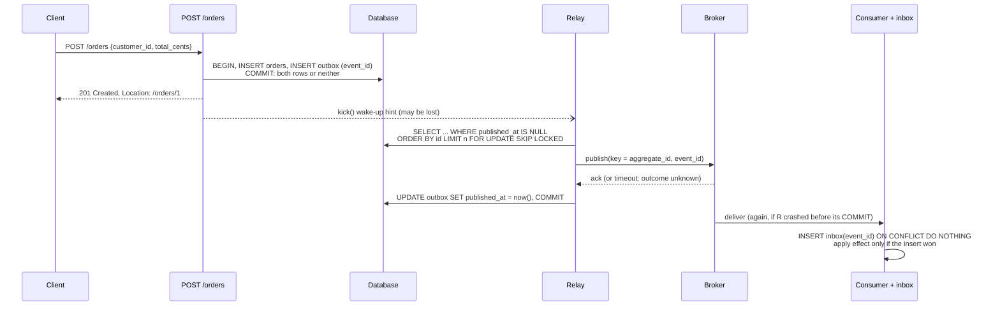

# The Dual-Write Problem and the Transactional Outbox Pattern: Atomic State + Event Persistence in One Database Commit

> [!summary] Claim
> A handler that commits a row and publishes an event as two operations has two failure windows that no ordering closes (a crash after `COMMIT` loses the event, a failed `COMMIT` after the publish invents one), so write the event as an outbox row in the same transaction and let a relay publish it later: the relay is at-least-once, so consumers deduplicate by event id, and it must read in commit order, not id order, or it skips events forever.

Part of [Database Access and Transactions for APIs](README.md) in [API Engineering](../README.md).

## TL;DR

- Mechanism: `INSERT INTO orders` and `INSERT INTO outbox` share one transaction, so the database's own atomicity decides both; a relay (a polling publisher, or a change-data-capture reader of the write-ahead log) copies committed outbox rows to the broker and marks or deletes them afterwards.
- Contract rule: the event is published if and only if the transaction commits, at least once, in per-aggregate order; every event carries a stable `event_id` that the relay reuses on every retry and the consumer records in an inbox before applying the effect.
- Trap: a relay that remembers "the highest `id` I have sent" skips events, because identity values are assigned at `INSERT` time and commit in a different order; on PostgreSQL 18.7 id `1` committed after id `2` and a watermark relay never sent it, while a `published_at IS NULL` scan or an `xid8` fence on `pg_snapshot_xmin(pg_current_snapshot())` did.
- Portability: the lab passes 14 of 14 on CPython 3.14.6 with SQLAlchemy 2.1.8 and SQLite 3.53.1; SQLite has no `FOR UPDATE` (SQLAlchemy's `SQLiteCompiler.for_update_clause` returns `""`), so `SKIP LOCKED` relay concurrency, commit-order gaps, `NOTIFY`, and logical decoding were measured on PostgreSQL 18.7 instead.
- When not to use it: skip the outbox when the broker or log is the system of record (append there first and derive the database from it), when the side effect must succeed before the response (call it synchronously with an idempotency key), or when nothing downstream needs the event.

## Mental model



The handler never talks to the broker: its only write is one database transaction, so the only failure it can observe is the one the database already makes atomic.
The `201` goes out after `COMMIT`, which is the moment the event becomes durable, even though nobody has published it yet.
The relay runs on its own schedule, woken early by a hint from the handler and otherwise by a timer, claims unpublished rows in `id` order, publishes each with the aggregate id as the partition key, and only then commits the `published_at` mark.
That order (publish, then mark) is what makes delivery at-least-once rather than at-most-once: a crash or a lost acknowledgement between the publish and the mark leaves the row unpublished, and the next drain sends it again with the same `event_id`.
The consumer turns at-least-once into exactly-once effects by recording `event_id` in its own database in the same transaction as the effect.

## How it works

### The dual-write problem

A dual write is any request path that changes two systems that share no transaction, for example a database and a message broker.
Kleppmann, Beresford, and Svingen name two failure classes for the database-plus-search-index case: "Non-atomic writes. If a failure occurs, a record may be written to one of the systems but not the other", and "Different order of writes", where two concurrent updates `A` and `B` are applied as `A, B` by one system and `B, A` by the other, so "the systems may disagree on which write was the latest" (Communications of the ACM 62(5), May 2019, "Online Event Processing").
AWS's prescriptive guidance states the same two outcomes for a database and a broker: if the update succeeds and the notification fails, "the downstream service will not be aware of the change", and if the update fails but the notification is sent, "data could get corrupted" (AWS Prescriptive Guidance, Transactional outbox pattern, Motivation).

Neither order of the two calls is safe, and the lab proves each with a real failure, not a mock:
- Database first, then publish (`create_order_publish_after_commit`): after `COMMIT` the order is durable; a process kill before `publish` returns leaves an order nobody hears about.
  The lab's `test_publish_after_commit_loses_event_on_crash` asserts `1` order row and an empty broker.
- Publish first, then commit (`create_order_publish_before_commit`): the event is out before the database has decided.
  The lab makes `orders.customer_id` a `DEFERRABLE INITIALLY DEFERRED` foreign key, so an unknown customer passes `INSERT` and `flush()` and fails only at `COMMIT` with `IntegrityError: FOREIGN KEY constraint failed`; `test_publish_before_commit_emits_phantom_event_when_commit_fails` asserts `0` orders and `1` published `OrderCreated` with payload `{"customer_id":999,"order_id":1,"total_cents":500}`.
- Commit-time failures are not exotic: deferred constraints, `SERIALIZABLE` serialization failures reported at `COMMIT` (see [[Transaction-Isolation-Levels-and-Concurrency-Anomalies-in-APIs]]), disk-full, and a connection that drops while `COMMIT` is in flight all surface only at the last step.
- A third window sits inside the publish itself: a timeout means the broker may or may not have stored the message.
  The lab models it with `InMemoryBroker(lose_ack_event_ids=...)`, which stores the message and then raises; a handler cannot tell this from a refusal, so retrying duplicates and not retrying may lose.
  PostgreSQL has the same ambiguity for `COMMIT`; `pg_xact_status(xid8)` exists so that applications can "determine whether their transaction committed or aborted after the application and database server become disconnected while a `COMMIT` is in progress" (PostgreSQL 18 Section 9.27.8).

The textbook fix is a distributed transaction, and it is rarely available.
Kleppmann et al. note that XA "transactions block execution if the application process fails during the prepare phase" and that many target systems "do not support XA or any other heterogeneous transaction model".
Even inside PostgreSQL, two-phase commit and asynchronous signalling do not mix: "A transaction that has executed `NOTIFY` cannot be prepared for two-phase commit" (PostgreSQL 18 `NOTIFY`, Notes), and PostgreSQL 18.7 rejects it with `ERROR: cannot PREPARE a transaction that has executed LISTEN, UNLISTEN, or NOTIFY` (measured).
Kafka's design document makes the same point from the other side: when a consumer writes to an external system, the limitation is coordinating the consumer's position with what is stored as output, two-phase commit is the classic answer, and many systems do not support it, so it suggests storing the offset in the same place as the output (Apache Kafka 4.2 Design, Message Delivery Semantics).

### Things that look like fixes and are not

- `SessionEvents.after_commit`: runs after the commit, so it is the same "database first" dual write with the same crash window, and the hook cannot even record that it failed: "The `Session` is not in an active transaction when the `after_commit` event is invoked, and therefore can not emit SQL" (sqlalchemy 2.1.8 lib/sqlalchemy/orm/events.py, SessionEvents.after_commit).
- FastAPI `BackgroundTasks`: Starlette runs them in the same process after the response body is sent (`await send(...)` for `http.response.start` and `http.response.body`, then `if self.background is not None: await self.background()` in starlette 1.10.0 starlette/responses.py, Response.__call__), and `BackgroundTasks.__call__` awaits each task in sequence (starlette 1.10.0 starlette/background.py, BackgroundTasks.__call__); nothing is persisted, so a deploy, an OOM kill, or a crash after the `201` drops the task.
- Retrying the publish inside the handler: it narrows the window but keeps it (the process can still die between `COMMIT` and the first successful attempt), adds request latency, and creates duplicates whenever an ack was lost.
- Publishing before `COMMIT` "but compensating on failure": the compensation is itself a second dual write, and consumers may already have acted on the phantom.
- A broker with transactions: Kafka's transactional producer makes writes to several partitions atomic with each other ("send messages atomically to multiple topic partitions"), not with your database (Apache Kafka 4.2 Design, Message Delivery Semantics).

### The outbox: one transaction, two rows

The pattern's statement is short: the service stores the message in the database "as part of the transaction that updates the business entities", and a separate process sends it to the broker, so "Messages are guaranteed to be sent if and only if the database transaction commits" (microservices.io, Pattern: Transactional outbox, Solution and Resulting context).
The same page lists the costs: "The Message relay might publish a message more than once", so consumers must be idempotent, and the pattern is "Potentially error prone since the developer might forget to publish the message/event after updating the database".
The lab's `create_order_with_outbox` runs both inserts inside one `async with session.begin()` block, flushing once so the generated `order.id` can go into the event; `test_outbox_commit_failure_persists_neither_state_nor_event` asserts `0` orders and `0` outbox rows after the same deferred-key failure that produced a phantom event above.

The row layout that tools expect is close to universal.
Debezium's outbox event router assumes the columns `id` (`uuid`), `aggregatetype`, `aggregateid`, `type`, and `payload` (`jsonb`), routes by `route.by.field` = `aggregatetype` to the topic `route.topic.replacement` = `outbox.event.${routedByValue}`, uses `table.field.event.key` = `aggregateid` as the message key, and stores the event id "in the emitted event's headers under the `id` key", noting "You can use this ID, for example, to remove duplicate messages" (Debezium 3.7, Outbox Event Router).
The lab keeps an integer surrogate key `id` for ordering and a separate unique `event_id` (a UUID string) for deduplication; it adds relay bookkeeping (`published_at`, `attempts`, `last_error`) that a log-tailing relay does not need.
Using the aggregate id as the key gives per-aggregate ordering on a partitioned log: events for one aggregate "will go into the same partition of that Kafka topic" (Morling, Debezium blog, 2019-02-19).

### Relay option 1: the polling publisher

The lab's `OutboxRelay.drain_once` opens one transaction, claims up to `batch_size` rows with `claim_batch`, publishes each, sets `published_at`, and commits:
- The claim is `SELECT ... WHERE outbox.published_at IS NULL ORDER BY outbox.id LIMIT n FOR UPDATE SKIP LOCKED` on PostgreSQL, and the same text without the locking clause on SQLite, because `SQLiteCompiler.for_update_clause` returns `""` ("sqlite has no "FOR UPDATE" AFAICT") while `PGCompiler.for_update_clause` appends `NOWAIT` or `SKIP LOCKED` (sqlalchemy 2.1.8 lib/sqlalchemy/dialects/sqlite/base.py and lib/sqlalchemy/dialects/postgresql/base.py); `test_claim_query_locks_rows_on_postgresql_but_not_on_sqlite` pins both renderings.
- `SKIP LOCKED` is what lets several relays drain one table: "any selected rows that cannot be immediately locked are skipped ... this is not suitable for general purpose work, but can be used to avoid lock contention with multiple consumers accessing a queue-like table", and with `LIMIT` "locking stops once enough rows have been returned" (PostgreSQL 18 `SELECT`, The Locking Clause).
  On 18.7 two relays each claiming `LIMIT 5` from ten rows got ids `1-5` and `6-10` with no overlap, and `FOR UPDATE NOWAIT` on a claimed row failed with SQLSTATE `55P03` "could not obtain lock on row in relation "outbox"" (measured).
- Publish, then mark, in that order: `test_relay_crash_between_publish_and_mark_redelivers_and_consumer_dedups` crashes after the broker accepted the message, finds the row still unpublished (the mark rolled back with the transaction), and sees the next drain deliver the same `event_id` a second time; `test_lost_ack_counts_as_failure_and_is_redelivered` gets the same duplicate from a lost ack and asserts `attempts == 1` and the stored `last_error`.
- Marking versus deleting: the lab marks, which keeps an audit trail and needs a retention job; Brandur's staged-job drain deletes the batch it just enqueued (`StagedJob.where(Sequel.lit("id <= ?", jobs.last.id)).delete`) and states "At least once delivery semantics are guaranteed" (brandur.org, "Transactionally Staged Job Drains in Postgres", 2017-09-20), and the AWS sample deletes after `sendMessageBatch` returns (AWS Prescriptive Guidance, sample code).
- Failure isolation: a failed publish increments `attempts`, records `last_error`, and blocks only that row's aggregate for the rest of the batch; `test_failure_blocks_only_its_aggregate_and_preserves_per_key_order` makes `A1` fail once with `A1, B1, A2` queued and asserts the broker sees `B1`, then `A1, A2`.
  After `max_attempts` the row is parked and keeps holding its aggregate, so `A2` cannot overtake it (`test_poison_event_parks_after_max_attempts_and_holds_its_aggregate`: `attempts == 3` after five drains, and the broker was called for `A1` only three times).
- Cost: on 18.7 a single relay marked 10,000 rows in 100 batches of 100 in 169 ms (about 59,000 rows per second) using one CTE per batch, with no broker in the loop (measured once on loopback); in production the broker round trip, not the database, bounds the relay, which is why batch publishing (`sendMessageBatch` in the AWS sample, Kafka's batching producer) matters.

The relay holds its transaction, and therefore its row locks, while it waits for the broker.
That is the simplest correct design, but a slow broker turns into long transactions on the primary; the alternative is a lease (`UPDATE ... SET locked_until = now() + interval '30 s' ... RETURNING`, commit, publish, then mark in a second transaction), which shortens transactions at the price of a second write per event and a lease timeout that must exceed the worst publish latency (design trade-off, not measured here).

### The commit-order trap

An identity or sequence value is assigned when the row is inserted, not when its transaction commits.
PostgreSQL says only that "the value obtained by `nextval` is not reclaimed for re-use if the calling transaction later aborts", so "PostgreSQL sequence objects cannot be used to obtain "gapless" sequences" (PostgreSQL 18 Section 9.17); it promises nothing about commit order, and gaps are not the dangerous part.
The dangerous part is a relay that treats `max(id)` as a high-water mark.
Measured on 18.7 with `id bigint GENERATED ALWAYS AS IDENTITY`: transaction `A` inserted and received id `1` and stayed open, transaction `B` inserted id `2` and committed, a watermark relay read `[2]` and advanced to `2`, then `A` committed, and the next pass (`id > 2`) returned `[]`, so id `1` is skipped forever.
The lab reproduces the same schedule on SQLite with explicit ids (`test_watermark_relay_skips_event_committed_out_of_id_order`), because SQLite's single writer cannot produce it concurrently.
Three fixes, in order of preference:
- Scan for state, not position: `WHERE published_at IS NULL` (the lab's `OutboxRelay`) finds the late row on the next pass; on 18.7 it returned `[1, 2]` after `A` committed.
  The catch is ordering: the late row is published after a row with a higher id, which is harmless across aggregates and harmful only if one aggregate's events come from concurrent transactions (prevent that with a row lock on the aggregate, see [[Optimistic-vs-Pessimistic-Locking-Version-ID-Col-and-FOR-UPDATE-SKIP-LOCKED]]).
- Fence by transaction visibility: store `txid xid8 DEFAULT pg_current_xact_id()` and read only rows with `txid < pg_snapshot_xmin(pg_current_snapshot())`; `xmin` is the "Lowest transaction ID that was still active. All transaction IDs less than `xmin` are either committed and visible, or rolled back and dead" (PostgreSQL 18 Table 9.85).
  On 18.7, while `A` was open the snapshot read `xmin=753 xmax=755` and the fenced query returned `[]` (it held back the committed id `2` too), and after `A` committed it returned `[1, 2]` in order.
  The cost is head-of-line latency: one long-running transaction anywhere in the database holds back every event behind it.
- Read the log instead of the table (next section), where commit order is the decoding order by construction.

### Waking the relay: LISTEN/NOTIFY and in-process kicks

A timer alone trades latency for load; a wake-up hint removes most of the latency, and PostgreSQL's `NOTIFY` is transactional, which is exactly the property a hint needs:
- "if a `NOTIFY` is executed inside a transaction, the notify events are not delivered until and unless the transaction is committed", and "messages from different transactions are delivered in the order in which the transactions committed" (PostgreSQL 18 `NOTIFY`, Description).
  On 18.7 a listener received nothing after `ROLLBACK`, nothing before `COMMIT`, and exactly one `committed` after a transaction that sent the identical notification twice (the manual: identical channel and payload in one transaction are delivered once) (measured).
- The payload "must be shorter than 8000 bytes" in the default configuration, and a full queue (8 GB in a standard installation) makes "transactions calling `NOTIFY` ... fail at commit" (PostgreSQL 18 `NOTIFY`); on 18.7 `pg_notify('outbox', repeat('x', 8000))` failed with SQLSTATE `22023` "payload string too long" and `7999` bytes succeeded (measured).
  Never put the event in the payload: send nothing, or the id, and let the relay read the table.
- A notification is not a delivery guarantee: a relay that is restarting misses it, so the timer must stay as the backstop.

The lab's `RelayPoller` uses an in-process `asyncio.Event` as the hint, set by the endpoint after its transaction commits.
It clears the event before draining, not after, so a kick that lands during a drain is not lost; the `interval` bounds latency when no kick arrives.
`test_api_creates_order_and_outbox_row_and_poller_publishes_on_kick` waits until the poller is asleep on a 30-second interval, posts an order, and requires delivery within 2 seconds, which only the kick can produce.

### Relay option 2: transaction log tailing (CDC)

A log-tailing relay reads the database's write-ahead log through logical decoding instead of querying the table:
- Order and atomicity come from the log: "Concurrent transactions are decoded in commit order ... Transactions that were rolled back explicitly or implicitly never get decoded" (PostgreSQL 18 Section 47.6.4).
  On 18.7 with `test_decoding`, transaction `762` began first and committed last and was decoded after `763`, and a `pg_logical_emit_message(true, 'outbox', 'rolled back')` inside a rolled-back transaction never appeared (measured).
- Delivery is still at-least-once: "The current position of each slot is persisted only at checkpoint, so in the case of a crash the slot might return to an earlier LSN, which will then cause recent changes to be sent again when the server restarts. Logical decoding clients are responsible for avoiding ill effects from handling the same message more than once" (PostgreSQL 18 Section 47.2.2).
  Debezium says the same of its connector: while recovering from a fault "it's possible that the connector might emit some duplicate change events", so consumers should "always anticipate some duplicate events" (Debezium 3.7, PostgreSQL connector).
- A slot retains WAL until its consumer confirms it: "Replication slots persist across crashes and know nothing about the state of their consumer(s). They will prevent removal of required resources even when there is no connection using them" (PostgreSQL 18 Section 47.2.2).
  On 18.7 a freshly created, inactive slot's lag grew from 336 bytes to 26,486,576 bytes after 100,000 inserts of an `int` and a 200-byte `text` and a `CHECKPOINT`, with `wal_status = reserved` (measured), and `max_slot_wal_keep_size` defaults to `-1`, meaning "replication slots may retain an unlimited amount of WAL files", while `idle_replication_slot_timeout` defaults to `0` (disabled) (PostgreSQL 18 Section 19.6).
- With CDC the outbox table can stay empty: Morling's Debezium design inserts the outbox row and deletes it in the same transaction, so "when looking at the contents of the table itself, it will always be empty" while the log still carries the insert; the event router drops `DELETE` events and treats the table as a queue where "updates to records in an outbox table are not allowed" (Debezium 3.7, Outbox Event Router).
- PostgreSQL can skip the table entirely: `pg_logical_emit_message(transactional, prefix, message)` writes a message into WAL that, when `transactional` is true, is "part of the current transaction" (PostgreSQL 18 Section 9.28.6); the measured run above used exactly this, and the trade-off is that the event is invisible to SQL, so you cannot query, replay, or repair it from the table.

### Broker and consumer: where exactly-once actually lives

The broker side removes some duplicates and never all:
- Kafka's idempotent producer, on by default (`enable.idempotence = true`, which requires `acks = all`, `retries > 0`, and `max.in.flight.requests.per.connection <= 5`), ensures "exactly one copy of each message is written in the stream" for the producer's own retries; the broker "assigns each producer an ID and deduplicates messages using a sequence number" (Apache Kafka 4.2 producer configs and Design).
  A relay that crashes before its mark and restarts is a new send of the same record, so that deduplication does not cover it (design inference from the documented mechanism, not measured).
- Amazon SQS FIFO deduplicates on `MessageDeduplicationId` within "a 5-minute deduplication window" (Amazon SQS Developer Guide); the AWS sample sets it to the outbox id, which covers relay restarts shorter than five minutes and nothing longer.

Exactly-once effects therefore belong to the consumer.
CloudEvents requires `id` and says "Producers MUST ensure that `source` + `id` is unique for each distinct event" and "Consumers MAY assume that Events with identical `source` and `id` are duplicates" (CloudEvents 1.0.3-wip, `id`); Standard Webhooks keeps `webhook-id` the same across retries and tells receivers to "Use the `webhook-id` header as an idempotency key" (Standard Webhooks specification).
The lab's `IdempotentConsumer` keeps the seen set in memory; a real consumer inserts `event_id` into an inbox table with `ON CONFLICT DO NOTHING` in the same transaction as its effect, which is the outbox pattern mirrored (see [[Idempotent-Event-Consumers-Inbox-Pattern-and-Poison-Message-DLQs]] and [[High-Throughput-Bulk-Writes-Upserts-and-RETURNING-in-SQLAlchemy-2-x]]).
That is Kafka's own advice for external systems, storing the position "in the same place as its output".

### Ordering guarantees, precisely

- Per aggregate, not global: the lab orders by `id` and blocks an aggregate behind its first failure; a partitioned broker keyed by aggregate id preserves that order per partition.
- Several relays with `SKIP LOCKED` break even per-aggregate order: on 18.7 relay 1 claimed `(1, o1), (2, o0), (3, o1), (4, o0), (5, o1)` and relay 2 claimed `(6, o0), (7, o1), ...` (measured), so relay 2 can publish `o1`'s seventh event before relay 1 publishes its third.
  Keep one active relay per ordering domain: a leader holding `pg_try_advisory_lock(key)`, which returns `false` "without waiting if the lock cannot be acquired immediately" (PostgreSQL 18 Section 9.28.10), or relays that each own `hash(aggregate_id) % N`.
- The `ORDER BY` itself can lie under concurrent updates: at `READ COMMITTED` a locking `SELECT` "using `ORDER BY` and a locking clause" can "return rows out of order" when the ordering column changed while it waited (PostgreSQL 18 `SELECT`, Caution); outbox `id` never changes, so ordering by it is safe.

### The SQLAlchemy transaction boundary, and a SQLite trap it exposed

`create_order_with_outbox` uses `async with session.begin():`, so `COMMIT` runs when the block exits and any exception, including one raised by `COMMIT`, rolls the transaction back.
The sessions are built with `expire_on_commit=False` so that `order.id` can be read after the commit without a lazy refresh (see [[Session-Internals-Identity-Map-Unit-of-Work-Flush-and-Expire-On-Commit]] and [[Request-Scoped-Transaction-Patterns-Commit-As-You-Go-vs-Unit-of-Work]]).
While building the lab, an explicit `await session.commit()` that failed on the deferred key, followed by leaving the `async with sessions()` block without `rollback()`, left SQLite's transaction open on the pooled connection:
- SQLite documents the cause: "COMMIT will fail as long as foreign key constraints remain in violation", and in its example, after the failed `COMMIT`, "The transaction remains open" (SQLite, Foreign Key Support, Section 4.2).
- SQLAlchemy marks the root transaction inactive when the DBAPI `commit()` raises but leaves it attached "so that a rollback needs to occur" (sqlalchemy 2.1.8 lib/sqlalchemy/engine/base.py, RootTransaction._do_commit); `RootTransaction._close_impl` only calls `_connection_rollback_impl()` when `is_active`, and `Connection.close` then checks the connection in with `_close_special(transaction_reset=True)`, so the pool takes its `transaction_was_reset` branch (logged as "Connection %s reset, transaction already reset" when pool echo is on) and skips its own rollback-on-return (same file, Connection.close; lib/sqlalchemy/pool/base.py, _ConnectionFairy._close_special and _ConnectionFairy._reset).
- Result, pinned by `test_sqlite_failed_commit_without_rollback_leaks_rows_into_a_later_commit`: the next request on that connection saw the uncommitted order, and when it committed an unrelated `Customer` row, the rejected order committed with it (`orders_after == 1`); with `await session.rollback()` after the failure, or with `session.begin()`, it stayed `0`.
- PostgreSQL does not keep a failed transaction open: on 18.7 the same deferred-key `COMMIT` failed with "insert or update on table "o" violates foreign key constraint "o_cid_fkey"" and a following `SELECT count(*)` returned `0` (measured), so this leak is SQLite-specific; the stdlib alone shows the SQLite half (after the failed `commit()`, `sqlite3.Connection.in_transaction` is still `True`, and a later `commit()` persists the rejected row, CPython 3.14.6, SQLite 3.53.1, measured), and GitHub issue searches of `sqlalchemy/sqlalchemy` on 2026-11-15 ("failed commit", "deferred sqlite", "transaction already reset") found no report of the pool half.

### The HTTP contract

- Respond `201 Created` with `Location` after `COMMIT`: `201` means "the request has been fulfilled and has resulted in one or more new resources being created", identified by `Location` (RFC 9110 Section 15.3.2, Section 10.2.2); the order exists, and the event is a consequence, not part of the response.
- If the client cares about the downstream effect rather than the row, `202 Accepted` is the honest status: the request "has been accepted for processing, but the processing has not been completed", and "There is no facility in HTTP for re-sending a status code from an asynchronous operation" (RFC 9110 Section 15.3.3), so give the client a status resource to poll.
- The lab maps the commit-time `IntegrityError` to `422 Unprocessable Content`, which RFC 9110 defines for content whose syntax is correct but whose instructions the server "was unable to process" (RFC 9110 Section 15.5.21); `test_api_commit_failure_returns_422_and_writes_nothing` asserts no order and no outbox row.
- `POST` is not idempotent (RFC 9110 Section 9.2.2), so a client retry after a timeout can create a second order and a second event with a new `event_id`; deduplicating that needs an `Idempotency-Key` stored in the same transaction as the order and the outbox row (see [[Idempotency-Key-Header-Specification-and-State-Machine-Draft-08]]).

## Numbers and limits

Measured rows ran once on an Apple M3 Pro, macOS 27.3, against a throwaway PostgreSQL 18.7 (Homebrew) cluster on `127.0.0.1` with `wal_level = logical`, driven by `asyncpg 0.32.0` and `psql` on CPython 3.14.6 (one-off probes, not part of the lab; every PostgreSQL row was re-run in an independent verify pass on 2026-11-15 on a fresh `initdb` cluster, and two numbers changed: slot lag and relay throughput).

| Quantity | Value | Source |
|---|---|---|
| Commit-order skip by an `id` watermark | id `1` committed after id `2`; watermark `2`; next pass `[]` | measured 2026-11-15 |
| `xid8` fence while the older transaction was open | snapshot `xmin=753 xmax=755`; fenced read `[]`; after commit `[1, 2]` | measured 2026-11-15 |
| Two `SKIP LOCKED` relays, `LIMIT 5` over 10 rows | ids `1-5` and `6-10`, no overlap; aggregates interleaved across relays | measured 2026-11-15 |
| `FOR UPDATE NOWAIT` on a claimed row | SQLSTATE `55P03` | measured 2026-11-15 |
| `NOTIFY` payload limit | `< 8000` bytes; `8000` -> SQLSTATE `22023` "payload string too long", `7999` accepted | PostgreSQL 18 `NOTIFY`; measured |
| `NOTIFY` queue size | 8 GB in a standard installation; full queue fails `NOTIFY` transactions at commit | PostgreSQL 18 `NOTIFY` |
| `PREPARE TRANSACTION` after `NOTIFY` | rejected ("cannot PREPARE a transaction that has executed LISTEN, UNLISTEN, or NOTIFY") | PostgreSQL 18 `NOTIFY`; measured with `max_prepared_transactions = 2` |
| Inactive logical slot WAL retention | lag `336` -> `26,486,576` bytes after 100,000 inserts of an `int` plus a 200-byte `text` and `CHECKPOINT`; `wal_status = reserved` | measured 2026-11-15 |
| `max_slot_wal_keep_size` default | `-1` (unlimited WAL retained by slots) | PostgreSQL 18 Section 19.6 |
| `idle_replication_slot_timeout` default | `0` (disabled) | PostgreSQL 18 Section 19.6 |
| `max_replication_slots` default | `10` | PostgreSQL 18 Section 19.6 |
| Single relay, no broker, 10,000 rows | 100 batches of 100, 169 ms, about 59,000 rows/s | measured once 2026-11-15 |
| Kafka idempotent producer defaults | `enable.idempotence = true`, `acks = all`, `max.in.flight.requests.per.connection = 5`, `retries = 2147483647`, `delivery.timeout.ms = 120000` | Apache Kafka 4.2 producer configs |
| SQS FIFO deduplication window | 5 minutes per `MessageDeduplicationId` | Amazon SQS Developer Guide (as of 2026-11) |
| Debezium outbox defaults | key `aggregateid`, route `aggregatetype` -> `outbox.event.${routedByValue}`, event id header `id` | Debezium 3.7 Outbox Event Router (as of 2026-11) |
| Lab runtime | 14 tests in 1.57 s (CPython 3.14.6, SQLite 3.53.1) | measured 2026-11-15 |

The PostgreSQL rows are single runs on loopback; they show mechanisms (who sees what, and when), and the throughput row is an upper bound for the database half of a relay, not a benchmark of a relay with a broker.

## Portability

| Runtime / component | Version / target | Behavior and verification status |
|---|---|---|
| CPython `3.14` | `3.14.6` (workspace venv) | Proven by lab (`uv run --frozen pytest <test> -q`: `14 passed in 1.57s`) |
| CPython `3.12`, `3.13`, `3.14.10`, `3.15`, `3.15t` | `3.12.13`, `3.13.18`, `3.14.10`, `3.15.2`, `3.15.0b3` free-threaded are installed here (`uv python list --only-installed`) | Not run: lab checks were paused on 2026-11-11 (the lab runs at most once per draft); the contract pins `3.12.16` and `3.15.2t` are not installed; no claim is made for these interpreters |
| SQLAlchemy | `2.1.8` | Proven by lab; `claim_batch` is annotated `Select[OutboxEvent]`, the 2.1 variadic form, so the `2.0.57` leg (`Select[tuple[OutboxEvent]]`) would need a different annotation and was not run |
| SQLite | `3.53.1` | Proven by lab: deferred foreign keys fail at `COMMIT` and leave the transaction open; no `FOR UPDATE` (SQLAlchemy renders nothing) |
| PostgreSQL | `18.7` | Commit-order skip, `xid8` fence, `SKIP LOCKED`, `NOTIFY`, logical decoding, slot retention, and failed-commit rollback measured by probe; not part of the lab |
| MySQL, SQL Server, Oracle | - | Not run and not cited; `SKIP LOCKED`, `NOTIFY`, and logical decoding are PostgreSQL facts in this note |
| Kafka, SQS, Debezium | Kafka 4.2 docs, SQS docs, Debezium 3.7 docs | Cited from documentation; no broker or connector was run |
| ASGI servers (Uvicorn, Hypercorn, Granian) | `0.54.0`, `0.18.0`, `2.8.7` | Not run: the lab uses `httpx.ASGITransport`; the outbox decision happens inside the database transaction, so the server only frames the `201` or `422` (design inference) |
| HTTP/1.1, HTTP/2, HTTP/3 | - | Not applicable: the pattern is independent of the HTTP version; status semantics cite RFC 9110 |
| Container environments | Debian Trixie, Alpine musl libc | Not run; no claim is made for them |

## Worked example

The lab [implementation](../labs/src/api_labs/f13_database_access_and_transactions_for_apis/transactional_outbox.py) has the two naive dual-write handlers, the outbox handler, a polling `OutboxRelay` with per-aggregate failure isolation, the broken `WatermarkRelay`, an `asyncio` `RelayPoller` with wake-up kicks, an `IdempotentConsumer`, and a FastAPI `POST /orders` endpoint, all on SQLAlchemy 2.1.8 async over `aiosqlite`.
The [test](../labs/tests/f13_database_access_and_transactions_for_apis/test_transactional_outbox_pattern_solving_dual_writes_between_db_and_events.py) drives each failure window with a real commit-time failure (a deferred foreign key), an injected crash, or a broker fault.

The broker-first dual write and the outbox handler, side by side (excerpt, verbatim lines 199-236 of `transactional_outbox.py`):

```python
async def create_order_publish_before_commit(
    sessions: async_sessionmaker[AsyncSession],
    broker: Broker,
    customer_id: int,
    total_cents: int,
) -> int:
    """Dual write, broker first: a failed COMMIT leaves a phantom event."""
    async with sessions() as session, session.begin():  # COMMIT runs on block exit
        order = Order(customer_id=customer_id, total_cents=total_cents)
        session.add(order)
        await session.flush()  # assigns order.id; the deferred FK is not checked yet
        await broker.publish(order_message(order, str(uuid.uuid4())))
    return order.id  # unreachable for an unknown customer: COMMIT raised IntegrityError


async def create_order_with_outbox(
    session: AsyncSession,
    customer_id: int,
    total_cents: int,
    now: Callable[[], datetime] = utc_now,
) -> tuple[int, str]:
    """State change and event in one transaction: both commit or neither does."""
    async with session.begin():
        order = Order(customer_id=customer_id, total_cents=total_cents)
        session.add(order)
        await session.flush()
        message = order_message(order, str(uuid.uuid4()))
        session.add(
            OutboxEvent(
                event_id=message.event_id,
                aggregate_type="order",
                aggregate_id=message.key,
                event_type=message.event_type,
                payload=message.payload.decode(),
                created_at=now(),
            )
        )
    return order.id, message.event_id
```

The relay: claim, publish, then mark, with failure isolation per aggregate (excerpt, verbatim lines 278-302 of `transactional_outbox.py`):

```python
    async def drain_once(self) -> DrainResult:
        published: list[str] = []
        failed: list[str] = []
        blocked: set[str] = set()
        async with self.sessions() as session, session.begin():
            rows = (await session.scalars(claim_batch(self.batch_size))).all()
            for row in rows:
                if row.aggregate_id in blocked:
                    continue
                if row.attempts >= self.max_attempts:
                    blocked.add(row.aggregate_id)  # parked: needs an operator
                    continue
                try:
                    await self.broker.publish(to_message(row))
                except BrokerUnavailableError as exc:
                    row.attempts += 1
                    row.last_error = str(exc)
                    failed.append(row.event_id)
                    blocked.add(row.aggregate_id)
                    continue
                if self.crash_at is CrashPoint.AFTER_PUBLISH_BEFORE_MARK:
                    raise ProcessCrashError(self.crash_at.value)
                row.published_at = self.now()
                published.append(row.event_id)
        return DrainResult(published, failed, sorted(blocked))
```

The commit-order trap as a test (excerpt, verbatim lines 243-258 of the test module):

```python
@pytest.mark.unit
@pytest.mark.asyncio
async def test_watermark_relay_skips_event_committed_out_of_id_order(
    sessions: async_sessionmaker[AsyncSession],
) -> None:
    broker = InMemoryBroker()
    watermark = WatermarkRelay(sessions, broker)
    # PostgreSQL hands out id 1 to a transaction that commits after id 2 has committed.
    second = await add_event(sessions, "B", row_id=2)
    assert await watermark.drain_once() == [second]
    late = await add_event(sessions, "A", row_id=1)
    assert await watermark.drain_once() == []  # id 1 < watermark 2: skipped forever
    assert watermark.last_id == 2

    scanning = OutboxRelay(sessions, InMemoryBroker())
    assert (await scanning.drain_once()).published == [late, second]
```

Captured run, from `labs/`, on CPython 3.14.6, SQLAlchemy 2.1.8, SQLite 3.53.1, macOS 27.3 arm64 (Apple M3 Pro), 2026-11-15:

```text
$ uv run --frozen pytest tests/f13_database_access_and_transactions_for_apis/test_transactional_outbox_pattern_solving_dual_writes_between_db_and_events.py -q
..............                                                           [100%]
14 passed in 1.57s
```

## Pitfalls

No primary-source postmortem that names the dual-write or outbox failure was found while drafting; the callouts below cite specifications and measurements from this note instead of incidents.

> [!warning] A high-water-mark relay silently skips events
> Trigger: the relay stores `last_id` and polls `WHERE id > :last_id`, while handlers commit concurrently.
> Symptom: rare, permanent event loss with no error, concentrated under load, when insert order and commit order diverge; on PostgreSQL 18.7 id `1` committed after id `2` was never read.
> Fix: poll `WHERE published_at IS NULL`, or fence with an `xid8` column and `pg_snapshot_xmin(pg_current_snapshot())`, or tail the WAL, where decoding follows commit order (PostgreSQL 18 Section 47.6.4).

> [!warning] Publishing from `after_commit`, `BackgroundTasks`, or the handler
> Trigger: the event is sent after `COMMIT` by in-process code.
> Symptom: orders with no `OrderCreated` after deploys, OOM kills, or broker outages, and no record of what was missed; `after_commit` cannot even write a retry row because the session "can not emit SQL" there.
> Fix: insert the outbox row inside the transaction; keep in-process signalling only as a wake-up hint.

> [!warning] Parked rows fill the batch
> Trigger: poison events stay `published_at IS NULL` forever and the claim query uses `ORDER BY id LIMIT n`.
> Symptom: once `n` parked rows sit at the head of the table, every drain claims only them and the relay stops making progress for every aggregate; the lab's relay has this limit by design.
> Fix: move parked rows to a dead-letter table (with the aggregate held by a separate marker), alert on `attempts >= max_attempts`, and expose a requeue operation.

> [!warning] An abandoned replication slot fills the disk
> Trigger: a CDC connector is stopped, deleted, or failing, but its logical slot remains.
> Symptom: `pg_wal` grows without bound (`26,486,576` bytes of lag after 100,000 small inserts in the probe), because `max_slot_wal_keep_size` defaults to `-1`; the manual adds that required catalog rows cannot be vacuumed either, which "In extreme cases ... could cause the database to shut down to prevent transaction ID wraparound" (PostgreSQL 18 Section 47.2.2).
> Fix: monitor `pg_replication_slots` (`active`, `wal_status`, `pg_wal_lsn_diff(pg_current_wal_lsn(), restart_lsn)`), set `max_slot_wal_keep_size` and `idle_replication_slot_timeout`, and drop slots you no longer consume; when the captured tables see little traffic compared with the rest of the database, Debezium recommends `heartbeat.interval.ms` and `heartbeat.action.query` to keep the slot advancing (Debezium 3.7, PostgreSQL connector).

> [!warning] Several relays reorder one aggregate
> Trigger: horizontal scaling of the relay with `FOR UPDATE SKIP LOCKED`.
> Symptom: consumers see `OrderShipped` before `OrderPaid` for the same order, because two relays claimed interleaved ids (measured on 18.7).
> Fix: one leader per ordering domain via `pg_try_advisory_lock`, or shard relays by `hash(aggregate_id)`, and make consumers reject or buffer out-of-order versions.

> [!warning] A failed SQLite `COMMIT` without `rollback()` commits later
> Trigger: SQLite with a deferred constraint, an explicit `await session.commit()` that raises, and no `rollback()` before the session closes.
> Symptom: the next unrelated request on that pooled connection commits the rejected rows (`orders_after == 1` in the lab), because SQLite keeps the failed transaction open and SQLAlchemy 2.1.8 skips the pool's rollback-on-return for it.
> Fix: use `async with session.begin():`, or always `await session.rollback()` in the `except` path; never rely on `close()` to clean up after a failed commit.

> [!warning] The event schema is an API nobody versioned
> Trigger: the outbox payload is the ORM row serialized as it is today.
> Symptom: a column rename breaks every consumer, and old events in the topic no longer parse; Morling lists event structure changes needing compatibility care among the pattern's costs (Debezium blog, 2019-02-19).
> Fix: an explicit event contract (CloudEvents envelope, versioned `type`, a schema registry), see [[CloudEvents-1-0-2-Envelope-Structured-vs-Binary-Content-Modes-and-Schema-Registries]].

## Security and robustness

- The outbox is a data export: everything in `payload` leaves the service boundary and lives as long as the topic retains it, so include identifiers and the fields consumers need, not the whole row, and treat retention and erasure of personal data in topics as a design input.
- Webhook relays are SSRF engines: when the outbox feeds customer-registered webhook URLs, the relay fetches attacker-chosen URLs from inside your network, which OWASP lists under API7:2023 Server Side Request Forgery with webhooks as a named source; its prevention list includes isolating the fetching mechanism, allow lists of origins, schemes, and ports, "Disable HTTP redirections", and "Use a well-tested and maintained URL parser" (OWASP API Security Top 10 2023, API7); Standard Webhooks adds routing through a filtering proxy and keeping webhook workers in a subnet without access to internal services (see [[Preventing-SSRF-API7-2023-DNS-Pinning-and-Private-CIDR-Socket-Guards]] and [[Webhook-Sender-Architecture-Standard-Webhooks-Signatures-and-Fan-Out]]).
- Sign and timestamp what you send: Standard Webhooks signs `msg_id.timestamp.payload` with HMAC-SHA256 (`v1,` prefix, base64) and asks receivers to reject timestamps outside a tolerance to prevent replay; reuse the outbox `event_id` as `webhook-id` so the signature and the idempotency key name the same event.
- Topic routing from row data: Debezium's router derives the topic from `aggregatetype`, so that column must come from code, never from request input, or a client can steer events into another topic (design inference from `route.by.field`).
- Bound the consumer's dedup state: an inbox keyed by attacker-influenced ids grows without limit; key it by a producer-controlled `event_id`, and size its retention to the longest redelivery window you accept (relay restart, slot replay, retry schedule), since Standard Webhooks' example schedule alone spans more than 75 hours.
- Least privilege for the relay: the polling relay needs `SELECT` and `UPDATE` on the outbox table only; the locking clause also "requires `UPDATE` privilege" (PostgreSQL 18 `SELECT`, Description); a CDC connector needs replication rights, which see every table in the publication, so scope the publication to the outbox table rather than the default `publication.autocreate.mode = all_tables` (Debezium 3.7, PostgreSQL connector).
- Poison and oversize events: cap payload size at insert time (a `CHECK` constraint), cap `attempts`, and alert on parked rows; never let one bad event hold the whole relay.

## The principal's view

The decision is not "outbox or not" but "which store is the source of truth for this fact, and how do others learn about it".
If the relational database is the system of record, the outbox is the cheapest correct answer: it reuses the one transaction you already trust, needs no new infrastructure for the polling variant, and fails safe (late, duplicated, never lost or invented).
Log tailing (Debezium or native logical decoding) is the right upgrade when event volume or latency makes polling expensive, or when many services need the same discipline, because it removes the relay's queries and gives commit order for free; the price is an operational component that can fill the primary's disk and a replication-privileged reader of your WAL.
CDC on the domain tables themselves, without an outbox, couples consumers to your schema; the outbox exists precisely so that the event is a published contract and the tables stay private.
If the log is the system of record, invert the flow: append to the log and derive the database from it, which is Kleppmann's online event processing, or event sourcing, which microservices.io lists as the alternative solution.
Choose a different tool when the downstream effect must be confirmed before you answer (call it synchronously with an idempotency key and a timeout budget), or when the workflow spans several services with compensations (a saga, whose steps each use an outbox).
Organizationally, the outbox moves work from producers to consumers: every consumer team must build an inbox and accept at-least-once and per-key ordering, so publish those guarantees as part of the event contract, own the relay as platform infrastructure with SLOs on lag (oldest unpublished `created_at`) and parked-row count, and treat event schemas as versioned APIs reviewed like HTTP endpoints.

## Interview questions

> [!question] L5: Why can't you fix a dual write by publishing to Kafka right after `session.commit()` and retrying until it succeeds?
>
> > [!success]- Answer
> > The process can die between `COMMIT` and the first successful publish, and then the order exists with no event and nothing records that it is missing.
> > Retrying also duplicates events whenever an acknowledgement was lost after the broker stored the message.
> > The fix is to make the event durable in the same commit as the state, as an outbox row, and publish from that row.
> >
> > Follow-up: What does the outbox guarantee, and what does it not?

> [!question] L5: In the outbox pattern, why does the relay publish first and mark second, and what does that imply for consumers?
>
> > [!success]- Answer
> > Marking first would make a crash between mark and publish lose the event, which is at-most-once.
> > Publishing first means a crash or lost ack between publish and mark republishes the row, which is at-least-once.
> > Consumers must therefore deduplicate by a stable `event_id`, ideally by inserting it into an inbox table in the same transaction as their effect.
> >
> > Follow-up: Does Kafka's idempotent producer remove these duplicates?

> [!question] L6 (predict the output): Transaction A inserts an outbox row and gets `id = 1` but stays open, B inserts `id = 2` and commits, a relay polls `WHERE id > :last_id`, publishes, and sets `last_id`, and then A commits and the relay polls again: what does the second poll return?
>
> > [!success]- Answer
> > Nothing: the first poll saw only `2` and set `last_id = 2`, and the second poll asks for `id > 2`, so id `1` is skipped forever.
> > Identity values are assigned at insert time and commit in another order; PostgreSQL 18.7 reproduced exactly this.
> > Poll `WHERE published_at IS NULL`, fence on `pg_snapshot_xmin(pg_current_snapshot())`, or read the WAL in commit order.
> >
> > Follow-up: What latency cost does the `xmin` fence impose, and when does it hurt?

> [!question] L6 (debug this API): Why do orders that a FastAPI service on SQLite rejected with `422` (it catches `IntegrityError` from `await session.commit()` and closes the session) start appearing in the database days later?
>
> > [!success]- Answer
> > A deferred foreign key fails at `COMMIT`, and SQLite keeps the transaction open after a failed `COMMIT`.
> > SQLAlchemy 2.1.8 marks the transaction inactive and, on close, skips the pool's rollback-on-return, so the open transaction rides along to the next checkout.
> > The next request that commits on that connection commits the rejected rows with its own.
> > Use `async with session.begin():` or call `await session.rollback()` in the `except` path.
> >
> > Follow-up: Why does the same code not leak on PostgreSQL?

> [!question] L6: You scale the polling relay to four replicas with `FOR UPDATE SKIP LOCKED`, so what breaks, and how do you fix it?
>
> > [!success]- Answer
> > Throughput scales, but per-aggregate order breaks: replicas claim interleaved id ranges, so two events of one aggregate can be published by different replicas in either order.
> > Keep one active relay per ordering domain, either a leader elected with `pg_try_advisory_lock`, or replicas that each own `hash(aggregate_id) % N`.
> > Consumers should still check an aggregate version, because ordering in the outbox is only as good as ordering of the transactions that wrote it.
> >
> > Follow-up: How would you detect reordering in production?

> [!question] L6: Polling or log tailing for the relay: how do you choose?
>
> > [!success]- Answer
> > Polling needs nothing but SQL, is easy to debug, and costs queries and some latency; it must avoid the commit-order trap and needs a retention job.
> > Log tailing gets commit order and low latency for free and keeps the outbox table empty, but adds a connector to operate, needs logical decoding and replication privileges, and a stalled slot retains WAL without limit by default.
> > Choose polling for modest volume and small teams, log tailing when volume, latency, or the number of producing services justifies a platform component.
> >
> > Follow-up: What do you monitor for each to know the relay is healthy?

> [!question] L7+: What do you tell a product team that wants exactly-once event delivery end to end?
>
> > [!success]- Answer
> > Delivery across a database and a broker without a shared transaction is at-least-once at best; Kafka's exactly-once covers Kafka-to-Kafka processing, and PostgreSQL's logical decoding itself may resend after a crash.
> > Exactly-once effects are achievable: a stable `event_id` from the outbox, and consumers that record it in the same transaction as the effect.
> > So the contract you publish is at-least-once, per-key ordered, with idempotency keys, and every consumer implements an inbox.
> >
> > Follow-up: How long must a consumer remember event ids, and what sets that bound?

> [!question] L7+: When is the transactional outbox the wrong architecture?
>
> > [!success]- Answer
> > When the log, not the database, is the source of truth: append the event first and derive the tables, as in event sourcing or online event processing.
> > When the caller needs the downstream effect confirmed in the response: call it synchronously with an idempotency key, or return `202` with a status resource.
> > When the workflow spans services with compensation: use a saga, whose individual steps still use outboxes.
> > And when no other system consumes the change, the outbox is cost without benefit.
> >
> > Follow-up: How do you migrate a service that publishes from its handlers to an outbox without losing or duplicating events during the cutover?

> [!question] L5: Why should the outbox payload not be sent in a PostgreSQL `NOTIFY`?
>
> > [!success]- Answer
> > `NOTIFY` is a wake-up signal, not a durable queue: a listener that is disconnected or restarting misses it.
> > The payload must be shorter than 8000 bytes by default, and a full notification queue fails the sending transaction at commit.
> > Send an empty or id-only notification, read the event from the outbox table, and keep a timer as the backstop.
> >
> > Follow-up: Why is it still useful that `NOTIFY` is transactional?

## Related

Prerequisites: [[High-Throughput-Bulk-Writes-Upserts-and-RETURNING-in-SQLAlchemy-2-x]]

Next: [[Alembic-Internals-Revision-Graph-Autogenerate-and-Async-Env]]

See also: [[02-Programming-Languages/Python/Python-Backend-Interview-Prep/08-Microservices-and-Messaging]], [[Request-Scoped-Transaction-Patterns-Commit-As-You-Go-vs-Unit-of-Work]], [[Session-Internals-Identity-Map-Unit-of-Work-Flush-and-Expire-On-Commit]], [[Transaction-Isolation-Levels-and-Concurrency-Anomalies-in-APIs]], [[Optimistic-vs-Pessimistic-Locking-Version-ID-Col-and-FOR-UPDATE-SKIP-LOCKED]], [[Idempotent-Event-Consumers-Inbox-Pattern-and-Poison-Message-DLQs]], [[Idempotency-Key-Header-Specification-and-State-Machine-Draft-08]], [[Webhook-Sender-Architecture-Standard-Webhooks-Signatures-and-Fan-Out]], [[Webhook-Consumer-Engineering-Signature-Verification-Replay-Windows-and-Idempotency]], [[CloudEvents-1-0-2-Envelope-Structured-vs-Binary-Content-Modes-and-Schema-Registries]], [[Event-Driven-APIs-and-AsyncAPI-3-1-0-Specification]], [[Preventing-SSRF-API7-2023-DNS-Pinning-and-Private-CIDR-Socket-Guards]]

- Lab: `labs/tests/f13_database_access_and_transactions_for_apis/test_transactional_outbox_pattern_solving_dual_writes_between_db_and_events.py`

## Further reading

- [Pattern: Transactional outbox](https://microservices.io/patterns/data/transactional-outbox.html) - Chris Richardson's statement of the pattern, its forces, and the at-least-once consequence.
- [Reliable Microservices Data Exchange With the Outbox Pattern](https://debezium.io/blog/2019/02/19/reliable-microservices-data-exchange-with-the-outbox-pattern/) - Gunnar Morling's log-tailing design with insert-and-delete outbox rows and aggregate-keyed partitions.
- [Debezium Outbox Event Router](https://debezium.io/documentation/reference/stable/transformations/outbox-event-router.html) - the de facto outbox column contract and routing defaults.
- [Online Event Processing](https://martin.kleppmann.com/papers/olep-cacm.pdf) - Kleppmann, Beresford, and Svingen, CACM 62(5), 2019: why dual writes fail and the log-first alternative.
- [PostgreSQL 18: NOTIFY](https://www.postgresql.org/docs/18/sql-notify.html) - transactional delivery, folding, the 8000-byte payload, and the 2PC restriction.
- [PostgreSQL 18: Logical Decoding Concepts](https://www.postgresql.org/docs/18/logicaldecoding-explanation.html) - slot persistence, WAL retention, and redelivery after crash.
- [PostgreSQL 18: Logical Decoding Output Plugins](https://www.postgresql.org/docs/18/logicaldecoding-output-plugin.html) - commit-order decoding and the generic message callback.
- [PostgreSQL 18: Transaction ID and Snapshot Information Functions](https://www.postgresql.org/docs/18/functions-info.html) - `pg_current_snapshot`, `xmin`, and `pg_xact_status` for the visibility fence and unknown-outcome commits.
- [PostgreSQL 18: SELECT, The Locking Clause](https://www.postgresql.org/docs/18/sql-select.html) - `SKIP LOCKED` semantics and the `ORDER BY` caution.
- [Apache Kafka 4.2 Design: Message Delivery Semantics](https://kafka.apache.org/42/design/design/) - idempotent and transactional producers and the external-system limit.
- [CloudEvents specification](https://github.com/cloudevents/spec/blob/main/cloudevents/spec.md) - `source` + `id` uniqueness as the consumer's deduplication key.
- [Standard Webhooks specification](https://github.com/standard-webhooks/standard-webhooks/blob/main/spec/standard-webhooks.md) - stable `webhook-id`, signatures, retries, and SSRF guidance for outbox-fed webhooks.
- [SQLite Foreign Key Support](https://www.sqlite.org/foreignkeys.html) - deferred constraints and the transaction that stays open after a failed `COMMIT`.
- [RFC 9110](https://www.rfc-editor.org/rfc/rfc9110.html) - `201`, `202`, `422`, `Location`, and idempotent methods for the HTTP side of the contract.
