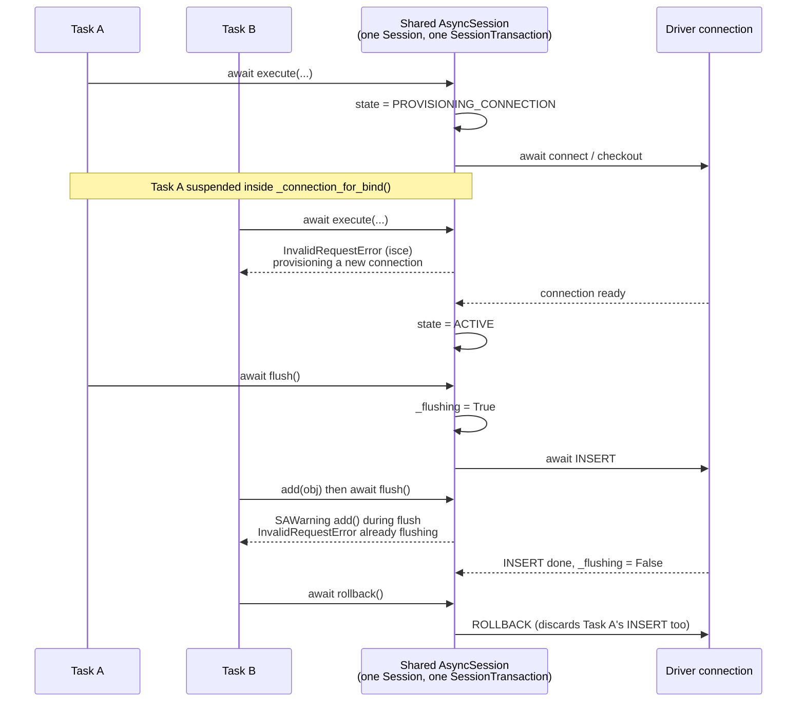

# Concurrency Hazard: Why One AsyncSession Cannot Be Shared Across asyncio.gather / TaskGroup Sibling Tasks

> [!summary] Claim
> An `AsyncSession` is one database transaction on one connection with one identity map, so sibling tasks that share it either trip SQLAlchemy's state guards (`isce` errors, `Session is already flushing`) or, worse, silently commit or roll back each other's work; the unit of concurrency is the session, so give every task its own.

Part of [Database Access and Transactions for APIs](README.md) in [API Engineering](../README.md).

## TL;DR

- Mechanism: every `await` on an `AsyncSession` is a `greenlet_spawn` that suspends the task mid-method, so a sibling task re-enters the same `Session`, `SessionTransaction`, and connection while the first is half-way through.
- Contract: SQLAlchemy documents the model as "Session per thread, AsyncSession per task" and says concurrent `asyncio.gather()` work "should use a separate AsyncSession per individual task".
- Trap: the guards only fire inside three windows (connection provisioning, flush, state transitions); once the connection is warm, concurrent statements succeed and the tasks quietly share one transaction, so one task's `rollback()` or `commit()` decides the fate of every sibling's writes.
- Portability: identical behavior on SQLAlchemy 2.1.8 and 2.0.57 and on CPython 3.12, 3.13, and 3.14 in the drafter's lab runs (verification re-ran only CPython 3.14.6 with SQLAlchemy 2.1.8); the `PROVISIONING_CONNECTION` guard exists only from 2.0.17 onward, and nothing in the design changes under free-threaded CPython except that the lock-free guards become weaker.
- When not to fan out: when the work must be atomic or must read one consistent snapshot, run it sequentially in one session (or push it into one SQL statement); per-task sessions give you parallelism by giving up shared atomicity and by spending one pooled connection per task.

## Mental model



Task A enters the session first and sets `SessionTransaction._state` to `PROVISIONING_CONNECTION` before it awaits the driver connect.
Because the event loop runs Task B while Task A is parked on that await, Task B finds the transaction in a state its method does not accept and gets the `isce` error.
Once the connection exists, Task A's flush raises the `_flushing` flag and suspends on the `INSERT`; Task B's `add()` lands in the middle of the flush and its own `flush()` is refused.
The last arrow is the dangerous one: no guard covers it, because a `rollback()` issued after Task A's flush returns is a perfectly legal call on a perfectly ACTIVE transaction, and it erases Task A's row even though Task A already reported success.

## How it works

### What an AsyncSession actually is

`AsyncSession` is a `ReversibleProxy[Session]` whose docstring states it "is **not safe for use in concurrent tasks.**" (sqlalchemy 2.1.8 sqlalchemy/ext/asyncio/session.py, AsyncSession).
Each coroutine method forwards to the synchronous `Session` through `greenlet_spawn`, for example `await greenlet_spawn(self.sync_session.flush, objects=objects)` in `AsyncSession.flush` and `await greenlet_spawn(self.sync_session.commit)` in `AsyncSession.commit` (same file).
`greenlet_spawn` runs the sync function in a child greenlet and, every time the driver code calls `await_()`, switches back to the parent and does `value = await result` on the driver's coroutine (sqlalchemy 2.1.8 sqlalchemy/util/concurrency.py, greenlet_spawn and await_).
That `await` is a real suspension point of the calling asyncio task, so the sync `Session` method is frozen half-way while the event loop is free to run any other task, including a sibling holding a reference to the same proxy.
The greenlet mechanics themselves are covered in [[Async-SQLAlchemy-Under-the-Hood-Greenlet-Bridge-and-MissingGreenlet]]; what matters here is that a sync `Session` was designed to be re-entered only by its own call stack, and `greenlet_spawn` exposes it to a second call stack at every I/O boundary.

The shared state behind the proxy is exactly what the error documentation lists: a `Session` represents "a single, ongoing database transaction upon a single database connection at a time for a particular Engine or AsyncEngine", with "only one connection per engine in play within the scope of a transaction" (SQLAlchemy errors page, "IllegalStateChangeError and concurrency exceptions", code `isce`).
Concretely that means one identity map, one set of `new`, `dirty`, and `deleted` collections, one `SessionTransaction` stack, and one `Connection` per bind, all mutated without locks.
The identity map and unit-of-work internals are in [[Session-Internals-Identity-Map-Unit-of-Work-Flush-and-Expire-On-Commit]].

### Guard 1: the SessionTransaction state machine

`SessionTransactionState` has six members: `ACTIVE = 1`, `PREPARED = 2`, `COMMITTED = 3`, `DEACTIVE = 4`, `CLOSED = 5`, `PROVISIONING_CONNECTION = 6` (sqlalchemy 2.1.8 sqlalchemy/orm/session.py, SessionTransactionState).
State-changing methods are wrapped by `_StateChange.declare_states(prerequisite_states, moves_to)` (sqlalchemy 2.1.8 sqlalchemy/orm/state_changes.py, _StateChange.declare_states).
The decorator's `_go` wrapper does three things without any lock:

1. If the current `_state` is not in the prerequisite tuple, it calls `_raise_for_prerequisite_state`.
2. If another decorated method is already running (`_current_fn` is set and `_next_state` is `CHANGE_IN_PROGRESS` or `NO_CHANGE`) and this method would move to a different state, it raises `IllegalStateChangeError("Method 'close()' can't be called here; method '_connection_for_bind()' is already in progress and this would cause an unexpected state change to ...")` with `code="isce"`.
3. Otherwise it records itself in `_current_fn`, sets `_next_state = CHANGE_IN_PROGRESS`, runs the method, and checks the resulting state afterwards.

The declarations that matter for concurrent use are `connection()`, `_begin()`, and `_connection_for_bind()`, each declared `(SessionTransactionState.ACTIVE,)` -> `NO_CHANGE`; `commit()` moves `ACTIVE` or `PREPARED` -> `CLOSED`; `close()` is `ANY` -> `CLOSED` (sqlalchemy 2.1.8 sqlalchemy/orm/session.py, SessionTransaction).
The design note in the 2.0 release notes is explicit that "The state transition checks intentionally don't use explicit locks to detect concurrent thread activity, instead relying upon simple attribute set / value test operations that inherently fail when unexpected concurrent changes occur", and that this is meant to catch "asyncio if a particular Session were shared among multiple asyncio tasks" (What's New in SQLAlchemy 2.0, "Session raises proactively when illegal concurrent or reentrant access is detected").
That section is motivated by issue `#7433`, where a thread calling `Session.commit()` while another ran `Session.execute()` produced the cryptic `AttributeError: 'NoneType' object has no attribute 'twophase'` inside `_connection_for_bind()`.

### Guard 2: the connection-provisioning critical section

`SessionTransaction._connection_for_bind` returns the cached connection if `bind in self._connections`; otherwise it sets `self._state = SessionTransactionState.PROVISIONING_CONNECTION`, calls `bind.connect()` and `conn.begin()`, stores the pair in `self._connections`, and resets the state to `ACTIVE` in a `finally` (sqlalchemy 2.1.8 sqlalchemy/orm/session.py, SessionTransaction._connection_for_bind).
On an `AsyncEngine`, `bind.connect()` is where the pool checkout and, for a new DBAPI connection, the driver handshake happen, which is an `await_()` and therefore a task switch.
Any sibling call that reaches a method declared with prerequisite `ACTIVE` during that window hits the override `SessionTransaction._raise_for_prerequisite_state`, which for `PROVISIONING_CONNECTION` raises `InvalidRequestError("This session is provisioning a new connection; concurrent operations are not permitted", code="isce")` (same file).
A sibling that calls `close()` instead gets the `IllegalStateChangeError` from guard 1, because `close()` accepts any prerequisite state but would move to `CLOSED` while `_connection_for_bind()` is in progress.
This check was added in 2.0.17 ("an additional check is added within the process to acquire connections from the underlying engine, which is a critical section with regards to internal connection management", changelog 2.0.17, `#9973`); the `PROVISIONING_CONNECTION = 6` member is absent from `lib/sqlalchemy/orm/session.py` at tag `rel_2_0_16` and present at `rel_2_0_17` (checked by fetching both tags).
Whether the window is open depends on the pool: with `NullPool` every checkout opens a connection, while `AsyncAdaptedQueuePool` holding an idle connection may hand it back without a task switch, which is why the same code can fail on a cold worker and pass on a warm one.

### Guard 3: the flush flag

`Session.flush` starts with `if self._flushing: raise sa_exc.InvalidRequestError("Session is already flushing")`, then sets `_flushing = True` around `_flush()` in a `try`/`finally` (sqlalchemy 2.1.8 sqlalchemy/orm/session.py, Session.flush).
Inside `_flush()` the session sets `_warn_on_events = True`, and `add()`, `add_all()`, `delete()`, `delete_all()`, `merge()`, and `merge_all()` then call `_flush_warning`, which emits `SAWarning: Usage of the 'Session.add()' operation is not currently supported within the execution stage of the flush process. Results may not be consistent.  Consider using alternative event listeners or connection-level operations instead.` (same file, Session._flush_warning).
A sibling that adds an object while another task's flush is suspended on an `INSERT` therefore gets a warning for the `add()` and an exception for its own `flush()`, and its object may or may not be picked up by the in-flight flush depending on where the topological sort was when the switch happened.
The quieter variant is autoflush: `Session._autoflush` runs only `if self.autoflush and not self._flushing`, so a sibling's query issued during another task's flush silently skips its own autoflush and can read without its own pending changes (same file, Session._autoflush).

### Below SQLAlchemy: the driver

SQLAlchemy's asyncio adapters serialize statements on one DBAPI connection with an `asyncio.Lock` named `_execute_mutex` (sqlalchemy 2.1.8 sqlalchemy/connectors/asyncio.py, AsyncAdapt_dbapi_connection.__init__ and AsyncAdapt_dbapi_cursor._execute_async), and the asyncpg adapter takes the same mutex in `AsyncAdapt_asyncpg_cursor._prepare_and_execute` and `_executemany` (sqlalchemy 2.1.8 sqlalchemy/dialects/postgresql/asyncpg.py).
The psycopg adapter deliberately skips that mutex ("override to not use mutex, psycopg3 already has mutex", sqlalchemy 2.1.8 sqlalchemy/dialects/postgresql/psycopg.py, AsyncAdapt_psycopg_cursor._execute_async) and relies on the `self.lock` that psycopg's `AsyncConnection` takes around its operations (psycopg 3.3.8 psycopg/connection_async.py, AsyncConnection).
aiosqlite additionally funnels every call through one worker thread fed by a `SimpleQueue` (aiosqlite 0.22.1 aiosqlite/core.py, Connection).
Raw asyncpg refuses overlap outright: `BaseProtocol._check_state` raises `InterfaceError('cannot perform operation: another operation is in progress')` when a waiter or a timeout handle is already pending (asyncpg 0.32.0 asyncpg/protocol/protocol.pyx, _check_state).
The consequence is counter-intuitive: on a warm shared session, concurrent `SELECT`s through the ORM do not fail at all, they are queued one by one on the same connection, so the "parallel" fan-out gets no parallelism and still shares one transaction.
Server-side cursors are the exception to that queueing on asyncpg: `AsyncAdapt_asyncpg_ss_cursor._buffer_rows` and `_all` call `self._cursor.fetch(...)` on asyncpg's `Cursor` without taking `_execute_mutex`, whereas `_prepare_and_execute` (which creates the cursor) does take it (sqlalchemy 2.1.8 sqlalchemy/dialects/postgresql/asyncpg.py, AsyncAdapt_asyncpg_ss_cursor and AsyncAdapt_asyncpg_cursor._prepare_and_execute; asyncpg 0.32.0 asyncpg/cursor.py, Cursor.fetch).
So while one task is suspended inside a `fetch()` of an open `AsyncSession.stream()`, a sibling's `execute()` finds the mutex free and reaches asyncpg's protocol, where `_check_state` refuses it.
This was reproduced against PostgreSQL 18.7 (see "Server-side streaming probe" under Worked example), so on asyncpg the sibling fails loudly with a driver `InterfaceError` instead of queueing.

### The silent class: one transaction, many authors

The guards protect SQLAlchemy's internal bookkeeping, not your transaction semantics.
After the connection is provisioned and outside a flush, every sibling call is legal, so these happen without any exception:

- One task's `await session.rollback()` discards every sibling's flushed rows, because they were all written inside the same `BEGIN` on the same connection.
- One task's `await session.commit()` flushes and commits whatever any sibling has `add()`ed so far, including work a sibling is about to abandon by raising.
- `await session.get(Order, 1)` in two tasks returns the identical Python object from the identity map, so an attribute set in one task is visible to the other before any flush.
- `expire_on_commit=True` (the default) means one task's commit expires the attributes of objects another task is still reading, and the next access triggers lazy SQL, which in async code is a `MissingGreenlet` (see [[Async-SQLAlchemy-Under-the-Hood-Greenlet-Bridge-and-MissingGreenlet]]).

### How the bug gets into an API

FastAPI caches a dependency per request: "FastAPI will know to call that sub-dependency only once per request" and saves the returned value in a cache passed to all dependants (FastAPI docs, "Using the same dependency multiple times"); in code, `solve_dependencies` keys a `dependency_cache` dict per request and reuses `solved` when `sub_dependant.use_cache` is true (fastapi 0.162.0 fastapi/dependencies/utils.py, solve_dependencies).
So a request-scoped `get_session` dependency yields exactly one `AsyncSession`, and the moment an endpoint or service hands it to `asyncio.gather()` or `TaskGroup.create_task()` the hazard is live.
`contextvars` do not save you: `asyncio.create_task()` copies the current context when no `context` is passed (Python docs, `asyncio.create_task`), so a session stored in a `ContextVar` before the fan-out is the same object in every child task.
The two fan-out primitives differ in how the failure surfaces: `gather()` with `return_exceptions=False` propagates the first exception while the "Other awaitables ... won't be cancelled and will continue to run", and with `return_exceptions=True` treats exceptions as results; `TaskGroup` (added in 3.11) cancels the remaining tasks on the first non-`CancelledError` failure and raises an `ExceptionGroup` (Python docs, "Coroutines and Tasks").
With `gather()` the surviving siblings keep writing into a session whose owner already saw an error; with `TaskGroup` the cancellation itself is delivered at the siblings' next suspension point, which can be inside a SQLAlchemy method on the shared session.

### The fix: one session per task

The documented rule is that concurrent work "should use a separate AsyncSession per individual task" (SQLAlchemy asyncio docs, "Using AsyncSession with Concurrent Tasks").
With `async_sessionmaker`, each task does `async with maker() as session:` and commits its own work, so each task has its own `SessionTransaction`, its own identity map, and its own pooled connection.
`async_scoped_session(maker, scopefunc=current_task)` gives the same isolation through a registry, but the docs warn that `scopefunc` is called on every access and that with `current_task()` as the key, `remove()` must be called "from within the outermost awaitable", "otherwise the task handle as well as the AsyncSession will remain in memory, essentially creating a memory leak" (SQLAlchemy asyncio docs, "Using asyncio scoped session").
An `asyncio.Lock` around the shared session removes the exceptions but not the problem: it serializes the tasks (no parallelism) and they still share one transaction, so the silent class above is untouched.

## Numbers and limits

| Quantity | Value | Source |
| --- | --- | --- |
| Connections a `Session` holds per bind inside one transaction | 1 | SQLAlchemy errors page, `isce` section |
| `SessionTransactionState` members | 6 (`ACTIVE` .. `PROVISIONING_CONNECTION`) | sqlalchemy 2.1.8 sqlalchemy/orm/session.py, SessionTransactionState |
| First release with the state-change guard | 2.0 (issue `#7433`) | What's New in SQLAlchemy 2.0 |
| First release with the provisioning guard | 2.0.17 (`#9973`) | changelog 2.0.17; absent at tag `rel_2_0_16`, present at `rel_2_0_17` |
| `QueuePool` / `AsyncAdaptedQueuePool` defaults | `pool_size=5`, `max_overflow=10`, `timeout=30.0` s | sqlalchemy 2.1.8 sqlalchemy/pool/impl.py, QueuePool.__init__ |
| Max concurrent checkouts per engine per process at defaults | 15 (5 + 10); the 16th concurrent checkout waits up to 30 s, then raises `TimeoutError` | derived from the row above |
| Requests that can fan out k per-task sessions concurrently per process at defaults | floor(15 / k), e.g. 3 requests at k = 5 | derived; sizing in [[Sizing-Connection-Pools-Across-Workers-Pods-and-PgBouncer-Transaction-Mode]] |
| Lab: siblings failing in a 2-task first-use race on a cold `NullPool` session | 1 of 2 | measured, `test_first_use_race_raises_isce_provisioning_error`, CPython 3.14.6, macOS 27.3 arm64 |
| Lab: siblings failing in a 2-task concurrent flush | 1 of 2, plus 1 `SAWarning` | measured, `test_concurrent_flush_raises_already_flushing_and_warns_on_add`, same machine |
| Lab: per-task sessions failing in an 8-task cold fan-out | 0 of 8 | measured, `test_per_task_sessions_survive_concurrent_first_use`, same machine |
| Lab module wall time | 11 tests in 1.63 s (one run; wall time is noisy) | measured in verification, `uv run --frozen --python 3.14 pytest ... -v -p no:cacheprovider`, CPython 3.14.6, macOS 27.3 arm64 |
| `asyncio.TaskGroup` availability | CPython >= 3.11 | Python docs, "Coroutines and Tasks" |

## Portability

| Leg | Result | Evidence |
| --- | --- | --- |
| CPython 3.12.13, SQLAlchemy 2.1.8 | 11 passed | drafter's lab run, `uv run --frozen --python 3.12 --isolated pytest ...`; not re-run in verification |
| CPython 3.13.18, SQLAlchemy 2.1.8 | 11 passed | drafter's lab run, `--python 3.13`; not re-run in verification |
| CPython 3.14.6, SQLAlchemy 2.1.8 | 11 passed | lab run, `--python 3.14` (workspace interpreter); re-run in verification (as of 2026-11) |
| CPython 3.14.6, SQLAlchemy 2.0.57 | 11 passed, same messages | drafter's lab run, `--no-group sqlalchemy21 --group sqlalchemy20`; not re-run in verification |
| CPython 3.15 (uv provided 3.15.0b3) | not run: collection aborted with `ModuleNotFoundError: No module named 'hypothesis._native'` while loading the hypothesis pytest plugin | lab attempt; environment issue, not a lab result |
| CPython 3.15t free-threaded | not run: `psycopg-binary==3.3.8` has no wheel for this interpreter, so `uv run --frozen` cannot build the environment | lab attempt |
| Free-threaded semantics | the guards are lock-free attribute tests by design, so true parallel threads can race past them; `Session` is documented as not thread-safe either way | What's New in SQLAlchemy 2.0, concurrency section; session FAQ |
| SQLAlchemy 2.0.0 - 2.0.16 | no `PROVISIONING_CONNECTION`; a cold-session race reaches deeper, less specific failures | source at tags `rel_2_0_0` and `rel_2_0_16` |
| Drivers: aiosqlite, asyncpg, psycopg | statements on one connection are serialized for all three (SQLAlchemy's `_execute_mutex` for aiosqlite and asyncpg, psycopg's own `AsyncConnection.lock` for psycopg), so the warm-session case is silent everywhere, except an open asyncpg server-side stream, where a sibling gets `InterfaceError` | source cited in How it works; aiosqlite exercised in the lab; the asyncpg stream case run once against PostgreSQL 18.7 (probe under Worked example) |
| Uvicorn, Hypercorn, Granian; HTTP/1.1, HTTP/2, HTTP/3 | independent of server and HTTP version: the hazard lives inside one request's task tree on one event loop | lab drives the app in-process through `httpx.ASGITransport`; no server leg run |

## Worked example

The [implementation](../labs/src/api_labs/f13_database_access_and_transactions_for_apis/shared_async_session.py) builds a file-backed aiosqlite engine with `NullPool`, so the first statement of every session awaits a connect and the provisioning window is deterministic.
The [test](../labs/tests/f13_database_access_and_transactions_for_apis/test_why_sharing_an_asyncsession_across_concurrent_tasks_corrupts_state.py) reproduces each guard, each silent failure, and the fix.

The bug and the fix, side by side (simplified excerpt of `shared_async_session.py`; the functions are verbatim, imports and models omitted):

```python
async def gather_on_shared_session[T](
    session: AsyncSession, *ops: SessionOp[T]
) -> list[T | BaseException]:
    """The bug: every sibling task receives the same `AsyncSession`."""
    return await asyncio.gather(*(op(session) for op in ops), return_exceptions=True)


async def run_in_own_session[T](maker: async_sessionmaker[AsyncSession], op: SessionOp[T]) -> T:
    """One task, one session, one transaction: commit on success, roll back on any error."""
    async with maker() as session:
        result = await op(session)
        await session.commit()
        return result
```

The API-level failure: a helper that "undoes its own work" ends the one transaction every sibling writes into (simplified excerpt; `write_audit` without its docstring, the endpoint verbatim):

```python
async def write_audit(
    session: AsyncSession, message: str, *, after: asyncio.Event, fail: bool
) -> None:
    await after.wait()
    session.add(AuditEvent(message=message))
    await session.flush()
    if fail:
        # Intended to discard only the audit row; on a shared session it ends the one
        # transaction that every sibling task is writing into.
        await session.rollback()
        raise AuditUnavailableError(message)

...

    @app.post("/orders/shared", status_code=status.HTTP_201_CREATED)
    async def create_order_shared(  # pyright: ignore[reportUnusedFunction]
        session: Annotated[AsyncSession, Depends(get_session)],
    ) -> OrderCreated:
        flushed = asyncio.Event()
        order_result, audit_result = await asyncio.gather(
            insert_order(session, "sku-1", flushed=flushed),
            write_audit(session, "order created", after=flushed, fail=audit_fails),
            return_exceptions=True,
        )
        await session.commit()
        order_id = order_result if isinstance(order_result, int) else None
        return OrderCreated(order_id=order_id, audit_ok=audit_result is None)
```

The `after` event pins the one interleaving in which no SQLAlchemy guard can fire: the audit write starts after the order flush has returned, as a slower upstream call would in production.
The endpoint answers `201 Created` with `{"order_id": 1, "audit_ok": false}`, yet the test proves the `orders` table is empty: the order was flushed, assigned a primary key, and then rolled back by its sibling, and the final `commit()` commits a fresh, empty autobegun transaction.
The `/orders/per-task` endpoint runs the same two operations through `run_in_own_session` and persists the order while the audit failure stays isolated.

Two of the tests, verbatim:

```python
@pytest.mark.unit
@pytest.mark.asyncio
async def test_first_use_race_raises_isce_provisioning_error(
    maker: async_sessionmaker[AsyncSession],
) -> None:
    async with maker() as session:
        results = await gather_on_shared_session(session, select_one, select_one)
    assert results[0] == 1
    error = results[1]
    assert isinstance(error, InvalidRequestError)
    assert PROVISIONING in str(error)
    assert error.code == "isce"


@pytest.mark.unit
@pytest.mark.asyncio
async def test_shared_session_endpoint_returns_201_but_loses_the_order(
    engine: AsyncEngine,
) -> None:
    app = create_app(engine, audit_fails=True)
    transport = httpx.ASGITransport(app=app)
    async with httpx.AsyncClient(transport=transport, base_url="http://test") as client:
        response = await client.post("/orders/shared")
    assert response.status_code == 201
    assert response.json() == {"order_id": 1, "audit_ok": False}
    assert await count_rows(engine, Order) == 0  # the audit rollback discarded the order
    assert await count_rows(engine, AuditEvent) == 0
```

Captured output, from `labs/`, CPython 3.14.6, SQLAlchemy 2.1.8, aiosqlite 0.22.1, macOS 27.3 arm64 (test path prefix shortened to `tests/f13_.../` here; the header lines are omitted):

```text
$ uv run --frozen --python 3.14 pytest tests/f13_database_access_and_transactions_for_apis/test_why_sharing_an_asyncsession_across_concurrent_tasks_corrupts_state.py -v -p no:cacheprovider
collecting ... collected 11 items

tests/f13_.../test_why_sharing_an_asyncsession_across_concurrent_tasks_corrupts_state.py::test_first_use_race_raises_isce_provisioning_error PASSED [  9%]
tests/f13_.../test_why_sharing_an_asyncsession_across_concurrent_tasks_corrupts_state.py::test_warm_shared_session_runs_concurrent_selects_without_any_error PASSED [ 18%]
tests/f13_.../test_why_sharing_an_asyncsession_across_concurrent_tasks_corrupts_state.py::test_concurrent_flush_raises_already_flushing_and_warns_on_add PASSED [ 27%]
tests/f13_.../test_why_sharing_an_asyncsession_across_concurrent_tasks_corrupts_state.py::test_close_during_provisioning_raises_illegal_state_change PASSED [ 36%]
tests/f13_.../test_why_sharing_an_asyncsession_across_concurrent_tasks_corrupts_state.py::test_taskgroup_sibling_failure_surfaces_as_exception_group PASSED [ 45%]
tests/f13_.../test_why_sharing_an_asyncsession_across_concurrent_tasks_corrupts_state.py::test_identity_map_is_shared_so_sibling_mutations_leak PASSED [ 54%]
tests/f13_.../test_why_sharing_an_asyncsession_across_concurrent_tasks_corrupts_state.py::test_sibling_commit_publishes_another_tasks_unfinished_work PASSED [ 63%]
tests/f13_.../test_why_sharing_an_asyncsession_across_concurrent_tasks_corrupts_state.py::test_shared_session_endpoint_returns_201_but_loses_the_order PASSED [ 72%]
tests/f13_.../test_why_sharing_an_asyncsession_across_concurrent_tasks_corrupts_state.py::test_per_task_endpoint_persists_order_and_isolates_audit_failure PASSED [ 81%]
tests/f13_.../test_why_sharing_an_asyncsession_across_concurrent_tasks_corrupts_state.py::test_per_task_sessions_survive_concurrent_first_use PASSED [ 90%]
tests/f13_.../test_why_sharing_an_asyncsession_across_concurrent_tasks_corrupts_state.py::test_async_scoped_session_keyed_by_current_task_isolates_siblings PASSED [100%]

============================== 11 passed in 1.63s ==============================
```

The exception reprs observed by a one-off probe script (two-task `gather()` on a shared `NullPool` session, same interpreter, re-captured in verification; the script printed only the failing element of each result list):

```text
exec:  InvalidRequestError('This session is provisioning a new connection; concurrent operations are not permitted')
flush: InvalidRequestError('Session is already flushing')
close: IllegalStateChangeError("Method 'close()' can't be called here; method '_connection_for_bind()' is already in progress and this would cause an unexpected state change to <SessionTransactionState.CLOSED: 5>")
tg:    InvalidRequestError('This session is provisioning a new connection; concurrent operations are not permitted')
```

### Server-side streaming probe

This probe is not a lab file because the lab has no PostgreSQL server; it ran once against a throwaway PostgreSQL 18.7 (Homebrew) cluster on `127.0.0.1`, with the verbatim script below (imports trimmed to what it uses), and the cluster was deleted afterwards.
One task consumes `AsyncSession.stream()` over a query that sleeps 10 ms per row, so each `fetch(50)` takes about 0.5 s; a sibling runs `select 42` on the same session 0.2 s in.

```python
async with maker() as session:
    await session.execute(text("select 1"))  # warm the connection

    async def streamer() -> int:
        n = 0
        result = await session.stream(text("select i, pg_sleep(0.01) from generate_series(1, 200) i"))
        async for _ in result:
            n += 1
        return n

    async def sibling() -> object:
        await asyncio.sleep(0.2)
        return (await session.execute(text("select 42"))).scalar_one()

    out = await asyncio.gather(streamer(), sibling(), return_exceptions=True)
```

Output (CPython 3.14.6, SQLAlchemy 2.1.8, asyncpg 0.32.0, `postgresql+asyncpg://`, macOS 27.3 arm64; each line is type, `orig` type, message):

```text
builtins.int | builtins.NoneType | 200
sqlalchemy.exc.InterfaceError | sqlalchemy.dialects.postgresql.asyncpg.AsyncAdapt_asyncpg_dbapi.InterfaceError | (sqlalchemy.dialects.postgresql.asyncpg.InterfaceError) cannot perform operation: another operation is in progress
```

The stream finished with all 200 rows and the sibling was the one refused, so the damage lands on whichever task arrives second.
One run, one interleaving; the exact victim depends on timing, and a sibling arriving between `fetch()` calls would succeed.

## Pitfalls

> [!warning] Green tests, red production
> Trigger: a test suite with a warm `StaticPool` or a pre-checked-out connection, while production uses `AsyncAdaptedQueuePool` and cold workers.
> Symptom: `InvalidRequestError ... provisioning a new connection; concurrent operations are not permitted` only right after deploys or pool recycles; never locally.
> Fix: never share the session; to make the hazard reproducible in tests, use `NullPool` as this lab does so every first statement opens a connection.

> [!warning] Silent cross-task rollback
> Trigger: `asyncio.gather(create_order(session), write_audit(session), return_exceptions=True)` where a helper calls `await session.rollback()` on its own failure.
> Symptom: `201 Created` with a generated id that does not exist in the database; no exception anywhere (reproduced by `test_shared_session_endpoint_returns_201_but_loses_the_order`).
> Fix: one session per task, or run the steps sequentially in one session if they must be atomic; never call `rollback()` in a helper that does not own the session.

> [!warning] Sibling commit publishes abandoned work
> Trigger: one task calls `await session.commit()` while a sibling has `add()`ed objects it will abandon by raising.
> Symptom: rows from a request path that failed validation are durable (reproduced by `test_sibling_commit_publishes_another_tasks_unfinished_work`).
> Fix: commit only at the owner of the transaction, after all participants finished; per-task sessions make ownership structural.

> [!warning] Cryptic errors on releases before the guards
> Trigger: SQLAlchemy 1.4 (the state-change guard arrived in 2.0.0; the provisioning guard only in 2.0.17), a shared `Session` across threads or tasks.
> Symptom: `AttributeError: 'NoneType' object has no attribute 'twophase'` from inside `_connection_for_bind()`, as recorded in issue `#7433` (What's New in SQLAlchemy 2.0); on 2.0.0 - 2.0.16 the cold-session race can still fail less specifically.
> Fix: upgrade to >= 2.0.17 so both guards name the concurrency, then remove the sharing; the guard is diagnosis, not a fix.

> [!warning] A session stuck in "flushing"
> Trigger: SQLAlchemy < 2.0.52 and a failed `bulk_insert_mappings()`, `bulk_update_mappings()`, or `bulk_save_objects()` whose transaction could not begin.
> Symptom: every later flush raises `Session is already flushing` even with no concurrency, and neither `rollback()` nor `close()` clears it (changelog 2.0.52, `#13485`).
> Fix: upgrade; do not assume `Session is already flushing` always means two tasks, check the version and the bulk API first.

> [!warning] Deadlocked pool after `dispose()` with `gather()`
> Trigger: SQLAlchemy < 2.0.25 (or < 1.4.51 on the 1.4 line, where the fix was backported), `AsyncEngine.dispose()` and then concurrent work via `asyncio.gather()`.
> Symptom: deadlock, because the recreated pool used a plain `threading.Lock()` instead of asyncio-compatible mutexes (changelog 2.0.25, `#10813`).
> Fix: upgrade; this one is a pool bug, not session sharing, but it presents under the same fan-out code.

> [!warning] `async_scoped_session` leak
> Trigger: `scopefunc=current_task` without `await registry.remove()` in the outermost awaitable of each task.
> Symptom: memory growth; the task handle and the session stay in the registry (SQLAlchemy asyncio docs, "Using asyncio scoped session").
> Fix: prefer explicit `async with maker() as session:` per task; if you use the registry, `remove()` in a `finally` of the task's top-level coroutine.

> [!warning] Cancellation inside a shared session
> Trigger: `TaskGroup` cancels the siblings of a failed task, or `asyncio.timeout()` fires, while a sibling is suspended inside a method of the shared session.
> Symptom: the `CancelledError` is thrown into the greenlet at the driver await, leaving the shared session mid-operation for the owner's cleanup.
> Fix: with per-task sessions the cancelled task's own `async with` closes only its own session; with a shared one, the owner must treat the session as poisoned and discard it.

## Security and robustness

- Integrity: the silent class lets a request report success for a write that was rolled back, which breaks idempotency bookkeeping and audit trails at once; an audit row that vanishes with its business row is an OWASP Top 10 2021 A09 "Security Logging and Monitoring Failures" problem, not just a bug.
- Resource consumption: per-task sessions multiply connection demand by the fan-out factor; an attacker-controlled fan-out (for example "fetch these N ids in parallel") is OWASP API4:2023 "Unrestricted Resource Consumption"; bound N in the request schema and bound concurrency with a semaphore sized below the pool.
- Pool starvation as availability failure: with defaults, once 15 connections are checked out the 16th concurrent checkout waits up to `pool_timeout` 30 s and then fails with `TimeoutError` (sqlalchemy 2.1.8 sqlalchemy/pool/impl.py, QueuePool.__init__); see [[Connection-Pooling-Internals-QueuePool-AsyncAdaptedQueuePool-and-Pre-Ping]].
- Cross-tenant leakage: a shared identity map returns the same Python object to every sibling; if siblings work for different principals (a batch endpoint resolving items for several tenants), a filter applied by one task does not protect objects already loaded by another; isolate per principal with separate sessions.
- Defense in depth: enforce the rule mechanically, for example a code review or lint rule that rejects passing a request-scoped session into `asyncio.gather`, `TaskGroup.create_task`, or `asyncio.create_task`, and keep `NullPool`-based tests that would fail on reintroduction.

## The principal's view

The decision is where the unit of concurrency sits, and the answer is the transaction: parallelize across transactions, never inside one.
A single database transaction runs one statement at a time on one connection, so concurrency inside it was never available; the SQLAlchemy error page says so directly ("A single database transaction is not an appropriate target for concurrent SQL commands").
Per-task sessions buy real parallelism and pay for it three ways: no shared atomicity (each task commits or fails alone), no shared snapshot (under `READ COMMITTED` every task sees whatever was committed when its statements ran), and one pooled connection per task, which multiplies pool demand across workers and pods (see [[Sizing-Connection-Pools-Across-Workers-Pods-and-PgBouncer-Transaction-Mode]]).
If the work must be atomic, keep it sequential in one session or collapse it into fewer statements (`IN` lists, joins, `INSERT ... RETURNING`; see [[High-Throughput-Bulk-Writes-Upserts-and-RETURNING-in-SQLAlchemy-2-x]]); if it must spread across processes, use the [[Transactional-Outbox-Pattern-Solving-Dual-Writes-Between-DB-and-Events]] rather than one transaction shared by many workers.
If parallel reads must share one consistent view on PostgreSQL, the database provides the primitive: one transaction exports its snapshot with `pg_export_snapshot()` and each parallel transaction imports it with `SET TRANSACTION SNAPSHOT`, which must run before the transaction's first query or data-modification statement and requires the transaction to already be at `SERIALIZABLE` or `REPEATABLE READ` (PostgreSQL 18 Section 9.28.5 and the `SET TRANSACTION` reference page, as of 2026-11, PostgreSQL 18.7).
Organizationally, the request-scoped session dependency is the right default for 95 percent of endpoints and the wrong primitive for fan-out; give teams a sanctioned helper such as `run_in_own_session` with a semaphore built in, so the safe path is also the short path.
Choose a different tool when the fan-out is wide: a query that needs 20 concurrent sub-queries usually wants one SQL statement, a read replica, or a cache, not 20 connections per request.

## Interview questions

> [!question] L5: Why does `await asyncio.gather(session.execute(a), session.execute(b))` sometimes work and sometimes raise?
>
> > [!success]- Answer
> > The first statement on a session provisions a connection, and while that `await` is pending the transaction is in `PROVISIONING_CONNECTION`, so the sibling's `_connection_for_bind()` call fails its `ACTIVE` prerequisite and raises the `isce` error.
> > If the connection was already provisioned, both calls are legal and SQLAlchemy's `_execute_mutex` queues them on the one connection, so they succeed.
> > Whether the window opens depends on the pool, so cold workers fail and warm ones pass.
> >
> > Follow-up: Which pool class makes the failure deterministic in tests, and why?

> [!question] L5: What is the fix, and what does it cost?
>
> > [!success]- Answer
> > Give each task its own session from an `async_sessionmaker`, for example `async with maker() as session:` inside the task.
> > Each task then has its own transaction, identity map, and pooled connection.
> > The costs are one connection per concurrent task, no shared atomicity across tasks, and no shared snapshot under `READ COMMITTED`.
> >
> > Follow-up: How many concurrent fan-out requests can one process serve at the default pool settings if each request opens five sessions?

> [!question] L6: Predict the output (simplified excerpt of `test_close_during_provisioning_raises_illegal_state_change`).
> ```python
> engine = create_async_engine("sqlite+aiosqlite:///lab.db", poolclass=NullPool)
> async with async_sessionmaker(engine)() as s:
>     r = await asyncio.gather(s.execute(text("SELECT 1")), s.close(), return_exceptions=True)
>     print(type(r[0]).__name__, type(r[1]).__name__)
> ```
>
> > [!success]- Answer
> > It prints `CursorResult IllegalStateChangeError`.
> > The `execute()` task enters `_connection_for_bind()` and suspends on the connect; `close()` accepts any prerequisite state but would move to `CLOSED` while another declared method is in progress, so the `_StateChange` guard raises.
> > The message is `Method 'close()' can't be called here; method '_connection_for_bind()' is already in progress and this would cause an unexpected state change to <SessionTransactionState.CLOSED: 5>`, as captured in the lab.
> >
> > Follow-up: What would change if the session had already executed one statement before the `gather()`?

> [!question] L6: Debug this API: `POST /orders` returns `201` with `{"order_id": 1}`, but `SELECT * FROM orders WHERE id = 1` is empty, and the logs show only an audit warning.
>
> > [!success]- Answer
> > Look for a fan-out that shares the request session, typically `asyncio.gather(create_order(session), write_audit(session), return_exceptions=True)`.
> > The order flushed and got its id, then the audit helper hit an error and called `session.rollback()`, which rolled back the one shared transaction including the order.
> > The endpoint's final `commit()` committed a new, empty autobegun transaction, and `return_exceptions=True` hid the audit failure in the result list.
> > Fix it with per-task sessions or sequential steps, and remove `rollback()` from helpers that do not own the session.
> >
> > Follow-up: Which test would have caught this before production, and why must it pin the interleaving?

> [!question] L6: Why is wrapping the shared session in an `asyncio.Lock` not a fix?
>
> > [!success]- Answer
> > The lock removes the guard exceptions by serializing calls, so it removes all parallelism the fan-out was meant to buy.
> > It does not separate the transactions, so one task's `rollback()` or `commit()` still decides every sibling's writes, and the identity map is still shared.
> > It also widens lock hold times across unrelated `await`s if held around whole operations.
> >
> > Follow-up: When is a single session with sequential awaits the correct design rather than a workaround?

> [!question] L6: What are the failure modes of `async_scoped_session(maker, scopefunc=current_task)`?
>
> > [!success]- Answer
> > The `scopefunc` runs on every access, so it must be cheap and side-effect free.
> > With `current_task()` as the key, `remove()` must be awaited in the outermost awaitable of each task, otherwise the task handle and its session stay in the registry and leak memory.
> > Code that awaits helpers via `create_task` inside the task gets a different key and therefore a different session, which can split one logical unit of work across two transactions.
> >
> > Follow-up: Why does a `ContextVar` holding the session not give per-task isolation?

> [!question] L7+: A product team needs ten parallel reads per request that must all see the same database state on PostgreSQL. Design it.
>
> > [!success]- Answer
> > Parallel reads need separate transactions, so a shared session is not an option and separate `READ COMMITTED` sessions do not agree on state.
> > One coordinator transaction can call `pg_export_snapshot()` and each worker transaction can start at `REPEATABLE READ` and run `SET TRANSACTION SNAPSHOT '<id>'` before its first query, all while the exporter stays open.
> > Budget ten plus one connections per request against the pool and PgBouncer limits, and prefer collapsing the reads into fewer statements if latency allows.
> >
> > Follow-up: What happens to the imported snapshots if the exporting transaction ends early, and how does PgBouncer transaction pooling interact with this?

> [!question] L7+: What changes about this hazard under free-threaded CPython 3.15t?
>
> > [!success]- Answer
> > The asyncio case does not change: tasks on one event loop still interleave only at awaits.
> > Sharing a `Session` across real threads becomes worse, because the state guards are lock-free attribute tests that the SQLAlchemy 2.0 notes say "inherently fail" only when they observe the change, and truly parallel threads can race past them.
> > The rule stays the same, one session per thread and one per task; the lab could not run a 3.15t leg here because `psycopg-binary` has no wheel for it.
> >
> > Follow-up: Which SQLAlchemy objects are safe to share across threads, and why is the `Engine` different from the `Session`?

> [!question] L7+: How would you prevent this class of bug across a 200-engineer organization?
>
> > [!success]- Answer
> > Make ownership structural: the request dependency owns the transaction, and the only sanctioned fan-out helper opens its own session per task with a concurrency semaphore below the pool size.
> > Add a review or lint rule that flags a request-scoped session passed into `gather`, `TaskGroup.create_task`, or `create_task`, and keep a `NullPool` regression test like this lab.
> > Alert on the `isce` error code and on `Session is already flushing` in production logs, since they are leading indicators of the silent class.
> >
> > Follow-up: What metric tells you the fan-out helper is starving the pool before users see timeouts?

## Related

Prerequisites: [[Sizing-Connection-Pools-Across-Workers-Pods-and-PgBouncer-Transaction-Mode]]

Next: [[Request-Scoped-Transaction-Patterns-Commit-As-You-Go-vs-Unit-of-Work]]

See also: [[02-Programming-Languages/Python/Python-Backend-Interview-Prep/06-SQL-and-SQLAlchemy]], [[02-Programming-Languages/Python/Python-Backend-Interview-Prep/17-Concurrency-in-Web-Services-and-Coding]], [[Session-Internals-Identity-Map-Unit-of-Work-Flush-and-Expire-On-Commit]], [[Async-SQLAlchemy-Under-the-Hood-Greenlet-Bridge-and-MissingGreenlet]], [[Connection-Pooling-Internals-QueuePool-AsyncAdaptedQueuePool-and-Pre-Ping]], [[Async-PostgreSQL-Drivers-Compared-Asyncpg-vs-Psycopg-3]], [[Transaction-Isolation-Levels-and-Concurrency-Anomalies-in-APIs]], [[Transactional-Outbox-Pattern-Solving-Dual-Writes-Between-DB-and-Events]]

- Lab: `labs/tests/f13_database_access_and_transactions_for_apis/test_why_sharing_an_asyncsession_across_concurrent_tasks_corrupts_state.py`

## Further reading

- [SQLAlchemy asyncio: Using AsyncSession with Concurrent Tasks](https://docs.sqlalchemy.org/en/20/orm/extensions/asyncio.html#using-asyncsession-with-concurrent-tasks) - the maintainers' rule of one `AsyncSession` per task, and the `async_scoped_session` leak warning.
- [SQLAlchemy FAQ: Is the Session thread-safe? Is AsyncSession safe to share in concurrent tasks?](https://docs.sqlalchemy.org/en/20/orm/session_basics.html#is-the-session-thread-safe-is-asyncsession-safe-to-share-in-concurrent-tasks) - "Session per thread, AsyncSession per task" and why.
- [SQLAlchemy errors: IllegalStateChangeError and concurrency exceptions](https://docs.sqlalchemy.org/en/20/errors.html#error-isce) - what the `isce` code means and the one-connection-per-transaction model.
- [What's New in SQLAlchemy 2.0: Session raises proactively when illegal concurrent or reentrant access is detected](https://docs.sqlalchemy.org/en/20/changelog/whatsnew_20.html) - the lock-free guard design and issue `#7433`.
- [SQLAlchemy 2.0 changelog](https://docs.sqlalchemy.org/en/20/changelog/changelog_20.html) - 2.0.17 `#9973` (provisioning guard), 2.0.25 `#10813`, 2.0.52 `#13485`.
- [sqlalchemy rel_2_1_8 lib/sqlalchemy/orm/state_changes.py](https://raw.githubusercontent.com/sqlalchemy/sqlalchemy/rel_2_1_8/lib/sqlalchemy/orm/state_changes.py) - the `_StateChange.declare_states` decorator in under 200 lines.
- [sqlalchemy rel_2_1_8 lib/sqlalchemy/orm/session.py](https://raw.githubusercontent.com/sqlalchemy/sqlalchemy/rel_2_1_8/lib/sqlalchemy/orm/session.py) - `SessionTransaction._connection_for_bind`, `_raise_for_prerequisite_state`, and `Session.flush`.
- [asyncpg v0.32.0 asyncpg/protocol/protocol.pyx](https://raw.githubusercontent.com/MagicStack/asyncpg/v0.32.0/asyncpg/protocol/protocol.pyx) - `_check_state`, the driver's own refusal of overlapping operations.
- [asyncpg v0.32.0 asyncpg/cursor.py](https://raw.githubusercontent.com/MagicStack/asyncpg/v0.32.0/asyncpg/cursor.py) and [sqlalchemy rel_2_1_8 dialects/postgresql/asyncpg.py](https://raw.githubusercontent.com/sqlalchemy/sqlalchemy/rel_2_1_8/lib/sqlalchemy/dialects/postgresql/asyncpg.py) - `Cursor.fetch` and the adapter's mutex-free server-side fetch path.
- [Python docs: Coroutines and Tasks](https://docs.python.org/3/library/asyncio-task.html) - `gather()` and `TaskGroup` failure and cancellation semantics, and context copying in `create_task()`.
- [PostgreSQL 18: Snapshot Synchronization Functions](https://www.postgresql.org/docs/current/functions-admin.html) and [SET TRANSACTION](https://www.postgresql.org/docs/current/sql-set-transaction.html) - the database-side way to give parallel transactions one consistent view.
