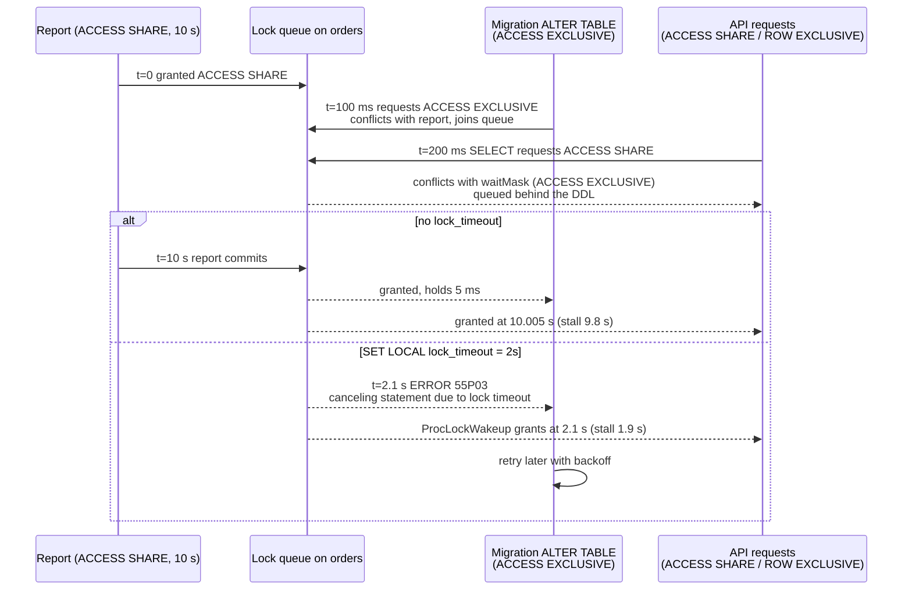

# Zero-Downtime Database Migrations for Live APIs: The Expand-and-Contract Pattern, lock_timeout, NOT VALID Constraints, and Concurrent Indexes

> [!summary] Claim
> A PostgreSQL migration takes an API down not by running long but by waiting: a queued `ACCESS EXCLUSIVE` request blocks every later `SELECT`, so every lock-taking DDL statement must run under a short `lock_timeout`, scans must be moved out from under strong locks (`NOT VALID` then `VALIDATE`, `CREATE INDEX CONCURRENTLY`), and every schema change must be split into expand and contract steps that both the old and the new application version can run against.

Part of [Database Access and Transactions for APIs](README.md) in [API Engineering](../README.md).

## TL;DR

- Mechanism: PostgreSQL grants a table lock only if it conflicts with no held lock and with no lock mode already waiting (`lock.c` `LockAcquireExtended` tests `conflictTab[lockmode] & lock->waitMask`), so one `ALTER TABLE` stuck behind a slow report freezes all reads and writes queued after it.
- Contract rule: every statement that needs a lock blocking writers (`SHARE` or stronger) runs with `SET LOCAL lock_timeout` inside a short transaction, constraints are added `NOT VALID` and validated later under `SHARE UPDATE EXCLUSIVE`, and indexes are built `CONCURRENTLY` in an Alembic `autocommit_block()`.
- The trap: `SET LOCAL` outside a transaction block does nothing but warn, `VALIDATE CONSTRAINT` in the same transaction as the `NOT VALID` add keeps the strong lock for the whole scan, and dropping or renaming a column the running pods still map breaks every in-flight request of the old version.
- Portability: the lab (lock-queue model plus an Alembic offline-SQL linter) passes 28 of 28 tests on CPython 3.14.6 (re-run in verification) and, in the drafter's runs, on 3.12.13, 3.13.18, 3.14.10, 3.15.2, and 3.15.0b3 free-threaded, and on SQLAlchemy 2.1.8 and 2.0.57; the PostgreSQL behaviors are version-gated (fast `ADD COLUMN` defaults since 11, `SET NOT NULL` scan skipping since 12, `NOT VALID` not-null constraints since 18).
- When not to use it: a table that is empty, unreferenced by running code, or tiny enough that a full-lock rewrite finishes inside your latency budget does not need the multi-deploy ceremony; a scheduled maintenance window is also legitimate when the business accepts it.

## Mental model



A long read holds `ACCESS SHARE`, which conflicts only with `ACCESS EXCLUSIVE`, so on its own it hurts nobody.
The migration's `ALTER TABLE` asks for `ACCESS EXCLUSIVE`, conflicts with the report, and joins the wait queue.
The next API `SELECT` asks for `ACCESS SHARE`; it does not conflict with anything granted, but it conflicts with the mode in the queue, so it waits behind the DDL, and so does every request after it.
Without a timeout the outage lasts as long as the slowest transaction already touching the table; with `lock_timeout` the DDL gives up, leaves the queue, the wakeup pass grants everyone behind it, and the migration retries.
The numbers on the arrows are the lab model's output, not a measurement of a real server.

## How it works

### 1. The lock queue: why waiting is worse than running

PostgreSQL has eight table-level lock modes, numbered 1 (`AccessShareLock`) to 8 (`AccessExclusiveLock`) in `src/include/storage/lockdefs.h`, and a fixed conflict matrix, `LockConflicts[]` in `src/backend/storage/lmgr/lock.c`, documented as Table 13.2 (PostgreSQL 18 documentation Section 13.3.1).
The modes that matter for a live API:

| Mode | Taken by (PostgreSQL 18 docs) | Blocks API reads | Blocks API writes |
|---|---|---|---|
| `ACCESS SHARE` | `SELECT` | no | no |
| `ROW EXCLUSIVE` | `INSERT`, `UPDATE`, `DELETE`, `MERGE` | no | no |
| `SHARE UPDATE EXCLUSIVE` | `VACUUM`, `ANALYZE`, `CREATE INDEX CONCURRENTLY`, `REINDEX CONCURRENTLY`, `VALIDATE CONSTRAINT` (ALTER TABLE, Notes) | no | no |
| `SHARE` | `CREATE INDEX` without `CONCURRENTLY` | no | yes |
| `SHARE ROW EXCLUSIVE` | `CREATE TRIGGER`, `ADD FOREIGN KEY` (on both tables) | no | yes |
| `ACCESS EXCLUSIVE` | most `ALTER TABLE` forms, `DROP TABLE`, `TRUNCATE`, `CLUSTER`, `VACUUM FULL`, plain `DROP INDEX` (DROP INDEX page); plain `REINDEX` takes it on the index only | yes | yes |

The documentation's tip is the whole risk model in one line: "Only an ACCESS EXCLUSIVE lock blocks a SELECT (without FOR UPDATE/SHARE) statement" (Section 13.3.1).
Locks are held until the end of the transaction, not the end of the statement, so every statement after a strong-lock DDL in the same transaction extends the hold.

The queue rule lives in `LockAcquireExtended` (`lock.c`, REL_18_7), whose comment reads "If lock requested conflicts with locks requested by waiters, must join wait queue."
Only otherwise does it go on to "check for conflict with already-held locks".
The test is `if (lockMethodTable->conflictTab[lockmode] & lock->waitMask) found_conflict = true;`, where `waitMask` is the set of modes someone is waiting for.
When a holder releases, `ProcLockWakeup` (`proc.c`) walks the wait queue in order and grants a waiter only if it "doesn't conflict with requests of earlier waiters, and ... doesn't conflict with already-held locks", accumulating the modes of waiters it skips into `aheadRequests`.
This is fair queueing: it prevents a stream of readers from starving the DDL forever, which is what the lab's `respect_wait_queue=False` variant shows.
The cost of fairness is head-of-line blocking: a waiter that cannot run makes everyone behind it unable to run either.
`JoinWaitQueue` has one exception: a backend that already holds a lock that conflicts with an earlier waiter's request is inserted in front of that waiter; the source calls this an optimization, "not a necessary step, since deadlock detection would move me to before that waiter anyway" (`proc.c`, REL_18_7); the lab's one-lock-per-transaction model does not include it.

The GoCardless postmortem "Zero-downtime Postgres migrations - the hard parts" (Chris Sinjakli, GoCardless engineering blog) is the canonical write-up: about 15 seconds of API downtime from an `ALTER TABLE ... ADD CONSTRAINT ... FOREIGN KEY ... NOT VALID` on an empty table whose referenced table was busy, because a long-running read on the parent table made the DDL wait and API queries piled up behind it.
The post describes the lock as `AccessExclusive` on both tables and its footnotes discuss PostgreSQL 9.4, so it reflects pre-9.5 locking; PostgreSQL 9.5 "reduce[d] lock levels of some create and alter trigger and foreign key commands" (9.5.0 release notes), and the PostgreSQL 18 documentation says `ADD FOREIGN KEY` takes `SHARE ROW EXCLUSIVE` on both tables, which still blocks writes, but no longer reads, on the referenced table.
The full incident narrative lives in [[Case-Study-Database-Migration-ACCESS-EXCLUSIVE-Lock-Convoy-Taking-Down-an-API]].

### 2. `lock_timeout`, `statement_timeout`, and their scopes

`lock_timeout` aborts "any statement that waits longer than the specified amount of time while attempting to acquire a lock", "separately to each lock acquisition attempt", explicit or implicit; zero, the default, disables it, and unitless values are milliseconds (Section 19.11.1).
When it fires, `ProcessInterrupts` in `src/backend/tcop/postgres.c` raises `ERRCODE_LOCK_NOT_AVAILABLE` with the message `canceling statement due to lock timeout`; `errcodes.txt` maps that to SQLSTATE `55P03`, which surfaces as `psycopg.errors.LockNotAvailable` (psycopg 3.3.8) or `asyncpg.exceptions.LockNotAvailableError` (asyncpg 0.32.0).
If `lock_timeout` and `statement_timeout` both expire, the code reports whichever finished first, ties going to the lock timeout (`postgres.c`, REL_18_7).
`lock_timeout` is useless if it is not shorter than `statement_timeout`, "since the statement timeout would always trigger first" (Section 19.11.1).
`statement_timeout` (SQLSTATE `57014`, `query_canceled`) bounds the whole statement, which is the wrong tool for a migration: GitLab notes that with only a short `statement_timeout`, "the request sits in the lock queue, blocking other queries for the duration of the configured statement timeout" (GitLab migration style guide).
PostgreSQL 17 added `transaction_timeout` (17.0 release notes), which bounds the whole transaction and is a useful outer fence around a migration.

Scope is where real migrations go wrong:
- `SET LOCAL` lasts "only till the end of the current transaction, whether committed or not", and issued "outside of a transaction block emits a warning and otherwise has no effect" (SQL `SET` reference).
- So `SET LOCAL lock_timeout` inside Alembic's `autocommit_block()` is a silent no-op; that block needs a session-level `SET lock_timeout`, which then persists on the connection.
- A plain `SET` inside a transaction is undone by `ROLLBACK` and also by rolling back to an earlier savepoint (SQL `SET` reference).
- Behind PgBouncer in transaction pooling mode, `SET/RESET` is marked "Never" compatible (PgBouncer features page), so a session-level `SET` leaks to whichever client gets the server connection next; strong_migrations recommends `ALTER ROLE myuser SET lock_timeout = '10s'` on the migration role in that setup.
- The PostgreSQL docs say "Setting lock_timeout in postgresql.conf is not recommended because it would affect all sessions" (Section 19.11.1); set it per migration role or per migration.

A timeout turns an outage into a failed deploy, so it needs a retry loop.
GitLab's `with_lock_retries` iterates 50 times, each with a preconfigured `lock_timeout`, sleeping between attempts, "for a maximum of 50 times over 40 minutes", and then runs the block once more without `lock_timeout` (GitLab migration style guide); that last step trades availability for progress, and is a choice, not a law.
strong_migrations' experimental `lock_timeout_retries` retries the statement outside a transaction or the whole migration inside one (strong_migrations README).
The retry must be at transaction granularity: after `55P03` the transaction is aborted, so retrying one statement inside it is impossible.

### 3. Which `ALTER TABLE` forms scan, rewrite, or only touch the catalog

`ALTER TABLE` takes `ACCESS EXCLUSIVE` "unless explicitly noted", and with several subcommands "the lock acquired will be the strictest one required by any subcommand" (ALTER TABLE, Description).
What decides the duration of that lock is whether the form only edits the catalog, scans the table, or rewrites it:

| Operation | Lock | Work under the lock | Safe pattern |
|---|---|---|---|
| `ADD COLUMN` nullable, or with a non-volatile `DEFAULT` | `ACCESS EXCLUSIVE` | catalog only (PostgreSQL 11+: the default "is evaluated at the time of the statement and the result stored in the table's metadata") | as is, with `lock_timeout` |
| `ADD COLUMN ... DEFAULT clock_timestamp()` or `gen_random_uuid()`, stored generated, identity, `SERIAL`, constrained domain | `ACCESS EXCLUSIVE` | full table and index rewrite (ALTER TABLE, Notes) | add nullable, backfill in batches, then set the default for new rows |
| `ADD COLUMN ... NOT NULL` without `DEFAULT` | `ACCESS EXCLUSIVE` | fails with SQLSTATE `23502` if any row exists; old app versions that omit the column fail on `INSERT` | nullable column, backfill, then the `SET NOT NULL` path below |
| `ALTER COLUMN ... TYPE` | `ACCESS EXCLUSIVE` | rewrite of table and indexes, unless binary-coercible with an unchanged `USING` (indexes may still rebuild) | new column, dual-write, backfill, swap |
| `ALTER COLUMN ... SET NOT NULL` | `ACCESS EXCLUSIVE` | full scan, skipped if a valid `CHECK` proves no `NULL` (PostgreSQL 12+; the 12.0 note says "when the table's column constraints can be recognized as disallowing nulls") | `CHECK (col IS NOT NULL) NOT VALID`, `VALIDATE`, then `SET NOT NULL`, then drop the check |
| `ADD CONSTRAINT ... CHECK` | `ACCESS EXCLUSIVE` | full scan | `NOT VALID`, then `VALIDATE CONSTRAINT` |
| `ADD CONSTRAINT ... FOREIGN KEY` | `SHARE ROW EXCLUSIVE` on both tables | full scan | `NOT VALID`, then `VALIDATE` (which also takes `ROW SHARE` on the referenced table) |
| `ADD CONSTRAINT ... UNIQUE` or `PRIMARY KEY` | `ACCESS EXCLUSIVE` | builds the index under the lock | `CREATE UNIQUE INDEX CONCURRENTLY`, then `ADD CONSTRAINT ... UNIQUE USING INDEX` |
| `VALIDATE CONSTRAINT` | `SHARE UPDATE EXCLUSIVE` | full scan, writes continue | run in its own transaction |
| `DROP COLUMN` | `ACCESS EXCLUSIVE` | catalog only; the column becomes invisible and space is reclaimed as rows are rewritten | only after no running code maps it |
| `RENAME` column or table | `ACCESS EXCLUSIVE` | catalog only | never on a name live code uses; add, dual-write, backfill, drop |

Sources: ALTER TABLE (Description, Parameters, and Notes), PostgreSQL 11 and 12 release notes, all PostgreSQL 18.7 documentation.
The 11 release note is precise about the boundary: the fast default "is enabled when the default value is a constant", and the 18 documentation phrases it as non-volatile, because a `STABLE` function such as `now()` is evaluated once at `ALTER` time.
Function volatility is a catalog fact, `provolatile` in `pg_proc.dat`: `gen_random_uuid`, `uuidv4`, `uuidv7`, `clock_timestamp`, `random`, `timeofday`, and `nextval` are `'v'`, while `now` and `statement_timestamp` are `'s'` (REL_18_7).
The rewriting forms "are not MVCC-safe": after a rewrite the table appears empty to concurrent transactions using a snapshot taken before it (ALTER TABLE, Notes).
Two migration-specific details from the same Notes: combining several subcommands in one `ALTER TABLE` lets "multiple table scans or rewrites ... be combined into a single pass", and `ADD ... USING INDEX` with `PRIMARY KEY` still runs `SET NOT NULL` with a full scan on columns not already marked `NOT NULL`.

### 4. `NOT VALID` and `VALIDATE CONSTRAINT`: splitting a scan from its lock

`ADD table_constraint NOT VALID` skips the "potentially-lengthy scan", but the constraint is still enforced on every subsequent insert and update (ALTER TABLE, Parameters).
It is allowed for foreign-key, `CHECK`, and (PostgreSQL 18+) not-null constraints; 18 also stores `NOT NULL` in `pg_constraint` and allows naming it (18.0 release notes).
The later `VALIDATE CONSTRAINT` "does not need to lock out concurrent updates, since it knows that other transactions will be enforcing the constraint for rows that they insert or update; only pre-existing rows need to be checked", so it takes only `SHARE UPDATE EXCLUSIVE` (ALTER TABLE, Notes).
That is the design reason the split is safe: from the moment of the `NOT VALID` add, the invariant holds for all new data, and validation is a read-only proof about old data.
The same Notes call out a second use: a `NOT VALID` constraint can be added to a table "known to contain pre-existing violations", which are then fixed at leisure until `VALIDATE` succeeds.
`NOT VALID` does not remove the brief strong lock of the `ADD` itself: `CHECK` still needs `ACCESS EXCLUSIVE`, and a foreign key still needs `SHARE ROW EXCLUSIVE` on both tables, so the `ADD` still needs `lock_timeout`.
PostgreSQL 18 also adds `NOT ENFORCED` for `CHECK` and foreign keys (18.0 release notes); such a constraint is not verified at all and `VALIDATE` on it errors (ALTER TABLE, Parameters), so it documents intent without enforcing it.

The `NOT NULL` promotion therefore takes three transactions:
1. `ALTER TABLE orders ADD CONSTRAINT ck_orders_status_nn CHECK (status IS NOT NULL) NOT VALID;` (brief `ACCESS EXCLUSIVE`).
2. `ALTER TABLE orders VALIDATE CONSTRAINT ck_orders_status_nn;` (scan under `SHARE UPDATE EXCLUSIVE`).
3. `ALTER TABLE orders ALTER COLUMN status SET NOT NULL;` then `DROP CONSTRAINT ck_orders_status_nn` (brief `ACCESS EXCLUSIVE`; "if a valid CHECK constraint exists ... which proves no NULL can exist, then the table scan is skipped").
On PostgreSQL 18 step 1 can be `ADD CONSTRAINT nn_status NOT NULL status NOT VALID`, and "if a column has an invalid not-null constraint, SET NOT NULL validates it" (ALTER TABLE, Description), which is a scan under `ACCESS EXCLUSIVE`; so on 18 still run `VALIDATE CONSTRAINT` first.

### 5. `CREATE INDEX CONCURRENTLY`: three transactions and two waits

A plain `CREATE INDEX` takes `SHARE`, which "locks out writes (but not reads)" until the build ends (CREATE INDEX, Parameters).
`CONCURRENTLY` takes `SHARE UPDATE EXCLUSIVE` instead, at a price (CREATE INDEX, Building Indexes Concurrently):
- The index is entered in the catalog as invalid in one transaction, then the table is scanned twice in two more transactions.
- Before each scan it waits for every transaction that has modified the table to finish; after the second scan it waits for every transaction with an older snapshot, then marks the index valid.
- It "cannot" run inside a transaction block, and only one concurrent build per table can run at a time.
- On failure (deadlock, uniqueness violation) it leaves an `INVALID` index that still costs write overhead; a failed unique build "continues to enforce its uniqueness constraint afterwards"; recover with `DROP INDEX` and retry, or `REINDEX INDEX CONCURRENTLY`.
- Partitioned parents cannot be built concurrently; build each partition concurrently and then create the parent index non-concurrently, which is then metadata-only.
The waits are why one long-running transaction anywhere in the database (an idle-in-transaction console, a stuck worker) can make a concurrent build hang for hours without blocking the API; `idle_in_transaction_session_timeout` bounds that class of session (Section 19.11.1).
Validity is visible in `pg_index.indisvalid` and `indisready` (System Catalogs, `pg_index`).
`DROP INDEX CONCURRENTLY` likewise "waits until conflicting transactions have completed", cannot run in a transaction block, takes one index name, and cannot drop an index backing a `UNIQUE` or `PRIMARY KEY` constraint; a plain `DROP INDEX` "acquires an ACCESS EXCLUSIVE lock on the table" (DROP INDEX).
`REINDEX` without `CONCURRENTLY` "locks out writes but not reads" of the parent table and takes `ACCESS EXCLUSIVE` on the index itself, which blocks reads planned to use it (REINDEX, Notes), so the `ACCESS EXCLUSIVE` listing of `REINDEX` in Section 13.3.1 is a lock on the index, not the table; `REINDEX CONCURRENTLY` arrived in PostgreSQL 12 (12.0 release notes).

### 6. Expand and contract: the application half of the problem

Danilo Sato's "ParallelChange" (martinfowler.com bliki, 13 May 2014) names the pattern: "Parallel change, also known as expand and contract, is a pattern to implement backward-incompatible changes to an interface in a safe manner, by breaking the change into three distinct phases: expand, migrate, and contract."
For databases, "the migrate phase is the transition period between the original and the new schema, until all database access code has been updated to work with the new schema", and the stated downside is that "If the contract phase is not executed you might end up in a worse state than you started".
The reason is the rolling deploy: during a rollout, version N and version N+1 of the API run against the same schema at the same time, and a rollback brings N back after the schema has moved.
So every migration must be compatible with the code before and after it, which forces a sequence like this for renaming `orders.total` to `orders.amount_cents`:

1. Expand migration: `ADD COLUMN amount_cents BIGINT` (nullable, catalog-only), plus `NOT VALID` constraints and concurrent indexes on it.
2. Deploy N+1: write both columns, keep reading `total`.
3. Backfill old rows in bounded batches, each its own short transaction, outside the migration (see [[High-Throughput-Bulk-Writes-Upserts-and-RETURNING-in-SQLAlchemy-2-x]]).
4. Validate constraints and promote to `NOT NULL` (section 4).
5. Deploy N+2: read `amount_cents`, still write both, so N+1 can be rolled back to.
6. Deploy N+3: stop writing and stop mapping `total` in the SQLAlchemy model.
7. Contract migration: `DROP COLUMN total`, only once no running pod maps it.
GitLab encodes the same split operationally: adding tables and columns must be a regular (pre-deploy) migration, while "Clean-ups, like removing unused columns" belong in post-deployment migrations that run after the code ships (GitLab migration style guide).

Why step 6 must precede step 7 in a SQLAlchemy service: the ORM renders every mapped column explicitly in `SELECT` and `INSERT`, so once the column is gone every statement touching the entity fails with SQLSTATE `42703` (`psycopg.errors.UndefinedColumn`, `asyncpg.exceptions.UndefinedColumnError`).
strong_migrations states the Rails equivalent: "Active Record caches database columns at runtime, so if you drop a column, it can cause exceptions until your app reboots", and fixes it with `self.ignored_columns` before the drop (strong_migrations README).
asyncpg adds a second failure mode on DDL: prepared statements cached on pooled connections go stale.
PostgreSQL re-plans a cached statement after DDL, but if the statement's result row type changed it raises `cached plan must not change result type` (`src/backend/utils/cache/plancache.c`, REL_18_7), which asyncpg maps to `InvalidCachedStatementError`; a `SELECT *` or `RETURNING *` changes shape when a column is added, while an explicit column list does not.
asyncpg 0.32.0 recognizes the error by its server source function `RevalidateCachedQuery`, not by the localizable message (asyncpg 0.32.0 asyncpg/exceptions/_base.py, `PostgresMessage._make_constructor`).
asyncpg 0.32.0 `Connection._do_execute` catches `InvalidCachedStatementError`, drops the statement cache, and retries once only if no transaction is running; inside a transaction it re-raises because the transaction is already aborted (asyncpg 0.32.0 asyncpg/connection.py, `Connection._do_execute`).
That retry covers only the query-string API (`Connection.fetch` and friends); an explicitly prepared `PreparedStatement.fetch` goes through `PreparedStatement.__do_execute`, which handles `OutdatedSchemaCacheError` but not `InvalidCachedStatementError` (asyncpg 0.32.0 asyncpg/prepared_stmt.py).
The SQLAlchemy 2.1.8 asyncpg dialect documents that it invalidates its caches for DDL emitted from its own process, but DDL from another process (the migration job) can still surface `InvalidCachedStatementError` or `InternalServerError("cache lookup failed for type <oid>")`, and while it then clears its caches it cannot prevent the error, "nor can it retry the statement as the PostgreSQL transaction is invalidated" (sqlalchemy 2.1.8 sqlalchemy/dialects/postgresql/asyncpg.py, module docstring and `PGExecutionContext_asyncpg.handle_dbapi_exception`).
Within one process the dialect's `_invalidate_schema_cache` sets a timestamp; before its next `_prepare` each connection calls asyncpg `reload_schema_state()` (which drops asyncpg's type and statement caches) and re-prepares any of SQLAlchemy's own cached statements older than that timestamp (`AsyncAdapt_asyncpg_connection._check_type_cache_invalidation` and `_prepare`), so the burst is short; budget for it after a schema change, or make the endpoint retry at the transaction level (see [[Preventing-and-Recovering-from-Database-Deadlocks-in-API-Transactions]]).

### 7. Alembic mechanics: transactions, `autocommit_block`, and dialect keywords

Alembic runs PostgreSQL migrations in a transaction because `PostgresqlImpl.transactional_ddl = True` (alembic 1.20.1 `alembic/ddl/postgresql.py`); by default all pending revisions share one transaction unless `EnvironmentContext.configure(transaction_per_migration=True)` is set (alembic 1.20.1 `alembic/runtime/environment.py`).
One transaction for many revisions means the strongest lock taken by the first revision is held until the last one commits, so `transaction_per_migration=True` is the zero-downtime setting.
`MigrationContext.autocommit_block()` (alembic 1.20.1 `alembic/runtime/migration.py`) commits the current transaction "unconditionally", switches the connection to `isolation_level="AUTOCOMMIT"`, and begins a new transaction afterwards; in offline mode it emits `COMMIT;` and `BEGIN;` via `DefaultImpl.emit_commit` and `emit_begin`.
Its docstring recommends `transaction_per_migration` whenever any migration uses it, because the commit splits the run.
Dialect keywords reach SQLAlchemy unchanged: `op.create_index(..., postgresql_concurrently=True)` renders `CREATE INDEX CONCURRENTLY` (sqlalchemy 2.1.8 `sqlalchemy/dialects/postgresql/base.py`, `PGDDLCompiler.visit_create_index`), and `postgresql_not_valid=True` on `op.create_check_constraint` or `op.create_foreign_key` renders ` NOT VALID` (`PGDDLCompiler._define_constraint_validity`, added in SQLAlchemy 1.4.32 per the dialect docs).
Alembic has no first-class `VALIDATE CONSTRAINT` operation, so the lab uses `op.execute("ALTER TABLE ... VALIDATE CONSTRAINT ...")`.
The revision graph, autogenerate limits, and async `env.py` belong to [[Alembic-Internals-Revision-Graph-Autogenerate-and-Async-Env]].

### 8. Linting migrations before they run

The lab renders `upgrade()` exactly as `alembic upgrade --sql` would, by configuring `MigrationContext` with `dialect_name="postgresql"` and `as_sql=True` and recording output, because `DefaultImpl.static_output` writes one statement per `write()` call (alembic 1.20.1 `alembic/ddl/impl.py`).
It then walks the statements with a small state machine (transaction open or not, session and local `lock_timeout`, tables created in this migration, validated not-null checks, strong locks held in the current transaction) and applies twelve rules:

| Rule | Fires on | Squawk rule with the same intent |
|---|---|---|
| `ZDM001` | a lock that blocks writers requested with no positive `lock_timeout` in effect | `require-lock-timeout` |
| `ZDM002` | `ADD COLUMN ... NOT NULL` with no `DEFAULT` | `adding-required-field` |
| `ZDM003` | `ADD COLUMN` with a volatile default, `SERIAL`, identity, or stored generated column | `adding-field-with-default` |
| `ZDM004` | `SET NOT NULL` with no validated not-null check earlier in the run | `adding-not-nullable-field` |
| `ZDM005` | `ADD CONSTRAINT` `CHECK` or `FOREIGN KEY` without `NOT VALID` | `constraint-missing-not-valid` |
| `ZDM006` | `ADD CONSTRAINT` `UNIQUE` or `PRIMARY KEY` without `USING INDEX` | `disallowed-unique-constraint` |
| `ZDM007` | `CREATE INDEX` or `DROP INDEX` without `CONCURRENTLY` on an existing table | `require-concurrent-index-creation`, `require-concurrent-index-deletion` |
| `ZDM008` | `CONCURRENTLY` inside `BEGIN ... COMMIT` | `ban-concurrent-index-creation-in-transaction` |
| `ZDM009` | `ALTER COLUMN ... TYPE` | `changing-column-type` |
| `ZDM010` | `RENAME` of a column or table | `renaming-column`, `renaming-table` |
| `ZDM011` | `DROP COLUMN` or `DROP TABLE` that the deployed app's `MetaData` still maps | `ban-drop-column` (unconditional) |
| `ZDM012` | DML or `VALIDATE CONSTRAINT` while the same transaction holds a writer-blocking lock | none listed |

Squawk rule names are from its rules index (squawkhq.com, as of 2026-11); "same intent" is my mapping, not Squawk's.
`ZDM011` is the one only an application-aware tool can do: it compares the DDL against the SQLAlchemy `MetaData` of the code currently deployed, which is the expand-and-contract invariant expressed as a check.

### 9. Seeing the queue while a migration runs

The queue is observable, so a deploy pipeline can tell a slow migration from a convoy.
`pg_locks` has one row per lock held or awaited; `granted` is "True if lock is held, false if lock is awaited", and `waitstart` is when the process began waiting (PostgreSQL 18 documentation, `pg_locks` view).
`pg_blocking_pids(pid)` returns the sessions blocking a given backend, and it counts both kinds of blocker: a session holding a conflicting lock (hard block) and a session "waiting for a lock that would conflict with the blocked process's lock request and is ahead of it in the wait queue" (soft block) (Section 9.27, system information functions).
The soft block is the convoy of section 1 made visible: in the GoCardless shape, `pg_blocking_pids` for the API read lists the queued DDL backend, not the report.
Following the chain to a backend that is not itself waiting finds the root, which is the session to terminate or wait out.
`log_lock_waits` (default off) logs a message "when a session waits longer than `deadlock_timeout` to acquire a lock", and `deadlock_timeout` defaults to `1s` (Sections 19.8 and 19.12); with it on, every convoy longer than one second leaves a log line naming the waiter, which is the evidence GoCardless recommends collecting.
Neither setting changes behavior, so enabling `log_lock_waits` on the API role is safe; it is detection, and `lock_timeout` is the control.

Partitioned tables follow the same rule with different locks: `ALTER TABLE ... ATTACH PARTITION` takes `SHARE UPDATE EXCLUSIVE` on the parent but `ACCESS EXCLUSIVE` on the table being attached and on the default partition (ALTER TABLE, Description).
The attach scans the new partition for rows violating its bound; "it is possible to avoid this scan by adding a valid `CHECK` constraint" that proves the bound first, so build the table, add the check `NOT VALID`, `VALIDATE` it, then attach (same section).
The same trick applies to the default partition, whose scan can also be avoided by a suitable `CHECK`.

## Numbers and limits

| Quantity | Value | Source |
|---|---|---|
| `lock_timeout` default | `0` (disabled); unitless values are ms | PostgreSQL 18.7 docs Section 19.11.1 |
| `statement_timeout`, `transaction_timeout`, `idle_in_transaction_session_timeout` defaults | `0` (disabled) | Section 19.11.1 |
| `deadlock_timeout` default, and `log_lock_waits` default | `1s`; off | Sections 19.12 and 19.8 (18.7 docs) |
| SQLSTATE on lock timeout | `55P03` `lock_not_available` | `errcodes.txt` REL_18_7 |
| SQLSTATE on statement timeout | `57014` `query_canceled` | `errcodes.txt` REL_18_7 |
| Table lock modes | 8, with 38 conflicting ordered pairs in Table 13.2 | Section 13.3.1; counted by `test_conflict_matrix_matches_postgres_table_13_2` |
| Modes that block a plain `SELECT` | 1 (`ACCESS EXCLUSIVE`) | Section 13.3.1 tip |
| Transactions in `CREATE INDEX CONCURRENTLY` | 3 (catalog entry, scan 1, scan 2) | CREATE INDEX, Building Indexes Concurrently |
| Concurrent index builds per table | 1 at a time | same |
| Fast `ADD COLUMN ... DEFAULT` | since PostgreSQL 11 (released 2018-10-18) | 11.0 release notes |
| `SET NOT NULL` scan skip with a valid `CHECK` | since PostgreSQL 12 (released 2019-10-03) | 12.0 release notes ("Allow ALTER TABLE ... SET NOT NULL to avoid unnecessary table scans"); the `CHECK` condition is from ALTER TABLE, Notes |
| `REINDEX CONCURRENTLY` | since PostgreSQL 12 | 12.0 release notes |
| `transaction_timeout` | since PostgreSQL 17 (released 2024-09-26) | 17.0 release notes |
| `NOT VALID` not-null constraints, `NOT ENFORCED` | since PostgreSQL 18 (released 2025-09-25) | 18.0 release notes |
| Current PostgreSQL documentation | 18.7; the 19 release notes read "Release date: 2026-??-??, AS OF 2026-10-09" (as of 2026-11) | postgresql.org |
| GitLab lock retries | 50 iterations, up to 40 minutes, last attempt without `lock_timeout` | GitLab migration style guide (as of 2026-11) |
| GitLab duration guidelines | regular migrations <= 3 minutes, post-deploy <= 10 minutes, concurrent index creation 20 minutes | GitLab migration style guide (as of 2026-11) |
| strong_migrations suggested timeouts | `lock_timeout` 10 s, `statement_timeout` 1 h for migrations; 10 s and 15 s for the app | strong_migrations README (master, as of 2026-11) |
| GoCardless outage | about 15 s of API timeouts | GoCardless engineering blog |
| Lab model: API read stall without `lock_timeout` | 9805 ms (simulated time, not wall time) | `test_queued_access_exclusive_blocks_later_readers` |
| Lab model: API read stall with `lock_timeout = 2000 ms` | 1900 ms (simulated) | `test_lock_timeout_bounds_the_stall` |
| Lab run time | `28 passed in 1.08s` (one verification run, 2026-11-15) | `uv run --frozen pytest ... -q`, CPython 3.14.6 (uv), macOS 27.3 arm64 (`uname -r` 27.3.0) |

The bound that matters: an API request that arrives while a DDL statement is queued waits at most `lock_timeout` plus, if the DDL is granted, the remaining duration of the DDL's transaction.
Keep both terms small: a short `lock_timeout` (hundreds of milliseconds to a few seconds, chosen from the endpoint's latency budget) and a transaction that contains nothing slow after its strong lock.

## Portability

| Leg | Version | Result and evidence |
|---|---|---|
| CPython 3.12 | 3.12.13 (uv), macOS 27.3 arm64 | `28 passed` in the drafter's run of `UV_PROJECT_ENVIRONMENT=<scratch> uv run --frozen --python <3.12.13> pytest <test> -q -p no:cacheprovider` (full lock); not re-run in verification (matrix checks paused); the matrix target 3.12.16 is not installed here and was not run |
| CPython 3.13 | 3.13.18 (Homebrew) | `28 passed`, same command, drafter's run only |
| CPython 3.14 | 3.14.6 (workspace `.venv`) and 3.14.10 (Homebrew) | 3.14.6: `28 passed in 1.08s`, re-run in verification; 3.14.10: `28 passed`, drafter's run only |
| CPython 3.15 | 3.15.2 (Homebrew) | `28 passed`, full lock, drafter's run only |
| CPython 3.15t | 3.15.0b3 free-threaded (uv), `sys._is_gil_enabled()` is `False` | full lock does not install (`psycopg-binary==3.3.8` has no wheel for the platform); with `uv run --no-project --with alembic==1.20.1 --with sqlalchemy==2.1.8 --with pytest==9.2.0 --with pytest-asyncio==1.4.1.post1`: `28 passed` (drafter's run only); the target 3.15.2t was not available |
| SQLAlchemy | 2.1.8 and 2.0.57 | 2.1.8 on every leg above; 2.0.57: `28 passed` (`--no-group sqlalchemy21 --group sqlalchemy20`, CPython 3.14.6, drafter's run only); both render `CONCURRENTLY` and `NOT VALID` identically |
| Alembic | 1.20.1 | offline rendering, `autocommit_block` `COMMIT;`/`BEGIN;`, and `Operations.context` proven by `test_render_offline_sql_matches_alembic_upgrade_sql` |
| PostgreSQL 11 / 12 / 17 / 18 | release notes | fast defaults (11), `SET NOT NULL` scan skip and `REINDEX CONCURRENTLY` (12), `transaction_timeout` (17), `NOT VALID` not-null and `NOT ENFORCED` (18); the lab does not run a server, so these are cited, not executed |
| PgBouncer transaction pooling | features page (as of 2026-11) | `SET/RESET` "Never" compatible: use `SET LOCAL` inside a transaction or role-level settings |
| Containers (Debian Trixie, Alpine musl) | not run | lab checks paused for this draft; the lab is pure Python with no native code of its own |
| Uvicorn, Hypercorn, Granian; HTTP/1.1, HTTP/2, HTTP/3 | not applicable | the lab has no HTTP surface; lock queueing happens inside PostgreSQL, below any ASGI server or HTTP version |

## Worked example

The lab has two halves: [implementation](../labs/src/api_labs/f13_database_access_and_transactions_for_apis/zero_downtime_migrations.py) and [test](../labs/tests/f13_database_access_and_transactions_for_apis/test_zero_downtime_schema_migrations_expand_contract_and_lock_timeouts.py).

The lock-queue model reproduces the two PostgreSQL rules that make queued DDL dangerous: the waitMask check on arrival and the ordered wakeup pass.
Simplified excerpt of `simulate_lock_queue`:

```python
    def grantable(req: LockRequest, ahead: set[LockMode]) -> bool:
        if any(conflicts(req.mode, g.mode) for g, _ in granted.values()):
            return False
        return not (respect_wait_queue and any(conflicts(req.mode, m) for m in ahead))

    def wakeup(now: int) -> None:
        # proc.c ProcLockWakeup: walk the queue in order; a waiter that cannot be
        # granted adds its mode to aheadRequests, which later waiters must respect.
        ahead: set[LockMode] = set()
        for req in list(queue):
            if grantable(req, ahead):
                queue.remove(req)
                grant(req, now)
            else:
                ahead.add(req.mode)
```

The GoCardless shape, as a test (byte-identical to the lab):

```python
def _gocardless(ddl_timeout_ms: int) -> list[LockRequest]:
    """A slow read, then DDL needing ACCESS EXCLUSIVE, then ordinary API reads."""
    return [
        LockRequest("report", M.ACCESS_SHARE, arrival_ms=0, hold_ms=10_000),
        LockRequest("ddl", M.ACCESS_EXCLUSIVE, 100, 5, lock_timeout_ms=ddl_timeout_ms),
        LockRequest("api_read_1", M.ACCESS_SHARE, 200, 1),
        LockRequest("api_write_1", M.ROW_EXCLUSIVE, 300, 1),
    ]


@pytest.mark.unit
def test_queued_access_exclusive_blocks_later_readers() -> None:
    out = simulate_lock_queue(_gocardless(ddl_timeout_ms=0))
    assert out["report"].granted_ms == 0
    assert out["ddl"].granted_ms == 10_000  # waits for the report to finish
    # The API read never conflicted with the report; it queued behind the DDL.
    assert out["api_read_1"].granted_ms == 10_005
    assert out["api_read_1"].waited_ms == 9_805
    assert out["api_write_1"].waited_ms == 9_705
```

```python
@pytest.mark.unit
def test_lock_timeout_bounds_the_stall() -> None:
    out = simulate_lock_queue(_gocardless(ddl_timeout_ms=2_000))
    assert out["ddl"].timed_out
    assert out["ddl"].granted_ms is None
    assert out["api_read_1"].granted_ms == 2_100  # woken when the DDL leaves the queue
    assert out["api_read_1"].waited_ms == 1_900
    assert out["api_write_1"].waited_ms == 1_800
    assert not out["api_read_1"].timed_out
```

The linter half: a safe expand migration and a contract migration, written as ordinary Alembic `upgrade()` bodies (byte-identical to the lab):

```python
def _expand() -> None:
    # Expand: nullable column, NOT VALID constraints, concurrent index, then validate
    # and promote to NOT NULL outside the DDL transaction.
    _timeout()
    op.add_column("orders", sa.Column("status", sa.String(20), nullable=True))
    op.create_check_constraint(
        "ck_orders_status_nn", "orders", "status IS NOT NULL", postgresql_not_valid=True
    )
    op.create_foreign_key(
        "fk_orders_user", "orders", "users", ["user_id"], ["id"], postgresql_not_valid=True
    )
    with op.get_context().autocommit_block():
        op.execute("SET lock_timeout = '2s'")
        op.create_index("ix_orders_status", "orders", ["status"], postgresql_concurrently=True)
        op.execute("ALTER TABLE orders VALIDATE CONSTRAINT ck_orders_status_nn")
        op.execute("ALTER TABLE orders VALIDATE CONSTRAINT fk_orders_user")
        op.alter_column("orders", "status", nullable=False)
        op.drop_constraint("ck_orders_status_nn", "orders", type_="check")


def _contract() -> None:
    _timeout()
    op.drop_column("orders", "legacy_status")
```

`_timeout()` is `op.execute("SET LOCAL lock_timeout = '2s'")`.
`render_offline_sql(_expand)` returned this statement list, printed one per line (captured with `uv run --frozen python -c ...` on CPython 3.14.6, macOS 27.3 arm64):

```text
BEGIN;
SET LOCAL lock_timeout = '2s';
ALTER TABLE orders ADD COLUMN status VARCHAR(20);
ALTER TABLE orders ADD CONSTRAINT ck_orders_status_nn CHECK (status IS NOT NULL) NOT VALID;
ALTER TABLE orders ADD CONSTRAINT fk_orders_user FOREIGN KEY(user_id) REFERENCES users (id) NOT VALID;
COMMIT;
SET lock_timeout = '2s';
CREATE INDEX CONCURRENTLY ix_orders_status ON orders (status);
ALTER TABLE orders VALIDATE CONSTRAINT ck_orders_status_nn;
ALTER TABLE orders VALIDATE CONSTRAINT fk_orders_user;
ALTER TABLE orders ALTER COLUMN status SET NOT NULL;
ALTER TABLE orders DROP CONSTRAINT ck_orders_status_nn;
BEGIN;
COMMIT;
```

`lint_migration(_expand)` returns `[]`, and the same call on `_contract` with the old app's `MetaData` returned:

```text
[Finding(rule='ZDM011', index=2, statement='ALTER TABLE orders DROP COLUMN legacy_status;', message='column legacy_status is still mapped by the running app')]
```

Run from `labs/` on CPython 3.14.6 (workspace `.venv`), macOS 27.3 arm64, 2026-11-15:

```text
$ uv run --frozen pytest tests/f13_database_access_and_transactions_for_apis/test_zero_downtime_schema_migrations_expand_contract_and_lock_timeouts.py -q
............................                                             [100%]
28 passed in 1.08s
```

What the 28 tests prove: the conflict matrix matches Table 13.2 (symmetric, 38 pairs, the API-relevant cells); the queued-DDL stall and its `lock_timeout` bound; that `SHARE UPDATE EXCLUSIVE` waiters let DML through and plain `CREATE INDEX` blocks writers but not readers; the exact SQL Alembic emits; one parametrized case per unsafe operation asserting that exactly its rule fires; `SET LOCAL` expiring at `COMMIT` and doing nothing outside a block; `lock_timeout = 0` disabling the guard; `NOT VALID` plus `VALIDATE` in one transaction tripping `ZDM012`; the PostgreSQL 18 `NOT NULL ... NOT VALID` form; tables created in the same migration being exempt; and `DEFAULT now()` being treated as catalog-only.

Known limits of the lab, stated so nobody mistakes it for a production linter: it matches the SQL that Alembic's PostgreSQL dialect emits with regular expressions rather than parsing with the PostgreSQL grammar, it knows a fixed list of volatile functions instead of reading `pg_proc.provolatile`, it does not flag two lock-taking statements on different tables in one transaction (lock-order and lock-holding risk), and it treats `CREATE TABLE ... REFERENCES` as lock-free on the referenced table.

## Pitfalls

> [!warning] DDL queued behind a long transaction
> Trigger: an `ALTER TABLE` (or a `NOT VALID` foreign key, which still takes a strong lock) starts while an analytics query, a stuck worker, or an open console transaction holds any lock on the table.
> Symptom: every API request touching the table hangs for the life of that transaction, then the migration finishes in milliseconds; GoCardless saw about 15 seconds of API timeouts this way.
> Fix: `SET LOCAL lock_timeout` on every lock-taking DDL, retry with backoff, and set `idle_in_transaction_session_timeout` for interactive roles; GoCardless also recommends `log_lock_waits` and moving analytics to a replica.

> [!warning] `SET LOCAL` inside `autocommit_block()`
> Trigger: copying the transactional pattern into a block that Alembic runs with `AUTOCOMMIT`.
> Symptom: PostgreSQL emits only a `WARNING` and the statement runs with no timeout at all (SQL `SET` reference); the lab's `ZDM001` reports "an earlier SET LOCAL outside a transaction had no effect".
> Fix: use session-level `SET lock_timeout` in the block and `RESET lock_timeout` after it, or set the timeout on the migration role.

> [!warning] `NOT VALID` and `VALIDATE` in the same transaction
> Trigger: writing both steps in one Alembic revision without a commit between them.
> Symptom: the validation scan runs while the transaction still holds the `ACCESS EXCLUSIVE` from the `CHECK` add, which is exactly the blocking scan `NOT VALID` exists to avoid.
> Fix: commit between the two (separate revisions with `transaction_per_migration=True`, or an `autocommit_block()`); the lab's `ZDM012` catches it.

> [!warning] Backfill inside the DDL transaction
> Trigger: `op.add_column(...)` followed by `op.execute("UPDATE ...")` in the same revision.
> Symptom: the `UPDATE` touches every row while `ACCESS EXCLUSIVE` from the `ADD COLUMN` is still held, so reads and writes stop for the whole backfill.
> Fix: backfill from a separate job in batches with their own transactions; the lab flags it as `ZDM012`.

> [!warning] Failed concurrent index left `INVALID`
> Trigger: `CREATE INDEX CONCURRENTLY` hits a deadlock, a uniqueness violation, or a timeout.
> Symptom: the migration fails, an `INVALID` index remains that costs write overhead (and, if unique, still enforces uniqueness), and a rerun fails because the name exists (strong_migrations README, Invalid Indexes).
> Fix: check `pg_index.indisvalid`, `DROP INDEX CONCURRENTLY` the leftover, and retry; make the migration idempotent about it.

> [!warning] Dropping a column the old pods still map
> Trigger: contract migration runs as a pre-deploy step, or a rollback restores code that maps the dropped column.
> Symptom: SQLSTATE `42703` (`UndefinedColumn`) on every ORM statement for that entity, because SQLAlchemy lists mapped columns explicitly.
> Fix: remove the attribute from the model, deploy, then drop in a post-deploy migration; the lab's `ZDM011` checks the drop against the deployed `MetaData`.

> [!warning] Stale prepared statements after DDL
> Trigger: DDL that changes the result row type of a statement (for example `ADD COLUMN` under `SELECT *`) while asyncpg connections in other processes hold it prepared.
> Symptom: `InvalidCachedStatementError` inside a transaction, which asyncpg cannot retry and SQLAlchemy documents it cannot retry either.
> Fix: explicit column lists in raw SQL, and treat the error as retryable at the unit-of-work boundary right after a migration.

> [!warning] Session `SET` behind PgBouncer transaction pooling
> Trigger: a migration or app sets `SET lock_timeout` on a pooled server connection.
> Symptom: the setting follows the server connection to unrelated clients; PgBouncer marks `SET/RESET` as never compatible with transaction pooling.
> Fix: `SET LOCAL` inside an explicit transaction, or `ALTER ROLE ... SET lock_timeout` (strong_migrations README); pool sizing and pooling modes are in [[Sizing-Connection-Pools-Across-Workers-Pods-and-PgBouncer-Transaction-Mode]].

## Security and robustness

- Least privilege: run migrations as a dedicated role that owns the schema, and run the API as a role that cannot run DDL; then a compromised API process cannot `ALTER` or `DROP`, and role-level `lock_timeout` and `statement_timeout` can be pinned on the migration role alone.
- Denial of service from inside: any principal that can open a long transaction on a hot table (a BI user, a console session) can turn the next routine migration into an outage; `idle_in_transaction_session_timeout` and read replicas for analytics are availability controls, not just hygiene.
- OWASP API4:2023 (Unrestricted Resource Consumption) applies to backfills and validations triggered by API calls: a bulk endpoint that runs unbounded `UPDATE`s holds row locks and generates WAL in proportion to the request, so batch size limits belong in the API contract.
- Input validation during the migrate phase: while a constraint is `NOT VALID`, old rows may violate it, so code that reads the new column must still tolerate `NULL` until `VALIDATE` and `SET NOT NULL` have run.
- Data integrity: `NOT ENFORCED` constraints (PostgreSQL 18) and dropped constraints remove a database-level guard; if the API is the only enforcement point, a second writer (a script, another service) can write invalid data.
- Rollback safety: every expand migration should leave the previous app version working, and every contract step needs a tested down path or an explicit "forward-only" decision recorded in the revision.
- Defense in depth: the linter in CI catches the patterns, `lock_timeout` on the role catches what the linter misses, and a deploy pipeline that aborts on `55P03` turns the residual risk into a failed deploy instead of an incident.

## The principal's view

The architectural decision is not which `ALTER TABLE` flags to use; it is to make schema change a staged, observable deploy primitive with the same rigor as code rollout.
That means three organizational commitments.
First, separate pre-deploy (expand) and post-deploy (contract) migrations in the pipeline, as GitLab does, and make "the previous app version must work against the new schema" a reviewed invariant.
Second, move safety into tooling rather than reviewers' memory: a linter (Squawk, strong_migrations, or an Alembic check like the lab's) in CI, `lock_timeout` on the migration role, and lock-retry wrappers in the migration framework.
Third, own long-transaction hygiene platform-wide, because the migration is only the trigger; the cause is any session that holds a lock for seconds on a hot table.
The trade-off is velocity: a rename becomes four deploys and a backfill job over days, and teams will try to skip the contract step, which Sato warns can leave you "in a worse state than you started".
Budget for it by tracking unfinished contract steps as debt with owners, and by allowing a maintenance window for genuinely rare cases instead of pretending every change must be online.
Choose differently when the store is different: online schema change tools for MySQL, or a schemaless document or event-sourced model where versioned readers (see [[Additive-Schema-Evolution-and-Tolerant-Reader-Patterns]]) replace DDL, move the same problem to the application layer rather than removing it.

## Interview questions

> [!question] L5: Why can a migration that runs in 5 ms take an API down for 10 seconds?
>
> > [!success]- Answer
> > The DDL needs `ACCESS EXCLUSIVE`, which conflicts with a long-running reader's `ACCESS SHARE`, so it waits in the lock queue.
> > PostgreSQL makes later requests wait if they conflict with any queued mode (`waitMask` in `LockAcquireExtended`), and every mode conflicts with `ACCESS EXCLUSIVE`.
> > So all API reads and writes queue behind the DDL until the reader finishes, then the DDL runs for 5 ms and everything drains.
> >
> > Follow-up: What setting bounds that stall, and what happens to the migration when it fires?

> [!question] L5: What does `NOT VALID` buy you on a foreign key, and what does it not?
>
> > [!success]- Answer
> > It skips the full scan of existing rows, so the `ADD CONSTRAINT` commits immediately while new inserts and updates are already checked.
> > It does not remove the `SHARE ROW EXCLUSIVE` lock on both tables during the `ADD`, so it still needs `lock_timeout`.
> > The later `VALIDATE CONSTRAINT` scans under `SHARE UPDATE EXCLUSIVE` plus `ROW SHARE` on the referenced table, which lets reads and writes continue.
> >
> > Follow-up: Why must `VALIDATE` run in a different transaction from the `ADD`?

> [!question] L5: Why does `CREATE INDEX CONCURRENTLY` fail in a default Alembic migration, and how do you fix it?
>
> > [!success]- Answer
> > Alembic wraps PostgreSQL migrations in a transaction because `transactional_ddl` is `True`, and PostgreSQL refuses `CONCURRENTLY` inside a transaction block.
> > Wrap the call in `op.get_context().autocommit_block()`, which commits the open transaction and runs the block with `AUTOCOMMIT`.
> > Set `transaction_per_migration=True` so the forced commit does not split a multi-revision run unexpectedly, and use session-level `SET lock_timeout` inside the block.
> >
> > Follow-up: What do you do if the build fails halfway?

> [!question] L6 (Predict-the-output): A migration runs `BEGIN; SET LOCAL lock_timeout = '2s'; ALTER TABLE orders ADD COLUMN a TEXT; COMMIT; ALTER TABLE orders ADD COLUMN b TEXT;`, and a 30-second report on `orders` starts just after the `COMMIT`; what happens to each `ALTER`, to API latency, and what does the lab's linter report?
>
> > [!success]- Answer
> > The first `ALTER` finds no conflicting lock, so it runs at once and commits; its `SET LOCAL` value ends with that transaction.
> > The second `ALTER` runs with the session value, the default `0`, so it waits for the report with no timeout.
> > Every API read and write on `orders` queues behind it for up to 30 seconds, then everything drains.
> > The lab reports exactly one finding, `("ZDM001", 4)`, on the second `ALTER`, which is `test_set_local_expires_at_commit`.
> >
> > Follow-up: How would you rewrite it so both statements are protected and each holds its lock as briefly as possible?

> [!question] L6: How do you add `NOT NULL` to a column on a 500-million-row table without blocking writes?
>
> > [!success]- Answer
> > Add `CHECK (col IS NOT NULL) NOT VALID`, which is a catalog change under a brief `ACCESS EXCLUSIVE` with `lock_timeout`.
> > In a separate transaction run `VALIDATE CONSTRAINT`, which scans under `SHARE UPDATE EXCLUSIVE` and lets DML continue.
> > Then `SET NOT NULL`, whose scan PostgreSQL 12+ skips because a valid check proves no `NULL` exists, and drop the check.
> > On PostgreSQL 18 a named `NOT NULL ... NOT VALID` constraint followed by `VALIDATE` does the same.
> >
> > Follow-up: What must the application do before you start, so `VALIDATE` can succeed?

> [!question] L6: Walk through renaming `orders.total` to `orders.amount_cents` with zero downtime behind a rolling deploy.
>
> > [!success]- Answer
> > Expand: add the nullable new column; deploy code that writes both and reads the old one.
> > Backfill in small batches outside the migration, then validate and promote constraints on the new column.
> > Deploy code that reads the new column and still writes both, so the previous version remains a safe rollback.
> > Deploy code that no longer maps `total`, then drop it in a post-deploy migration.
> > A direct `RENAME` would break every pod of the old version mid-rollout, because SQLAlchemy names columns explicitly.
> >
> > Follow-up: Where can a view or a generated column shorten this, and what does each cost?

> [!question] L7+ (Debug-this-API): Right after a migration added a column to `orders`, a FastAPI service on SQLAlchemy 2.1.8 with asyncpg logs a short burst of `InvalidCachedStatementError` on `GET /orders/{id}`, whose handler runs `text("SELECT * FROM orders WHERE id = :id")`, then recovers while ORM endpoints on the same table see nothing; what is happening and what do you change?
>
> > [!success]- Answer
> > The pooled connections had prepared `SELECT *`, whose result row type gained a column, so PostgreSQL refused the cached plan with `cached plan must not change result type` (`plancache.c`).
> > ORM statements list columns explicitly, so their result type did not change and they re-planned silently.
> > The dialect executes through its own cached asyncpg `PreparedStatement` objects, and that path has no retry (asyncpg 0.32.0 retries once only in `Connection._do_execute`, and only outside a transaction); the dialect also opens a transaction before the statement unless the connection is in `AUTOCOMMIT` (`_prepare_and_execute` calls `_start_transaction`), so the error reaches the handler; `handle_dbapi_exception` then bumps the cache-invalidation timestamp, which is why the burst ends.
> > Replace `SELECT *` with an explicit column list, and treat the error as retryable at the transaction boundary.
> >
> > Follow-up: Which other DDL, besides adding a column, changes a cached statement's result type even with an explicit column list?

> [!question] L7+: Your organization has 200 services on PostgreSQL and had two migration outages last quarter; what do you standardize?
>
> > [!success]- Answer
> > A migration framework wrapper that sets `lock_timeout` per statement, retries the transaction with jittered backoff, and fails the deploy on exhaustion.
> > A CI linter with an allowlist mechanism that requires a written reason, plus role-level timeouts as the backstop.
> > Separate pre-deploy and post-deploy migration phases with the previous-version compatibility rule enforced in review.
> > Fleet-wide `idle_in_transaction_session_timeout`, analytics on replicas, and `log_lock_waits` alerting.
> >
> > Follow-up: Which of these would you give up first under deadline pressure, and how would you measure the risk you took on?

> [!question] L7+: When is a maintenance window the right answer instead of expand and contract?
>
> > [!success]- Answer
> > When the change is a one-off with a large rewrite (a primary key type change on a huge table) and the business can schedule downtime more cheaply than a multi-week dual-write project.
> > When the data store or tooling cannot perform the change online, and building that tooling costs more than the window.
> > The decision should be explicit and priced, not a default born of skipping the contract step.
> >
> > Follow-up: How do you make the window itself safe, given that locks still queue during it?

## Related

Prerequisites: [[Alembic-Internals-Revision-Graph-Autogenerate-and-Async-Env]]

Next: [[API-Authentication-Architecture-Edge-Verification-vs-Zero-Trust-Propagation]]

See also: [[02-Programming-Languages/Python/Python-Backend-Interview-Prep/06-SQL-and-SQLAlchemy]], [[Case-Study-Database-Migration-ACCESS-EXCLUSIVE-Lock-Convoy-Taking-Down-an-API]], [[Sizing-Connection-Pools-Across-Workers-Pods-and-PgBouncer-Transaction-Mode]], [[Preventing-and-Recovering-from-Database-Deadlocks-in-API-Transactions]], [[High-Throughput-Bulk-Writes-Upserts-and-RETURNING-in-SQLAlchemy-2-x]], [[Async-PostgreSQL-Drivers-Compared-Asyncpg-vs-Psycopg-3]], [[Request-Scoped-Transaction-Patterns-Commit-As-You-Go-vs-Unit-of-Work]], [[Additive-Schema-Evolution-and-Tolerant-Reader-Patterns]], [[Graceful-Shutdown-SIGTERM-Drain-Windows-and-Kubernetes-PreStop-Hooks]]

- Lab: `labs/tests/f13_database_access_and_transactions_for_apis/test_zero_downtime_schema_migrations_expand_contract_and_lock_timeouts.py`

## Further reading

- PostgreSQL 18 documentation, Section 13.3.1 Table-Level Locks (https://www.postgresql.org/docs/current/explicit-locking.html): the lock modes and the conflict matrix every rule here derives from.
- PostgreSQL 18 documentation, ALTER TABLE (https://www.postgresql.org/docs/current/sql-altertable.html): per-subform lock levels, `NOT VALID`, and which forms rewrite or scan.
- PostgreSQL 18 documentation, CREATE INDEX, Building Indexes Concurrently (https://www.postgresql.org/docs/current/sql-createindex.html): the three-transaction build, its waits, and invalid-index recovery.
- PostgreSQL 18 documentation, Section 19.11.1 Statement Behavior (https://www.postgresql.org/docs/current/runtime-config-client.html): exact semantics of `lock_timeout`, `statement_timeout`, and `transaction_timeout`.
- PostgreSQL source `src/backend/storage/lmgr/lock.c` and `proc.c` at REL_18_7 (https://github.com/postgres/postgres/tree/REL_18_7/src/backend/storage/lmgr): `LockAcquireExtended`, `JoinWaitQueue`, and `ProcLockWakeup`, the queueing behavior in code.
- PostgreSQL 11 and 12 release notes (https://www.postgresql.org/docs/current/release-11.html, https://www.postgresql.org/docs/current/release-12.html): when fast defaults and `SET NOT NULL` scan skipping arrived.
- PostgreSQL 18 release notes (https://www.postgresql.org/docs/release/18.0/): `NOT VALID` not-null constraints and `NOT ENFORCED`.
- Danilo Sato, "ParallelChange" (https://martinfowler.com/bliki/ParallelChange.html): the original statement of expand, migrate, contract.
- Chris Sinjakli, "Zero-downtime Postgres migrations - the hard parts" (https://gocardless.com/blog/zero-downtime-postgres-migrations-the-hard-parts/): the primary postmortem of a lock-queue outage.
- GitLab migration style guide (https://docs.gitlab.com/development/migration_style_guide/): pre- and post-deploy migrations and `with_lock_retries` at production scale.
- Alembic 1.20.1 `alembic/runtime/migration.py` (https://github.com/sqlalchemy/alembic/blob/rel_1_20_1/alembic/runtime/migration.py): `autocommit_block` and `begin_transaction`, read from the installed release.
