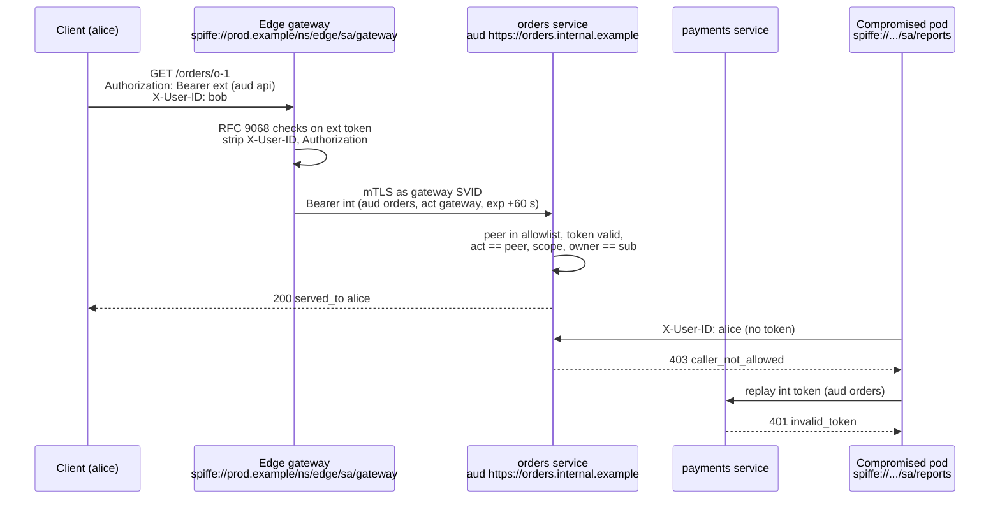

# Authentication vs Authorization Architecture: Edge Termination vs Zero-Trust End-to-End Token Propagation Across Microservices

> [!summary] Claim
> Verifying the token once at the edge and forwarding `X-User-ID` turns identity into a header that anything able to reach the service can type, so every internal hop must instead authenticate two things on every request, the calling workload (mTLS or a SPIFFE SVID) and the end user (a short-lived token whose `aud` names that one service), and then authorize the object itself, because RFC 9700 Section 4.13 and NIST SP 800-207 tenet 2 both refuse to let network position stand in for identity.

Part of [API Authentication and Identity](README.md) in [API Engineering](../README.md).

## TL;DR

Mechanism: edge termination verifies the external access token at the gateway and propagates identity as plain headers or the original token; zero-trust propagation verifies at every service, using a per-hop, audience-restricted internal token (RFC 9068 profile, `act` naming the caller per RFC 8693 Section 4.1) plus the transport peer's workload identity.
Contract rule: a reverse proxy "MUST therefore sanitize any inbound requests to ensure the authenticity and integrity of all header values relevant for the security of the application servers", and the proxy-to-service link "MUST be protected against eavesdropping, injection, and replay of messages" `(RFC 9700 Section 4.13)`; every resource server MUST reject a token whose `aud` does not name it `(RFC 9068 Section 4)`.
Trap: a gateway that appends `X-User-ID` instead of replacing it lets the client's copy win, because Starlette 1.10.0 `Headers.get` returns the first matching line, and a service that never sees a credential cannot tell a gateway from a compromised pod; the lab reproduces both, plus a passthrough token that only works if every service shares one audience.
Portability: the 39-test lab passes on CPython 3.14.6 (re-run in verification) and, in the drafter's matrix run, on 3.12.13, 3.13.18, 3.14.10, 3.15.2, and free-threaded 3.15.0b3; none of Uvicorn 0.54.0, Hypercorn 0.18.0, and Granian 2.8.7 populates the ASGI `tls` extension, so an app behind them cannot read the mTLS peer and needs a sidecar, a terminating proxy with `Client-Cert`, or a JWT-SVID.
When not to use it: a single deployable whose only ingress is a sidecar on loopback can trust a sanitized header from that sidecar, and an ES256 verification costs about 80 us per hop in the lab, so very deep synchronous call graphs should verify at the boundary of each trust domain rather than by habit at every function.

## Mental model



The first arrow carries two identity claims and only one of them is proven: the bearer token is signed by the IdP, while `X-User-ID` is text the client typed.
The gateway's self-arrow is where edge termination stops; zero-trust propagation adds the next arrow, in which the gateway discards both inbound credentials and mints a new token whose audience is exactly one service and whose `act` claim names the gateway's own workload identity.
The `orders` self-arrow is the four-part check Google describes for BeyondProd backends: the caller is authenticated, the caller is authorized to call and to present an end-user credential, the end-user credential is valid, and the user is authorized for the data.
The attacker arrows show what each layer buys: the lateral pod cannot pass the peer check, and a token it steals from `orders` is useless at `payments` because its `aud` names someone else.

## How it works

### Two decisions, two status codes

Authentication answers who sent the request; authorization answers whether that principal may perform this action on this object.
HTTP keeps them apart in its status codes: `401 Unauthorized` means the request "lacks valid authentication credentials for the target resource" and the server "MUST send a `WWW-Authenticate` header field" `(RFC 9110 Section 15.5.2)`, while `403 Forbidden` means the server "understood the request but refuses to fulfill it", and an origin server MAY answer `404 Not Found` instead to hide that the resource exists `(RFC 9110 Section 15.5.4)`.
The Bearer scheme maps token failures onto those codes: `invalid_request` SHOULD be `400`, `invalid_token` (expired, revoked, malformed, or "invalid for other reasons") SHOULD be `401`, and `insufficient_scope` SHOULD be `403` with an optional `scope` attribute naming what was needed `(RFC 6750 Section 3.1)`.
When the request carried no authentication at all, the challenge SHOULD NOT include an error code, which is why the lab answers a tokenless request with exactly `WWW-Authenticate: Bearer realm="orders"` `(RFC 6750 Section 3.1)`.
RFC 9068 makes this mandatory for JWT access tokens: after any failed validation check the response "MUST include the error code "invalid_token"" `(RFC 9068 Section 4)`; the RFC's sentence says "the authorization server response", but the checks it follows are the resource server's.
The architecture question in this note is where each decision runs: at the edge only, or again at every service.

### Edge termination: the gateway as the only checkpoint

A gateway "acts as an origin server for the outbound connection but translates received requests and forwards them inbound to another server or servers" `(RFC 9110 Section 3.7)`, so it may legitimately consume the client's `Authorization` field; the rule that "A proxy forwarding a request MUST NOT modify any Authorization header fields" `(RFC 9110 Section 11.6.2)` binds forward proxies, not the origin role the gateway plays.
Envoy's `jwt_authn` filter does exactly that by default: for `forward`, "If false, the JWT is removed in the request after a success verification", and the default is false, with the caveat that removal applies only to tokens taken from headers or query parameters, not cookies (Envoy `jwt_authn` v3 `JwtProvider`, as of 2026-11).
The gateway then tells the backend who the user is in one of three ways, all of them unsigned once they leave the gateway:

- Custom identity headers such as `X-User-ID`, which the lab's `HEADER_SET` and `HEADER_APPEND` modes produce.
- Envoy `claim_to_headers`, which copies string, number, and boolean claims verbatim and serializes arrays and objects to JSON "copied base64-encoded"; the header name "is sanitized from the request for every provider configured on the filter (including on paths that bypass JWT verification) and then replaced with the claim value when verification succeeds" (Envoy `JwtClaimToHeader`, as of 2026-11).
- Envoy `forward_payload_header`, which forwards `base64url_encoded(jwt_payload_in_JSON)`: the claims without the signature, so the backend gets the same trust level as a plain header; the documentation does not say whether a client-sent header of that name is removed first, but the source adds the name to `headers_to_sanitize_` and `Filter::decodeHeaders` strips it "before any bypass decision" behind the runtime guard `envoy_reloadable_features_jwt_authn_sanitize_payload_headers_filter_wide`, on by default (envoy v1.40.2 `source/extensions/filters/http/jwt_authn/extractor.cc` and `filter.cc`), so check that guard on older releases.

NIST names the model this produces: the "implicit trust zone" is "an area where all the entities are trusted to at least the level of the last PDP/PEP gateway", the PDP/PEP "cannot apply additional policies beyond its location in the flow of traffic", and therefore "the implicit trust zone must be as small as possible" `(NIST SP 800-207 Section 2)`.
Edge termination is correct only under two conditions that RFC 9700 states as requirements, not advice: the proxy sanitizes every security-relevant header from outside, and the proxy-to-service link resists injection, because "If an attacker were able to get access to the internal network between the proxy and application server, the attacker could also try to circumvent security controls in place" `(RFC 9700 Section 4.13)`.

### Why append is a vulnerability and set is not enough

The order of field lines with the same name is significant, a proxy MUST NOT reorder them, and a recipient MAY combine them into one comma-separated value `(RFC 9110 Section 5.3)`; a custom field like `X-User-ID` has no list syntax, so what a backend sees for two copies is implementation behavior.
Starlette 1.10.0 lowercases the requested name and returns the first matching line from `scope["headers"]` `(starlette 1.10.0 starlette/datastructures.py, Headers.__getitem__)`, and `Headers.get` goes through the same lookup.
A gateway that appends its value after the client's therefore loses: the lab's `HEADER_APPEND` mode forwards `[b"bob", b"alice"]` for `x-user-id`, and the header-trusting service serves Bob's order to Alice.
`HEADER_SET` strips every case variant first, which fixes the request that went through the gateway, and changes nothing for a request that did not: the same service answers `200` with `served_to: bob` to any process that can open a connection and type the header.
RFC 9700 draws the same picture with `X-Forwarded-For`, which proxies "accept ... and just add the origin of the inbound request (making it a list)", so "the attacker could simply add an allowed IP address to the header and render the protection useless" `(RFC 9700 Section 4.13)`; see [[Forwarded-Header-RFC-7239-and-X-Forwarded-For-Spoofing]] for the client-IP variant.

```python
def propagate(
    headers: list[Header],
    principal: Principal,
    mode: PropagationMode,
    *,
    audience: str,
    issuer: InternalIssuer | None,
) -> list[Header]:
    """The header list the gateway sends upstream for an already verified principal."""
    user = principal.subject.encode("latin-1")
    scopes = " ".join(sorted(principal.scopes)).encode("latin-1")
    if mode is PropagationMode.HEADER_APPEND:
        return [*headers, (b"x-user-id", user), (b"x-user-scopes", scopes)]
    if mode is PropagationMode.HEADER_SET:
        return [*strip_identity_headers(headers), (b"x-user-id", user), (b"x-user-scopes", scopes)]
    if mode is PropagationMode.PASSTHROUGH:
        return strip_identity_headers(headers)
    if issuer is None:
        raise ValueError("TOKEN_EXCHANGE needs an InternalIssuer")
    token = issuer.mint(principal, audience).encode("ascii")
    return [
        *strip_identity_headers(headers, extra=[b"authorization"]),
        (b"authorization", b"Bearer " + token),
    ]
```

### Why the network is not an identity

NIST SP 800-207 tenet 2 is the rule edge termination breaks: "All communication is secured regardless of network location", because "Network location alone does not imply trust", and communication should "provide source authentication" `(NIST SP 800-207 Section 2.1)`.
Tenet 3 adds that "authentication and authorization to one resource will not automatically grant access to a different resource", and tenet 6 that all authentication and authorization "are dynamic and strictly enforced before access is allowed" `(NIST SP 800-207 Section 2.1)`.
NIST SP 800-204B applies this to microservices: "The entire network and all microservices are untrusted", so mutual authentication such as mTLS is required between services, and the code of the enforcement framework "should be verifiable and non-bypassable (always invoked)" `(NIST SP 800-204B Section 1)`.
OWASP lists the same failure as broken authentication: a microservice is vulnerable if "Other microservices can access it without authentication" (OWASP API2:2023).
Google's BeyondProd lists "No inherent mutual trust between services" as a benefit in its own right: "Only authenticated, trusted, and specifically authorized callers or services can access any other service", which keeps a compromised service from expanding its reach (Google BeyondProd, content as of 2026-09, page last updated 2026-11-10).

### Propagating the user, option 1: pass the external token through

Forwarding the client's token unchanged keeps a cryptographic proof at every hop, but RFC 9068 Section 4 makes every hop check that `aud` names itself, so passthrough only works if the IdP lists every service in `aud` or every service accepts the edge's audience.
Both are substitution attacks by construction: a token presented to one service "might then present that same access token to a different protected resource for which the access token is not intended" `(RFC 8725 Section 2.7)`, and the SPIFFE JWT-SVID specification gives the concrete version: "if Alice has a token with audiences Bob and Chuck, and transmits that token to Chuck, then Chuck can impersonate Alice by sending the same token to Bob" (JWT-SVID Section 7.2).
RFC 9068 requires authorization servers to "use a distinct identifier as an "aud" claim value to uniquely identify access tokens issued by the same issuer for distinct resources" `(RFC 9068 Section 5)`, and RFC 9700 says tokens SHOULD be audience-restricted "to a specific resource server or, if that is not feasible, to a small set of resource servers" `(RFC 9700 Section 2.3)`.
The Model Context Protocol states the rule bluntly for its servers: an MCP server "MUST NOT pass through the token it received from the MCP client" (MCP 2026-07-28, Authorization Security Considerations, Access Token Privilege Restriction).
The lab shows both sides: with a strict `orders` audience the passthrough request gets `401`; with the shared edge audience it succeeds, which is precisely the configuration that makes replay work.

### Propagating the user, option 2: exchange at the edge, per hop

NIST describes the common alternative: "exchange an external EUC, like an Oauth bearer token, at ingress for an internal credential that is encoded within a JWT" `(NIST SP 800-204B Section 4.4.3)`.
RFC 8693 standardizes the exchange and the composite token it yields: in delegation, "principal A still has its own identity separate from B" and the token carries both, the `act` claim naming the current actor `(RFC 8693 Section 1.1)` `(RFC 8693 Section 4.1)`.
For access control "the consumer of a token MUST only consider the token's top-level claims and the party identified as the current actor by the "act" claim", and nested actors are "informational only" `(RFC 8693 Section 4.1)`; the lab's `Principal.actor` reads only the outermost `act.sub`, and a test with a nested `act` proves the prior actor is ignored.
The lab's `InternalIssuer` mints, per upstream call, an RFC 9068 token with `iss` the edge, `aud` the one target service, `sub` and `client_id` copied from the verified external token, `act: {"sub": <gateway SPIFFE ID>}`, and a 60-second lifetime; the full STS protocol, `may_act`, and on-behalf-of chains belong to [[Service-to-Service-Identity-Client-Credentials-and-Token-Exchange-RFC-8693]].
Google's end-user context tickets are the same idea in a proprietary format: "integrity-protected, centrally issued, forwardable credentials that attest to the identity of an end user", issued as "short-lived, cryptographic" tickets after the frontend authenticates the user (Google BeyondProd).
A third option, opaque tokens at the edge exchanged for JWTs by introspection (the phantom-token pattern, RFC 7662), shares this structure and is covered in [[Refresh-Token-Rotation-Reuse-Detection-and-Token-Revocation-Architectures]].

### Proving the caller: workload identity

A user token says whose request it is; it does not say which process is presenting it, so a zero-trust service also authenticates its transport peer.
SPIFFE gives workloads a URI identity of the form `spiffe://trust-domain-name/path`, with no query or fragment, a lowercase trust domain, and a 2048-byte length every implementation MUST support (SPIFFE-ID Sections 2, 2.1, and 2.3).
An X.509-SVID carries it as exactly one URI SAN, and validators "MUST reject" an SVID with more than one; for authentication the leaf must have `cA` false, no `keyCertSign` or `cRLSign`, the `spiffe` scheme, and a non-root path (X509-SVID Sections 2 and 5.2); chain validation and SPIFFE bundles are covered in [[Mutual-TLS-mTLS-Handshake-and-SPIFFE-Identity]].
The lab's `spiffe_id_from_pem` enforces the one-URI, non-CA, scheme, and path rules, and its tests reject two URIs, no URI, a root ID, an `https` URI, and a CA certificate.
An ASGI app can receive the peer certificate through the ASGI TLS extension: version 0.3 (2026-09-15) "removed all fields except" `client_cert_chain`, an iterable of PEM strings with the client certificate first, which "shall be an empty iterable" when the server cannot provide it, "e.g. if TLS is terminated by a separate proxy or load balancer" (asgiref `specs/tls.rst`).
None of the pinned servers provides it: Uvicorn 0.54.0 builds the h11 scope with no `extensions` key `(uvicorn 0.54.0 uvicorn/protocols/http/h11_impl.py, H11Protocol.handle_events)`, Hypercorn 0.18.0 fills `extensions` with only `http.response.trailers`, `http.response.push`, and `http.response.early_hint` `(hypercorn 0.18.0 hypercorn/protocol/http_stream.py, HTTPStream.handle)`, and neither calls `getpeercert` anywhere in its installed source.
Granian 2.8.7's ASGI scope carries only `http.response.pathsend` and `websocket.http.response` `(granian 2.8.7 src/asgi/utils.rs, ASGI_EXTENSIONS)`, although all three servers can require a client certificate (`ssl_cert_reqs` in Uvicorn's `Config`, `verify_mode` in Hypercorn's `Config`, `--ssl-client-verify` in Granian's CLI).
So in Python deployments the peer identity arrives one of three ways: a mesh sidecar terminates mTLS and enforces the peer policy itself, a terminating proxy forwards it in `Client-Cert` ([[Client-Cert-Header-and-TLS-Terminating-Proxies-RFC-9440]]), or the caller sends a JWT-SVID, whose `aud` MUST be present and checked and whose `exp` MUST be set (JWT-SVID Sections 3.2 and 3.3).
The lab models a server that implements the extension with `with_peer_certificate`, a ten-line ASGI wrapper, and says so in its docstring.

### The resource server's verifier

RFC 9068 Section 4 lists the checks a resource server MUST make: `typ` is `at+jwt` or `application/at+jwt`; `iss` exactly matches the expected issuer; `aud` contains this server's identifier; the signature verifies with the issuer's keys and `alg` is not `none`; and the current time is before `exp`, with leeway "usually no more than a few minutes".
`typ` comparison follows JWS: media types are case-insensitive, and a recipient "MUST treat it as if "application/" were prepended to any "typ" value not containing a '/'" `(RFC 7515 Section 4.1.9)`, so the lab accepts `at+jwt`, `at+JWT` (the spelling in RFC 9068's own example), and `APPLICATION/AT+JWT`, and rejects `JWT`, the type an OIDC ID token or a JWT-SVID carries (JWT-SVID Section 2.3 allows only `JWT` or `JOSE`).
Explicit typing is RFC 8725's defense against cross-JWT confusion, and validation rules for different kinds of JWT from one issuer MUST be mutually exclusive `(RFC 8725 Section 3.11)` `(RFC 8725 Section 3.12)`.
RFC 9068 also makes `iss`, `exp`, `aud`, `sub`, `client_id`, `iat`, and `jti` REQUIRED `(RFC 9068 Section 2.2)`, which the lab enforces with PyJWT's `require` option.

```python
@dataclass(frozen=True, slots=True)
class TokenVerifier:
    """RFC 9068 Section 4 validation for one resource server (one audience)."""

    issuer: str
    audience: str
    keys: Mapping[str, ec.EllipticCurvePublicKey]
    algorithms: tuple[str, ...] = ("ES256",)
    leeway: int = 60

    def verify(self, token: str) -> Principal:
        try:
            header = jwt.get_unverified_header(token)
        except jwt.InvalidTokenError as exc:
            raise TokenRejected(f"malformed: {exc}") from exc
        alg, typ, kid = header.get("alg"), header.get("typ"), header.get("kid")
        if alg not in self.algorithms:  # RFC 8725 Section 3.1, never trust the header's choice
            raise TokenRejected(f"alg {alg!r} not allowed")
        if not isinstance(typ, str) or normalize_media_type(typ) not in ACCESS_TOKEN_TYPES:
            raise TokenRejected(f"typ {typ!r} is not an access token")  # RFC 8725 Section 3.11
        if not isinstance(kid, str) or kid not in self.keys:
            raise TokenRejected(f"unknown kid {kid!r}")
        try:
            claims: dict[str, Any] = jwt.decode(
                token,
                self.keys[kid],
                algorithms=list(self.algorithms),
                audience=self.audience,
                issuer=self.issuer,
                leeway=self.leeway,
                options={"require": list(REQUIRED_CLAIMS)},
            )
        except jwt.InvalidTokenError as exc:
            raise TokenRejected(f"{type(exc).__name__}: {exc}") from exc
        return _principal(claims)
```

PyJWT's defaults are why every argument above is explicit.
With `audience=None`, `_validate_aud` returns silently for a token with no `aud` and raises `InvalidAudienceError` for a token that has one; with an audience configured, a missing `aud` raises `MissingRequiredClaimError` `(pyjwt 2.15.1 jwt/api_jwt.py, PyJWT._validate_aud)`.
With `issuer=None`, `_validate_iss` returns without looking at `iss` at all `(pyjwt 2.15.1 jwt/api_jwt.py, PyJWT._validate_iss)`, and PyJWT never inspects `typ`, so the header check is the application's job.
The base JWT rule is weaker than the profile: RFC 7519 rejects a mismatched `aud` only "when this claim is present" and calls the claim OPTIONAL `(RFC 7519 Section 4.1.3)`, while RFC 8725 says that when one issuer serves several relying parties the JWT MUST contain `aud` and a recipient MUST reject it "if the audience value is not present or not associated with the recipient" `(RFC 8725 Section 3.9)`.
Key discovery, `kid` caching, and rotation are in [[JWKS-Discovery-Caching-Key-Rotation-and-Thundering-Herd-Protection]]; `alg` confusion and `jku` SSRF are in [[JWT-Cryptographic-Pitfalls-and-RFC-8725-Best-Current-Practices]].

### Binding the two identities

BeyondProd's backend accepts a request only if the frontend "is authenticated using a valid, unrevoked certificate", its ALTS identity "is authorized to make requests to the backend service and present an EUC ticket", "The end-user context ticket is valid", and "The user in the EUC ticket is authorized to access the requested data"; in a chain, "every intermediary service does a service access check on inbound RPCs, and the ticket is forwarded on outbound RPCs" (Google BeyondProd).
NIST calls this the EU+SVC-SVC request, which "requires the verification of two identities: the calling user identity and the service identity" `(NIST SP 800-204B Section 5.2.2)`.
The lab's `build_zero_trust_service` runs the checks in that order, and adds one binding of its own: when `bind_actor_to_peer` is true, the token's current actor must equal the mTLS peer's SPIFFE ID.
That rule is a design choice, not an RFC 8693 requirement; it makes a token minted for the gateway useless to any other workload that steals it, and the lab shows a compromised `orders` pod replaying a `payments` token getting `403 actor_is_not_peer`, then `200` once the binding is turned off.
The standards-based way to get the same property is to bind the token to the caller's certificate with `cnf` and `x5t#S256` (RFC 8705) or to a DPoP key (RFC 9449), covered in [[Sender-Constrained-Tokens-DPoP-RFC-9449-and-mTLS-Binding-RFC-8705]].

### Where each authorization decision lives

The edge can decide what it can see: whether the token is valid, whether the route is exposed, and whether the scope covers the route.
It cannot decide object-level questions, because ownership lives in the service's data; the lab's gateway lets Alice's valid `orders:read` token through to `/orders/o-2`, and only the service's `record["owner"] != principal.subject` check turns that into `404`, which is OWASP API1:2023 broken object level authorization in its usual form.
RFC 9700 wants both levels: tokens SHOULD be restricted "to certain resources and actions on resource servers or resources", and every resource server "is obliged to verify, for every request", that the token was meant for "that particular action on the particular resource" `(RFC 9700 Section 2.3)`; the refusal is an uppercase MUST for a wrong audience but a lowercase "must" for a wrong action.
NIST's default policy "rejects all requests that are unauthenticated, mandates that service and end-user credentials be present on every request, restricts all communication to services within the application's own namespace", and allows cross-namespace calls only through an explicit policy (NIST SP 800-204B Section 4.6.6, APE-SR-3); it also recommends that "All application traffic should carry end user credentials" even when the application enforces its own authorization (NIST SP 800-204B Section 4.5.2, EUAZ-SR-3).
Placement of each check inside a service is covered in [[Where-Authorization-Lives-Gateway-Middleware-vs-Domain-and-Query-Layer]], function-level guards in [[Defeating-BFLA-API5-2023-Function-Level-Guards-and-Deny-By-Default-Routers]], and tenant-scoped queries in [[Defeating-BOLA-API1-2023-Tenant-Scoped-Queries-and-PostgreSQL-RLS]].

## Numbers and limits

| Quantity | Value | Source |
|---|---|---|
| `x-user-id: alice` header line on the HTTP/1.1 wire | 18 bytes including CRLF (16 without) | measured |
| External RFC 9068 token in the lab (ES256, 7 claims + `scope`) | 417 characters | measured |
| Internal per-hop token (adds `act`, edge `iss`) | 512 characters | measured |
| `TokenVerifier.verify`, ES256 | 80.4 us/op | measured, best of 5 x 2000 |
| `jwt.decode` alone: RS256 2048 / ES256 / EdDSA | 32.9 / 55.3 / 83.4 us/op | measured, claims `sub` `iat` `exp` only |
| Verify external + mint internal (the edge's per-request work) | 112.0 us/op | measured |
| `spiffe_id_from_pem` (parse PEM, read SAN and constraints) | 6.7 us/op | measured |
| Lab internal token lifetime / verifier leeway | 60 s / 60 s | lab design; leeway "usually no more than a few minutes" `(RFC 9068 Section 4)` |
| RFC 9068 REQUIRED claims | 7 (`iss` `exp` `aud` `sub` `client_id` `iat` `jti`) | `(RFC 9068 Section 2.2)` |
| URI SANs in an X.509-SVID | exactly 1 | X509-SVID Section 2 |
| SPIFFE ID length implementations MUST support | 2048 bytes | SPIFFE-ID Section 2.3 |
| JWT-SVID `aud` values | >= 1 required, 1 "strongly recommended" | JWT-SVID Sections 3.2 and 7.2 |
| Lab module | 39 tests, 0.52 s on CPython 3.14.6 | `uv run --frozen pytest ... -q`, see Worked example |

Measured rows come from one run of a probe script (`uv run --frozen python measure.py` from `labs/`, `timeit.repeat`, best of 5 x 2000) on an Apple M3 Pro, macOS 27.3 arm64 (`uname -r` 27.3.0), CPython 3.14.6, PyJWT 2.15.1, cryptography 50.0.2, single thread, re-run in verification on 2026-11-15; they are CPU costs only, with no network or key fetch.
RSA verification is cheaper than ECDSA verification in this run, while RSA signatures make tokens longer (446 characters for the `sub`, `iat`, `exp` claim set with PyJWT's default header, versus 190 for ES256 and EdDSA).
The derived budget: a synchronous request that crosses five services, each verifying one ES256 token, spends about 5 x 80 us = 0.4 ms of CPU on token checks, plus the mTLS handshake cost, which connection reuse amortizes and which this lab does not measure.
The size cost is per request and per hop: about 500 bytes of `Authorization` instead of 18 bytes of `X-User-ID`, and per-hop tokens defeat header compression because every mint carries a new `jti` and `iat`: with hpack 4.2.0 on one encoder, `x-user-id: alice` costs 14 bytes the first time and 1 byte on each repeat, a reused 512-character token 420 bytes then 1 byte, and a freshly minted token 422 bytes on every request (measured, same machine and CPython; QPACK was not measured).

## Portability

| Runtime, library, or protocol | Behavior | Evidence |
|---|---|---|
| CPython 3.12.13 + OpenSSL 3.5.7 | 39 passed (3.12.16 is not installed here) | drafter's run, `UV_PROJECT_ENVIRONMENT=<tmp venv> uv run --frozen --python 3.12`; not re-run in verification |
| CPython 3.13.18 + OpenSSL 3.5.9 | 39 passed | drafter's run, `--python 3.13.18`; not re-run in verification |
| CPython 3.14.6 + OpenSSL 3.5.7 | 39 passed (workspace `.venv`) | `uv run --frozen pytest ...`, re-run in verification |
| CPython 3.14.10 + OpenSSL 4.1.0 | 39 passed | drafter's run, `--python 3.14.10`; not re-run in verification |
| CPython 3.15.2 + OpenSSL 4.1.0 | 39 passed | drafter's run, `--python 3.15.2`; not re-run in verification |
| CPython 3.15t free-threaded | 39 passed on 3.15.0b3, `sys._is_gil_enabled()` False, in a minimal venv constrained by `uv export --frozen`; 3.15.2t is not installed | drafter's run; not re-run in verification |
| PyJWT 2.15.1 | no `typ` check; `audience=None` accepts a token without `aud`; `issuer=None` skips `iss` | `(pyjwt 2.15.1 jwt/api_jwt.py, PyJWT._validate_aud)`; lab test |
| PyJWT 2.10.0 | `iss` compared with `in` against a configured string, so any substring passed (the advisory's example: `"abc" not in "__abcd__"` evaluated instead of `"abc" != "__abc__"`); signatures were still checked; fixed in 2.10.1 | NVD CVE-2024-53861 |
| Starlette 1.10.0 `Headers` | first matching line wins | `(starlette 1.10.0 starlette/datastructures.py, Headers.__getitem__)`; lab |
| Starlette 1.10.0 `AuthenticationMiddleware` | default `on_error` returns `400` plain text and no `WWW-Authenticate`; WebSocket gets `websocket.close` code 1000 | `(starlette 1.10.0 starlette/middleware/authentication.py, AuthenticationMiddleware.default_on_error)`; lab |
| FastAPI 0.162.0 `HTTPBearer` | missing or non-Bearer credentials -> `401` with `WWW-Authenticate: Bearer`; it parses and never verifies | `(fastapi 0.162.0 fastapi/security/http.py, HTTPBearer.__call__)`; lab |
| Uvicorn 0.54.0, Hypercorn 0.18.0 | can require client certificates, but expose no ASGI `tls` extension | installed source search; `(uvicorn 0.54.0 uvicorn/protocols/http/h11_impl.py, H11Protocol.handle_events)`; `(hypercorn 0.18.0 hypercorn/protocol/http_stream.py, HTTPStream.handle)` |
| Granian 2.8.7 | has `--ssl-client-verify`, but its ASGI scope `extensions` holds only `http.response.pathsend` and `websocket.http.response`, so no `tls` | `granian/cli.py`; `(granian 2.8.7 src/asgi/utils.rs, ASGI_EXTENSIONS)` |
| Envoy `jwt_authn` | `forward` default false; unset `audiences` -> "will not check audiences in the token"; `claim_to_headers` and `forward_payload_header` names sanitized on every path | Envoy documentation (as of 2026-11); envoy v1.40.2 `filter.cc` |
| Istio `RequestAuthentication` | a request with no credentials "will be accepted but will not have any authenticated identity" unless an authorization rule requires one; `forwardOriginalToken` default false; "The service name will be accepted if audiences is empty" | Istio documentation (as of 2026-11) |
| HTTP/1.1, HTTP/2, HTTP/3 | identity headers and `Authorization` are ordinary fields with the same semantics in all three | `(RFC 9110 Section 1.2)`, `(RFC 9110 Section 6)` |
| gRPC | JWT-SVIDs SHOULD travel in metadata key `authorization` as `Bearer <serialized_token>` | JWT-SVID Section 5.3 |

## Worked example

The [implementation](../labs/src/api_labs/f14_api_authentication_and_identity/edge_vs_zero_trust.py) contains the RFC 9068 `TokenVerifier`, the four `PropagationMode` variants of `EdgeGateway`, a header-trusting service, a zero-trust service, and a minimal X.509-SVID reader; the [test](../labs/tests/f14_api_authentication_and_identity/test_api_authentication_architecture_edge_verification_vs_zero_trust_propagation.py) has 39 `unit` cases that drive Starlette and FastAPI in process through `httpx.ASGITransport`, with deterministic P-256 keys from `ec.derive_private_key` and self-signed SVIDs standing in for SPIRE.

The edge-only failure, verbatim from the test:

```python
@pytest.mark.unit
@pytest.mark.asyncio
async def test_header_append_lets_the_client_copy_win() -> None:
    gateway = EdgeGateway(
        [Upstream("/orders", ORDERS_AUD, build_header_trust_service("orders", ORDERS))],
        EXTERNAL,
        PropagationMode.HEADER_APPEND,
    )
    # Alice authenticates honestly, then adds Bob's identity header; Starlette reads the first.
    r = await call(gateway, "/orders/o-2", [bearer(user_token("alice")), ("X-User-ID", "bob")])
    assert (r.status_code, r.json()["served_to"]) == (200, "bob")
```

The zero-trust service's handler, verbatim from the implementation, in check order:

```python
    async def read(request: Request) -> JSONResponse:
        chain = _peer_chain(request.scope)
        try:
            peer = spiffe_id_from_pem(chain[0]) if chain else None
        except SvidError:
            peer = None
        if peer is None or peer not in allowed_callers:
            # Not an HTTP authentication scheme, so 403 rather than a 401 challenge.
            return JSONResponse({"error": "caller_not_allowed", "peer": peer}, status_code=403)
        if not request.user.is_authenticated:
            return JSONResponse(
                {"error": "missing_token"},
                status_code=401,
                headers={"WWW-Authenticate": bearer_challenge(realm)},
            )
        principal: Principal = request.user.principal
        if bind_actor_to_peer and principal.actor != peer:
            return JSONResponse({"error": "actor_is_not_peer", "actor": principal.actor}, 403)
        if required_scope not in principal.scopes:
            return JSONResponse(
                {"error": "insufficient_scope"},
                status_code=403,
                headers={
                    "WWW-Authenticate": bearer_challenge(
                        realm, "insufficient_scope", required_scope
                    )
                },
            )
        record = records.get(request.path_params["record_id"])
        if record is None or record["owner"] != principal.subject:
            # Object-level authorization (OWASP API1:2023); 404 hides existence (RFC 9110 15.5.4).
            return JSONResponse({"error": "not_found"}, status_code=404)
        return JSONResponse({**record, "served_to": principal.subject, "via": peer})
```

The token check itself runs earlier, in Starlette's `AuthenticationMiddleware` with the lab's `BearerBackend`, whose `on_error` turns a `TokenRejected` into `401` with `error="invalid_token"` or `400` with `error="invalid_request"`, overriding Starlette's default `400`.
The replay and stolen-token cases, verbatim:

```python
@pytest.mark.unit
@pytest.mark.asyncio
async def test_token_for_orders_replayed_at_payments_is_invalid_token() -> None:
    token = ISSUER.mint(EXTERNAL.verify(user_token(scopes=["payments:read"])), ORDERS_AUD)
    r = await call(payments_service(), "/payments/p-1", [bearer(token)], peer_pem=GATEWAY_PEM)
    assert r.status_code == 401
    assert r.headers["www-authenticate"] == 'Bearer realm="payments", error="invalid_token"'


@pytest.mark.unit
@pytest.mark.asyncio
async def test_stolen_delegated_token_fails_when_actor_is_not_the_peer() -> None:
    # A compromised orders workload replays a token the gateway minted for payments.
    token = ISSUER.mint(EXTERNAL.verify(user_token(scopes=["payments:read"])), PAYMENTS_AUD)
    r = await call(payments_service(), "/payments/p-1", [bearer(token)], peer_pem=ORDERS_PEM)
    assert (r.status_code, r.json()["actor"]) == (403, GATEWAY_ID)
    unbound = payments_service(bind_actor_to_peer=False)
    assert (await call(unbound, "/payments/p-1", [bearer(token)], ORDERS_PEM)).status_code == 200
```

Run from `labs/` on CPython 3.14.6, macOS 27.3 arm64 (Apple M3 Pro):

```text
$ uv run --frozen pytest tests/f14_api_authentication_and_identity/test_api_authentication_architecture_edge_verification_vs_zero_trust_propagation.py -q
.......................................                                  [100%]
39 passed in 0.52s
```

The 39 cases group as follows: 5 edge-only header cases (direct spoof, append, set, emitted lines, gateway challenges), 10 zero-trust cases (end to end with object check, exchanged-token claims, no peer, lateral peer, cross-audience replay, actor binding, passthrough, bare challenge, insufficient scope, duplicate `Authorization`), 16 verifier cases (9 rejections, 4 `typ` spellings, leeway boundary, PyJWT defaults, nested actors), 6 SVID cases, and 2 framework-default cases.

## Pitfalls

> [!warning] The gateway appends identity instead of replacing it
> Trigger: the edge adds `X-User-ID` (or `X-Forwarded-For`, or a tenant header) without first deleting every client copy in every case variant.
> Symptom: backends that read the first value, as Starlette 1.10.0 does, act on the attacker's value; the lab serves Bob's order to Alice.
> Fix: strip, then set, on every listener and route, as RFC 9700 Section 4.13 requires; better, stop carrying identity in unsigned headers.

> [!warning] An "internal" header is honored from the outside
> Trigger: a framework or proxy uses a request header as an internal signal and does not remove it from untrusted requests.
> Symptom: Next.js 12.x before 12.3.5, 13.x before 13.5.9, 14.x before 14.2.25, and 15.x before 15.2.3 (per the GitHub advisory; NVD's range starts at 11.1.4) let a request bypass authorization implemented in middleware, and the advisory's workaround is to block external requests carrying `x-middleware-subrequest` (NVD CVE-2025-29927); Envoy before 1.26.0 and its patch releases did not remove a client-sent `x-envoy-original-path`, which was then "used in the URL used for `jwt_authn` checks" (NVD CVE-2023-27487).
> Fix: treat every internal header name as reserved and sanitize it at the first hop, and never let a header decide whether an authentication check runs.

> [!warning] The edge rule and the backend disagree about which request this is
> Trigger: the edge matches paths or hosts differently from the router behind it.
> Symptom: Istio's exact-path JWT requirement could be skipped by adding `?` or `#` to the URI (NVD CVE-2020-8595), and an authorization policy compared `Host` case-sensitively while routing was case-insensitive, so `Httpbin.Foo` bypassed a rule for `httpbin.foo` (NVD CVE-2021-39155).
> Fix: verify in the service that owns the resource, after its own routing, so the check and the handler see the same request; see [[HTTP-Desync-and-Header-Normalization-Across-Multi-Tier-Proxies]].

> [!warning] A request re-enters behind the checkpoint
> Trigger: a batch, fan-out, or loopback feature issues inner requests that skip the outer IP or identity check.
> Symptom: Apache APISIX's `batch-requests` plugin let attackers bypass the Admin API IP restriction through a bug in the check that overrides the client IP, and a default configuration "(with default API key) is vulnerable to remote code execution" (NVD CVE-2022-24112).
> Fix: every inner request must carry and re-prove the outer principal; an internal origin is not a principal.

> [!warning] The service verifies the token but not its audience or issuer
> Trigger: `jwt.decode(token, key, algorithms=["ES256"])` with no `audience` and no `issuer`.
> Symptom: PyJWT 2.15.1 accepts a token with no `aud` and any `iss` (the lab proves both), so a token minted for another service, or an ID token without `aud`, works here.
> Fix: pass `audience`, `issuer`, and `options={"require": [...]}`, and check `typ` yourself, as `TokenVerifier` does; pin and track the library, since PyJWT 2.10.0 briefly matched `iss` by substring, with signatures still checked (NVD CVE-2024-53861).

> [!warning] Token authentication is configured but tokenless requests still pass
> Trigger: an Istio `RequestAuthentication` without an `AuthorizationPolicy` that requires a principal, or an Envoy provider with an empty `audiences` list.
> Symptom: a request with no token "will be accepted but will not have any authenticated identity" (Istio documentation), and Envoy "will not check audiences in the token" (Envoy documentation), so a lateral caller simply omits the credential.
> Fix: deny by default at the mesh and in the service, and test the no-credential path explicitly, as the lab's `test_missing_token_gets_a_bare_bearer_challenge` does.

> [!warning] The framework's defaults speak the wrong status code
> Trigger: Starlette `AuthenticationMiddleware` with the default `on_error`, or FastAPI `HTTPBearer` treated as authentication.
> Symptom: expired or wrong-audience tokens get `400` with no `WWW-Authenticate`, so clients that refresh on `401` never do, and `HTTPBearer` lets `Bearer not.a.jwt` reach the endpoint because it only parses.
> Fix: supply an `on_error` that returns `401` with `WWW-Authenticate: Bearer error="invalid_token"` `(RFC 6750 Section 3.1)`, and verify the token in the dependency or middleware, not only parse it.

> [!warning] Authorization stops at the gateway's scope check
> Trigger: the edge enforces `orders:read` and the service trusts that as permission to read any order.
> Symptom: any user reads any other user's objects by changing an ID, OWASP API1:2023; the lab's gateway forwards Alice's request for Bob's order and only the service's ownership check returns `404`.
> Fix: the service decides object-level access from the verified `sub` and its own data on every request `(RFC 9700 Section 2.3)`.

## Security and robustness

| Attacker | Edge termination with headers | Passthrough of the external token | Per-hop exchange + peer identity |
|---|---|---|---|
| External client adds identity headers | blocked only if the gateway strips every copy (`HEADER_SET`) | blocked (no identity headers trusted) | blocked (headers stripped and ignored) |
| Compromised pod calls a service directly | succeeds: types `X-User-ID` | succeeds if it holds any user token with the shared audience | fails: peer not in allowlist (`403`) |
| Compromised service replays a token it received | n/a: there is no token | succeeds everywhere the audience is shared (RFC 8725 Section 2.7) | fails: `aud` names only the original target (`401`) |
| Stolen per-hop token used by a different workload | n/a | n/a | fails with the actor-peer binding (`403`); otherwise valid for at most 60 s |
| Edge route or path rule misconfigured | full bypass | service still checks `aud` and signature | service still checks peer, token, and object |

The OWASP API Security 2023 mapping: unsigned identity headers and unauthenticated east-west calls are API2:2023 broken authentication, whose microservice criteria are "Other microservices can access it without authentication" and "Uses weak or predictable tokens to enforce authentication"; missing object checks are API1:2023; missing function checks behind a coarse edge scope are API5:2023; and an edge that forgets to sanitize, or a mesh rule with empty audiences, is API8:2023 security misconfiguration; the full model is in [[OWASP-API-Security-Top-10-2023-Complete-Threat-Model]].
Input validation at the verifier: reject before signature work on a disallowed `alg`, a non-access-token `typ`, or an unknown `kid`, which bounds the cost of garbage tokens to a base64 decode and a dictionary lookup, and treat `kid` as an opaque lookup key, never a path or query fragment `(RFC 8725 Section 3.10)`.
Duplicate credentials are malformed: the lab rejects two `Authorization` lines with `400 invalid_request` rather than picking one, because "uses more than one method for including an access token" is the definition of that error `(RFC 6750 Section 3.1)`, and a proxy and a backend that pick different copies are a smuggling primitive.
`sub` is only meaningful per issuer: RFC 8725 requires validating the issuer-subject pair `(RFC 8725 Section 3.8)`, and RFC 9068 warns that an authorization server using `client_id` as `sub` for client credentials tokens "should prevent clients from registering an arbitrary client_id value", or a malicious client could "select the sub of a high-privilege resource owner" `(RFC 9068 Section 5)`; internal tokens should therefore come from one internal issuer whose `sub` namespace the services understand.
Defense in depth means each layer fails independently: the mesh enforces peer policy, the service verifies the token, the handler checks the object, and the database scopes the query; any one of them alone is a single point of failure.
Every service holding user tokens is a theft target: RFC 9700 says the resource server MUST treat access tokens "like other sensitive secrets and not store or transfer them in plaintext" `(RFC 9700 Section 4.9.3)`, so log redaction ([[Structured-Log-Redaction-and-Preventing-PII-and-Token-Leaks]]) and short per-hop lifetimes are part of this architecture, not hygiene.

## The principal's view

The decision is not edge versus service; it is how small to make the implicit trust zone, and the defensible default for a multi-team microservice estate is that the zone ends at the process: the edge does coarse authentication, rate limiting, and token translation, and every service re-verifies a token addressed to it and a peer identity it can name.
The organizational cost is a platform dependency: an internal issuer (or STS) and a trust bundle become tier-0 services that every request touches, and the verification library becomes something one team owns and every service imports, which is the real reason teams drift back to `X-User-ID`.
Pay that cost deliberately: publish one verifier package with the RFC 9068 checks as non-optional, one mesh policy that denies tokenless and unknown-peer traffic by default, and one audience naming scheme per service, so the per-service decision shrinks to "which scopes and which objects".
The performance cost is real but small and measurable: about 80 us of ES256 verification per hop on the lab machine and about 500 bytes per request, against which the alternative is a breach model in which one compromised pod is every user.
Edge-only header trust is acceptable when the header's whole path is a loopback hop from a sidecar that terminates mTLS, sanitizes, and enforces peer policy for exactly one application, because then "only the gateway can reach the service" is enforced by the kernel rather than by a network diagram; it is not acceptable across a node, a namespace, or a team boundary.
Choose a different mechanism when the requirement changes: sender-constrained tokens when stolen-token replay within the lifetime matters ([[Sender-Constrained-Tokens-DPoP-RFC-9449-and-mTLS-Binding-RFC-8705]]), HTTP Message Signatures when the request body itself must be attributable ([[HTTP-Message-Signatures-RFC-9421-and-Content-Digests-RFC-9530]]), and asynchronous messages, where there is no peer connection at the consumer, need a signed envelope or a token embedded with the message rather than mTLS.
The mesh is an enforcement point, not a substitute for the service: NIST SP 800-204B puts the policy in the sidecar so a central team can manage security across the organization (Section 1.1) and build audit on the mesh (Section 4.5.2), yet keeps end-user credentials on all traffic "even if the application is enforcing authentication and authorization independently", which is the right reading of both layers; see [[Service-Mesh-Architecture-Sidecar-vs-Ambient-Mesh-and-East-West-Policy]] and [[External-Authorization-Ext-Authz-and-Global-Rate-Limit-Filters]].

## Interview questions

> [!question] L5: What is the difference between `401` and `403`, and which one does a valid token with the wrong scope get?
>
> > [!success]- Answer
> > `401` means the request lacks valid authentication credentials and MUST carry a `WWW-Authenticate` challenge (RFC 9110 Section 15.5.2).
> > `403` means the server understood the request and refuses it; retrying with the same credentials will not help (RFC 9110 Section 15.5.4).
> > A valid token without the needed scope is `insufficient_scope`, which SHOULD be `403` and MAY name the required scope (RFC 6750 Section 3.1).
> > An expired or wrong-audience token is `invalid_token` and `401`.
> >
> > Follow-up: When may a server return `404` instead of `403`, and why does the lab do so for someone else's order?

> [!question] L5: Predict the output: with the gateway in `HEADER_APPEND` mode, Alice sending her valid token plus `X-User-ID: bob`, and the backend reading `request.headers.get("x-user-id")` in Starlette 1.10.0, whose order is served?
>
> > [!success]- Answer
> > Bob's.
> > The upstream header list is `[x-user-id: bob, x-user-id: alice]`, because append keeps the client's line and adds the gateway's after it.
> > Starlette's `Headers` lookup returns the first matching line, so the backend sees `bob`.
> > The lab asserts exactly this: status `200` with `served_to: bob`.
> >
> > Follow-up: Does switching to `HEADER_SET` make the service safe, and against which attacker does it still fail?

> [!question] L5: Why is checking the signature of a JWT not enough to accept it at a resource server?
>
> > [!success]- Answer
> > A valid signature proves the issuer minted the token, not that it was minted for this server or for this purpose.
> > RFC 9068 Section 4 also requires `typ` of `at+jwt`, an exact `iss` match, `aud` containing this server, and an unexpired `exp`.
> > Without `aud`, a token issued to any other service from the same issuer is accepted here, the substitution attack of RFC 8725 Section 2.7.
> > Without `typ`, an ID token from the same issuer may be confused for an access token (RFC 8725 Section 3.11).
> >
> > Follow-up: What does PyJWT 2.15.1 do if you call `jwt.decode` without `audience` on a token that has no `aud` claim?

> [!question] L6: Debug this API: after the team added Starlette's `AuthenticationMiddleware` with a JWT backend, mobile clients with expired tokens show a generic error instead of silently refreshing; what happened?
>
> > [!success]- Answer
> > The backend raises `AuthenticationError` on an expired token, and Starlette 1.10.0's `default_on_error` returns `400` plain text with no `WWW-Authenticate`.
> > The clients refresh only on `401` with a Bearer challenge, which is what RFC 6750 Section 3.1 and RFC 9068 Section 4 prescribe for `invalid_token`.
> > The fix is an `on_error` that returns `401` with `WWW-Authenticate: Bearer realm="...", error="invalid_token"`, and `400` only for `invalid_request`, as the lab's `_auth_error` does.
> > A regression test should assert the status and the exact challenge for expired, wrong-audience, and duplicate-header cases.
> >
> > Follow-up: What should a tokenless request get, and why must its challenge omit the `error` attribute?

> [!question] L6: The platform team proposes forwarding the user's original access token to every downstream service; what breaks, and what do you propose instead?
>
> > [!success]- Answer
> > Each service must check that `aud` names itself (RFC 9068 Section 4), so passthrough works only if the token names every service or every service accepts one shared audience.
> > Either way any service that receives the token can replay it to any other, which RFC 8725 Section 2.7 calls a substitution attack and JWT-SVID Section 7.2 illustrates with Alice, Bob, and Chuck.
> > The MCP specification forbids passthrough for exactly this reason.
> > Instead, exchange at the edge or at each hop for a short-lived token whose `aud` is the single next service and whose `act` names the caller (RFC 8693 Section 4.1), as NIST SP 800-204B Section 4.4.3 describes.
> >
> > Follow-up: How does the exchanged token's lifetime interact with revocation of the original token?

> [!question] L6: With services running under Uvicorn 0.54.0 behind a mesh, how does application code learn which workload called it?
>
> > [!success]- Answer
> > Not from the ASGI scope: Uvicorn 0.54.0 can require a client certificate but does not populate the ASGI `tls` extension, so `client_cert_chain` is unavailable.
> > Options are to let the sidecar enforce peer policy and keep the app's check token-based, to have a terminating proxy forward the certificate in `Client-Cert` (RFC 9440) and accept it only from that proxy, or to have callers send a JWT-SVID whose `aud` the app checks.
> > Whatever carries it, the identity should be a SPIFFE ID read from exactly one URI SAN of a leaf certificate.
> > The lab models a server that implements the extension and documents that modelling.
> >
> > Follow-up: What new trust assumption does the `Client-Cert` option introduce, and how do you enforce it?

> [!question] L7+: After an attacker fully compromises one internal service, how does the blast radius compare under edge-only headers, shared-audience passthrough, and per-hop exchange with peer identity?
>
> > [!success]- Answer
> > With edge-only headers the attacker can call every service as every user, because identity is a header and the network path is the only check.
> > With shared-audience passthrough, every user token that transits the compromised service is a key to every other service until it expires.
> > With per-hop exchange, the tokens it holds name only itself as audience, it can call only services whose allowlists include its SPIFFE ID, and with actor-peer binding or sender-constrained tokens even stolen downstream tokens fail.
> > What remains is the data the compromised service itself may access for users whose requests transit it; RFC 9700 Section 4.9.2 warns that a compromised resource server can reach all of its own resources and "obtain other access tokens held on the compromised system", which audience restriction and sender-constraining (Section 4.9.3) keep from working elsewhere.
> >
> > Follow-up: Which monitoring signal would detect the compromised service using its remaining legitimate access abnormally?

> [!question] L7+: A staff engineer argues per-hop verification is too slow for a 12-service synchronous call graph; how do you decide?
>
> > [!success]- Answer
> > Measure: in the lab ES256 verification is about 80 us per hop and verify-plus-mint at the edge about 112 us, so 12 hops cost about 1 ms of CPU, usually far below network and database time.
> > If it still matters, the fix is usually the call graph, because 12 synchronous hops is a latency and availability problem before it is a crypto one.
> > Cheaper verification exists (RS256 verified in 33 us here), and verifying once per trust-domain boundary instead of per function call inside one process is legitimate.
> > What is not legitimate is dropping verification at a network hop between separately deployed services, because that re-creates the implicit trust zone NIST SP 800-207 says to minimize.
> >
> > Follow-up: What do you cache safely on the verifier, and what must never be cached?

> [!question] L7+: Where should object-level authorization live in this architecture, and what does the gateway still own?
>
> > [!success]- Answer
> > Object-level decisions live in the service that owns the data, because only it knows who owns `o-2`; the lab's gateway passes a valid `orders:read` request for Bob's order and only the service returns `404`.
> > The gateway owns coarse decisions it can see: token validity, route exposure, scope-to-route mapping, rate limits, and token translation.
> > The mesh owns service-to-service allowlists and default deny (NIST SP 800-204B APE-SR-3).
> > RFC 9700 Section 2.3 wants both levels, audience and action on the particular resource, checked for every request.
> >
> > Follow-up: How do you keep scope names and service policies from drifting across 50 teams?

## Related

Prerequisites: [[Zero-Downtime-Schema-Migrations-Expand-Contract-and-Lock-Timeouts]]

Next: [[API-Key-Engineering-Prefixed-Entropy-Hashed-Storage-and-Zero-Downtime-Rotation]]

See also: [[API-Authentication-and-Authorization]], [[02-Programming-Languages/Python/Python-Backend-Interview-Prep/07-Auth-and-Security]], [[Service-to-Service-Identity-Client-Credentials-and-Token-Exchange-RFC-8693]], [[JWT-JWS-JWK-Structure-and-RFC-9068-Access-Token-Profile]], [[JWT-Cryptographic-Pitfalls-and-RFC-8725-Best-Current-Practices]], [[JWKS-Discovery-Caching-Key-Rotation-and-Thundering-Herd-Protection]], [[Sender-Constrained-Tokens-DPoP-RFC-9449-and-mTLS-Binding-RFC-8705]], [[Refresh-Token-Rotation-Reuse-Detection-and-Token-Revocation-Architectures]], [[OpenID-Connect-OIDC-ID-Tokens-vs-Access-Tokens-and-Metadata-Discovery]], [[HTTP-Message-Signatures-RFC-9421-and-Content-Digests-RFC-9530]], [[Mutual-TLS-mTLS-Handshake-and-SPIFFE-Identity]], [[Client-Cert-Header-and-TLS-Terminating-Proxies-RFC-9440]], [[Forwarded-Header-RFC-7239-and-X-Forwarded-For-Spoofing]], [[HTTP-Desync-and-Header-Normalization-Across-Multi-Tier-Proxies]], [[Where-Authorization-Lives-Gateway-Middleware-vs-Domain-and-Query-Layer]], [[Defeating-BOLA-API1-2023-Tenant-Scoped-Queries-and-PostgreSQL-RLS]], [[Defeating-BFLA-API5-2023-Function-Level-Guards-and-Deny-By-Default-Routers]], [[OWASP-API-Security-Top-10-2023-Complete-Threat-Model]], [[Structured-Log-Redaction-and-Preventing-PII-and-Token-Leaks]], [[API-Gateway-Architecture-Responsibilities-and-Anti-Patterns]], [[Service-Mesh-Architecture-Sidecar-vs-Ambient-Mesh-and-East-West-Policy]], [[External-Authorization-Ext-Authz-and-Global-Rate-Limit-Filters]], [[Project-4-Zero-Trust-OAuth-2-1-DPoP-and-Tenant-Isolated-Resource-Server]]

- Lab: `labs/tests/f14_api_authentication_and_identity/test_api_authentication_architecture_edge_verification_vs_zero_trust_propagation.py`

## Further reading

- [RFC 9700 OAuth 2.0 Security Best Current Practice](https://www.rfc-editor.org/rfc/rfc9700.html): Section 4.13 is the normative rule for TLS-terminating proxies, and Sections 2.3 and 4.10.2 for audience restriction.
- [RFC 9068 JWT Profile for OAuth 2.0 Access Tokens](https://www.rfc-editor.org/rfc/rfc9068.html): Section 4 is the resource server's validation checklist, and Section 5 requires distinct audiences per resource.
- [RFC 8725 JSON Web Token Best Current Practices](https://www.rfc-editor.org/rfc/rfc8725.html): substitution and cross-JWT confusion (Sections 2.7 and 2.8) and their mitigations (Sections 3.8 to 3.12).
- [RFC 8693 OAuth 2.0 Token Exchange](https://www.rfc-editor.org/rfc/rfc8693.html): delegation versus impersonation (Section 1.1) and the `act` claim with its current-actor rule (Section 4.1).
- [RFC 6750 Bearer Token Usage](https://www.rfc-editor.org/rfc/rfc6750.html): Section 3 defines the challenge and the three error codes every hop must emit.
- [NIST SP 800-207 Zero Trust Architecture](https://nvlpubs.nist.gov/nistpubs/SpecialPublications/NIST.SP.800-207.pdf): the implicit trust zone (Section 2) and the seven tenets (Section 2.1).
- [NIST SP 800-204B ABAC for Microservices Using a Service Mesh](https://nvlpubs.nist.gov/nistpubs/SpecialPublications/NIST.SP.800-204B.pdf): ingress token exchange (Section 4.4.3), the two-identity request (Section 5.2.2), and default-deny policy (Section 4.6.6).
- [Google BeyondProd](https://docs.cloud.google.com/docs/security/beyondprod): the production four-check model with ALTS service identity and end-user context tickets.
- [SPIFFE X509-SVID](https://github.com/spiffe/spiffe/blob/main/standards/X509-SVID.md) and [JWT-SVID](https://github.com/spiffe/spiffe/blob/main/standards/JWT-SVID.md): workload identity documents and why multi-audience tokens are replayable.
- [ASGI TLS extension](https://github.com/django/asgiref/blob/main/specs/tls.rst): how an ASGI server reports the mTLS peer, version 0.3.
- [Envoy jwt_authn configuration](https://www.envoyproxy.io/docs/envoy/latest/api-v3/extensions/filters/http/jwt_authn/v3/config.proto): what an edge verifier forwards, strips, and sanitizes by default.
- [NVD CVE-2025-29927](https://nvd.nist.gov/vuln/detail/CVE-2025-29927) and [NVD CVE-2023-27487](https://nvd.nist.gov/vuln/detail/CVE-2023-27487): two recent cases of internal headers honored from outside the trust zone.
