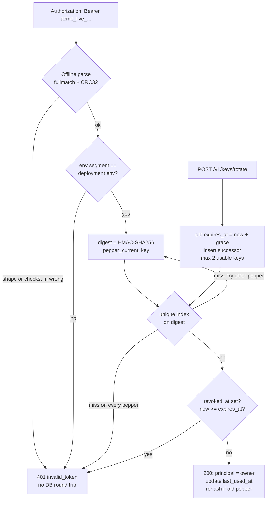

# Engineering Production API Keys: Secret-Scanning Prefixes (acme_live_...), SHA-256/HMAC Lookup Hashes, Constant-Time Comparison, and Dual-Key Rotation

> [!summary] Claim
> A production API key is a 256-bit CSPRNG secret wrapped in a greppable prefix and a CRC32 checksum, stored only as a deterministic HMAC-SHA256 digest that doubles as the database index, compared without early exit, and rotated by letting exactly two keys overlap for a bounded grace window; each of those four choices closes a specific, documented failure (leaks nobody detects, a dumped table that authenticates, a timing oracle, and a rotation outage).

Part of [API Authentication and Identity](README.md) in [API Engineering](../README.md).

## TL;DR

Mechanism: mint `acme_live_` + 43 base62 digits of `secrets.token_bytes(32)` + 6 base62 digits of `zlib.crc32` over everything before it, hand the plaintext to the client exactly once, and store only `HMAC-SHA256(pepper, key)` with a unique index on it.
Contract rule: the key travels as `Authorization: Bearer <key>` `(RFC 6750 Section 2.1)`, a missing key gets `401` with a bare `WWW-Authenticate: Bearer realm=...` challenge and an invalid one adds `error="invalid_token"` `(RFC 6750 Section 3.1)`, and every internal reason (unknown, expired, revoked, wrong environment) produces the same response.
The trap: a fast hash is correct here only because the secret has at least 112 bits of entropy, the line NIST draws for look-up secrets `(NIST SP 800-63B-4 Section 3.1.2.2)`; comparing a plaintext secret with `==` leaks it byte by byte (Mailman CVE-2021-34337), and a regex anchored with `$` accepts a key with a trailing newline.
Portability fact: the lab's 34 cases pass unchanged on CPython 3.12.13, 3.13.18, 3.14.6, 3.14.10, 3.15.2, and a 3.15.0b3 free-threaded build with the GIL off, because every primitive used (`secrets`, `hmac`, `hashlib`, `zlib.crc32`) is stdlib and `hmac.compare_digest` resolves to OpenSSL's `CRYPTO_memcmp` on all of them.
When not to use it: API keys identify a calling application, not a user, so do not use them for end-user authentication (OWASP API2:2023), and prefer short-lived OAuth client-credentials tokens or mTLS workload identity when the caller can run a token client.

## Mental model



A request's bearer credential is first parsed with no I/O: the exact shape and the CRC32 checksum reject typos, truncations, and random garbage before anything touches the database.
The environment segment is checked next so a `test` key can never authenticate against the `live` deployment.
The verifier then computes the HMAC-SHA256 of the whole key under the current pepper and looks it up in a unique index; on a miss it retries with older peppers, which is how a pepper rotation stays invisible to clients.
A hit is still refused if the row is revoked or past its `expires_at`, and every refusal collapses into one `401` so the response is not an oracle.
Rotation does not mutate the old key's secret; it sets the old row's `expires_at` to `now + grace` and inserts a successor row, so for the grace window both digests resolve and clients can redeploy without an outage.

## How it works

### The key on the wire: byte layout

The lab's format is 59 ASCII bytes, chosen so every field has a fixed offset.

| Bytes | Content | Purpose |
|---|---|---|
| 0-3 | `acme` | vendor prefix: makes the token greppable by secret scanners |
| 4 | `_` | separator: not a base64 character, and selected as part of the word on double-click (GitHub) |
| 5-8 | `live` or `test` | environment: lets the server, the scanner, and a human tell production from sandbox at a glance |
| 9 | `_` | separator |
| 10-52 | 43 base62 digits | the secret: 32 bytes from the OS CSPRNG as one big-endian integer, zero-padded |
| 53-58 | 6 base62 digits | CRC32 of bytes 0-52, zero-padded |

Every byte is in the `b64token` alphabet (`ALPHA / DIGIT / "-" / "." / "_" / "~" / "+" / "/"`), so the key is a valid bearer credential without any encoding `(RFC 6750 Section 2.1)`.
Base62 instead of `secrets.token_urlsafe` is deliberate: URL-safe base64 contains `-`, which is not a regex word character, so `\b`-anchored scanners and editor double-click both stop at it and split the key.
Fixed width matters too: without zero padding a secret whose top bytes happen to be zero encodes shorter, and a scanner regex with an exact length misses it; the lab generates keys from all-zero and all-`0xFF` input and asserts both are 59 bytes.

### Why the prefix exists: secret scanning

GitHub's April 2021 redesign added three-letter prefixes (`ghp_` for personal access tokens, `gho_`, `ghu_`, `ghs_`, `ghr_`) and an `_` separator, and reported that the prefix alone was expected to bring the secret-scanning false positive rate down to 0.5% (GitHub blog, "Behind GitHub's new authentication token formats", 2021-04-05).
The same post moved OAuth tokens from 160 to 178 bits of entropy and appended a 32-bit CRC32 checksum in the last 6 characters, base62-encoded with leading-zero padding, to "virtually eliminate" false positives in offline scanning.
The post shows its arithmetic: the old tokens were 40 hex characters (`log2(16) x 40 = 160`) and the new random part is 30 base62 characters (`log2(62) x 30 = 178`), all "without changing the token length"; the lab asserts the 178-bit figure.
GitHub's secret-scanning partner program requires a regular expression for each secret type, "as precise as possible", a test account, and the URL of an endpoint that receives matches, and lists "A uniquely defined prefix", "High entropy random strings", and "A 32-bit checksum" as best practices for identifiable secrets (GitHub Docs, secret scanning partner program, as of 2026-11).
Matches arrive as JSON objects with `token`, `type`, `url`, and `source`, signed over the raw body with `ECDSA-NIST-P256V1-SHA256`; the key id and signature travel in `Github-Public-Key-Identifier` and `Github-Public-Key-Signature`.
The IETF version of the idea is the `secret-token:` URI scheme, registered "to aid prevention of such accidental disclosures" with ABNF `secret-token-URI = secret-token-scheme ":" token` and `token = 1*pchar` `(RFC 8959 Section 1, Section 2)`; its security considerations admit it "cannot prevent intentional disclosure" `(RFC 8959 Section 4)`.
Stripe's live and sandbox prefixes (`sk_live_`, `rk_live_`, `pk_live_`, `sk_test_`, `rk_test_`, `pk_test_`) show the second job of a prefix: encoding the key's type and blast radius, from publishable (`pk_`, safe to embed) through restricted (`rk_`) to unrestricted secret (`sk_`) (Stripe Docs, API keys, as of 2026-11).
Why it pays: GitGuardian counted 23,770,171 new hardcoded secrets on public GitHub in 2024 and found that 58% of detected leaks were generic credentials, noting that keys which "lack a standardized prefix" (MySQL and MongoDB credentials) "still evade GitHub's filter", meaning Push Protection (State of Secrets Sprawl 2025).

### Entropy and the CSPRNG

`secrets.token_bytes(n)` is `SystemRandom().randbytes(n)`, and `SystemRandom.randbytes` returns `os.urandom(n)` (CPython 3.14.6 `Lib/secrets.py`, `token_bytes`; `Lib/random.py`, `SystemRandom.randbytes`).
The `secrets` documentation says that "as of 2015" 32 bytes (256 bits) is believed sufficient and that `DEFAULT_ENTROPY` may change in any release, so pass the byte count explicitly; the lab passes `SECRET_BYTES = 32`.
OAuth sets the floor for any server-generated credential: the probability of guessing one "MUST be less than or equal to 2^(-128) and SHOULD be less than or equal to 2^(-160)" `(RFC 6749 Section 10.10)`.
NIST requires random authentication secrets to come from an approved random bit generator of at least 112-bit strength `(NIST SP 800-63B-4 Section 3.2.12)`.
Base62 digits carry `log2(62) = 5.954` bits each, so 43 digits hold `256.03` bits and 42 do not reach 256; 6 digits hold a CRC32 (`62^6 = 56,800,235,584 > 2^32`) and 5 do not; the lab asserts all four inequalities.
Derived arithmetic, not a measurement: an attacker making `10^12` online guesses per second for 100 years makes about `2^71.4` guesses and succeeds with probability about `2^-184.6`, and among `2^32` issued keys the birthday collision probability is below `2^-193`, so the unique index on the digest is a correctness guard, not an expected event.

### The checksum is for machines that cannot ask you

CRC32 (`zlib.crc32`) is a public, unkeyed function, so it authenticates nothing; anyone can mint a key-shaped string with a valid checksum.
Its jobs are offline: a scanner can drop random lookalikes with false-accept probability `2^-32` without calling the issuer, and the API can reject a corrupted or truncated key before spending an HMAC and an index probe.
A single-character substitution changes one byte and an adjacent transposition changes at most 16 contiguous bits, and a CRC with a degree-32 generator detects every error burst of 32 bits or fewer.
The argument is short: a burst is the error polynomial `x^i B(x)` with `deg B <= 31`, the generator has a nonzero constant term so it shares no factor with `x^i`, and it cannot divide a nonzero `B` of lower degree; `zlib.crc32`'s initial value and final XOR are affine and cancel in the difference of two checksums.
`zlib.crc32` uses the reflected CRC-32 generator `0xEDB88320` (`0x04C11DB7` bit-reversed): a bitwise reimplementation with that constant matches `zlib.crc32` byte for byte, and 200,000 random bursts of 1 to 32 bits over a 53-byte payload all changed the checksum (verifier check, CPython 3.14.6, 2026-11-15).
The lab does not rely on the theorem: it tries all `49 x 61 = 2,989` single substitutions and every adjacent transposition of distinct characters of one key, and every variant fails the checksum.

### Storage: why a fast hash is correct here, and why HMAC

A key that is stored in plaintext authenticates whoever reads the table: a SQL injection, a leaked backup, or a support tool becomes a credential dump.
NIST draws the line by entropy: look-up secrets "SHALL be stored in a hashed form using an approved hashing function", and only secrets shorter than the SP 800-131A minimum strength ("112 bits as of the date of this publication") must be stored "in a salted and hashed form using a suitable password hashing scheme" `(NIST SP 800-63B-4 Section 3.1.2.2)`.
API keys are not a NIST authenticator type, so this is the closest normative line rather than a rule that names them.
A 256-bit key is far above that line, so a memory-hard password hash buys nothing against brute force and costs a great deal: measured here, HMAC-SHA256 of a 59-byte key took 867 ns while an `argon2-cffi 25.1.0` default Argon2id verify (`t=3`, `m=65536` KiB, `p=4`) took 29.1 ms, about 34,000 times longer, or roughly 291 seconds of verify time for every second of traffic at 10,000 requests per second.
Low-entropy secrets (passwords, human-chosen client secrets) are the opposite case and belong to [[Password-and-Client-Secret-Hashing-with-Argon2id-and-Pwdlib]].
The hash must also be deterministic and unsalted per row, because it is the lookup key: a per-row salt would force the server to know which row to salt with before it can hash, which is why salted designs carry a separate public identifier.
Seam's `prefixed-api-key` shows that two-part variant, `mycompany_BRTRKFsL_51FwqftsmMDHHbJAMEXXHCgG`, where the server stores the short token in the clear for lookup and identification and only "a hash of" the long token, and the database is searched "for `short_token` and `hash(long_token)`" (seamapi/prefixed-api-key README, as of 2026-11); its `hashLongToken` takes no salt argument, so the short token is what would make a per-row salt possible, not something Seam uses.
The lab uses the single-part variant and indexes `HMAC-SHA256(pepper, key)` directly, using HMAC as defined in `(RFC 2104 Section 2)`.
What the pepper adds over plain SHA-256: a dumped table alone cannot be used to confirm a candidate key found elsewhere, and any legacy keys with less entropy are not exposed to offline guessing; the lab checks that neither `sha256(key)` nor an HMAC under a guessed pepper appears in the index.
NIST's earlier revision recommended exactly this extra keyed step for memorized secrets, with the "secret salt" stored "separately from the hashed memorized secrets (e.g., in a specialized device like a hardware security module)" `(NIST SP 800-63B, 2017 revision, Section 5.1.1.2)`, a revision superseded by SP 800-63-4 on 2025-08-01.
The cost is a second secret with its own lifecycle: losing the pepper invalidates every key, and rotating it cannot rehash rows eagerly because the server never sees plaintext except at presentation time.
The lab therefore keeps versioned peppers, tries the newest first, and rehashes a row under the current pepper on its first successful presentation, so an unknown key costs one HMAC per active pepper (2 in the lab after a pepper rotation) and a migrated key costs one.

### Constant-time comparison: what CPython actually does

`==` on `bytes` exits early: `bytes_compare_eq` returns on a length mismatch, then on a first-byte mismatch, then calls `memcmp` (CPython 3.14.6 `Objects/bytesobject.c`, `bytes_compare_eq`), and `memcmp` makes no timing promise.
`hmac.compare_digest` is `_hashlib.compare_digest` whenever CPython is built with OpenSSL, and falls back to `_operator._compare_digest` otherwise (CPython `Lib/hmac.py` at v3.12.13, v3.13.18, v3.14.6, and v3.15.2).
The OpenSSL path's `_tscmp` sets `left = b` and `result = 1` when the lengths differ, then calls `CRYPTO_memcmp(left, right, len_b)`, so the work depends only on the length of the second argument (CPython 3.14.6 `Modules/_hashopenssl.c`, `_tscmp`).
The fallback `_tscmp` in `Modules/_operator.c` does the same with `volatile` pointers and an `OR`-accumulated `XOR` loop "to keep the amount of CPU instructions constant".
Both accept `bytes`-like objects or two `str` objects, and for `str` they raise `TypeError: comparing strings with non-ASCII characters is not supported` (CPython 3.14.6 `Modules/_operator.c`, `_operator__compare_digest_impl`), which matters because Starlette decodes header bytes as latin-1 (starlette 1.10.0 `starlette/datastructures.py`, `Headers.__getitem__`), so an attacker-sent `0xE9` byte becomes a non-ASCII `str`.
The docstring is honest about the residual leak: with different lengths "a timing attack could theoretically reveal information about the types and lengths of a and b--but not their values"; a fixed-length key format makes length public anyway.
Remote timing is practical: Crosby, Wallach, and Riedi measured events with "15-100us accuracy across the Internet, and as good as 100ns over a local network" (ACM TISSEC 12(3), 2009, abstract).
Where it matters most is comparing a plaintext secret or a MAC: Mailman Core before 3.3.5 compared its REST API password non-constant-time, so "an attacker with access to the REST API could use timing attacks to determine the value" (CVE-2021-34337, OSV record).
Comparing digests largely blinds the channel, because a guess that matches the first `k` bytes of the stored digest says nothing about the key's first characters; the lab's byte-by-byte attack recovers a 16-byte secret through an early-exit comparison in at most `62 x 16` queries, recovers nothing through the constant-time model, and recovers nothing through an early-exit comparison of SHA-256 digests.
The lab still uses `hmac.compare_digest` after the index hit, because the cost is about 31 ns (measured below) and because a store that indexes a truncated digest or a public key id does compare secret-derived bytes in application code.

### Dual-key rotation as a state machine

A key row has four observable states: usable (`expires_at` is null or in the future, `revoked_at` null), draining (usable with `expires_at` set), expired (`now >= expires_at`), and revoked (`revoked_at` set, which wins over everything).
`rotate` sets the old row's `expires_at` to `now + grace` (never extending an earlier deadline) and inserts a successor, so both keys verify until the deadline and only the successor after it; the lab checks the boundary one second before and exactly at `now + grace`.
The owner may hold at most two usable keys, which is the AWS model: "Access keys per user" is 2 and not adjustable (AWS General Reference, IAM quotas, as of 2026-11), and the documented rotation is create a second key, update applications, check last use with `GetAccessKeyLastUsed`, set the old key `Inactive` rather than deleting it, confirm, then delete (AWS IAM User Guide, "Update access keys").
Stripe's dashboard rotation keeps "both the old and new keys" working "for up to 7 days", lets the operator pick an expiration or `Now` (which deletes the old key), and advises expiring the old key only after its request volume "has been at zero for a few hours or days" (Stripe Docs, API keys, as of 2026-11).
The lab records `last_used_at` on every successful verify so the operator can see that the draining key has gone quiet before the deadline, and a `409` refuses a third key while one is still draining.
The count check and the successor insert must sit in one critical section: if the lock is released between them, two concurrent rotations both observe one usable key and the owner ends with three; the lab interleaves a second thread's rotation inside the first and asserts the second is refused.
Emergency rotation is a different operation: a leaked key is revoked immediately with no grace, which is why revocation overrides `expires_at` in the lab.

### The HTTP surface

`Authorization` carries the credential `(RFC 9110 Section 11.6.2)`, the scheme token is case-insensitive `(RFC 9110 Section 11.1)`, and a `401` "MUST send a WWW-Authenticate header field" `(RFC 9110 Section 15.5.2)`.
RFC 6750 adds the bearer specifics: no error code when the request carried no credentials, `error="invalid_token"` with `401` for an expired, revoked, or malformed one, and `insufficient_scope` with `403` `(RFC 6750 Section 3.1)`.
FastAPI 0.162.0's `HTTPBearer.__call__` splits `Authorization` on the first space with `get_authorization_scheme_param`, compares `scheme.lower() != "bearer"`, and with `auto_error=False` returns `None` instead of raising (fastapi 0.162.0 `fastapi/security/http.py`, `HTTPBearer.__call__`; `fastapi/security/utils.py`, `get_authorization_scheme_param`).
Its default error is `401` with `WWW-Authenticate: Bearer` (`HTTPBase.make_authenticate_headers`), and `APIKeyHeader` instead sends the non-standard challenge `WWW-Authenticate: APIKey` (fastapi 0.162.0 `fastapi/security/api_key.py`, `APIKeyBase.make_not_authenticated_error`).
FastAPI's documentation says these utilities returned `403 Forbidden` before 0.122.0 and `401` with `WWW-Authenticate` from 0.122.0 on (FastAPI docs, "Use Old 403 Authentication Error Status Codes", as of 2026-11).
The lab uses `HTTPBearer(auto_error=False)` and raises its own `401` so the challenge carries a realm and the RFC 6750 error code.
The rotation response body contains a live secret, so it is sent with `Cache-Control: no-store`; issuers show it once (Stripe: "You can't retrieve it later"; AWS: "This is your only opportunity to save your secret access key").

## Numbers and limits

| Quantity | Value | Source |
|---|---|---|
| Lab key length | 59 ASCII bytes: 10 prefix + 43 secret + 6 checksum | lab, `test_key_is_prefix_then_43_secret_digits_then_6_checksum_digits` |
| Secret entropy | 256 bits from `os.urandom` (43 base62 digits hold 256.03 bits) | lab, `test_digit_counts_are_the_minimum_that_hold_256_and_32_bits` |
| OAuth guessing bound | MUST be `<= 2^-128`, SHOULD be `<= 2^-160` | `(RFC 6749 Section 10.10)` |
| Hash-only storage threshold | `>= 112` bits: approved hash; below: salted password hash | `(NIST SP 800-63B-4 Section 3.1.2.2)` |
| Failed-attempt limit for an authenticator | no more than 100 consecutive failures before disabling it (an upper bound) | `(NIST SP 800-63B-4 Section 3.2.2)` |
| GitHub OAuth token entropy | 160 bits before, 178 bits after the 2021 format | GitHub blog, 2021-04-05 |
| GitHub expected false positives from prefix alone | 0.5% | GitHub blog, 2021-04-05 |
| Checksum false-accept for random strings | `2^-32` | CRC32 output size |
| Single substitutions rejected by the checksum | 2,989 of 2,989 | lab, `test_every_single_character_substitution_fails_the_checksum` |
| Remote timing resolution | 15-100 us over the Internet, 100 ns on a LAN | Crosby, Wallach, Riedi 2009, abstract |
| AWS access keys per IAM user | 2, not adjustable | AWS General Reference, IAM quotas (as of 2026-11) |
| Stripe dashboard rotation overlap | up to 7 days | Stripe Docs, API keys (as of 2026-11) |
| Leaked secrets on public GitHub in 2024 | 23,770,171 new; 70% of 2022 leaks still valid | GitGuardian State of Secrets Sprawl 2025 |
| `hashlib.sha256` of a 59-byte key | 236 ns | measured by the verifier, `uv run --frozen python -I bench.py` (`timeit.repeat`, best of 5 x 200,000), CPython 3.14.6, macOS 27.3 arm64 (Darwin 27.3.0), Apple M3 Pro, 2026-11-15 |
| `hmac.new(pepper, key, sha256).digest()` | 867 ns (`hmac.digest` one-shot: 803 ns) | same run |
| `hmac.compare_digest` on two 32-byte values | 31 ns | same run |
| Argon2id verify, `argon2-cffi 25.1.0` defaults | 29.1 ms (`t=3`, `m=65536`, `p=4`) | same run, best of 5 x 10 |
| HMACs per verify | 1 per active pepper on a miss; 1 after lazy rehash | lab, `test_unknown_key_costs_one_hmac_per_active_pepper` |
| Lab run time | `34 passed in 1.27s` | verifier run, `uv run --frozen pytest <test> -q`, CPython 3.14.6, macOS 27.3 arm64, 2026-11-15; about 0.5 s of it is the race test's deliberate `join(timeout=0.5)` |

## Portability

| Runtime, library, or layer | Behavior | Evidence |
|---|---|---|
| CPython 3.12.13 (macOS arm64) | 34 passed | lab, `UV_PROJECT_ENVIRONMENT=<tmp> uv run --frozen --python 3.12 pytest <test> -q`, full `uv.lock` env, 2026-11-15; the 3.12.13, 3.13.18, 3.14.10, 3.15.2, and free-threaded rows are the drafter's runs, not re-run by the verifier because matrix checks are paused |
| CPython 3.13.18 (macOS arm64) | 34 passed | lab, same method with `--python 3.13` |
| CPython 3.14.6 (workspace `.venv`) | 34 passed | lab, `uv run --frozen pytest <test> -q`, re-run by the verifier on 2026-11-15 |
| CPython 3.14.10 (macOS arm64) | 34 passed | lab, same method with `--python 3.14.10` |
| CPython 3.15.2 (macOS arm64) | 34 passed | lab, same method with `--python 3.15.2` |
| CPython 3.15 free-threaded | 34 passed on 3.15.0b3t with `sys._is_gil_enabled()` False; 3.15.2t was not available here | lab, minimal venv (`fastapi 0.162.0`, `starlette 1.10.0`, `pydantic 2.14.3`, `pydantic-core 2.50.4`, `httpx 0.28.1`, `pytest 9.2.0`, `pytest-asyncio 1.4.1.post1`), `PYTHONPATH=src python -X gil=0 -m pytest <test> -q`; the full lock fails to install because `psycopg-binary==3.3.8` has no free-threaded wheel |
| Debian Trixie and Alpine musl containers | not run (the 2026-11-11 instruction paused container checks) | the lab uses only stdlib crypto plus in-process ASGI, so no libc-specific path is expected, but this is not proven |
| `hmac.compare_digest` backing | `_hashlib.compare_digest` (OpenSSL `CRYPTO_memcmp`) when `_hashlib` imports, else `_operator._compare_digest` | CPython `Lib/hmac.py` at v3.12.13, v3.13.18, v3.14.6, v3.15.2 |
| `compare_digest` with non-ASCII `str` | `TypeError` on every version above | lab, `test_cpython_compare_digest_raises_on_non_ascii_str_but_not_on_bytes` |
| FastAPI 0.162.0 `HTTPBearer` | case-insensitive scheme, `401` + `WWW-Authenticate: Bearer`; before 0.122.0 these utilities returned `403` | source read; lab, `test_valid_key_authenticates_and_the_scheme_is_case_insensitive`; FastAPI docs |
| HTTP/1.1, HTTP/2, HTTP/3 | identical: `Authorization` and `WWW-Authenticate` are version-independent fields | `(RFC 9110 Section 11.6.1, Section 11.6.2)`; HPACK and QPACK only change field encoding |
| Uvicorn 0.54.0 (HTTP/1.1) | the one server-dependent input is the header name case: Starlette's `Headers.__getitem__` compares `key.lower()` with the raw scope names, so the server must deliver lowercase names; Uvicorn does, as `bytes` | source read, uvicorn 0.54.0 `uvicorn/protocols/http/h11_impl.py` (`self.headers = [(key.lower(), value) ...]`) and `httptools_impl.py`, `on_header` (`name = name.lower()`); starlette 1.10.0 `starlette/datastructures.py`, `Headers.__getitem__`; ASGI HTTP scope: `headers` is an iterable of byte-string pairs |
| Hypercorn 0.18.0 | same input: scope `headers` is `event.headers` from h11 0.16.0, whose `Headers` iterates as "(lowercased-name, value)"; HTTP/2 field names "MUST be converted to lowercase" | source read, hypercorn 0.18.0 `hypercorn/protocol/http_stream.py` (scope construction) and h11 0.16.0 `h11/_headers.py`, `Headers`; `(RFC 9113 Section 8.2)`; no socket run |
| Granian 2.8.7 | no claim made: its Rust scope builder was not read and no socket run was made, so the note asserts nothing about it beyond the ASGI contract (byte-string pairs, names "should" be lowercased) | ASGI HTTP connection scope specification |

## Worked example

The [implementation](../labs/src/api_labs/f14_api_authentication_and_identity/api_keys.py) is one stdlib-plus-FastAPI module: key minting and parsing, an in-memory `KeyStore` that models a table with a unique index on `digest`, rotation and revocation, a scanner and redactor, a FastAPI app, and pure-Python comparison models with a byte-by-byte timing attack.
The [test](../labs/tests/f14_api_authentication_and_identity/test_api_key_engineering_prefixed_entropy_hashed_storage_and_zero_downtime_rotation.py) drives all of it with injected randomness and explicit timestamps, so every run sees the same keys.

Minting and offline parsing (verbatim excerpt of `api_keys.py`):

```python
def checksum(payload: str) -> str:
    """CRC32 of the prefix and secret, as 6 base62 digits (the GitHub token-format design)."""
    return base62_encode(zlib.crc32(payload.encode("ascii")), CHECKSUM_CHARS)


def entropy_bits(alphabet_size: int, length: int) -> float:
    """Bits of entropy in `length` symbols drawn uniformly from `alphabet_size` symbols."""
    return length * math.log2(alphabet_size)


def generate_api_key(
    env: Environment, token_bytes: Callable[[int], bytes] = secrets.token_bytes
) -> str:
    """`acme_<env>_` + 43 base62 digits of 32 CSPRNG bytes + 6 base62 digits of CRC32."""
    secret = base62_encode(int.from_bytes(token_bytes(SECRET_BYTES), "big"), SECRET_CHARS)
    payload = f"{BRAND}_{env}_{secret}"
    return payload + checksum(payload)


@dataclass(frozen=True, slots=True)
class ParsedKey:
    env: Environment
    secret: str


def parse_api_key(presented: str) -> ParsedKey | None:
    """Offline validation: shape and checksum, with no database round trip."""
    match = KEY_PATTERN.fullmatch(presented)
    if match is None:
        return None
    payload = presented[:-CHECKSUM_CHARS]
    if not hmac.compare_digest(checksum(payload), match["checksum"]):
        return None
    env: Environment = "live" if match["env"] == "live" else "test"
    return ParsedKey(env=env, secret=match["secret"])
```

Verification with versioned peppers and lazy rehash (verbatim excerpt):

```python
    def verify(self, presented: str, now: datetime, environment: Environment) -> Verification:
        parsed = parse_api_key(presented)
        if parsed is None:
            return Verification(None, "malformed", 0)
        if parsed.env != environment:
            return Verification(None, "wrong_environment", 0)
        calls = 0
        for pepper_id, pepper in self._peppers_newest_first():
            digest = lookup_digest(presented, pepper)
            calls += 1
            self.index_lookups += 1
            record = self.by_digest.get(digest)
            # The index lookup already matched; the constant-time check is defense in depth
            # for stores that index a truncated digest or a separate public key id.
            if record is None or not hmac.compare_digest(record.digest, digest):
                continue
            if record.revoked_at is not None:
                return Verification(None, "revoked", calls)
            if not record.usable_at(now):
                return Verification(None, "expired", calls)
            if pepper_id != self.current_pepper:
                self._rehash(record, presented)
            record.last_used_at = now
            return Verification(record, None, calls)
        return Verification(None, "unknown", calls)
```

Dual-key rotation (verbatim excerpt):

```python
    def rotate(
        self,
        key_id: str,
        now: datetime,
        grace: timedelta,
        token_bytes: Callable[[int], bytes] = secrets.token_bytes,
    ) -> tuple[str, KeyRecord]:
        """Issue a successor and schedule the old key to expire after `grace` (dual-key window).

        The count check and the successor's insert share one critical section; releasing the
        lock between them would let two concurrent rotations both see one live key."""
        with self._lock:
            old = self.by_id[key_id]
            if len(self.live_keys(old.owner, now)) >= MAX_LIVE_KEYS:
                raise TooManyKeysError(f"{old.owner} already has {MAX_LIVE_KEYS} usable keys")
            deadline = now + grace
            if old.expires_at is None or deadline < old.expires_at:
                old.expires_at = deadline
            return self.issue(old.owner, old.env, now, token_bytes)
```

The end-to-end rotation test over in-process ASGI (verbatim excerpt of the test module):

```python
async def test_rotation_over_http_has_no_window_where_neither_key_works() -> None:
    store = new_store()
    clock = FakeClock()
    old_key, _ = store.issue("alice", "live", T0, seeded(31))
    old_auth = b"Bearer " + old_key.encode()

    rotated = await call(store, clock, "POST", "/v1/keys/rotate", old_auth)
    assert rotated.status_code == 200
    assert rotated.headers["cache-control"] == "no-store"
    body = rotated.json()
    assert body["old_key_expires_at"] == (T0 + GRACE).isoformat()
    new_auth = b"Bearer " + body["api_key"].encode()

    again = await call(store, clock, "POST", "/v1/keys/rotate", new_auth)
    assert again.status_code == 409

    statuses: list[tuple[int, int]] = []
    for offset in (timedelta(0), GRACE - timedelta(seconds=1), GRACE):
        clock.now = T0 + offset
        old = await call(store, clock, "GET", "/v1/whoami", old_auth)
        new = await call(store, clock, "GET", "/v1/whoami", new_auth)
        statuses.append((old.status_code, new.status_code))
    assert statuses == [(200, 200), (200, 200), (401, 200)]
```

The timing-attack demonstration (verbatim excerpt of the test module):

```python
TARGET = b"Q7xK2pLm9ZrT4vWc"
ALPHABET = BASE62.encode()


@pytest.mark.unit
def test_timing_oracle_on_an_early_exit_compare_recovers_the_secret() -> None:
    found, queries = timing_attack(lambda g: naive_equal(TARGET, g), len(TARGET), ALPHABET)
    assert found == TARGET
    assert queries <= 62 * len(TARGET)
```

Captured output, CPython 3.14.6, macOS 27.3 arm64 (Darwin 27.3.0), Apple M3 Pro, run from `labs/` on 2026-11-15:

```text
$ uv run --frozen pytest tests/f14_api_authentication_and_identity/test_api_key_engineering_prefixed_entropy_hashed_storage_and_zero_downtime_rotation.py -q
..................................                                       [100%]
34 passed in 1.27s
```

## Pitfalls

> [!warning] Comparing a plaintext secret with `==`
> Trigger: a static API key or shared password lives in config and the handler does `if presented == settings.api_key`.
> Symptom: response time grows with the length of the matching prefix, and an attacker recovers the secret one byte at a time; Mailman Core before 3.3.5 had exactly this on its REST API password (CVE-2021-34337), and the lab's attack recovers a 16-byte secret through an early-exit compare in at most 992 queries.
> Fix: never hold the plaintext; compare digests, and use `hmac.compare_digest` on `bytes` for any remaining secret-derived comparison.

> [!warning] `hmac.compare_digest` on a raw header `str`
> Trigger: `hmac.compare_digest(request.headers["x-api-key"], expected)` where the client sends a non-ASCII byte, which Starlette decodes as latin-1.
> Symptom: `TypeError: comparing strings with non-ASCII characters is not supported`, an unhandled exception, and a `500` instead of a `401`; every malformed request now pages someone.
> Fix: validate the shape first (the lab's `fullmatch` rejects it), or encode to `bytes` before comparing; the lab's `test_non_ascii_credential_is_a_401_not_a_500` sends `Bearer acme_\xe9`.

> [!warning] `$` instead of `fullmatch`
> Trigger: `re.match(r"acme_live_[0-9A-Za-z]{49}$", value)` as the format check.
> Symptom: `$` also matches before a trailing newline, so a key with `\n` appended passes validation and then misses the index or, worse, is stored or logged with the newline.
> Fix: `KEY_PATTERN.fullmatch(value)` or `\Z`; the lab rejects `\n`, `\r\n`, a space, and an extra character.

> [!warning] Keys in the query string
> Trigger: `GET /v1/report?api_key=...` because it is easy to paste, or FastAPI's `APIKeyQuery`.
> Symptom: the key lands in proxy logs, browser history, and `Referer`; RFC 6750 says the URI method "SHOULD NOT be used" because of the "high likelihood that the URL containing the access token will be logged" `(RFC 6750 Section 2.3)`.
> Fix: accept keys only in `Authorization`, and run the redactor over logs anyway (see [[Structured-Log-Redaction-and-Preventing-PII-and-Token-Leaks]]).

> [!warning] Rotation without overlap
> Trigger: "rotate" implemented as replace-in-place, or the new key issued and the old one deleted in the same operation.
> Symptom: every client still on the old key fails until it redeploys, so teams stop rotating and keys live for years.
> Fix: successor plus `expires_at = now + grace`, a two-key cap, and `last_used_at` to prove the old key is quiet; Stripe and AWS both document this procedure.

> [!warning] Encrypting keys instead of hashing them
> Trigger: keys stored with reversible encryption so support can "show the key again".
> Symptom: whoever obtains the data and the encryption key has every credential; in the CircleCI incident the attacker exfiltrated customer environment variables, tokens, and keys on 2022-12-22, and although the data "was encrypted at rest, the third party extracted encryption keys from a running process", so every customer was told to rotate all secrets (CircleCI incident report, 2023-01-12).
> Fix: hash, show once, and rotate instead of recovering.

> [!warning] Leaked keys that never die
> Trigger: no expiry policy, no scanning partnership, no automated revocation.
> Symptom: GitGuardian reports that 70% of secrets leaked in 2022 were still valid when its 2025 report was written.
> Fix: a prefix and checksum that scanners can match precisely, a partner endpoint that revokes on match, and alerting on `last_used_at` from new sources.

> [!warning] Distinct error messages per failure reason
> Trigger: `401 key expired`, `401 key revoked`, `401 unknown key`.
> Symptom: the endpoint becomes an oracle that tells an attacker which leaked keys were once real and when they were rotated.
> Fix: one external response (`401`, `error="invalid_token"`, same body) and the reason only in internal logs; `test_every_rejection_reason_looks_identical_to_the_client` asserts this across five reasons.

## Security and robustness

Threat model, in the order an attacker tries:

| Threat | Control in this design | Residual risk |
|---|---|---|
| Key committed to a repo or pasted in a ticket | prefix + checksum for precise scanning, partner revocation endpoint, `display_hint` redaction | scanners see only what is pushed to platforms that scan |
| Online guessing | 256-bit secret, checksum pre-filter, per-source rate limiting | none practical; rate limiting is for cost, not entropy |
| Table dump (SQLi, backup) | only `HMAC-SHA256(pepper, key)` stored; pepper held outside the database | pepper and table stolen together reduce to the plain-hash case, still 256-bit |
| Timing side channel | lookup by digest, `hmac.compare_digest` on `bytes` | length is public by design |
| Test key used against production | environment segment checked before any lookup | none |
| Stolen key replayed | scoping, source restrictions, short grace windows, fast revocation | a bearer key is replayable by design; bind it with mTLS or DPoP where the client allows (see [[Sender-Constrained-Tokens-DPoP-RFC-9449-and-mTLS-Binding-RFC-8705]]) |
| Forged scanning alert | verify `Github-Public-Key-Signature` over the raw body before acting | a forged alert can only revoke keys the forger already holds, but an unverified endpoint is a free validity oracle if it answers differently |

OWASP API2:2023 Broken Authentication lists "Uses weak or predictable tokens to enforce authentication" and sending auth tokens "in the URL" as vulnerabilities, and states that "API keys should not be used for user authentication" (OWASP API Security Top 10 2023, API2).
Defense in depth beyond the key itself: least-privilege key types (Stripe recommends restricted keys over unrestricted `sk_` keys), source restrictions (Stripe access policies by IP range, ASN, country, and threat source), and per-key audit trails keyed by `key_id` and `hint`, never by the plaintext.
Rate-limit failures per source and per key prefix to protect the database from garbage, but do not lock an owner out on failures from unknown sources, because anyone can spray random keys; see [[Credential-Stuffing-Brute-Force-Defense-and-Account-Lockout-Traps]].
If an edge gateway caches positive verification results, revocation latency becomes the cache TTL; cache by digest, keep the TTL short, and purge on revoke (see [[API-Authentication-Architecture-Edge-Verification-vs-Zero-Trust-Propagation]]).
The response that returns a new key must be `Cache-Control: no-store`, or a shared cache can replay it (see [[Caching-Authenticated-and-Multi-Tenant-API-Responses]]).

## The principal's view

The decision is not "how to hash a key" but whether a long-lived bearer secret is the right credential at all.
API keys win on onboarding friction: a developer pastes one string into `curl` and is done, and that is why Stripe, AWS, and GitHub still issue them.
They lose on lifetime and binding: a key is valid until someone rotates it and works from anywhere, so the platform must supply what the credential lacks, which is scanning, revocation, scoping, source restrictions, and usage visibility.
A staff-plus engineer therefore treats the key format as a public, versioned contract owned by one platform team: register the prefix with scanning partners, put the environment and key type in the prefix, keep the checksum algorithm stable, and treat format changes like API versions.
Rotation is a product feature with an SLO, not a runbook: self-service rotation with a bounded overlap, `last_used_at` per key, and alerts on use from new sources are what make customers actually rotate.
Choose OAuth client credentials with short-lived access tokens when callers are services that can run a token client, mTLS or workload identity when both ends are yours, and sender-constrained tokens when replay matters; keep API keys for the developer-facing edge and as the bootstrap credential for those flows (see [[Service-to-Service-Identity-Client-Credentials-and-Token-Exchange-RFC-8693]]).
The organizational trade-off is that every key issuer in the company must use the same library, because one team minting `uuid4()` keys stored in plaintext undoes the whole scheme and is invisible to scanners.

## Interview questions

> [!question] L5: Why does an API key need a vendor prefix like `acme_live_` when the random part already has 256 bits of entropy?
>
> > [!success]- Answer
> > The prefix does nothing for guessing resistance; it exists for leak detection and humans.
> > Secret scanners match on a precise regex, and an unprefixed random string is indistinguishable from a hash or an ID, which is why generic secrets dominate leak statistics.
> > GitHub reported that its prefixes alone were expected to cut scanning false positives to 0.5%.
> > The environment segment also lets the server reject a test key in production before any lookup.
> >
> > Follow-up: Why does GitHub use `_` as the separator rather than `-` or `.`?

> [!question] L5: Why is SHA-256 (or HMAC-SHA256) acceptable for storing API keys when it is unacceptable for passwords?
>
> > [!success]- Answer
> > The cost of offline guessing depends on the secret's entropy, not on the hash alone.
> > A 256-bit random key cannot be brute-forced even at billions of hashes per second, so a slow hash adds latency without adding security.
> > NIST SP 800-63B-4 Section 3.1.2.2 allows an approved hash for look-up secrets at or above 112 bits and requires a salted password hash below that.
> > Measured here, an Argon2id verify cost 29.1 ms against 867 ns for HMAC-SHA256, which would dominate every authenticated request.
> >
> > Follow-up: What changes if customers can choose their own key value?

> [!question] L5: What does the CRC32 checksum protect against, and what does it not protect against?
>
> > [!success]- Answer
> > It lets anyone validate a key's shape offline: scanners drop lookalikes with a `2^-32` false-accept rate, and the API rejects typos and truncations without a database probe.
> > It is unkeyed, so it provides no authentication; anyone can compute a valid checksum for any string.
> > The lab shows every single-character substitution and adjacent transposition of a key fails it.
> >
> > Follow-up: Would an HMAC-based checksum be better, and who would then be unable to verify it?

> [!question] L6: Predict the output: two clients call `POST /v1/keys/rotate` with the same old key at the same instant, the store checks "fewer than 2 usable keys", releases its lock, then inserts the successor.
>
> > [!success]- Answer
> > Both calls succeed and the owner ends with three usable keys: the old one draining and two successors.
> > Each call read the count while only the old key existed, because neither successor had been inserted yet.
> > The fix is to make the check and the insert one critical section (or a database constraint), which is what the lab's `test_concurrent_rotations_cannot_both_pass_the_two_key_check` enforces; the second call gets `409`.
> >
> > Follow-up: How would you enforce the two-key cap in PostgreSQL without an application lock?

> [!question] L6: Debug this API: after adding API keys, the error dashboard shows a burst of `500` responses with `TypeError: comparing strings with non-ASCII characters is not supported`, all from one scanner IP.
>
> > [!success]- Answer
> > The handler passes the raw header `str` to `hmac.compare_digest`, and CPython raises `TypeError` when either `str` argument is non-ASCII.
> > Starlette decodes header bytes as latin-1, so a byte like `0xE9` becomes a non-ASCII character, and the uncaught exception becomes a `500`.
> > Validate the key's exact shape before comparing, or compare `bytes`, so the request becomes a normal `401`.
> > Better still, compare digests rather than the presented string.
> >
> > Follow-up: Why is a `500` on malformed credentials a security problem and not just noise?

> [!question] L6: How do you rotate the server-side pepper used to HMAC every stored API key without forcing customers to rotate their keys?
>
> > [!success]- Answer
> > You cannot rehash eagerly because the server never stores plaintext keys.
> > Keep peppers versioned, write new digests under the newest pepper, and on lookup try the newest first and then older ones.
> > On a successful match under an old pepper, rehash that row under the current pepper, so active keys migrate on first use.
> > The cost is one extra HMAC per active pepper on every miss, so retire an old pepper once its rows are migrated or expired.
> >
> > Follow-up: What do you do with rows that are never presented again before you want to delete the old pepper?

> [!question] L6: Why should an expired key, a revoked key, and an unknown key all get the same response?
>
> > [!success]- Answer
> > Different responses turn the endpoint into an oracle that tells an attacker which leaked strings were real keys and when they were revoked.
> > RFC 6750 already gives one external code, `invalid_token` with `401`, for all of them.
> > Keep the precise reason in internal logs keyed by `key_id` for support.
> >
> > Follow-up: Stripe returns a different error type for an expired key; when is that trade-off acceptable?

> [!question] L7+: Design API key management for a payments platform with 50,000 merchants, a public secret-scanning partnership, and a requirement that a leaked key is unusable within five minutes of being pushed to GitHub.
>
> > [!success]- Answer
> > Use a prefixed, checksummed format with type and environment in the prefix, registered with scanning partners, and a verified partner endpoint that revokes on match.
> > Store HMAC digests with a unique index, cache positive verifications at the edge for well under five minutes, and purge the cache entry on revoke.
> > Offer restricted key types and source policies so most leaks are low blast radius.
> > Give self-service rotation with a two-key cap, a bounded grace window, and `last_used_at`, and alert on first use from a new network.
> > Measure the scanning-to-revocation latency end to end as an SLO.
> >
> > Follow-up: How do you notify the merchant without breaking their integration more than the leak already has?

> [!question] L7+: When would you refuse to issue API keys at all and require OAuth client credentials or mTLS instead?
>
> > [!success]- Answer
> > When the callers are services you control or partners that can run a token client, short-lived tokens or workload identity remove the long-lived bearer secret entirely.
> > When replay of a stolen credential is unacceptable, use sender-constrained tokens or mTLS, because an API key works from anywhere.
> > When you need per-user delegation, use OAuth; API keys identify an application, and OWASP API2:2023 says they should not authenticate users.
> > Keep API keys for developer onboarding and as the bootstrap secret for those stronger flows.
> >
> > Follow-up: How do you migrate 10,000 existing key holders without a flag day?

## Related

Prerequisites: [[API-Authentication-Architecture-Edge-Verification-vs-Zero-Trust-Propagation]]

Next: [[Password-and-Client-Secret-Hashing-with-Argon2id-and-Pwdlib]]

See also: [[API-Authentication-and-Authorization]], [[02-Programming-Languages/Python/Python-Backend-Interview-Prep/07-Auth-and-Security]], [[Refresh-Token-Rotation-Reuse-Detection-and-Token-Revocation-Architectures]], [[Sender-Constrained-Tokens-DPoP-RFC-9449-and-mTLS-Binding-RFC-8705]], [[Service-to-Service-Identity-Client-Credentials-and-Token-Exchange-RFC-8693]], [[JWKS-Discovery-Caching-Key-Rotation-and-Thundering-Herd-Protection]], [[Structured-Log-Redaction-and-Preventing-PII-and-Token-Leaks]], [[Credential-Stuffing-Brute-Force-Defense-and-Account-Lockout-Traps]], [[OWASP-API-Security-Top-10-2023-Complete-Threat-Model]], [[Caching-Authenticated-and-Multi-Tenant-API-Responses]], [[Webhook-Consumer-Engineering-Signature-Verification-Replay-Windows-and-Idempotency]], [[Pydantic-Settings-Environment-Secret-Files-and-Source-Priority]]

- Lab: `labs/tests/f14_api_authentication_and_identity/test_api_key_engineering_prefixed_entropy_hashed_storage_and_zero_downtime_rotation.py`

## Further reading

- [GitHub, "Behind GitHub's new authentication token formats" (2021)](https://github.blog/engineering/platform-security/behind-githubs-new-authentication-token-formats/): the original rationale for prefixes, the `_` separator, and the base62 CRC32 checksum.
- [GitHub Docs, secret scanning partner program](https://docs.github.com/en/code-security/secret-scanning/secret-scanning-partnership-program/secret-scanning-partner-program): what an issuer must provide and how match payloads are signed.
- [RFC 8959](https://www.rfc-editor.org/rfc/rfc8959.html): the `secret-token:` URI scheme, the standards-track framing of greppable secrets.
- [RFC 6750 Sections 2 and 3](https://www.rfc-editor.org/rfc/rfc6750.html): bearer credential syntax, the URI-parameter warning, and the `WWW-Authenticate` error codes.
- [RFC 6749 Section 10.10](https://www.rfc-editor.org/rfc/rfc6749.html#section-10.10): the `2^-128` and `2^-160` guessing bounds for generated credentials.
- [RFC 9110 Sections 11 and 15.5.2](https://www.rfc-editor.org/rfc/rfc9110.html#section-11): the HTTP authentication framework and the `401` challenge requirement.
- [RFC 2104](https://www.rfc-editor.org/rfc/rfc2104.html): the HMAC construction used for the lookup digest.
- [NIST SP 800-63B-4](https://pages.nist.gov/800-63-4/sp800-63b.html): the 112-bit threshold between plain hashing and password hashing, RBG requirements, and throttling limits.
- [CPython `Modules/_hashopenssl.c` at v3.14.6](https://github.com/python/cpython/blob/v3.14.6/Modules/_hashopenssl.c): `_tscmp` and `CRYPTO_memcmp`, the code behind `hmac.compare_digest`.
- [Crosby, Wallach, Riedi, "Opportunities and Limits of Remote Timing Attacks" (2009)](https://www.cs.rice.edu/~dwallach/pub/crosby-timing2009.pdf): the measured resolution of remote timing channels.
- [AWS IAM, "Update access keys"](https://docs.aws.amazon.com/IAM/latest/UserGuide/id-credentials-access-keys-update.html): the canonical two-key rotation procedure with last-used checks and reversible deactivation.
- [Stripe Docs, API keys](https://docs.stripe.com/keys): typed prefixes, show-once keys, and rotation with an overlap of up to 7 days.
- [CircleCI January 4, 2023 incident report](https://circleci.com/blog/jan-4-2023-incident-report/): why stored-and-encrypted secrets still had to be rotated en masse.
- [OSV CVE-2021-34337](https://api.osv.dev/v1/vulns/CVE-2021-34337): a real timing attack on a non-constant-time REST API password check.
