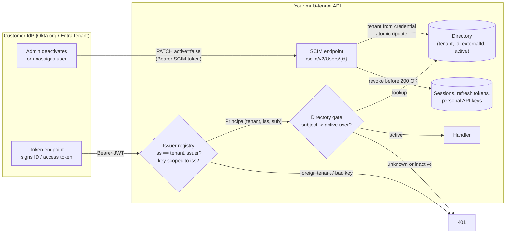

# Integrating APIs with Enterprise Identity Providers (Okta, Entra ID): Multi-Tenant Issuer Validation and Automated SCIM 2.0 User/Group Deprovisioning

> [!summary] Claim
> A B2B API is only as safe as two joins it makes on every request: token `iss` to exactly one onboarded tenant (with the signing key bound to that issuer), and token subject to a SCIM-provisioned, still-`active` directory record; skip the first and any company's employees can log in (BingBang), skip the second and a fired employee keeps working until their token expires.

Part of [API Authentication and Identity](README.md) in [API Engineering](../README.md).

## TL;DR

- Mechanism: each customer tenant is onboarded with one concrete issuer URL; a token is accepted only if its `iss` exactly equals that tenant's issuer, its signing key is scoped to that issuer, and its immutable subject (`sub`, or Entra `oid`) maps to a SCIM user that is still `active`.
- Contract rule: the SCIM bearer credential, not the URL, selects the tenant (RFC 7644 Section 6.1), and a `PATCH` that sets `active` to `false` must delete that user's sessions, refresh tokens, and personal credentials before the response is sent.
- The trap: multi-tenant Entra metadata publishes the template issuer `https://login.microsoftonline.com/{tenantid}/v2.0`, so validators that cannot pin one issuer pass `issuer=None`, which PyJWT 2.15.1 treats as "do not check `iss` at all".
- Portability: Okta and Entra speak different SCIM dialects for the same deactivation (`{"op":"replace","value":{"active":false}}` vs `{"op":"Replace","path":"active","value":"False"}`), Okta never sends `DELETE` for users, and Entra pushes changes on a roughly 40-minute cycle, so the server must normalize shapes and must not assume real-time delivery.
- When not to use it: single-tenant internal APIs behind one workforce IdP do not need an issuer registry, and consumer sign-in (social login) has no SCIM feed; use plain issuer pinning and your own account lifecycle there.

## Mental model



Two independent channels reach the API from each customer's identity provider.
The token channel (bottom) carries signed JWTs; the issuer registry accepts a token only when its `iss` is the exact issuer onboarded for one tenant and the key that signed it is allowed to vouch for that issuer, which yields a `Principal` of tenant, issuer, and immutable subject.
The provisioning channel (top) carries SCIM 2.0 requests authenticated by a per-tenant bearer secret; the secret selects the tenant, the update is applied atomically, and a transition of `active` from `true` to `false` revokes every server-side credential for that user before the `200 OK` leaves.
The directory gate joins the two channels: a cryptographically valid token whose subject has no active SCIM record is refused, which is the only way to cut off a stateless JWT before its `exp`.

## How it works

### Three identifiers, and the only pair that is stable

A federated user is identified by three values that come from different places: the tenant (yours, assigned at onboarding), the issuer (the IdP's URL), and the subject (assigned by the IdP).
OpenID Connect defines the issuer as "a case-sensitive URL" and the `sub` claim as "locally unique and never reassigned within the Issuer", at most 255 ASCII characters (OIDC Core Section 2).
Section 5.7 of OIDC Core is blunt about everything else: "the only guaranteed unique identifier for a given End-User is the combination of the `iss` Claim and the `sub` Claim", and an issuer "MAY re-use an `email` Claim Value across different End-Users at different points in time" (OIDC Core Section 5.7).
Entra adds two of its own: `tid`, the immutable GUID of the tenant the user signed in to, and `oid`, the immutable GUID of the user object, which is the same across applications in one tenant while `sub` is pairwise per application (Microsoft Entra ID token claims reference, as of 2026-11).
Microsoft's guidance is to "use the immutable claim values tid and oid as a combined key for application data" and never to use `email`, `preferred_username`, or `unique_name` for authorization (Microsoft Entra claims validation, as of 2026-11), and "the tid claim must be part of the key used to access the user's data" (Microsoft Entra access tokens documentation, as of 2026-11).
Microsoft also states that the same `sub` under two different tenants' issuers describes different users, "because claims like sub are interpreted within the context of the issuer/tenant" (Microsoft Entra access tokens documentation, as of 2026-11).
So the primary key of a federated user in your system is `(tenant, issuer, immutable subject)`, and `email`, `preferred_username`, and `upn` are display attributes only.

### Issuer validation is an exact string comparison against configuration

OIDC Core lists issuer validation as the second step of ID Token validation: "The Issuer Identifier for the OpenID Provider ... MUST exactly match the value of the `iss` (issuer) Claim" (OIDC Core Section 3.1.3.7).
The configuration side is pinned the same way: the `issuer` in a discovery document "MUST be identical to the Issuer URL that was used as the prefix to `/.well-known/openid-configuration`" and to the `iss` of tokens from that issuer (OpenID Connect Discovery 1.0 Section 4.3); RFC 8414 imposes the identical rule on OAuth metadata and says that on mismatch "the data contained in the response MUST NOT be used" (RFC 8414 Section 3.3).
Discovery's security section names the attack this blocks: an attacker publishes a discovery document claiming a real OP's issuer "but with its own endpoints and signing keys" (OpenID Connect Discovery 1.0 Section 7.2).
Exact means byte-exact: `https://acme.okta.com` and `https://acme.okta.com/` are different issuers, and no normalization (case folding, trailing slash, default port) is allowed.

A client that talks to more than one authorization server, which a multi-tenant SaaS always does, is also the precondition for the OAuth mix-up attack.
RFC 9207 adds an `iss` parameter to the authorization response and requires the client to compare it with "simple string comparison" to the issuer it sent the request to, rejecting the response on mismatch (RFC 9207 Section 2.4).
RFC 9700 says clients that interact with two or more authorization servers "MUST prevent mix-up attacks", by issuer identification or by a distinct redirect URI per AS (RFC 9700 Sections 4.4.2, 4.4.2.1, and 4.4.2.2).
The login flow details belong to [[OAuth-2-0-to-OAuth-2-1-and-RFC-9700-Security-BCP]]; this note is about what the resource server does with the token afterwards.

### Okta issuers

Every Okta org has an org authorization server whose issuer is `https://{yourOktaDomain}`; its access tokens are for Okta's own APIs and Okta says they "aren't intended for validation or use by your own apps or resource servers" and their content may change without notice (Okta authorization servers concept, as of 2026-11).
Custom authorization servers (the API Access Management product) have issuers of the form `https://{yourOktaDomain}/oauth2/{authorizationServerId}`, with the pre-provisioned one at `/oauth2/default`, and these are the ones a resource server validates.
The org authorization server is still a legitimate issuer of ID tokens: Okta says to "use the org authorization server to perform Single Sign-On (SSO) with Okta for your OIDC apps" (Okta authorization servers concept, as of 2026-11).
So a customer's Okta connection record stores the full custom-AS issuer for API access tokens and, separately, whichever issuer the customer's login integration uses for ID tokens; storing the domain and prefix-matching is the classic bug that accepts tokens from every authorization server in that org.
Keys are per authorization server too: Okta says to rotate a custom authorization server's keys "at the Authorization Server level" (Okta key rotation concept, as of 2026-11), and a validator fetches the JWKS from the `jwks_uri` in that authorization server's own metadata (Okta validate ID tokens guide, as of 2026-11), so the JWKS cache is keyed per issuer.

### Entra issuers and the `{tenantid}` template

A tenant-specific Entra discovery document (`https://login.microsoftonline.com/{tenant}/v2.0/.well-known/openid-configuration`) returns a concrete issuer, and exact matching is "all that is needed" (Microsoft Entra access tokens documentation, as of 2026-11).
The tenant-independent documents for `/common` and `/organizations` return a template instead; fetched on 2026-11-15, both returned `"issuer": "https://login.microsoftonline.com/{tenantid}/v2.0"` and the `/common` document returned `"jwks_uri": "https://login.microsoftonline.com/common/discovery/v2.0/keys"`.
Microsoft's rule for the template is: substitute the tenant ID that is the target of the current request (the token's `tid`) into `{tenantid}`, require `tid` to be a GUID, then require an exact match with `iss` (Microsoft Entra access tokens documentation, "Multitenant applications", as of 2026-11).
The keys document adds a second binding: each JWK carries an `issuer` property, and "keys that have a templated issuer value ... should only be used when the `iss` claim in the token matches this value after substituting the `tid` claim", while keys pinned to a concrete issuer such as the consumer-account tenant `9188040d-6c67-4c5b-b112-36a304b66dad` "should only be used when the `iss` claim in the token matches the value exactly".
The live `/common` keys document fetched on 2026-11-15 held 8 keys: 5 with the template issuer and 3 pinned to the `9188040d-...` consumer tenant.
The template check proves only that the token is internally consistent and came from some Entra tenant; it does not prove the tenant is your customer.
That last step is your allowlist, and in this note's design it is the exact `iss` match against the tenant's onboarded concrete issuer, so the template is used only to scope keys, never as the expected issuer.

Entra access tokens also come in two versions selected by the resource's `requestedAccessTokenVersion` manifest setting (`null` or `1` gives v1.0, `2` gives v2.0), and a v1.0 token must be validated against the v1.0 metadata document even if the API is configured with a v2.0 authority (Microsoft Entra access tokens documentation, as of 2026-11).
That v1.0 document uses a different issuer form: fetched on 2026-11-15, `https://login.microsoftonline.com/common/.well-known/openid-configuration` returned `"issuer": "https://sts.windows.net/{tenantid}/"`, not the `login.microsoftonline.com/.../v2.0` form.
The Entra SCIM guide shows that same v1.0 form in the token Entra sends to SCIM endpoints: `"iss":"https://sts.windows.net/aaaabbbb-0000-cccc-1111-dddd2222eeee/"` (Microsoft Entra SCIM endpoint guide, as of 2026-11).
An onboarding record that stores only one of the two forms rejects every token of the other version, which is a common day-one outage.

### Routing a token to a tenant

There are two safe ways to pick the tenant, and one unsafe one.
Route-bound: the request URL or host names the tenant (`/t/acme/...`, `acme.example.com`), the registry looks up that tenant's connection, and the token must carry exactly that issuer.
Issuer-first: the server reads the unverified `iss`, looks it up in a map of onboarded issuers, then runs full validation against that tenant's configuration; reading `iss` before verification is safe here because the value is only a lookup key into your allowlist and is re-verified against a key scoped to it.
Unsafe: choosing keys or JWKS URLs from token content (`jku`, `x5u`, or an `iss` used to build a discovery URL on the fly), which turns the validator into an SSRF and key-injection primitive; see [[JWT-Cryptographic-Pitfalls-and-RFC-8725-Best-Current-Practices]].
The registry must enforce that one issuer belongs to exactly one tenant: two tenants sharing an issuer means one customer's IdP admin can mint sessions in the other customer's tenant.

### What the validation libraries actually do

PyJWT 2.15.1 enables `verify_iss` by default, but its check is gated on the argument, not the option: `_validate_iss` begins `if issuer is None: return` (PyJWT 2.15.1 `jwt/api_jwt.py`, `PyJWT._validate_iss`).
With a string it requires `iss != issuer` to be false; with any other container it uses `iss not in issuer`, so passing a list of onboarded issuers works, and passing nothing silently accepts any issuer.
joserfc 1.8.0 behaves the same way structurally: `JWTClaimsRegistry.validate_iss` only type-checks the claim and then calls `check_value`, which returns immediately when no `iss` option was configured (joserfc 1.8.0 `joserfc/_rfc7519/claims.py`, `BaseClaimsRegistry.check_value`).
Neither library knows about Entra's `{tenantid}` template or the key `issuer` property; that binding is application code.
The lab's `test_pyjwt_issuer_none_silently_skips_the_issuer_check` decodes a token from a tenant that was never onboarded with only `algorithms` and `audience` set and gets its claims back.

### SCIM 2.0 resources on the wire

SCIM is three RFCs: concepts and use cases (RFC 7642), the schema (RFC 7643), and the HTTP protocol (RFC 7644), with cursor pagination added in October 2025 by RFC 9865.
Every resource has `id`, assigned by the service provider, "stable, non-reassignable", `caseExact`, `readOnly`, and never specified by the client (RFC 7643 Section 3.1).
`externalId` is the client's identifier for the resource; the service provider "MUST always interpret the externalId as scoped to the provisioning domain" and does not enforce its uniqueness (RFC 7643 Section 3.1), and in a multi-tenant server it "is required to be unique ONLY within the resources associated with the associated Tenant" (RFC 7644 Section 6.2).
`meta.version`, when present, must equal the `ETag` response header, prefixed `W/` if weak (RFC 7643 Section 3.1).
`userName` is REQUIRED, unique across the provider's users, and case insensitive (RFC 7643 Section 4.1.1), and attribute names themselves are case insensitive (RFC 7643 Section 2.1).
`active` is "a Boolean value indicating the user's administrative status", whose definitive meaning "is determined by the service provider" (RFC 7643 Section 4.1.1), and a SCIM boolean is "the literal `true` or `false`" (RFC 7643 Section 2.3.2).
That "meaning is up to you" clause is why deprovisioning correctness is a server design decision, not something the protocol gives you.
Group semantics are equally open: groups exist to express group or role based access control, "although no explicit authorization model is defined" (RFC 7643 Section 4.2), and the User resource's `groups` attribute says direct membership changes go "through the `Group` resource" (RFC 7643 Section 4.1.2).

### PATCH semantics that deprovisioning depends on

A SCIM `PATCH` body must carry `"schemas": ["urn:ietf:params:scim:api:messages:2.0:PatchOp"]` and an `Operations` array whose items have exactly one `op` of `add`, `remove`, or `replace`; `path` is optional for `add` and `replace` and required for `remove` (RFC 7644 Section 3.5.2).
Operations apply in order and the request "SHALL be treated as atomic": if any operation fails, "the original SCIM resource MUST be restored" (RFC 7644 Section 3.5.2).
On success the server returns `200 OK` with the resource, or `204 No Content` (RFC 7644 Section 3.5.2).
A `replace` with no `path` targets the resource itself, and `value` then holds the attributes to replace (RFC 7644 Section 3.5.2.3); this is the shape Okta uses for deactivation.
A `remove` whose path is a multi-valued attribute with no filter removes "the attribute and all values" (RFC 7644 Section 3.5.2.2), so `{"op":"remove","path":"members"}` empties a group.
`If-Match` with the resource's `ETag` makes `PUT` and `PATCH` conditional (RFC 7644 Section 3.14), and a failed precondition is `412 Precondition Failed` (RFC 7644 Section 3.12, Table 8).
Errors are a JSON body with schema `urn:ietf:params:scim:api:messages:2.0:Error`, a REQUIRED `status` that is the HTTP status "expressed as a JSON string", and an optional `scimType` such as `invalidFilter`, `uniqueness`, `mutability`, `invalidSyntax`, `invalidPath`, `noTarget`, or `invalidValue` (RFC 7644 Section 3.12, Table 9).
`DELETE` returns `204 No Content`, after which every operation on that resource returns `404 Not Found` and the resource is omitted from queries, even if it is only soft-deleted internally (RFC 7644 Section 3.6).

### The Okta dialect

For new Okta Integration Network (OIN) integrations, Okta sends `PATCH` only to activate a user, deactivate a user, and sync the password; every other update is a full `PUT` (Okta SCIM 2.0 guide, as of 2026-11).
Custom apps built with the App Integration Wizard send every update, deactivation included, as `PUT` with `"active": false` in the full body.
The deactivation `PATCH` is pathless:

```json
{
    "schemas": ["urn:ietf:params:scim:api:messages:2.0:PatchOp"],
    "Operations": [{
        "op": "replace",
        "value": {
            "active": false
        }
    }]
}
```

"Okta doesn't perform DELETE operations on user objects in your SCIM app", "there's no deprovisioning event sent for users that are suspended inside Okta", and deleting an already-deactivated user in Okta leaves the SCIM resource untouched (Okta SCIM 2.0 guide and SCIM concept page, as of 2026-11).
Before creating a user Okta checks for an existing one with `GET /Users?filter=userName eq "..."`, so `userName eq` filtering is mandatory; it imports with `startIndex` and `count=100`, requires `itemsPerPage`, `startIndex`, and `totalResults` in responses as JSON integers, not strings, and requires stable ordering across pages (Okta SCIM 2.0 guide, as of 2026-11).
Group membership changes arrive as `PATCH` with `remove` and a filtered path such as `members[value eq "89bb1940-..."]`, or as a `replace` of the whole `members` list (Okta SCIM 2.0 guide, as of 2026-11).

### The Entra dialect

The Entra provisioning service runs an initial cycle and then incremental cycles; the SCIM guide says they "occur approximately every 40 minutes as long as the service is running" (Microsoft Entra SCIM endpoint guide, as of 2026-11).
Unassigning a user, disabling them, or soft-deleting them in Entra produces an update that sets `active` to `false`; hard deletion, which happens 30 days after soft deletion, produces a `DELETE` (Microsoft Entra "How provisioning works", as of 2026-11).
A user who was unassigned first is no longer managed by the provisioning service, so no later `DELETE` is sent for them (same page).
Entra documents its own deviations from RFC 7644 in a compatibility page, and two of them hit deprovisioning directly (Microsoft Entra SCIM compatibility known issues, as of 2026-11).
Without the `aadOptscim062020` feature flag in the tenant URL, a deactivation is `{"op": "Replace", "path": "active", "value": "False"}`: a capitalized `op` and a string, not a boolean.
With the flag it is `{"op": "replace", "path": "active", "value": false}`.
Without the flag, removing one group member is `{"op": "Remove", "path": "members", "value": [{"value": "u1091"}]}`; read literally against RFC 7644 Section 3.5.2.2, a path of `members` with no filter removes every member, so a strictly conforming server empties the whole group when Entra removes one person.
With the flag the same removal is `{"op": "remove", "path": "members[value eq \"7f4b...\"]"}`.
The SCIM guide also tells implementers not to "require a case-sensitive match on structural elements in SCIM, in particular PATCH `op` operation values", because Entra "emits the values of op as `Add`, `Replace`, and `Remove`", and says group `PATCH` "should yield an HTTP 204 No Content" (Microsoft Entra SCIM endpoint guide, as of 2026-11).
By default Entra matches users with `externalId` mapped from `mailNickname` and `userName` from `userPrincipalName` (Microsoft Entra SCIM endpoint guide, attribute mapping table, as of 2026-11); both are mutable, so for the SSO join you remap `externalId` to `objectId`, which then equals the token's `oid`.

### Binding SCIM to a tenant

RFC 7644 does not define multi-tenancy ("Multi-tenancy is OPTIONAL. The SCIM protocol does not define a scheme for multi-tenancy") but suggests that the service provider "MAY use one of the authentication mechanisms ... to determine the identity of the client and thus infer the associated Tenant" (RFC 7644 Sections 6 and 6.1).
Inferring the tenant from the credential is the safe default because every SCIM path parameter is then a lookup inside that tenant's partition, and a guessed `id` from another tenant is indistinguishable from a missing one (`404 Not Found`), which is also the BOLA defense in [[Defeating-BOLA-API1-2023-Tenant-Scoped-Queries-and-PostgreSQL-RLS]].
If the tenant is also in the URL (`/Tenants/{tenant_id}/v2/Users`, which RFC 7644 Section 6.1 lists as an option), the server must still check that it matches the credential's tenant.
The credential itself is usually a long-lived secret pasted into the IdP admin console, even though RFC 7644 says bearer tokens "MUST have a limited lifetime" (RFC 7644 Section 7.4); store only its hash, give each tenant its own, support two concurrent values for rotation, and see [[API-Key-Engineering-Prefixed-Entropy-Hashed-Storage-and-Zero-Downtime-Rotation]].
Entra is moving away from that model: its SCIM guide lists the long-lived bearer token as "Not supported for new apps" in the gallery and supports the OAuth 2.0 client credentials grant and Workload Identity Federation (an Entra-signed JWT assertion validated against a JWKS) for gallery and non-gallery apps (Microsoft Entra SCIM endpoint guide, as of 2026-11).
If the customer leaves Entra's Secret Token field empty, Entra instead sends an Entra-issued JWT whose audience is the gallery application's ID, and Microsoft says that token "should only be used for testing" (Microsoft Entra SCIM endpoint guide, as of 2026-11).

### From `active=false` to "cannot call the API"

Deprovisioning has four layers, and SCIM only reaches the first one by itself.
First, the directory record: `active` flips to `false` atomically with the rest of the `PATCH`.
Second, server-side state you issued: browser sessions, refresh tokens, personal access tokens, and API keys owned by the user must be deleted synchronously in the same request, before the `200 OK`, so the IdP's provisioning log only shows success when access is actually gone.
OIDC Back-Channel Logout is weaker here than people assume: it clears "any state associated with the identified session(s)" but says refresh tokens issued with `offline_access` "normally SHOULD NOT be revoked" (OIDC Back-Channel Logout 1.0 Section 2.7), so logout is not deprovisioning.
Third, stateless tokens already in flight: an IdP-issued JWT access token stays cryptographically valid until `exp`, and Entra's default access token lifetime is a random value between 60 and 90 minutes (75 on average), or 20 to 28 hours for CAE-enabled long-lived tokens (Microsoft Entra access tokens documentation, as of 2026-11).
The only way to cut those off at your API is a directory gate: after signature and claims validation, look the subject up in the SCIM directory and require an active record; the gate can be cached for seconds, not for the token lifetime.
Fourth, signals that arrive faster than SCIM: OIDC Back-Channel Logout delivers a Logout Token (a JWT with `iss`, `aud`, `iat`, `exp`, `jti`, `sub` or `sid`, and an `events` member `http://schemas.openid.net/event/backchannel-logout`, never a `nonce`) to which the RP must answer `200 OK` (OIDC Back-Channel Logout 1.0 Sections 2.4, 2.6, 2.8), and the Shared Signals Framework (final 29 August 2025) carries CAEP events such as `https://schemas.openid.net/secevent/caep/event-type/session-revoked` as Security Event Tokens (RFC 8417) over push (RFC 8935) or poll (RFC 8936) delivery (OpenID SSF 1.0, OpenID CAEP 1.0 Section 3.1).
SCIM is the authoritative state, the signals are the low-latency hint, and the directory gate is what makes either of them effective against tokens you did not issue.
Reactivation (`active` back to `true`) must not resurrect deleted sessions; the user logs in again.

### Joining the login to the provisioned record

The ID token gives you `(iss, sub)` or `(tid, oid)`; SCIM gives you `id`, `externalId`, and `userName`.
The join must be on an immutable value present in both, which means configuring the IdP's attribute mapping so `externalId` carries the immutable subject (Entra `objectId` to match `oid`).
When a user is assigned, Okta stores your SCIM `id` as the Okta-side `externalId` of the app user, and its documented create request sends your server `"externalId": "00ujl29u0le5T6Aj10h7"`, an Okta user ID (Okta SCIM 2.0 guide, as of 2026-11).
Okta's OIDC reference defines the ID token `sub` as "A unique identifier for the user" (example `00uk1u7AsAk6dZL3z0g3`), and lists `uid` ("A unique identifier for the user") among access token reserved claims while its access token claim table does not define `sub` (Okta OpenID Connect and OAuth 2.0 API overview, as of 2026-11).
So join ID tokens on `sub` and access tokens on `uid`, and verify per customer, with a test user before go-live, that the value arriving in SCIM `externalId` equals it, because profile mappings in the customer's Okta app can change what is sent.
If the join finds zero or more than one record, fail closed with `403` rather than falling back to email; the fallback is precisely the nOAuth account takeover.
Just-in-time creation on first login is a separate product decision: it is convenient, but a JIT-created user has no SCIM record that the IdP will ever deactivate unless the IdP later provisions and links it.

### Pagination, filtering, and rate limits

SCIM index pagination is 1-based: `startIndex` defaults to 1 and "a value less than 1 SHALL be interpreted as 1", `count` is non-negative with negatives "interpreted as 0", and `count=0` returns only `totalResults`; pagination is not stateful, so clients "MUST be prepared to handle inconsistent results" (RFC 7644 Section 3.4.2.4).
RFC 9865 adds `cursor`, `nextCursor`, and `previousCursor` for providers whose storage already pages by cursor, with `invalidCursor` among its new errors (RFC 9865 Sections 2 and 2.1).
Entra's provisioning engine uses only the `eq` and `and` filter operators and expects every uniqueness attribute to be filterable (Microsoft Entra SCIM endpoint guide, as of 2026-11).
When your server answers `429 Too Many Requests`, Okta pauses the task and honors an integer-seconds `Retry-After`; without one, or with an HTTP-date, it waits five minutes, doubles the wait on each repeat, and gives up after 10 attempts (Okta SCIM concept page, "Handle SCIM server rate limiting", as of 2026-11).
Entra retries failed objects on later cycles with decreasing frequency, drops a mostly failing job into quarantine where cycles slow to once per day, and disables the job after more than four weeks in quarantine (Microsoft Entra "How provisioning works", as of 2026-11).
Rate-limiting a SCIM endpoint therefore delays deprovisioning by minutes to hours; exempt it from generic API quotas and size it for a full initial sync.

## Numbers and limits

| Quantity | Value | Source |
| :--- | :--- | :--- |
| OIDC `sub` maximum length | 255 ASCII characters | OIDC Core Section 2 |
| Entra default access token lifetime | random 60 to 90 minutes, 75 average | Entra access tokens doc (as of 2026-11) |
| Entra CAE long-lived access token lifetime | 20 to 28 hours | Entra access tokens doc (as of 2026-11) |
| Entra incremental provisioning cycle | approximately every 40 minutes | Entra SCIM endpoint guide (as of 2026-11) |
| Entra soft delete to hard delete (`DELETE` sent) | 30 days | Entra "How provisioning works" (as of 2026-11) |
| Entra quarantine | cycles slow to once per day; job disabled after more than 4 weeks | Entra "How provisioning works" (as of 2026-11) |
| Okta `429` default wait without integer `Retry-After` | 5 minutes, doubling, at most 10 attempts | Okta SCIM concept page (as of 2026-11) |
| Okta import page size | `count=100` | Okta SCIM 2.0 guide (as of 2026-11) |
| SCIM `startIndex` floor; `count` floor | 1; 0 | RFC 7644 Section 3.4.2.4 |
| SCIM bulk limits example | `maxOperations` 1000, `maxPayloadSize` 1048576 (example values; each provider sets its own) | RFC 7644 Section 3.12, Table 8 |
| Entra `/common` JWKS keys | 8 (5 template issuer, 3 pinned to `9188040d-...`) | fetched with `curl` on 2026-11-15 |
| Multi-tenant Entra apps found vulnerable to tenant bypass | 25% of those Wiz scanned | Wiz BingBang write-up, 2023-03-29 |
| Lab run | 20 tests passed in 0.46 s (single run, 2026-11-15) | `uv run --frozen pytest ... -v`, CPython 3.14.6, macOS 27.3 arm64 (this lab) |

## Portability

| Dimension | Behavior | Evidence |
| :--- | :--- | :--- |
| CPython 3.14.6 | 20 of 20 lab tests pass | lab run on macOS 27.3 arm64, 2026-11-15 |
| CPython 3.12.16, 3.13.18, 3.15.2, 3.15.2t | not run: lab checks paused by the user on 2026-11-11; the newest language features the lab uses are `dataclass(slots=True)` (3.10+) and `str.removeprefix` (3.9+), and the workspace declares `requires-python = ">=3.12,<3.16"` | `labs/pyproject.toml`; not a proof |
| PyJWT 2.15.1 | `issuer=None` skips the check; `str` is exact; any other container uses `in` | `jwt/api_jwt.py`, `PyJWT._validate_iss` |
| joserfc 1.8.0 | `iss` value checked only when an `iss` option is registered | `joserfc/_rfc7519/claims.py`, `BaseClaimsRegistry.check_value` |
| Okta OIN vs AIW apps | new OIN: `PATCH` for activate, deactivate, password; AIW: always `PUT` | Okta SCIM 2.0 guide (as of 2026-11) |
| Entra without vs with `aadOptscim062020` | `"op":"Replace","value":"False"` vs `"op":"replace","value":false`; member removal by `value` list vs filtered path | Entra SCIM compatibility page (as of 2026-11) |
| Entra v1.0 vs v2.0 tokens | `https://sts.windows.net/{tid}/` vs `https://login.microsoftonline.com/{tid}/v2.0` | live `/common` v1.0 and v2.0 metadata fetched 2026-11-15; Entra SCIM guide (as of 2026-11) |
| Uvicorn, Hypercorn, Granian | nothing here depends on the server; multi-worker deployments need the session table and directory gate in a shared store (database or Valkey), not process memory as in the lab | design consequence; not measured |
| HTTP/1.1, HTTP/2, HTTP/3 | RFC 7644 was written against the HTTP/1.1 RFCs ("SCIM is a protocol that is based on HTTP [RFC7230]") but uses only methods, headers, status codes, and JSON bodies, so it carries over HTTP/2 and HTTP/3 unchanged; not exercised by the in-process lab | RFC 7644 Section 3.1 |

## Worked example

The lab is a Starlette app with an issuer registry, a tenant-partitioned SCIM directory, a session table, and a directory-gated bearer endpoint: [implementation](../labs/src/api_labs/f14_api_authentication_and_identity/enterprise_sso_scim.py) and [test](../labs/tests/f14_api_authentication_and_identity/test_enterprise_sso_integration_multi_tenant_oidc_and_scim_provisioning.py).
Tokens are ES256 JWTs signed with in-process P-256 keys from `cryptography`; one key plays an Okta custom authorization server, one plays the Entra `/common` template key, and one is pinned to the consumer tenant `9188040d-6c67-4c5b-b112-36a304b66dad`.

Issuer and key binding, verbatim from `IssuerRegistry` in `enterprise_sso_scim.py`:

```python
    def validate(self, token: str, *, tenant: str, audience: str) -> Principal:
        conn = self.connection(tenant)
        try:
            header = jwt.get_unverified_header(token)
        except jwt.PyJWTError:
            raise TokenRejectedError("malformed token") from None
        key = self._keys.get(str(header.get("kid")))
        if key is None:
            raise TokenRejectedError("unknown kid")
        try:
            claims = jwt.decode(
                token,
                key.public_key,
                algorithms=self._algorithms,
                audience=audience,
                issuer=conn.issuer,  # exact string match, OIDC Core 3.1.3.7 step 2
                leeway=self._leeway,
                options={"require": ["exp", "iat", "iss", "aud", "sub"]},
            )
        except jwt.PyJWTError as exc:
            raise TokenRejectedError(type(exc).__name__) from None
        self._check_key_issuer(key, claims)
        subject = claims.get(conn.subject_claim)
        if not isinstance(subject, str) or not subject:
            raise TokenRejectedError(f"missing {conn.subject_claim}")
        return Principal(tenant=conn.tenant, issuer=conn.issuer, subject=subject)

    @staticmethod
    def _check_key_issuer(key: SigningKey, claims: dict[str, Any]) -> None:
        """Bind the signing key to the token issuer (Entra keys carry an `issuer` property).

        The tenant allowlist is the exact `conn.issuer` match above; this check stops a key
        scoped to one issuer, or to the `{tenantid}` template, from vouching for another.
        """
        if "{tenantid}" not in key.issuer:
            if key.issuer != claims["iss"]:
                raise TokenRejectedError("key issuer mismatch")
            return
        tid = claims.get("tid")
        if not isinstance(tid, str) or _GUID.fullmatch(tid) is None:
            raise TokenRejectedError("tid is not a GUID")
        if key.issuer.replace("{tenantid}", tid) != claims["iss"]:
            raise TokenRejectedError("iss does not embed tid")
```

Deactivation, verbatim from `Directory.patch_user` and `Directory._revoke_sessions`; the draft copy makes the `PATCH` atomic, and revocation runs before the handler returns:

```python
    def patch_user(
        self, tenant: str, user_id: str, body: Any, if_match: str | None = None
    ) -> ScimUser:
        current = self.get_user(tenant, user_id)
        if if_match is not None and if_match != current.etag:
            raise ScimError(412, "resource changed since the supplied ETag")
        draft = dataclasses.replace(current)  # RFC 7644 3.5.2: the whole PATCH is atomic
        for op in _parse_patch(body):
            if op.path is None:
                if op.op == "remove":
                    raise ScimError(400, "remove requires a path", "noTarget")
                if not _obj(op.value):  # RFC 7644 3.5.2.3: one or more attributes
                    raise ScimError(400, "pathless op needs an object value", "invalidValue")
                for name, value in _obj(op.value).items():
                    _set_user_attr(draft, op.op, name, value)
            else:
                _set_user_attr(draft, op.op, op.path, op.value)
        draft.version = current.version + 1
        self.users[(tenant, user_id)] = draft
        if current.active and not draft.active:
            self._revoke_sessions(tenant, user_id, "scim active=false")
        return draft
```

```python
    def _revoke_sessions(self, tenant: str, user_id: str, reason: str) -> None:
        doomed = [
            sid for sid, s in self.sessions.items() if s.tenant == tenant and s.user_id == user_id
        ]
        for sid in doomed:
            del self.sessions[sid]
        self.revocations.append((tenant, user_id, reason, len(doomed)))
```

The tolerant reader for Entra's legacy string boolean, verbatim:

```python
def _coerce_bool(value: Any) -> bool:
    """RFC 7643 2.3.2 says JSON true/false; legacy Entra sends the string "False"."""
    if isinstance(value, bool):
        return value
    if isinstance(value, str) and value.lower() in {"true", "false"}:
        return value.lower() == "true"
    raise ScimError(400, f"active must be a boolean, got {value!r}", "invalidValue")
```

The directory gate on IdP-issued bearer tokens, verbatim from `create_app`:

```python
    async def api_whoami(request: Request) -> Response:
        token = _bearer(request) or ""
        try:
            tenant = registry.tenant_for_issuer(token)
            conn = registry.connection(tenant)
            principal = registry.validate(token, tenant=tenant, audience=conn.api_audience)
        except TokenRejectedError:
            return JSONResponse({"error": "invalid_token"}, status_code=401)
        # A valid JWT outlives deprovisioning, so gate every call on the SCIM directory.
        user = directory.user_for_subject(tenant, principal.subject)
        if user is None or not user.active:
            return JSONResponse({"error": "invalid_token"}, status_code=401)
        return JSONResponse({"tenant": tenant, "user": user.id})
```

The central test, as a simplified excerpt (fixture plumbing omitted): all three vendor deactivation shapes must revoke the session in the same request.

```python
@pytest.mark.parametrize("shape", ["okta", "entra-legacy", "entra-aadOptscim062020"])
async def test_every_idp_deactivation_shape_revokes_sessions_before_responding(world, shape):
    user_id = await provision(world, "acme", "alice@acme.example", "00u-alice")
    assert (await login(world, "acme", okta_token("00u-alice"))).status_code == 200
    assert (await world.client.get("/t/acme/me")).status_code == 200
    resp = await world.client.patch(
        f"/scim/v2/Users/{user_id}", json=deactivate_body(shape), headers=scim_headers("acme")
    )
    assert resp.status_code == 200
    assert resp.headers["content-type"] == "application/scim+json"
    assert resp.json()["active"] is False
    assert world.directory.revocations == [("acme", user_id, "scim active=false", 1)]
    assert (await world.client.get("/t/acme/me")).status_code == 401
    assert (await login(world, "acme", okta_token("00u-alice"))).json() == {"error": "deactivated"}
```

Captured run, from `labs/`, with `uv run --frozen pytest tests/f14_api_authentication_and_identity/test_enterprise_sso_integration_multi_tenant_oidc_and_scim_provisioning.py -v` on CPython 3.14.6 (Clang 22.1.3), macOS 27.3 arm64, pytest 9.2.0; the header lines are trimmed and the module path prefix `tests/f14_api_authentication_and_identity/test_enterprise_sso_integration_multi_tenant_oidc_and_scim_provisioning.py` is shortened to `...` on each line:

```text
collecting ... collected 20 items

...::test_exact_issuer_accepted_and_bound_to_its_tenant PASSED [  5%]
...::test_pyjwt_issuer_none_silently_skips_the_issuer_check PASSED [ 10%]
...::test_entra_template_key_requires_onboarded_issuer_and_matching_tid[foreign-tenant-InvalidIssuerError] PASSED [ 15%]
...::test_entra_template_key_requires_onboarded_issuer_and_matching_tid[tid-not-guid-tid is not a GUID] PASSED [ 20%]
...::test_entra_template_key_requires_onboarded_issuer_and_matching_tid[tid-mismatch-iss does not embed tid] PASSED [ 25%]
...::test_tenant_pinned_key_cannot_sign_for_another_issuer PASSED [ 30%]
...::test_one_issuer_maps_to_exactly_one_tenant PASSED [ 35%]
...::test_login_joins_on_immutable_subject_never_on_email PASSED [ 40%]
...::test_session_from_one_tenant_is_rejected_on_another PASSED [ 45%]
...::test_every_idp_deactivation_shape_revokes_sessions_before_responding[okta] PASSED [ 50%]
...::test_every_idp_deactivation_shape_revokes_sessions_before_responding[entra-legacy] PASSED [ 55%]
...::test_every_idp_deactivation_shape_revokes_sessions_before_responding[entra-aadOptscim062020] PASSED [ 60%]
...::test_unexpired_idp_access_token_is_refused_after_deprovisioning PASSED [ 65%]
...::test_patch_is_atomic_and_rejects_non_boolean_active PASSED [ 70%]
...::test_if_match_with_a_stale_etag_returns_412 PASSED [ 75%]
...::test_scim_credential_selects_the_tenant_and_hides_other_tenants PASSED [ 80%]
...::test_delete_returns_204_then_404_and_revokes_sessions PASSED [ 85%]
...::test_reactivation_does_not_resurrect_revoked_sessions PASSED [ 90%]
...::test_group_removal_shapes_and_live_entitlement_check PASSED [ 95%]
...::test_filter_and_pagination_follow_rfc_7644 PASSED [100%]

============================== 20 passed in 0.46s ==============================
```

What the tests pin down:
- `foreign-tenant` is BingBang in miniature: a correctly signed Entra token from a tenant that was never onboarded fails only because `iss` is compared with the tenant's concrete issuer.
- `test_unexpired_idp_access_token_is_refused_after_deprovisioning` sends the same unexpired bearer JWT before and after the legacy Entra `PATCH`; the second call is `401` only because of the directory gate.
- `test_patch_is_atomic_and_rejects_non_boolean_active` sends `active=false` followed by an unsupported path; the `400 invalidPath` leaves the user active and the session alive.
- `test_group_removal_shapes_and_live_entitlement_check` shows the legacy Entra `Remove` with a `value` list removing only the listed member, the filtered path removing one, the bare `members` path removing all, and a foreign tenant's user id rejected as `invalidValue`; it also shows group removal taking effect on the next request because entitlements are read live, while the session survives.

## Pitfalls

> [!warning] Multi-tenant app with no tenant allowlist (BingBang)
> Trigger: an Entra app registered for "accounts in any organizational directory" whose code (or platform authentication feature) only checks that the token is a valid Entra token.
> Symptom: any Entra user from any tenant can sign in; Wiz signed in to Microsoft's Bing Trivia app with a user from its own tenant, found 25% of the multi-tenant apps it scanned vulnerable, reported on 2023-01-31, and published on 2023-03-29 after Microsoft fixed the apps (Wiz Research, "BingBang").
> Fix: onboard each customer tenant explicitly and compare `iss` to that tenant's concrete issuer; treat `/common` and `/organizations` metadata as a key source only.

> [!warning] Identity keyed on `email` (nOAuth)
> Trigger: account linking or lookup by the `email` claim from Entra.
> Symptom: an attacker sets the mutable, unverified `Email` attribute of a user in their own tenant to the victim's address and signs in with "Log in with Microsoft"; apps that merge accounts by email hand over the victim's account (Descope, "nOAuth", 2023-06-20).
> Fix: key on `(tenant, iss, sub)` or `(tid, oid)`; Microsoft added the optional `xms_edov` claim and the `RemoveUnverifiedEmailClaim` behavior as mitigations, but email still is not an identifier (OIDC Core Section 5.7).

> [!warning] `issuer=None` because the issuer "varies"
> Trigger: the `/common` template makes developers drop the `issuer` argument to `jwt.decode`.
> Symptom: PyJWT 2.15.1 returns early from `_validate_iss`, so tokens from every issuer whose key you trust are accepted; with the shared Entra JWKS that is every Entra tenant.
> Fix: resolve the tenant first (route or issuer map) and pass its concrete issuer; the lab test `test_pyjwt_issuer_none_silently_skips_the_issuer_check` demonstrates the gap.

> [!warning] Strict boolean parsing rejects Entra deactivations
> Trigger: a schema validator (for example a Pydantic `StrictBool` field) on `value` for `path: "active"`.
> Symptom: legacy Entra sends `"value": "False"`; the server answers `400`, Entra retries on later cycles, and the user stays active in your app for hours or until quarantine.
> Fix: accept case-insensitive `"true"`/`"false"` strings for `active` only, and case-insensitive `op` values, as Microsoft's SCIM guide requires; reject everything else with `invalidValue` (Entra SCIM compatibility page, as of 2026-11).

> [!warning] A one-member removal empties the group
> Trigger: a strictly RFC 7644 Section 3.5.2.2 server receives legacy Entra `{"op":"Remove","path":"members","value":[{"value":"u1091"}]}`.
> Symptom: the path has no filter, so every member is removed; everyone loses the group's entitlement at once.
> Fix: when `remove` targets `members` with a `value` array, remove only the listed values; remove all only when `value` is absent.

> [!warning] Waiting for a `DELETE` that never comes
> Trigger: cleanup jobs (license release, data retention, key revocation) wired to SCIM `DELETE`.
> Symptom: Okta never sends `DELETE` for users, and Entra sends it 30 days after soft deletion and never for a user who was unassigned first, so departed users keep their licenses and credentials.
> Fix: treat `active=false` as the deprovisioning event; treat `DELETE` as data cleanup only.

> [!warning] Suspension is invisible
> Trigger: relying on SCIM to reflect every lockout in Okta.
> Symptom: Okta sends no deprovisioning event for suspended users (Okta SCIM 2.0 guide, as of 2026-11), so a suspended user's existing sessions in your app continue.
> Fix: keep your own session lifetimes short, re-authenticate through the IdP on refresh, and consume Shared Signals or Back-Channel Logout where the customer's IdP offers them.

> [!warning] `active=false` that only flips a column
> Trigger: the SCIM handler updates the user row and returns.
> Symptom: open browser sessions, refresh tokens, and personal API keys keep working; IdP-issued JWTs keep working until `exp` (60 to 90 minutes by default on Entra).
> Fix: revoke server-side credentials in the same transaction and gate every token-authenticated request on the directory, as the lab does.

> [!warning] Issuer string drift
> Trigger: storing `https://acme.okta.com` for a customer whose tokens come from `https://acme.okta.com/oauth2/default`, a trailing slash difference, or only the v2.0 Entra form when the API emits v1.0 tokens.
> Symptom: every login fails with an issuer error on day one, and the tempting "fix" is prefix matching, which accepts every authorization server under that domain.
> Fix: copy the `issuer` value from the customer's discovery document verbatim at onboarding and compare exactly; record both v1.0 and v2.0 issuers only if both are genuinely expected.

## Security and robustness

Threat model, by OWASP API Security Top 10 2023 category (see [[OWASP-API-Security-Top-10-2023-Complete-Threat-Model]]):
- API2 Broken Authentication: cross-tenant tokens (issuer not pinned), keys vouching for issuers they do not belong to (no key `issuer` binding), and email-keyed identity (nOAuth); the defenses are the exact issuer map, key scoping, and `(tenant, iss, sub)` keys.
- API1 Broken Object Level Authorization: SCIM `id` values guessed across tenants, and group `add` operations that reference another tenant's user; the defenses are credential-selected tenant partitions, `404` for foreign ids, and membership values validated against the caller's tenant (the lab rejects them with `invalidValue`).
- API3 Broken Object Property Level Authorization: `PATCH` paths that target `id`, `meta`, or internal attributes; accept an allowlist of writable paths and reject the rest with `invalidPath` or `mutability` (RFC 7644 Section 3.5.2 requires mutability to be honored); see [[Defeating-BOPLA-and-Mass-Assignment-API3-2023-Strict-Input-Output-Schemas]].
- API4 Unrestricted Resource Consumption: unbounded filters and page sizes; cap `count`, reject expensive filters with `tooMany` or `invalidFilter`, and size limits for bulk (RFC 7644 Section 3.7.4 requires `413` when limits are exceeded).
- API7 Server Side Request Forgery: tenant admins usually type an issuer URL during onboarding, and the server fetches `/.well-known/openid-configuration` from it; resolve and fetch through an egress allowlist, never from a token at request time; see [[Preventing-SSRF-API7-2023-DNS-Pinning-and-Private-CIDR-Socket-Guards]].

Defense in depth for the SCIM credential:
- One secret per tenant, stored as a hash, compared by digest lookup, rotated with two valid values during the overlap.
- Scope the credential to SCIM routes only; a leaked SCIM token can deactivate every user in a tenant (denial of service) or create users that SSO will then accept, so it is as sensitive as an admin password.
- Log every SCIM mutation with tenant, resource id, operation, and the IdP's request id, but never the token or full user payload; see [[Structured-Log-Redaction-and-Preventing-PII-and-Token-Leaks]].

Input validation edge cases worth tests:
- `op` casing, string booleans, pathless `replace` with an object, `remove` without `path` (`noTarget`), `If-Match` mismatches (`412`), filters with unsupported operators (`invalidFilter`), `startIndex` below 1, negative `count`, and duplicate `userName` differing only in case (`409 uniqueness`).
- Personal data in query strings: SCIM forbids sending it in URIs and defines `sensitive` for that case (RFC 7644 Section 7.5.2 and Table 9), yet the Okta existence check puts `userName` in the query, so keep those URLs out of access logs.

Failure modes of the gate itself:
- If the directory is unavailable, the gate must fail closed for mutations and may fail open only for read-only, low-risk calls by explicit policy, because failing open re-creates the "valid until exp" window.
- Cache the gate result per `(tenant, subject)` for seconds and invalidate it on every SCIM write; a 15-minute cache quietly reintroduces most of the problem.

## The principal's view

The architectural decision is where identity lifecycle authority lives.
In a multi-tenant B2B product the customer's IdP is the source of truth for who works there, and your product is the source of truth for what they may do; SCIM is the contract between the two, and the directory gate is how you enforce it on tokens you did not mint.
The organizational cost is real: every enterprise customer brings a different IdP dialect, onboarding becomes a support workflow (issuer, client ID, SCIM secret, attribute mapping, test user), and engineering must own a compatibility matrix that the RFCs do not cover.
The usual staffing answer is a dedicated identity integration team or an identity broker (Auth0, WorkOS, Okta Customer Identity, Keycloak) that normalizes inbound OIDC and SAML and terminates SCIM, at the price of a new critical dependency and a second place where tenant mapping can be wrong.
Choose the broker when you have many small enterprise customers and few identity engineers; build in-house when identity is part of the product's trust boundary (security, finance, healthcare) and you need to prove deprovisioning latency in audits.
Measure what matters: deprovisioning latency from IdP action to the first refused request, split into IdP delivery delay (40-minute cycles on Entra) and your own processing, because only the second is under your control and the first is why Shared Signals exist.
Prefer opaque, introspected access tokens or short-lived self-issued tokens over long-lived IdP JWTs when the API's blast radius is high; the directory gate costs one indexed lookup per request and buys immediate revocation.
Choose differently when the API serves consumers (no SCIM, use your own lifecycle), when a single enterprise is the only tenant (pin one issuer, skip the registry), or when the integration is machine-to-machine ([[Service-to-Service-Identity-Client-Credentials-and-Token-Exchange-RFC-8693]]).

## Interview questions

> [!question] L5: Why is `email` the wrong key for a federated user, and what should you use with Okta and with Entra ID?
>
> > [!success]- Answer
> > OIDC Core Section 5.7 says only `iss` plus `sub` is a stable unique identifier, and issuers may reuse or change `email`.
> > In Entra the `email` claim was mutable and unverified, which enabled the nOAuth account takeover.
> > Use `(tenant, iss, sub)` for Okta ID tokens (with `uid` as the user identifier in Okta access tokens) and `(tid, oid)` or `(tid, sub)` for Entra, with `tid` part of every data key.
> >
> > Follow-up: Entra's `sub` is pairwise per application; when would you prefer `oid`?

> [!question] L5: What does a SCIM `PATCH` that sets `active` to `false` look like from Okta and from Entra, and what must your server do before it responds?
>
> > [!success]- Answer
> > Okta sends a pathless `replace` with `"value": {"active": false}`; legacy Entra sends `"op": "Replace", "path": "active", "value": "False"`, and Entra with `aadOptscim062020` sends `"op": "replace", "path": "active", "value": false`.
> > The server must apply the change atomically and revoke the user's sessions, refresh tokens, and personal credentials before returning `200 OK` or `204 No Content`.
> >
> > Follow-up: Which Okta app type sends deactivation as `PUT` instead of `PATCH`?

> [!question] L6: Walk through issuer validation for an API that accepts Entra tokens from many customer tenants using the `/organizations` metadata.
>
> > [!success]- Answer
> > Fetch keys from the tenant-independent JWKS and select by `kid`.
> > Verify the signature, `aud`, and time claims.
> > If the key's `issuer` property is the `{tenantid}` template, require `tid` to be a GUID and `iss` to equal the template with `tid` substituted; if it is a concrete issuer, require exact equality.
> > Finally, require `iss` to equal the concrete issuer onboarded for the tenant the request targets, which is the step that blocks BingBang-style access from non-customers.
> >
> > Follow-up: How do v1.0 tokens with `https://sts.windows.net/{tid}/` issuers change your onboarding record?

> [!question] L6: Predict the output.
> ```python
> import jwt
> from cryptography.hazmat.primitives.asymmetric import ec
> k = ec.generate_private_key(ec.SECP256R1())
> t = jwt.encode({"iss": "https://evil.example", "aud": "api", "sub": "x"}, k, algorithm="ES256")
> print(jwt.decode(t, k.public_key(), algorithms=["ES256"], audience="api")["iss"])
> ```
>
> > [!success]- Answer
> > It prints `https://evil.example`.
> > PyJWT 2.15.1 has `verify_iss` on by default, but `_validate_iss` returns immediately when the `issuer` argument is `None`, so no issuer is checked.
> > Pass `issuer=` with the tenant's concrete issuer (or a container of allowed issuers) to make the check real.
> >
> > Follow-up: What does joserfc 1.8.0 do in the same situation, and why?

> [!question] L6: Debug this API: after an Entra customer removes one person from the "Finance" group, every Finance member loses access, although your SCIM handler follows RFC 7644 exactly.
>
> > [!success]- Answer
> > Legacy Entra sends `{"op": "Remove", "path": "members", "value": [{"value": "<id>"}]}`.
> > RFC 7644 Section 3.5.2.2 says a `remove` on a multi-valued attribute with no filter removes all values, so a literal implementation clears the group and ignores `value`.
> > Fix the handler to remove only listed values when a `value` array is present, and ask the customer to enable `aadOptscim062020`, which sends `members[value eq "<id>"]` instead.
> >
> > Follow-up: How would you detect this class of bug from provisioning logs before customers report it?

> [!question] L6: A user deactivated in Okta two minutes ago can still call your API with a bearer token; where can the gap be, and how do you close it?
>
> > [!success]- Answer
> > Either the SCIM `PATCH` did not arrive or failed (check the IdP's provisioning task and your `4xx` or `429` responses), or it arrived and only flipped a column.
> > A JWT access token remains valid until `exp`, so unless each request consults the directory, deactivation does not affect it.
> > Close it by revoking server-side credentials in the SCIM handler and gating every request on an active directory record with a cache of seconds.
> >
> > Follow-up: What changes if the user was suspended rather than deactivated?

> [!question] L7+: Designing tenant onboarding for 5,000 enterprise customers on mixed Okta, Entra, and Ping, which invariants do you enforce and where?
>
> > [!success]- Answer
> > One concrete issuer maps to exactly one tenant, enforced by a unique index; the issuer is copied verbatim from the customer's discovery document fetched through an SSRF-safe egress path.
> > Each tenant gets its own SCIM credential (hashed), its own JWKS cache keyed by issuer, and a declared subject claim and join attribute validated with a test user before go-live.
> > SCIM writes, the session store, and the directory gate share one durable store so revocation is visible to every worker immediately.
> > Onboarding is a state machine (configured, verified login, verified provisioning, live) with alerts on SCIM error rates per tenant.
> >
> > Follow-up: How do you migrate a customer from one IdP to another without orphaning users?

> [!question] L7+: Should you build SCIM and multi-IdP SSO in-house or buy an identity broker?
>
> > [!success]- Answer
> > A broker normalizes dialects and speeds onboarding, but it adds a critical dependency and a second tenant mapping you must keep consistent.
> > Build when deprovisioning latency and auditability are product requirements and you can staff an identity team; buy when you have many small enterprise tenants and few identity engineers.
> > Either way, keep the directory gate and session revocation in your own service, because the broker cannot revoke credentials it did not issue.
> >
> > Follow-up: Which metrics would you put in the contract with a broker?

> [!question] L7+: SCIM gives you state every 40 minutes on Entra but your customer demands sub-minute revocation; what do you build?
>
> > [!success]- Answer
> > Accept Shared Signals (SSF 1.0) CAEP `session-revoked` and credential-change events, or OIDC Back-Channel Logout tokens, as low-latency triggers that revoke sessions and mark the subject for an immediate directory refresh.
> > Keep SCIM as the authoritative state and reconcile against it, because signals can be lost and do not carry full lifecycle data.
> > Shorten the lifetime of any token your API trusts without a directory lookup, or switch those paths to introspection.
> >
> > Follow-up: How do you authenticate and deduplicate incoming Security Event Tokens?

> [!question] L5: What do `startIndex=0` and `count=-5` mean in a SCIM list request?
>
> > [!success]- Answer
> > RFC 7644 Section 3.4.2.4 says a `startIndex` below 1 is interpreted as 1 and a negative `count` as 0.
> > So the server returns page metadata and `totalResults` with no resources.
> > Okta additionally requires `itemsPerPage`, `startIndex`, and `totalResults` in the response as JSON integers, and stable ordering across pages.
> >
> > Follow-up: What does RFC 9865 add for providers whose storage cannot offer stable offsets?

## Related

Prerequisites: [[Selective-Disclosure-JWTs-SD-JWT-RFC-9901]], [[OpenID-Connect-OIDC-ID-Tokens-vs-Access-Tokens-and-Metadata-Discovery]], [[JWKS-Discovery-Caching-Key-Rotation-and-Thundering-Herd-Protection]]

Next: [[Authorization-Models-Scopes-RBAC-ABAC-and-Zanzibar-ReBAC]]

See also: [[02-Programming-Languages/Python/Python-Backend-Interview-Prep/07-Auth-and-Security]], [[API-Authentication-Architecture-Edge-Verification-vs-Zero-Trust-Propagation]], [[JWT-Cryptographic-Pitfalls-and-RFC-8725-Best-Current-Practices]], [[Refresh-Token-Rotation-Reuse-Detection-and-Token-Revocation-Architectures]], [[OAuth-2-0-to-OAuth-2-1-and-RFC-9700-Security-BCP]], [[API-Key-Engineering-Prefixed-Entropy-Hashed-Storage-and-Zero-Downtime-Rotation]], [[Defeating-BOLA-API1-2023-Tenant-Scoped-Queries-and-PostgreSQL-RLS]], [[Multi-Tenancy-and-Region-Routing-in-API-Contracts]], [[Preventing-SSRF-API7-2023-DNS-Pinning-and-Private-CIDR-Socket-Guards]]

- Lab: `labs/tests/f14_api_authentication_and_identity/test_enterprise_sso_integration_multi_tenant_oidc_and_scim_provisioning.py`

## Further reading

- [OpenID Connect Core 1.0](https://openid.net/specs/openid-connect-core-1_0.html): Section 3.1.3.7 issuer validation and Section 5.7 on why only `iss` plus `sub` identifies a user.
- [OpenID Connect Discovery 1.0](https://openid.net/specs/openid-connect-discovery-1_0.html): Section 4.3 issuer identity rule and Section 7.2 impersonation attack.
- [RFC 7643](https://www.rfc-editor.org/rfc/rfc7643.html): SCIM core schema, including `id`, `externalId`, `meta.version`, and the deliberately open meaning of `active`.
- [RFC 7644](https://www.rfc-editor.org/rfc/rfc7644.html): SCIM protocol, PATCH atomicity and remove semantics, error `scimType` table, pagination, and multi-tenancy.
- [RFC 9865](https://www.rfc-editor.org/rfc/rfc9865.html): cursor pagination for SCIM (October 2025).
- [RFC 9207](https://www.rfc-editor.org/rfc/rfc9207.html): the authorization response `iss` parameter that defends multi-AS clients against mix-up.
- [Microsoft Entra access tokens](https://learn.microsoft.com/en-us/entra/identity-platform/access-tokens): the `{tenantid}` template, signing key `issuer` binding, and token lifetimes.
- [Microsoft Entra SCIM known issues](https://learn.microsoft.com/en-us/entra/identity/app-provisioning/application-provisioning-config-problem-scim-compatibility): the exact non-compliant PATCH bodies and the `aadOptscim062020` flag.
- [Okta SCIM 2.0 guide](https://developer.okta.com/docs/api/openapi/okta-scim/guides/scim-20/): Okta's PATCH vs PUT behavior, no user `DELETE`, and pagination expectations.
- [OIDC Back-Channel Logout 1.0](https://openid.net/specs/openid-connect-backchannel-1_0.html): Logout Token structure and why logout does not revoke `offline_access` refresh tokens.
- [OpenID Shared Signals Framework 1.0](https://openid.net/specs/openid-sharedsignals-framework-1_0-final.html) and [CAEP 1.0](https://openid.net/specs/openid-caep-1_0-final.html): push and poll delivery of `session-revoked` and related events.
- [Wiz Research, BingBang](https://www.wiz.io/blog/azure-active-directory-bing-misconfiguration): the primary write-up of multi-tenant Entra apps without tenant checks.
- [Descope, nOAuth](https://www.descope.com/blog/post/noauth): the primary write-up of email-keyed account takeover via Entra.
