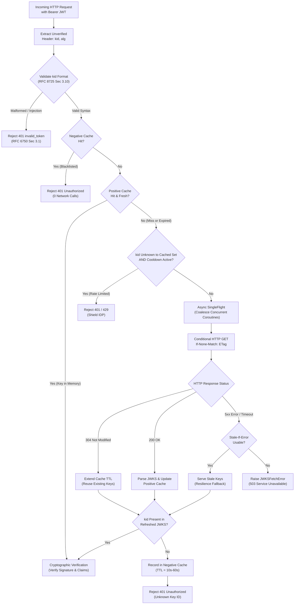

# JWKS Endpoint Engineering: Public Key Caching, Graceful Signing Key Rotation (kid), and Preventing IDP DoS on Unknown kid Attacks

> [!summary] Claim
> Resource servers verifying asymmetric JSON Web Tokens must decouple cryptographic validation from remote identity provider availability by combining RFC 9111 HTTP caching with singleflight request coalescing, bounded negative caching, and rate-limited cooldowns; failing to do so turns arbitrary unverified `kid` headers into an amplification vector for Identity Provider denial-of-service and cascading authentication outages.

Part of [API Authentication and Identity](README.md) in [API Engineering](../README.md).

## TL;DR

- Cryptographic signature validation requires local public key caching governed by RFC 9111 HTTP `Cache-Control` directives with conditional `If-None-Match` revalidation.
- Graceful key rotation demands a multi-phase publication lifecycle where the Identity Provider advertises both retired and newly introduced keys in the JWKS for an overlap duration exceeding the token lifetime plus cache TTL.
- Naive cache-miss fetches on unknown `kid` tokens allow unauthenticated attackers to flood the Identity Provider with outbound HTTP requests, causing connection exhaustion and upstream rate-limiting.
- On every CPython in the matrix (3.12 through 3.15), PyJWT 2.15.1's synchronous `PyJWKClient` blocks the asyncio event loop for the whole fetch, so async services need a non-blocking transport with a singleflight future that collapses concurrent cache misses into a single outbound request.
- Do not use dynamic JWKS discovery when managing low-volume internal microservices with static pre-shared asymmetric keys or symmetric HMAC shared secrets where key distribution is handled out-of-band.

## Mental model

An incoming request carries a signed JSON Web Token with an unverified header containing a Key ID (`kid`).
The resource server must resolve the matching public key from an in-memory cache without exposing its outbound network stack or the upstream Identity Provider (IDP) to malicious request floods.



The resource server inspects the unverified JWS header to extract the `kid` and `alg` parameters.
Before initiating any network request, the server executes syntactic boundary checks against the `kid` string to prevent injection attacks and checks a bounded negative cache of recently failed key lookups.
If the key resides in the positive cache and remains fresh according to RFC 9111 rules, signature verification proceeds entirely in memory.
When the `kid` is absent from an already cached set, the server checks a minimum cooldown interval so that unauthenticated traffic cannot trigger back-to-back outbound HTTP requests; an expired cache holding a known `kid` refreshes without the cooldown gate.
Coroutines racing on the same cache miss are coalesced by a singleflight coordinator so that fifty concurrent tasks generate exactly one outbound HTTP request, sent with `If-None-Match` whenever an `ETag` is already cached.
If the Identity Provider returns `200 OK` or `304 Not Modified`, the cache updates; if the requested `kid` remains absent from the refreshed set, it is committed to the negative cache to prevent subsequent attempts from bypassing local defenses.

## How it works

### 1. Wire Layout and Discovery Protocol

In modern OAuth 2.0 and OpenID Connect deployments, public key distribution is automated through well-known metadata discovery endpoints defined in RFC 8414 Section 3 and OpenID Connect Discovery 1.0 Section 4.
A relying party boots with an issuer URL (for example, `https://idp.example.com`) and discovers operational endpoints by requesting the well-known document:

```http
GET /.well-known/openid-configuration HTTP/1.1
Host: idp.example.com
Accept: application/json
```

The authorization server responds with an OpenID Provider Configuration document:

```http
HTTP/1.1 200 OK
Content-Type: application/json
Cache-Control: public, max-age=86400

{
  "issuer": "https://idp.example.com",
  "authorization_endpoint": "https://idp.example.com/oauth/authorize",
  "token_endpoint": "https://idp.example.com/oauth/token",
  "jwks_uri": "https://idp.example.com/.well-known/jwks.json",
  "response_types_supported": ["code"],
  "subject_types_supported": ["public"],
  "id_token_signing_alg_values_supported": ["RS256", "ES256"]
}
```

OpenID Connect Discovery 1.0 Section 3 marks `issuer`, `authorization_endpoint`, `jwks_uri`, `response_types_supported`, `subject_types_supported`, and `id_token_signing_alg_values_supported` as REQUIRED (`token_endpoint` unless only the Implicit Flow is used), and states that `RS256` MUST be included in `id_token_signing_alg_values_supported`.

The `jwks_uri` field indicates the HTTPS URL where the Identity Provider publishes its active public keys as a JSON Web Key Set (JWK Set) defined in RFC 7517 Section 5.
When the resource server fetches the JWKS document, the wire response contains an array of cryptographic keys:

```http
GET /.well-known/jwks.json HTTP/1.1
Host: idp.example.com
Accept: application/json, application/jwk-set+json

HTTP/1.1 200 OK
Content-Type: application/jwk-set+json; charset=UTF-8
Cache-Control: public, max-age=3600, stale-while-revalidate=60, stale-if-error=86400
ETag: "v2-8f9c2e1b4a"

{
  "keys": [
    {
      "kty": "RSA",
      "use": "sig",
      "alg": "RS256",
      "kid": "prod-auth-2026-11-a",
      "n": "u1v8...[342 base64url chars encoding 256 bytes]...w9Z",
      "e": "AQAB"
    },
    {
      "kty": "RSA",
      "use": "sig",
      "alg": "RS256",
      "kid": "prod-auth-2026-11-b",
      "n": "x7k2...[342 base64url chars encoding 256 bytes]...m1Q",
      "e": "AQAB"
    }
  ]
}
```

Each JWK member in the `keys` array conforms to RFC 7517 Section 4:
- `kty` (Key Type, RFC 7517 Section 4.1): Identifies the cryptographic algorithm family; RFC 7518 Section 6.1 defines `EC`, `RSA`, and `oct`, and RFC 8037 adds `OKP`, so asymmetric signing keys in a JWKS are `RSA`, `EC`, or `OKP`.
- `use` (Public Key Use): Restricts the key's intended cryptographic operation; RFC 7517 Section 4.2 defines `sig` (signature) and `enc` (encryption).
- `alg` (Algorithm): Identifies the algorithm intended for use with the key per RFC 7517 Section 4.4; JWS values such as `RS256` and `ES256` come from RFC 7518 Section 3.1.
- `kid` (Key ID): A case-sensitive string used to match a specific key, "for instance, to choose among a set of keys within a JWK Set during key rollover"; RFC 7517 Section 4.5 leaves its structure unspecified.
- `n` and `e`: The base64url-encoded modulus and exponent for RSA public keys.

### 2. Deterministic Key ID Computation: RFC 7638 JWK Thumbprint

Rather than assigning arbitrary UUIDs or incrementing integers to `kid`, distinguished architectures compute `kid` deterministically using RFC 7638 (JSON Web Key Thumbprint), which Section 1 and Section 3.4 explicitly allow to be used as a `kid` value.
RFC 7638 Section 3 defines the thumbprint as the hash of a canonical JSON object containing strictly the required public key members (Section 3.2) in lexicographic order with no whitespace (Section 3.3); base64url-encoding the hash yields the `kid` string.

For an RSA key (RFC 7638 Section 3.2), the canonical dictionary includes exactly three members in alphabetical sequence without whitespace:

```json
{"e":"AQAB","kty":"RSA","n":"u1v8...w9Z"}
```

For an Elliptic Curve key, the canonical dictionary includes `crv`, `kty`, `x`, and `y`:

```json
{"crv":"P-256","kty":"EC","x":"f83OJ3D2xFMTbKEGaJtNYYXkeCp7COmZnYTQ2mK318o","y":"x_daQauIfDp4nfPXpmOMPRZHAwq3qI2Wpu-zkTeST-4"}
```

RFC 7638 does not fix the hash function; Section 3.4 calls SHA-256 "a good default choice", which gives:

$$\text{kid} = \text{Base64URL}(\text{SHA-256}(\text{CanonicalJSON}(K_{pub})))$$

Deterministic thumbprints let independently generated keys in different regions get distinct `kid` values without a coordinated counter, because a SHA-256 collision between distinct keys is computationally infeasible.
The flip side is that the same public key always yields the same `kid`, even when two issuers publish it, so a verifier must scope key lookup by issuer and never by `kid` alone.
RFC 7638 Section 7 also warns that the thumbprint is unique only when the key has a single canonical encoding; a non-canonical `e`, for example, produces a different thumbprint for effectively the same key.

### 3. Graceful Signing Key Rotation Lifecycle (The Overlap Protocol)

Cryptographic keys must be rotated periodically to satisfy regulatory standards and limit exposure in the event of private key leakage.
However, abrupt key rotation immediately invalidates all active, unexpired tokens signed by the previous key, triggering widespread authentication failures across distributed clients.

Production-grade rotation implements a four-phase phased rollover lifecycle:

```mermaid
sequenceDiagram
    autonumber
    participant IDP as Identity Provider (IDP)
    participant RS as Resource Server Cache
    participant Client as API Client

    Note over IDP,RS: Phase 1: Key Generation & Publication (T_0)
    IDP->>IDP: Generate K_2; Sign tokens with K_1
    IDP->>RS: Publish JWKS with [K_1, K_2]
    Note over RS: Cache stores both K_1 and K_2

    Note over IDP,Client: Phase 2: Active Signing Promotion (T_switch)
    IDP->>IDP: Promote K_2 to primary signer
    Client->>IDP: Authenticate
    IDP->>Client: Issues Token signed with K_2
    Client->>RS: Request with Token(K_2)
    RS->>RS: Verify Token(K_2) via local cache hit!

    Note over IDP,Client: Phase 3: Drain Window (T_switch to T_retire)
    Note over Client,RS: Legitimate in-flight Token(K_1) still verified via cached K_1

    Note over IDP,RS: Phase 4: Key Deprecation & Revocation (T_retire)
    IDP->>IDP: Securely delete private key k_1
    IDP->>RS: Publish JWKS containing only [K_2]
    RS->>RS: Evict K_1 on subsequent refresh
```

The mathematical duration of the overlap window ($T_{overlap}$) must satisfy the strict lower bound:

$$T_{overlap} \ge \max(TTL_{token}) + T_{cache\_ttl} + 2 \times \Delta_{clock\_skew}$$

Where:
- $\max(TTL_{token})$ is the maximum allowable lifetime of any issued access token (typically 3,600 seconds).
- $T_{cache\_ttl}$ is the maximum freshness duration defined in the `Cache-Control` header of the JWKS endpoint (typically 3,600 to 86,400 seconds).
- $\Delta_{clock\_skew}$ is the configured `exp` and `nbf` leeway; RFC 7519 Section 4.1.4 allows "some small leeway, usually no more than a few minutes, to account for clock skew", and 60 seconds is a common choice.

The bound is the sum of two phases: $K_2$ must be published at least $T_{cache\_ttl}$ before it signs anything, so every cache already holds it, and $K_1$ must stay published at least $\max(TTL_{token})$ plus leeway after its last signature, so every token it signed has expired.
The factor of two on skew is a conservative margin for issuer and verifier clocks drifting in opposite directions.

During Phase 1, the IDP publishes $K_2$ in the JWKS while continuing to sign all tokens with $K_1$.
Resource servers naturally pull $K_2$ into their caches during regular TTL revalidation.
In Phase 2, the IDP flips its signing pipeline to use $K_2$.
Because resource servers already have $K_2$ cached, token verification proceeds with zero cache misses.
In Phase 3, unexpired tokens signed with $K_1$ continue to succeed.
Only after $T_{overlap}$ has fully elapsed does Phase 4 occur, safely revoking $K_1$ from the published JWKS.
OpenID Connect Core 1.0 Section 10.1.1 codifies both halves: "The verifier knows to go back to the jwks_uri location to re-retrieve the keys when it sees an unfamiliar kid value", and the JWK Set "SHOULD retain recently decommissioned signing keys for a reasonable period of time"; it gives no number, which is why the bound above has to be derived.

### 4. HTTP Caching Semantics & The Thundering Herd (Cache Stampede)

Resource servers must treat the `jwks_uri` as a standard HTTP caching resource governed by RFC 9111.
The upstream server communicates cache freshness using the `Cache-Control` header:
- `max-age=3600`: The response becomes stale once its age exceeds 3,600 seconds (RFC 9111 Section 5.2.2.1).
- `stale-while-revalidate=60`: RFC 5861 Section 3 allows the cache to serve a stale JWKS for up to 60 seconds, and says it SHOULD attempt to revalidate meanwhile without blocking.
- `stale-if-error=86400`: RFC 5861 Section 4 permits serving cached keys for up to 24 hours if upstream revalidation attempts return network timeouts or 5xx server errors.

When revalidating an expired cache entry, the client issues a conditional GET using the HTTP `If-None-Match` request header (RFC 9110 Section 13.1.2) containing the stored `ETag` (RFC 9110 Section 8.8.3).
If the keys have not changed, the IDP returns `304 Not Modified`, which carries no content (RFC 9110 Section 6.4.1 and Section 15.4.5):

```http
GET /.well-known/jwks.json HTTP/1.1
Host: idp.example.com
If-None-Match: "v2-8f9c2e1b4a"

HTTP/1.1 304 Not Modified
Cache-Control: public, max-age=3600
ETag: "v2-8f9c2e1b4a"
```

The client receives the `304 Not Modified`, freshens the stored response (RFC 9111 Section 4.3.4) by updating the local expiration timestamp without re-allocating or reparsing the cryptographic structures, and avoids re-downloading the key set.

#### The Thundering Herd Problem

In a high-throughput API gateway processing 10,000 requests per second, cache expiration presents an acute concurrency hazard known as the cache stampede or thundering herd.
When the cached JWKS expires at $t_{exp}$, every worker thread or asyncio task processing an incoming request simultaneously detects a cache miss.
Without concurrency controls, thousands of worker threads concurrently execute outbound HTTP requests to the IDP's JWKS endpoint.
This floods the network connection pool, triggers ephemeral port exhaustion, trips the IDP's rate limiters (`429 Too Many Requests`), and causes cascading authorization failures across the entire cluster.

To prevent cache stampedes, production systems apply the singleflight pattern.
The singleflight coordinator maintains a registry of in-flight network futures keyed by resource (the lab uses one key, `"jwks_refresh"`, per client instance).
In asyncio the registry needs no lock, because the check and the insert run without an `await` between them; a thread-based implementation must guard the same check-and-insert with a lock.
When task $A$ initiates a JWKS fetch, it creates an uncompleted future and places it in the registry.
When concurrent tasks $B, C, \dots, N$ arrive, they detect the active future and await its completion rather than dispatching redundant HTTP requests.
When task $A$ completes the fetch, the future resolves with the parsed key set, satisfying all $N$ awaiting coroutines through a single network round-trip.

### 5. The Unknown kid Attack Vector & IDP Denial of Service

A severe architectural vulnerability exists in naive JWKS clients that attempt on-demand key discovery without rate limiting or negative caching.
When an incoming token contains a `kid` that is not present in the local positive cache, the client assumes that a key rotation event just took place and immediately bypasses the cache to fetch the latest JWKS from the IDP.

Because the JWS header is completely unverified prior to cryptographic signature checking, the `kid` parameter is entirely user-controlled.
An attacker can generate thousands of forged JWTs per second, each containing a randomly generated UUID in the `kid` header:

```json
{
  "alg": "RS256",
  "kid": "forged-uuid-8f9a2e3b-4c5d-6e7f-8a9b-0c1d2e3f4a5b"
}
```

When sent to an unshielded resource server:
1. The server reads `kid: "forged-uuid-..."`.
2. The key is absent from the positive cache.
3. The server executes a blocking or immediate outbound HTTP `GET` to the IDP's `jwks_uri`.
4. The IDP returns the JWKS, which naturally does not contain the attacker's bogus `kid`.
5. The server rejects the token as unauthorized.
6. The next incoming request with a different randomized `kid` immediately repeats steps 1 through 5.

This vulnerability creates a 1:1 request amplification attack against the Identity Provider.
The resource server acts as a distributed reflector, directing an overwhelming stream of outbound HTTP traffic toward the IDP.
Python's `PyJWT` shipped this exact behavior in `PyJWKClient` from 2.4.0 through 2.12.1 (GHSA-fhv5-28vv-h8m8, CVE-2026-48524): `get_signing_key(kid)` called `get_signing_keys(refresh=True)` for every unknown `kid`, "bypassing TTL cache with no cooldown".
Furthermore, when the upstream fetch failed (a `429 Too Many Requests` surfaces from `urllib` as an `HTTPError`, a `URLError` subclass), `fetch_data()` wrote `None` to the JWK Set cache in a `finally` block, so one transient error wiped the cached keys and failed legitimate tokens too.
PyJWT 2.13.0 fixed only the cache wipe; the unknown-`kid` amplification remained until 2.14.0 (GHSA-2gx3-rcp4-g85q, CVE-2026-101917, published 2026-09-11 as an "incomplete fix of CVE-2026-48524"), which added a 30-second cooldown after each successful fetch (as of 2026-11).

### 6. Defense-in-Depth Mitigations

To neutralize unknown `kid` attacks, resilient resource servers combine three distinct defensive layers:

#### Bounded Negative Caching
When a refreshed JWKS arrives from the IDP and the requested `kid` is still absent, the server marks that `kid` as negative in a bounded in-memory cache with a finite TTL (typically 10 to 60 seconds).
If subsequent requests present that same unknown `kid`, the server immediately rejects the token with `401 Unauthorized` without initiating any network I/O.
To prevent attackers from consuming server memory by generating millions of unique random strings, the negative cache is bounded in size (the lab defaults to `max_negative_cache_size=1000`) and evicts the oldest insertion with `OrderedDict.popitem(last=False)`; the lab never reorders an entry on a hit, so this is FIFO rather than true LRU eviction, which is adequate because entries expire after a few seconds anyway.
The trade-off: a legitimate `kid` that was probed before its key was published stays rejected for the full negative TTL.

#### Cooldown Rate Limiting
To defend against attackers who randomize the `kid` on every individual request (which would defeat a negative cache), the client enforces a mandatory cooldown period (for example, 5 to 30 seconds) between forced refreshes.
If an unknown `kid` arrives within the cooldown window following the most recent successful fetch, the client refuses to query the network and immediately raises a `RateLimitedRefreshError`.
This caps unknown-`kid`-driven outbound requests from any single resource server process at $\frac{1}{T_{cooldown}}$ per second regardless of incoming traffic volume, on top of the one regular refresh per `max-age`.
The trade-off is the one the PyJWT 2.15.1 docstring states: "A newly rotated key may therefore wait for the cooldown period before it is fetched", which is harmless only when the IDP pre-publishes keys as in the overlap protocol above.

#### Boundary Input Validation (RFC 8725 Section 3.10)
RFC 8725 Section 3.10 ("Do Not Trust Received Claims") says applications should validate and/or sanitize the received `kid` so key lookup cannot become a SQL or LDAP injection, and SHOULD protect against SSRF from `jku` and `x5u` headers, for example by matching the URL to an allowlist.
Before evaluating any cache, the `kid` parameter should be validated against a strict character allowlist; the lab's `_KID_PATTERN` is `[A-Za-z0-9_\-.:=]{1,256}\Z`, anchored with `\Z` because Python's `$` also matches before a trailing newline:
- Reject non-string types.
- Enforce length limits (for example, $\le 256$ characters).
- Reject path separators (`/`), quotes and spaces (so `' OR 1=1` fails), and LDAP filter metacharacters such as `(`, `)`, and `*`.
- Reject tokens containing in-band key headers (`jku`, `x5u`, or embedded `jwk`) unless explicitly validated against an immutable allowlist; the lab's `verify_token` rejects `jku` and `x5u` but does not check `jwk` or `x5c`.

### 7. Discovery Validation and JWKS Parsing Rules

Fetching the right document is only half of discovery; the relying party must also check it, and parse the key set defensively.
- **Issuer binding.** The `issuer` value in the metadata "MUST be identical" to the issuer URL that was used as the prefix to `/.well-known/openid-configuration`, and also to the `iss` claim in ID Tokens from that issuer; if validation fails the information "MUST NOT be used" (OpenID Connect Discovery 1.0 Section 4.3; the same rule for OAuth metadata is RFC 8414 Section 3.3).
  A relying party that follows a `jwks_uri` from a document whose `issuer` does not match has let whoever served that document choose its trust anchors.
- **Where the URL comes from.** Take `jwks_uri` from the validated metadata or from static configuration, never from the token (`jku`, see Pitfall 4).
- **Unusable keys are skipped, not fatal.** RFC 7517 Section 5 says implementations "SHOULD ignore JWKs within a JWK Set that use `kty` values that are not understood by them, that are missing required members, or for which values are out of the supported ranges"; the lab's parse loop does this by catching the `PyJWK.from_dict` error and continuing, and raises `JWKSFetchError` only if no key survives.
- **`kid` uniqueness and order.** Different keys in a set "SHOULD use distinct `kid` values" (RFC 7517 Section 4.5), and the order of `keys` implies no preference (RFC 7517 Section 5.1).
  The lab stores keys in a dict by `kid`, so a duplicate silently keeps the last one; a deployment that cannot guarantee distinct `kid` values must select by `kid` plus `kty` and `alg`.
- **`max-age=0` is a value, not an absence.** The lab resolves freshness with `_resolve_ttl`, which uses its default only when no `max-age` is present; the first version used `parsed or default`, which turned `max-age=0` into the 300-second default.
  `test_max_age_zero_is_honored_not_replaced_by_default_ttl` pins the fix.

## Numbers and limits

The following table summarizes operational bounds, default timeouts, and architectural limits for production JWKS implementations (as of 2026-11).

| Parameter | Default Value | Recommended Production Bound | Hard Limit / Boundary Constraint | Primary Source |
| :--- | :--- | :--- | :--- | :--- |
| JWKS Cache Freshness (`max-age`) | `300s` (PyJWT `lifespan`; lab `cache_ttl`) | `3600s` - `86400s` (1 hr - 24 hr) | No floor or ceiling in RFC 9111; a delta-seconds value too large to represent is treated as `2147483648` (RFC 9111 Section 1.2.2) | RFC 9111 Section 5.2.2.1; `(PyJWT 2.15.1 jwt/jwks_client.py, PyJWKClient.__init__)` |
| Forced Refresh Cooldown | `30s` (`PyJWT` >= 2.14.0, `cooldown_duration`); lab `5s` | `5s` - `30s` per process | PyJWT requires `>= 0` and finite; `0` disables it | `(PyJWT 2.15.1 jwt/jwks_client.py, PyJWKClient.__init__)` |
| `jwks-rsa` (Node.js) Rate Limit | Off (`rateLimit: false`); `10 req/min` once enabled | `10` - `30 req/min` | `limiter` token bucket: `new RateLimiter(jwksRequestsPerMinute, 'minute', true)` | `(jwks-rsa 4.1.0 src/wrappers/rateLimit.js, rateLimitWrapper)`; `(jwks-rsa 4.1.0 src/JwksClient.js, JwksClient)` |
| Negative Cache TTL | None in PyJWT 2.15.1; lab `10s` | `10s` - `60s` | No standard; every second of TTL is a second a just-published `kid` probed too early stays rejected | Lab `AsyncJWKSClient.__init__` (`negative_cache_ttl=10.0`) |
| Negative Cache Max Entries | Lab `1,000` | `1,000` - `10,000` entries | Measured ~1.79 MB for 10,000 entries (see below) | CWE-770 (Allocation of Resources Without Limits or Throttling) |
| Key Rollover Overlap Window | `0s` (Naive) | `24h` - `48h` | $T_{overlap} \ge T_{cache} + \max(TTL_{token}) + 2\Delta_{skew}$ | OpenID Connect Core 1.0 Section 10.1.1 (retain decommissioned keys; no number given) |
| Singleflight Concurrency Collapsing | 1:1 (No coalescing) | N:1 for N concurrent misses | Exactly 1 HTTP request in flight per client | Measured in lab (50 coroutines -> 1 request) |
| RSA Key Size | 2048 bits | 2048 or 4096 bits | "A key of size 2048 bits or larger MUST be used" | RFC 7518 Section 3.3 |
| Elliptic Curve Key Size | P-256 (256 bits) | P-256 (`ES256`) or Ed25519 (`EdDSA`) | `ES256` is ECDSA with P-256 and SHA-256 | RFC 7518 Section 3.4; RFC 8037 Section 3.1 |
| Public JWK Size (compact JSON, `kty` plus key members only) | RSA-2048 `394` bytes | P-256 `126` bytes; Ed25519 `79` bytes | No size limit in RFC 7517 Section 5; cap the response body in the client | Measured (see below) |
| Maximum `kid` Header Length | Unspecified (RFC 7517 Section 4.5) | `43` characters for a SHA-256 RFC 7638 thumbprint | Lab caps at 256 characters | RFC 7517 Section 4.5; lab `_KID_PATTERN` |

Singleflight request collapsing was measured in the companion lab with `uv run --frozen pytest tests/f14_api_authentication_and_identity/test_jwks_discovery_caching_key_rotation_and_thundering_herd_protection.py -v` on macOS 27.3 arm64 (`uname -r` = `27.3.0`) under CPython 3.14.6: on a cold cache, 50 concurrent coroutines racing on `get_signing_key()` produced exactly 1 request at the `httpx.MockTransport` handler instead of 50, a 98% reduction in outbound requests.
The remaining measured numbers come from a one-off script run with `uv run --frozen python` from `labs/` on the same machine and interpreter, with `cryptography` 50.0.2 and PyJWT 2.15.1.
Negative cache memory: `tracemalloc` reported 1,788,584 bytes for an `OrderedDict` holding 10,000 entries of 48-character `forged-uuid-<uuid4>` keys mapped to `float` expiries.
JWK sizes: `json.dumps(..., separators=(",", ":"))` of the `to_jwk()` output of `RSAAlgorithm`, `ECAlgorithm`, and `OKPAlgorithm` gave 394, 126, and 79 bytes; an RSA-2048 `n` is 342 base64url characters.

## Portability

The table below outlines implementation behaviors, thread safety models, and protocol support across Python runtimes, server engines, and cryptographic libraries (as of 2026-11).

| Environment / Library | Concurrency Model | Outbound Transport | Cache Stampede Protection | Free-Threaded Safe (3.14t/3.15t) | HTTP Versions Supported |
| :--- | :--- | :--- | :--- | :--- | :--- |
| `PyJWT.PyJWKClient` (2.15.1) | Threading; one `threading.RLock` serializes each whole `get_signing_key()` | Synchronous `urllib.request.build_opener(...).open()`, redirects refused | 30s unknown-`kid` cooldown (`cooldown_duration=30`, since 2.14.0); no negative cache `(PyJWT 2.15.1 jwt/jwks_client.py, PyJWKClient.get_signing_key)` | No `Free Threading` classifier in the 2.15.1 `METADATA` (classifiers stop at 3.15); pure-Python `py3-none-any` wheel; not run on 3.14t or 3.15t | HTTP/1.1 |
| `joserfc` (1.8.0) | Key and JWS primitives only (`KeySet.import_key_set`) | None; the caller fetches the JWKS | Caller responsibility | No `Free Threading` classifier in the 1.8.0 `METADATA`; pure-Python `py3-none-any` wheel over `cryptography`; not run on 3.14t or 3.15t | N/A (Transport agnostic) |
| `authlib` (1.9.5) | OIDC client integrations over `requests` or `httpx` sessions | The integration's session (`AsyncOpenIDMixin.fetch_jwk_set`) | Stores the JWKS in `server_metadata["jwks"]` with no TTL; on `InvalidKeyIdError` refetches with `force=True`, no cooldown or singleflight `(authlib 1.9.5 authlib/integrations/base_client/async_openid.py, AsyncOpenIDMixin.parse_id_token)` | No `Free Threading` classifier in the 1.9.5 `METADATA`; pure-Python `py3-none-any` wheel; not run on 3.14t or 3.15t | HTTP/1.1; HTTP/2 only via `httpx` with `http2=True` |
| `AsyncJWKSClient` (Lab) | Asyncio non-blocking; one event loop | `httpx.AsyncClient` | Singleflight + cooldown + bounded negative cache | Not thread-safe; share one instance per event loop thread only | HTTP/1.1 by default; HTTP/2 with `http2=True` (`h2` 4.4.1 is installed) |
| Uvicorn (0.54.0) | Multi-process (`--workers`), one asyncio loop per process | N/A (server; the app chooses) | Shared nothing across worker processes | No `Free Threading` classifier in the 0.54.0 `METADATA`; pure-Python `py3-none-any` wheel; not run on 3.14t or 3.15t | HTTP/1.1; HTTP/2 only with `http2=True` and `http="zttp"` (the `zttp` package, not installed in the lab) `(uvicorn 0.54.0 uvicorn/config.py, Config.load)` |
| Hypercorn (0.18.0) | Multi-process; asyncio or Trio workers (`hypercorn/asyncio`, `hypercorn/trio`) | N/A (server; the app chooses) | Shared nothing across worker processes | No `Free Threading` classifier in the 0.18.0 `METADATA`; pure-Python `py3-none-any` wheel; not run on 3.14t or 3.15t | HTTP/1.1, HTTP/2, HTTP/3 via `aioquic` `(hypercorn 0.18.0 hypercorn/protocol/h3.py)` |
| Granian (2.8.7) | Rust (`tokio`) I/O runtime; Python app in worker processes on a GIL build, worker threads sharing one loaded app on a free-threaded build (Granian 2.8.7 README, "Free-threaded Python") | N/A (server; the app chooses) | Shared nothing across worker processes | Declared: `Free Threading :: 2 - Beta` classifier, and its README calls free-threaded support "experimental and highly discouraged in production"; `cp314t` wheels are listed in `uv.lock`; not run | HTTP/1.1, HTTP/2 |

Key runtime differences across CPython versions:
- On every CPython version in the matrix, `PyJWT` 2.15.1's synchronous `PyJWKClient.get_signing_key()` fetches through `urllib.request.build_opener(...).open()` with a default `timeout=30`.
  If called directly inside a FastAPI or Starlette async route without `anyio.to_thread.run_sync()`, it halts the entire asyncio event loop for the DNS resolution, TLS handshake, and HTTP round trip, so every other request on that loop waits for the fetch (up to the 30-second timeout when the IDP hangs).
- In free-threaded CPython (3.14t and 3.15t), no GIL serializes Python code, so a JWKS cache shared across threads must guard every read-modify-write with a lock or publish each refresh as a new immutable object swapped in by a single reference assignment.
  The lab's `CachedKeySet` does not qualify as such a snapshot: the `304` path mutates its `expires_at` and `stale_until` in place.
- The free-threaded cells above are metadata and documentation evidence, not runs: the lab matrix is paused, so no row was executed on 3.14t or 3.15t, and a missing `Free Threading` classifier means support is undeclared, not proven absent.
  `cryptography` 50.0.2 lists `cp314-cp314t` wheels in `labs/uv.lock`, so the signature primitives are not what blocks a free-threaded deployment.
  On a free-threaded Granian all workers are threads sharing one loaded application (Granian 2.8.7 README), so a module-level `AsyncJWKSClient` would be used from several event loops at once, which its `asyncio.Future` registry does not support; create one client per worker thread or guard it as described above.
- In multi-process ASGI deployments (for example, Uvicorn running with `--workers 8`), process memory is completely isolated.
  An unknown `kid` attack triggers independent cooldown cycles and network fetches across all 8 worker processes unless mitigated at an edge gateway or shared Redis/Valkey cache layer.

## Worked example

The companion lab implements a production-grade asynchronous JWKS client featuring singleflight request coalescing, negative caching, cooldown rate limiting, and RFC 9111 conditional revalidation.
Review the complete source files in the workspace:
- Implementation: [jwks_cache.py](../labs/src/api_labs/f14_api_authentication_and_identity/jwks_cache.py)
- Test Suite: [test_jwks_discovery_caching_key_rotation_and_thundering_herd_protection.py](../labs/tests/f14_api_authentication_and_identity/test_jwks_discovery_caching_key_rotation_and_thundering_herd_protection.py)

Here is a simplified excerpt illustrating the core singleflight request coalescing and negative cache lookup pipeline:

```python
# Simplified excerpt from api_labs.f14_api_authentication_and_identity.jwks_cache

class AsyncSingleFlight:
    """Coalesces concurrent asynchronous requests for the same resource into one execution."""

    def __init__(self) -> None:
        self._in_flight: dict[str, asyncio.Future[Any]] = {}

    async def call(self, key: str, fn: Callable[[], Coroutine[Any, Any, T]]) -> T:
        loop = asyncio.get_running_loop()
        if key in self._in_flight:
            result: T = await self._in_flight[key]
            return result

        future: asyncio.Future[T] = loop.create_future()
        self._in_flight[key] = future
        try:
            val = await fn()
            future.set_result(val)
            return val
        except BaseException as exc:
            future.set_exception(exc)
            raise
        finally:
            self._in_flight.pop(key, None)


class AsyncJWKSClient:
    async def get_signing_key(self, kid: str) -> PyJWK:
        self.validate_kid(kid)
        now = time.monotonic()

        self._purge_expired_negative_cache(now)
        if kid in self._negative_cache:
            raise NegativeCachedKeyError(f"Key ID {kid!r} is blacklisted in negative cache")

        if self._cached_set and kid in self._cached_set.keys and self._cached_set.is_fresh(now):
            return self._cached_set.keys[kid]

        time_since_last_fetch = now - self._last_successful_fetch
        in_cooldown = self._last_successful_fetch > 0 and time_since_last_fetch < self.cooldown_duration

        if self._cached_set and kid not in self._cached_set.keys and in_cooldown:
            raise RateLimitedRefreshError(
                f"Unknown key ID {kid!r} arrived during cooldown ({time_since_last_fetch:.2f}s < {self.cooldown_duration}s)"
            )

        # SingleFlight collapses concurrent stampedes into exactly one network GET
        cached_set: CachedKeySet = await self._single_flight.call("jwks_refresh", self._fetch_from_network)

        if kid in cached_set.keys:
            return cached_set.keys[kid]

        # Unknown kid still missing after fresh network fetch -> commit to negative cache
        self._record_negative_cache(kid, time.monotonic())
        raise UnknownKeyIdError(f"Signing key with kid {kid!r} not found in remote JWKS")
```

Execution output captured under CPython 3.14.6 on macOS 27.3 arm64 (`uname -r` = `27.3.0`):

```text
$ uv run --frozen pytest tests/f14_api_authentication_and_identity/test_jwks_discovery_caching_key_rotation_and_thundering_herd_protection.py -v
============================= test session starts ==============================
platform darwin -- Python 3.14.6, pytest-9.2.0, pluggy-1.7.0 -- /Users/shreejitverma/github/The-Distinguished-Engineer/build/api_notes/jobs/JWKS-Discovery-Caching-Key-Rotation-and-Thundering-Herd-Protection/verify/labs/.venv/bin/python
cachedir: .pytest_cache
hypothesis profile 'default'
rootdir: /Users/shreejitverma/github/The-Distinguished-Engineer/build/api_notes/jobs/JWKS-Discovery-Caching-Key-Rotation-and-Thundering-Herd-Protection/verify/labs
configfile: pyproject.toml
plugins: platformdirs-4.14.5, schemathesis-4.33.1, cov-7.1.0, hypothesis-6.170.14, inline-snapshot-0.36.1, Faker-40.44.0, locust-2.47.0, typeguard-4.6.0, anyio-4.16.0, asyncio-1.4.1.post1, respx-0.23.1
asyncio: mode=Mode.STRICT, debug=False, asyncio_default_fixture_loop_scope=function, asyncio_default_test_loop_scope=function
collecting ... collected 9 items

tests/f14_api_authentication_and_identity/test_jwks_discovery_caching_key_rotation_and_thundering_herd_protection.py::test_jwks_cache_hit_and_ttl PASSED [ 11%]
tests/f14_api_authentication_and_identity/test_jwks_discovery_caching_key_rotation_and_thundering_herd_protection.py::test_graceful_key_rotation_overlap PASSED [ 22%]
tests/f14_api_authentication_and_identity/test_jwks_discovery_caching_key_rotation_and_thundering_herd_protection.py::test_singleflight_thundering_herd_coalescing PASSED [ 33%]
tests/f14_api_authentication_and_identity/test_jwks_discovery_caching_key_rotation_and_thundering_herd_protection.py::test_unknown_kid_negative_cache_blocks_storm PASSED [ 44%]
tests/f14_api_authentication_and_identity/test_jwks_discovery_caching_key_rotation_and_thundering_herd_protection.py::test_unknown_kid_cooldown_throttles_varying_kids PASSED [ 55%]
tests/f14_api_authentication_and_identity/test_jwks_discovery_caching_key_rotation_and_thundering_herd_protection.py::test_conditional_revalidation_304 PASSED [ 66%]
tests/f14_api_authentication_and_identity/test_jwks_discovery_caching_key_rotation_and_thundering_herd_protection.py::test_stale_if_error_resilience PASSED [ 77%]
tests/f14_api_authentication_and_identity/test_jwks_discovery_caching_key_rotation_and_thundering_herd_protection.py::test_malformed_kid_and_header_rejection PASSED [ 88%]
tests/f14_api_authentication_and_identity/test_jwks_discovery_caching_key_rotation_and_thundering_herd_protection.py::test_max_age_zero_is_honored_not_replaced_by_default_ttl PASSED [100%]

============================== 9 passed in 0.54s ===============================
```

## Pitfalls

> [!warning] Pitfall 1: Unbounded On-Demand Refresh and Cache Wipe on Fetch Failure (CVE-2026-48524, CVE-2026-101917)
> **Trigger**: Using `PyJWKClient` from `PyJWT` 2.4.0 through 2.13.0 and receiving tokens with randomized unknown `kid` headers, especially while the IDP is degraded.
> **Symptom**: Every unknown `kid` forces a JWKS fetch (GHSA-2gx3-rcp4-g85q, CVSS 5.3, fixed in 2.14.0); through 2.12.1 a failed fetch also ran the `finally`-block `put(None)` in `PyJWKClient.fetch_data()`, wiping the cached JWKS so legitimate tokens with valid cached keys failed too (GHSA-fhv5-28vv-h8m8, fixed in 2.13.0).
> **Fix**: Upgrade to `PyJWT >= 2.14.0`, which keeps the cache on fetch errors and applies a 30-second unknown-`kid` cooldown (configurable in 2.15.1 as `cooldown_duration`), or wrap key resolution with an explicit negative cache and stale-if-error fallback as demonstrated in [jwks_cache.py](../labs/src/api_labs/f14_api_authentication_and_identity/jwks_cache.py).

> [!warning] Pitfall 2: Re-instantiating the JWKS Client Inside Web Request Handlers
> **Trigger**: Initializing `PyJWKClient` or Node.js `jwks-rsa` inside a route handler or dependency function rather than creating a singleton instance at application lifespan startup.
> **Symptom**: Every incoming HTTP request constructs a brand new cache instance with an empty state; the server issues an outbound HTTP request to `/.well-known/jwks.json` for every single API request, quickly tripping IDP rate limits and crashing under minimal load.
> **Fix**: Instantiate the JWKS client exactly once at process startup (or inside FastAPI lifespan state) and inject the singleton client across request dependencies.

> [!warning] Pitfall 3: Immediate Zero-Overlap Key Rollover
> **Trigger**: An operations team or automated secret rotation script generates a new private key $K_2$, updates the Identity Provider to sign with $K_2$, and immediately removes $K_1$ from the published JWKS.
> **Symptom**: Hundreds of thousands of existing active user access tokens signed with $K_1$ instantly fail verification with `UnknownKeyIdError`, forcing all clients to re-authenticate and overwhelming the authorization endpoint.
> **Fix**: Enforce the phased rollover protocol where $K_2$ is published in the JWKS for at least the JWKS cache TTL before promoting it to active signing, and retain $K_1$ in the JWKS for at least the maximum token TTL plus leeway after promotion, as OpenID Connect Core 1.0 Section 10.1.1 asks ("SHOULD retain recently decommissioned signing keys").

> [!warning] Pitfall 4: Blindly Fetching In-Band Key Headers (`jku` / `x5u`)
> **Trigger**: Parsing an incoming token whose header specifies a `jku` (JWK Set URL) pointing to an arbitrary domain (for example, `https://attacker.evil/keys.json`) and dynamically fetching keys from that URL per RFC 7515 Section 4.1.2.
> **Symptom**: An attacker signs a token with their own private key, supplies their own public key via `jku`, and completely bypasses authentication; alternately, the server makes outbound requests to internal metadata services (`http://169.254.169.254`), resulting in critical Server-Side Request Forgery (SSRF).
> **Fix**: RFC 8725 Section 3.10 says applications SHOULD protect against this, for example by matching the URL to an allowlist of allowed locations; the simplest compliant policy is to reject `jku` and `x5u` outright and hardcode the trusted `jwks_uri` from server configuration, falling back to strict host allowlist validation only when dynamic key URLs are a real requirement.

> [!warning] Pitfall 5: Cache Stampede on Periodic Key Expiration
> **Trigger**: The local JWKS cache expires synchronously across all worker threads under peak production load without request coalescing.
> **Symptom**: Thousands of concurrent worker threads attempt simultaneous HTTP connections to the IDP, leading to DNS timeouts, ephemeral socket exhaustion, and cascading 503 errors.
> **Fix**: Implement the singleflight request coalescing pattern to ensure only one outbound HTTP request is dispatched, paired with a refresh that starts before the entry expires (the `stale-while-revalidate` behavior of RFC 5861 Section 3; the lab does not implement it and instead serves stale keys only on error, `stale-if-error`).

> [!warning] Pitfall 6: Synchronous HTTP I/O Starving the Asyncio Event Loop
> **Trigger**: Using standard blocking HTTP clients (`urllib.request` or synchronous `requests`) inside async FastAPI or Starlette middleware to fetch the JWKS.
> **Symptom**: The entire asyncio event loop freezes during DNS lookups and TLS handshakes; p99 latency spikes into seconds, health check endpoints fail, and container orchestrators restart pods under false assumptions of unresponsiveness.
> **Fix**: Use non-blocking asynchronous HTTP clients (`httpx.AsyncClient`) with native async locks, or offload synchronous calls to worker thread pools via `anyio.to_thread.run_sync()`.

## Security and robustness

### Threat Models & Mitigations

1. **Amplified Identity Provider Denial-of-Service**:
   - *Threat*: Attackers blast resource servers with forged JWTs containing random `kid` values to induce continuous outbound HTTP traffic against the IDP.
   - *Mitigation*: Deploy a two-tiered defense consisting of a cooldown interval (minimum time between forced refreshes) and a bounded negative cache (short-lived blacklisting of failed `kid`s).

2. **Algorithm Confusion Attacks**:
   - *Threat*: Attackers alter the token header to specify `alg: "none"` or use HMAC symmetric algorithms (`HS256`) with the IDP's public RSA key treated as the HMAC shared secret.
   - *Mitigation*: Strictly enforce cryptographic algorithm allowlists (for example, `allowed_algorithms=["RS256"]`).
     Ensure the public key used for verification is explicitly typed as an asymmetric public key (`RSAPublicKey` or `EllipticCurvePublicKey`) and reject any symmetric algorithm verification against public key material per RFC 8725 Section 3.1.

3. **Memory Exhaustion via Negative Cache Flooding**:
   - *Threat*: Attackers send millions of distinct, randomized `kid` values hoping to exhaust heap memory by swelling the negative cache.
   - *Mitigation*: Enforce a strict upper bound on negative cache capacity (for example, 1,000 entries) with oldest-first eviction (the lab's `OrderedDict.popitem(last=False)` is FIFO; true LRU would also call `move_to_end` on each hit).

4. **In-Band URL Injection and SSRF**:
   - *Threat*: Attackers inject malicious URLs into `jku` or `x5u` headers to trigger server-side request forgery against internal endpoints.
   - *Mitigation*: Explicitly reject tokens presenting `jku` or `x5u` headers unless the URL matches an immutable allowlist, the protection RFC 8725 Section 3.10 recommends; silently ignoring them is weaker because a later code change may start honoring them.

### OWASP API Security (2023) Alignment

- **API4:2023 Unrestricted Resource Consumption**: Mitigated by singleflight request coalescing, bounded negative caching, and rate-limited cooldown timers that prevent outbound network and socket exhaustion.
- **API7:2023 Server Side Request Forgery (SSRF)**: Mitigated by prohibiting dynamic in-band URL dereferencing (`jku`/`x5u`) and strictly fetching from pre-configured authorization server endpoints.
- **API8:2023 Security Misconfiguration**: Mitigated by parsing RFC 9111 `Cache-Control` directives, respecting `ETag` validations, and avoiding zero-overlap key rotations.

## The principal's view

At staff-plus and principal level, JWKS engineering is an exercise in decoupling availability domains across organizational boundaries.
A resource server should never inherit the availability characteristics of an external Identity Provider.
If an enterprise IDP experiences an outage, network partition, or configuration error, downstream API gateways must continue validating valid user sessions for the duration of the token TTL plus `stale-if-error` window without interruption.

Architectural decision matrix for key caching topologies:

1. **Process-Local In-Memory Cache (Preferred for Monoliths & Small Microservices)**:
   - *Trade-off*: Simplest operational model: a key lookup is an in-process dictionary read with no network hop and no external infrastructure dependency.
   - *Downside*: Cache misses and cooldown windows are isolated per process.
     In a cluster of 100 pods with 8 workers each (800 processes), an unknown `kid` attack can still generate up to 800 outbound requests per cooldown interval.

2. **Centralized Distributed Cache (Redis / Valkey)**:
   - *Trade-off*: Collapses unknown `kid` misses across the entire fleet; once an unknown `kid` is negatively cached in Redis, all 800 worker processes instantly reject it.
   - *Downside*: Introduces a network hop on every cache lookup and an operational dependency on the Redis cluster for token verification; requires distributed locks (`Redlock`) to coalesce background refreshes.

3. **Gateway / Sidecar Offloading (Envoy `jwt_authn` / Istio)**:
   - *Trade-off*: Moves cryptographic verification entirely out of the application code into an optimized C++ proxy layer.
     Envoy's `jwt_authn` filter caches each `RemoteJwks` for `cache_duration` (default 10 minutes); with `async_fetch` the main thread fetches once before the listener activates and refetches on expiry, sharing the keys with all worker threads, while without it each worker thread fetches its own copy on demand and pauses requests until the fetch completes; a failed fetch is retried after `failed_refetch_duration` (default 1 second).
     Its documented expiry control is `cache_duration`, not the response's `Cache-Control` (as of 2026-11).
   - *Downside*: Requires service mesh or API gateway infrastructure; internal service-to-service calls bypassing the gateway must re-implement verification or rely on mTLS.

When to choose alternative architectures:
- If microservices communicate strictly within a trusted Kubernetes cluster, consider mutual TLS (mTLS) with SPIFFE/SPIRE x509 SVIDs, eliminating JWT signature parsing overhead entirely.
- If tokens require instantaneous revocation (such as banking transactions), asymmetric stateless JWTs with JWKS discovery are inappropriate; use token introspection (RFC 7662) or opaque tokens backed by an in-memory distributed store, accepting the latency trade-off of an active lookup per request.

## Interview questions

> [!question] L5: What happens if an API Gateway verifies incoming JWTs by fetching the JWKS on every single request, and how do you fix it?
>
> > [!success]- Answer
> > Fetching the JWKS per request adds a full network round trip (plus TLS setup when connections are not reused) to every API call, quickly exhausts socket file descriptors, and trips the Identity Provider's rate limits (`429 Too Many Requests`), causing immediate denial-of-service.
> > The fix is to cache the JWKS in memory as a singleton across request lifecycles, respecting the HTTP `Cache-Control` headers (`max-age`) and using conditional HTTP revalidation (`If-None-Match` with `ETag`).
> >
> > Follow-up: How do you handle an incoming token signed with a newly rotated key that is not yet in the local cache?

> [!question] L6: Explain the "unknown kid attack" and describe how a resource server can defend against it without dropping legitimate rotated keys.
>
> > [!success]- Answer
> > An attacker sends requests with forged JWTs containing randomized, non-existent `kid` values in the unverified header.
> > If the resource server treats every cache miss as a signal that key rotation occurred, it immediately fires an outbound HTTP request to the IDP, allowing the attacker to launch an amplified denial-of-service against the IDP.
> > The defense requires a minimum cooldown interval between forced network refreshes (capping outbound request frequency) combined with a bounded negative cache that temporarily blacklists unknown `kid`s after a fresh fetch confirms their absence.
> >
> > Follow-up: What data structure and eviction strategy should you choose for the negative cache to prevent memory exhaustion?

> [!question] L6: How does the singleflight pattern prevent a cache stampede during JWKS expiration under high concurrency?
>
> > [!success]- Answer
> > When a hot cache expires under thousands of concurrent requests, a naive cache triggers thousands of simultaneous outbound HTTP GET requests to the IDP.
> > Singleflight maintains a map of in-flight futures keyed by resource; in asyncio the check-and-insert runs without an `await` in between so it needs no lock, while a threaded version must hold a lock around it.
> > The first coroutine creates and registers a shared future while initiating the network call; all subsequent concurrent coroutines discover the existing future and await its completion, collapsing thousands of requests into a single network round-trip.
> >
> > Follow-up: What happens if the single in-flight request fails with a network timeout, and how do you prevent cascading failures across awaiting callers?

> [!question] L6: Predict the output: Under PyJWT 2.15.1, how many JWKS requests reach the IDP and what does `main()` return, given that the JWKS publishes only `k-old` and each of the 100 tokens is a well-formed `RS256` JWT whose header `kid` is `k-new`?
> ```python
> import asyncio, jwt
> from jwt import PyJWKClient
>
> client = PyJWKClient("https://idp.example.com/jwks.json", cooldown_duration=30)
> tokens: list[str] = ...  # 100 well-formed RS256 JWTs, header kid "k-new"
>
> async def authenticate(token: str):
>     header = jwt.get_unverified_header(token)
>     key = client.get_signing_key(header["kid"])
>     return jwt.decode(token, key.key, algorithms=["RS256"])
>
> async def main():
>     # 100 concurrent requests arrive with a brand new kid
>     tasks = [authenticate(t) for t in tokens]
>     return await asyncio.gather(*tasks, return_exceptions=True)
>
> print(asyncio.run(main())[0])
> ```
>
> > [!success]- Answer
> > Exactly one JWKS request reaches the IDP, and `main()` returns 100 `PyJWKClientError` instances; it prints `Unable to find a signing key that matches: "k-new"`.
> > The first coroutine finds the JWK Set cache empty and calls `fetch_data()` through a blocking `urllib` opener, freezing the event loop for the round trip; `fetch_data()` sets `_last_successful_fetch`, so when `k-new` is missing the cooldown check is already true and no forced refresh happens.
> > The other 99 coroutines hit the cached set (`lifespan=300`) inside the 30-second cooldown and raise without network I/O; because `authenticate` never awaits, the 100 coroutines actually run one after another, not concurrently.
> > This was reproduced against a local HTTP server counting `GET`s (CPython 3.14.6, PyJWT 2.15.1, macOS 27.3 arm64); with the literal strings `f"token_with_new_kid_{i}"` instead, `jwt.get_unverified_header` raises `DecodeError: Not enough segments` before any network call.
> >
> > Follow-up: How do you refactor this to achieve true non-blocking async execution?

> [!question] L6: Debug this API: Customer complaints began immediately after a 02:00 UTC signing key rotation with 401 Unauthorized errors that resolved on their own after 60 minutes; what was the root cause?
> ```text
> 02:00:01 IDP: Key rotation executed; active key changed from K1 to K2
> 02:00:02 IDP: JWKS updated to publish [K2]; K1 removed
> 02:00:03 Gateway: Received token signed with K1 -> 401 Unauthorized (Key K1 not found)
> ```
>
> > [!success]- Answer
> > The team executed a zero-overlap abrupt key rollover where $K_1$ was removed from the JWKS at the exact instant $K_2$ became the active signing key.
> > Any legitimate user access tokens issued prior to 02:00 UTC that had a 60-minute lifetime were still cryptographically signed with $K_1$.
> > When resource servers refreshed their JWKS, $K_1$ was missing, causing all in-flight legitimate tokens to fail validation until they naturally expired after 60 minutes.
> > The fix is to implement the phased overlap lifecycle: keep $K_1$ published in the JWKS alongside $K_2$ until the maximum token TTL has fully elapsed.
> >
> > Follow-up: How would you design an automated CI/CD pipeline check to prevent immediate key revocation?

> [!question] L7: Design a zero-trust multi-region JWKS verification architecture capable of processing 100,000 requests per second across 5 AWS regions during a complete cross-region network partition.
>
> > [!success]- Answer
> > The architecture decouples the data plane from the control plane using an Envoy-based service mesh sidecar pattern.
> > Each regional Envoy instance uses `jwt_authn` with `async_fetch` and a long `cache_duration` (for example 24 hours), pointed at a region-local JWKS endpoint rather than the global IDP.
> > Envoy's documented expiry control is `cache_duration`, not RFC 5861 directives, so stale tolerance lives in a regional control-plane daemon: it synchronizes the JWKS from the IDP with conditional `GET`s and `ETag`, and on upstream failure keeps serving its last good copy for a bounded window (for example 7 days, the policy `stale-if-error=604800` would express).
> > During a cross-region partition the regional data plane keeps validating tokens signed by keys published before the partition with no cross-region egress; tokens signed by a key introduced during the partition fail until it heals, which is why IDPs must pre-publish keys well ahead of use.
> >
> > Follow-up: How do you handle emergency key revocation during a private key compromise when regional data planes are configured to serve stale keys?

> [!question] L7: If an attacker discovers an SSRF vulnerability that lets them forge tokens pointing to an arbitrary `jku` (JWK Set URL), how can an architecture eliminate this vulnerability even if application developers forget to validate the header?
>
> > [!success]- Answer
> > Enforce architectural boundary constraints at three separate layers:
> > First, configure the JWT verification engine to reject tokens with `jku`, `x5u`, or `jwk` headers by default at the parser level, a stricter form of the allowlist protection RFC 8725 Section 3.10 recommends.
> > Second, configure network egress firewall rules (for example, AWS Security Groups or Kubernetes NetworkPolicies) on the API gateway pods to block all outbound HTTP connections except to explicitly allowlisted Identity Provider CIDR blocks.
> > Third, configure the HTTP transport client with a resolver check that refuses private (RFC 1918), loopback, and link-local (`169.254.0.0/16`, which contains the cloud metadata address `169.254.169.254`) destinations after DNS resolution, preventing SSRF even if an outbound URL is dynamically invoked.
> >
> > Follow-up: DPoP (RFC 9449) binds a token to a key through an RFC 7638 thumbprint in `cnf.jkt`; what exactly does that binding prove, and what does it not protect against?

> [!question] L7: Compare the memory and CPU footprint of verifying RS256 versus ES256 versus EdDSA (Ed25519) at 50,000 requests per second on modern ARM64 servers, and evaluate their impact on JWKS engineering.
>
> > [!success]- Answer
> > RSA-2048 verification (`RS256`) is a modular exponentiation with the small public exponent $e = 65537$, so it is the cheapest of the three to verify, but the public key is large: the modulus alone is 342 base64url characters.
> > ECDSA (`ES256` over P-256) has 64 bytes of raw public key, but verification needs elliptic-curve scalar multiplications and costs several times more than RSA verification.
> > EdDSA (`Ed25519`) has the smallest key (32 bytes) and is designed for constant-time implementations, but its verification is not cheaper than RSA either.
> > Measured on macOS 27.3 arm64 under CPython 3.14.6 with `cryptography` 50.0.2 (`timeit`, best of 5 runs of 5,000 verifications of a 300-byte message): RS256 12.8 us, ES256 40.1 us, Ed25519 69.4 us per verification; the compact public JWKs were 394, 126, and 79 bytes.
> > At 50,000 verifications per second that is roughly 0.64, 2.0, and 3.5 CPU cores, so moving from RS256 to Ed25519 shrinks each JWK by about 80% but costs CPU; JWKS size rarely matters because the set is cached, while verification cost is paid on every request.
> >
> > Follow-up: Why do many enterprise identity providers still default to RS256 (hint: OpenID Connect Discovery 1.0 Section 3 requires `RS256` in `id_token_signing_alg_values_supported`)?

## Related

Prerequisites: [[JWT-Cryptographic-Pitfalls-and-RFC-8725-Best-Current-Practices]], [[JWT-JWS-JWK-Structure-and-RFC-9068-Access-Token-Profile]]

Next: [[Refresh-Token-Rotation-Reuse-Detection-and-Token-Revocation-Architectures]], [[Sender-Constrained-Tokens-DPoP-RFC-9449-and-mTLS-Binding-RFC-8705]]

See also: [[02-Programming-Languages/Python/Python-Backend-Interview-Prep/07-Auth-and-Security]], [[OpenID-Connect-OIDC-ID-Tokens-vs-Access-Tokens-and-Metadata-Discovery]], [[API-Authentication-Architecture-Edge-Verification-vs-Zero-Trust-Propagation]]

- Lab: `labs/tests/f14_api_authentication_and_identity/test_jwks_discovery_caching_key_rotation_and_thundering_herd_protection.py`

## Further reading

- [RFC 7517: JSON Web Key (JWK)](https://www.rfc-editor.org/rfc/rfc7517.html) - Defines the JSON representation of cryptographic keys and Key Sets.
- [RFC 7515: JSON Web Signature (JWS)](https://www.rfc-editor.org/rfc/rfc7515.html) - Specifies digital signature structures, the `kid` header parameter, and security considerations on key identification.
- [RFC 7638: JSON Web Key (JWK) Thumbprint](https://www.rfc-editor.org/rfc/rfc7638.html) - Specifies deterministic canonical hashing of JWKs for unique identifier generation.
- [RFC 8414: OAuth 2.0 Authorization Server Metadata](https://www.rfc-editor.org/rfc/rfc8414.html) - Defines the `/.well-known/oauth-authorization-server` discovery mechanism and `jwks_uri` parameter.
- [RFC 8725: JSON Web Token Best Current Practices](https://www.rfc-editor.org/rfc/rfc8725.html) - Documents critical vulnerabilities including indirect attacks, SSRF via key URLs, and algorithm confusion.
- [RFC 9111: HTTP Caching](https://www.rfc-editor.org/rfc/rfc9111.html) - The standard for HTTP cache freshness, revalidation, and `Cache-Control` directives.
- [RFC 5861: HTTP Cache-Control Extensions for Stale Content](https://www.rfc-editor.org/rfc/rfc5861.html) - Defines `stale-while-revalidate` and `stale-if-error` directives for resilient caching.
- [OpenID Connect Discovery 1.0](https://openid.net/specs/openid-connect-discovery-1_0.html) - The foundational specification for provider configuration metadata and dynamic key retrieval.
- [GitHub Advisory GHSA-fhv5-28vv-h8m8 (CVE-2026-48524)](https://github.com/jpadilla/pyjwt/security/advisories/GHSA-fhv5-28vv-h8m8) - Root cause of PyJWT's unrate-limited unknown-`kid` refresh and the `finally`-block cache wipe fixed in 2.13.0.
- [GitHub Advisory GHSA-2gx3-rcp4-g85q (CVE-2026-101917)](https://github.com/jpadilla/pyjwt/security/advisories/GHSA-2gx3-rcp4-g85q) - The incomplete-fix follow-up that added PyJWT 2.14.0's 30-second unknown-`kid` cooldown.
- [OpenID Connect Core 1.0](https://openid.net/specs/openid-connect-core-1_0.html) - Section 10.1.1 tells verifiers to re-fetch on an unfamiliar `kid` and signers to retain decommissioned keys, the root of both the rotation protocol and the attack.
- [RFC 7518: JSON Web Algorithms (JWA)](https://www.rfc-editor.org/rfc/rfc7518.html) - Sections 3.3 and 3.4 set the RSA key-size floor and define `ES256`.
