# JWT Vulnerability Anatomy and RFC 8725 Defenses: alg: none, RS256-to-HS256 Key Confusion, Unvalidated kid Path Traversal, and jku/x5u SSRF

> [!summary] Claim
> RFC 8725 mitigates foundational architectural flaws in JSON Web Token validation by enforcing strict cryptographic boundaries where unverified header parameters never dictate algorithm selection or key retrieval, eliminating signature bypasses, asymmetric-to-symmetric key confusion, directory traversal, and server-side request forgery.

Part of [API Authentication and Identity](README.md) in [API Engineering](../README.md).

## TL;DR

- Mechanism: The JWS Compact Serialization exposes algorithm (`alg`) and key identifiers (`kid`, `jku`, `x5u`) in an untrusted Base64url-encoded header prior to signature verification, enabling forged inputs to subvert verification logic unless the verifier isolates policy from token content.
- Contract rule: Verifiers must enforce caller-defined algorithm allowlists, bind keys strictly to one algorithm and key type (`kty`), mandate explicit typing (`typ: "at+jwt"`), and look up keys from trusted internal registries rather than external network references.
- Trap: Inspecting unverified payload claims with `verify_signature=False` to route multi-tenant lookups or trust the token's declared `alg` allows attackers to bypass cryptographic checks entirely.
- Portability fact: `PyJWT 2.15.1` requires explicit `algorithms` parameter lists and actively rejects asymmetric PEM keys passed to HMAC algorithms via `(PyJWT 2.15.1 jwt/algorithms.py, HMACAlgorithm.prepare_key)`, while `joserfc 1.8.0` verifies key type invariants via `(joserfc 1.8.0 joserfc/_rfc7515/model.py, JWSAlgModel.check_key)`.
- When not to use it: Where a resource server cannot run a hardened, allowlist-driven verifier, issue opaque tokens and use edge-cached introspection, which avoids JWT header parsing at that server entirely; high-assurance east-west paths add sender constraint (RFC 8705 mTLS or RFC 9449 DPoP) on top, which binds the token but does not remove the verification rules below.

## Mental model

The core flaw of naive JSON Web Signature (RFC 7515) processing is parameter inversion: trusting untrusted client headers to configure the cryptographic state machine before validating the cryptographic proof.
RFC 8725 restores sound security architecture by decoupling verification policy from incoming token metadata.

```mermaid
flowchart TD
    subgraph Insecure["Naive Parameter Inversion (Vulnerable)"]
        A1["Untrusted JWT Token<br/>(Header.Payload.Signature)"] --> B1["Parse Base64url Header<br/>(Reads alg, kid, jku, x5u)"]
        B1 --> C1["Dynamic Algorithm Dispatch<br/>(Executes declared alg, even 'none')"]
        B1 --> D1["Dynamic Key Resolution<br/>(Fetches jku URL or reads file via kid)"]
        C1 --> E1["Verify Signature with Resolved Key<br/>(Vulnerable to Key Confusion and Traversal)"]
        D1 --> E1
        E1 --> F1["Trust Claims"]
    end

    subgraph Secure["RFC 8725 Decoupled Verification (Hardened)"]
        A2["Untrusted JWT Token<br/>(Header.Payload.Signature)"] --> B2["Static Server Policy<br/>(Allowed algs: RS256, typ: at+jwt)"]
        A2 --> C2["Inspect Header (Unverified)"]
        B2 --> D2{"Header alg in<br/>Allowlist?"}
        C2 --> D2
        D2 -- No --> E2["REJECT: Invalid Algorithm"]
        D2 -- Yes --> F2{"Header typ ==<br/>Expected Type?"}
        C2 --> F2
        F2 -- No --> G2["REJECT: Type Confusion"]
        F2 -- Yes --> H2["Safe Key Lookup<br/>(Internal Registry / Static JWKS)"]
        H2 --> I2{"Key Type Matches<br/>Algorithm Invariant?"}
        I2 -- No --> J2["REJECT: Key Type Mismatch"]
        I2 -- Yes --> K2["Cryptographic Signature Verification"]
        K2 --> L2{"Signature Valid &<br/>Claims Satisfied?"}
        L2 -- No --> M2["REJECT: Invalid Token"]
        L2 -- Yes --> N2["ACCEPT: Validated Payload"]
    end
```



In the insecure workflow, the client dictates how the server verifies the payload.
If the client specifies `alg: "none"`, the server disables cryptographic verification; if the client specifies `alg: "HS256"` on an RSA public key, the server evaluates the asymmetric public key bytes as a symmetric HMAC shared secret; if the client specifies `kid: "../../../dev/null"`, a hand-rolled HMAC verifier reads an empty file as the secret key.
In the RFC 8725 workflow, the server dictates the exact verification parameters.
The server verifies that the declared algorithm is present in an immutable local allowlist, that the token type matches the expected API profile, that the key is strictly typed for that specific algorithm, and that key resolution never escapes local trust boundaries.

## How it works

A signed JSON Web Token (RFC 7519) compact serialization consists of three URL-safe Base64-encoded segments separated by ASCII periods (`.`):

`BASE64URL(UTF8(JWS_Protected_Header)) . BASE64URL(UTF8(JWT_Claims_Set)) . BASE64URL(JWS_Signature)`

The wire format places the header first, which exposes protocol agility parameters before cryptographic validation occurs.
RFC 8725 (JSON Web Token Best Current Practices, published February 2020) provides normative implementation rules to prevent exploitation of this wire structure.

### 1. The `alg: none` Signature Bypass

RFC 7518 Section 3.6 defines the `none` algorithm for "Unsecured JWS" objects and states that "Implementations MUST NOT accept Unsecured JWSs by default"; RFC 8725 Section 3.2 adds that `none` "should only be used when the JWT is cryptographically protected by other means", for example end-to-end TLS.
RFC 7519 Section 6 defines an Unsecured JWT as a token whose header specifies `"alg": "none"` and whose signature segment is the empty string (this example header also carries `"typ":"JWT"`; decoded, it is `{"alg":"none","typ":"JWT"}` with payload `{"sub":"admin","role":"superuser"}`):

`eyJhbGciOiJub25lIiwidHlwIjoiSldUIn0.eyJzdWIiOiJhZG1pbiIsInJvbGUiOiJzdXBlcnVzZXIifQ.`

Early JOSE libraries dynamically inspected `header["alg"]` and branched execution.
When encountering `none`, the parser returned the decoded claims without executing any cryptographic verification step.
An attacker modifies the header to specify `{"alg":"none"}`, changes the payload claims to elevate privileges (for example, setting `role: "superuser"` or `admin: true`), strips the signature segment, and retains the trailing period.

RFC 8725 Section 3.1 mandates that libraries MUST enable callers to specify a supported set of algorithms and MUST NOT use any other algorithms.
RFC 8725 Section 3.2 specifies that libraries SHOULD NOT generate or consume tokens using `none` unless explicitly requested.
In `PyJWT 2.15.1`, calling `jwt.decode()` with signature verification on and no `algorithms` argument raises `jwt.exceptions.DecodeError: It is required that you pass in a value for the "algorithms" argument when calling decode().` `(PyJWT 2.15.1 jwt/api_jws.py, PyJWS.decode_complete)`; the check is skipped when the key is a `PyJWK`, which carries its own algorithm.
Furthermore, in `(PyJWT 2.15.1 jwt/algorithms.py, NoneAlgorithm.verify)`, the verification method unconditionally returns `False`, so even with `algorithms=["none"]` the decode raises `InvalidSignatureError: Signature verification failed` (and `NoneAlgorithm.prepare_key` raises `InvalidKeyError: When alg = "none", key value must be None.` for any non-empty key); only `options={"verify_signature": False}` returns the claims (verified locally with PyJWT 2.15.1).
Similarly, in `(joserfc 1.8.0 joserfc/_rfc7515/registry.py, JWSRegistry.get_alg)`, a registry built without an `algorithms` allowlist accepts only `JWSRegistry.recommended`, which is `['HS256', 'RS256', 'ES256']`, so `none` raises `UnsupportedAlgorithmError: unsupported_algorithm: Algorithm of 'none' is not recommended`; with an allowlist that omits it, the message is `Algorithm of 'none' is not allowed`.

### 2. RS256-to-HS256 Asymmetric-to-Symmetric Key Confusion

Disclosed by Tim McLean on 2015-03-31 and tracked for the Node.js `jsonwebtoken` module before 4.2.2 as CVE-2015-9235 (RFC 8725 Section 2.1 cites both), asymmetric-to-symmetric algorithm substitution exploits architectural divergence between digital signatures and Message Authentication Codes (MACs).
Under standard operation with `RS256` (RSASSA-PKCS1-v1_5 using SHA-256 per RFC 7518 Section 3.3), the identity provider signs the token using an RSA private key ($d, n$).
The relying party verifies the token using the corresponding RSA public key ($e, n$), commonly distributed as a PEM string:

`-----BEGIN PUBLIC KEY-----`
`MIIBIjANBgkqhkiG9w0BAQEFAAOCAQ8AMIIBCgKCAQEA...`
`-----END PUBLIC KEY-----`

Because the public key is non-secret, anyone can download it from the identity provider's JWKS endpoint or metadata document.
Under `HS256` (HMAC using SHA-256 per RFC 7518 Section 3.2), a single symmetric secret $K$ is shared between signer and verifier to compute:

$\text{HMAC-SHA256}(K, \text{Header} \,||\, \text{'.'} \,||\, \text{Payload})$

If a verifier supports both symmetric and asymmetric algorithms and passes its RSA public key material into a generic verification function, an attacker crafts an exploit:
1. The attacker fetches the server's public key PEM string.
2. The attacker crafts a forged token with header `{"alg":"HS256","typ":"JWT"}` and modified claims.
3. The attacker signs the forged token using standard HMAC-SHA256, using the exact ASCII/UTF-8 bytes of the server's public key PEM as the symmetric secret $K$.
4. The server inspects the header, sees `alg: "HS256"`, invokes its HMAC verification routine, and passes its configured key variable.
5. Because that variable contains the public key PEM bytes, the HMAC verification succeeds.

RFC 8725 Section 3.1 states: "Moreover, each key MUST be used with exactly one algorithm, and this MUST be checked when the cryptographic operation is performed."
Modern libraries enforce this at multiple levels:
- Allowlist restriction: Setting `allowed_algorithms=["RS256"]` causes `jwt.decode()` or `joserfc.jwt.decode()` to reject `HS256` tokens immediately.
- Type invariant enforcement: In `(PyJWT 2.15.1 jwt/algorithms.py, HMACAlgorithm.prepare_key)`, the library rejects an empty key (`HMAC key must not be empty.`) and checks whether the secret is a PEM block, an OpenSSH public key, or a DER public key or certificate (`is_pem_format(key_bytes)`, `is_ssh_key(key_bytes)`, `self._is_der_key(key_bytes)`), raising `InvalidKeyError: The specified key is an asymmetric key or x509 certificate and should not be used as an HMAC secret.` on both `encode` and `decode`.
  The check is a blocklist of key encodings, and it has had gaps: CVE-2022-29217 was an algorithm confusion in PyJWT before 2.4.0 reachable through OpenSSH ECDSA keys when callers passed `algorithms=jwt.algorithms.get_default_algorithms()`, and CVE-2024-33663 is the same class in `python-jose` through 3.3.0; the allowlist, not the key sniffing, is the primary control.
- Object model isolation: In `(joserfc 1.8.0 joserfc/_rfc7515/model.py, JWSAlgModel.check_key)`, the algorithm verifies `key.key_type == self.key_type`.
  An `RSAKey` instance has `key_type = "RSA"` `(joserfc 1.8.0 joserfc/_rfc7518/rsa_key.py, RSAKey)`, while `HMACAlgorithm` inherits the base `JWSAlgModel.key_type = "oct"`, triggering `InvalidKeyTypeError: invalid_key_type: Algorithm 'HS256' requires 'oct' key` (asserted in the lab).

### 3. Untrusted `kid` Manipulation: Path Traversal and SQL Injection

RFC 7515 Section 4.1.4 defines `kid` (Key ID) as an optional hint indicating which key was used to secure the token; its value MUST be a case-sensitive string.
The specification explicitly leaves the structure of `kid` unspecified.
Naive API implementations use `kid` directly in database queries or filesystem lookups:

`key_path = os.path.join("/etc/api/keys", header["kid"])`
`with open(key_path, "rb") as f: secret = f.read()`

An attacker supplies path traversal sequences in `kid`:
`{"alg": "HS256", "kid": "../../../../../dev/null"}`

On POSIX systems, `/dev/null` resolves to an empty byte string (`b""`).
The application reads 0 bytes and computes HMAC-SHA256 using an empty secret.
The attacker precomputes HMAC-SHA256 of `header.payload` using `b""`, yielding an instantly valid forged token against a hand-rolled `hmac.new(key, ...)` verifier.
`PyJWT 2.15.1` and `joserfc 1.8.0` both refuse an empty HMAC key (`InvalidKeyError: HMAC key must not be empty.` and `ValueError: oct key material must not be empty`, verified locally), so the `/dev/null` variant fails against them, but any non-empty readable file still works.
Alternatively, an attacker targets known world-readable files (such as `/etc/os-release` or static assets like `favicon.ico`) or uploaded profile images, using those known bytes as the HMAC key.
If `kid` is passed into a relational query (`SELECT key FROM keys WHERE kid = '` + kid + `'`), classic SQL injection allows an attacker to execute `UNION SELECT 'attacker-secret'` to force key injection.

RFC 8725 Section 2.9 classifies this under "Indirect Attacks on the Server" (claims used for database and LDAP lookups), and Section 3.10 ("Do Not Trust Received Claims") says applications should ensure the `kid` lookup "does not create SQL or LDAP injection vulnerabilities by validating and/or sanitizing the received value"; filesystem traversal is the same class, though the RFC does not name it.
Production defenses require:
1. Rejecting anything outside a strict character set (`^[a-zA-Z0-9_-]{1,64}$`), which removes `/` and `.` and so every `../` sequence.
2. Anchoring path resolution with `pathlib.Path.resolve()` and verifying `resolved.is_relative_to(base_dir)`, which is the only check that catches a regex-valid `kid` naming a symlink planted inside the key directory (the lab tests this case).
3. Preferring in-memory key maps or parameterized SQL queries over filesystem-based key loading.

### 4. Untrusted `jku` and `x5u` Header Exploits: SSRF and Rogue Key Injection

RFC 7515 Sections 4.1.2 (`jku`, JWK Set URL) and 4.1.5 (`x5u`, X.509 URL) define URI parameters referencing external endpoints for public keys or certificate chains; Section 4.1.2 requires that the retrieval use TLS and validate the server identity, but nothing in RFC 7515 makes the URL itself trustworthy.
If a resource server dynamically fetches keys from the URI specified in the client's token header, an attacker exploits the mechanism:
- Rogue key injection: The attacker sets `jku` to `https://attacker-controlled.com/jwks.json`, hosts their own public key, and signs the token with their own private key.
- Server-Side Request Forgery (SSRF): The attacker sets `jku` to `http://169.254.169.254/latest/meta-data/` to probe internal AWS/GCP instance metadata, or targets local service ports (`http://localhost:8080/admin`).

RFC 8725 Section 3.10 warns that "blindly following a `jku` (JWK set URL) or `x5u` (X.509 URL) header, which may contain an arbitrary URL, could result in server-side request forgery (SSRF) attacks", and says applications SHOULD protect against this, "e.g., by matching the URL to a whitelist of allowed locations and ensuring no cookies are sent in the GET request".
This note goes further than the RFC: production APIs should ignore client-supplied `jku` and `x5u` headers completely.
Public keys must be retrieved from statically configured authorization server metadata (RFC 8414 `jwks_uri` via `.well-known/openid-configuration`), never from untrusted per-request headers.
If dynamic federated fetching is mandatory, the server must enforce HTTPS, validate certificates, reject loopback and private IP blocks (RFC 1918, RFC 3927 link-local `169.254.0.0/16`), block HTTP redirects, and match hosts against a rigid domain allowlist.
A literal-IP check only sees the URL; an allowlisted name that resolves to a private address (DNS rebinding) must be caught by checking the resolved address at connect time.

### 5. Cross-JWT Confusion and Explicit Typing

RFC 8725 Section 2.8 and Sections 3.11 and 3.12 address cross-JWT substitution attacks, where a valid token issued for one purpose is accepted by an endpoint expecting a different token.
A common failure mode is accepting an OpenID Connect ID Token at an API resource server in place of an OAuth 2.0 Access Token.
Because both tokens share the same issuer (`iss`), cryptographic key, and often overlapping subject (`sub`) claims, an API lacking audience and type verification grants access based on an identity assertion rather than an authorization grant.

RFC 8725 Section 3.11 recommends explicit typing via the `typ` header parameter.
RFC 9068 (JSON Web Token Profile for OAuth 2.0 Access Tokens) Section 2.1 requires access tokens to carry the `application/at+jwt` media type in `typ` and says the value SHOULD be `at+jwt` (prefix omitted).
Section 4 then says the resource server "MUST verify that the `typ` header value is `at+jwt` or `application/at+jwt` and reject tokens carrying any other value"; the lab's exact match on `at+jwt` is stricter than RFC 9068 and would reject a conforming `application/at+jwt` token.
An ID Token (which has `typ: "JWT"` or omits `typ`) or a Security Event Token (`typ: "secevent+jwt"` per RFC 8417) is immediately rejected, preventing token substitution even when signed by the same private key.

### 6. Remaining RFC 8725 Rules: Nested Tokens, Claims, Encoding, and Compression

The sections above cover the algorithm, key, and typing attacks; RFC 8725 lists further rules that complete a verifier (checked against the RFC text, 2026-11-15).
- Nested tokens (Section 2.3 threat, Section 3.3 rule): some libraries that decrypt a JWE to obtain a JWS "do not always validate the internal signature"; Section 3.3 requires that "All cryptographic operations used in the JWT MUST be validated", that the entire JWT be rejected if any fails, and that both outer and inner operations use the keys and algorithms supplied by the application.
  The lab verifies a plain JWS only, so nested JWE is a rule to enforce in the library you choose, not behavior this lab proves.
- Issuer and subject (Section 3.8): when an `iss` claim is present, the application MUST validate that the keys used belong to that issuer, and MUST reject the JWT if not; the subject must likewise match a valid subject or issuer-subject pair.
  This is why a tenant-aware verifier must bind a key set to an issuer before reading any claim.
- Audience (Section 3.9): when one issuer serves multiple relying parties, the JWT MUST contain `aud`, and the recipient MUST reject a JWT whose `aud` is missing or not associated with it (the lab passes `audience=` to `jwt.decode`).
- Mutually exclusive rules (Section 3.12): where one issuer mints several kinds of JWT, the validation rules "MUST be written such that they are mutually exclusive"; explicit `typ` is one tool, and distinct `aud`, keys, or issuers are others.
- Encoding (Sections 2.6 and 3.7): earlier JSON specifications allowed UTF-8, UTF-16, and UTF-32, which a malicious sender could use to bypass validation checks; Section 3.7 requires UTF-8 only and forbids admitting other Unicode encodings.
- Compression (Section 3.6): "Compression of data SHOULD NOT be done before encryption", because compressed output can expose details of the original content.

## Numbers and limits

Cryptographic and architectural bounds for secure JWT processing are specified across IETF standards, NIST guidelines, and production implementations.
Measured rows come from a verification scratch script run in the lab venv: `timeit.repeat(number=5000, repeat=5)`, best of 5, per-operation `jwt.encode` and `jwt.decode` (with `audience` check) on PyJWT 2.15.1 and `cryptography` 50.0.2 (OpenSSL 4.0.3), pre-parsed key objects, CPython 3.14.6, Apple M3 Pro, macOS 27.3 arm64 (Darwin 27.3.0), run 2026-11-15.

| Metric / Parameter | Specification / Bound | Value | Operational Implication and Failure Mode |
|---|---|---|---|
| Minimum HMAC Key Length (HS256) | RFC 7518 Section 3.2; entropy rules in RFC 8725 Section 3.5 | >= 256 bits (32 bytes) | RFC 7518 Section 3.2: "A key of the same size as the hash output ... or larger MUST be used"; RFC 8725 Section 3.5 forbids human-memorizable passwords as HMAC keys because captured tokens allow offline brute force (Section 2.2). |
| Minimum HMAC Key Length (HS384 / HS512) | RFC 7518 Section 3.2 | >= 384 bits / >= 512 bits | Same rule: key length >= hash output size; a shorter or low-entropy key lowers the cost of offline key search, not collision resistance. |
| Minimum RSA Key Size (RS256, PS256) | RFC 7518 Sections 3.3 and 3.5; NIST SP 800-57 Part 1 Rev 5 Tables 2 and 4 | >= 2048 bits | RFC 7518 Section 3.3: "A key of size 2048 bits or larger MUST be used"; NIST rates RSA-2048 (`k = 2048`) at 112-bit strength (Table 2), which Table 4 lists as acceptable through 2030; from 2031, applying protection (signing) at 112 bits is disallowed and verifying is legacy use, so new signing keys need 128-bit strength (RSA-3072 or P-256). |
| Deterministic ECDSA Nonce Generation | RFC 6979, RFC 8725 Section 3.2 | SHOULD (not MUST) | RFC 8725 Section 3.2: JWT libraries "SHOULD implement ECDSA using the deterministic approach defined in [RFC6979]"; predictable nonces can let an attacker recover the private key. |
| NIST ECC Public Key Validation | NIST SP 800-56A Rev 3 Section 5.6.2.3.4 | Not identity, coordinates in range, point on curve | RFC 8725 Section 3.4 makes this a MUST for ECDH-ES `epk` inputs on P-256, P-384, and P-521; skipping it enables invalid-curve attacks that recover the recipient private key (Section 2.5). |
| Maximum Header Segment Size (`joserfc`) | `(joserfc 1.8.0 joserfc/_rfc7515/registry.py, JWSRegistry.max_header_length)` | 512 bytes | Measured on the base64url segment; a 582-byte header segment raised `ExceededSizeError: exceeded_size: Header size exceeds 512 bytes.` in `joserfc.jwt.decode` (local run). |
| Maximum Payload Segment Size (`joserfc`) | `(joserfc 1.8.0 joserfc/_rfc7515/registry.py, JWSRegistry.max_payload_length)` | 128,000 bytes | The whole compact value is also capped at 512 + 128,000 + 1,024 = 129,536 bytes (`validate_compact_value_size`); a 133,344-byte payload segment raised `Value size exceeds 129536 bytes.` (local run). |
| Maximum Signature Segment Size (`joserfc`) | `(joserfc 1.8.0 joserfc/_rfc7515/registry.py, JWSRegistry.max_signature_length)` | 1,024 bytes | Fits an RSA-4096 signature (512 raw bytes, 683 base64url characters); bounds work done on attacker-supplied input before any cryptography. |
| JWKS Cache Lifespan (`PyJWKClient`) | `(PyJWT 2.15.1 jwt/jwks_client.py, PyJWKClient.__init__)` | `lifespan=300` seconds | Balances key rotation freshness against load on the IdP JWKS endpoint. |
| JWKS Unknown `kid` Cooldown | `(PyJWT 2.15.1 jwt/jwks_client.py, PyJWKClient.__init__)` | `cooldown_duration=30` seconds | An unknown `kid` triggers at most one forced refresh per cooldown, so random `kid` values cannot turn each request into a JWKS fetch; a freshly rotated key may wait up to the cooldown. |
| HS256 sign / verify (Measured) | Command and machine above | 9.12 us / 16.56 us | Cheapest option; verify includes JSON parsing and claim checks, not just the MAC. |
| RS256 sign / verify (Measured) | 2048-bit key, $e = 65537$ | 432.12 us / 33.68 us | Signing is ~47x HS256 (private-key exponentiation); verification is cheap because the public exponent is small. |
| ES256 sign / verify (Measured) | P-256 | 20.91 us / 55.24 us | Signs ~21x faster than RS256 but verifies ~1.6x slower; token 230 bytes vs 486 bytes for RS256 with the same claims. |
| EdDSA (Ed25519) sign / verify (Measured) | RFC 8037 | 27.92 us / 81.97 us | Slowest verifier of the four on this build; same 64-byte signature as ES256. |

## Portability

The portability matrix reflects behavioral guarantees across Python runtimes, cryptographic libraries, ASGI servers, and transport protocols `(as of 2026-11)`.
Rows marked "drafter run" were reported by the drafting run and were not re-executed at verification, because the lab matrix is paused (2026-11-11); the 3.14.6 row was rerun.

| Environment / Component | Version / Release | Status | Observed Behavior and Compatibility Notes |
|---|---|---|---|
| CPython 3.12 | 3.12.13 | Drafter run | 6 passed (drafting run, before the verification-added symlink and IP-literal assertions). |
| CPython 3.13 | 3.13.18 | Drafter run | 6 passed (drafting run, same caveat). |
| CPython 3.14 (Default) | 3.14.6 | Verified | 6 passed in 0.43s at verification on macOS 27.3 arm64 (output below). |
| CPython 3.15 (Prerelease) | 3.15.0b3 | Drafter run, not passing | Drafter reported `ModuleNotFoundError: No module named 'hypothesis._native'` from `hypothesis 6.170.14` at test collection. |
| CPython 3.15t (Free-threaded) | 3.15.0b3 | Not run | Not run by drafter or verifier; this leg is missing. |
| `PyJWT` | 2.15.1 | Hardened | Requires `algorithms` when verifying with a non-`PyJWK` key; rejects empty, PEM, OpenSSH, and DER keys in `HMACAlgorithm.prepare_key`. |
| `joserfc` | 1.8.0 | Hardened | `check_key` enforces `kty` per algorithm; `none` is not in `JWSRegistry.recommended`; segment sizes bounded; unknown header parameters rejected by default (`strict_check_header=True`). |
| `cryptography` | 50.0.2 | Hardened | Wheel bundles OpenSSL 4.0.3 (`backend.openssl_version_text()`, local run). |
| Uvicorn | 0.54.0 | Not exercised | The lab is in-process; the verifier runs on the token string after the server has parsed `Authorization`, so the server choice does not change verification results. |
| Hypercorn | 0.18.0 | Not exercised | Same as Uvicorn. |
| Granian | 2.8.7 | Not exercised | Same as Uvicorn. |
| HTTP/1.1 and HTTP/2 | RFC 9112 / RFC 9113 | Standard | RFC 9110 Section 5.4 sets no field-size limit; servers impose their own, for example h11 (used by Uvicorn) caps an incomplete event at `DEFAULT_MAX_INCOMPLETE_EVENT_SIZE = 16 * 1024` `(h11 0.16.0 h11/_connection.py, DEFAULT_MAX_INCOMPLETE_EVENT_SIZE)`, so a multi-kilobyte JWT fits but leaves less room for cookies and other headers. |
| HTTP/3 over QUIC | RFC 9114 | Standard | RFC 9114 Section 4.2.2 lets a peer cap the uncompressed header section via `SETTINGS_MAX_FIELD_SECTION_SIZE` and answer `431`; a token that changes per request gains little from QPACK dynamic-table compression. |

## Worked example

The implementation is located at [implementation](../labs/src/api_labs/f14_api_authentication_and_identity/jwt_cryptographic_pitfalls.py) and verified by [test](../labs/tests/f14_api_authentication_and_identity/test_jwt_cryptographic_pitfalls_and_rfc_8725_best_current_practices.py).

Here is the hardened RFC 8725 verifier implementation excerpted from the lab:

```python
# Simplified excerpt from labs/src/api_labs/f14_api_authentication_and_identity/jwt_cryptographic_pitfalls.py
class RFC8725HardenedVerifier:
    """RFC 8725 compliant JWT verifier implementing defense-in-depth protections."""

    def __init__(
        self,
        allowed_algorithms: list[str],
        allowed_issuers: list[str] | None = None,
        allowed_audiences: list[str] | None = None,
        expected_type: str | None = "at+jwt",
        key_store_dir: Path | None = None,
        allowed_jku_domains: list[str] | None = None,
    ):
        if not allowed_algorithms or "none" in allowed_algorithms:
            raise ValueError("RFC 8725 Section 3.1: allowed_algorithms must not include 'none'")
        self.allowed_algorithms = allowed_algorithms
        self.allowed_issuers = allowed_issuers or []
        self.allowed_audiences = allowed_audiences or []
        self.expected_type = expected_type
        self.key_store_dir = key_store_dir.resolve() if key_store_dir else None
        self.allowed_jku_domains = allowed_jku_domains or []

    def safe_resolve_kid_path(self, kid: str) -> Path:
        """Enforces RFC 8725 Section 3.10 safe kid handling against path traversal."""
        if not self.key_store_dir:
            raise ValueError("Key store directory not configured")
        if not re.fullmatch(r"^[a-zA-Z0-9_\-]{1,64}$", kid):
            raise ValueError(f"RFC 8725 Section 3.10: invalid kid format: {kid}")

        resolved_path = (self.key_store_dir / kid).resolve()
        if not resolved_path.is_relative_to(self.key_store_dir):
            raise ValueError(f"RFC 8725 Section 3.10: kid path traversal detected: {kid}")
        if not resolved_path.is_file():
            raise FileNotFoundError(f"Key file not found: {kid}")
        return resolved_path

    def safe_validate_jku(self, jku_url: str) -> str:
        """Enforces RFC 8725 Section 3.10 safe jku handling against SSRF."""
        parsed = urlparse(jku_url)
        if parsed.scheme != "https":
            raise ValueError("RFC 8725 Section 3.10: jku must use https scheme")
        if not parsed.hostname:
            raise ValueError("RFC 8725 Section 3.10: jku missing hostname")

        literal: ipaddress.IPv4Address | ipaddress.IPv6Address | None
        try:
            literal = ipaddress.ip_address(parsed.hostname)
        except ValueError:
            literal = None
        if parsed.hostname == "localhost" or (literal is not None and not literal.is_global):
            raise ValueError(f"RFC 8725 Section 3.10: jku SSRF target blocked: {parsed.hostname}")

        if parsed.hostname not in self.allowed_jku_domains:
            raise ValueError(
                f"RFC 8725 Section 3.10: jku domain {parsed.hostname} not in allowlist"
            )

        return jku_url

    def verify_with_pyjwt(self, token: str, verification_key: Any) -> dict[str, Any]:
        """Verify token using PyJWT 2.15.1 under RFC 8725 constraints."""
        header = jwt.get_unverified_header(token)
        alg = header.get("alg")
        if alg not in self.allowed_algorithms:
            raise ValueError(f"RFC 8725 Section 3.1: algorithm '{alg}' not in allowlist")

        if self.expected_type is not None:
            typ = header.get("typ")
            if typ != self.expected_type:
                raise ValueError(
                    f"RFC 8725 Section 3.11: token type '{typ}' does not match "
                    f"expected '{self.expected_type}'"
                )

        options: dict[str, Any] = {"verify_signature": True, "require": ["exp"]}
        kwargs: dict[str, Any] = {"algorithms": self.allowed_algorithms, "options": options}
        if self.allowed_issuers:
            kwargs["issuer"] = self.allowed_issuers
        if self.allowed_audiences:
            kwargs["audience"] = self.allowed_audiences

        try:
            return jwt.decode(token, key=verification_key, **kwargs)
        except (jwt.PyJWTError, ValueError) as err:
            raise ValueError(f"JWT verification failed: {err}") from err
```

The test suite validates both vulnerability exploitation against unhardened verifiers and strict defense-in-depth protection across PyJWT 2.15.1 and joserfc 1.8.0.
The following output was captured at verification on 2026-11-15 (macOS 27.3 arm64, CPython 3.14.6), after the verifier added the symlink-containment and IP-literal assertions:

```text
$ uv run --frozen pytest tests/f14_api_authentication_and_identity/test_jwt_cryptographic_pitfalls_and_rfc_8725_best_current_practices.py -v
============================= test session starts ==============================
platform darwin -- Python 3.14.6, pytest-9.2.0, pluggy-1.7.0 -- /Users/shreejitverma/github/The-Distinguished-Engineer/build/api_notes/jobs/JWT-Cryptographic-Pitfalls-and-RFC-8725-Best-Current-Practices/verify/labs/.venv/bin/python
cachedir: .pytest_cache
hypothesis profile 'default'
rootdir: /Users/shreejitverma/github/The-Distinguished-Engineer/build/api_notes/jobs/JWT-Cryptographic-Pitfalls-and-RFC-8725-Best-Current-Practices/verify/labs
configfile: pyproject.toml
plugins: platformdirs-4.14.5, schemathesis-4.33.1, cov-7.1.0, hypothesis-6.170.14, inline-snapshot-0.36.1, Faker-40.44.0, locust-2.47.0, typeguard-4.6.0, anyio-4.16.0, asyncio-1.4.1.post1, respx-0.23.1
asyncio: mode=Mode.STRICT, debug=False, asyncio_default_fixture_loop_scope=function, asyncio_default_test_loop_scope=function
collecting ... collected 6 items

tests/f14_api_authentication_and_identity/test_jwt_cryptographic_pitfalls_and_rfc_8725_best_current_practices.py::test_alg_none_vulnerable_bypass_and_rfc8725_block PASSED [ 16%]
tests/f14_api_authentication_and_identity/test_jwt_cryptographic_pitfalls_and_rfc_8725_best_current_practices.py::test_rs256_to_hs256_key_confusion_and_defenses PASSED [ 33%]
tests/f14_api_authentication_and_identity/test_jwt_cryptographic_pitfalls_and_rfc_8725_best_current_practices.py::test_kid_path_traversal_exploit_and_safe_resolution PASSED [ 50%]
tests/f14_api_authentication_and_identity/test_jwt_cryptographic_pitfalls_and_rfc_8725_best_current_practices.py::test_jku_ssrf_exploit_and_domain_allowlist_defense PASSED [ 66%]
tests/f14_api_authentication_and_identity/test_jwt_cryptographic_pitfalls_and_rfc_8725_best_current_practices.py::test_explicit_typing_and_cross_jwt_confusion_rfc8725 PASSED [ 83%]
tests/f14_api_authentication_and_identity/test_jwt_cryptographic_pitfalls_and_rfc_8725_best_current_practices.py::test_unverified_claim_decoding_pitfall PASSED [100%]

============================== 6 passed in 0.43s ===============================
```

## Pitfalls

> [!warning] Asymmetric-to-Symmetric Key Confusion (CVE-2015-9235)
> Trigger: The server validates incoming tokens using a public key PEM variable while accepting both `RS256` and `HS256`, or delegating algorithm selection dynamically to `header["alg"]`.
> Symptom: Attackers forge arbitrary tokens signed via HMAC-SHA256 using the publicly accessible RSA public key PEM bytes, acquiring complete administrative impersonation.
> Fix: Enforce an immutable algorithm allowlist (e.g. `allowed_algorithms=["RS256"]`), verify that asymmetric public keys are never passed into HMAC algorithms, and rely on library-level key type checking `(PyJWT 2.15.1 jwt/algorithms.py, HMACAlgorithm.prepare_key)`.

> [!warning] Blank Signature Acceptance on ECDSA Curves (CVE-2022-21449 / Psychic Signatures)
> Trigger: The rewritten ECDSA verifier in Java 15, 17, and 18 (before the April 2022 Critical Patch Update; NVD lists Oracle Java SE 17.0.2 and 18) did not check that the signature values $r$ and $s$ lie in $[1, n-1]$ before verifying.
> Symptom: An attacker presents a token with `alg: "ES256"` whose signature is all zeros (`r = 0`, `s = 0`, 64 zero bytes in the JWS encoding), which the JVM accepted as valid for any message and any public key (Neil Madden, "Psychic Signatures in Java", 2022-04-19).
> Fix: Use a provider that rejects $r$ or $s$ outside $[1, n-1]$, which is the first step of ECDSA verification in FIPS 186-5 Section 6.4.2, and apply the vendor patch; no JWT-level allowlist helps, because `ES256` is the legitimately expected algorithm.

> [!warning] Arbitrary Secret File Loading via `kid` Path Traversal
> Trigger: The authentication service dynamically resolves keys from the filesystem by concatenating untrusted header parameter `kid` into a directory path.
> Symptom: Attackers pass `kid: "../../../../../dev/null"` to force an empty HMAC key, or target known uploaded assets to forge valid tokens with zero prior secret knowledge.
> Fix: Validate `kid` against a strict character set (`^[a-zA-Z0-9_-]{1,64}$`), canonicalize paths using `Path.resolve()` and assert `path.is_relative_to(base_dir)` (this second check is what stops a regex-valid `kid` that names a planted symlink), or replace filesystem lookups with in-memory key dictionaries.

> [!warning] JWKS Endpoint DoS via Random `kid` Cache Busting
> Trigger: A resource server configured with dynamic JWKS caching forces a remote HTTP GET request to the IdP whenever an unknown `kid` is encountered.
> Symptom: Attackers flood the API with tokens containing random, pseudo-unique `kid` values, forcing the resource server to trigger a thundering herd of HTTP requests against the IdP, exhausting socket pools and triggering rate limits.
> Fix: Enforce a minimum cooldown window between remote JWKS refreshes (such as the default `cooldown_duration=30` seconds in `(PyJWT 2.15.1 jwt/jwks_client.py, PyJWKClient.__init__)`), and reject tokens immediately if the key is not in the cached set.
> [!warning] Metadata SSRF via Untrusted `jku` and `x5u` Headers
> Trigger: The application or API gateway dynamically resolves public keys by issuing an HTTP GET to the URI specified in the token's `jku` or `x5u` header.
> Symptom: Attackers specify cloud metadata endpoints (`http://169.254.169.254/latest/meta-data/iam/security-credentials/`) to exfiltrate IAM role credentials, or point to an external server to inject arbitrary public keys.
> Fix: Ignore `jku` and `x5u` headers entirely; configure the JWKS URL statically via out-of-band OpenID Connect discovery metadata.

## Security and robustness

### Threat Models

1. Malicious External Client: The external client submits forged or tampered tokens with manipulated headers (`alg: "none"`, `alg: "HS256"`, `kid: "../../../dev/null"`, `jku: "http://169.254.169.254"`) aiming to bypass authentication, escalate privileges, or trigger server-side request forgery.
2. Cross-Context Attacker: An attacker intercepts a legitimate ID token issued by the shared corporate identity provider and replays it against a downstream microservice API, attempting to exploit missing `typ` or `aud` validation to gain unauthorized resource access.
3. Untrusted Multi-Tenant Client: An attacker modifies unverified tenant claims in the payload, exploiting naive authorization gateways that inspect `claims["tenant_id"]` before cryptographic verification to route database queries into an isolated tenant silo.

### OWASP API Security Mapping

- API1:2023 Broken Object Level Authorization: Occurs when unverified claims in a forged JWT are trusted to determine record ownership or tenant boundaries.
- API2:2023 Broken Authentication: Encompasses `alg: none` bypasses, RS256-to-HS256 key confusion, and lack of signature verification on nested or decrypted tokens.
- API7:2023 Server-Side Request Forgery: Directly caused by accepting dynamic `jku` or `x5u` headers without scheme validation, private IP blocking, or domain allowlisting.
- API8:2023 Security Misconfiguration: Arises from leaving `algorithms` unconfigured in `jwt.decode()`, failing to set explicit audience validation, or using low-entropy symmetric secrets.

### Defense in Depth Checklist

1. Algorithm Allowlist: Pass an immutable list of accepted algorithms (`["RS256"]` or `["ES256"]`) to every decoding operation; never allow runtime negotiation.
2. Single-Use Key Invariant: Enforce a 1:1 binding between a cryptographic key and its algorithm; verify that symmetric algorithms reject asymmetric key formats.
3. Explicit Typing (`typ`): Enforce `typ` of `at+jwt` or `application/at+jwt` per RFC 9068 Section 4 for access tokens; reject tokens with missing or general `typ: "JWT"` headers at resource APIs.
4. Cryptographic Validation Order: Never inspect, route, or branch on payload claims before signature validation is complete.
5. In-Memory Key Lookup: Look up `kid` in a pre-warmed, in-memory key cache; never concatenate `kid` into filesystem paths or database queries.
6. Ban Dynamic Key URLs: Strip or ignore `jku` and `x5u` parameters in API gateways; configure JWKS URLs via static deployment configuration.
7. Enforce Time Boundaries: Require `exp`, validate `nbf`, and enforce a maximum acceptable clock leeway (e.g. `<= 60` seconds).

## The principal's view

At staff-plus and principal level, securing JWT implementations is not merely about patching library calls; it is about choosing the correct authorization architecture and minimizing state explosion.

### The Stateless Token Fallacy

Engineering teams often adopt stateless JWTs under the assumption that eliminating database lookups at the API gateway will yield unbounded scalability.
In practice, statelessness introduces severe security debt:
1. Immediate revocation is impossible without maintaining a centralized distributed blacklist (e.g. Redis bloom filters or token revocation lists), reintroducing shared state and network latency.
2. Large token size (often 1KB to 4KB per request) inflates HTTP request headers, consuming bandwidth, degrading mobile client performance, and, when the token changes per request, evicting useful entries from the default 4,096-byte HPACK dynamic table (`SETTINGS_HEADER_TABLE_SIZE`, RFC 9113 Section 6.5.2).
3. Key management and rotation overhead across dozens of microservices multiplies the attack surface, as every microservice becomes responsible for cryptographic validation and JWKS caching.

### Edge Termination vs. End-to-End Propagation

A robust enterprise architecture employs the Phantom Token Pattern:
- Public-Facing Boundary: Clients receive high-entropy opaque reference tokens (e.g., 256-bit cryptographically random strings) stored in HTTP-only, SameSite cookies or memory.
- API Gateway / Reverse Proxy: The edge gateway intercepts the opaque token, checks an in-memory cache, introspects the token against the authorization server, and translates it into a short-lived (e.g. 5-minute), cryptographically signed internal JWT.
- East-West Microservices: Downstream services receive the sanitized internal JWT.
The microservices validate the signature using a local, centrally managed JWKS, check the audience (`aud`), and extract verified identity claims without exposing internal APIs to external header manipulation attacks.

### Asymmetric vs. Symmetric Trade-Offs

While HMAC (`HS256`) is computationally inexpensive (9.12 us signing and 16.56 us verification in the measured table above), it requires sharing the secret key with every validating resource server.
If any single microservice is compromised, the attacker acquires the ability to forge tokens for every other service in the architecture.
Asymmetric cryptography (`RS256` or `ES256`) provides strict non-repudiation: only the identity provider possesses the private key, while resource servers possess read-only public keys.
`ES256` (ECDSA using P-256 and SHA-256) and `Ed25519` (RFC 8037) have 64-byte signatures instead of 256 bytes for RSA-2048 (230-byte versus 486-byte tokens for the same claims in the measurement above) and sign 15x to 21x faster than RS256.
The trade-off runs the other way for verification, which is what resource servers do on every request: on the measured build RS256 verified in 33.68 us, ES256 in 55.24 us, and Ed25519 in 81.97 us.
Choose ECDSA or EdDSA when signing volume, token size, or 128-bit strength beyond 2030 dominates; RS256-2048 remains the cheapest verifier until its 2030 NIST horizon.

## Interview questions

> [!question] L5: Explain how the `alg: none` vulnerability allows an attacker to bypass authentication, and what code prevents it.
>
> > [!success]- Answer
> > The `alg: none` vulnerability occurs when a JWT parsing library trusts the token header's declared algorithm and skips signature verification when `alg` equals `none`.
> > An attacker crafts a token with header `{"alg":"none"}`, modifies claims to grant admin privileges, and appends a trailing period with an empty signature segment.
> > The defense requires passing an explicit, immutable algorithm allowlist such as `algorithms=["RS256"]` to the verification function, ensuring the parser rejects `none` before evaluating the payload.
> > In `PyJWT 2.15.1`, omitting the `algorithms` argument raises a `DecodeError`, and `NoneAlgorithm.verify` unconditionally returns `False`.
> >
> > Follow-up: What happens if an application specifies `options={"verify_signature": False}` in PyJWT?

> [!question] L5: Predict the output: What happens when this PyJWT code executes against a token signed with HMAC using an RSA public key?
> ```python
> import jwt
> # public_pem contains '-----BEGIN PUBLIC KEY-----\n...'
> token = jwt.encode({"sub": "admin"}, key=public_pem, algorithm="HS256")
> decoded = jwt.decode(token, key=public_pem, algorithms=["RS256", "HS256"])
> print(decoded["sub"])
> ```
>
> > [!success]- Answer
> > The code raises `jwt.exceptions.InvalidKeyError: The specified key is an asymmetric key or x509 certificate and should not be used as an HMAC secret.` on the `jwt.encode` line, so `jwt.decode` never runs (verified locally with PyJWT 2.15.1).
> > Even though `algorithms` includes `"HS256"`, `(PyJWT 2.15.1 jwt/algorithms.py, HMACAlgorithm.prepare_key)` actively inspects the key bytes for PEM, DER, and SSH key headers before executing the HMAC operation.
> > Because `public_pem` contains `-----BEGIN PUBLIC KEY-----`, the library detects an asymmetric key passed to an HMAC function and aborts before signing; the same check would fire in `decode` for an attacker-supplied HS256 token.
> >
> > Follow-up: Why did older libraries such as `jsonwebtoken` before 4.2.2 (CVE-2015-9235) fail to catch this, and how does `joserfc` prevent it?

> [!question] L6: Walk through the exact cryptographic mechanism of the RS256-to-HS256 key confusion attack (CVE-2015-9235).
>
> > [!success]- Answer
> > In `RS256`, the identity provider signs with an RSA private key ($d, n$) and verifiers verify with the RSA public key ($e, n$), which is freely published in PEM format.
> > In `HS256`, verification computes HMAC-SHA256 over `header.payload` using a symmetric shared secret $K$.
> > When a vulnerable verifier dynamically reads `alg: "HS256"` from the header and passes its configured RSA public key variable into a generic verification function, it treats the public key PEM bytes as $K$.
> > An attacker downloads the public key PEM, signs a forged payload with standard HMAC-SHA256 using those exact PEM bytes as the secret, and presents the token.
> > The server computes HMAC-SHA256 using its own copy of the public key PEM, finds an identical hash digest, and accepts the forged token as authentic.
> >
> > Follow-up: If an RSA public key is represented as a JWK with modulus `n` and exponent `e`, can an attacker still execute an HMAC key confusion attack?

> [!question] L6: Debug this API: An engineer writes a microservice token resolver that fails in production during a security audit; identify all vulnerabilities and provide the fix.
> ```python
> @app.get("/api/data")
> def get_data(authorization: str = Header(...)):
>     token = authorization.split(" ")[1]
>     header = jwt.get_unverified_header(token)
>     with open(f"/app/keys/{header['kid']}", "rb") as f:
>         key = f.read()
>     claims = jwt.decode(token, key=key, algorithms=[header["alg"]])
>     return fetch_records(claims["tenant_id"])
> ```
>
> > [!success]- Answer
> > The code contains three critical vulnerabilities:
> > First, `header["kid"]` is directly interpolated into a filesystem path, enabling directory traversal (e.g. `kid: "../../../../../dev/null"` to read an empty secret, or pointing to known system files).
> > Second, `algorithms=[header["alg"]]` trusts the untrusted header parameter to select the algorithm, re-enabling `alg: none` and RS256-to-HS256 key confusion.
> > Third, `claims["tenant_id"]` is trusted without validating standard claims (`exp`, `iss`, `aud`), allowing expired or cross-service tokens to be replayed.
> > The fix requires: (1) using a fixed in-memory dictionary or strict regex-validated `is_relative_to` path resolver for `kid`; (2) hardcoding `algorithms=["RS256"]`; and (3) enforcing `issuer`, `audience`, and expiration checks.
> >
> > Follow-up: How does an attacker exploit `kid: "../../../../../dev/null"` against an HMAC verification endpoint?

> [!question] L6: What is Cross-JWT confusion, how does explicit typing (`typ`) mitigate it, and what does RFC 9068 mandate?
>
> > [!success]- Answer
> > Cross-JWT confusion occurs when a token issued for one security context is substituted by an attacker into an unintended application context that shares the same issuer and verification keys.
> > A classic example is presenting an OpenID Connect ID Token to an API resource server expecting an OAuth 2.0 Access Token; because both tokens are signed by the same IdP key and contain overlapping claims, an unhardened API accepts it.
> > RFC 8725 Section 3.11 recommends explicit typing using the `typ` header parameter (e.g. `secevent+jwt` for security event tokens).
> > RFC 9068 Section 2.1 formalizes this for OAuth 2.0 access tokens: the token MUST carry the `application/at+jwt` media type in `typ`, and the value SHOULD be written `at+jwt`.
> > RFC 9068 Section 4 says resource servers MUST accept `at+jwt` or `application/at+jwt` and reject any other value, which rejects ID tokens and logout tokens regardless of valid signatures.
> >
> > Follow-up: Why does RFC 8725 recommend omitting the `application/` prefix in the `typ` header?

> [!question] L7: Why is reading unverified payload claims to perform tenant or database routing an anti-pattern, and how must multi-tenant token routing be architected?
>
> > [!success]- Answer
> > Calling `jwt.decode(..., options={"verify_signature": False})` to extract claims like `tenant_id` or `iss` before signature verification introduces parameter tampering vulnerabilities.
> > If an API uses an unverified `tenant_id` to route to a tenant-specific database or look up a tenant-specific verification key, an attacker can craft a token with `tenant_id: "victim_corp"` and sign it with the attacker's own key.
> > If the key lookup uses an unverified `iss` URL, the server can be tricked into fetching the attacker's rogue public key (SSRF and key substitution).
> > In a secure architecture, tenant routing must either: (1) map a trusted, authenticated identifier from an outer layer (such as an mTLS client certificate CN or verified API key); (2) verify the token against a shared, trusted root JWKS before reading any claims; or (3) use an unguessable tenant subdomain where the host header selects the tenant's public key from a secure internal store before validating the token.
> >
> > Follow-up: What is the architectural impact if an API gateway decodes and verifies a JWT at the edge, strips it, and passes tenant claims downstream via HTTP headers?

> [!question] L7: Explain how an attacker exploits `jku` and `x5u` headers to achieve Server-Side Request Forgery (SSRF) and remote code execution/privilege escalation, and evaluate defense architectures.
>
> > [!success]- Answer
> > RFC 7515 defines `jku` (JWK Set URL) and `x5u` (X.509 URL) as header parameters pointing to remote public key material.
> > If a server dynamically fetches keys from `header["jku"]`, an attacker supplies a URL targeting internal endpoints (e.g. `http://169.254.169.254/latest/meta-data/` to steal cloud credentials, or internal microservices on RFC 1918 addresses).
> > Alternatively, the attacker hosts their own JWK Set containing an RSA public key at an external URL, signs the token with their matching private key, and sets `jku` to their server; the target server downloads the attacker's key and validates the forged token.
> > The distinguished engineer's defense is to ban client-driven key retrieval entirely: public keys must only be fetched from trusted, statically configured identity provider endpoints discovered via RFC 8414 metadata.
> > If dynamic URI resolution is unavoidable across open federations, the HTTP client must enforce HTTPS, validate TLS certificates, resolve DNS and reject private/loopback/link-local IPs (RFC 1918, RFC 3927), disable redirects, and match against a strict domain allowlist, re-checking the resolved address at connect time to defeat DNS rebinding.
> >
> > Follow-up: How do cloud instance metadata services (AWS IMDSv2) defend against `jku` SSRF attacks?

> [!question] L7: Design a zero-trust token propagation architecture for 50 microservices that eliminates both token tampering vulnerabilities and the thundering-herd JWKS problem.
>
> > [!success]- Answer
> > The architecture uses edge termination with the Phantom Token Pattern paired with internal sender-constrained tokens:
> > At the API Gateway, external clients authenticate using high-entropy opaque bearer tokens; the gateway validates the token against an edge Redis cluster and translates it into an internal JWT.
> > The internal JWT is signed using an internal ECDSA private key (`ES256`), includes explicit typing (`typ: "at+jwt"`), a short TTL (120 seconds), and an audience claim restricted to the specific target downstream service (`aud: "orders-service"`).
> > To prevent thundering-herd JWKS queries across 50 microservices during key rotation, public keys are distributed push-style via a secure internal control plane (e.g., Envoy discovery service or Consul/etcd watcher) rather than pull-style HTTP requests.
> > Each microservice maintains an immutable in-memory key cache and validates `alg == "ES256"`, `typ == "at+jwt"`, and `aud == self.service_name`.
> > For east-west calls between microservices, services must not reuse the inbound user token; they exchange tokens via RFC 8693 Token Exchange or issue service-to-service mTLS requests with SPIFFE/SPIRE identity assertions.
> >
> > Follow-up: `ES256` signs about 21x faster than `RS256` but verified about 1.6x slower in the measured table; when does that trade favor `ES256` for internal tokens?

## Related

Prerequisites: [[JWT-JWS-JWK-Structure-and-RFC-9068-Access-Token-Profile]]

Next: [[JWKS-Discovery-Caching-Key-Rotation-and-Thundering-Herd-Protection]]

See also: [[API-Authentication-and-Authorization]], [[02-Programming-Languages/Python/Python-Backend-Interview-Prep/07-Auth-and-Security]], [[API-Authentication-Architecture-Edge-Verification-vs-Zero-Trust-Propagation]], [[Sender-Constrained-Tokens-DPoP-RFC-9449-and-mTLS-Binding-RFC-8705]], [[Service-to-Service-Identity-Client-Credentials-and-Token-Exchange-RFC-8693]]

- Lab: `labs/tests/f14_api_authentication_and_identity/test_jwt_cryptographic_pitfalls_and_rfc_8725_best_current_practices.py`

## Further reading

- [RFC 8725: JSON Web Token Best Current Practices](https://www.rfc-editor.org/rfc/rfc8725.html): Authoritative IETF BCP defining mandatory mitigations for algorithm substitution, key confusion, explicit typing, and claim validation.
- [RFC 7515: JSON Web Signature (JWS)](https://www.rfc-editor.org/rfc/rfc7515.html): Base specification defining compact serialization, header parameters (`alg`, `kid`, `jku`, `x5u`), and signature processing rules.
- [RFC 7518: JSON Web Algorithms (JWA)](https://www.rfc-editor.org/rfc/rfc7518.html): Cryptographic algorithm registry and requirements for HMAC, RSA, ECDSA, and key wrap algorithms.
- [RFC 7519: JSON Web Token (JWT)](https://www.rfc-editor.org/rfc/rfc7519.html): Core claims specification and definitions for Unsecured JWTs (`alg: none`).
- [RFC 9068: JSON Web Token (JWT) Profile for OAuth 2.0 Access Tokens](https://www.rfc-editor.org/rfc/rfc9068.html): Establishes mandatory explicit typing (`typ: at+jwt`) and standard claim requirements for resource server access tokens.
- [Critical Vulnerabilities in JSON Web Token Libraries (Tim McLean, 2015)](https://auth0.com/blog/critical-vulnerabilities-in-json-web-token-libraries/): The original research disclosure detailing RS256-to-HS256 key confusion and `none` algorithm bypass across multiple languages.
- [NIST Special Publication 800-56A Revision 3](https://doi.org/10.6028/NIST.SP.800-56Ar3): Recommendation for Pair-Wise Key-Establishment Schemes, specifying required partial public key validation routines for elliptic curves.
