# JSON Web Tokens in Depth: JWS (RFC 7515), JWK (RFC 7517), JWA (RFC 7518), JWT (RFC 7519), and the RFC 9068 OAuth Access Token Profile

> [!summary] Claim
> A JWT access token is three base64url segments whose security rests on choices the generic specifications leave to the application, so a resource server is only as safe as the ordered checks it writes itself: strict canonical decoding, explicit `typ` of `at+jwt` compared as a case-insensitive media type, an `alg` allow-list bound to the selected JWK, the signature, and then all seven RFC 9068 claims, because joserfc 1.8.0's `jwt.decode` checks no claims and neither it nor PyJWT 2.15.1 checks `typ` at all.

Part of [API Authentication and Identity](README.md) in [API Engineering](../README.md).

## TL;DR

Mechanism: a JWS Compact Serialization is `BASE64URL(UTF8(header)) || '.' || BASE64URL(payload) || '.' || BASE64URL(signature)`, the signature covers the ASCII of the first two segments exactly as transmitted, and a JWT is a JWS (or JWE) whose payload is a JSON claims set `(RFC 7515 Section 7.1)` `(RFC 7519 Section 3)`.
Contract rule: an RFC 9068 access token MUST be signed, MUST NOT use `none`, MUST carry `typ` `at+jwt`, and MUST contain `iss`, `exp`, `aud`, `sub`, `client_id`, `iat`, and `jti`; the resource server MUST check `typ`, exact `iss`, its own identifier in `aud`, the signature with the AS keys, and `exp`, and answer failures with `invalid_token` `(RFC 9068 Section 2.1)` `(RFC 9068 Section 2.2)` `(RFC 9068 Section 4)`.
Trap: libraries verify the cryptography and leave semantics to you, so an OIDC ID Token signed by the same issuer passes joserfc and PyJWT signature checks; and one token has several valid serializations (padded base64url accepted by PyJWT 2.15.1, and every ES256 signature has an `(r, n - s)` twin), so revocation and replay state must key on `jti`, never on the raw string.
Portability: the lab's 61 tests pass on the workspace CPython 3.14.6 on macOS arm64, and the drafter's earlier 60-test version passed on 3.12.13, 3.13.18, 3.14.10, 3.15.2, and 3.15.0b3 free-threaded; what varies is the library (joserfc rejects unknown header parameters by default and caps the header at 512 bytes, PyJWT accepts a string `exp` and, from 2.15.1, padded segments), and `EdDSA` is deprecated in favor of `Ed25519` by RFC 9864 (October 2025).
When not to use it: if a token must be revocable within seconds, must hide its contents from the client, or only one service ever validates it, use opaque tokens with introspection ([[Refresh-Token-Rotation-Reuse-Detection-and-Token-Revocation-Architectures]]); if a stolen token must be useless, bind it to a key ([[Sender-Constrained-Tokens-DPoP-RFC-9449-and-mTLS-Binding-RFC-8705]]).

## Mental model

```mermaid
flowchart LR
    AS["Authorization server<br/>private key, kid = RFC 7638 thumbprint"] -->|"JWS compact:<br/>header.payload.signature"| C["Client<br/>treats token as opaque"]
    AS -->|"jwks_uri: public JWK Set"| RS
    C -->|"Authorization: Bearer token"| RS["Resource server"]
    RS --> P1["1 split: 3 segments<br/>5 = JWE, reject"]
    P1 --> P2["2 strict base64url +<br/>strict JSON header"]
    P2 --> P3["3 typ == at+jwt<br/>(media type rules)"]
    P3 --> P4["4 alg in allow-list,<br/>not none, crit understood"]
    P4 --> P5["5 kid -> exactly one JWK<br/>JWK alg == header alg"]
    P5 --> P6["6 verify signature over<br/>ASCII(seg1 '.' seg2)"]
    P6 --> P7["7 strict JSON claims:<br/>7 required, iss exact,<br/>aud contains me, exp/iat/nbf"]
    P7 --> P8["8 scope -> 403 or 200"]
    P2 -.->|"any failure"| E["401 WWW-Authenticate:<br/>Bearer error=invalid_token"]
    P6 -.-> E
    P7 -.-> E
```



The authorization server signs with a private key whose `kid` is its JWK Thumbprint and publishes only the public half at `jwks_uri`, which RFC 9068 says the authorization server SHOULD advertise through RFC 8414 metadata, along with the `issuer` value to expect in `iss` `(RFC 9068 Section 4)`.
The client forwards the token without reading it, because the format may change at any time `(RFC 9068 Section 6)`.
The resource server runs the numbered boxes in order, and the order is the design: nothing in the header is trusted until it has been parsed strictly, `typ` and `alg` are policy decisions made before any key is touched, the key is chosen by the server's rules and pinned to one algorithm, the signature is checked over the bytes as received, and only then are the claims parsed and enforced.
Every dashed arrow ends in the same `401` with `error="invalid_token"`, as RFC 9068 requires by reference to RFC 6750 `(RFC 9068 Section 4)` `(RFC 6750 Section 3.1)`, while a valid token that lacks the route's scope gets `403` `insufficient_scope`.

## How it works

### The layer cake: JWA, JWK, JWS, JWE, JWT, and profiles

The JOSE family is layered, and most confusion comes from attributing a rule to the wrong layer.
JWA (RFC 7518) names algorithms and their parameters: `HS256`, `RS256`, `ES256`, `PS256`, `none`, and the key types `EC`, `RSA`, and `oct` `(RFC 7518 Section 3.1)` `(RFC 7518 Section 6.1)`.
JWK (RFC 7517) is the JSON representation of a key and of a key set `(RFC 7517 Section 4)` `(RFC 7517 Section 5)`.
JWS (RFC 7515) signs or MACs arbitrary bytes and defines the header parameters, the signing input, and two serializations `(RFC 7515 Section 3)`.
JWE (RFC 7516) encrypts bytes and has five compact segments instead of three `(RFC 7516 Section 7.1)`.
JWT (RFC 7519) says the payload is a JSON claims set and registers seven claim names, none of them mandatory `(RFC 7519 Section 4.1)`.
A profile such as RFC 9068 is where mandatory claims, `typ` values, and validation rules finally appear; without a profile, "validate the JWT" has no defined meaning, which RFC 7519 states directly: the set of claims a JWT must contain "is context dependent and is outside the scope of this specification" `(RFC 7519 Section 4)`.

### Compact serialization on the wire

The JWS Compact Serialization is `BASE64URL(UTF8(JWS Protected Header)) || '.' || BASE64URL(JWS Payload) || '.' || BASE64URL(JWS Signature)`, supports exactly one signature, and has no unprotected header `(RFC 7515 Section 7.1)`.
The JWS Signing Input is `ASCII(BASE64URL(UTF8(JWS Protected Header)) || '.' || BASE64URL(JWS Payload))`, so the signature covers the encoded text, not a re-serialization of parsed JSON `(RFC 7515 Section 2)`.
That is why JOSE needs no JSON canonicalization: RFC 7515's own HS256 example has a CRLF and a leading space inside the header bytes `{"typ":"JWT",\r\n "alg":"HS256"}`, and the lab reproduces its MAC `dBjftJeZ4CVP-mB92K27uhbUJU1p1r_wW1gFWFOEjXk` byte for byte `(RFC 7515 Appendix A.1)`.
RFC 7519 makes the same point for producers: whitespace is allowed "and no canonicalization need be performed before encoding" `(RFC 7519 Section 7.1)`.

Base64url is RFC 4648 Section 5 with all trailing `=` removed and no line breaks or other characters, and the empty octet string encodes to the empty string `(RFC 7515 Section 2)`.
Decoding restores padding from the length: length mod 4 of 0 adds nothing, 2 adds `==`, 3 adds `=`, and 1 "is malformed" `(RFC 7515 Appendix C)`.
The appendix's example `[3, 236, 255, 224, 193]` -> `A-z_4ME` is a lab assertion.
A lenient decoder accepts more than one spelling of the same bytes: trailing `=`, standard-alphabet `+` and `/`, junk characters, and non-zero bits in the last character (`A-z_4MF` decodes to the same five bytes as `A-z_4ME` in a decoder that discards the two trailing bits).
The lab's `b64url_decode` rejects all of them by re-encoding the result and requiring equality with the input, which makes the encoding a bijection and the token string a unique representation of its bytes.

Parsing a compact JWT is defined step by step: verify there is at least one `.`, base64url-decode the header, require it to be "a completely valid JSON object conforming to RFC 7159", understand every parameter you must understand, decide JWS versus JWE, validate the JWS, then parse the payload as a JSON object `(RFC 7519 Section 7.2)`.
JWS versus JWE can be told apart by segment count (three versus five), by the JSON members (`payload` versus `ciphertext`), by whether `alg` is a signature or key-management algorithm, or by the presence of `enc` `(RFC 7516 Section 9)`.

### The JSON Serialization and detached payloads

The general JWS JSON Serialization carries one `payload` and a `signatures` array whose elements each hold a `protected` header (integrity protected), an optional `header` (not protected), and a `signature` `(RFC 7515 Section 7.2.1)`.
The flattened syntax hoists one signature's members to the top level and forbids `signatures` `(RFC 7515 Section 7.2.2)`.
With several signatures, which must validate is "an application decision", but at least one MUST `(RFC 7515 Section 5.2)`.
Access tokens never use the JSON serialization: an RFC 6750 bearer credential is a `b64token`, `1*( ALPHA / DIGIT / "-" / "." / "_" / "~" / "+" / "/" ) *"="`, which cannot carry braces or quotes `(RFC 6750 Section 2.1)`.
A detached payload replaces the middle segment with the empty string, and the recipient re-inserts the bytes it already has `(RFC 7515 Appendix F)`.
RFC 7797's `b64: false` goes further and signs the raw payload: the signing input becomes `ASCII(BASE64URL(UTF8(JWS Protected Header)) || '.') || JWS Payload`, `b64` MUST be integrity protected `(RFC 7797 Section 3)`, and `crit` MUST list `b64` so that implementations that do not understand it reject the JWS instead of misreading it `(RFC 7797 Section 6)`.
joserfc 1.8.0 registers `b64` in its default header registry and, when signing a `b64: false` compact JWS whose payload contains non-URL-safe characters, silently detaches it (`header..signature`) `(joserfc 1.8.0 src/joserfc/_rfc7797/compact.py, sign_rfc7515_compact)`.

### The JOSE header parameters

Header parameter names MUST be unique; a parser MUST reject duplicates or keep only the lexically last one, the ECMAScript 5.1 rule `(RFC 7515 Section 4)`.
Parameters defined by RFC 7515 that are not marked "MUST be understood" MUST be ignored when not understood, and so must any parameter not defined by the RFC unless it is listed in `crit` `(RFC 7515 Section 4)`.
The registered parameters and what each one does to a validator:

| Parameter | Meaning | Rule that matters | Source |
|---|---|---|---|
| `alg` | algorithm used | MUST be present and understood; case-sensitive | `(RFC 7515 Section 4.1.1)` |
| `jku` | URL of a JWK Set | MUST be fetched over TLS with server identity validated | `(RFC 7515 Section 4.1.2)` |
| `jwk` | the public key itself | trusting it means trusting the attacker | `(RFC 7515 Section 4.1.3)` |
| `kid` | key ID hint | structure unspecified, case-sensitive string | `(RFC 7515 Section 4.1.4)` |
| `x5u`, `x5c` | certificate URL or chain | `x5c` is base64, not base64url, DER; chain MUST be validated per RFC 5280 | `(RFC 7515 Section 4.1.5)` `(RFC 7515 Section 4.1.6)` |
| `x5t`, `x5t#S256` | SHA-1 or SHA-256 certificate thumbprint | base64url of the digest of the DER | `(RFC 7515 Section 4.1.7)` `(RFC 7515 Section 4.1.8)` |
| `typ` | media type of the whole JWS | ignored by JWS implementations; the application processes it | `(RFC 7515 Section 4.1.9)` |
| `cty` | media type of the payload | `JWT` signals a nested JWT | `(RFC 7515 Section 4.1.10)` `(RFC 7519 Section 5.2)` |
| `crit` | extensions that MUST be understood | non-empty, protected only, names present in the header, unknown name -> invalid | `(RFC 7515 Section 4.1.11)` |

Key-identifying parameters (`jku`, `jwk`, `kid`, `x5u`, `x5c`, `x5t`, `x5t#S256`) "MUST be integrity protected if the information that they convey is to be utilized in a trust decision", but if only the key is used, tampering just makes verification fail `(RFC 7515 Section 6)`.
`jku`, `jwk`, `x5u`, and `x5c` turn the token into the source of its own trust anchor, which is the attack surface [[JWT-Cryptographic-Pitfalls-and-RFC-8725-Best-Current-Practices]] dissects; an RFC 9068 resource server uses only the keys the authorization server publishes, which the RFC requires ("MUST use the keys provided by the authorization server") `(RFC 9068 Section 4)`.
RFC 7515 Appendix E is a negative test: `{"alg":"none","crit":[...UNDEFINED...],...}` "must be rejected by all implementations"; the prose names `http://example.invalid/UNDEFINED` while the encoded token in the RFC actually decodes to `http://example.com/UNDEFINED` (checked by decoding the RFC's header segment), and joserfc 1.8.0 rejects it with `UnsupportedHeaderError` before it even reaches the `none` lookup `(RFC 7515 Appendix E)` `(joserfc 1.8.0 src/joserfc/registry.py, check_crit_header)`.

### `typ` and media-type comparison

`typ` declares the media type of the complete JWS, and RFC 7515 RECOMMENDS dropping an `application/` prefix when no other `/` appears, while a recipient MUST treat a `typ` without `/` as if `application/` were prepended `(RFC 7515 Section 4.1.9)`.
Per RFC 2045, media type and subtype names are case-insensitive, and `typ` and `cty` are the only header values exempt from JOSE's verbatim string comparison `(RFC 7515 Section 4.1.9)` `(RFC 7515 Section 5.3)`.
RFC 9068 requires a resource server to accept `at+jwt` or `application/at+jwt` and reject anything else, and its own Figure 2 example header is `{"typ":"at+JWT","alg":"RS256","kid":"RjEwOwOA"}` `(RFC 9068 Section 3)` `(RFC 9068 Section 4)`.
A byte-equal comparison against `at+jwt` therefore rejects the RFC's own example; the lab normalizes the prefix, lowercases, and compares, accepting `at+jwt`, `at+JWT`, `AT+JWT`, and `Application/AT+JWT` while rejecting `JWT`, `application/jwt`, `dpop+jwt`, `at+jwt; v=1`, a missing value, and a non-string.
RFC 7519 recommends `typ` `JWT` in uppercase "for compatibility with legacy implementations" `(RFC 7519 Section 5.1)`, and RFC 8725 makes explicit typing the defense against cross-JWT confusion, recommending `application/example+jwt` media types for new JWT kinds `(RFC 8725 Section 3.11)`.
OpenID Connect Core 1.0 (errata set 2) defines no `typ` value for ID Tokens at all (the word does not occur in the specification text), so the only robust separation is that access-token validators require `at+jwt` `(RFC 9068 Section 5)`.

### JWA: algorithms, key sizes, and signature formats

| `alg` | Construction | Key requirement | Signature bytes | Base64url chars | Source |
|---|---|---|---|---|---|
| `HS256` / `HS384` / `HS512` | HMAC with SHA-2 | key >= hash output size (256, 384, 512 bits) | 32 / 48 / 64 | 43 / 64 / 86 | `(RFC 7518 Section 3.2)` |
| `RS256` / `RS384` / `RS512` | RSASSA-PKCS1-v1_5 | >= 2048-bit modulus | modulus length (256 for 2048-bit) | 342 for 2048-bit | `(RFC 7518 Section 3.3)` |
| `ES256` / `ES384` / `ES512` | ECDSA P-256, P-384, P-521 | curve fixed by `alg` | 64 / 96 / 132, `R \|\| S` fixed width | 86 / 128 / 176 | `(RFC 7518 Section 3.4)` |
| `PS256` / `PS384` / `PS512` | RSASSA-PSS, MGF1 same hash, salt = hash size | >= 2048-bit modulus | modulus length | 342 for 2048-bit | `(RFC 7518 Section 3.5)` |
| `Ed25519` / `Ed448` | EdDSA, fully specified | `OKP` key of that curve | 64 / 114 | 86 / 152 | `(RFC 9864 Section 2.2)` `(RFC 8037 Section 3.1)` |
| `EdDSA` | EdDSA, curve taken from the key | `OKP` `Ed25519` or `Ed448` | 64 / 114 | 86 / 152 | `(RFC 8037 Section 3.1)`, Deprecated by `(RFC 9864 Section 4.1.2)` |
| `none` | no protection | none | empty | 0 | `(RFC 7518 Section 3.6)` |

The implementation-requirement column of RFC 7518 Section 3.1 lists `HS256` as Required, `RS256` Recommended, `ES256` Recommended+, and the rest Optional, and RFC 7519 makes `HS256` and `none` the only algorithms a conforming JWT library MUST implement `(RFC 7518 Section 3.1)` `(RFC 7519 Section 8)`.
RFC 9068 overrides that for access tokens: asymmetric signing is RECOMMENDED, `none` MUST NOT be used, and both sides MUST include `RS256` among their supported algorithms `(RFC 9068 Section 2.1)`.
The HMAC comparison MUST be constant-time; comparing the base64url forms is equally valid if also constant-time `(RFC 7518 Section 3.2)`; joserfc 1.8.0 uses `hmac.compare_digest` and refuses an empty key `(joserfc 1.8.0 src/joserfc/_rfc7518/jws_algs.py, HMACAlgorithm.verify)`.
ECDSA signatures are `R || S` as fixed-width big-endian integers that "MUST NOT be shortened to omit any leading zero octets", and a verifier MUST fail anything that is not 64 octets for `ES256` `(RFC 7518 Section 3.4)`.
Most crypto libraries emit ASN.1 DER instead; joserfc converts with `decode_dss_signature` when signing and returns `False` from `ESAlgorithm.verify` when `len(sig) != 2 * length`, and the lab shows that the RFC 7515 Appendix A.3 token verifies while the same `(R, S)` re-encoded as DER does not `(joserfc 1.8.0 src/joserfc/_rfc7518/jws_algs.py, ESAlgorithm.verify)` `(RFC 7515 Appendix A.3)`.
For P-521 each 521-bit integer is padded to 66 octets, so `ES512` signatures are 132 octets `(RFC 7518 Section 3.4)`.
`none` MUST carry an empty signature, MUST NOT be accepted by default, and MUST NOT be enabled "at a global level", because a global switch lets an attacker downgrade a channel that requires signatures `(RFC 7518 Section 3.6)` `(RFC 7518 Section 8.5)`.

RFC 9864 (October 2025) calls identifiers that need extra information to pin the operation "polymorphic" and deprecates the JOSE `EdDSA` identifier in favor of the fully specified `Ed25519` and `Ed448` `(RFC 9864 Section 1)` `(RFC 9864 Section 2.2)` `(RFC 9864 Section 4.1.2)`.
"Deprecated" now has a registry definition: a replacement exists and SHOULD be used in new deployments unless documented requirements prevent migration `(RFC 9864 Section 4.4)`.
Keys do not change, only the `alg` value inside them `(RFC 9864 Section 5)`.
RSA identifiers are deliberately not split by key size because opinions differ on whether they are fully specified `(RFC 9864 Section 6.1)`.
In joserfc 1.8.0 the legacy `EdDSA` model carries `security_warning = "EdDSA is deprecated via RFC 9864"` and accepts either Ed25519 or Ed448 keys `(joserfc 1.8.0 src/joserfc/_rfc8037/jws_eddsa.py, EdDSAAlgorithm)`, while the RFC 9864 model checks that the key's curve equals the algorithm name `(joserfc 1.8.0 src/joserfc/_rfc9864/jws_eddsa.py, EdDSAAlgorithm.check_key)`.
The lab reproduces RFC 8037 Appendix A.4 exactly with `{"alg":"EdDSA"}` (Ed25519 is deterministic, so the compact JWS is byte-identical to the RFC) and shows that the same key and payload under `{"alg":"Ed25519"}` has header segment `eyJhbGciOiJFZDI1NTE5In0` and a different signature, because the header is part of the signing input.
Migration consequence: a resource server that allow-lists only `Ed25519` rejects every `EdDSA` token still in flight, so the switch needs a window in which both names are accepted for the same key.

### JWK: key representation and JWK Sets

A JWK MUST have `kty`, member names MUST be unique, and unknown members MUST be ignored `(RFC 7517 Section 4)` `(RFC 7517 Section 4.1)`.
`use` is `sig` or `enc`, `key_ops` lists operations such as `sign` and `verify` with no duplicates, the two SHOULD NOT be combined and MUST be consistent if they are, and only paired operations (`sign` with `verify`, `encrypt` with `decrypt`, `wrapKey` with `unwrapKey`) are permitted together, while other combinations SHOULD NOT be used `(RFC 7517 Section 4.2)` `(RFC 7517 Section 4.3)`.
`alg` on a key is OPTIONAL in the RFC and is the most useful member in practice, because it pins the key to one algorithm `(RFC 7517 Section 4.4)`.
`kid` values in a set SHOULD be distinct; the RFC's one exception is equivalent keys of different `kty` `(RFC 7517 Section 4.5)`.
A JWK Set is `{"keys": [...]}`, its order implies no preference, and an implementation SHOULD ignore keys whose `kty` it does not understand, that miss required members, or whose values are out of range, which is what lets an issuer add a new key type without breaking old verifiers `(RFC 7517 Section 5)` `(RFC 7517 Section 5.1)`.
Private and symmetric keys MUST be protected from disclosure, and the recommended carrier is a JWE whose `cty` MUST be `jwk+json` or `jwk-set+json` unless the application knows the content type by other means `(RFC 7517 Section 7)` `(RFC 7517 Section 9.2)`.

Key-type parameters come from JWA and RFC 8037:

| `kty` | Public members | Private members | Encoding rule | Source |
|---|---|---|---|---|
| `EC` | `crv`, `x`, `y` | `d` | coordinates are full-length octet strings (66 octets for P-521); no point compression | `(RFC 7518 Section 6.2.1)` |
| `RSA` | `n`, `e` | `d`, then all of `p`, `q`, `dp`, `dq`, `qi` if any | Base64urlUInt: minimum octets, so 65537 is `AQAB`; strip the extra leading zero some libraries return | `(RFC 7518 Section 2)` `(RFC 7518 Section 6.3.1.1)` `(RFC 7518 Section 6.3.1.2)` `(RFC 7518 Section 6.3.2)` |
| `oct` | (none) | `k` | `alg` SHOULD be present | `(RFC 7518 Section 6.4)` |
| `OKP` | `crv`, `x` | `d` | `d` MUST NOT be present in a public key; do not assume an elliptic curve | `(RFC 8037 Section 2)` |

RFC 8037 adds a warning that applies to every key type: never separate key material from its subtype, and check that the algorithm is compatible with the key, because mixing signature and MAC algorithms is "particularly dangerous" `(RFC 8037 Section 4)`.
The lab enforces that by requiring the selected JWK's `alg` to equal the header `alg`.
joserfc's `JWSAlgModel.check_key` checks `use`, `kty`, and then `key.check_alg(self.name)` `(joserfc 1.8.0 src/joserfc/_rfc7515/model.py, JWSAlgModel.check_key)`, but `BaseKey.check_alg` fails only when the key carries an `alg` member that differs, so a JWK without `alg` is accepted for any algorithm of its `kty` `(joserfc 1.8.0 src/joserfc/_rfc7517/models.py, BaseKey.check_alg)`; the lab is stricter and rejects a key with no `alg`.

### RFC 7638 thumbprints as `kid`

A JWK Thumbprint hashes a JSON object holding only the required members, sorted by Unicode code point, with no whitespace, and with no escaping of member names or values `(RFC 7638 Section 3)` `(RFC 7638 Section 3.3)`.
The required members are `crv`, `kty`, `x`, `y` for EC, `e`, `kty`, `n` for RSA, `k`, `kty` for `oct` `(RFC 7638 Section 3.2)`, and `crv`, `kty`, `x` for OKP `(RFC 8037 Section 2)`.
Optional members are excluded on purpose so that the thumbprint names the key, not a key plus attributes, and the thumbprint of a private key equals that of its public key `(RFC 7638 Section 3.2.1)` `(RFC 7638 Section 3.2.2)`.
The lab reproduces both RFC vectors: `NzbLsXh8uDCcd-6MNwXF4W_7noWXFZAfHkxZsRGC9Xs` for the RFC 7638 RSA key (with `alg` and `kid` present and ignored) and `kPrK_qmxVWaYVA9wwBF6Iuo3vVzz7TxHCTwXBygrS4k` for the RFC 8037 Ed25519 key, and joserfc's `OKPKey.thumbprint()` agrees `(RFC 7638 Section 3.1)` `(RFC 8037 Appendix A.3)`.
The hash function is a choice; a producer using the thumbprint as `kid` needs nobody else to know it, but parties recomputing it must agree `(RFC 7638 Section 3.4)`.
RFC 9278 wraps the value in a URN, `urn:ietf:params:oauth:jwk-thumbprint:sha-256:<value>`, for contexts that need a URI, with SHA-256 mandatory to implement `(RFC 9278 Section 3)` `(RFC 9278 Section 5)` `(RFC 9278 Section 6)`.
Using the thumbprint as `kid` makes rotation self-describing (a new key is a new `kid` by construction) and lets a verifier detect a JWK Set entry whose `kid` lies about its key.

### JWT claims, NumericDate, and strict JSON

Claim names MUST be unique with the same duplicate rule as headers, unknown claims MUST be ignored unless a profile says otherwise, and claim classes are registered, public (collision-resistant), and private `(RFC 7519 Section 4)` `(RFC 7519 Section 4.2)` `(RFC 7519 Section 4.3)`.
`iss` and `sub` are case-sensitive StringOrURI values, and `sub` MUST be locally unique for the issuer or globally unique `(RFC 7519 Section 4.1.1)` `(RFC 7519 Section 4.1.2)`.
`aud` is in general an array of case-sensitive strings and MAY be a single string when there is one audience; a principal that does not find itself in a present `aud` MUST reject the JWT `(RFC 7519 Section 4.1.3)`.
`exp` is the time "on or after which the JWT MUST NOT be accepted", so `now == exp` is expired; `nbf` requires `now >= nbf`; both allow "small leeway, usually no more than a few minutes" `(RFC 7519 Section 4.1.4)` `(RFC 7519 Section 4.1.5)`.
NumericDate is seconds since the epoch ignoring leap seconds, and "non-integer values can be represented" `(RFC 7519 Section 2)`.
`jti` MUST be assigned so that accidental reuse has negligible probability, collisions MUST be prevented across issuers when there are several, and it "can be used to prevent the JWT from being replayed" `(RFC 7519 Section 4.1.7)`.
Strict JSON is a security requirement: malformed JSON MUST be rejected in its entirety, and input such as `{"tag":"value"}ABCD` MUST be invalid `(RFC 7515 Section 10.12)`.
CPython's `json.loads` accepts `NaN`, `Infinity`, and duplicate keys (keeping the last), none of which is JSON, so the lab parses with `object_pairs_hook` rejecting duplicates and `parse_constant` rejecting the three constants; the stdlib already rejects trailing data with `Extra data`.
A `NaN` `exp` is the dangerous case because every comparison with `NaN` is false, so a naive `now >= exp` never fires; joserfc 1.8.0 guards this explicitly in `_validate_numeric_time` `(joserfc 1.8.0 src/joserfc/_rfc7519/claims.py, _validate_numeric_time)`.
UTF-8 is mandatory for headers and claims, and other encodings MUST NOT be admitted `(RFC 8725 Section 3.7)`.
Header names and `alg` values are compared verbatim after JSON unescaping, so `"sig"` equals `"sig"` but not `"SIG"` or `"Sig"` `(RFC 7515 Section 10.13)`.

### The RFC 9068 profile

RFC 9068 (October 2021) exists because vendors already put access tokens in JWTs with incompatible claim layouts, and it standardizes the claims, how request parameters drive them, AS metadata, and resource-server validation `(RFC 9068 Section 1)`.
Header: MUST be signed, asymmetric RECOMMENDED, `none` forbidden, `RS256` mandatory to support, `typ` MUST be `application/at+jwt` and SHOULD be written `at+jwt` `(RFC 9068 Section 2.1)`.
Required claims: `iss`, `exp`, `aud`, `sub`, `client_id`, `iat`, `jti` `(RFC 9068 Section 2.2)`.
`sub` is the resource owner for user grants and SHOULD identify the client for grants with no resource owner such as client credentials `(RFC 9068 Section 2.2)`.
`client_id` and `scope` are borrowed from token exchange: `scope` is "a JSON string containing a space-separated list of scopes" `(RFC 8693 Section 4.2)` `(RFC 8693 Section 4.3)`.
`auth_time`, `acr`, and `amr` MAY carry the authentication event and stay fixed across refreshes and exchanges derived from the same authorization `(RFC 9068 Section 2.2.1)`.
Identity attributes SHOULD use registered JWT claim names when one fits, and arbitrary claims need collision-resistant names unless the token stays inside a private subsystem `(RFC 9068 Section 2.2.2)`.
If the request had `scope`, the token SHOULD have `scope`, and every scope string MUST have meaning for the resources in `aud` `(RFC 9068 Section 2.2.3)`.
Role and group data SHOULD use the SCIM `groups`, `roles`, and `entitlements` attribute names, which RFC 9068 registers as JWT claims `(RFC 9068 Section 2.2.3.1)` `(RFC 9068 Section 7.2)`.

Audience selection: with an RFC 8707 `resource` parameter, `aud` SHOULD equal it; `resource` MUST be an absolute URI without a fragment `(RFC 9068 Section 3)` `(RFC 8707 Section 2)`.
Without `resource`, the AS MUST use a default resource indicator, SHOULD infer it from `scope`, and SHOULD reject with `invalid_scope` when the scopes map to different default resources `(RFC 9068 Section 3)`.
The AS MUST NOT issue a token whose granted authorization would be ambiguous `(RFC 9068 Section 3)`.

Resource-server validation is a list of MUSTs `(RFC 9068 Section 4)`:
- `typ` MUST be `at+jwt` or `application/at+jwt`.
- If encryption was negotiated, decrypt with the registered keys, and SHOULD reject an unencrypted token.
- `iss` MUST exactly match the issuer identifier from discovery.
- `aud` MUST contain a resource indicator for this resource server.
- The signature MUST be validated per RFC 7515 using the `alg` header, `none` MUST be rejected, and the keys MUST be the authorization server's.
- The current time MUST be before `exp`, with a few minutes of leeway at most.
- Errors MUST follow RFC 6750 Section 3.1 and use `invalid_token`.

RFC 9068 lists no check for `iat`, `nbf`, `sub`, `client_id`, or `jti` beyond their presence; the lab also rejects an `iat` beyond the leeway into the future and a future `nbf`, which RFC 7519 permits but RFC 9068 does not require.

Security considerations shape the design `(RFC 9068 Section 5)`:
- Explicit typing is what separates access tokens from ID Tokens with nearly identical layouts.
- If `client_id` becomes `sub` for client credentials, the AS must stop clients from registering an arbitrary `client_id` that collides with a privileged user's `sub`.
- The AS MUST use distinct `aud` values for distinct resources to prevent cross-JWT confusion.
- Signing ID Tokens and access tokens with different keys protects nothing, because a resource server cannot tell which published key is meant for access tokens and must accept all of them.

Privacy: the client MUST NOT inspect the token, the AS should assume the client can read it, and `sub` should come from a privacy impact assessment, up to a fresh `sub` and `jti` per call if correlation must be prevented `(RFC 9068 Section 6)`.

### What joserfc 1.8.0 and PyJWT 2.15.1 actually do

Both libraries are faithful to RFC 7515 and leave the profile to you, and the differences are in defaults:

| Behavior | joserfc 1.8.0 | PyJWT 2.15.1 | Source |
|---|---|---|---|
| Claims checked by `decode` | none; `JWTClaimsRegistry(...).validate(claims)` is a separate call | `exp`, `nbf`, `iat` if present; `iss` if passed; `aud` always (a token carrying `aud` fails when no `audience` is passed) | `(joserfc 1.8.0 src/joserfc/jwt.py, decode)`, `(pyjwt 2.15.1 jwt/api_jwt.py, PyJWT._validate_claims)` |
| `typ` check | none (`encode` defaults `typ` to `JWT`) | none (`header_typ = "JWT"` on encode) | `(joserfc 1.8.0 src/joserfc/jwt.py, encode)`, `(pyjwt 2.15.1 jwt/api_jws.py, PyJWS)` |
| `algorithms` omitted | only the recommended set `HS256`, `RS256`, `ES256` | `DecodeError`: you must pass `algorithms` | `(joserfc 1.8.0 src/joserfc/_rfc7515/registry.py, JWSRegistry.get_alg)`, `(pyjwt 2.15.1 jwt/api_jws.py, PyJWS.decode_complete)` |
| Unknown header parameter | rejected (`strict_check_header=True`), contrary to RFC 7515 Section 4 | ignored | `(joserfc 1.8.0 src/joserfc/registry.py, check_supported_header)` |
| Size caps before parsing | header 512, payload 128000, signature 1024 bytes of base64 | none | `(joserfc 1.8.0 src/joserfc/_rfc7515/registry.py, JWSRegistry)` |
| Base64url decoding | rejects `+`, `/`, `=` and non-canonical last characters | accepts correct `=` padding (at most two, total length a multiple of 4; the comment cites AWS ALB) and rejects non-alphabet characters and non-canonical trailing bits; 2.14.0 and 2.15.0 rejected padding too, and 2.15.1 re-admitted it (PR #1216) | `(joserfc 1.8.0 src/joserfc/util.py, urlsafe_b64decode)`, `(pyjwt 2.15.1 jwt/api_jws.py, PyJWS._decode_base64url_segment)`, `(pyjwt 2.14.0 jwt/api_jws.py, PyJWS._decode_base64url_segment)` |
| `exp` type | NumericDate only: not `bool`, finite `int` or `float` | `int(payload["exp"])`, so `"9999999999"` is accepted | `(joserfc 1.8.0 src/joserfc/_rfc7519/claims.py, JWTClaimsRegistry.validate_exp)`, `(pyjwt 2.15.1 jwt/api_jwt.py, PyJWT._validate_exp)` |
| `exp` boundary | expired when `value <= now - leeway` | expired when `exp <= now - leeway` | same |
| RSA below 2048 bits | `SecurityWarning` on import, still signs | `InsecureKeyLengthWarning`; `InvalidKeyError` only with `enforce_minimum_key_length` | `(joserfc 1.8.0 src/joserfc/_rfc7518/rsa_key.py, RSAKey.import_key)`, `(pyjwt 2.15.1 jwt/algorithms.py, RSAAlgorithm.check_key_length)` |
| No `kid`, one key in set; duplicate `kid` | uses that key; returns the first match without a uniqueness check | not applicable (key passed directly) | `(joserfc 1.8.0 src/joserfc/_keys.py, KeySet.get_by_kid)` |

The lab tests every row it can execute: an expired token decodes through `jose_jwt.decode`, an ID-Token-shaped `typ: JWT` token passes both libraries, an `Ed25519` token fails joserfc's default registry with "not recommended", a 400-character `kid` trips joserfc's `ExceededSizeError`, an unknown `x-trace` header trips `UnsupportedHeaderError`, and PyJWT accepts both a padded signature and a string `exp`.
The lab's own validator therefore calls joserfc only for the signature, through a per-call `JWSRegistry(algorithms=[alg], strict_check_header=False)` with the size caps raised to the policy limit, and does every other step itself.

## Numbers and limits

| Quantity | Value | Source |
|---|---|---|
| Compact JWS segments / JWE segments | 3 / 5 | `(RFC 7515 Section 7.1)` `(RFC 7516 Section 9)` |
| Base64url length of n bytes | `ceil(4n / 3)`; length mod 4 == 1 is malformed | `(RFC 7515 Appendix C)` |
| `ES256` / `Ed25519` signature | 64 bytes, 86 characters | `(RFC 7518 Section 3.4)`; lab test |
| `RS256` signature, 2048-bit key | 256 bytes, 342 characters | lab test |
| HMAC key minimum | hash output size: 256 / 384 / 512 bits | `(RFC 7518 Section 3.2)` |
| RSA modulus minimum for `RS*` and `PS*` | 2048 bits | `(RFC 7518 Section 3.3)` `(RFC 7518 Section 3.5)` |
| Required RFC 9068 claims | 7 | `(RFC 9068 Section 2.2)` |
| `exp` and `nbf` leeway | "usually no more than a few minutes" (lab default 60 s) | `(RFC 7519 Section 4.1.4)` `(RFC 9068 Section 4)` |
| ID Token `sub` length | MUST NOT exceed 255 ASCII characters (OIDC; RFC 9068 sets no limit) | OpenID Connect Core 1.0 Section 2 |
| joserfc 1.8.0 caps | header 512 B, payload 128000 B, signature 1024 B, whole value their sum | `(joserfc 1.8.0 src/joserfc/_rfc7515/registry.py, JWSRegistry)` |
| h11 0.16.0 incomplete event cap (request line plus headers, Uvicorn's h11 path) | `16 * 1024` bytes unless Uvicorn's `h11_max_incomplete_event_size` is set | `(h11 0.16.0 h11/_connection.py, DEFAULT_MAX_INCOMPLETE_EVENT_SIZE)`, `(uvicorn 0.54.0 uvicorn/protocols/http/h11_impl.py, H11Protocol.__init__)` |
| Lab token, same 8 claims, `kid` = 43-char thumbprint | `Ed25519` 490 chars (header 112, payload 290, signature 86); `ES256` 488 (110, 290, 86); `RS256` 744 (110, 290, 342) | measured |
| Public JWK size, compact JSON with `kid`, `alg`, `use` | `Ed25519` 159 B, `ES256` 204 B, `RS256` (2048-bit) 451 B | measured |
| Full `validate_access_token` (key import, two JSON parses, verify, claims) | `Ed25519` 106.2 us, `ES256` 93.5 us, `RS256` 89.1 us per call | measured, 2000 calls each, one run (2026-11-15) |
| `mint_access_token` | `Ed25519` 33.7 us, `ES256` 26.1 us, `RS256` 447.9 us per call | measured, same run |
| Lab module runtime | 61 tests in 0.36 s on CPython 3.14.6 | `uv run --frozen pytest <test> -q`, Worked example |

Measured rows come from one run of a verification script that imports the lab module (`uv run --frozen python measure.py` from `labs/`, `timeit` with 2000 iterations per algorithm, the same claims and keys as the test's `mint`) on an Apple M3 Pro, macOS 27.3 (`uname -r` 27.3.0), CPython 3.14.6, cryptography 50.0.2, joserfc 1.8.0; the sizes match the drafter's run exactly and the timings are within 6 percent of it.
The validation timings are dominated by Python-level work (an RSA public operation with exponent 65537 is cheap, an RSA private operation is not, which is why `RS256` validates fastest and mints slowest); they are one run on one machine and support only the ordering, not a capacity plan.
Size arithmetic: the 8-claim payload is 217 bytes of JSON and 290 base64url characters, so a token is about `4/3 x (header + claims)` plus the signature, and the signature dominates only for RSA.

## Portability

| Runtime, library, or protocol | Behavior | Evidence |
|---|---|---|
| CPython 3.12.13 + OpenSSL 3.5.7 | 60 passed (drafter's run, before verification added one test; not re-run, lab checks paused) | lab, minimal venv with the locked pins, `PYTHONPATH=src python -m pytest <test> -q`; 3.12.16 is not installed here |
| CPython 3.13.18 + OpenSSL 3.5.9 | 60 passed (drafter's run; not re-run) | same |
| CPython 3.14.6 (workspace `.venv`) | 61 passed (verification run, 2026-11-15) | `uv run --frozen pytest <test> -q` |
| CPython 3.14.10 + OpenSSL 4.1.0 | 60 passed (drafter's run; not re-run) | minimal venv |
| CPython 3.15.2 + OpenSSL 4.1.0 | 60 passed (drafter's run; not re-run) | minimal venv |
| CPython 3.15t free-threaded | 60 passed on 3.15.0b3t, `sys._is_gil_enabled()` `False`, OpenSSL 3.5.7 (drafter's run; not re-run); 3.15.2t is not installed | minimal venv |
| Containers (Debian Trixie, Alpine musl) | not run (lab checks paused for this book); nothing in the lab touches libc or OpenSSL-version-specific strings | none |
| joserfc 1.8.0 vs PyJWT 2.15.1 | different defaults for `typ` (both ignore), unknown headers, padding, string `exp`, size caps | lab tests; table in How it works |
| PyJWT 2.14.0 and 2.15.0 vs 2.15.1 | 2.14.0 and 2.15.0 reject a padded segment; 2.15.1 accepts canonical padding again, so a padded-token test flips on a point release | source diff at the tags; `(pyjwt 2.14.0 jwt/api_jws.py, PyJWS._decode_base64url_segment)`, PR #1216 |
| `EdDSA` vs `Ed25519` | same key and payload give different header and signature segments; joserfc warns on `EdDSA` | lab test; `(RFC 9864 Section 4.1.2)` |
| Uvicorn 0.54.0 (h11) | the token is just an `Authorization` field value; total headers bounded by h11's 16 KiB default | `(h11 0.16.0 h11/_connection.py, DEFAULT_MAX_INCOMPLETE_EVENT_SIZE)` |
| Hypercorn 0.18.0, Granian 2.8.7 | no token-specific behavior; not exercised here | none |
| HTTP/1.1 | `Authorization: Bearer <b64token>`; the grammar allows trailing `=`, so padded variants are syntactically valid credentials | `(RFC 6750 Section 2.1)` |
| HTTP/2 | encoders may send `Authorization` as a never-indexed literal, and intermediaries MUST NOT re-index it | `(RFC 7541 Section 7.1.3)` |
| HTTP/3 over QUIC | same rule via the QPACK `N` bit | `(RFC 9204 Section 7.1.3)` |

The library rows are the ones that bite in practice: moving a service from PyJWT to joserfc changes what a default call accepts (`Ed25519` disappears from the default set, an unknown header becomes an error, and claims stop being checked) even though both claim RFC 7519 support.

## Worked example

The [implementation](../labs/src/api_labs/f14_api_authentication_and_identity/jwt_access_token.py) mints RFC 9068 tokens with joserfc 1.8.0 and validates them with an ordered pipeline; the [test](../labs/tests/f14_api_authentication_and_identity/test_jwt_jws_jwk_structure_and_rfc_9068_access_token_profile.py) has 61 `unit` cases: RFC test vectors (RFC 7515 A.1, RFC 8037 A.4, and the RFC 7638 Section 3.1 and RFC 8037 A.3 thumbprints reproduced byte for byte, and the RFC 7515 A.3 ES256 token verified, since ECDSA signing is randomized), every rejection reason, both libraries' defaults, and a Starlette resource server driven through `httpx.ASGITransport`.
The Ed25519 and P-256 keys are deterministic (a seed and a fixed scalar) and the RSA key is generated per run; ES256 and RS256 signatures therefore differ per run, and every assertion on them is about outcomes and lengths, not signature bytes.

Canonical base64url, verbatim from the lab:

```python
def b64url_decode(segment: str) -> bytes:
    """Decode one compact-serialization segment, rejecting every alternate spelling.

    Padding, characters outside the alphabet, a length of 1 mod 4, and non-zero trailing
    bits all decode to the same bytes in a lenient decoder, which gives one token several
    serializations; only the canonical one is accepted here.
    """
    if any(ch not in _B64URL_ALPHABET for ch in segment):
        raise TokenRejected("segment is not unpadded base64url")
    if len(segment) % 4 == 1:
        raise TokenRejected("segment length is 1 mod 4")
    decoded = base64.urlsafe_b64decode(segment + "=" * (-len(segment) % 4))
    if b64url_encode(decoded) != segment:
        raise TokenRejected("segment has non-zero trailing bits")
    return decoded
```

Explicit typing, verbatim:

```python
def is_access_token_typ(typ: object) -> bool:
    """RFC 9068 Section 4 with RFC 7515 Section 4.1.9 media-type rules.

    A ``typ`` without '/' means ``application/<typ>``, and media type names are
    case-insensitive, so ``at+jwt``, ``AT+JWT``, and ``application/at+jwt`` all match.
    """
    if not isinstance(typ, str):
        return False
    media_type = typ if "/" in typ else f"application/{typ}"
    return media_type.lower() == AT_JWT_MEDIA_TYPE
```

The validation pipeline, verbatim; the order of the blocks is the order of the Mental model boxes:

```python
def validate_access_token(
    token: str, jwks: Mapping[str, Any], policy: AccessTokenPolicy, *, now: int
) -> AccessToken:
    """Validate a JWT access token per RFC 9068 Section 4; raise ``TokenRejected`` on failure."""
    if len(token.encode("utf-8")) > policy.max_token_bytes:
        raise TokenRejected("token exceeds the size limit")
    segments = token.split(".")
    if len(segments) == 5:
        raise TokenRejected("encrypted JWT (JWE) was not negotiated")
    if len(segments) != 3:
        raise TokenRejected("not a JWS Compact Serialization")
    header_b64, payload_b64, signature_b64 = segments

    header = parse_json_object(b64url_decode(header_b64), "header")
    if not is_access_token_typ(header.get("typ")):
        raise TokenRejected("typ is not at+jwt")
    alg = header.get("alg")
    if not isinstance(alg, str) or alg == "none":
        raise TokenRejected("alg is missing or none")
    if alg not in policy.algorithms:
        raise TokenRejected("alg is not allowed")
    crit = header.get("crit")
    if crit is not None:
        if not isinstance(crit, list) or not crit:
            raise TokenRejected("crit is not a non-empty array")
        for name in cast("list[object]", crit):
            if name not in policy.understood_crit or name not in header:
                raise TokenRejected("crit names an extension this server does not understand")

    key_jwk = select_key(jwks, header.get("kid"), alg)
    payload = b64url_decode(payload_b64)
    if not b64url_decode(signature_b64):
        raise TokenRejected("empty signature")
    _verify_signature(token, key_jwk, alg, policy.max_token_bytes)

    claims = parse_json_object(payload, "claims")
    missing = [name for name in REQUIRED_CLAIMS if name not in claims]
    if missing:
        raise TokenRejected(f"missing required claims {missing}")
    if claims["iss"] != policy.issuer:
        raise TokenRejected("iss does not match the expected issuer")
    aud: object = claims["aud"]
    audiences: list[object] = (
        [aud]
        if isinstance(aud, str)
        else cast("list[object]", aud)
        if isinstance(aud, list)
        else []
    )
    if not audiences or not all(isinstance(a, str) for a in audiences):
        raise TokenRejected("aud is not a string or array of strings")
    if policy.audience not in audiences:
        raise TokenRejected("aud does not contain this resource server")
    exp = _numeric_date(claims, "exp")
    iat = _numeric_date(claims, "iat")
    if now >= exp + policy.leeway_s:
        raise TokenRejected("token expired")
    if iat > now + policy.leeway_s:
        raise TokenRejected("iat is in the future")
    if "nbf" in claims and _numeric_date(claims, "nbf") > now + policy.leeway_s:
        raise TokenRejected("token not yet valid")
    subject = _non_empty_string(claims, "sub")
    client_id = _non_empty_string(claims, "client_id")
    jti = _non_empty_string(claims, "jti")
    scope = claims.get("scope", "")
    if not isinstance(scope, str):
        raise TokenRejected("scope is not a string")
    scopes = frozenset(scope.split(" ")) if scope else frozenset[str]()
    if "" in scopes:
        raise TokenRejected("scope has an empty scope-token")
    return AccessToken(header, claims, subject, client_id, jti, scopes, exp)
```

Key selection (`select_key`) rejects a header without `kid` when the set holds more than one key, a `kid` that matches zero or several entries, a set entry holding `d`, `p`, `q`, `dp`, `dq`, `qi`, `oth`, or `k`, a `use` other than `sig`, and a JWK whose `alg` differs from the header's, so `HS256` with a public key as the secret and `ES256` pointed at an Ed25519 `kid` both fail before any cryptography runs.

One token, two valid serializations, verbatim from the test module:

```python
def test_ecdsa_signatures_are_malleable_so_revoke_by_jti_not_by_token_string() -> None:
    token = mint(ES)
    head, _, sig_b64 = token.rpartition(".")
    raw = b64url_decode(sig_b64)
    r, s = int.from_bytes(raw[:32]), int.from_bytes(raw[32:])
    twin = f"{head}.{b64url_encode(r.to_bytes(32) + (P256_ORDER - s).to_bytes(32))}"
    assert twin != token
    first = validate_access_token(token, jwk_set(ES), POLICY, now=NOW)
    second = validate_access_token(twin, jwk_set(ES), POLICY, now=NOW)
    assert first.jti == second.jti
    # The same (r, n - s) pair also verifies directly in cryptography.
    public = ec.derive_private_key(0x5EED_0001_0002_0003, ec.SECP256R1()).public_key()
    der = encode_dss_signature(r, P256_ORDER - s)
    assert decode_dss_signature(der) == (r, P256_ORDER - s)
    public.verify(der, head.encode(), ec.ECDSA(hashes.SHA256()))
```

ECDSA verification accepts `(r, s)` and `(r, n - s)` equally, so anyone holding an ES256 token can mint a different string with identical claims without the key; Ed25519 has no such twin because an RFC 8032 verifier decodes `S` "in the range 0 <= s < L" and treats anything else as invalid, which is exactly what makes Ed25519 and Ed448 non-malleable `(RFC 8032 Section 5.1.7)` `(RFC 8032 Section 8.4)`; the companion test adds `L` to `S` and gets `signature verification failed`.

The run, on macOS 27.3 arm64 (Apple M3 Pro) with the workspace interpreter CPython 3.14.6, from `labs/` (finish run, 2026-11-15):

```text
$ uv run --frozen pytest tests/f14_api_authentication_and_identity/test_jwt_jws_jwk_structure_and_rfc_9068_access_token_profile.py -q
.............................................................            [100%]
61 passed in 0.36s
```

## Pitfalls

> [!warning] Accepting an ID Token as an access token
> Trigger: the resource server validates signature, `iss`, `aud`, and `exp` with a library default, and the IdP signs ID Tokens and access tokens with keys from the same JWK Set.
> Symptom: a token obtained by a client for login (its `aud` is the client's `client_id`) authorizes API calls wherever the API's audience equals that client ID, which is common for first-party SPAs; in the lab a `typ: JWT` token passes `jose_jwt.decode` and `pyjwt.decode(..., audience=..., issuer=...)` unchanged.
> Fix: require `typ` `at+jwt` with media-type comparison, use a distinct `aud` per resource, and do not rely on key separation, which RFC 9068 says gives no protection `(RFC 9068 Section 4)` `(RFC 9068 Section 5)`; the full ID Token contrast is in [[OpenID-Connect-OIDC-ID-Tokens-vs-Access-Tokens-and-Metadata-Discovery]].

> [!warning] Calling `jwt.decode` and assuming the claims were checked
> Trigger: joserfc 1.8.0 `jwt.decode(token, key)` returns a `Token` after the signature check.
> Symptom: expired, wrong-audience, and wrong-issuer tokens are accepted; the lab decodes an expired token successfully.
> Fix: call `JWTClaimsRegistry(iss={"essential": True, "value": ...}, aud=..., ...).validate(token.claims)` or validate explicitly, and test the negative cases `(joserfc 1.8.0 src/joserfc/jwt.py, decode)`.

> [!warning] Issuer comparison by substring (CVE-2024-53861)
> Trigger: PyJWT 2.10.0 changed the `iss` check from `isinstance(issuer, list)` to `isinstance(issuer, Sequence)`, and `str` is a `Sequence`, so a string issuer was tested with `in`.
> Symptom: per NVD, `"acb"` was accepted for `"_abc_"`; signature checks still applied, so NVD judges real-world impact "likely limited to denial of service scenarios", and 2.10.1 fixed it `(NVD CVE-2024-53861)`.
> Fix: compare `iss` with `==` against one configured string, as RFC 9068 requires ("MUST exactly match"), and keep a test with a near-miss issuer; PyJWT 2.15.1 uses `iss != issuer` for a string `(pyjwt 2.15.1 jwt/api_jwt.py, PyJWT._validate_iss)`.

> [!warning] Letting the token choose the algorithm (CVE-2022-29217, CVE-2024-33663)
> Trigger: `algorithms=jwt.algorithms.get_default_algorithms()` in PyJWT before 2.4.0, or python-jose through 3.3.0 with OpenSSH ECDSA and other key formats.
> Symptom: algorithm confusion, where an attacker picks an `alg` under which the verifier misuses the key `(NVD CVE-2022-29217)` `(NVD CVE-2024-33663)`.
> Fix: one allow-list per resource server, and bind each JWK to one `alg` so the header can only select a key, never reinterpret it `(RFC 8725 Section 3.1)`; the lab rejects `HS256` with a public JWK as the HMAC secret at the allow-list.

> [!warning] Revocation keyed on the raw token string (GHSA-hxm8-2xgr-2p9m)
> Trigger: a logout or deny list stores `SHA-256(raw_token)`, and the library accepts more than one spelling of a token.
> Symptom: PyJWT through 2.13.0 (the maintainers reproduced it at tags back to 2.4.0) accepted signature segments with non-alphabet characters such as a trailing `!!!!`, so a logged-out token came back as a different string with the same claims; the advisory's lab saw `200 -> logout -> 401` for the canonical token and `200` for the variant, and 2.14.0 fixed it by requiring unpadded canonical base64url `(GHSA-hxm8-2xgr-2p9m, CVE-2026-102269)`.
> The class is wider than that bug: PyJWT 2.15.1 re-admitted correct trailing `=` padding (PR #1216, "Accept canonical Base64URL padding in JWT segments"), so a padded spelling is again a second valid string, and every ES256 token has an `(r, n - s)` twin that standard ECDSA verification accepts (joserfc and `cryptography` in the lab), both shown in the lab.
> Fix: key revocation, replay, and rate-limit state on `jti` (plus `iss`), which RFC 7519 designates for replay prevention `(RFC 7519 Section 4.1.7)`, and decode canonically.

> [!warning] Trusting `NaN`, strings, or duplicates in claims
> Trigger: claims parsed with `json.loads` and compared with `<`, or read with `int()`.
> Symptom: `{"exp": NaN}` never expires under a naive comparison; `"exp": "9999999999"` is accepted by PyJWT 2.15.1 because it calls `int(payload["exp"])`; `{"aud":"billing","aud":"orders"}` means `orders` to CPython and whatever another parser picks elsewhere.
> Fix: strict JSON (reject duplicates and the three non-JSON constants) and type-checked NumericDate, as RFC 7515 Section 10.12 and RFC 7519 Section 2 require; the lab rejects all three.

> [!warning] An exact string match on `typ`
> Trigger: `header["typ"] == "at+jwt"`.
> Symptom: the RFC 9068 Figure 2 token (`"typ":"at+JWT"`) and any `application/at+jwt` token are rejected, so interop with a conforming AS breaks on the first deploy.
> Fix: prepend `application/` when there is no `/`, then compare case-insensitively `(RFC 7515 Section 4.1.9)`.

> [!warning] Breaking on `EdDSA` to `Ed25519` migration
> Trigger: an issuer switches its `alg` from `EdDSA` to `Ed25519` following RFC 9864, or a verifier allow-lists only one name.
> Symptom: every token with the other name fails `alg is not allowed`; with joserfc, an `EdDSA` key JWK carrying `"alg":"EdDSA"` also fails `check_alg` against an `Ed25519` header.
> Fix: allow both names for the overlap window, publish the key once per name if `alg` is set on the JWK, and remove `EdDSA` after the longest token lifetime has passed `(RFC 9864 Section 5)`.

## Security and robustness

Threat model: the attacker can send any bytes in `Authorization`, can obtain legitimate tokens for itself (including ID Tokens and tokens for other resources from the same issuer), can observe tokens in logs, and cannot read the AS private keys.
OWASP API2:2023 Broken Authentication lists an API that "Accepts unsigned/weakly signed JWT tokens" or "Doesn't validate the JWT expiration date" as vulnerable `(OWASP API2:2023)`; RFC 8725 is the BCP-level catalogue, covered in depth in [[JWT-Cryptographic-Pitfalls-and-RFC-8725-Best-Current-Practices]].
Defenses in depth, in the order a resource server applies them:

- Bound the input before parsing: the lab rejects tokens over 8192 bytes, joserfc rejects base64 segments above its caps, and h11 bounds the whole header block at 16 KiB.
- Decode canonically, so one token has one string and log-based or hash-based controls cannot be sidestepped.
- Parse headers and claims as strict JSON, because a parser that "returns an unpredictable value for duplicate member names" creates "ambiguous and potentially exploitable situations" `(RFC 7515 Section 10.12)`, and decode only UTF-8, since other encodings let a sender bypass validation `(RFC 8725 Section 2.6)` `(RFC 8725 Section 3.7)`.
- Decide `typ`, `alg`, and `crit` from policy before touching a key, so the token cannot steer key selection into a weaker algorithm.
- Select keys only from the issuer's JWK Set, refuse private material in that set (an `oct` key published by mistake turns every verifier into a signer for `HS*`), and bind key to algorithm.
- Verify the signature over the received bytes, then parse claims; never act on unverified claims except to route errors.
- Check `iss` by exact equality and `aud` by membership, which binds the token to an issuer and a recipient `(RFC 8725 Section 3.8)` `(RFC 8725 Section 3.9)`.
- Treat `exp` with small leeway; `now == exp` is expired.
- Authorize from `scope` (and `groups`, `roles`, `entitlements` where used), answering `403` with `insufficient_scope`, never `401`, so clients do not loop on refresh `(RFC 6750 Section 3.1)`.
- Keep error descriptions free of `"` and `\`, which RFC 6750 forbids in `error_description` `(RFC 6750 Section 3)`; the lab's `bearer_challenge` strips them.
- Log `jti`, `client_id`, `sub`, and the rejection reason, never the token; a bearer token in a log is a credential.

Input edge cases the lab pins: empty signature segment, five segments, two segments, a trailing `.`, a 400-character `kid`, a `kid` that is not a string, `crit` naming an unknown extension (signed by hand because joserfc refuses to emit it), `aud` as `[]` or a number, `scope` with a double space or as an array, and each of the seven required claims missing.

Privacy is a security property here: a JWT access token is readable by the client and anyone who logs it, so minimize claims, and consider pairwise `sub` values per resource server when correlation matters `(RFC 9068 Section 6)`.

## The principal's view

The decision is not "JWT or not", it is where validation semantics live and who owns them.
A self-contained JWT access token moves the authorization decision's inputs to the edge of every service, which buys stateless validation at any scale (about 0.1 ms of CPU and no network call per request, as measured above) and pays for it with revocation latency equal to the token lifetime, claims that leak to clients, and N independent re-implementations of the validation pipeline.
The staff-level move is to make that pipeline a single owned artifact: one library or sidecar per organization that encodes `typ`, the algorithm allow-list, key binding, issuer, audience, leeway, and canonical decoding, with negative tests like this lab's, and to forbid calling `jwt.decode` directly in service code.
Choose RFC 9068 over a proprietary layout because it is what lets a resource server switch authorization servers, or run two during a migration, without rewriting claim mapping; its `typ` and `aud` rules are the parts that matter most.
Choose asymmetric keys (`ES256` or `Ed25519` for size and signing cost, `RS256` because the profile requires support for it) so that the verification key can be published and rotated through `jwks_uri` ([[JWKS-Discovery-Caching-Key-Rotation-and-Thundering-Herd-Protection]]), and use thumbprints as `kid` so rotation is self-describing.
Keep lifetimes short (minutes) and pair them with refresh tokens and, for high-value APIs, sender constraint, because a JWT's weakness is that possession equals authority.
Choose something else when the trade-off flips: opaque tokens plus introspection (RFC 7662) or the phantom-token pattern when you need instant revocation or must hide claims from clients ([[Refresh-Token-Rotation-Reuse-Detection-and-Token-Revocation-Architectures]]); DPoP or mTLS binding when replay of stolen tokens is the dominant risk ([[Sender-Constrained-Tokens-DPoP-RFC-9449-and-mTLS-Binding-RFC-8705]]); HTTP Message Signatures when the request itself, not a bearer credential, must be authenticated ([[HTTP-Message-Signatures-RFC-9421-and-Content-Digests-RFC-9530]]); SD-JWT when the holder must disclose claims selectively ([[Selective-Disclosure-JWTs-SD-JWT-RFC-9901]]); and token exchange when a downstream service needs its own audience ([[Service-to-Service-Identity-Client-Credentials-and-Token-Exchange-RFC-8693]]).
The organizational trade-off is that a central validation library becomes a dependency every team must upgrade together; the alternative, letting each team pick a JOSE library, is how the defaults in the library table above end up as production behavior.

## Interview questions

> [!question] L5: What exactly does the signature of a compact JWS cover, and why does JOSE not need JSON canonicalization?
>
> > [!success]- Answer
> > It covers `ASCII(BASE64URL(UTF8(header)) || '.' || BASE64URL(payload))`, the first two segments as transmitted.
> > Because the verifier checks those bytes before parsing them, it never re-serializes JSON, so whitespace and key order do not matter.
> > RFC 7515 Appendix A.1's header even contains a CRLF and still verifies byte for byte.
> >
> > Follow-up: What breaks if a gateway parses the token's payload, pretty-prints it, and re-encodes it before forwarding?

> [!question] L5: Predict the output: what do `jose_jwt.decode(expired_token, key, algorithms=["Ed25519"])` (with `exp` ten minutes in the past), `is_access_token_typ("at+JWT")`, and `b64url_decode("A-z_4MF")` each return?
>
> > [!success]- Answer
> > The joserfc call returns a `Token` normally, because joserfc 1.8.0 `jwt.decode` verifies only the signature and validates no claims.
> > `is_access_token_typ("at+JWT")` returns `True`, because media type names are case-insensitive and RFC 9068's own example uses `at+JWT`.
> > `b64url_decode("A-z_4MF")` raises `TokenRejected("segment has non-zero trailing bits")`, because it decodes to the same bytes as `A-z_4ME` and only the canonical spelling is accepted.
> >
> > Follow-up: Which of the three would PyJWT 2.15.1 handle differently, and how?

> [!question] L5: Why does an `ES256` signature from `cryptography` not verify when pasted into a JWS?
>
> > [!success]- Answer
> > `cryptography` returns ASN.1 DER (`SEQUENCE { r, s }`), typically 70 to 72 bytes.
> > RFC 7518 Section 3.4 requires `R || S` as two 32-byte big-endian integers, exactly 64 bytes, and a verifier MUST fail anything else.
> > Convert with `decode_dss_signature` and fixed-width `to_bytes(32)`, keeping leading zeros.
> >
> > Follow-up: What are the corresponding lengths for `ES384` and `ES512`, and why is the latter not 130?

> [!question] L6: Debug this API: after an IdP change every request to `/orders` returns `401` with `error="invalid_token", error_description="typ is not at+jwt"` although the logged header is `{"typ":"at+JWT","alg":"ES256",...}`; what is wrong, and what else would you check?
>
> > [!success]- Answer
> > The resource server compares `typ` byte for byte against `at+jwt`, but `typ` is a media type and names are case-insensitive, so `at+JWT` (the form in RFC 9068 Figure 2) is valid.
> > Fix the comparison: prepend `application/` when there is no `/`, lowercase, and compare to `application/at+jwt`.
> > Then check the other things an IdP change moves: `iss` exact string (trailing slash), `aud` value, `alg` (for example `EdDSA` versus `Ed25519`), and whether the new `kid` is in the cached JWK Set.
> >
> > Follow-up: How would you make this class of regression impossible to ship again?

> [!question] L6: An ES256 access token was revoked by storing the SHA-256 of the token string in a deny list, so how does the same user keep calling the API with a token that has identical claims?
>
> > [!success]- Answer
> > The same JWS has more than one valid serialization: ECDSA accepts `(r, n - s)` as well as `(r, s)`, and some libraries accept padded or otherwise non-canonical base64url (GHSA-hxm8-2xgr-2p9m for PyJWT through 2.13.0; trailing `=` rejected in 2.14.0 and 2.15.0 but accepted again in 2.15.1).
> > The attacker needs no key to produce the twin, so the hash changes while the claims do not.
> > Revoke by `jti` and `iss`, which RFC 7519 defines for replay prevention, and decode canonically.
> >
> > Follow-up: Does switching to Ed25519 remove the problem completely?

> [!question] L6: RFC 9068 says the AS "MUST NOT issue a JWT access token if the authorization granted by the token would be ambiguous"; what is a concrete ambiguous case, and how should the AS handle it?
>
> > [!success]- Answer
> > A request with two `resource` values and scopes `read write` where `write` is meaningful only for one resource yields a token with two `aud` values whose scopes cannot be attributed.
> > Each scope must have meaning for the resources in `aud` (Section 2.2.3), so the AS should issue one token per resource or reject.
> > Without `resource`, if the scopes map to different default resources, the AS SHOULD reject with `invalid_scope`.
> >
> > Follow-up: How does RFC 8707 change the client's flow to get two single-audience tokens?

> [!question] L6: Why does RFC 9068 require `client_id` and warn about using it as `sub`?
>
> > [!success]- Answer
> > `client_id` tells the resource server which application acts, which matters for auditing and for client-specific policy even when `sub` is a user.
> > For client credentials, `sub` SHOULD identify the client, and if the AS copies `client_id` into `sub`, a client that can choose its own `client_id` could pick a privileged user's `sub`.
> > So the AS must prevent arbitrary `client_id` registration or use a separate namespace.
> >
> > Follow-up: How would you encode the difference between a user token and a machine token so a resource server cannot confuse them?

> [!question] L7+: Your organization runs 200 services that validate JWT access tokens with whatever library each team picked; how do you design the validation contract and its rollout?
>
> > [!success]- Answer
> > Write one validation component (library or sidecar) owned by a platform team, with the policy as data: issuer, audience per service, allowed algorithms, leeway, size limit, understood `crit`.
> > Implement the RFC 9068 Section 4 list plus canonical decoding, strict JSON, key-to-alg binding, and `jti`-based revocation hooks, with a negative test corpus like this lab's that every release must pass.
> > Roll out in shadow mode (validate and log disagreements with the old path), then enforce per service, and forbid direct `decode` calls with a lint rule.
> > Accept the trade-off that a security fix now ships to everyone at once, and plan for it with fast, automated dependency updates.
> >
> > Follow-up: Which of the policy fields would you let a service override, and which never?

> [!question] L7+: When would you stop issuing JWT access tokens for an API and switch to opaque tokens, and what do you lose?
>
> > [!success]- Answer
> > Switch when revocation must take effect within seconds, when claims must not be visible to clients (RFC 9068 Section 6), or when only one service validates and introspection latency is acceptable.
> > You lose stateless validation, so every request (or every cache miss) costs a call to the introspection endpoint, and the AS becomes a hard dependency on the request path.
> > A phantom-token gateway keeps opaque tokens outside and JWTs inside, which restores local validation behind the edge.
> >
> > Follow-up: How do sender-constrained JWTs change this decision?

## Related

Prerequisites: [[OpenID-Connect-OIDC-ID-Tokens-vs-Access-Tokens-and-Metadata-Discovery]]

Next: [[JWT-Cryptographic-Pitfalls-and-RFC-8725-Best-Current-Practices]]

See also: [[API-Authentication-and-Authorization]], [[02-Programming-Languages/Python/Python-Backend-Interview-Prep/07-Auth-and-Security]], [[JWKS-Discovery-Caching-Key-Rotation-and-Thundering-Herd-Protection]], [[Sender-Constrained-Tokens-DPoP-RFC-9449-and-mTLS-Binding-RFC-8705]], [[Refresh-Token-Rotation-Reuse-Detection-and-Token-Revocation-Architectures]], [[Selective-Disclosure-JWTs-SD-JWT-RFC-9901]], [[Service-to-Service-Identity-Client-Credentials-and-Token-Exchange-RFC-8693]], [[HTTP-Message-Signatures-RFC-9421-and-Content-Digests-RFC-9530]], [[API-Authentication-Architecture-Edge-Verification-vs-Zero-Trust-Propagation]], [[HPACK-Header-Compression-and-Dynamic-Table-Security]]

- Lab: `labs/tests/f14_api_authentication_and_identity/test_jwt_jws_jwk_structure_and_rfc_9068_access_token_profile.py`

## Further reading

- [RFC 7515: JSON Web Signature](https://www.rfc-editor.org/rfc/rfc7515.html) - the signing input, both serializations, header parameters, and Appendix A test vectors.
- [RFC 7516: JSON Web Encryption](https://www.rfc-editor.org/rfc/rfc7516.html) - the five-segment format and how to tell JWE from JWS (Section 9).
- [RFC 7517: JSON Web Key](https://www.rfc-editor.org/rfc/rfc7517.html) - `use`, `key_ops`, `alg`, `kid`, and JWK Set processing rules.
- [RFC 7518: JSON Web Algorithms](https://www.rfc-editor.org/rfc/rfc7518.html) - key sizes, the `R || S` ECDSA format, and why `none` must never be enabled globally.
- [RFC 7519: JSON Web Token](https://www.rfc-editor.org/rfc/rfc7519.html) - registered claims, NumericDate, and the JWT validation steps.
- [RFC 9068: JWT Profile for OAuth 2.0 Access Tokens](https://www.rfc-editor.org/rfc/rfc9068.html) - the mandatory claims, `at+jwt`, and the resource-server validation list.
- [RFC 7638: JWK Thumbprint](https://www.rfc-editor.org/rfc/rfc7638.html) - the canonical hash input that makes a good `kid`.
- [RFC 8037: CFRG Elliptic Curves in JOSE](https://www.rfc-editor.org/rfc/rfc8037.html) - the `OKP` key type and Ed25519 test vectors.
- [RFC 9864: Fully-Specified Algorithms for JOSE and COSE](https://www.rfc-editor.org/rfc/rfc9864.html) - why `EdDSA` is deprecated in favor of `Ed25519`.
- [RFC 7797: JWS Unencoded Payload Option](https://www.rfc-editor.org/rfc/rfc7797.html) - `b64: false` and the alternate signing input.
- [RFC 8725: JWT Best Current Practices](https://www.rfc-editor.org/rfc/rfc8725.html) - explicit typing, algorithm verification, and cross-JWT confusion.
- [RFC 6750: Bearer Token Usage](https://www.rfc-editor.org/rfc/rfc6750.html) - the `b64token` grammar and the `WWW-Authenticate` error codes the profile requires.
- [RFC 8693: OAuth 2.0 Token Exchange](https://www.rfc-editor.org/rfc/rfc8693.html) - the source of the `scope` and `client_id` claims.
- [joserfc 1.8.0 `jwt.py`](https://raw.githubusercontent.com/authlib/joserfc/1.8.0/src/joserfc/jwt.py) - shows that `decode` verifies the signature and validates no claims.
- [PyJWT 2.15.1 `api_jws.py`](https://raw.githubusercontent.com/jpadilla/pyjwt/2.15.1/jwt/api_jws.py) - the base64url decoder that tolerates padding and the `algorithms` requirement.
