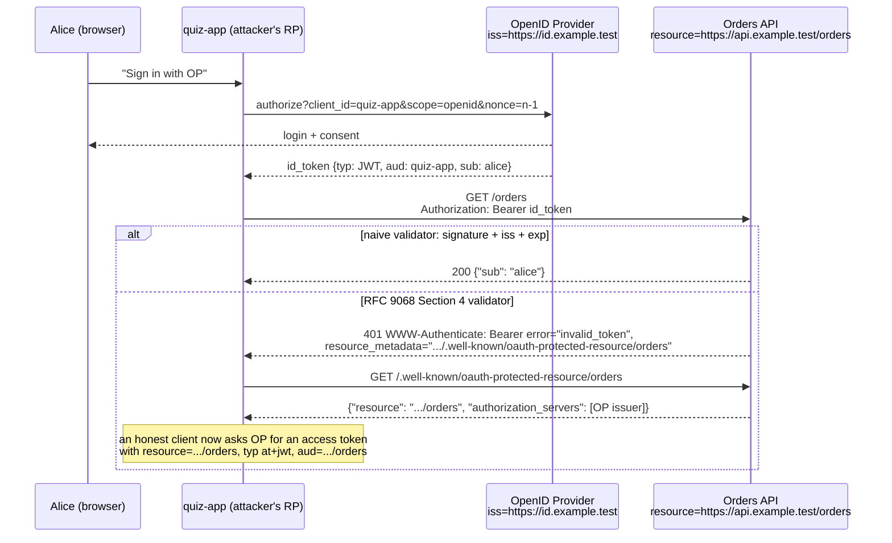

# OpenID Connect (OIDC Core 1.0) vs OAuth 2.0: Why an ID Token Must Never Be Accepted as an API Access Token, Plus RFC 8414 and RFC 9728 Metadata

> [!summary] Claim
> An ID Token is a signed statement to one client that a user logged in, with `aud` set to that client's `client_id`; an API that accepts it as a bearer credential lets every client of the same provider, including an attacker's app the victim once signed in to, call the API as that user, so a resource server must require `typ: at+jwt` and its own resource identifier in `aud`, and must learn issuers and keys only from metadata whose `issuer` or `resource` exactly matches the identifier it was fetched for.

Part of [API Authentication and Identity](README.md) in [API Engineering](../README.md).

## TL;DR

- Mechanism: one OpenID Provider signs two JWT kinds with the same keys: the ID Token (OIDC Core Section 2, `aud` = the Relying Party's `client_id`) and the access token (RFC 9068 Section 2, `typ: at+jwt`, `aud` = the RFC 8707 resource), so signature, `iss`, and `exp` cannot tell them apart.
- Contract rule: a resource server MUST reject any `typ` other than `at+jwt` or `application/at+jwt` and MUST reject a token whose `aud` does not name it (RFC 9068 Section 4); a client MUST use metadata only when its `issuer` (RFC 8414 Section 3.3) or `resource` (RFC 9728 Section 3.3) is identical to the identifier the well-known URL was built from.
- Trap: the confused deputy; quiz-app, a client an attacker registered at the same provider, receives a victim's ID Token at login and replays it at your API, and a validator that checks only signature, issuer, and expiry answers `200` as the victim (proven in the lab).
- Portability: library defaults do not save you (as of 2026-11): PyJWT 2.15.1 never reads `typ` and treats a list `audience` as any-match, authlib 1.9.5's RFC 9068 claims class accepts a token with no `typ`, and pydantic 2.14.3 `AnyHttpUrl` rewrites `https://id.example.test` to `https://id.example.test/`, which breaks exact issuer comparison.
- When not to use it: do not authenticate API calls with ID Tokens at all, even first-party ones; send the ID Token nowhere but the client that requested it, use opaque tokens plus introspection (RFC 7662) when you cannot ship `typ`-aware JWT validation to every resource server, and skip RFC 9728 discovery when the client-to-API binding is static configuration.

## Mental model



Alice signs in to quiz-app, which a malicious operator registered as an ordinary client at the same OpenID Provider, so the provider correctly mints Alice an ID Token whose audience is `quiz-app`.
The ID Token is signed by the provider's key, names the provider as `iss`, and has not expired, so a resource server that checks only those three facts treats it as Alice's credential, and quiz-app now reads Alice's orders.
The RFC 9068 validator rejects it twice over: its header says `typ: JWT`, and its `aud` names `quiz-app`, not the API's resource identifier.
The `401` challenge carries the RFC 9728 `resource_metadata` URL, from which an honest client learns which authorization server the API trusts and requests an audience-restricted access token for exactly this resource.

## How it works

### Two token kinds, one issuer, one key set

OpenID Connect is "a simple identity layer on top of the OAuth 2.0 protocol" (OIDC Core 1.0 Section 1, incorporating errata set 2, December 15, 2023).
OAuth 2.0 issues access tokens, which represent delegated authorization to a protected resource; OIDC adds the ID Token, a JWT "that contains Claims about the Authentication event" (OIDC Core Section 1.2).
The two are aimed at different recipients:

| Property | ID Token | JWT access token |
| --- | --- | --- |
| Defined by | OIDC Core Section 2 | RFC 9068 Section 2 |
| Consumer | the Relying Party (client) | the resource server (API) |
| `aud` | MUST contain the RP's `client_id` | the resource indicator (RFC 9068 Section 3) |
| `typ` header | not specified by OIDC Core | MUST be `at+jwt` or `application/at+jwt` (RFC 9068 Section 2.1) |
| Required claims | `iss`, `sub`, `aud`, `exp`, `iat` | `iss`, `exp`, `aud`, `sub`, `client_id`, `iat`, `jti` (RFC 9068 Section 2.2) |
| Replay binding | `nonce`, `at_hash`, `c_hash` | `jti`, optional sender constraint (RFC 9449, RFC 8705) |
| Meaning | "this user authenticated to you, at `auth_time`, with `acr`/`amr`" | "the bearer may do `scope` at `aud` for `sub`" |
| Format | always a JWS (OIDC Core Section 2) | any format; RFC 9068 profiles the JWT case |

Nothing in the signature distinguishes them: RFC 9068 Section 4 lets the authorization server sign access tokens "with any of the keys advertised" in metadata, and Section 5 states that "resource servers have no way of knowing what key should be used to validate JWT access tokens in particular".
So key separation is not a defense; the defenses are explicit typing, audience, and required claims, written as mutually exclusive rule sets (RFC 8725 Section 3.12).

### The ID Token, claim by claim

OIDC Core Section 2 requires `iss` ("a case-sensitive URL using the https scheme" with no query or fragment), `sub` ("locally unique and never reassigned", at most 255 ASCII characters), `aud` (MUST contain the RP's `client_id`, MAY contain others), `exp`, and `iat`.
`nonce` is passed through unmodified from the request; if the RP sent one, the ID Token MUST carry the same value.
`acr` value `"0"` means the authentication did not reach ISO/IEC 29115 level 1 and "SHOULD NOT be used to authorize access to any resource of any monetary value".
`azp` (authorized party), per errata set 2, "only occurs when extensions beyond the scope of this specification are used", and implementations not using such extensions "are encouraged to not use azp and to ignore it".
ID Tokens MUST be signed (JWS), MAY then be encrypted (Nested JWT), and MUST NOT use `alg: none` unless no ID Token comes from the authorization endpoint and the client registered for `none` (OIDC Core Section 2).

The RP's checks (OIDC Core Section 3.1.3.7), condensed:

1. Decrypt if encryption was registered; if it was and the token is not encrypted, the RP SHOULD reject it.
2. `iss` MUST exactly match the issuer identifier from discovery.
3. `aud` MUST contain the RP's `client_id`; reject if it "contains additional audiences not trusted by the Client".
4. and 5. Validate `azp` if the deployment's extensions produce it.
6. For tokens received directly from the token endpoint over TLS, TLS server validation MAY replace signature checking; all other ID Tokens MUST be signature-checked with the issuer's keys.
7. `alg` SHOULD be `RS256` or the registered `id_token_signed_response_alg`.
8. For `HS256`/`HS384`/`HS512`, the key is the UTF-8 octets of the `client_secret`; behavior with multi-valued `aud` is unspecified.
9. The current time MUST be before `exp`; the leeway allowance, "some small leeway, usually no more than a few minutes", is in the `exp` definition (OIDC Core Section 2), not in this step.
10. `iat` MAY bound how long nonces are stored.
11. If a `nonce` was sent, it MUST be present and equal.
12. and 13. Check `acr` and `auth_time` if requested.

Note what is missing from that list: nothing tells a resource server how to treat an ID Token, because a resource server is not its audience.

### `at_hash` and `c_hash`: binding companions

`at_hash` is "the base64url encoding of the left-most half of the hash of the octets of the ASCII representation of the access_token value", using the hash of the ID Token's `alg` (OIDC Core Section 3.1.3.6); `c_hash` is the same over the authorization code (Section 3.3.2.11).
For `RS256`/`ES256`/`PS256` that is SHA-256 truncated to 128 bits, which base64url-encodes to 22 characters; for `*512` it is 256 bits and 43 characters.
`at_hash` is REQUIRED when the authorization endpoint returns an access token next to an ID Token (`response_type=id_token token`, Section 3.2.2.10) and OPTIONAL in the code flow (Section 3.1.3.6), where the client MAY use it to validate the access token from the token endpoint (Section 3.1.3.8).
Its job is token substitution defense (Section 16.11): it lets the client prove that the access token it holds is the one issued in the same response as the ID Token.
It is a client-side check; it never makes the ID Token a credential for anything else.
The lab reproduces the specification's own vectors: `at_hash` `77QmUPtjPfzWtF2AnpK9RQ` for access token `jHkWEdUXMU1BwAsC4vtUsZwnNvTIxEl0z9K3vx5KF0Y` (Appendix A.3) and `c_hash` `LDktKdoQak3Pk0cnXxCltA` for the Appendix A.4 code.
OIDC Core defines the hash only through the JWS `alg`'s hash, so `EdDSA` has no rule there; authlib 1.9.5 picks SHA-512 for it (authlib 1.9.5 authlib/oidc/core/util.py, create_half_hash), and the lab refuses instead.

### The UserInfo endpoint is the protected resource OIDC defines

OIDC's own API is the UserInfo endpoint, "an OAuth 2.0 Protected Resource", which MUST accept access tokens per RFC 6750 and MUST support `GET` and `POST` (OIDC Core Section 5.3).
The client sends the access token, never the ID Token (Section 5.3.1: "The Access Token obtained from an OpenID Connect Authentication Request MUST be sent as a Bearer Token").
Because of token substitution, "the UserInfo Response is not guaranteed to be about the End-User identified by the sub (subject) element of the ID Token", so the client MUST check that the two `sub` values match exactly (Section 5.3.2).
That is the specification itself modelling the right shape: identity for the client in the ID Token, API access with an access token.

### Identity: only `iss` + `sub`

"The only guaranteed unique identifier for a given End-User is the combination of the iss Claim and the sub Claim"; `email`, `phone_number`, `preferred_username`, and `name` "MUST NOT be used as unique identifiers" (OIDC Core Section 5.7).
The path is part of the issuer: subject `1234` at `https://example.com` is a different user from `1234` at `https://example.com/sales` (Section 16.15).
A resource server keying users by `sub` alone across issuers merges strangers; key by the pair.

### RFC 9068: explicit typing and the resource server's checklist

RFC 9068 (October 2021) registers `application/at+jwt`, requires the `typ` header, and recommends dropping the `application/` prefix, so `typ` SHOULD be `at+jwt` (Section 2.1); `RS256` support is mandatory and `none` is forbidden.
Section 4 is the resource server's checklist:

1. `typ` is `at+jwt` or `application/at+jwt`, "and reject tokens carrying any other value".
2. Decrypt if encryption was negotiated; SHOULD reject unencrypted tokens then.
3. `iss` MUST exactly match the issuer from discovery.
4. `aud` MUST contain "a resource indicator value corresponding to an identifier the resource server expects for itself".
5. Signature per RFC 7515 with the issuer's keys; MUST reject `alg: none`.
6. Current time before `exp`, with small leeway.
7. On any failure, answer per RFC 6750 Section 3.1 with `error="invalid_token"`.

Two details matter for implementations.
First, `typ` is a media type, and media types are case-insensitive (RFC 7515 Section 4.1.9), so `at+JWT`, which RFC 9068 Figure 2 itself uses, must be accepted; a `==` comparison against `"at+jwt"` breaks interop with exactly the specification's example.
Second, a recipient "MUST treat it as if `application/` were prepended to any `typ` value not containing a `/`" (RFC 7515 Section 4.1.9), which is why both spellings are equivalent.

The rule must be an allowlist.
RFC 8725 Section 3.11 warns that explicit typing "may not achieve disambiguation from existing kinds of JWTs, as the validation rules for existing kinds of JWTs often do not use the `typ` Header Parameter value"; an ID Token from a provider that omits `typ` is untyped, so a denylist of `JWT` lets it through.
Defense in depth comes from the required claims: an ID Token normally lacks `client_id` and `jti`, which RFC 9068 Section 2.2 makes REQUIRED, and its `aud` names a client, not a resource.
RFC 9068 Section 5 adds the issuer-side half: authorization servers "MUST use a distinct identifier as an `aud` claim value" for distinct resources, citing cross-JWT confusion (RFC 8725 Section 2.8).

### Audience: what `aud` must contain, and who chooses it

RFC 7519 Section 4.1.3 makes `aud` OPTIONAL in general and says a principal that does not identify itself with a value in `aud` "when this claim is present" MUST reject the JWT; the conditional is the gap.
RFC 8725 Section 3.9 closes it: when one issuer issues JWTs for more than one relying party, the JWT MUST contain `aud`, and a recipient MUST reject a JWT whose audience "is not present or not associated with the recipient".
RFC 9068 makes `aud` REQUIRED (Section 2.2), and when the request carries an RFC 8707 `resource` parameter, `aud` SHOULD have the same value (Section 3); without `resource`, the server MUST use a default resource indicator and SHOULD reject with `invalid_scope` when scopes map to different defaults.

RFC 8707 Section 2 defines `resource` as an absolute URI without fragment, SHOULD NOT have a query, with the error `invalid_target` for a bad or unknown value.
Its security section adds three operational rules: use a tenant-specific URI so tokens cannot cross tenants, prefer one `resource` per token because a multi-audience bearer token "can be used by any one of those resources to access any of the others", and prefer the network location so the client can check that the endpoint it is about to call actually owns the audience (RFC 8707 Section 3).
RFC 9700 Section 2.3 turns it into a BCP: access tokens SHOULD be audience-restricted, and every resource server "MUST refuse to serve" a request whose token was not meant for it.

### The confused deputy and token forwarding

RFC 8725 Section 2.7 describes substitution: a protected resource that legitimately received a token presents it to a different resource.
Section 2.8 names the special case, cross-JWT confusion, where a JWT issued for one purpose is accepted for another.
OIDC Core Section 16.8 calls the resource-server form "Access Token Redirect" and prescribes the same mitigation, audience restriction.
The MCP authorization specification (version 2025-11-25) states the operational rule plainly: an MCP server "MUST validate that access tokens were issued specifically for them as the intended audience, according to RFC 8707 Section 2", and token passthrough, forwarding the unmodified inbound token downstream, is "explicitly forbidden" because the downstream API "may incorrectly trust the token as if it came from the MCP server".
A backend that forwards a user's ID Token to an internal API is the same bug with a different token: the internal API learns who logged in to the front end, not what it may do; use RFC 8693 token exchange for the downstream hop (see [[Service-to-Service-Identity-Client-Credentials-and-Token-Exchange-RFC-8693]]).

### RFC 6750 challenges on the wire

A protected resource MUST send `WWW-Authenticate` when a request lacks credentials or has an unusable token (RFC 6750 Section 3); the scheme is `Bearer`, and `realm`, `scope`, `error`, `error_description`, and `error_uri` each MUST NOT appear more than once.
The error codes (RFC 6750 Section 3.1):

| Code | When | Status |
| --- | --- | --- |
| `invalid_request` | malformed request, two token transport methods | SHOULD `400 Bad Request` |
| `invalid_token` | expired, revoked, malformed, wrong `typ`, wrong `aud` | SHOULD `401 Unauthorized` |
| `insufficient_scope` | valid token, missing privilege; MAY add `scope` | SHOULD `403 Forbidden` |
| none | no credentials at all | `401`, and the server SHOULD NOT include an error code |

The lab's three challenges, byte for byte, as status code and header printed by a one-off `httpx.ASGITransport` script against `build_resource_server` (no credentials, the quiz-app ID Token, an access token with `scope=profile`); the two `401` values are pinned exactly in the tests, the `403` value by its `error` and `scope` parameters:

```text
401 WWW-Authenticate: Bearer resource_metadata="https://api.example.test/.well-known/oauth-protected-resource/orders"
401 WWW-Authenticate: Bearer error="invalid_token", error_description="typ", resource_metadata="https://api.example.test/.well-known/oauth-protected-resource/orders"
403 WWW-Authenticate: Bearer error="insufficient_scope", scope="orders:read", resource_metadata="https://api.example.test/.well-known/oauth-protected-resource/orders"
```

Echoing the rejection reason in `error_description` is a lab choice for teaching; production servers may prefer a generic description and log the precise reason.

### RFC 8414: authorization server metadata

RFC 8414 (June 2018) publishes an authorization server's configuration at a URL built by inserting `/.well-known/oauth-authorization-server` "between the host component and the path component" of the issuer (Section 3), fetched with `GET` (Section 3.1).
The issuer identifier is an `https` URL with no query or fragment (Section 2); `issuer` and `response_types_supported` are REQUIRED, `authorization_endpoint` and `token_endpoint` are conditionally required, `jwks_uri` is OPTIONAL but MUST be `https`, and an omitted `code_challenge_methods_supported` means the server does not support PKCE (Section 2).
Arrays with zero elements MUST be omitted, and the success status MUST be `200 OK` with `application/json` (Section 3.2).
`signed_metadata` (Section 2.1) is a JWT with an `iss` claim whose values, when the consumer supports it, "MUST take precedence over" the plain JSON members.

The validation rule (Section 3.3): "The `issuer` value returned MUST be identical to the authorization server's issuer identifier value into which the well-known URI string was inserted"; otherwise the data "MUST NOT be used".
Identical means code point for code point, with no Unicode normalization (Section 4), so `https://ID.example.test`, `https://id.example.test/`, and `https://id.example.test:443` are three different issuers.
Section 6.2 gives the threat: an attacker publishes a document that claims the real issuer's identifier but lists its own endpoints and keys; the exact match is what turns that into a rejection.
Section 6.4 leaves the hard question open: which protected resources go with which authorization server is "out of scope"; RFC 9728 is the answer.

### OIDC Discovery 1.0: the same document, a different URL rule

OIDC Discovery 1.0 (errata set 2, December 15, 2023) appends instead of inserting: the document lives at the issuer with any terminating `/` removed, followed by `/.well-known/openid-configuration` (Section 4.1).
For a path-less issuer the two rules coincide; with a path they diverge:

| Issuer | RFC 8414 Section 3.1 (insert) | OIDC Discovery Section 4.1 (append) |
| --- | --- | --- |
| `https://id.example.test` | `https://id.example.test/.well-known/oauth-authorization-server` | `https://id.example.test/.well-known/openid-configuration` |
| `https://id.example.test/tenant1` | `https://id.example.test/.well-known/oauth-authorization-server/tenant1` | `https://id.example.test/tenant1/.well-known/openid-configuration` |
| `https://id.example.test:8443/a/b/` | `https://id.example.test:8443/.well-known/oauth-authorization-server/a/b` | `https://id.example.test:8443/a/b/.well-known/openid-configuration` |

RFC 8414 Section 5 says new deployments should insert, may publish at both locations during a transition, and clients should try the inserted location first and fall back only when the suffix is `openid-configuration`.
The MCP specification (2025-11-25) codifies a three-URL order for path-bearing issuers: `/.well-known/oauth-authorization-server/tenant1`, then `/.well-known/openid-configuration/tenant1`, then `/tenant1/.well-known/openid-configuration`.
OIDC Discovery Section 3 requires `issuer`, `authorization_endpoint`, `jwks_uri`, `response_types_supported`, `subject_types_supported`, and `id_token_signing_alg_values_supported` (which MUST include `RS256`), plus `token_endpoint` unless only the implicit flow is used.
Its Section 4.3 repeats the exact-match rule and extends it to the token: the metadata `issuer` "MUST also be identical to the iss Claim value in ID Tokens issued from this Issuer", and Section 7.2 names the impersonation attack it stops.
RFC 9068 Section 4 adds that a server publishing both documents MUST keep them consistent.

### RFC 9728: protected resource metadata

RFC 9728 (April 2025) is the mirror image for APIs.
A resource identifier is an `https` URL with no fragment, which SHOULD NOT have a query (RFC 9728 Section 1.2, following RFC 8707).
The document lives at the identifier with `/.well-known/oauth-protected-resource` inserted between the host and "the path and/or query components"; a terminating `/` directly after the host is removed (Section 3.1).
`resource` is REQUIRED; `authorization_servers` lists RFC 8414 issuer identifiers; `scopes_supported` is RECOMMENDED; `bearer_methods_supported` takes `header`, `body`, `query`; and `dpop_bound_access_tokens_required`, `tls_client_certificate_bound_access_tokens`, `dpop_signing_alg_values_supported`, and `authorization_details_types_supported` connect to RFC 9449, RFC 8705, and RFC 9396 (Section 2).
Unknown members MUST be ignored and empty arrays omitted (Section 3.2).
Validation has two rules (Section 3.3): `resource` MUST be identical to the identifier the URL was built from, and, when the URL came from a `WWW-Authenticate` challenge, `resource` MUST be identical to the URL the client was requesting.
`signed_metadata` works as in RFC 8414, except that a `signed_metadata` member inside the JWT is RECOMMENDED to cause rejection (Section 2.2).
RFC 9728 Section 4 adds the reverse link: an authorization server's `protected_resources` metadata, which clients should cross-check against `authorization_servers` when both are used.

Section 5 adds discovery from a challenge: a `401` with `WWW-Authenticate: Bearer resource_metadata="..."` (Section 5.1), usable with `DPoP` too, after which the client fetches the resource metadata, validates it, builds the RFC 8414 URL from a listed issuer, fetches that, and runs a normal OAuth flow (Figure 1).
A later challenge with a new `resource_metadata` signals changed metadata and SHOULD trigger a refetch (Section 5.2), which lets an API move to another authorization server "without any other coordination with clients".
What RFC 9728 does not do: it does not tell the client which authorization servers to trust (Section 7.6, "out of scope"); it warns of SSRF because clients now fetch URLs named by servers they did not know (Section 7.7); it warns that a malicious resource server can use the challenge to make a client mint a token for another resource, which is why it RECOMMENDS RFC 8707 audience-restricted tokens (Section 7.4); and it relies on normal HTTP caching (Section 7.10).

### Mix-up and the issuer as the anchor

A client talking to several authorization servers can be tricked into sending a code from one to another (RFC 9700 Section 4.4).
The defense is issuer identification: the client compares the `iss` it receives with the issuer it sent the request to, either from the RFC 9207 `iss` authorization response parameter or from the ID Token's `iss` (RFC 9700 Section 4.4.2.1), using "simple string comparison as defined in Section 6.2.1 of [RFC3986]" and rejecting responses without `iss` from servers that support the parameter according to the client's configuration, for example via `authorization_response_iss_parameter_supported` metadata (RFC 9207 Sections 2.4 and 3).
Every check in this note hangs from the same anchor: the issuer string fetched once from configuration, compared exactly against metadata, ID Tokens, access tokens, and authorization responses.

## Numbers and limits

| Quantity | Value | Source |
| --- | --- | --- |
| `sub` maximum length | 255 ASCII characters | OIDC Core Section 2 |
| `at_hash` / `c_hash` size for `*256` algs | 128 bits, 22 base64url characters | OIDC Core Section 3.1.3.6; lab `test_half_hash_matches_oidc_core_appendix_a_vectors` |
| `at_hash` / `c_hash` size for `*512` algs | 256 bits, 43 base64url characters | lab, same test |
| ES256 JWS signature segment | 64 bytes (`r` then `s`), 86 base64url characters | lab `test_es256_signature_segment_is_86_base64url_characters` |
| Lab ID Token / access token length | 289 / 374 bytes (ES256, kid `k1`; the quiz-app ID Token with `sub=alice`, `nonce=n-1`, and the orders access token with `client_id=spa`, `scope=orders:read`, `jti=j-1`, both at `now=1_800_000_000`) | re-measured by the reviewer with `uv run --frozen python -c ...` printing `len()` of `issue_id_token` and `issue_access_token` output, CPython 3.14.6, macOS 27.3 arm64 (Darwin 27.3.0) |
| Clock-skew leeway | "usually no more than a few minutes" | OIDC Core Section 2; RFC 9068 Section 4 |
| Lab leeway | 60 s; accepted at `exp + 59`, rejected at `exp + 60` | lab `test_exp_boundary_with_60_second_leeway` |
| Mandatory signing algorithm | `RS256` | RFC 9068 Section 2.1; OIDC Discovery Section 3 |
| Minimum TLS for RFC 8414 servers | TLS 1.2 MUST | RFC 8414 Section 6.1 |
| `typ` spellings a resource server must accept | `at+jwt`, `application/at+jwt`, any case | RFC 9068 Section 4; RFC 7515 Section 4.1.9 |
| Well-known URLs a path-issuer MCP client tries | 3 | MCP authorization 2025-11-25 |
| Google sign-in `sub` change rate | "about 0.04% of logins", an anonymous claim, not a figure published by Google | Truffle Security, January 13, 2025, quoting "a staff engineer at a major tech company" |
| Lab metadata cache lifetime | `Cache-Control: max-age=3600` | lab policy (RFC 9728 Section 7.10 only says to use HTTP caching) |
| Lab test run | 41 passed in 0.56 s | reviewer's single run of `uv run --frozen pytest ... -q`, CPython 3.14.6, macOS 27.3 arm64 (Darwin 27.3.0); wall time varies run to run |

## Portability

The rules are protocol-level, so they hold over every HTTP version; what varies is what libraries do by default.

| Dimension | Behavior | Evidence |
| --- | --- | --- |
| CPython 3.14.6 | all 41 lab tests pass | rerun by the reviewer, macOS 27.3 arm64 |
| CPython 3.12, 3.13, 3.15, 3.15t | not run | lab checks paused by the user on 2026-11-11; the lab uses only `hashlib`, `hmac`, `base64`, `urllib.parse` from the standard library, but that is not proof |
| PyJWT 2.15.1 | never checks `typ` (encodes `typ: JWT` by default); `audience=[a, b]` passes if any listed value is in `aud`; `strict_aud` exists for single-value exact match | PyJWT 2.15.1 jwt/api_jwt.py, PyJWT._validate_aud; jwt/api_jws.py, PyJWS.header_typ; lab `test_pyjwt_audience_list_is_any_match_and_ignores_typ` |
| joserfc 1.8.0 | `jwt.encode` defaults `typ` to `JWT`; claims registry checks `exp` only if present unless marked essential, and a list `aud` matches if it contains the expected value | joserfc 1.8.0 joserfc/jwt.py, encode (`default_type="JWT"`); joserfc/_rfc7519/claims.py, BaseClaimsRegistry.validate (runs `validate_<claim>` only for claims present), BaseClaimsRegistry.check_value, JWTClaimsRegistry.validate_exp |
| authlib 1.9.5 RFC 9068 | rejects `typ` other than `at+jwt`/`application/at+jwt` (case-insensitive) but accepts a missing `typ`; `JWTBearerTokenValidator.authenticate_token` marks all seven RFC 9068 Section 2.2 claims (`iss`, `exp`, `aud`, `sub`, `client_id`, `iat`, `jti`) essential | authlib 1.9.5 authlib/oauth2/rfc9068/claims.py, JWTAccessTokenClaims.validate; rfc9068/token_validator.py, authenticate_token; lab `test_authlib_rfc9068_claims_waves_through_a_missing_typ` |
| authlib 1.9.5 RFC 8414 URL | keeps a terminating `/` on the issuer path (`/tenant1/`) | authlib 1.9.5 authlib/oauth2/rfc8414/well_known.py, get_well_known_url; lab test |
| pydantic 2.14.3 `AnyHttpUrl` | lowercases host, drops `:443`, appends `/` to a bare host, so it cannot hold an issuer for exact comparison | lab `test_pydantic_url_type_rewrites_issuer_so_exact_match_needs_str` |
| mcp 2.3.0 client | builds the three AS metadata URLs in the 2025-11-25 order; `issuers_match` treats `https://as` and `https://as/` as equal, a deliberate relaxation of RFC 8414 Section 3.3; PRM discovery uses only the path, so a resource with a query loses it (RFC 9728 Section 3.1 keeps it) | mcp 2.3.0 mcp/client/auth/utils.py, build_oauth_authorization_server_metadata_discovery_urls, issuers_match, build_protected_resource_metadata_discovery_urls |
| mcp 2.3.0 server | `BearerAuthBackend` compares the token's resource with `resource_server_url` only when that argument is set, and then after normalizing both through pydantic `AnyHttpUrl` and ignoring a trailing `/`; `RequireAuthMiddleware` sends `error="invalid_token"` even when no credentials were sent, where RFC 6750 Section 3.1 says SHOULD NOT | mcp 2.3.0 mcp/server/auth/middleware/bearer_auth.py, BearerAuthBackend.authenticate, BearerAuthBackend._issued_for_this_resource, RequireAuthMiddleware.__call__ |
| HTTP/1.1, HTTP/2, HTTP/3 | `Authorization` and `WWW-Authenticate` are HTTP semantics, identical across versions | RFC 6750 Section 3 builds on HTTP authentication framework; lab runs in-process ASGI only |
| Uvicorn, Hypercorn, Granian | no server-specific behavior; validation runs in the application | lab uses `httpx.ASGITransport`, no server |

## Worked example

The [implementation](../labs/src/api_labs/f14_api_authentication_and_identity/oidc_token_confusion.py) is one issuer that mints both token kinds with one key, three validators (the naive one, RFC 9068 Section 4, and OIDC Core Section 3.1.3.7), the three well-known URL builders, two metadata validators, and a Starlette API that publishes RFC 9728 metadata.
The [test](../labs/tests/f14_api_authentication_and_identity/test_openid_connect_oidc_id_tokens_vs_access_tokens_and_metadata_discovery.py) runs the attack end to end over ASGI and pins each rule and each library behavior above.

The resource server's validator, copied verbatim from the lab:

```python
def validate_access_token(
    token: str, *, jwks: KeySet, issuer: str, resource: str, now: int, leeway: int = 60
) -> Principal:
    """RFC 9068 Section 4, in its order: `typ`, `iss`, `aud`, signature/alg, `exp`.

    The signature is checked first here only because `jwt.decode` returns the header and
    claims together; every header value read below is integrity-protected by it.
    """
    decoded = _decode(token, jwks)
    typ = decoded.header.get("typ")
    if not isinstance(typ, str) or typ.lower() not in ACCESS_TOKEN_TYPES:
        raise TokenRejected("typ")
    claims = decoded.claims
    _require(claims, ACCESS_TOKEN_REQUIRED)
    if claims["iss"] != issuer:  # exact code-point match (RFC 8414 Section 4)
        raise TokenRejected("iss")
    if resource not in _audiences(claims):
        raise TokenRejected("aud")
    _check_exp(claims, now, leeway)
    scope = claims.get("scope", "")
    return Principal(
        sub=str(claims["sub"]),
        client_id=str(claims["client_id"]),
        scopes=frozenset(scope.split()) if isinstance(scope, str) else frozenset(),
    )
```

`_decode` calls `joserfc.jwt.decode(token, jwks, algorithms=["ES256"])`, so the algorithm comes from an allowlist, never from the header alone.
The bug it replaces, also verbatim:

```python
def naive_validate(token: str, *, jwks: KeySet, issuer: str, now: int) -> Principal:
    """THE BUG: signature + `iss` + `exp`, no `typ`, no `aud`. Do not ship this."""
    claims = _decode(token, jwks).claims
    if claims.get("iss") != issuer:
        raise TokenRejected("iss")
    _check_exp(claims, now, 0)
    scope = claims.get("scope")
    return Principal(
        sub=str(claims.get("sub")),
        client_id=str(claims.get("client_id", claims.get("aud"))),
        scopes=frozenset(scope.split()) if isinstance(scope, str) else frozenset(),
    )
```

The attack and the fix, as a simplified excerpt of two tests (the real tests build the app through a shared helper):

```python
token = op.issue_id_token(client_id="quiz-app", sub="alice", nonce="n-1", now=NOW)
# naive API:  GET /orders with Bearer token -> 200 {"sub": "alice", "client_id": "quiz-app"}
# strict API: GET /orders with Bearer token -> 401 {"error": "invalid_token", "reason": "typ"}
```

Each rule has a test that isolates it: a JWT carrying every RFC 9068 claim and the right `aud` but `typ: JWT` is rejected only by `typ`; a correctly typed access token for `https://billing.example.test/` is accepted there and rejected at the orders API only by `aud`; a token signed by a second key under the same issuer string fails only the signature.

Captured run (CPython 3.14.6, macOS 27.3 arm64, from `labs/`):

```text
$ uv run --frozen pytest tests/f14_api_authentication_and_identity/test_openid_connect_oidc_id_tokens_vs_access_tokens_and_metadata_discovery.py -q
.........................................                                [100%]
41 passed in 0.56s
```

## Pitfalls

> [!warning] Accepting ID Tokens at the API "because they are signed by our IdP"
> Trigger: a SPA sends the ID Token to its backend API, or the API validates with signature, `iss`, and `exp` only.
> Symptom: any client registered at the same provider, including a malicious one the victim signed in to once, can replay the victim's ID Token at your API; the lab's naive API answers `200 {"sub": "alice", "client_id": "quiz-app"}`.
> Fix: require `typ` in `{at+jwt, application/at+jwt}`, your resource identifier in `aud`, and RFC 9068's required claims (RFC 9068 Section 4); have the client request an access token with `resource=` (RFC 8707).

> [!warning] Merging "API audience" and "login client" into one PyJWT audience list
> Trigger: `jwt.decode(token, key, audience=[API, CLIENT_ID], ...)` so that both the SPA's ID Token and real access tokens validate.
> Symptom: PyJWT 2.15.1 accepts any token whose `aud` contains either value, so every ID Token for that client is an API credential, and PyJWT never looks at `typ` (lab `test_pyjwt_audience_list_is_any_match_and_ignores_typ`).
> Fix: one validator per token kind with one expected audience; check `typ` yourself from `decode_complete`'s header.

> [!warning] A key accepted for the wrong issuer: Storm-0558
> Trigger: a validator trusts any key it can find rather than the keys that belong to the token's issuer (RFC 8725 Section 3.8).
> Symptom: Microsoft reported on July 14, 2023 that an actor "acquired an inactive MSA consumer signing key and used it to forge authentication tokens for Azure AD enterprise and MSA consumer", and that "a validation issue allowed this key to be trusted for signing Azure AD tokens".
> Fix: bind each key set to exactly one issuer via its own metadata `jwks_uri`, and validate `iss` against the issuer whose keys verified the signature.

> [!warning] Using `email` as the account key: nOAuth
> Trigger: an RP or API maps users by the `email` claim.
> Symptom: Descope reported on June 20, 2023 that in Azure AD "the email claim is both mutable and unverified": "A bad actor can change the Email attribute under 'Contact Information' in the Azure AD account to control the 'email' claim", so an attacker who sets a victim's address on an account they control logs in as the victim at apps keyed on email.
> Fix: key accounts by (`iss`, `sub`) as OIDC Core Section 5.7 requires; treat `email` as a display attribute unless a verification claim backs it.

> [!warning] Domain-scoped trust outliving the domain
> Trigger: a service grants workspace access by the hosted-domain claim and email.
> Symptom: Truffle Security reported on January 13, 2025 that buying a defunct startup's domain and recreating accounts let them sign in to former employees' accounts at downstream services via Google sign-in; they quote an unnamed "staff engineer at a major tech company" saying `sub` "changes in about 0.04% of logins", and conclude that services are left "reliant on the email and hd claims"; the rate is that anonymous claim, not a Google figure.
> Fix: bind accounts to `sub`, handle `sub` changes through an explicit re-link flow rather than an email fallback, and deprovision through SCIM (see [[Enterprise-SSO-Integration-Multi-Tenant-OIDC-and-SCIM-Provisioning]]).

> [!warning] Normalizing the issuer
> Trigger: storing the configured issuer in a URL type (pydantic `AnyHttpUrl`), or comparing with `rstrip("/")`, `lower()`, or a URL parser.
> Symptom: `https://id.example.test` becomes `https://id.example.test/`, so a correct `iss` fails, or the code "fixes" that by normalizing both sides and then accepts look-alike issuers that RFC 8414 Section 4 says are different.
> Fix: keep issuer and resource identifiers as `str` and compare code point for code point (RFC 8414 Section 4, RFC 9728 Section 6).

> [!warning] Trusting whatever `authorization_servers` says
> Trigger: a generic client (an MCP host, an API explorer) follows `resource_metadata` and then any issuer listed there.
> Symptom: SSRF into internal ranges (RFC 9728 Section 7.7), phishing consent screens (Section 7.8), and tokens minted for one resource used at another (Section 7.4).
> Fix: an allowlist of trusted issuers (lab `choose_authorization_server`), RFC 8707 `resource` on every token request, and outbound URL filtering.

> [!warning] Insert vs append at the well-known path
> Trigger: a path-bearing issuer such as `https://id.example.test/tenant1` and a client that only knows one URL rule.
> Symptom: `404` on discovery, then a hand-configured endpoint that silently skips the issuer check.
> Fix: try RFC 8414 insertion first and OIDC append second (RFC 8414 Section 5), and run the `issuer` exact match on whichever document answers.

## Security and robustness

Threat model, in the order an attacker tries them:

- Cross-JWT confusion (RFC 8725 Section 2.8): ID Token, logout token, or another JWT type from the same issuer presented as an access token; stopped by the `typ` allowlist plus RFC 9068 required claims.
- Audience substitution (RFC 8725 Section 2.7, OIDC Core Section 16.8): an access token for API A replayed at API B, often by a compromised or malicious API A; stopped by one resource per token (RFC 8707 Section 3) and the `aud` check, and further by sender-constrained tokens (see [[Sender-Constrained-Tokens-DPoP-RFC-9449-and-mTLS-Binding-RFC-8705]]).
- Token passthrough: an intermediate service forwards the inbound token downstream; forbidden by the MCP authorization specification and replaced by RFC 8693 exchange.
- Metadata impersonation (RFC 8414 Section 6.2, RFC 9728 Section 7.3): a document claiming someone else's identifier; stopped by TLS certificate checks for the identifier's host and the exact `issuer`/`resource` match.
- Mix-up (RFC 9700 Section 4.4): stopped by RFC 9207 `iss` checks.
- Key-issuer confusion (RFC 8725 Section 3.8, Storm-0558): stopped by one key set per issuer.
- Identity takeover through mutable claims (OIDC Core Section 5.7, nOAuth): stopped by keying on (`iss`, `sub`).

OWASP API Security Top 10 2023 API2 Broken Authentication lists APIs that do not "validate the authenticity of tokens", accept "unsigned/weakly signed JWT tokens", or do not "validate the JWT expiration date"; accepting the wrong kind of signed token belongs in the same category.

Input validation edge cases the lab enforces:

- `aud` that is not a string or a non-empty array of strings is `invalid_token`, not a crash.
- `exp` that is `true` is rejected; Python's `bool` is an `int`, so a bare `isinstance(exp, int)` would accept it.
- A missing `typ` is rejected, unlike authlib 1.9.5.
- `nonce` and `at_hash` are compared with `hmac.compare_digest`, following the spirit of OIDC Core Section 16.12.
- Issuer identifiers with `http`, a query, or a fragment raise before any network fetch.

Defense in depth for an API fleet: validate at the edge and again in each service (see [[API-Authentication-Architecture-Edge-Verification-vs-Zero-Trust-Propagation]]), give each service its own `aud`, keep access tokens short-lived (OIDC Core Section 16.18), and cache JWKS with single-flight refresh (see [[JWKS-Discovery-Caching-Key-Rotation-and-Thundering-Herd-Protection]]).

## The principal's view

The decision is not "which JWT library", it is "which artifact is an API credential in this company", and the answer must be exactly one: an access token whose audience is the API.
Write that down as a platform rule, enforce it in a shared validation package with no options to turn `typ` or `aud` off, and give every API a resource identifier that matches its URL, because RFC 8707 Section 3 and RFC 9700 Section 4.10.2 both make the network location the most phishing-resistant audience.
The organizational trade-off is migration cost: front ends that send ID Tokens today must start requesting access tokens with `resource=`, identity teams must configure per-API audiences and `typ: at+jwt`, and some providers make that awkward, so plan a dual-accept window keyed by client and measure the ID Token traffic to zero before flipping enforcement.
Publish RFC 9728 metadata for every API that unknown clients will call (MCP servers, partner APIs), because it makes the API, not tribal knowledge, the source of truth for which authorization server it trusts, and lets you move authorization servers with a challenge instead of a client release.
Do not publish it, or keep it static, for internal APIs with fixed configuration, where dynamic discovery only adds SSRF surface.
Choose opaque tokens with introspection (RFC 7662) instead of JWT access tokens when you need instant revocation or cannot guarantee that every resource server validates `typ` and `aud` correctly; choose sender-constrained tokens when a leaked token must be useless off the client.
Choose SAML or a different protocol only for legacy enterprise SSO at the login boundary; the API boundary still wants OAuth access tokens.

## Interview questions

> [!question] L5: What is the difference between an ID Token and an access token, and who is each one for?
>
> > [!success]- Answer
> > The ID Token is for the client: it tells the Relying Party that a user authenticated, and its `aud` contains the client's `client_id` (OIDC Core Section 2).
> > The access token is for the resource server: it tells an API what the bearer may do there, and in RFC 9068 its `aud` is the API's resource identifier.
> > The client should read the ID Token and should treat the access token as opaque.
> >
> > Follow-up: Why does OIDC Core Section 5.3.1 send the access token, not the ID Token, to the UserInfo endpoint?

> [!question] L5: Predict the output: a FastAPI dependency calls `jwt.decode(token, key, algorithms=["RS256"], audience=["https://api.example.com", "spa-client"], issuer=ISS)` with PyJWT 2.15.1, and the request carries the SPA's ID Token (`aud: "spa-client"`, `typ: "JWT"`). What happens?
>
> > [!success]- Answer
> > It returns the claims and the request is authenticated as the user.
> > PyJWT's `_validate_aud` passes when any listed audience is in the token's `aud`, and PyJWT never checks `typ`.
> > The lab pins this behavior in `test_pyjwt_audience_list_is_any_match_and_ignores_typ`.
> >
> > Follow-up: What two changes make the same call reject the ID Token?

> [!question] L5: Why must `typ` be compared case-insensitively, and why must a missing `typ` be rejected?
>
> > [!success]- Answer
> > `typ` is a media type, and RFC 7515 Section 4.1.9 says media type values are case-insensitive, so `at+JWT` (RFC 9068 Figure 2) is valid.
> > RFC 9068 Section 4 says reject "any other value", and RFC 8725 Section 3.11 warns that existing JWT kinds often carry no `typ`, so accepting absence lets untyped ID Tokens through.
> >
> > Follow-up: Which pinned library accepts a missing `typ`, and what else in its validator still catches an ID Token?

> [!question] L6: Debug this API: users report that a partner's app can read their orders, though they never consented to it; logs show valid signatures from your IdP and `sub` values of your users. What do you check?
>
> > [!success]- Answer
> > Check the `typ` and `aud` of the accepted tokens: the partner app is a client of the same IdP, so it holds ID Tokens with `aud` equal to its own `client_id`, signed by the same keys.
> > If the API validates only signature, `iss`, and `exp`, those ID Tokens work as credentials, which is the confused deputy the lab reproduces.
> > Fix the validator per RFC 9068 Section 4, then audit access logs by `aud` and `client_id` to scope the incident.
> >
> > Follow-up: How would you roll out enforcement without breaking your own SPA, which also sends ID Tokens today?

> [!question] L6: An issuer is `https://login.example.com/tenant1`. Which URLs hold its metadata, and what must the client check in the response?
>
> > [!success]- Answer
> > RFC 8414 Section 3.1 inserts: `https://login.example.com/.well-known/oauth-authorization-server/tenant1`, and with the OIDC suffix `https://login.example.com/.well-known/openid-configuration/tenant1`.
> > OIDC Discovery Section 4.1 appends: `https://login.example.com/tenant1/.well-known/openid-configuration`.
> > Whichever answers, `issuer` must be identical to `https://login.example.com/tenant1` (RFC 8414 Section 3.3), and ID Tokens' `iss` must match it too (OIDC Discovery Section 4.3).
> >
> > Follow-up: Why is storing that issuer in a pydantic `AnyHttpUrl` field a bug?

> [!question] L6: What does RFC 9728 add that RFC 8414 left open, and what does it still leave open?
>
> > [!success]- Answer
> > RFC 8414 Section 6.4 left the association between resources and authorization servers out of scope; RFC 9728 lets the API publish `authorization_servers` at a well-known URL derived from its resource identifier and point to it from a `401` challenge (Sections 3 and 5.1).
> > It still leaves trust out of scope (Section 7.6), so the client needs an issuer allowlist, SSRF controls (Section 7.7), and RFC 8707 audience restriction (Section 7.4).
> >
> > Follow-up: What two identity checks does RFC 9728 Section 3.3 require when the metadata URL came from a challenge?

> [!question] L7+: Your company runs 300 APIs behind one IdP and some services forward the user's token downstream. Design the token architecture.
>
> > [!success]- Answer
> > Give each API a resource identifier equal to its base URL and issue one-audience `at+jwt` tokens per API via `resource=` (RFC 8707, RFC 9068 Section 3).
> > Ban forwarding; downstream hops use RFC 8693 token exchange to mint a token for the next audience, so each service validates only tokens addressed to it.
> > Ship one validation library that enforces `typ`, `iss`, `aud`, `exp`, and required claims with no opt-outs, cache JWKS per issuer, and alert on rejections by reason.
> > Consider opaque tokens plus introspection for high-risk APIs that need instant revocation.
> >
> > Follow-up: What breaks if two APIs share an audience, and who can exploit it?

> [!question] L7+: Storm-0558 forged tokens with a consumer signing key that enterprise validation accepted. Which specification rule was violated, and how do you make that class of bug structurally impossible?
>
> > [!success]- Answer
> > RFC 8725 Section 3.8: the application MUST validate that the keys used belong to the issuer named in `iss`.
> > Make the key set a function of the issuer: resolve the expected issuer from configuration, fetch its metadata with exact `issuer` matching, use only that document's `jwks_uri`, and never consult a merged key pool.
> > Then `iss` comparison and key selection cannot disagree.
> >
> > Follow-up: Does RFC 9068 let a resource server require a specific key for access tokens versus ID Tokens?

> [!question] L7+: When would you not use JWT access tokens at all, and what do you lose?
>
> > [!success]- Answer
> > When revocation must be immediate, when tokens must not leak claims to clients, or when you cannot guarantee correct validation in every resource server, use opaque tokens and RFC 7662 introspection.
> > You lose offline validation, so every request costs an introspection call or a cache entry, and the authorization server becomes a hard runtime dependency.
> >
> > Follow-up: Where does a phantom-token gateway fit between those two options?

## Related

Prerequisites: [[OAuth-2-0-for-Browser-Based-Applications-BFF-and-Cookies-RFC-10017]]

Next: [[JWT-JWS-JWK-Structure-and-RFC-9068-Access-Token-Profile]]

See also: [[API-Authentication-and-Authorization]], [[02-Programming-Languages/Python/Python-Backend-Interview-Prep/07-Auth-and-Security]], [[OAuth-2-0-to-OAuth-2-1-and-RFC-9700-Security-BCP]], [[JWT-Cryptographic-Pitfalls-and-RFC-8725-Best-Current-Practices]], [[JWKS-Discovery-Caching-Key-Rotation-and-Thundering-Herd-Protection]], [[API-Authentication-Architecture-Edge-Verification-vs-Zero-Trust-Propagation]], [[Service-to-Service-Identity-Client-Credentials-and-Token-Exchange-RFC-8693]], [[Sender-Constrained-Tokens-DPoP-RFC-9449-and-mTLS-Binding-RFC-8705]], [[Refresh-Token-Rotation-Reuse-Detection-and-Token-Revocation-Architectures]], [[Enterprise-SSO-Integration-Multi-Tenant-OIDC-and-SCIM-Provisioning]], [[Pushed-Authorization-Requests-PAR-RFC-9126-and-Rich-Authorization-Requests-RAR-RFC-9396]]

- Lab: `labs/tests/f14_api_authentication_and_identity/test_openid_connect_oidc_id_tokens_vs_access_tokens_and_metadata_discovery.py`

## Further reading

- [OpenID Connect Core 1.0, errata set 2](https://openid.net/specs/openid-connect-core-1_0.html): the ID Token (Section 2), RP validation (Section 3.1.3.7), UserInfo (Section 5.3), and the threat catalog (Section 16).
- [OpenID Connect Discovery 1.0, errata set 2](https://openid.net/specs/openid-connect-discovery-1_0.html): provider metadata, the append rule, and issuer exact match (Sections 3, 4, 7.2).
- [RFC 9068](https://www.rfc-editor.org/rfc/rfc9068.html): the JWT access token profile, `typ: at+jwt`, and the resource server checklist (Section 4).
- [RFC 8725](https://www.rfc-editor.org/rfc/rfc8725.html): cross-JWT confusion, explicit typing, and mutually exclusive validation rules (Sections 2.8, 3.11, 3.12).
- [RFC 8414](https://www.rfc-editor.org/rfc/rfc8414.html): authorization server metadata, the insert rule, and its compatibility note with OIDC Discovery (Sections 3 and 5).
- [RFC 9728](https://www.rfc-editor.org/rfc/rfc9728.html): protected resource metadata and the `resource_metadata` challenge parameter.
- [RFC 8707](https://www.rfc-editor.org/rfc/rfc8707.html): resource indicators, the source of a meaningful `aud`.
- [RFC 6750](https://www.rfc-editor.org/rfc/rfc6750.html): bearer token usage and `WWW-Authenticate` error codes.
- [RFC 9700](https://www.rfc-editor.org/rfc/rfc9700.html): the OAuth security BCP on audience restriction and mix-up (Sections 2.3, 4.4, 4.10).
- [RFC 9207](https://www.rfc-editor.org/rfc/rfc9207.html): the `iss` authorization response parameter.
- [MCP authorization, 2025-11-25](https://modelcontextprotocol.io/specification/2025-11-25/basic/authorization): a current profile that makes RFC 9728, RFC 8707, and audience validation mandatory.
- [Microsoft, Analysis of Storm-0558 techniques (2023-07-14)](https://www.microsoft.com/en-us/security/blog/2023/07/14/analysis-of-storm-0558-techniques-for-unauthorized-email-access/): primary account of a key accepted for the wrong issuer.
