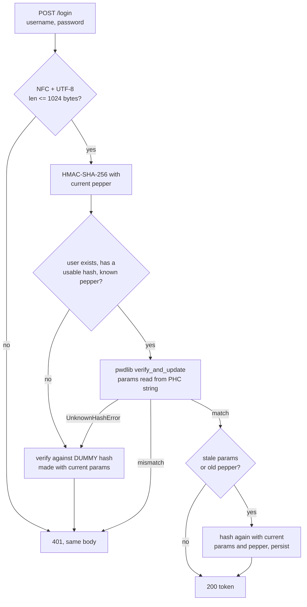

# Hashing User Passwords and High-Entropy vs Low-Entropy Secrets: Argon2id Parameters (pwdlib 0.3.1 / argon2-cffi 25.1.0) and Timing-Safe Dummy Verifies

> [!summary] Claim
> Stretch only what can be guessed: a human password gets a salted, memory-hard Argon2id hash (RFC 9106 Section 4, 64 MiB and 3 passes by default in argon2-cffi 25.1.0, about 29 ms here) behind an HMAC pepper, a server-generated 256-bit client secret gets one keyed HMAC-SHA-256 (about 1 us), and every login failure path, including unknown users and SSO-only accounts, must spend one Argon2 verify against a dummy hash made with the current parameters, or response time tells an attacker which accounts exist.

Part of [API Authentication and Identity](README.md) in [API Engineering](../README.md).

## TL;DR

- Mechanism: Argon2id fills `m` KiB of 1 KiB blocks over `t` passes in `p` lanes, with data-independent addressing only in the first two slices of pass 0 (RFC 9106 Section 3.4.1.3); the PHC string `$argon2id$v=19$m=65536,t=3,p=4$<salt>$<tag>` carries every parameter, so `verify` needs no configuration and `check_needs_rehash` is a field comparison.
- Contract rule: salts of at least 32 bits and a cost "as high as practical", plus an optional keyed step with a secret stored apart from the hashes (NIST SP 800-63B-4 Section 3.1.1.2); secrets below 112 bits of entropy SHALL be stored with a password hashing scheme (Section 3.1.2.2), and high-entropy client secrets need only a fast keyed hash (RFC 6819 Section 5.1.4.1.3).
- Trap: `pwdlib` raises `UnknownHashError` instantly for a non-Argon2 stored value and a dictionary miss costs nothing, so unknown users and SSO-only accounts answer about five orders of magnitude faster than real ones (0.00008 ms vs 28.9 ms measured here) unless the code burns a dummy verify; and the verify cost follows the stored hash's parameters, not the hasher's.
- Portability: the 33-test lab passes on CPython 3.12.13, 3.13.18, 3.14.6, 3.14.10, 3.15.2, and free-threaded 3.15.0b3, where `argon2-cffi-bindings 26.1.0` ships a `cpython-315t` extension that leaves the GIL off; `pwdlib` changed `verify` argument order in 0.2.0, and `bcrypt` 5.0.0 raises `ValueError` above 72 bytes instead of truncating.
- When not to use it: never Argon2 a 256-bit random secret (API key, client secret, refresh token handle), because it adds about 29 ms and 64 MiB per request for zero security; and do not use it where the server must hold the secret in clear, such as OIDC `client_secret_jwt`, where HMAC needs the raw secret (OIDC Core Section 9).

## Mental model



Every arrow into `401` passes through exactly one Argon2 verify, so the response time of a failed login is the cost of one verify regardless of which branch produced it.
The input check runs before the lookup, so rejecting an oversized password reveals nothing about the account.
The pepper is applied before the lookup for the same reason, and the stored hash itself decides the parameters of the real verify, which is why the dummy hash is created at startup with the current parameters and why a stale stored hash is rewritten on the next successful login, the only moment the plaintext exists.

## How it works

### Low-entropy versus high-entropy secrets

A password hash exists to make an offline guess expensive after the hash table leaks.
That only helps when the attacker's guess space is small enough to search: human passwords, PINs, and short look-up codes.
NIST draws the line at the minimum security strength of SP 800-131A, "112 bits as of the date of this publication": look-up secrets shorter than that "SHALL be stored in a salted and hashed form using a suitable password hashing scheme" (NIST SP 800-63B-4 Section 3.1.2.2).
A secret from `secrets.token_urlsafe(32)` carries 256 bits from the operating system CSPRNG; at 2^256 candidates, stretching each guess by a factor of 10^6 changes nothing, so a single keyed hash is the right tool.
RFC 6819 Section 5.1.4.1.3 says the same for OAuth servers: store hashes instead of cleartext, and "If the credential lacks a reasonable entropy level (because it is a user password), an additional salt will harden the storage".
RFC 6819 Section 5.1.4.2.2 asks, with a non-normative lowercase "should", that secrets not used by humans, such as client secrets and token handles, be ">=128 bits long and constructed from a cryptographically strong random or pseudo-random number sequence".
The lab encodes that rule as `storage_scheme_for`, which returns `"password-hash"` below 112 bits and `"keyed-fast-hash"` at or above it.

Why keyed rather than plain SHA-256 for the high-entropy case: a plain digest lets anyone holding a leaked table confirm a candidate secret offline, while HMAC-SHA-256 under a server key kept outside the database makes the table useless on its own.
The trade-off is that the key becomes a dependency of every verification and needs its own rotation plan; prefixed lookup identifiers, secret scanning, and dual-key rotation are the subject of [[API-Key-Engineering-Prefixed-Entropy-Hashed-Storage-and-Zero-Downtime-Rotation]].

### Argon2: the inputs and the memory matrix

RFC 9106 Section 3.1 fixes the inputs and their ranges: the password `P` up to 2^32 - 1 bytes, the salt `S` with "16 bytes is RECOMMENDED for password hashing", parallelism `p` from 1 to 2^24 - 1, tag length `T` from 4 to 2^32 - 1 bytes, memory `m` in KiB from `8*p` to 2^32 - 1, passes `t` from 1, version byte `0x13`, an OPTIONAL secret `K`, OPTIONAL associated data `X`, and type `y` of 0 (Argon2d), 1 (Argon2i), or 2 (Argon2id).
All inputs are first absorbed into a 64-byte seed `H_0 = H^(64)(LE32(p) || LE32(T) || LE32(m) || LE32(t) || ...)` with BLAKE2b, each variable-length field preceded by its 32-bit length, "If K, X, or S has zero length, it is just absent, but its length field remains" (RFC 9106 Section 3.2).
Because the password is length-prefixed and hashed once into `H_0`, its length barely moves the cost and embedded NUL bytes are significant; the lab proves the second point (`b"abc\x00def"` and `b"abc\x00xyz"` produce different results), and the probe below measured the first.

Memory is `m' = 4 * p * floor(m / 4p)` blocks of 1024 bytes, arranged as `p` lanes of `q = m'/p` columns, split into `SL = 4` vertical slices; the first two blocks of lane `i` are `H'^(1024)(H_0 || LE32(0) || LE32(i))` and the same with `LE32(1)`, and the computation "MUST proceed slicewise" (RFC 9106 Sections 3.2 and 3.4).
Each new block is the compression function `G` (a BLAKE2b-round-based permutation, RFC 9106 Sections 3.5 and 3.6) applied to the previous block and one reference block.
Which reference block is chosen is the whole difference between the variants: Argon2d picks it from the previous block's contents (data-dependent, best against GPU tradeoffs, leaks through cache timing), Argon2i from a counter-driven pseudo-random stream (data-independent, side-channel resistant), and Argon2id uses Argon2i addressing "If the pass number is 0 and the slice number is 0 or 1" and Argon2d addressing everywhere else (RFC 9106 Section 3.4.1.3).
RFC 9106 Section 1 makes Argon2id mandatory to implement, and Section 4 tells implementers who do not know the difference to "choose Argon2id".

### Parameter choice: RFC 9106, OWASP, and the library defaults

RFC 9106 Section 4 gives two uniform options and a tuning procedure:

- FIRST RECOMMENDED: Argon2id, `t=1`, `p=4`, `m=2^21` (2 GiB), 128-bit salt, 256-bit tag.
- SECOND RECOMMENDED, when "much less memory is available": Argon2id, `t=3`, `p=4`, `m=2^16` (64 MiB), 128-bit salt, 256-bit tag.
- Otherwise: fix `p=4`, take the largest affordable `m`, then raise `t` until the time budget is used; 128-bit salts are "sufficient for all applications".

RFC 9106 Section 7.3 explains the shape of that advice: for Argon2d and Argon2id, "1 pass maximizes the attack costs for the constant defender time", so memory is the first lever and passes are the remainder.

argon2-cffi 25.1.0 ships both as `argon2.profiles.RFC_9106_HIGH_MEMORY` and `RFC_9106_LOW_MEMORY`, and `get_default_parameters()` returns the low-memory profile, with `parallelism=1` substituted only on WebAssembly (argon2-cffi 25.1.0 argon2/profiles.py, get_default_parameters).
The defaults became RFC 9106 values in 21.2.0; the older `PRE_21_2` profile (100 MiB, `t=2`, `p=8`, 16-byte tag) is kept so you can still recognize hashes from 18.2.0 to 21.1.0 (argon2-cffi 25.1.0 argon2/profiles.py).
`pwdlib.PasswordHash.recommended()` builds a single `Argon2Hasher()` whose constructor defaults are `argon2.DEFAULT_TIME_COST`, `DEFAULT_MEMORY_COST`, and the rest, so pwdlib 0.3.1 inherits the RFC 9106 low-memory profile unchanged (pwdlib 0.3.1 pwdlib/_hash.py, PasswordHash.recommended; pwdlib/hashers/argon2.py, Argon2Hasher.__init__).

OWASP's Password Storage Cheat Sheet (as of 2026-11) lists equivalent-strength Argon2id minimums that trade memory for passes at `p=1`: `m=47104` (46 MiB) `t=1`, `m=19456` (19 MiB) `t=2`, `m=12288` `t=3`, `m=9216` `t=4`, and `m=7168` `t=5`.
Those are floors for constrained servers, not a better default: the lab machine verifies the 19 MiB profile in 17.7 ms, so the 64 MiB library default costs about 1.6 times the time for more than three times the memory per guess.
When Argon2id is unavailable, the same cheat sheet (as of 2026-11) falls back to scrypt at `N=2^17` (128 MiB), `r=8`, `p=1`; to bcrypt with a work factor of 10 or more and its 72-byte password limit, "legacy systems only"; and to PBKDF2-HMAC-SHA-256 with 600,000 iterations where FIPS-140 compliance is required.
pwdlib 0.3.1 can hold a `BcryptHasher` beside the Argon2 one for migrating such hashes, and `verify_and_update` then returns a new Argon2id hash on the first successful login because the matching hasher is not the current one.

### The PHC string and what each library reads from it

The encoded form produced by the reference implementation, and checked byte for byte by the lab:

```text
$argon2id$v=19$m=65536,t=3,p=4$<22 chars: 16-byte salt>$<43 chars: 32-byte tag>
 variant   version  m KiB  t  p   standard base64 alphabet, "=" padding stripped
```

With the default profile that is exactly 97 ASCII characters (`test_recommended_uses_rfc_9106_second_recommended_option`).
The reference decoder at the commit vendored by argon2-cffi-bindings 26.1.0 parses the fields in fixed order with exact prefix matches (`CC("$m=")`, `CC(",t=")`, `CC(",p=")`), reads the version through the optional `CC_opt("$v=", ...)`, and when `$v=` is absent it keeps the preset `ARGON2_VERSION_10`, the pre-RFC 0x10 algorithm (phc-winner-argon2 f57e61e src/encoding.c, decode_string).
`argon2_verify` allocates salt and tag buffers as long as the whole encoded string ("No field can be longer than the encoded length"), decodes, sets the decoded tag aside, and calls `argon2_verify_ctx`, which recomputes the hash with the decoded `m`, `t`, and `p` and compares with a branch-free accumulator (phc-winner-argon2 f57e61e src/argon2.c, argon2_verify, argon2_verify_ctx, and argon2_compare):

```c
static int argon2_compare(const uint8_t *b1, const uint8_t *b2, size_t len) {
    size_t i;
    uint8_t d = 0U;

    for (i = 0U; i < len; i++) {
        d |= b1[i] ^ b2[i];
    }
    return (int)((1 & ((d - 1) >> 8)) - 1);
}
```

Two consequences follow directly from that source.
First, verification cost is set by the stored string, not by your configured hasher: the lab verifies an 8 KiB hash with a hasher configured for 8 MiB and it runs more than 10 times faster (`test_verify_cost_follows_the_stored_hash_not_the_hasher_configuration`).
Second, the stored string is trusted input: argon2-cffi documents that "It is assumed that the caller is in full control of the hash" (argon2-cffi 25.1.0 argon2/_password_hasher.py, PasswordHasher.verify), because a hash with `m=4194304` would make one verify allocate 4 GiB.

The high-level C entry point `argon2_hash` sets `context.secret = NULL` and `context.secretlen = 0`, and argon2-cffi's `hash_secret` calls it (phc-winner-argon2 f57e61e src/argon2.c, argon2_hash; argon2-cffi 25.1.0 argon2/low_level.py, hash_secret), so the RFC 9106 secret input `K` is unreachable from `PasswordHasher` and a pepper must be applied outside Argon2, as the lab does with HMAC.
`argon2_hash` also sets `context.threads = parallelism`, and when `threads` is above 1 the dispatcher `fill_memory_blocks` runs `fill_memory_blocks_mt`, which creates up to `threads` pthreads per slice of every pass, one per lane here because `threads` equals `lanes`, and joins them at each sync point (phc-winner-argon2 f57e61e src/core.c, fill_memory_blocks and fill_memory_blocks_mt; src/thread.c, argon2_thread_create).
At the default `t=3`, `p=4` that is 3 x 4 x 4 = 48 thread creations per hash or verify, and in 10 default verifies here each consumed 111.4 to 120.2 ms of process CPU time (median 114.4 ms) over 28.7 to 33.7 ms of wall time (median 30.2 ms), so one login occupies about 3.8 cores while it runs.
`p` therefore buys latency, not attacker cost per guess: an attacker computes lanes in parallel too, and a server already saturated with concurrent logins gains nothing from four threads per login, which is one reason OWASP's minimums use `p=1`.
The reference library also wipes its block memory on free by default (`int FLAG_clear_internal_memory = 1;` in phc-winner-argon2 f57e61e src/core.c), which is the "memory-wiping option" RFC 9106 Section 4 recommends when side channels are a concern.

### argon2-cffi 25.1.0: hash, verify, and rehash detection

`PasswordHasher.__init__` validates types once, builds a `Parameters` dataclass with `version=19`, and checks the platform; `hash` then calls `hash_secret(secret=..., salt=salt or os.urandom(self.salt_len), ...)` (argon2-cffi 25.1.0 argon2/_password_hasher.py, PasswordHasher.hash).
That `salt or` expression means an explicit `salt=b""` is silently replaced by a random salt, which the lab pins; a salt shorter than 8 bytes is refused by the C library with `HashingError: Salt is too short` (`ARGON2_MIN_SALT_LENGTH` is 8 in phc-winner-argon2 f57e61e include/argon2.h).
`verify(hash, password)` picks the variant from the first 9 bytes (`b"$argon2i$"`, `b"$argon2d$"`, `b"$argon2id"`), raises `InvalidHashError` for anything else (argon2-cffi 25.1.0 argon2/_password_hasher.py, PasswordHasher.verify), and `verify_secret` maps C return codes to `VerifyMismatchError` (wrong password) or its superclass `VerificationError` (anything else, such as a decoding failure) (argon2-cffi 25.1.0 argon2/low_level.py, verify_secret).
`check_needs_rehash(hash)` is `self._parameters != extract_parameters(hash)`, and `extract_parameters` splits on `$`, inserts `v=18` for five-field legacy hashes, and derives `salt_len` and `hash_len` from the base64 lengths (argon2-cffi 25.1.0 argon2/_utils.py, extract_parameters).
Because the whole dataclass is compared, a change to any of `type`, `version`, `salt_len`, `hash_len`, `time_cost`, `memory_cost`, or `parallelism` triggers a rehash; the lab parametrizes all six tunable fields.
argon2-cffi 25.1.0 itself added official support for Python 3.13 and 3.14, let `check_needs_rehash` accept bytes, and improved "parameter compatibility handling for Pyodide / WebAssembly environments" (argon2-cffi 25.1.0 release notes); the installed docstring of `check_needs_rehash` in the same release says `versionchanged:: 24.1.0` for the bytes change, so the two upstream records disagree on the version.

### pwdlib 0.3.1: a thin, multi-hasher front end

`PasswordHash(hashers)` hashes with `hashers[0]` and verifies with the first hasher whose classmethod `identify` matches; if none matches, `verify` raises `UnknownHashError` (pwdlib 0.3.1 pwdlib/_hash.py, PasswordHash.verify).
`verify_and_update(password, hash)` returns `(False, None)` on mismatch and `(True, new_hash)` when the matching hasher is not the current one or `check_needs_rehash` is true (pwdlib 0.3.1 pwdlib/_hash.py, PasswordHash.verify_and_update):

```python
        for hasher in self.hashers:
            if hasher.identify(hash):
                if not hasher.verify(password, hash):
                    return False, None
                else:
                    updated_hash: str | None = None
                    if hasher != self.current_hasher or hasher.check_needs_rehash(hash):
                        updated_hash = self.current_hasher.hash(password)
                    return True, updated_hash
        raise exceptions.UnknownHashError(hash)
```

`Argon2Hasher.identify` is a classmethod over one anchored regex, `^\$(?P<variant>argon2(id|i|d))\$(?:v=(?P<version>\d+)\$)?m=...,t=...,p=...`, which pwdlib 0.3.0 fixed to recognize `argon2i` and `argon2d` as well (pwdlib 0.3.1 pwdlib/hashers/argon2.py, ARGON2_ENCODED_HASH_REGEX; pwdlib 0.3.0 release notes).
Since every `Argon2Hasher` instance identifies every Argon2 string, listing an "old parameters" Argon2 hasher second is dead code: the first one verifies the old hash (the parameters come from the string anyway) and flags it for rehash, which `test_first_argon2_hasher_claims_every_argon2_hash` proves by counting calls.
`Argon2Hasher.verify` catches `VerificationError` and `InvalidHashError` and returns `False`, so a corrupt Argon2 string that still matches the regex is a quiet `False`, while a non-Argon2 value such as Django's `!` unusable-password marker or a bcrypt string with no `BcryptHasher` configured raises `UnknownHashError` before any hashing.
pwdlib 0.2.0 reversed the argument order of `verify` and `verify_and_update` to `(password, hash)` to match passlib, while argon2-cffi keeps `verify(hash, password)` (pwdlib 0.2.0 release notes); calling the old order on 0.3.1 raises `UnknownHashError`, which the lab pins.
pwdlib is the maintained alternative to passlib, whose last release is 1.7.4 (uploaded 2020-10-08, per PyPI) and the `crypt` module it could use was deprecated in Python 3.11 and removed in 3.13 (PEP 594); pwdlib 0.4.0 was released on 2026-11-14 with Python 3.15 support and a 3.11 minimum, one day before this note, so the lab stays on the pinned 0.3.1 (as of 2026-11).

### The timing oracle and the dummy verify

A login endpoint has three cheap failure branches that skip hashing unless code prevents it: the user does not exist, the user exists without a usable password (SSO-only, invited, disabled), and the stored value is in a format the hasher does not recognize.
Each answers in microseconds while a wrong password for a real user costs one full verify, so a single request per username enumerates accounts, which then feeds credential stuffing (OWASP API2:2023 Broken Authentication lists credential stuffing "with a list of valid usernames and passwords").
Django fixed the first branch years ago by running the default hasher once for a nonexistent user (Django 5.0.7 django/contrib/auth/backends.py, ModelBackend.authenticate, ticket #20760), and fixed the second only in 2024: CVE-2024-39329 is "a timing attack involving login requests for users with an unusable password", fixed in Django 5.0.7 and 4.2.14 (NVD).
The fix initializes `fake_runtime = password is None or not is_password_usable(encoded)`, sets it to `True` when the hash is unidentifiable (`ValueError` from `identify_hasher`), and then calls `make_password(get_random_string(UNUSABLE_PASSWORD_SUFFIX_LENGTH))` before returning `False, False` (Django 5.0.7 django/contrib/auth/hashers.py, verify_password).
Django also narrows the third gap, a stale work factor: on a failed check with the same algorithm and `must_update`, it calls `hasher.harden_runtime(password, encoded)` to spend the difference, and its comment admits "we don't protect against enumeration if it does" change algorithm.
FastAPI's own tutorial at 0.162.0 now defines `DUMMY_HASH = password_hash.hash("dummypassword")` and verifies against it when `get_user` returns nothing (fastapi 0.162.0 docs_src/security/tutorial004_an_py310.py, authenticate_user); the tutorial page explains that this prevents "timing attacks that could be used to enumerate existing usernames" (fastapi 0.162.0 docs/en/docs/tutorial/security/oauth2-jwt.md, where "timing attacks" is bold).
The tutorial covers only the unknown-user branch; the lab covers all four failure shapes (unknown user, `password_hash=None`, the `!unusable` marker, and a retired pepper id) and proves each runs exactly one verify against the same dummy hash, whose parameters equal the current ones.

### Pepper, normalization, and input limits

NIST SP 800-63B-4 Section 3.1.1.2 says verifiers "SHOULD perform an additional iteration of a keyed hashing or encryption operation using a secret key known only to the verifier", that the key "SHALL be stored separately from the hashed passwords", and that it SHOULD live in an HSM or TEE.
The lab pre-hashes with HMAC-SHA-256 under the pepper and Argon2-hashes the 32-byte result; NUL bytes in that binary digest are safe for Argon2 because the input is length-prefixed, which is exactly what makes the same trick dangerous for bcrypt, whose input is NUL-terminated (OWASP Password Storage Cheat Sheet, "Pre-Hashing Passwords with bcrypt").
A pepper cannot be rotated in bulk, because re-wrapping needs the plaintext; OWASP notes that changing a compromised pepper forces resets.
The lab instead stores a `pepper_id` per user and re-wraps lazily under the current pepper at the next successful login, which `test_login_after_pepper_rotation_rewraps_under_the_current_pepper` proves.
NIST SP 800-63B-4 Section 3.1.1.2 also says verifiers SHOULD apply NFC normalization before hashing, SHALL verify "the entire submitted password (e.g., not truncate it)", SHOULD permit at least 64 characters, and SHALL require at least 15 characters for single-factor passwords; pwdlib only UTF-8-encodes, so `"cafe\u0301"` (decomposed) and `"caf\u00e9"` (composed) fail against each other unless the application normalizes, as the lab does.
The previous revision, SP 800-63B-3 Section 5.1.1.2, named "either the NFKC or NFKD normalization"; revision 4 names NFC, so a system migrating between them must normalize consistently at enrollment and at login.

## Numbers and limits

| Quantity | Value | Source |
| --- | --- | --- |
| Argon2 salt minimum (reference implementation) | 8 bytes | phc-winner-argon2 f57e61e include/argon2.h, `ARGON2_MIN_SALT_LENGTH` |
| Recommended salt | 16 bytes; 8 acceptable under space constraints | RFC 9106 Sections 3.1 and 4 |
| Tag length | 4 to 2^32 - 1 bytes; 32 in both RFC options | RFC 9106 Sections 3.1 and 4 |
| Memory | `8*p` to 2^32 - 1 KiB, rounded down to a multiple of `4*p` | RFC 9106 Sections 3.1 and 3.2 |
| Lanes `p` | 1 to 2^24 - 1 (`ARGON2_MAX_LANES` 0xFFFFFF) | RFC 9106 Section 3.1; argon2.h |
| Slices per pass | 4 (`ARGON2_SYNC_POINTS`) | RFC 9106 Section 3.4; argon2.h |
| Password length | up to 2^32 - 1 bytes | RFC 9106 Section 3.1 |
| argon2-cffi 25.1.0 default | Argon2id, `t=3`, `m=65536`, `p=4`, 16-byte salt, 32-byte tag | argon2/profiles.py, RFC_9106_LOW_MEMORY |
| NIST salt minimum | 32 bits | NIST SP 800-63B-4 Section 3.1.1.2 |
| NIST entropy threshold for password-hash storage | 112 bits | NIST SP 800-63B-4 Section 3.1.2.2 |
| NIST password length | >= 15 (single factor), >= 8 (MFA only), max SHOULD be >= 64 | NIST SP 800-63B-4 Section 3.1.1.2 |
| NIST online-guess limit | <= 100 consecutive failures per authenticator on one account | NIST SP 800-63B-4 Section 3.2.2 |
| OAuth client secret entropy | >= 128 bits | RFC 6819 Section 5.1.4.2.2 |
| bcrypt input limit | 72 bytes; `ValueError` above it since bcrypt 5.0.0 | pyca/bcrypt CHANGELOG 5.0.0 |
| anyio default thread limiter | 40 tokens | anyio 4.16.0 anyio/_backends/_asyncio.py, current_default_thread_limiter |
| Encoded length: CHEAPEST / PRE_21_2 / RFC low / RFC high | 45 / 77 / 97 / 99 chars | measured |
| Argon2id hash / verify, `CHEAPEST` (8 KiB, `t=1`, `p=1`) | 0.03 ms / 0.03 ms, 0 MiB peak RSS delta | measured |
| Argon2id hash / verify, OWASP 19 MiB `t=2` `p=1` | 17.3 ms / 17.7 ms, +19.0 MiB peak RSS | measured |
| Argon2id hash / verify, OWASP 46 MiB `t=1` `p=1` | 23.8 ms / 21.9 ms, +46.0 MiB | measured |
| Argon2id hash / verify, `PRE_21_2` (100 MiB, `t=2`, `p=8`) | 24.3 ms / 24.6 ms, +100.2 MiB | measured |
| Argon2id hash / verify, RFC 9106 low memory (default) | 28.7 ms / 28.8 ms, +64.2 MiB | measured |
| Argon2id hash / verify, RFC 9106 high memory (2 GiB) | 345.6 ms / 351.8 ms, +2048.1 MiB | measured |
| HMAC-SHA-256 + `compare_digest`, 43-char secret | 1.06 us per verify (mean of 200000) | measured |
| Default-profile hash, password 16 B / 1 KiB / 1 MiB | 29.4 / 29.1 / 30.9 ms | measured |
| Login: wrong password / unknown user with dummy / unknown user without dummy | 28.9 / 29.2 / 0.00008 ms | measured |
| Four default verifies: serial / four threads | 127.7 ms / 70.2 ms | measured |
| Default verify: process CPU time / wall time | 111.4 to 120.2 ms / 28.7 to 33.7 ms, medians 114.4 / 30.2 ms (about 3.8 cores) | measured, 10 verifies |
| Longest event-loop tick while verifying: inline in `async def` / `asyncio.to_thread` | 33.2 ms / 2.0 ms | measured |

Every "measured" row comes from one run on 2026-11-15 by the independent fact-check, of a throwaway probe (`uv run --frozen python ../tmp_probe/probe.py` from `labs/`, removed afterwards) on an Apple M3 Pro, macOS 27.3 (Darwin 27.3.0 arm64), CPython 3.14.6 with the pinned argon2-cffi 25.1.0 and argon2-cffi-bindings 26.1.0.
Times are medians of 15 runs (3 for the 2 GiB profile, 9 for the password-length rows, 5 for the thread rows, 10 single verifies for the CPU-time row, `time.process_time` against `time.perf_counter`); the HMAC row is the mean of 200000 `ClientSecretStore.verify` calls; peak RSS is the growth of `ru_maxrss` across one hash in a fresh subprocess; the event-loop row is the largest gap seen by a 1 ms `asyncio.sleep` ticker across five verifies.
These are single-machine numbers with large run-to-run variance: an earlier probe on the same machine the same day measured the default verify at 53.3 ms rather than 28.8 ms, so treat any single row as good to about a factor of two; the serial four-verify figure (127.7 ms) is slightly above four times the single-verify median.
Treat the thread row as evidence that the C call releases the GIL (cffi documents "C function calls are done with the GIL released"), not as a speedup factor, and remember that each default verify already runs four lanes on four pthreads.
The peak RSS rows track `memory_cost` almost exactly, which is the number that matters for capacity: with anyio's default 40-token thread limiter, which Starlette's `run_in_threadpool` uses, all verifying at once, the default profile needs about 40 x 64 MiB = 2.5 GiB, hence the lab's semaphore.

## Portability

| Dimension | Behavior | Evidence |
| --- | --- | --- |
| CPython 3.12 | 33 pass on 3.12.13 (the matrix patch 3.12.16 is not available to uv here) | lab, `uv run --isolated --no-project --python 3.12.13` with the pinned test imports, macOS 27.3 arm64 |
| CPython 3.13 | 33 pass on 3.13.18 | lab, same command |
| CPython 3.14 | 33 pass on 3.14.6 (workspace `.venv`) and 3.14.10 | lab, `uv run --frozen pytest` and `--python 3.14.10` |
| CPython 3.15 | 33 pass on 3.15.2 | lab, `--python 3.15.2` |
| CPython 3.15t | 33 pass on free-threaded 3.15.0b3 with the GIL still off after `import argon2` (`sys._is_gil_enabled()` is `False`); 3.15.2t is not available to uv here, so the matrix leg is recorded as not run | lab; `argon2-cffi-bindings 26.1.0` installed `_ffi.cpython-315t-darwin.so` and cffi 2.1.1 `_cffi_backend.cpython-315t-darwin.so` |
| argon2-cffi-bindings wheels | `abi3` extension on GIL builds, a separate `cpython-315t` extension on free-threaded 3.15 | file names observed in the two environments above |
| argon2-cffi 25.1.0 | defaults to RFC 9106 low memory everywhere except WebAssembly, where `parallelism` becomes 1 and other values raise `UnsupportedParametersError` | argon2/profiles.py, get_default_parameters; argon2/_utils.py, validate_params_for_platform |
| argon2-cffi before 21.2.0 | 18.2.0 to 21.1.0 defaulted to `PRE_21_2` (100 MiB, `t=2`, `p=8`, 16-byte tag), so their hashes report `check_needs_rehash() == True` on 25.1.0 | argon2/profiles.py, PRE_21_2; lab measured 77-char encoding |
| pwdlib 0.1.0 vs 0.2.0+ | `verify(hash, password)` became `verify(password, hash)` | pwdlib 0.2.0 release notes; lab `test_pwdlib_verify_takes_password_then_hash_unlike_argon2_cffi` |
| pwdlib 0.2.x vs 0.3.0+ | 0.3.0 identifies `argon2i` and `argon2d` hashes, not only `argon2id`, and type-checks inputs at runtime | pwdlib 0.3.0 release notes; pwdlib 0.3.1 pwdlib/hashers/argon2.py |
| pwdlib 0.3.1 vs 0.4.0 | 0.4.0 (2026-11-14) adds Python 3.15 support and drops 3.10; 0.3.1 declares classifiers only up to 3.14 but ran here on 3.15 | pwdlib releases; 0.3.1 METADATA; lab runs above |
| bcrypt 4.x vs 5.0.0 | 4.x silently truncated at 72 bytes; 5.0.0 raises `ValueError` | pyca/bcrypt CHANGELOG |
| passlib | last release 1.7.4 (2020-10-08); its `crypt`-based handlers lost their backend when `crypt` was removed in 3.13 | PyPI JSON; PEP 594 |
| Uvicorn, Hypercorn, Granian | not run: the lab drives the app in-process through `httpx.ASGITransport`; hashing is server-independent, but where it runs is not: FastAPI runs a `def` endpoint through `run_in_threadpool` and awaits an `async def` endpoint on the loop under every server | fastapi 0.162.0 fastapi/routing.py, run_endpoint_function |
| HTTP/1.1, HTTP/2, HTTP/3 | credentials travel in a form body (`/login`) or the `Authorization` field (`/client-token`) under all three; under HPACK an encoder "might also choose not to index" `Authorization`, and an intermediary MUST NOT re-index a never-indexed literal | RFC 6749 Section 2.3.1; RFC 7541 Section 7.1.3; HTTP versions not run in this lab |

## Worked example

The [implementation](../labs/src/api_labs/f14_api_authentication_and_identity/password_hashing.py) has four parts: NFC normalization with a 1024-byte cap and an HMAC pepper, a `PasswordAuthenticator` with dummy verifies, lazy rehash and pepper rotation, and a semaphore around Argon2 work, a `ClientSecretStore` that keeps only HMAC-SHA-256 digests of 256-bit secrets, and a FastAPI app with a `/login` form endpoint and a `/client-token` endpoint using HTTP Basic client authentication.
The [test](../labs/tests/f14_api_authentication_and_identity/test_password_and_client_secret_hashing_with_argon2id_and_pwdlib.py) has 33 cases; it uses a real but cheap Argon2id profile (1 MiB, `t=1`, `p=1`) for speed, an 8 MiB profile where it compares timings, and a `CountingHasher` wrapper that satisfies pwdlib's `HasherProtocol` and records every call.

The authenticator, verbatim from the lab:

```python
    def authenticate(self, username: str, password: str) -> UserRecord | None:
        """Return the user on success, ``None`` on any failure; one Argon2 verify either way."""
        # Raises before the lookup, so the rejection says nothing about the account.
        candidate = self._prepare(password, self._pepper_id)
        record = self._users.get(username)
        pepper_id = record.pepper_id if record is not None else None
        with self._slots:
            if (
                record is None
                or record.password_hash is None
                or pepper_id is None
                or pepper_id not in self._peppers
            ):
                self._ph.verify(candidate, self._dummy_hash)
                return None
            prepared = (
                candidate if pepper_id == self._pepper_id else self._prepare(password, pepper_id)
            )
            try:
                valid, updated = self._ph.verify_and_update(prepared, record.password_hash)
            except UnknownHashError:  # e.g. Django's "!" unusable-password marker
                self._ph.verify(candidate, self._dummy_hash)
                return None
            if not valid:
                return None
            if record.pepper_id != self._pepper_id:
                # Lazy pepper rotation: the plaintext exists only now, so re-wrap it here.
                updated = self._ph.hash(candidate)
            if updated is None:
                return record
            upgraded = replace(record, password_hash=updated, pepper_id=self._pepper_id)
        self._users[username] = upgraded
        return upgraded
```

The dummy hash is created in `__init__` as `self._ph.hash(secrets.token_bytes(32))`, so it always carries the current parameters; a module-level constant computed under an older configuration would reintroduce the gap after the next parameter bump.
A successful login that triggers a rehash costs two Argon2 calls, which leaks only to someone who already has the right password.
The test for the four failure shapes:

```python
@pytest.mark.unit
@pytest.mark.parametrize(
    "record",
    [
        None,
        UserRecord("sso", None),
        UserRecord("dj", "!unusable", "p1"),
        UserRecord("x", "h", "p9"),
    ],
    ids=["unknown-user", "sso-only", "foreign-hash-format", "retired-pepper"],
)
def test_every_failure_path_runs_exactly_one_dummy_verify(record: UserRecord | None) -> None:
    auth, counter, users = _authenticator()
    if record is not None:
        users["target"] = record
    before = len(counter.verified)
    assert auth.authenticate("target", "any password at all") is None
    assert auth.authenticate("target", "another password") is None
    first, second = counter.verified[before:]  # exactly one verify per attempt
    assert first == second  # the same dummy hash every time ...
    assert extract_parameters(str(first)) == FAST  # ... made with the current parameters
    assert record is None or first != record.password_hash
```

The unpacking `first, second = ...` fails if any branch skips the verify or runs two, and a companion test compares wall-clock medians with an 8 MiB profile and asserts the unknown-user path takes more than a quarter of the wrong-password path, a margin chosen because the probe measured the undefended ratio at the default profile at about 1 to 360000 (0.00008 ms vs 28.9 ms).
The HTTP-level test sends a wrong password for a real user, an unknown user, and an SSO-only user, and requires one identical `(401, body, WWW-Authenticate, Content-Length)` tuple across all three: `(401, b'{"detail":"Incorrect username or password"}', "Bearer", "43")`.

Output captured on 2026-11-15 from `labs/` on macOS 27.3 (Apple M3 Pro) with CPython 3.14.6:

```text
$ uv run --frozen pytest tests/f14_api_authentication_and_identity/test_password_and_client_secret_hashing_with_argon2id_and_pwdlib.py -q
.................................                                        [100%]
33 passed in 1.17s
```

## Pitfalls

> [!warning] Fast failure paths enumerate accounts
> Trigger: `if not user: return False` before any hashing, or a stored value that makes pwdlib raise `UnknownHashError` (SSO-only accounts, Django's `!` marker, a bcrypt hash with no `BcryptHasher`).
> Symptom: unknown and passwordless accounts answer in microseconds, real ones in about 29 ms; CVE-2024-39329 is this bug for Django users with unusable passwords (NVD, published 2024-07-10).
> Fix: route every failure through one verify against a dummy hash made with the current parameters, as `test_every_failure_path_runs_exactly_one_dummy_verify` requires, and return one response body for all of them.

> [!warning] Stale hashes verify at their old cost
> Trigger: raising `memory_cost` or `time_cost` while millions of users still have hashes with the old parameters.
> Symptom: `argon2_verify` uses the parameters in the stored string, so not-yet-migrated users fail faster than unknown users who hit the new dummy hash, and the difference identifies them.
> Fix: rehash on every successful login (`verify_and_update`), consider Django's `harden_runtime` approach of spending the difference on failures, and after a deadline wrap or expire old hashes as the OWASP cheat sheet's "Upgrading Legacy Hashes" section describes.

> [!warning] Argon2 in an `async def` endpoint stalls the event loop
> Trigger: FastAPI's own JWT tutorial at 0.162.0 declares `async def login_for_access_token` and calls the synchronous `authenticate_user`, which runs `password_hash.verify` on the loop (fastapi 0.162.0 docs_src/security/tutorial004_an_py310.py).
> Symptom: the longest event-loop tick measured here was 33.2 ms with an inline default-profile verify versus 2.0 ms with `asyncio.to_thread`; every concurrent request on that worker waits.
> Fix: declare the endpoint with `def` so FastAPI uses `run_in_threadpool`, or `await anyio.to_thread.run_sync(...)`, and see [[Async-Def-vs-Def-Endpoints-and-AnyIO-Threadpool-Limiter-Semantics]].

> [!warning] Memory blow-up under a login burst
> Trigger: 40 threadpool workers (anyio's default limiter) each hashing with 64 MiB, or the 2 GiB RFC option on a shared host.
> Symptom: about 2.5 GiB of transient allocation per worker process for the default profile, then OOM kills or swap during credential-stuffing waves, which is OWASP API4:2023 territory.
> Fix: bound concurrent hashes with a semaphore sized from memory, as the lab does (`test_concurrent_logins_never_exceed_the_hash_slot_limit`), rate-limit per account and per source before hashing, and size `memory_cost` from the worst-case concurrency, not from one request.

> [!warning] bcrypt truncates at 72 bytes, and pre-hashing it naively adds NUL bytes
> Trigger: bcrypt over a concatenation such as `userId + username + password`, or over a raw binary digest.
> Symptom: Okta's AD/LDAP delegated-authentication cache key was "a combined string of userId + username + password" hashed with bcrypt, and for usernames of 52 or more characters a cached login could succeed with any password between 2024-07-23 and 2024-10-30 (Okta advisory, 2024-11-01; the advisory itself does not state the 72-byte limit, which is bcrypt's documented input limit per the OWASP cheat sheet).
> Fix: use Argon2id, which length-prefixes its input; on bcrypt 5.0.0 the truncation raises `ValueError`; if you must pre-hash for bcrypt, base64-encode the HMAC output as OWASP recommends.

> [!warning] Long passwords as a CPU attack
> Trigger: a KDF that rehashes the full password each iteration, as Django's PBKDF2 path did.
> Symptom: CVE-2013-1443, a denial of service "via a long password which is then hashed" (NVD), and the OWASP cheat sheet cites that 2013 Django issue as its example of long-password DoS against PBKDF2.
> Fix: Argon2 absorbs the password once into `H_0`, so a 1 MiB password measured 30.9 ms against 29.4 ms for 16 bytes here; still cap the input (the lab uses 1024 bytes after NFC) so request bodies and the HMAC step stay bounded, and keep the cap well above NIST's 64-character SHOULD.

> [!warning] Argument order and silent salt fallback
> Trigger: code written for pwdlib 0.1.x, or copied from argon2-cffi, calls `verify(hash, password)`; or a caller passes `salt=b""` expecting a deterministic hash.
> Symptom: on pwdlib 0.3.1 the swapped call raises `UnknownHashError`; `salt=b""` is replaced by `os.urandom(16)` because of `salt or os.urandom(self.salt_len)`.
> Fix: use keyword-free calls only after checking the library's order, never pass salts in production, and pin both behaviors with tests as the lab does.

## Security and robustness

- Threat model: the primary adversary holds a copy of the user table (SQL injection, backup leak, insider) and guesses offline; Argon2's memory hardness and the pepper target this attacker, while the dummy verify, uniform responses, and per-account limits target the online attacker.
- Pepper placement: keep it outside the database and ideally in an HSM or TEE (NIST SP 800-63B-4 Section 3.1.1.2); a table dump alone then cannot test a single guess, which `test_stolen_hash_cannot_be_checked_without_the_pepper` shows.
- Online guessing: NIST caps consecutive failures at 100 per authenticator, and OWASP API2:2023 asks for anti-brute-force controls "stricter than the regular rate limiting mechanisms on your APIs"; lockout design and its denial-of-service traps belong to [[Credential-Stuffing-Brute-Force-Defense-and-Account-Lockout-Traps]].
- Response uniformity: the same status, body, `WWW-Authenticate`, and `Content-Length` for every failure; differences in error text, redirect targets, or logging side effects are oracles too, and the request log must never contain the password field ([[Structured-Log-Redaction-and-Preventing-PII-and-Token-Leaks]]).
- Input validation: reject lone surrogates and oversize input before the lookup, normalize to NFC at enrollment and login, and never trim or truncate (NIST SP 800-63B-4 Section 3.1.1.2).
- Stored-hash integrity: anything that can write `password_hash` can set `m=4194304` and turn the next login into a 4 GiB allocation, so treat hash imports as trusted-path operations and validate parameters with `extract_parameters` before accepting migrated data.
- Client secrets: issue 256 bits from `secrets`, store `HMAC(server_key, secret)`, compare with `hmac.compare_digest`, compute a digest even for unknown clients, and answer `401` with `{"error": "invalid_client"}` and a `Basic` challenge when the client used the `Authorization` header (RFC 6749 Section 5.2); the lab also form-urlencodes both halves as RFC 6749 Section 2.3.1 requires.
- Transport: RFC 6749 Section 2.3.1 requires TLS for password-based client authentication and protection of the endpoint against brute force.
- Defense in depth: a hash only buys time after a breach; pair it with breach detection, forced resets on evidence of compromise (the only rotation NIST still requires), and phishing-resistant MFA.

## The principal's view

The architectural decision is where each class of secret lives and who pays the hashing cost.
Classify every secret by entropy and origin first: human-chosen secrets get Argon2id behind a pepper, machine-issued secrets get a keyed fast hash, and secrets the server must use as keys (OIDC `client_secret_jwt`, HMAC request signing) cannot be hashed at all and must be "strongly encrypted", as the note in RFC 6819 Section 5.1.4.1.3 says for protocols that need the secret in the clear; keeping that key in a managed KMS is this note's recommendation, not the RFC's.
Then centralize the low-entropy path in one identity service, because the dangerous details (dummy verifies on every failure branch, parameter migration, pepper custody, concurrency caps, uniform responses) are easy to get mostly right in each of twenty services and impossible to audit there.
The organizational trade-off is that the identity service becomes a capacity hotspot whose cost scales with login rate times `memory_cost`; budget it explicitly, autoscale on memory not CPU, and give it its own bulkhead ([[Bulkhead-Isolation-and-Per-Dependency-Resource-Partitioning]]).
Choose the parameters by measurement on production hardware under the RFC 9106 Section 4 procedure, record them in the PHC string, and plan the next bump on day one, because every bump is a migration that completes only as users log in.
The strongest move is often to stop accepting passwords at the API layer: delegate interactive login to an OIDC provider, use client credentials or mTLS for machines ([[Service-to-Service-Identity-Client-Credentials-and-Token-Exchange-RFC-8693]]), and keep passwords only where a product requirement forces them.
The OAuth 2.1 draft states that "The Resource Owner Password Credentials grant is omitted from this specification as per Section 2.4 of [RFC9700]" (draft-ietf-oauth-v2-1-17 Section 10, see [[OAuth-2-0-to-OAuth-2-1-and-RFC-9700-Security-BCP]]), so a password-accepting `/token` endpoint on a public API is a design smell even when its hashing is perfect.
Language choice rarely matters here, since every serious stack binds the same reference C or Rust implementation; what differs is the concurrency model, and Python's answer is a thread pool plus a semaphore, or a free-threaded build where the bindings already run without the GIL.

## Interview questions

> [!question] L5: Why should API keys and OAuth client secrets not be hashed with Argon2, while user passwords must be?
>
> > [!success]- Answer
> > Argon2 raises the cost of each guess, which only matters when the guess space is searchable.
> > A server-generated 256-bit secret has 2^256 candidates, so multiplying the per-guess cost changes nothing and only adds about 29 ms and 64 MiB per request.
> > NIST SP 800-63B-4 Section 3.1.2.2 requires a password hashing scheme only below 112 bits, and RFC 6819 Section 5.1.4.1.3 says the extra salt is for credentials that lack entropy.
> > Store high-entropy secrets as an HMAC under a server key and compare with `hmac.compare_digest`.
> >
> > Follow-up: Which secrets cannot be hashed at all, and how do you store those?

> [!question] L5: What is in `$argon2id$v=19$m=65536,t=3,p=4$...$...`, and why does `verify` need no configuration?
>
> > [!success]- Answer
> > The variant, the version 0x13 (19), memory in KiB, passes, lanes, then the salt and tag as unpadded base64.
> > The reference decoder reads all of them from the string and recomputes the tag with those exact values (phc-winner-argon2 f57e61e src/argon2.c, argon2_verify and argon2_verify_ctx).
> > That is also why `check_needs_rehash` is a comparison between the configured `Parameters` and the parsed ones.
> >
> > Follow-up: What does the decoder assume if `$v=` is missing?

> [!question] L6: Predict the output: with `ph = PasswordHash((Argon2Hasher(time_cost=3), Argon2Hasher(time_cost=2)))` and `old` an Argon2id hash made with `time_cost=2`, which hasher verifies `ph.verify_and_update("pw", old)` and what is returned?
>
> > [!success]- Answer
> > The first hasher verifies it, because `Argon2Hasher.identify` is a classmethod regex that matches every Argon2 string.
> > It succeeds, since parameters come from the stored string, and `check_needs_rehash` is true because `time_cost` differs.
> > The result is `(True, <new hash with t=3>)`; the second hasher is never consulted, as the lab's call counter shows.
> >
> > Follow-up: When does a second hasher in the list actually matter?

> [!question] L6: Debug this API: after enabling Google sign-in, `POST /login` returns `500` for some usernames and `401` in about 30 ms for others; what is happening, and what else is wrong?
>
> > [!success]- Answer
> > SSO-only users were stored with a placeholder such as `!` or an empty string, and `pwdlib` raises `UnknownHashError` for any value no hasher identifies, which surfaces as `500`.
> > The status code alone enumerates SSO accounts, and catching the error naively would still answer in microseconds, the timing form of CVE-2024-39329.
> > Fix it by treating unknown formats and missing hashes as failures that run one dummy verify with current parameters, returning the same `401` body.
> >
> > Follow-up: How would you prove in CI that every failure branch costs one verify?

> [!question] L6: A team raises `memory_cost` from 19 MiB to 64 MiB; what changes for existing users, and what new leak appears?
>
> > [!success]- Answer
> > Existing hashes keep verifying at 19 MiB because the cost is read from each stored string.
> > `verify_and_update` returns a new hash on each successful login, so migration is lazy and never completes for inactive users.
> > Until then, unknown users cost the new dummy price and unmigrated users the old one, so the latency gap identifies unmigrated accounts.
> > Close it by spending the difference on failures, as Django's `harden_runtime` does, and by expiring or wrapping long-inactive hashes.
> >
> > Follow-up: How would you wrap an old hash so the stored value is immediately at full strength?

> [!question] L6: Why does the lab apply its pepper with HMAC before Argon2 instead of using Argon2's secret input `K`?
>
> > [!success]- Answer
> > RFC 9106 defines `K`, but the high-level `argon2_hash` sets `context.secret = NULL`, and argon2-cffi's `PasswordHasher` calls that path.
> > HMAC-SHA-256 under the pepper gives the same property, a table dump cannot test guesses, and its 32-byte output is safe for Argon2 because the input is length-prefixed.
> > Storing a `pepper_id` per user lets you rotate lazily at the next successful login, since rewrapping needs the plaintext.
> >
> > Follow-up: Why would the same pre-hash be dangerous with bcrypt?

> [!question] L7+: Design password verification capacity for 2000 logins per second at the RFC 9106 low-memory profile on 8 GiB instances.
>
> > [!success]- Answer
> > One default verify measured about 30 ms of wall time but about 114 ms of CPU, because the reference code runs `p=4` lanes on four pthreads, so budget roughly 0.115 core-seconds and 64 MiB per login.
> > At 2000 logins per second that is on the order of 230 busy cores before headroom, and `p=1` profiles from the OWASP table cut thread churn without changing the attacker's cost per guess.
> > Memory per instance caps concurrency, for example 32 concurrent hashes is 2 GiB, so the semaphore, not the thread pool size, defines the instance's throughput.
> > Shed load before hashing: per-account and per-source limits, cached negative results for obviously invalid input, and priority for known-good sessions.
> > If the budget is unacceptable, lower memory per the OWASP equivalence table (19 MiB `t=2`) rather than dropping below it, or move users to passkeys or OIDC.
> >
> > Follow-up: How does a credential-stuffing wave change the plan, given that failed logins cost the same as successful ones?

> [!question] L7+: When would you put password verification in a dedicated identity service instead of each API, and what do you give up?
>
> > [!success]- Answer
> > Centralize when several services accept passwords, because dummy verifies, uniform responses, parameter migration, pepper custody, and concurrency caps must be identical and auditable.
> > You give up locality: login latency adds a network hop, the service is a shared capacity hotspot, and its outage blocks every product login.
> > Mitigate with a bulkhead, explicit capacity budgets, and token-based sessions so only the login itself depends on it.
> >
> > Follow-up: Which parts of this service would you never let product teams configure?

> [!question] L7+: An auditor asks for evidence that login timing does not reveal account existence; what do you show?
>
> > [!success]- Answer
> > A deterministic test that counts hasher calls on every failure branch, so a refactor that skips the dummy verify fails CI regardless of machine speed.
> > A statistical test comparing latency distributions for real, unknown, SSO-only, and unmigrated accounts in a production-like environment, with the measured ratio.
> > Byte-identical failure responses, including `Content-Length` and headers, and logs that record outcomes without the password field.
> >
> > Follow-up: Which remaining channel would you still accept, and why?

## Related

Prerequisites: [[API-Key-Engineering-Prefixed-Entropy-Hashed-Storage-and-Zero-Downtime-Rotation]]

Next: [[OAuth-2-0-to-OAuth-2-1-and-RFC-9700-Security-BCP]]

See also: [[02-Programming-Languages/Python/Python-Backend-Interview-Prep/07-Auth-and-Security]], [[Credential-Stuffing-Brute-Force-Defense-and-Account-Lockout-Traps]], [[Async-Def-vs-Def-Endpoints-and-AnyIO-Threadpool-Limiter-Semantics]], [[Unrestricted-Resource-Consumption-API4-2023-Payload-Depth-and-Limit-Guards]], [[Bulkhead-Isolation-and-Per-Dependency-Resource-Partitioning]], [[Structured-Log-Redaction-and-Preventing-PII-and-Token-Leaks]], [[Service-to-Service-Identity-Client-Credentials-and-Token-Exchange-RFC-8693]], [[OWASP-API-Security-Top-10-2023-Complete-Threat-Model]], [[HPACK-Header-Compression-and-Dynamic-Table-Security]]

- Lab: `labs/tests/f14_api_authentication_and_identity/test_password_and_client_secret_hashing_with_argon2id_and_pwdlib.py`

## Further reading

- [RFC 9106: Argon2 Memory-Hard Function for Password Hashing and Proof-of-Work Applications](https://www.rfc-editor.org/rfc/rfc9106.html) - the inputs in Section 3.1, the matrix and `H_0` in Section 3.2, Argon2id addressing in Section 3.4.1.3, and the two recommended profiles in Section 4.
- [NIST SP 800-63B-4](https://pages.nist.gov/800-63-4/sp800-63b.html) - password verifier rules, the keyed second step, NFC normalization, and the 112-bit look-up secret threshold.
- [OWASP Password Storage Cheat Sheet](https://cheatsheetseries.owasp.org/cheatsheets/Password_Storage_Cheat_Sheet.html) - the Argon2id, scrypt, bcrypt, and PBKDF2 minimums, peppering, and legacy hash upgrades.
- [RFC 6819: OAuth 2.0 Threat Model and Security Considerations](https://www.rfc-editor.org/rfc/rfc6819.txt) - Section 5.1.4.1.3 on hashed credential storage and Section 5.1.4.2.2 on secret entropy.
- [RFC 6749: The OAuth 2.0 Authorization Framework](https://www.rfc-editor.org/rfc/rfc6749.txt) - client password authentication in Section 2.3.1 and `invalid_client` in Section 5.2.
- [phc-winner-argon2 at f57e61e, src/argon2.c](https://raw.githubusercontent.com/P-H-C/phc-winner-argon2/f57e61e19229e23c4445b85494dbf7c07de721cb/src/argon2.c) - `argon2_verify` and the constant-time `argon2_compare` that argon2-cffi-bindings 26.1.0 vendors.
- [pwdlib releases](https://api.github.com/repos/frankie567/pwdlib/releases) - the 0.2.0 argument-order break, the 0.3.0 variant fix, and 0.4.0.
- [Django 5.0.7 django/contrib/auth/hashers.py](https://raw.githubusercontent.com/django/django/5.0.7/django/contrib/auth/hashers.py) - `verify_password`, `fake_runtime`, and `harden_runtime`, the reference fix for CVE-2024-39329.
- [CVE-2024-39329 in NVD](https://services.nvd.nist.gov/rest/json/cves/2.0?cveId=CVE-2024-39329) - user enumeration through login timing for accounts with unusable passwords.
- [Okta AD/LDAP Delegated Authentication advisory](https://trust.okta.com/security-advisories/okta-ad-ldap-delegated-authentication-username/) - a production incident where bcrypt input handling broke authentication.
