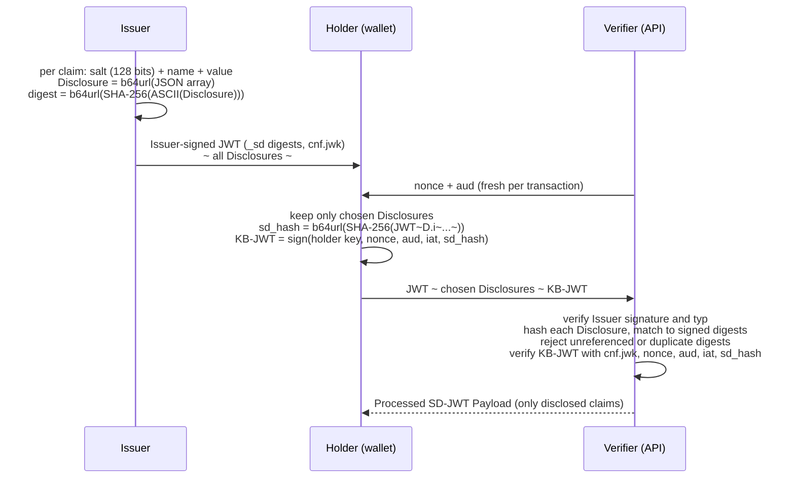

# Privacy-Preserving Identity Claims with Selective Disclosure for JSON Web Tokens (SD-JWT, RFC 9901, November 2025)

> [!summary] Claim
> An SD-JWT replaces each concealable claim with a salted hash that the Issuer signs once, so a Holder can later reveal any subset of claims to any Verifier without contacting the Issuer, and the Verifier's safety rests on three checks that lenient parsers skip: reject every Disclosure that no signed digest references, decide Key Binding from policy rather than from the presentation, and recompute `sd_hash` over the exact bytes received.

Part of [API Authentication and Identity](README.md) in [API Engineering](../README.md).

## TL;DR

- Mechanism: the Issuer signs a JWT whose payload holds `_sd` arrays of base64url SHA-256 digests (and `{"...": digest}` array placeholders) instead of claim values, and hands the Holder the matching Disclosures, each a base64url JSON array `[salt, name, value]` or `[salt, value]`, joined as `<Issuer-signed JWT>~<D.1>~...~<D.N>~` (RFC 9901 Section 4).
- Contract rule: the digest is computed over the US-ASCII bytes of the base64url Disclosure string, not over the decoded JSON, which is why no JSON canonicalization is needed (RFC 9901 Section 4.2.3, Appendix B).
- Trap: a Verifier that silently skips a Disclosure whose digest is not in the signed payload, instead of rejecting the whole presentation, lets a Holder or on-path attacker strip claims while verification reports success; that is exactly CVE-2026-62374 in `@sd-jwt/decode` and `@sd-jwt/core` `<= 0.19.0` (GHSA-f9j6-8p6x-r9j6) and a direct violation of RFC 9901 Section 7.1 step 5.
- Portability fact: the lab is pure Python over `joserfc 1.8.0` ES256 and `hashlib`, and its 34 tests passed on CPython `3.14.6` on macOS 27.3 arm64; the other matrix legs were not run because lab checks are paused (as of 2026-11), and `joserfc` caps a JWS protected header at 512 bytes and a payload at 128000 bytes by default (`joserfc 1.8.0 joserfc/_rfc7515/registry.py, JWSRegistry`).
- When not to use it: if the Issuer is online at presentation time (classic OpenID Connect or a first-party API), mint a token that contains only the needed claims instead; and if Verifiers and the Issuer must not be able to link presentations, SD-JWT cannot deliver that property at all (RFC 9901 Section 10.1), so look at anonymous-credential schemes.

## Mental model



The Issuer does all expensive trust work once: it salts and hashes every concealable claim, signs a payload that contains only digests and the always-visible claims, and binds the credential to a Holder public key carried in `cnf` (RFC 9901 Section 4.1.2, RFC 7800 Section 3.2).
The Holder never re-signs the Issuer's data; it only chooses which Disclosures to append, and when the Verifier demands Key Binding it signs a short Key Binding JWT whose `sd_hash` commits to the exact Issuer-signed JWT plus the exact Disclosures it chose (RFC 9901 Section 4.3.1).
The Verifier's arrow is the long one: it must authenticate the Issuer, recompute every digest from the received strings, splice the Disclosure contents back into the payload at the positions their digests occupy, and then refuse anything that does not connect, so that the signature, the digests, and the KB-JWT together pin both the values and the set of values (RFC 9901 Sections 7.1, 7.3, and 9.10).
The Issuer is absent from the presentation arrow, which is the whole point (offline, Holder-mediated disclosure) and the root of the privacy limit: the Verifier receives the Issuer's signature verbatim and can always show it to the Issuer later (RFC 9901 Section 10.1).

## How it works

### The composite format on the wire

An SD-JWT is the Issuer-signed JWT, a tilde, and zero or more Disclosures each followed by a tilde; an SD-JWT+KB appends a Key Binding JWT after the last tilde (RFC 9901 Section 4).
The trailing tilde is mandatory: with no KB-JWT the final component MUST be the empty string, so a Verifier that expects an SD-JWT MUST check the last component is empty and one that expects an SD-JWT+KB MUST check it is a valid KB-JWT (RFC 9901 Section 4).
The RFC gives the grammar in ABNF: `SD-JWT = JWT "~" *(DISCLOSURE "~")`, `KB-JWT = JWT`, `SD-JWT-KB = SD-JWT KB-JWT`, and `DISCLOSURE = BASE64URL` where `BASE64URL = 1*(ALPHA / DIGIT / "-" / "_")`, so an empty middle component such as `jwt~~` is not a Disclosure and the lab rejects it as `malformed_sd_jwt` (RFC 9901 Section 4).
The Holder MAY send any subset, including none, but MUST NOT send a Disclosure that was not issued or send one twice (RFC 9901 Section 4).
The registered media types are `application/sd-jwt` for the compact form, `application/sd-jwt+json` for the JWS JSON Serialization, and `application/kb+jwt` for a KB-JWT, and `+sd-jwt` is registered as a structured syntax suffix (RFC 9901 Sections 11.2.1, 11.2.2, 11.2.3, and 11.3).

The Section 5 example from the RFC is 1967 characters as issued (an 1186-character Issuer-signed JWT plus 10 Disclosures) and 1859 characters as presented with 4 Disclosures and a KB-JWT, measured by `test_rfc_9901_section_5_sizes` on the strings copied from the RFC.

### Disclosures: salt, name, value, then base64url

For an object property the Issuer builds the JSON array `[salt, claim_name, claim_value]`, UTF-8 encodes it, and base64url encodes the bytes; that string is the Disclosure (RFC 9901 Section 4.2.1).
The salt MUST be a string, MUST be unique per claim, and MUST NOT be revealed to anyone except the Holder; 128 bits of CSPRNG output base64url-encoded is the suggested construction, which yields the 22-character salts seen in every RFC example (RFC 9901 Sections 4.2.1 and 9.3).
The claim name MUST NOT be `_sd`, `...`, or a name already present as a permanently disclosed claim in the same object (RFC 9901 Section 4.2.1).
For an array element the array has two elements, `[salt, value]`, and there is no name (RFC 9901 Section 4.2.2).
The RFC's own vector `["_26bc4LT-ac6q2KI6cBW5es", "family_name", "M\u00f6bius"]` encodes to `WyJfMjZiYzRMVC1hYzZxMktJNmNCVzVlcyIsICJmYW1pbHlfbmFtZSIsICJNw7ZiaXVzIl0`, which the lab reproduces byte for byte with Python's default `json.dumps(..., ensure_ascii=False)` separators `", "` (RFC 9901 Section 4.2.1).

Because the digest covers the encoded string, the Issuer may choose any valid JSON spelling (whitespace, `\u00f6` escapes, member order) and the Verifier never canonicalizes; the RFC lists three alternative encodings of the same `"M\u00f6bius"` claim, each of which is valid and each of which produces a different digest (RFC 9901 Section 4.2.1).
Appendix B calls this "source string hardening" and explains the choice: canonicalization would force both sides to share a canonicalization library, and mixed approaches that ship both JSON and a hashing string invite time-of-check-time-of-use bugs (RFC 9901 Appendix B).

### Digests and where they go

Each Disclosure is hashed with the algorithm named in `_sd_alg`, or `sha-256` when `_sd_alg` is absent; the input MUST be the US-ASCII bytes of the base64url string and the output MUST be base64url, not hex (RFC 9901 Sections 4.1.1 and 4.2.3).
The RFC vector digest for the Disclosure above is `X9yH0Ajrdm1Oij4tWso9UzzKJvPoDxwmuEcO3XAdRC0`, and the lab asserts both that it matches and that hashing the decoded bytes instead gives a different value (RFC 9901 Section 4.2.3).
`_sd_alg` is case-sensitive, MUST appear only at the top level, takes a value from the IANA Named Information "Hash Name String" column or a profile, and every implementation MUST support `sha-256` (RFC 9901 Section 4.1.1).

Object-property digests go into an `_sd` array of strings in the object that would have held the claim, at any depth, and the Issuer MUST hide the original claim order, for example by sorting (RFC 9901 Section 4.2.4.1).
Array-element digests replace the element in place with a single-key object `{"...": "<digest>"}`; no other keys are allowed in that object (RFC 9901 Section 4.2.4.2).
A Verifier that receives no Disclosure for an array placeholder removes the element, so `["DE", {"...": d}, "US"]` becomes `["DE", "US"]` unless the matching Disclosure arrives (RFC 9901 Section 4.2.4.2).
The same digest value MUST NOT appear twice in the SD-JWT (RFC 9901 Section 4.1).

Decoy digests are hashes of random values with no Disclosure; they MAY be added to `_sd` arrays and to arrays to hide how many claims exist, and they are RECOMMENDED where the mere presence of a claim leaks information, for example a membership number that exists only for members (RFC 9901 Sections 4.2.5 and 10.4).
Each extra SHA-256 entry in an `_sd` array costs exactly 47 bytes of payload JSON with `json.dumps` default separators (`, "` plus 43 characters plus `"`), measured as an 8 x 47 = 376 byte delta for 8 decoys in `test_decoys_pad_every_object_and_digests_are_sorted`, which becomes roughly 63 more characters after the payload is base64url encoded (4/3 expansion, arithmetic, not measured).

### Flat, structured, and recursive layouts

The Issuer decides concealability claim by claim and level by level (RFC 9901 Section 6).
In a flat layout the whole `address` object is one Disclosure, so it is all-or-nothing (RFC 9901 Section 6.1).
In a structured layout `address` stays visible as an object whose own `_sd` array conceals each sub-claim, which reveals that an address exists (RFC 9901 Section 6.2).
In a recursive layout `address` is itself a Disclosure whose value contains an `_sd` array of sub-claim digests, so the Holder can hide the address entirely or show selected parts, at the price of dependencies: a child Disclosure is unusable without its parent, and a presentation that includes a child MUST include every Disclosure needed to connect it to the Issuer-signed JWT (RFC 9901 Sections 4.2.6 and 6.3).
The lab's `test_recursive_array_disclosures_need_their_parent` conceals `nationalities` and each of its elements, shows that presenting the parent plus `"DE"` yields `["DE"]`, and shows that both the Holder (`present`) and the Verifier reject the child without its parent as `unreferenced_disclosure`.

### The Issuer-signed JWT

The JWT MUST be signed with the Issuer's private key and MUST NOT use `alg` `none` (RFC 9901 Section 4.1).
`_sd` and `...` MUST NOT appear in the payload except to carry digests (RFC 9901 Section 4.1).
Profiles SHOULD use explicit typing with a `typ` of the form `example+sd-jwt`, following RFC 8725 Section 3.11, to stop cross-JWT confusion (RFC 9901 Section 9.11, RFC 8725 Sections 2.8 and 3.11).
The RFC Section 5 example uses `{"alg": "ES256", "typ": "example+sd-jwt"}`, and the SD-JWT VC example in Appendix A.3 decodes to `{"alg": "ES256", "typ": "dc+sd-jwt"}` (RFC 9901 Section 5.1 and Appendix A.3, decoded in the lab session).
Key Binding is enabled by putting the Holder public key in `cnf`, and the `jwk` confirmation method is suggested (RFC 9901 Section 4.1.2, RFC 7800 Section 3.2).

### The Key Binding JWT

A KB-JWT MUST have `typ` `kb+jwt` and an `alg` that is not `none` in its header, and `iat`, `aud` (a single string), `nonce` (a string), and `sd_hash` in its payload (RFC 9901 Section 4.3).
`sd_hash` is the base64url digest, with the same algorithm as the Disclosures, of the US-ASCII bytes of `<Issuer-signed JWT>~<D.1>~...~<D.N>~`, that is the SD-JWT exactly as presented including the trailing tilde and excluding the KB-JWT (RFC 9901 Section 4.3.1).
The RFC's presentation carries `"sd_hash": "0_Af-2B-EhLWX5ydh_w2xzwmO6iM66B_2QCEanI4fUY"`, and the lab recomputes that value from the presentation prefix (RFC 9901 Section 5.2).
Because `sd_hash` covers the chosen Disclosure set, an SD-JWT+KB integrity-protects which Disclosures were sent, whereas a bare SD-JWT does not: anyone can add or remove Disclosures from a bare SD-JWT and it remains valid (RFC 9901 Section 9.10).

### Verification, step by step (RFC 9901 Sections 7.1 and 7.3)

1. Decide from policy whether Key Binding is required, before looking at the presentation; this decision MUST NOT depend on whether a KB-JWT was provided, otherwise an attacker strips the KB-JWT (RFC 9901 Sections 7.3 step 1 and 9.5).
2. If Key Binding is required and only an SD-JWT arrived, reject (RFC 9901 Section 7.3 step 2).
3. Split, then validate the Issuer-signed JWT: an algorithm deemed secure, never `none`, the signature per RFC 7515 Section 5.2, the Issuer and that the key belongs to it, and an understood and acceptable `_sd_alg` (RFC 9901 Section 7.1 step 2).
4. Hash every received Disclosure; find every `_sd` digest and every `{"...": digest}` element; for each digest with a matching Disclosure, insert the claim (rejecting a non-three-element Disclosure in `_sd`, a name of `_sd` or `...`, or a name that already exists at that level) or replace the array element (rejecting a non-two-element Disclosure), recursing into the inserted value; ignore digests without a Disclosure; drop unmatched array placeholders; then remove `_sd` and `_sd_alg` (RFC 9901 Section 7.1 step 3).
5. Reject if any digest value occurs more than once, directly or via Disclosures (RFC 9901 Section 7.1 step 4).
6. Reject if any Disclosure was not referenced by a digest (RFC 9901 Section 7.1 step 5).
7. Check `nbf`, `exp`, `aud` and any validity claim the context requires in the processed payload, and reject if a required one is missing (RFC 9901 Section 7.1 step 6).
8. With Key Binding: take the Holder key from the processed payload, check the KB-JWT algorithm and signature, `typ` `kb+jwt`, `iat` within an acceptable window, `nonce` and `aud` for this transaction, and `sd_hash` over the received SD-JWT bytes (RFC 9901 Section 7.3 step 5).

The lab's `_Walk` class and `process_sd_jwt` implement items 4 to 6 of this list (RFC 9901 Section 7.1 steps 3 to 5) in one pass: `claim` marks each digest seen (raising `duplicate_digest` on a repeat) and records which Disclosures were used, and `process_sd_jwt` raises `unreferenced_disclosure` for any leftover.

The Holder runs the same Section 7.1 checks on receipt, MUST reject an SD-JWT+KB from the Issuer, and before presenting MUST check that every selected Disclosure's digest is in the Issuer-signed JWT or in another selected Disclosure (RFC 9901 Section 7.2).

### JWS JSON Serialization

As an OPTIONAL alternative, the Disclosures travel in an unprotected header member `disclosures` and the KB-JWT in `kb_jwt`; in the General serialization both MUST be in the first unprotected header only (RFC 9901 Sections 8, 8.1, and 8.3).
`sd_hash` is still computed over a temporarily rebuilt compact serialization, protected header, payload, and signature joined with `.` followed by the `~`-joined Disclosures, and unprotected headers other than `disclosures` are not covered by any digest (RFC 9901 Section 8.1).

### Library implementation used by the lab

The lab signs and verifies both JWTs with `joserfc 1.8.0`.
`jws.serialize_compact` and `jws.deserialize_compact` take an `algorithms` collection; with an explicit list, `JWSRegistry.get_alg` raises `UnsupportedAlgorithmError` for any name outside it, and without one only algorithms flagged `recommended` (`HS256`, `RS256`, `ES256` in `JWS_ALGORITHMS`) are accepted, and `NoneAlgorithm` is registered but not recommended and carries a deprecation `security_warning` (`joserfc 1.8.0 joserfc/_rfc7515/registry.py, JWSRegistry.get_alg`; `joserfc/_rfc7518/jws_algs.py, JWS_ALGORITHMS`).
The lab passes `algorithms=("ES256",)`, so a crafted `{"alg": "none"}` Issuer JWT is rejected with `UnsupportedAlgorithmError` as the cause (`test_issuer_signature_typ_and_alg_none_are_enforced`).
`ESAlgorithm.verify` rejects any signature whose length is not `2 x ceil(key_size / 8)` bytes (64 bytes for P-256) before converting the raw `r || s` pair to DER for `cryptography` (`joserfc 1.8.0 joserfc/_rfc7518/jws_algs.py, ESAlgorithm.verify`).
`extract_rfc7515_compact` enforces `max_header_length = 512`, `max_payload_length = 128000`, and `max_signature_length = 1024` bytes on the base64url segments before decoding (`joserfc 1.8.0 joserfc/_rfc7797/compact.py, extract_rfc7515_compact`; `joserfc/_rfc7515/registry.py, JWSRegistry`).
Its `urlsafe_b64decode` rejects `+`, `/`, `=`, a length of 1 mod 4, and non-canonical trailing characters (`joserfc 1.8.0 joserfc/util.py, urlsafe_b64decode`); joserfc does not parse Disclosures, so the lab applies the same strictness itself in `b64url_decode`, plus strict UTF-8, duplicate-member rejection (RFC 7519 Section 4 allows either rejection or last-wins, and the lab chooses rejection), and refusal of `NaN` and `Infinity` in `strict_json`.

## Numbers and limits

| Quantity | Value | Source or measurement |
|---|---|---|
| Recommended minimum salt entropy | 128 bits | RFC 9901 Section 9.3 |
| Salt length in every RFC Section 5 Disclosure | 22 characters | `test_rfc_9901_section_5_sizes`, CPython 3.14.6, macOS 27.3 arm64 |
| SHA-256 digest as base64url | 43 characters | Same test (all 10 Disclosures) |
| Mandatory-to-implement `_sd_alg` | `sha-256` (default when absent) | RFC 9901 Section 4.1.1 |
| Hash strength guidance | collision resistance SHOULD match the signature, for example `ES512` -> SHA-512; truncated `sha-256-32` and `sha-256-64` are unfit | RFC 9901 Section 9.4 |
| RFC Section 5 SD-JWT as issued | 1967 characters, Issuer-signed JWT 1186, 10 Disclosures | `test_rfc_9901_section_5_sizes` |
| RFC Section 5 SD-JWT+KB as presented (4 Disclosures) | 1859 characters | Same test |
| Payload cost of one extra `_sd` entry | 47 bytes of JSON (8 decoys -> 376 bytes) | `test_decoys_pad_every_object_and_digests_are_sorted` |
| ES256 JWS signature | 64 bytes (raw `r` then `s`, 32 bytes each) | `joserfc 1.8.0 joserfc/_rfc7518/jws_algs.py, ESAlgorithm.verify` |
| joserfc default JWS limits | header 512, payload 128000, signature 1024 bytes (base64url segments) | `joserfc 1.8.0 joserfc/_rfc7515/registry.py, JWSRegistry`; header limit exercised by `test_joserfc_size_limits_bound_the_issuer_jwt` |
| h11 request line plus headers buffer (Uvicorn default) | 16384 bytes; overflow -> Uvicorn `400` `Invalid HTTP request received.` | `h11 0.16.0 h11/_connection.py, DEFAULT_MAX_INCOMPLETE_EVENT_SIZE`; `uvicorn 0.54.0 uvicorn/protocols/http/h11_impl.py, H11Protocol.handle_events` |
| Lab verifier body cap | 65536 bytes -> `413` | Lab choice, `MAX_PRESENTATION_BYTES` in `sd_jwt.py` |
| Lab KB-JWT `iat` window | 300 s back, 30 s forward skew | Lab choice; the RFC only says "an acceptable window" (RFC 9901 Section 7.3 step 5.e) |
| Lab test run | 34 passed in 0.25 s (wall time of one run, not a benchmark) | `uv run --frozen pytest tests/f14_api_authentication_and_identity/test_selective_disclosure_jwts_sd_jwt_rfc_9901.py -q`, CPython 3.14.6, macOS 27.3 arm64 (`uname -r` `27.3.0`) |
| SD-JWT VC draft | `draft-ietf-oauth-sd-jwt-vc-26`, 6 November 2026 | IETF datatracker (as of 2026-11) |
| Token Status List draft | `draft-ietf-oauth-status-list-21`, 21 June 2026, in the RFC Editor queue | IETF datatracker (as of 2026-11) |

## Portability

Lab checks were paused by the user on 2026-11-11, so the lab ran once, on the workspace interpreter; every other cell cites a source and says it was not run.

| Leg | Behavior | Evidence |
|---|---|---|
| CPython `3.14.6` (macOS 27.3 arm64, workspace `.python-version` `3.14`) | 34 passed; ruff format and check, mypy strict, and pyright strict clean on this note's `sd_jwt.py` and its test module | Ran once by the fact-checker on 2026-11-15; workspace-wide `ruff`, `mypy`, and `pyright` runs fail only in other notes' files (f10, f12, f13) |
| CPython `3.12.16`, `3.13.18`, `3.14.10`, `3.15.2` | Not run. The lab uses only `hashlib`, `json`, `base64`, `secrets`, `re`, `dataclasses`, and `joserfc`; `joserfc 1.8.0` declares `requires_python >=3.11` and lists classifiers for 3.12 to 3.15, inside a workspace declaring `requires-python = ">=3.12,<3.16"` (as of 2026-11) | `joserfc-1.8.0.dist-info/METADATA`; PyPI JSON for `joserfc` 1.8.0; `labs/pyproject.toml` |
| Free-threaded `3.15.2t` | Not run. The venv's `cryptography 50.0.2` wheel is tagged `cp311-abi3-macosx_11_0_arm64`, and the free-threaded build does not support the stable ABI, so that wheel cannot serve a `t` interpreter; whether a `cp315t` wheel or a source build of `cryptography` exists was not checked, so the lab's status on `3.15.2t` is unknown | `cryptography-50.0.2.dist-info/WHEEL`; Python docs, Free-threading extensions HOWTO, "Limited C API and Stable ABI"; PEP 703 Backwards Compatibility |
| `joserfc 1.8.0` vs earlier releases | Only 1.8.0 read and run; `algorithms` allowlist and size limits as cited above | `joserfc 1.8.0 joserfc/_rfc7515/registry.py` |
| Uvicorn, Hypercorn, Granian | The verifier reads the presentation from the request body, so the server only affects size limits; a presentation carried in a header instead meets the 16384-byte h11 buffer on Uvicorn's h11 path | Lab used in-process `httpx.ASGITransport`; servers not run; h11 limit from source cited in Numbers |
| HTTP/1.1, HTTP/2, HTTP/3 | Transport-independent: SD-JWT defines no HTTP binding and leaves confidentiality to the transport, recommending JWE when an SD-JWT travels in a URL | RFC 9901 Section 10.3; not run over any wire protocol |

## Worked example

The lab [implementation](../labs/src/api_labs/f14_api_authentication_and_identity/sd_jwt.py) is an Issuer (`Issuer.issue` with `Sd(...)` markers), a Holder (`present` with a `KeyBinding`), a Verifier (`verify_presentation` with a `VerifierPolicy`), and a Starlette verifier API that issues one-time nonces (`POST /transactions`) and accepts `application/sd-jwt` bodies (`POST /presentations/{txn}`); the [test](../labs/tests/f14_api_authentication_and_identity/test_selective_disclosure_jwts_sd_jwt_rfc_9901.py) checks it against the RFC 9901 test vectors and against every rejection rule above.

Digest and Disclosure construction (excerpt, verbatim lines from `sd_jwt.py`):

```python
def sd_digest(encoded: str, sd_alg: str = SD_ALG_DEFAULT) -> str:
    """Section 4.2.3: hash the US-ASCII bytes of the base64url text, then base64url the digest."""
    return b64url_encode(_HASHES[sd_alg](encoded.encode("ascii")))


@dataclass(frozen=True, slots=True)
class Disclosure:
    """One Disclosure: ``[salt, name, value]`` for a property, ``[salt, value]`` for an element."""

    encoded: str
    salt: str
    name: str | None
    value: object

    @classmethod
    def create(cls, salt: str, name: str | None, value: object) -> Disclosure:
        items: list[object] = [salt, value] if name is None else [salt, name, value]
        raw = json.dumps(items, ensure_ascii=False).encode("utf-8")
        return cls(b64url_encode(raw), salt, name, value)
```

The Section 7.1 step 3 to step 5 walk (excerpt, verbatim lines from `sd_jwt.py`):

```python
    def walk_object(self, node: dict[str, object]) -> dict[str, object]:
        result = {name: self.walk_value(value) for name, value in node.items() if name != "_sd"}
        listed = node.get("_sd")
        if listed is None:
            return result
        if not isinstance(listed, list) or not all(
            isinstance(d, str) for d in cast("list[object]", listed)
        ):
            raise SdJwtError("malformed_sd", "_sd must be an array of strings")
        for digest in cast("list[str]", listed):
            disclosure = self.claim(digest)
            if disclosure is None:
                continue
            if disclosure.name is None:
                raise SdJwtError("disclosure_shape", "array-element Disclosure in _sd")
            if disclosure.name in _RESERVED_NAMES:
                raise SdJwtError("reserved_claim_name", disclosure.name)
            if disclosure.name in result:
                raise SdJwtError("claim_name_collision", disclosure.name)
            result[disclosure.name] = self.walk_value(disclosure.value)
        return result
```

```python
def process_sd_jwt(
    payload: dict[str, object], encoded: list[str], sd_alg: str
) -> dict[str, object]:
    """Section 7.1 steps 3 to 5 over an already signature-checked payload."""
    by_digest: dict[str, Disclosure] = {}
    for item in encoded:
        digest = sd_digest(item, sd_alg)
        if digest in by_digest:
            raise SdJwtError("duplicate_disclosure", digest)
        by_digest[digest] = Disclosure.parse(item)
    walk = _Walk(by_digest)
    try:
        processed = walk.walk_object(payload)
    except RecursionError as exc:
        raise SdJwtError("nesting_too_deep") from exc
    processed.pop("_sd_alg", None)
    if unused := by_digest.keys() - walk.used:
        raise SdJwtError("unreferenced_disclosure", f"{len(unused)} not referenced")  # step 5
    return processed
```

The Verifier entry point, with the policy-first Key Binding decision and the KB-JWT checks (excerpt, verbatim lines from `sd_jwt.py`):

```python
def verify_presentation(
    presentation: str, policy: VerifierPolicy, *, nonce: str | None, now: int
) -> dict[str, object]:
    """Sections 7.1 and 7.3; returns the Processed SD-JWT Payload or raises SdJwtError."""
    issuer_jwt, encoded, kb_jwt = split_presentation(presentation)
    if policy.require_key_binding and kb_jwt is None:
        raise SdJwtError("key_binding_required")  # Section 7.3 step 2
    if not policy.require_key_binding and kb_jwt is not None:
        raise SdJwtError("unexpected_kb_jwt")  # Section 4: final component must be empty
    header, payload = _verify_jws(issuer_jwt, policy.issuer_key, "bad_issuer_jwt")
    if header.get("typ") != policy.expected_typ:
        raise SdJwtError("wrong_typ", repr(header.get("typ")))  # Section 9.11
    sd_alg = _sd_alg(payload, policy.allowed_sd_algs)
    claims = process_sd_jwt(payload, encoded, sd_alg)
    _check_validity(claims, policy, now)
    if kb_jwt is None:
        return claims
    kb_header, kb = _verify_jws(kb_jwt, _holder_key(claims), "bad_kb_jwt")
    if kb_header.get("typ") != KB_JWT_TYP:
        raise SdJwtError("wrong_kb_typ", repr(kb_header.get("typ")))
    iat = kb.get("iat")
    if not _is_int(iat) or not (
        now - policy.max_kb_age <= cast("int", iat) <= now + policy.clock_skew
    ):
        raise SdJwtError("kb_iat_out_of_window", repr(iat))
    if kb.get("aud") != policy.audience:
        raise SdJwtError("kb_audience_mismatch", repr(kb.get("aud")))
    if nonce is None or kb.get("nonce") != nonce:
        raise SdJwtError("kb_nonce_mismatch")
    sd_part = presentation[: len(presentation) - len(kb_jwt)]
    if kb.get("sd_hash") != sd_digest(sd_part, sd_alg):
        raise SdJwtError("sd_hash_mismatch")  # Section 7.3 step 5.g
    return claims
```

The lab plan's scenario, issuing nine claims and disclosing only `birthdate` with Key Binding, plus the CVE-2026-62374 regression (excerpt, verbatim lines from the test module):

```python
CLAIMS: dict[str, object] = {
    "iss": ISSUER,
    "iat": NOW - 60,
    "exp": NOW + 3600,
    "sub": "user_42",
    "given_name": Sd("John"),
    "family_name": Sd("Doe"),
    "email": Sd("johndoe@example.com"),
    "birthdate": Sd("1940-01-01"),
    "nationalities": [Sd("US"), Sd("DE")],
}
```

```python
def test_holder_discloses_only_the_selected_claim_with_key_binding() -> None:
    sd_jwt = make_issuer().issue(CLAIMS, HOLDER_JWK)
    shown = present(sd_jwt, lambda d: d.name == "birthdate", binding())
    _, disclosures, kb_jwt = split_presentation(shown)
    assert len(disclosures) == 1
    assert kb_jwt is not None
    claims = verify_presentation(shown, policy(key_binding=True), nonce="n-123", now=NOW)
    assert claims["birthdate"] == "1940-01-01"
    assert claims["nationalities"] == []
    assert not {"given_name", "family_name", "email", "_sd", "_sd_alg"} & claims.keys()
```

```python
def test_unreferenced_disclosure_is_rejected_not_silently_dropped() -> None:
    sd_jwt = make_issuer().issue(CLAIMS, HOLDER_JWK)
    issuer_jwt, disclosures, _ = split_presentation(sd_jwt)
    forged = Disclosure.create("salt-forged", "family_name", "Smith").encoded
    tampered = "~".join([issuer_jwt, disclosures[0], forged]) + "~"
    assert rejection(tampered, policy(key_binding=False)) == "unreferenced_disclosure"
```

`test_rfc_9901_section_5_presentation_verifies_end_to_end` verifies the RFC's own SD-JWT+KB with the Appendix A.5 Issuer key, nonce `1234567890`, and `now=1748537244`, and asserts the Processed SD-JWT Payload equals the one printed in RFC 9901 Section 5.2, including `"nationalities": ["US"]` after the undisclosed `"DE"` placeholder is dropped.

Captured run, from `labs/`, CPython `3.14.6`, `macOS-27.3-arm64-arm-64bit-Mach-O`:

```text
$ uv run --frozen pytest tests/f14_api_authentication_and_identity/test_selective_disclosure_jwts_sd_jwt_rfc_9901.py -q
..................................                                       [100%]
34 passed in 0.25s
```

## Pitfalls

> [!warning] Silently dropping a Disclosure that matches no digest
> - Trigger: a decode loop that looks up each Disclosure's digest and `continue`s when it is absent, or that decodes Disclosure bytes leniently (U+FFFD substitution) so a corrupted Disclosure parses but no longer matches.
> - Symptom: verification succeeds with fewer claims than were presented; if authorization defaults to allow when a restricting claim (age, role) is absent, the decision flips; CVE-2026-62374 (GHSA-f9j6-8p6x-r9j6, CVSS 4.0 7.1) reports exactly this in `@sd-jwt/decode` and `@sd-jwt/core` `<= 0.19.0`, with `@sd-jwt/core 0.20.0` patched and no patched `@sd-jwt/decode` listed, and the same advisory notes `_sd` accepted as a claim name and `_sd_alg` matched case-insensitively.
> - Fix: reject the whole presentation for any unreferenced Disclosure (RFC 9901 Section 7.1 step 5), decode UTF-8 strictly, and match `_sd_alg` exactly; the lab's `test_unreferenced_disclosure_is_rejected_not_silently_dropped`, `test_invalid_utf8_disclosure_is_rejected_not_replaced`, and `test_sd_alg_is_matched_exactly_against_policy` pin all three.

> [!warning] Deciding Key Binding from the presentation
> - Trigger: `if kb_jwt: verify_kb(...)` without a policy flag.
> - Symptom: a stolen or forwarded SD-JWT+KB is replayed with its KB-JWT cut off, and the Verifier accepts a bearer credential (RFC 9901 Sections 9.5 and 9.9).
> - Fix: fix the requirement in policy before parsing and reject a bare SD-JWT when it is set (RFC 9901 Section 7.3 steps 1 and 2); `test_stripping_the_kb_jwt_does_not_downgrade_the_policy` covers both directions.

> [!warning] Hashing the decoded JSON, hex digests, or re-serialized Disclosures
> - Trigger: computing `sha256(json.dumps(json.loads(b64decode(d))))` or emitting `hexdigest()`.
> - Symptom: no digest ever matches an interoperable Issuer, or an implementation "canonicalizes" and accepts a Disclosure the Issuer never signed.
> - Fix: hash `disclosure.encode("ascii")` and base64url the raw digest bytes (RFC 9901 Section 4.2.3); keep the received string, never a re-encoding, as the hash input.

> [!warning] Concealing validity-controlling claims, or trusting that the Issuer did not
> - Trigger: making `exp`, `nbf`, `iss`, or `cnf` selectively disclosable, or a Verifier that only checks `exp` "if present".
> - Symptom: the Holder withholds `exp` and an expired credential verifies.
> - Fix: Issuers MUST NOT conceal content critical to validity, and Verifiers MUST reject when a required validity claim is missing after processing (RFC 9901 Sections 7.1 step 6 and 9.7); SD-JWT VC goes further and forbids `iss`, `nbf`, `exp`, `cnf`, `vct`, `vct#integrity`, `aka_vcts`, and `status`, including their subclaims, in Disclosures (`draft-ietf-oauth-sd-jwt-vc-26` Section 2.2.2.3).

> [!warning] Reusing salts or keys across a batch
> - Trigger: deriving salts from a counter or reusing one salt per claim name, or reusing the Holder key and exact timestamps across credentials meant to be used once each.
> - Symptom: an undisclosed low-entropy value (a birthdate) is brute-forced from its digest, or two Verifiers link presentations by an identical digest, `cnf` key, or `iat`.
> - Fix: fresh 128-bit CSPRNG salt per claim even when names repeat (RFC 9901 Section 9.3), and for batch issuance new keys and salts per credential with randomized or rounded `iat`, `exp`, and `nbf` (RFC 9901 Section 10.1).

> [!warning] Putting an SD-JWT in a header or URL
> - Trigger: sending a multi-kilobyte SD-JWT+KB in `Authorization` or a query parameter.
> - Symptom: the request is refused before the application runs once the request line and headers exceed the server buffer (16384 bytes on Uvicorn's h11 path, answered with `400`), and URL-borne credentials land in logs and browser history.
> - Fix: carry it as an `application/sd-jwt` request body, and encrypt with JWE when it must travel in a URL (RFC 9901 Section 10.3).

## Security and robustness

Threat model, with the RFC's two named goals: selective disclosure (a Verifier learns nothing about undisclosed claims beyond what other data reveals) and integrity (a Holder cannot change names or values undetected) (RFC 9901 Section 9).

| Adversary | Attack | Control |
|---|---|---|
| Malicious Holder | Edit a Disclosure value | Digest mismatch -> unreferenced Disclosure -> reject (RFC 9901 Sections 7.1 step 5 and 9.2) |
| Malicious Holder | Insert a claim that collides with a plaintext claim | `claim_name_collision` (RFC 9901 Section 7.1 step 3.c.ii.3) |
| Malicious Holder | Withhold `exp` | Required validity claims (RFC 9901 Sections 7.1 step 6 and 9.7) |
| Thief of the credential | Replay to another Verifier | Key Binding required by policy, `aud`, one-time `nonce` (RFC 9901 Sections 7.3 and 9.5) |
| On-path party | Add or drop Disclosures | `sd_hash` covers the set in an SD-JWT+KB (RFC 9901 Section 9.10); a bare SD-JWT offers no such protection |
| Curious Verifier | Guess an undisclosed value from its digest | 128-bit salts and a preimage-resistant, hiding hash (RFC 9901 Sections 9.3 and 9.4) |
| Curious Verifier | Infer claim count or presence | Decoys (RFC 9901 Sections 4.2.5 and 10.4); claim names of visible containers are never hidden (RFC 9901 Section 9.6) |
| Colluding Verifiers | Link two presentations | Batch issuance with fresh keys, salts, and randomized timestamps (RFC 9901 Section 10.1) |
| Issuer plus any Verifier | Link a presentation to issuance | Not preventable with salted hashes (RFC 9901 Section 10.1) |
| Token confusion | Present an ID Token or another JWT as an SD-JWT | Explicit `typ` checked by the Verifier (RFC 9901 Section 9.11, RFC 8725 Section 3.11) |

OWASP API Security Top 10 (2023) mapping:
- `API2:2023 Broken Authentication`: every Section 7.3 omission (policy inferred from presence, no `nonce` binding, no `sd_hash`) is an authentication bypass for an API that accepts presentations as credentials.
- `API3:2023 Broken Object Property Level Authorization`: requesting more claims than the endpoint needs defeats minimal disclosure; Verifier APIs should declare and request only the properties they consume.
- `API4:2023 Unrestricted Resource Consumption`: a presentation is attacker-controlled JSON nested inside base64; bound the body size (the lab returns `413` above 65536 bytes, but only after Starlette's `request.body()` has buffered the whole body, so the memory bound must come from the server or a proxy), cap JSON depth (the lab sets no explicit cap and instead maps CPython's `RecursionError` to `malformed_json` or `nesting_too_deep`), and lean on `joserfc`'s segment limits.
- `API8:2023 Security Misconfiguration`: accepting `none`, a wide algorithm list, or any `_sd_alg` in the registry (which includes truncated hashes) are configuration errors (RFC 9901 Section 9.4).

Input validation edge cases the lab rejects: padded or `+` base64url, non-canonical trailing bits, invalid UTF-8, duplicate JSON member names, `NaN`, Disclosures with one or four elements or a non-string name, `_sd` that is not an array of strings, a three-element Disclosure referenced from an array or a two-element one from `_sd`, duplicate Disclosures, duplicate digests, and a `cnf.jwk` that carries a private `d` member.
Boundary enforcement: the verifier API checks `Content-Type` is `application/sd-jwt` (`415` otherwise, per RFC 9110 Section 15.5.16), consumes the transaction nonce before verifying so a failed attempt cannot be retried with the same nonce, and answers a reused transaction with `404` `unknown_transaction`; it answers verification failures with `400` rather than `401`, because a `401` MUST carry a `WWW-Authenticate` challenge (RFC 9110 Section 15.5.2) and this endpoint defines none.
Defense in depth: Issuers and Verifiers SHOULD NOT store SD-JWTs after use, including in logs, and Holders SHOULD store them only in encrypted form, using hardware-backed encryption wherever possible and in particular for the private Key Binding key (RFC 9901 Section 10.2); revocation checks against an Issuer endpoint can leak usage, which is why the Token Status List design gives herd privacy by publishing one compressed bit array for many credentials (`draft-ietf-oauth-status-list-21` Sections 1.2, 4.1, and 12.1).

## The principal's view

The architectural decision is whether the Issuer must be online when claims are consumed.
If it is (first-party APIs, workforce SSO, OpenID Connect), the Issuer already minimizes disclosure at issuance time by putting only the requested claims in the token, and SD-JWT adds size, a second key pair per user, and wallet machinery for no gain; use an ID Token or a narrowly scoped access token from token exchange instead (RFC 9901 Section 1).
If it is not (a government or bank issues once, and thousands of unknown Verifiers check later), SD-JWT is the pragmatic standard: it can be built purely on widely available JWT, JSON, and Base64 libraries plus a hash function (RFC 9901 Appendix B), and it is the base layer for SD-JWT VC (`draft-ietf-oauth-sd-jwt-vc-26`) and for the EU digital identity wallet profiles named in the GHSA-f9j6-8p6x-r9j6 advisory.

The organizational trade-off is that privacy moves from protocol to operations.
Verifier/Verifier unlinkability needs batch issuance, which multiplies signing load, Holder storage, and status-list entries by the batch size (RFC 9901 Section 10.1).
Issuer/Verifier unlinkability against a colluding or coerced Verifier is impossible with salted hashes, and the RFC explicitly warns about power asymmetries such as a government Issuer mandating Verifier reporting (RFC 9901 Section 10.1); if that property is a hard requirement, choose an anonymous-credential scheme instead (the RFC cites Camenisch-Lysyanskaya credentials as the bar SD-JWT does not meet), and accept less mature tooling.
For CBOR-centric or constrained ecosystems the same salted-hash design exists as mDL/mdoc (ISO/IEC 18013-5) and SD-CWT (`draft-ietf-spice-sd-cwt`), with the same linkability limit (RFC 9901 Section 10.1).

For an API platform team the concrete calls are: centralize verification in one library with the Section 7.1 and 7.3 algorithm implemented exactly once and fuzzed against the RFC vectors (CVE-2026-62374 was found by differential fuzzing against a reference oracle, per its advisory); express Verifier policy as data (required claims, `typ`, allowed `_sd_alg`, Key Binding, `iat` window) reviewed like an authorization rule; treat the Processed SD-JWT Payload, never the raw Disclosures, as the only input to authorization (RFC 9901 Appendix B); and never let absence of a claim mean "allow".

## Interview questions

> [!question] L5: Why does SD-JWT hash the base64url-encoded Disclosure string instead of the claim's JSON value?
>
> > [!success]- Answer
> > JSON allows many byte encodings of one value (whitespace, escapes, member order), so hashing a parsed value would need a shared canonicalization algorithm on both sides (RFC 9901 Appendix B).
> > Hashing the exact transmitted string means the Verifier recomputes the digest over bytes it received, with no canonicalization, and the Issuer's chosen spelling becomes immutable for that SD-JWT (RFC 9901 Section 4.2.1).
> > The input MUST be the US-ASCII bytes of the base64url text and the output MUST be base64url, not hex (RFC 9901 Section 4.2.3).
> >
> > Follow-up: What breaks if a Verifier decodes, re-serializes, and re-encodes each Disclosure before hashing?

> [!question] L5: What is the difference between `<JWT>~<D1>~` and `<JWT>~<D1>~<KB-JWT>` on the wire, and what must a Verifier check about the last component?
>
> > [!success]- Answer
> > The first is an SD-JWT, whose final tilde-separated component is the empty string; the second is an SD-JWT+KB, whose final component is a Key Binding JWT (RFC 9901 Section 4).
> > A Verifier expecting an SD-JWT MUST verify the last component is empty, and one expecting an SD-JWT+KB MUST verify it is a valid KB-JWT (RFC 9901 Section 4).
> > Which one it expects comes from its policy, not from the input (RFC 9901 Section 7.3 step 1).
> >
> > Follow-up: Why is the trailing tilde mandatory even when there are zero Disclosures?

> [!question] L5: Predict the output: The Issuer signs `{"nationalities": [{"...": d_us}, {"...": d_de}], ...}` and the Holder presents only the Disclosure for `"US"`; what does the Processed SD-JWT Payload contain for `nationalities`, and why?
>
> > [!success]- Answer
> > `["US"]`.
> > The Verifier replaces the placeholder whose digest matches a received Disclosure with that Disclosure's value and removes every array element whose digest had no Disclosure (RFC 9901 Section 7.1 steps 3.c.iii and 3.d).
> > This is exactly the RFC Section 5.2 example, which the lab's `test_rfc_9901_section_5_presentation_verifies_end_to_end` reproduces with the RFC's own strings.
> >
> > Follow-up: How can the Issuer stop the Verifier from learning that the array had two entries?

> [!question] L6: What does `sd_hash` protect that the Issuer signature does not, and over which exact bytes is it computed?
>
> > [!success]- Answer
> > The Issuer signature covers digests, so it protects claim values but not which Disclosures were sent; anyone can add or remove Disclosures from a bare SD-JWT and it stays valid (RFC 9901 Section 9.10).
> > `sd_hash` is the `_sd_alg` digest of the US-ASCII bytes `<Issuer-signed JWT>~<D.1>~...~<D.N>~` exactly as presented, so the Holder's KB-JWT signature pins the chosen set (RFC 9901 Section 4.3.1).
> > In the JWS JSON Serialization the Verifier must rebuild that compact string temporarily to compute it (RFC 9901 Section 8.1).
> >
> > Follow-up: Why does the lab compute `sd_hash` from a slice of the received presentation rather than from re-joined parsed components?

> [!question] L6: Why must a Verifier reject a presentation that contains a valid-looking Disclosure whose digest appears nowhere in the signed payload, instead of ignoring it?
>
> > [!success]- Answer
> > RFC 9901 Section 7.1 step 5 makes it a MUST, and ignoring it turns tampering into silent claim removal.
> > CVE-2026-62374 (GHSA-f9j6-8p6x-r9j6) is that bug in `@sd-jwt/decode` and `@sd-jwt/core <= 0.19.0`: a corrupted or edited Disclosure no longer matched, was skipped, and verification reported success with a reduced claim set.
> > If the relying party authorizes by "deny only if the restricting claim is present", removing that claim flips the decision.
> >
> > Follow-up: With Key Binding enforced, who can still exploit the silent-drop bug, and who cannot?

> [!question] L6: Debug this API: A Verifier endpoint runs `verify_issuer_sig(jwt); if kb: verify_kb(kb, nonce=session.nonce)` and returns the claims, and pen testers report that a credential captured from another site is accepted; diagnose and fix.
>
> > [!success]- Answer
> > Key Binding is decided by the presence of a KB-JWT, so the attacker strips the KB-JWT and presents the bare SD-JWT, which needs no Holder key (RFC 9901 Section 9.5).
> > The fix is a policy flag fixed before parsing, rejecting a bare SD-JWT when it is set (RFC 9901 Section 7.3 steps 1 and 2), plus checks of `aud`, a one-time `nonce`, `iat` freshness, `typ` `kb+jwt`, and `sd_hash`.
> > Also check that `session.nonce` is consumed on first use, or a captured SD-JWT+KB can be replayed within the same session.
> >
> > Follow-up: Which HTTP status should the endpoint return on failure if it does not define an authentication scheme, and why not `401`?

> [!question] L6: Compare flat, structured, and recursive Disclosure layouts for `address`.
>
> > [!success]- Answer
> > Flat makes the whole object one Disclosure, so it is all-or-nothing (RFC 9901 Section 6.1).
> > Structured keeps `address` visible with an inner `_sd`, letting each sub-claim be disclosed but revealing that an address exists, because names of visible containers are never hidden (RFC 9901 Sections 6.2 and 9.6).
> > Recursive conceals `address` and its sub-claims, so it can be hidden entirely or shown partially, but child Disclosures require the parent and the Holder must include it (RFC 9901 Sections 4.2.6 and 6.3).
> >
> > Follow-up: How do decoys interact with the structured layout's leak?

> [!question] L7+: A national ID program wants revocation and wants Verifiers unable to correlate citizens across services; what can SD-JWT guarantee, what must operations add, and what is impossible?
>
> > [!success]- Answer
> > SD-JWT guarantees value confidentiality of undisclosed claims and integrity of disclosed ones (RFC 9901 Section 9).
> > Verifier/Verifier unlinkability requires batch issuance with fresh Holder keys, fresh salts, and randomized or rounded timestamps per credential (RFC 9901 Section 10.1), and revocation must avoid per-credential Issuer callbacks, for example with a Token Status List that offers herd privacy (`draft-ietf-oauth-status-list-21`).
> > Issuer/Verifier unlinkability against a colluding or coerced Verifier is impossible for any salted-hash scheme, including mdoc and SD-CWT (RFC 9901 Section 10.1), so if that is a requirement the program needs anonymous credentials.
> >
> > Follow-up: How does batch size trade off against signing cost, status-list size, and the privacy gained?

> [!question] L7+: Should your company's internal APIs adopt SD-JWT for service-to-service authorization?
>
> > [!success]- Answer
> > Usually no: internal Issuers are online, so token exchange can mint a token with exactly the needed claims and audience, avoiding wallet keys, larger tokens, and the Section 7.1 complexity (RFC 9901 Section 1 describes the online-Issuer model as already minimizing disclosure).
> > SD-JWT pays off when issuance and presentation are decoupled in time and trust domain, for example credentials held by end users or partner organizations and forwarded down a supply chain (RFC 9901 Section 9.9).
> > If adopted, require explicit `typ`, Key Binding by policy, a single vetted verifier library, and authorization only on the Processed SD-JWT Payload.
> >
> > Follow-up: What would make forwarding with removed Disclosures a feature rather than a vulnerability?

## Related

Prerequisites: [[HTTP-Message-Signatures-RFC-9421-and-Content-Digests-RFC-9530]]

Next: [[Enterprise-SSO-Integration-Multi-Tenant-OIDC-and-SCIM-Provisioning]]

See also: [[JWT-JWS-JWK-Structure-and-RFC-9068-Access-Token-Profile]], [[JWT-Cryptographic-Pitfalls-and-RFC-8725-Best-Current-Practices]], [[JWKS-Discovery-Caching-Key-Rotation-and-Thundering-Herd-Protection]], [[Sender-Constrained-Tokens-DPoP-RFC-9449-and-mTLS-Binding-RFC-8705]], [[OpenID-Connect-OIDC-ID-Tokens-vs-Access-Tokens-and-Metadata-Discovery]], [[Service-to-Service-Identity-Client-Credentials-and-Token-Exchange-RFC-8693]], [[Refresh-Token-Rotation-Reuse-Detection-and-Token-Revocation-Architectures]], [[Content-Negotiation-Media-Types-and-Charsets]], [[Unrestricted-Resource-Consumption-API4-2023-Payload-Depth-and-Limit-Guards]], [[Webhook-Consumer-Engineering-Signature-Verification-Replay-Windows-and-Idempotency]]

- Lab: `labs/tests/f14_api_authentication_and_identity/test_selective_disclosure_jwts_sd_jwt_rfc_9901.py`

## Further reading

- [RFC 9901 - Selective Disclosure for JSON Web Tokens](https://www.rfc-editor.org/rfc/rfc9901.html) - the format, the Section 7 verification algorithm, test vectors, and the security and privacy analysis this note follows.
- [RFC 7515 - JSON Web Signature (JWS)](https://www.rfc-editor.org/rfc/rfc7515.html) - base64url (Section 2), duplicate header names (Section 4), and signature validation (Section 5.2) that the Issuer-signed JWT and KB-JWT rely on.
- [RFC 7519 - JSON Web Token (JWT)](https://www.rfc-editor.org/rfc/rfc7519.html) - claim uniqueness (Section 4) and the `exp`, `nbf`, `iat`, and `aud` semantics checked after processing.
- [RFC 7800 - Proof-of-Possession Key Semantics for JWTs](https://www.rfc-editor.org/rfc/rfc7800.html) - the `cnf` claim and the `jwk` confirmation method (Section 3.2) used for Key Binding.
- [RFC 8725 - JSON Web Token Best Current Practices](https://www.rfc-editor.org/rfc/rfc8725.html) - algorithm verification and explicit typing (Sections 3.1, 3.2, 3.11) referenced by RFC 9901 Sections 7 and 9.11.
- [draft-ietf-oauth-sd-jwt-vc-26](https://www.ietf.org/archive/id/draft-ietf-oauth-sd-jwt-vc-26.txt) - the credential profile on top of SD-JWT: `typ` `dc+sd-jwt`, `vct`, and claims that must never be selectively disclosed.
- [draft-ietf-oauth-status-list-21](https://www.ietf.org/archive/id/draft-ietf-oauth-status-list-21.txt) - privacy-preserving revocation via compressed status bit arrays; a later revision of the `[TSL]` reference in RFC 9901 Section 10.1, which cites `-13`.
- [GHSA-f9j6-8p6x-r9j6 / CVE-2026-62374](https://github.com/advisories/GHSA-f9j6-8p6x-r9j6) - primary advisory for the silently dropped Disclosure bug in the OpenWallet Foundation JavaScript SD-JWT libraries.
- [Python docs - Free-threading extensions HOWTO](https://docs.python.org/3/howto/free-threading-extensions.html) - states the free-threaded build does not support the Limited C API or stable ABI, which is why an `abi3` wheel does not settle `3.15.2t` portability.
- [PEP 703 - Making the GIL Optional](https://peps.python.org/pep-0703/) - Backwards Compatibility: the GIL-less build is not ABI compatible with the stable ABI, and extensions must be rebuilt.
