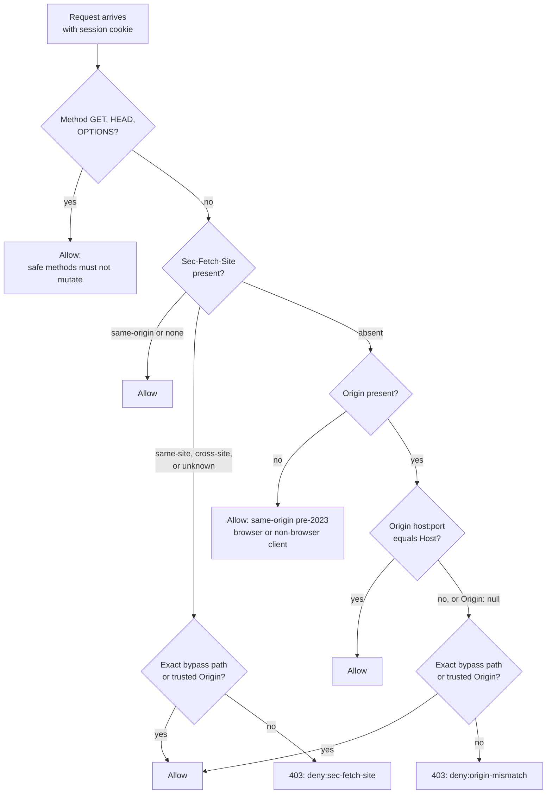

# When APIs Are Vulnerable to CSRF: Cookie Auth vs Bearer Headers, SameSite=Lax/Strict Limits, and Sec-Fetch-Site / Origin Header Enforcement

> [!summary] Claim
> An API is exposed to CSRF exactly when the browser attaches its credential automatically (a cookie, HTTP auth, or a client certificate), so a bearer-header API is immune by construction, while a cookie API needs a server-side cross-origin check (`Sec-Fetch-Site` first, `Origin` vs `Host` as fallback) because `SameSite` is a browser-side, site-scoped, partially deployed default rather than an origin-scoped guarantee.

Part of [API Authorization and OWASP Security](README.md) in [API Engineering](../README.md).

## TL;DR

- Mechanism: CSRF is the confused-deputy attack on ambient authority; the attacker's page makes the victim's browser send a state-changing request, and the browser attaches the victim's cookie because cookies are keyed to the destination, not to the page that initiated the request.
- Contract rule: reject every unsafe-method request whose `Sec-Fetch-Site` is not `same-origin` or `none`, and when that header is absent fall back to requiring `Origin` to match `Host` (the Go 1.25 `net/http.CrossOriginProtection` algorithm), keeping `GET`, `HEAD`, and `OPTIONS` free of side effects (RFC 9110 Section 9.2.1).
- The trap: `SameSite=Lax` and `Strict` are scoped to the *site* (registrable domain plus scheme), so any sibling subdomain, including a forgotten marketing host or a subdomain takeover, is "same-site" and gets your cookies; and a JSON API that parses `text/plain` bodies is reachable with no CORS preflight at all (CVE-2021-32677 in FastAPI before 0.65.2).
- Portability: `Sec-Fetch-Site` is sent by Chrome 76+, Edge 79+, Firefox 90+, and Safari 16.4+ (MDN browser-compat-data `http/headers/Sec-Fetch-Site.json`, as of 2026-11), but only to potentially trustworthy URLs (W3C Fetch Metadata Section 3), so plain-HTTP deployments must rely on the `Origin` fallback.
- When not to use it: an API authenticated only by an `Authorization` header that JavaScript sets explicitly needs no CSRF defense, and adding a cookie "for convenience" to such an API silently re-creates the vulnerability.

## Mental model



The guard never asks "who is the user"; authentication already answered that from the cookie, and that answer is exactly what the attacker borrows.
It asks "which page caused this request", and the browser answers it twice: `Sec-Fetch-Site` is computed by the browser over the whole redirect chain and cannot be set by page script because the `Sec-` prefix makes it a forbidden request-header (Fetch Standard Section 2.2.2; W3C Fetch Metadata Section 4.2), and `Origin` is appended to every non-`GET`/`HEAD` request (Fetch Standard Section 3.2).
Safe methods pass unconditionally, which is only sound because they do not change state; the arrow into `A1` is therefore a contract on the application, not a property of the guard.
The "no headers at all" arrow is allowed because a request carrying neither header cannot have come from a post-2023 browser making an unsafe cross-origin request, so it is either a same-origin request from an old browser or a non-browser client, and a non-browser client cannot ride on a victim's cookie jar.

## How it works

### Why cookies, and only cookies, make an API forgeable

A browser decides whether to attach a cookie by matching the cookie's domain, path, `Secure`, and `SameSite` attributes against the *destination* URL and the request's relationship to the top-level site (RFC 6265bis-22 Section 5.8.3, the retrieval algorithm), never against the page whose script issued the request.
That is ambient authority: the credential travels with any request the browser can be induced to make.
An `Authorization: Bearer ...` header is the opposite: page script must set it explicitly, the attacker's origin cannot read the token from the victim origin's storage, and a cross-origin `fetch()` that sets `Authorization` is not a CORS-safelisted request header, so the browser sends an `OPTIONS` preflight first and the request never leaves unless the server opts in (Fetch Standard Section 2.2.2).
The lab's `test_bearer_api_ignores_ambient_cookie` shows the consequence: the same forged request that drains the cookie endpoint gets `401` with `WWW-Authenticate: Bearer` from the bearer endpoint, because the cookie is simply not an input to its authentication.
The other ambient credentials, HTTP Basic or Digest credentials cached by the browser and TLS client certificates, are vulnerable for the same reason; mTLS-authenticated browser APIs need the same guard.

The browser-based OAuth pattern that keeps tokens out of JavaScript, the Backend-for-Frontend, is the common way APIs end up cookie-authenticated again: the BFF holds the access token and the browser holds a session cookie, so the BFF's mutation endpoints are classic CSRF targets ([[OAuth-2-0-for-Browser-Based-Applications-BFF-and-Cookies-RFC-10017]]).

### What an attacker page can send without a preflight

CORS does not stop requests from being *sent*; it stops responses from being *read*, plus it adds a preflight only for requests a plain HTML form could not already make.
A request skips preflight when its method is a CORS-safelisted method, `GET`, `HEAD`, or `POST` (Fetch Standard Section 2.2.1), and every author-set header is a CORS-safelisted request header.
For `Content-Type` that means the parsed MIME type's essence is `application/x-www-form-urlencoded`, `multipart/form-data`, or `text/plain`, the value is at most 128 bytes, and the safelisted headers total at most 1024 bytes (Fetch Standard Section 2.2.2).
In `mode: "no-cors"` the `Request` constructor throws a `TypeError` for a non-safelisted method and sets the header guard to `request-no-cors`, so non-safelisted headers cannot be added at all (Fetch Standard Section 5.4).
The body type decides `Content-Type` implicitly: a string body becomes `text/plain;charset=UTF-8`, `URLSearchParams` becomes `application/x-www-form-urlencoded;charset=UTF-8`, `FormData` becomes `multipart/form-data; boundary=...`, and a `Blob` contributes a type only "if object's type attribute is not the empty byte sequence" (Fetch Standard Section 5.2, extract a body).
So an attacker can POST arbitrary JSON bytes as `text/plain`, or with no `Content-Type` at all by wrapping them in an untyped `Blob`, with `credentials: "include"`, and the response is opaque but the side effect happens.

Two framework behaviors decide whether that request reaches your handler:
- FastAPI before 0.65.2 parsed any body as JSON regardless of `Content-Type`, so a cookie-authenticated JSON endpoint accepted the `text/plain` forgery; GHSA rated it High, CWE-352 (CVE-2021-32677, GHSA-8h2j-cgx8-6xv7).
- FastAPI 0.65.2 also refused a body with no `Content-Type`, but 0.65.3 reverted that ("Assume request bodies contain JSON when no Content-Type header is provided", fastapi PR #3456, 2021-07-03), so 0.65.3 through 0.131.x parse a header-less body as JSON (fastapi 0.65.2 and 0.131.0 fastapi/routing.py, `get_request_handler`).
- FastAPI 0.132.0 added `strict_content_type`, default `True`, which again refuses to parse a body with *no* `Content-Type` as JSON; the in-tree docstring names the attack as requests "without a Content-Type header, bypassing CORS preflight checks" (fastapi 0.162.0 fastapi/applications.py, `FastAPI.__init__`; FastAPI docs, Strict Content-Type).
In fastapi 0.162.0 the decision is in `get_request_handler` (fastapi/routing.py): an empty `Content-Type` is parsed as JSON only when `strict_content_type` is false, and otherwise the body is parsed only when the maintype is `application` and the subtype is `json` or ends in `+json`; anything else leaves raw bytes that fail model validation with `422`.
The lab's `test_fastapi_parses_json_only_for_json_media_types` pins all six combinations, including that `strict_content_type=False` turns a header-less body into a `200`.

A strict media-type check is a real but narrow defense: it kills the form and `text/plain` vectors but does nothing for endpoints that legitimately accept form posts, multipart uploads, or no body (`POST /logout`, `POST /orders/42/cancel`), and SvelteKit's version of this check was bypassed twice in four days (advisories published 2023-04-04 and 2023-04-07), first by `text/plain` (CVE-2023-29003, fixed in 1.15.1) and then by an upper-cased `Content-Type` value (CVE-2023-29008, fixed in 1.15.2).

### SameSite: what the browser actually enforces

`SameSite` is set by the server per cookie and enforced by the browser at retrieval time.
"Same-site" compares registrable domains, a public suffix plus one label (RFC 6265bis-22 Section 2.3), so `api.bank.example` and `blog.bank.example` are same-site while `alice.github.io` and `bob.github.io` are cross-site because `github.io` is on the Public Suffix List; the modern "schemeful" definition also requires the same scheme, which Chrome shipped in 2020 and, per Filippo Valsorda, Firefox and Safari never implemented (words.filippo.io/csrf, as of 2026-11).
The enforcement modes (RFC 6265bis-22 Section 5.6.7):
- `Strict`: sent only on same-site requests.
- `Lax`: sent on same-site requests and on cross-site requests "if and only if they are top-level navigations" using a safe method (Section 5.6.7.1); a redirect can change the method and safety is judged per hop.
- `None`: sent on every request; the draft ignores a `SameSite=None` cookie that lacks `Secure` (Section 5.7, step 19), and Chromium enforces the same rule (chromium.org/updates/same-site).
- No attribute: the cookie's same-site flag becomes `Default` (Section 5.7, step 17); Chromium treats it as `Lax`, with the target rollout population raised to 100 percent of Chrome 80+ stable users on 2020-08-11 and the actual share then "ramping up to 100% gradually" (chromium.org/updates/same-site).
- `Lax-allowing-unsafe`: for cookies that "did not explicitly specify a `SameSite` attribute", a browser may also send them on a cross-site top-level `POST`, limited to recently created cookies, where "a cookie age of 2 minutes or less" is "a reasonable limit" (Section 5.6.7.2); Chromium calls this "Lax + POST" (chromium.org/updates/same-site).

The specification itself says Lax "does not offer a robust defense against CSRF as a general category of attack", that pop-ups and top-level navigations make it "only a speedbump", and points to session management for real mitigation (RFC 6265bis-22 Section 5.6.7.1); Section 8.8.1 recommends server-side defenses in addition even for `Strict`, and Section 8.8.6 calls the unsafe-method allowance "a temporary, transitional measure".
OWASP's position matches: `SameSite` "is useful as a defense-in-depth control but it does not replace a proper CSRF defense in most deployments" (OWASP CSRF Prevention Cheat Sheet).
As of 2026-11 the document is still a draft: `draft-ietf-httpbis-rfc6265bis-22` (2025-12-01) is in the RFC Editor queue (status "blocked: Final Approval Pending" on datatracker) with no RFC number, so RFC 6265 (2011), which has no `SameSite` at all, is still the published standard.

Concrete gaps the lab's `test_samesite_cookie_retrieval_matrix` encodes:
- `Lax` sends the cookie on a cross-site top-level `GET` navigation, so any state-changing `GET` (`GET /unsubscribe?all=1`, `GET /api/v1/approve?id=7`) is forgeable with a plain link.
- An attribute-less cookie set less than 120 s ago rides a cross-site top-level form `POST`, which is exactly the window right after login.
- `Strict` is still sent on a request from a compromised sibling subdomain, because that request is same-site.
- A browser that never adopted Lax-by-default treats the missing attribute as `None` (modeled by `lax_by_default=False`), so relying on the default instead of setting the attribute explicitly makes protection browser-dependent.
Starlette sets an explicit attribute for you: `Response.set_cookie` defaults to `samesite="lax"`, `secure=False`, `httponly=False`, and `SessionMiddleware` defaults to `same_site="lax"`, `https_only=False` (starlette 1.10.0 starlette/responses.py, `Response.set_cookie`; starlette/middleware/sessions.py, `SessionMiddleware.__init__`); the lab's `test_starlette_set_cookie_defaults_to_samesite_lax` pins the emitted `Set-Cookie` line.

### Fetch Metadata: the browser tells you the relationship

The W3C Fetch Metadata Request Headers specification defines four request headers, all Structured Field items: `Sec-Fetch-Dest`, `Sec-Fetch-Mode`, and `Sec-Fetch-Site` are tokens, and `Sec-Fetch-User` is a boolean sent only as `?1` on user-activated navigations (Sections 2.1 to 2.4).
`Sec-Fetch-Mode` is one of `cors`, `navigate`, `no-cors`, `same-origin`, `websocket`; `Sec-Fetch-Site` is one of `cross-site`, `same-origin`, `same-site`, `none`.
The `Sec-Fetch-Site` algorithm (Section 2.3) starts at `same-origin`, sets `none` for navigations the user started from browser UI, and otherwise walks the request's entire URL list: each URL that is not same-origin with the initiator sets `cross-site`, and the walk stops there unless the URL is same-site, in which case the value becomes `same-site`.
Section 4.1 makes the redirect consequence explicit: one cross-site hop taints the request even if the chain returns home, which defeats the "bounce through an open redirect on your own domain" trick that plain `Origin` or `Referer` checks are exposed to.
The lab's `sec_fetch_site` implements this and `test_sec_fetch_site_follows_the_whole_redirect_chain` checks that `https://bank.example -> https://evil.example/bounce -> https://bank.example/...` yields `cross-site`.
The headers are only attached when the current URL is potentially trustworthy (Section 3), meaning HTTPS or loopback such as `http://localhost`; a plain-HTTP intranet API receives none of them.

### Origin: the fallback, and why `null` is a deny

`Origin` is the serialized origin `scheme "://" host [ ":" port ]` or the literal `null` (RFC 6454 Section 7.1), and a user agent "MUST NOT" send more than one (Section 7.3).
The Fetch Standard decides when it is sent (Section 3.2, append a request `Origin` header): always for CORS-tainted requests and WebSocket handshakes, and for any request whose method is neither `GET` nor `HEAD`; for a non-CORS unsafe request it is replaced with `null` under `Referrer-Policy: no-referrer`, on an HTTPS to non-HTTPS downgrade under `no-referrer-when-downgrade`, `strict-origin`, and `strict-origin-when-cross-origin`, and cross-origin under `same-origin`.
A cross-origin redirect also serializes the origin as `null` ("If request's redirect-taint is not "same-origin", then return "null"", Fetch Standard Section 2.2.5).
So for the unsafe methods the guard cares about, a current browser always sends `Origin`, which is what makes the fallback sound, and `null` is never evidence of same-origin: OWASP says "Missing headers and `Origin: null` are not evidence of a same-origin request", and the lab's `_origin_netloc` returns `None` for it so it can never equal `Host`.
Go compares only the `Origin` host and port with `Host`, which means a pre-2023 browser on `http://bank.example` can forge to `https://bank.example`; the Go source comments that it fails open here and that HSTS mitigates it (Go net/http/csrf.go, `CrossOriginProtection.Check`).

Django's `CsrfViewMiddleware` layers the same idea under its token: if `Origin` is present it must match the request's scheme and host or `CSRF_TRUSTED_ORIGINS`, and only when it is absent on an HTTPS request does it fall back to strict `Referer` checking, then it checks the token; its safe set is `GET`, `HEAD`, `OPTIONS`, `TRACE` (django 5.2 django/middleware/csrf.py, `CsrfViewMiddleware.process_view` and `_origin_verified`).

### Tokens: synchronizer and signed double-submit

Before Fetch Metadata the standard defense was a secret the attacker cannot read: a synchronizer token stored server-side per session, or for stateless servers a double-submit token sent both as a cookie and as a header or form field.
OWASP calls the naive double-submit (cookie value equals header value) "bypassable by an attacker who can write cookies on the target domain", because cookies have weak integrity: "Cookies do not provide integrity guarantees for sibling domains (and their subdomains)" (RFC 6265bis-22 Section 8.6), and `foo.example.com` may set `Domain=example.com` (RFC 6265 Section 4.1.2.3).
Two cookies with the same name then both arrive, ordered longer-path first and then by creation time (RFC 6265 Section 5.4), and servers "SHOULD NOT rely upon the serialization order" (RFC 6265 Section 4.2.2); Starlette's `cookie_parser` keeps the *last* occurrence because it fills a dict (starlette 1.10.0 starlette/requests.py, `cookie_parser`), so which value wins depends on attacker-chosen paths.
The fix OWASP prescribes is to "bind the CSRF token explicitly to session-specific data": HMAC-SHA-256 under a server secret over "an unambiguous encoding of the session-dependent value and random value", with the random value and MAC in the token and the session ID never in it.
The `__Host-` prefix closes the tossing channel at the cookie layer: such a cookie must be `Secure`, have `Path=/`, and have no `Domain` (RFC 6265bis-22 Section 4.1.3.2), so a sibling cannot set or overwrite it, and prefixes are matched case-insensitively (Section 5.4).

Tokens cost instrumentation of every form and every `fetch()` call, a token endpoint or template injection, and rotation on login; Fetch Metadata costs nothing in the client, which is why Go 1.25 shipped `CrossOriginProtection` without tokens and Filippo Valsorda summarizes it as "no need for tokens or keys, modern browsers tell you if a request is cross-origin" (words.filippo.io/csrf).
Tokens remain the right tool when you must support browsers without Fetch Metadata over plain HTTP, when same-site siblings are untrusted *and* must call you, or as defense in depth on the handful of endpoints where a forged request is catastrophic.

### WebSockets: CSRF against the handshake

The WebSocket opening handshake is a `GET` with the victim's cookies, so a method-based guard waves it through, yet it opens a credentialed, bidirectional channel; this is cross-site WebSocket hijacking.
A browser client "MUST include" `Origin` in the handshake (RFC 6455 Section 4.1), and servers that only accept browser input from certain sites "SHOULD verify the Origin field" and answer `403` (RFC 6455 Section 10.2); `Sec-Fetch-Mode: websocket` exists for the same request (W3C Fetch Metadata Section 2.2).
In ASGI, sending `websocket.close` before `websocket.accept` makes the server reject the handshake with HTTP `403` (ASGI HTTP and WebSocket spec), so `CrossOriginGuardMiddleware` treats a `websocket` scope as an unsafe method and closes with code `1008`, "a message that violates its policy" (RFC 6455 Section 7.4.1); `test_cross_site_websocket_handshake_is_closed_with_1008` checks both the rejection and that a same-origin handshake still connects.

## Numbers and limits

| Quantity | Value | Source |
|---|---|---|
| CORS-safelisted methods | `GET`, `HEAD`, `POST` | Fetch Standard Section 2.2.1 |
| Preflight-free `Content-Type` essences | 3: `application/x-www-form-urlencoded`, `multipart/form-data`, `text/plain` | Fetch Standard Section 2.2.2 |
| Safelisted header value cap / total cap | 128 bytes per value / 1024 bytes total | Fetch Standard Section 2.2.2 |
| RFC safe methods vs guard-exempt methods | RFC 9110: 4 (`GET`, `HEAD`, `OPTIONS`, `TRACE`); Go and the lab: 3 (no `TRACE`); Django: 4 | RFC 9110 Section 9.2.1; go.dev/src/net/http/csrf.go; django 5.2 csrf.py |
| `Lax-allowing-unsafe` window | 2 minutes after cookie creation, attribute-less cookies only | RFC 6265bis-22 Section 5.6.7.2; chromium.org/updates/same-site |
| Chrome Lax-by-default | Chrome 80+, target rollout population 100 percent of stable on 2020-08-11 | chromium.org/updates/same-site |
| `Sec-Fetch-Site` first versions | Chrome 76, Edge 79 (mirrors Chrome), Firefox 90, Safari 16.4 | MDN browser-compat-data `http/headers/Sec-Fetch-Site.json`, the data behind the web.dev compatibility widget (as of 2026-11) |
| OWASP coverage statement | "supported in all major browsers since March 2023", "over 98% global coverage" | OWASP CSRF Prevention Cheat Sheet (as of 2026-11) |
| `Sec-Fetch-Site` values | 4: `same-origin`, `same-site`, `cross-site`, `none` | W3C Fetch Metadata Section 2.3 |
| `Origin` headers per request | at most 1 | RFC 6454 Section 7.3 |
| Django token lengths | `CSRF_SECRET_LENGTH = 32`, `CSRF_TOKEN_LENGTH = 2 * CSRF_SECRET_LENGTH`, so 64 (mask plus masked secret) | django 5.2 django/middleware/csrf.py |
| Lab token size | 16-byte nonce + 32-byte HMAC-SHA256 = 66 ASCII chars (22 + `.` + 43, base64url unpadded) | `csrf_guard.py`, `GOLDEN_TOKEN` in the test |
| FastAPI `strict_content_type` | added in 0.132.0, default `True` | FastAPI docs, Strict Content-Type; fastapi 0.162.0 `get_request_handler` |
| FastAPI lenient JSON parsing | any `Content-Type` before 0.65.2; missing `Content-Type` in 0.65.3 to 0.131.x | CVE-2021-32677; fastapi PR #3456; fastapi 0.65.2, 0.65.3, 0.131.0 fastapi/routing.py |
| WebSocket policy-violation close code | `1008` | RFC 6455 Section 7.4.1 |
| Lab run, measured | 59 tests in 0.60 s | `uv run --frozen pytest ... -q`, CPython 3.14.6, macOS 27.3 arm64 (Darwin 27.3.0), 2026-11-15 |

The guard's own cost is two header lookups and, on the fallback path, one `urlsplit`; it allocates nothing per request beyond the `Headers` view, so its latency is negligible next to session lookup.
The lab did not benchmark it, so no per-request figure is claimed.

## Portability

| Dimension | Behavior | Proof |
|---|---|---|
| CPython 3.14.6 (workspace `.venv`) | 59 passed | ran 2026-11-15, see Worked example |
| CPython 3.12.16, 3.13.18, 3.14.10, 3.15.2, 3.15.2t | not run: lab checks are paused for this note (2026-11-11 instruction); the module uses only `enum.StrEnum` (3.11+), `hmac`, `secrets`, `base64`, `urllib.parse` from the stdlib | not run |
| Starlette 1.10.0 | no CSRF middleware ships; `set_cookie` and `SessionMiddleware` default to `SameSite=lax`, `Secure` off | starlette 1.10.0 starlette/responses.py, starlette/middleware/sessions.py; lab test |
| FastAPI 0.162.0 | `strict_content_type=True` default; JSON parsed only for `application/json` and `application/*+json` | `test_fastapi_parses_json_only_for_json_media_types`; fastapi/routing.py `get_request_handler` |
| FastAPI < 0.65.2 | parses any `Content-Type` as JSON; cookie-auth JSON endpoints forgeable | CVE-2021-32677 |
| FastAPI 0.65.2 | neither `text/plain` nor a body with no `Content-Type` is parsed as JSON | fastapi 0.65.2 fastapi/routing.py, `get_request_handler` (read at the release tag) |
| FastAPI 0.65.3 to < 0.132.0 | `text/plain` refused but a body with no `Content-Type` parsed as JSON (the "older versions" behavior `strict_content_type=False` restores) | fastapi PR #3456; fastapi 0.65.3 and 0.131.0 fastapi/routing.py, `get_request_handler`; FastAPI docs, Strict Content-Type |
| Go `net/http` | `CrossOriginProtection` from Go 1.25; `AddInsecureBypassPattern` over-matched until 1.25.1 | go.dev/src/net/http/csrf.go; GO-2025-3955 (CVE-2025-47910) |
| HTTP/1.1 | `Host` is the comparison target | `test_old_browser_fallback_compares_origin_with_host` (in-process ASGI) |
| HTTP/2 and HTTP/3 under Hypercorn 0.18.0 | `:authority` is rewritten into a `host` header before the ASGI app sees it, so the `Origin` vs `Host` fallback is unchanged | hypercorn 0.18.0 hypercorn/utils.py, `filter_pseudo_headers` (called from protocol/h2.py and protocol/h3.py) |
| Uvicorn 0.54.0 | HTTP/1.1: `Host` passes through in `scope["headers"]`; HTTP/2 needs the separately installed `zttp` package (not a declared dependency), and `ZttpH2Protocol.handle_request` copies zttp's header list into the scope; zttp 0.0.35 rewrites `:authority` into a `host` header, so the fallback is unchanged | uvicorn 0.54.0 uvicorn/protocols/http/zttp_h2_impl.py, `handle_request`; run once 2026-11-15: an `h2` client frame with `:authority: app.example.com` and no `host` yields zttp `Request.headers` containing `(b"host", b"app.example.com")` |
| Granian 2.8.7 | the ASGI scope builder inserts `host` from the request URI authority (HTTP/2 `:authority`) when no `Host` header is present, so the fallback is unchanged | granian 2.8.7 src/asgi/utils.rs, `build_scope_common!` (read at the `v2.8.7` tag); not run |
| Browsers | `Sec-Fetch-*` only to potentially trustworthy URLs; `Sec-Fetch-Site` is schemeful everywhere, but schemeful same-site for `SameSite` cookies ships in Chrome only | W3C Fetch Metadata Section 3; words.filippo.io/csrf |

## Worked example

The implementation is [implementation](../labs/src/api_labs/f15_api_authorization_and_owasp_security/csrf_guard.py) and the test is [test](../labs/tests/f15_api_authorization_and_owasp_security/test_csrf_in_cookie_authenticated_apis_samesite_double_submit_and_fetch_metadata.py).

The policy is a pure function from method, path, and headers to a `Verdict`, so every branch is testable without ASGI; this is the `CrossOriginPolicy` class verbatim:

```python
@dataclass(frozen=True, slots=True)
class CrossOriginPolicy:
    """Reject unsafe cross-origin browser requests (the Go 1.25 algorithm plus two knobs).

    ``allow_same_site`` accepts ``Sec-Fetch-Site: same-site``: only safe when every sibling
    subdomain is as trusted as this origin.  ``require_browser_headers`` turns the
    "neither header present" case from allow (non-browser client) into deny, for
    endpoints that only browsers should call.
    """

    trusted_origins: frozenset[str] = field(default_factory=frozenset[str])
    bypass_paths: frozenset[str] = field(default_factory=frozenset[str])
    allow_same_site: bool = False
    require_browser_headers: bool = False

    def decide(self, method: str, path: str, headers: Mapping[str, str]) -> Verdict:
        if method.upper() in GUARD_SAFE_METHODS:
            return Verdict.ALLOW_SAFE_METHOD
        site = headers.get("sec-fetch-site")
        origin = headers.get("origin")
        if site is not None:
            site = site.strip()
            if site in (FetchSite.SAME_ORIGIN, FetchSite.NONE):
                return Verdict.ALLOW_FETCH_METADATA
            if site == FetchSite.SAME_SITE and self.allow_same_site:
                return Verdict.ALLOW_FETCH_METADATA
            return self._exempt(path, origin) or Verdict.DENY_SEC_FETCH_SITE
        if origin is None:
            if self.require_browser_headers:
                return self._exempt(path, origin) or Verdict.DENY_NO_BROWSER_HEADERS
            return Verdict.ALLOW_NON_BROWSER
        netloc = _origin_netloc(origin)
        if netloc is not None and netloc == headers.get("host", "").strip().lower():
            return Verdict.ALLOW_ORIGIN_MATCHES_HOST
        return self._exempt(path, origin) or Verdict.DENY_ORIGIN_MISMATCH

    def _exempt(self, path: str, origin: str | None) -> Verdict | None:
        # Exact string match only: prefix or pattern matching is how CVE-2025-47910
        # let Go 1.25.0's AddInsecureBypassPattern exempt more paths than intended.
        if path in self.bypass_paths:
            return Verdict.ALLOW_BYPASS_PATH
        if origin is not None and origin.strip() in self.trusted_origins:
            return Verdict.ALLOW_TRUSTED_ORIGIN
        return None
```

Three decisions differ from a naive port.
`Sec-Fetch-Site` is consulted before `Origin` and wins even when `Origin` matches, because only `Sec-Fetch-Site` carries the redirect taint; the test row `("POST", _h(sec_fetch_site="cross-site", origin=APP), Verdict.DENY_SEC_FETCH_SITE)` pins that.
Token values are compared exactly, so `Same-Origin` is denied: browsers send only the four lowercase tokens of W3C Fetch Metadata Section 2.3, and a value no browser sends is better treated as hostile than normalized.
The specification says servers "SHOULD ignore this header if it contains an invalid value" (Section 2.3), which would mean falling back to `Origin`; Go's `CrossOriginProtection.Check` denies any non-empty value other than `same-origin` or `none`, and the lab follows Go.
Bypass paths are exact strings, so `/webhooks/stripe/` and `/webhooks/stripe2` stay guarded.

The ASGI wrapper is the `CrossOriginGuardMiddleware` class verbatim:

```python
class CrossOriginGuardMiddleware:
    """Pure ASGI middleware applying ``CrossOriginPolicy`` before the app runs.

    A WebSocket handshake is a ``GET`` but opens a credentialed, stateful channel, so it is
    checked as an unsafe method (cross-site WebSocket hijacking defense).
    """

    def __init__(self, app: ASGIApp, policy: CrossOriginPolicy | None = None) -> None:
        self.app = app
        self.policy = policy if policy is not None else CrossOriginPolicy()

    async def __call__(self, scope: Scope, receive: Receive, send: Send) -> None:
        if scope["type"] not in ("http", "websocket"):
            await self.app(scope, receive, send)
            return
        method = scope["method"] if scope["type"] == "http" else "WEBSOCKET"
        verdict = self.policy.decide(method, scope["path"], Headers(scope=scope))
        if verdict.allowed:
            await self.app(scope, receive, send)
            return
        if scope["type"] == "websocket":
            await send({"type": "websocket.close", "code": WEBSOCKET_POLICY_VIOLATION})
            return
        body = {"detail": "cross-origin request rejected", "reason": verdict.value}
        await JSONResponse(body, status_code=403)(scope, receive, send)
```

It rejects before the app reads the body, so a forged request never touches the session store, the database, or the request-body parser.

The signed double-submit token, verbatim:

```python
def _csrf_mac(secret: bytes, session_id: str, nonce: bytes) -> bytes:
    sid = session_id.encode("utf-8")
    # Length-prefixed fields: an unambiguous encoding, so (sid, nonce) pairs cannot collide.
    message = len(sid).to_bytes(4, "big") + sid + len(nonce).to_bytes(4, "big") + nonce
    return hmac.new(secret, message, hashlib.sha256).digest()


def issue_csrf_token(secret: bytes, session_id: str, *, nonce: bytes | None = None) -> str:
    """Return ``b64url(nonce) "." b64url(HMAC-SHA256(secret, len|sid|len|nonce))``."""
    raw_nonce = secrets.token_bytes(_NONCE_BYTES) if nonce is None else nonce
    return f"{_b64(raw_nonce)}.{_b64(_csrf_mac(secret, session_id, raw_nonce))}"


def verify_csrf_token(secret: bytes, session_id: str, token: str) -> bool:
    nonce_text, sep, mac_text = token.partition(".")
    if not sep:
        return False
    try:
        nonce = _unb64(nonce_text)
        mac = _unb64(mac_text)
    except ValueError:  # binascii.Error subclasses ValueError
        return False
    if len(nonce) != _NONCE_BYTES:
        return False
    return hmac.compare_digest(mac, _csrf_mac(secret, session_id, nonce))
```

The attack and the defense, from the test module verbatim; the forged headers are what a no-cors `fetch()` with a string body sends from `https://evil.example`:

```python
# What a browser sends for fetch(url, {method: "POST", mode: "no-cors", credentials:
# "include", body: jsonString}) from https://evil.example when the session cookie is
# SameSite=None: a string body gets text/plain;charset=UTF-8 (Fetch Section 5.2), a
# CORS-safelisted Content-Type, so there is no preflight.
FORGED = {
    "cookie": f"{SESSION_COOKIE}=sid-alice",
    "origin": EVIL,
    "sec-fetch-site": "cross-site",
    "sec-fetch-mode": "no-cors",
    "content-type": "text/plain;charset=UTF-8",
}
JSON_CT = {"content-type": "application/json"}


@pytest.mark.unit
@pytest.mark.asyncio
async def test_unguarded_lenient_json_api_executes_forged_request() -> None:
    bank = _bank()
    async with _client(build_bank_app(bank, lenient_json=True)) as client:
        response = await client.post("/cookie/transfer", content=TRANSFER, headers=FORGED)
    assert response.status_code == 200
    assert bank.balances == {"alice": 900, "mallory": 100}


@pytest.mark.unit
@pytest.mark.asyncio
async def test_guard_rejects_forged_request_and_state_is_unchanged() -> None:
    bank = _bank()
    app = build_bank_app(bank, policy=CrossOriginPolicy(), lenient_json=True)
    async with _client(app) as client:
        response = await client.post("/cookie/transfer", content=TRANSFER, headers=FORGED)
    assert response.status_code == 403
    assert response.json() == {
        "detail": "cross-origin request rejected",
        "reason": "deny:sec-fetch-site",
    }
    assert bank.balances == {"alice": 1000, "mallory": 0}
```

The rest of the module covers: the registrable-domain and schemeful same-site model, the `Sec-Fetch-Site` redirect-chain algorithm, the `SameSite` retrieval matrix including `Lax-allowing-unsafe` at 120 s and 121 s, every policy branch, the `Origin` fallback for pre-2023 browsers, the `415` from a strict media-type check, the bearer endpoint ignoring the cookie, token binding and tamper cases, cookie tossing against naive double-submit, FastAPI's `strict_content_type` matrix, Starlette's `Set-Cookie` default, and the WebSocket `1008` close.

Captured output, run from `labs/` on 2026-11-15 with CPython 3.14.6 (the workspace `.venv`) on macOS 27.3 (Darwin) arm64:

```text
$ uv run --frozen pytest tests/f15_api_authorization_and_owasp_security/test_csrf_in_cookie_authenticated_apis_samesite_double_submit_and_fetch_metadata.py -q
...........................................................              [100%]
59 passed in 0.60s
```

## Pitfalls

> [!warning] JSON endpoint that ignores `Content-Type`
> Trigger: a cookie-authenticated handler calls `await request.json()` (or a framework does it for you) without checking the media type.
> Symptom: a cross-site `fetch(..., {mode: "no-cors", credentials: "include", body: JSON.stringify(...)})` or an `enctype="text/plain"` form executes the mutation with no preflight.
> Fix: check the media type (FastAPI >= 0.65.2 does; 0.65.3 through 0.131.x parse a missing `Content-Type` as JSON again, and >= 0.132.0 refuses it by default), and add the cross-origin guard, because a media-type check is not a CSRF defense for form or empty-body endpoints.
> Primary source: CVE-2021-32677 (GHSA-8h2j-cgx8-6xv7).

> [!warning] Content-Type check implemented as a string comparison
> Trigger: the framework's CSRF check blocks only cross-origin requests whose `Content-Type` is in a lower-case form-type list.
> Symptom: SvelteKit <= 1.15.0 let `text/plain` through (CVE-2023-29003); after that fix, SvelteKit <= 1.15.1 let `Content-Type: text/plaiN` through because the comparison was case-sensitive (CVE-2023-29008).
> Fix: decide on the request's origin, not its media type; when you must parse a media type, parse it (type and subtype are case-insensitive) rather than comparing strings.

> [!warning] Bypass pattern that matches more than you registered
> Trigger: exempting webhook or OAuth-callback routes from the guard with a router pattern.
> Symptom: in Go 1.25.0, `CrossOriginProtection.AddInsecureBypassPattern` could "unexpectedly bypass more requests than intended", skipping validation while the original path was still routed to a different, unprotected handler (GO-2025-3955, CVE-2025-47910, fixed in Go 1.25.1).
> Fix: exempt exact paths only, keep the list tiny, and authenticate exempted endpoints by a non-ambient credential (a webhook signature, see [[HTTP-Message-Signatures-RFC-9421-and-Content-Digests-RFC-9530]]).

> [!warning] Treating `same-site` as trusted
> Trigger: copying the web.dev Resource Isolation Policy, which allows `same-origin`, `same-site`, and `none` (web.dev/articles/fetch-metadata), or setting `allow_same_site=True`.
> Symptom: any sibling subdomain, a user-content host, a stale CNAME taken over, or a lower-trust marketing site, can forge requests; `SameSite=Strict` cookies are sent too, because the request is same-site.
> Fix: allow only `same-origin` and `none` (Go 1.25 and this lab), and list sibling origins that genuinely need to call you in `trusted_origins` by exact origin.

> [!warning] State change on a safe method
> Trigger: `GET /logout`, `GET /email/confirm?token=...&next=...`, or a GraphQL endpoint that accepts mutations over `GET`.
> Symptom: `SameSite=Lax` sends the cookie on a cross-site top-level `GET` navigation (RFC 6265bis-22 Section 5.6.7.1) and every cross-origin guard exempts `GET`, so a link or `window.open` performs the action.
> Fix: make the mutation `POST`, `PUT`, `PATCH`, or `DELETE` (RFC 9110 Section 9.2.1); see [[HTTP-Method-Semantics-Safety-and-Idempotency-Invariants]].

> [!warning] Naive double-submit with a non-prefixed cookie
> Trigger: `csrf` cookie compared to an `X-CSRF-Token` header, no binding to the session, cookie without `__Host-`.
> Symptom: a sibling subdomain sets `csrf=attacker; Domain=bank.example` and submits `X-CSRF-Token: attacker`; `naive_double_submit_ok("attacker", "attacker")` is `True` in the lab.
> Fix: HMAC-bind the token to the session (OWASP), name the cookie `__Host-csrf` (RFC 6265bis-22 Section 4.1.3.2), and rotate it on login.

> [!warning] `Origin: null` allowlisted
> Trigger: an allowlist that contains `"null"` because sandboxed iframes, `file:` pages, or redirected requests showed up in logs with it.
> Symptom: any attacker can produce `Origin: null` with a sandboxed iframe or a cross-origin redirect (Fetch Standard Section 2.2.5), so the allowlist entry admits everyone.
> Fix: never trust `null`; OWASP says not to allowlist the literal `null` value, and the lab's `_origin_netloc` maps it to `None`.

> [!warning] Fail-open on missing headers for browser-only endpoints
> Trigger: a privacy extension or corporate proxy strips `Origin` and `Sec-Fetch-*`.
> Symptom: the request falls into the "non-browser" allow branch; Filippo Valsorda calls header-stripping extensions a vulnerability introduced by the extension, but your users still run them.
> Fix: for endpoints only browsers call (account settings, payment confirmation), set `require_browser_headers=True` or require a token; OWASP leaves the choice explicit: fail-safe for sensitive endpoints.

## Security and robustness

Threat model.
The attacker controls a page the victim visits (any site, or a same-site sibling), cannot read responses from your origin, cannot set `Sec-` headers or `Origin`, and can choose method, a safelisted `Content-Type`, body bytes, redirect chains, top-level navigation versus subresource, and timing relative to login.
Out of scope for this defense: XSS on your own origin (the attacker *is* same-origin and every CSRF defense, tokens included, falls), a compromised browser, and client-side CSRF, where your own JavaScript builds a request from attacker-controlled input; OWASP notes token defenses and `SameSite` do not stop the latter.

OWASP mapping.
CSRF is not a separate entry in the OWASP API Security Top 10 2023; it sits under API8:2023 Security Misconfiguration, whose vulnerability list includes "Appropriate security hardening is missing across any part of the API stack" and "A Cross-Origin Resource Sharing (CORS) policy is missing or improperly set" and whose references cite the OWASP CSRF testing guide, and it amplifies API5:2023 when the forged call hits an administrative function; see [[OWASP-API-Security-Top-10-2023-Complete-Threat-Model]].

Input edge cases the guard must handle:
- Unknown or differently-cased `Sec-Fetch-Site` values: deny (`Same-Origin` is not a browser value).
- `Origin` with path, query, or fragment, or a non-HTTP scheme: unparseable, deny on mismatch.
- `Origin: https://bank.example.evil.example`: host comparison is exact, not suffix; OWASP warns that a weak check lets `example.org.attacker.com` pass.
- `Host` spoofing by a direct client: irrelevant for CSRF, since a browser sets `Host` from the URL; but behind a proxy that rewrites `Host`, compare against the public host (forwarded by a trusted proxy) or configure `trusted_origins` with your public origin.
- WebSocket handshakes: treated as unsafe; closed with `1008` before accept, which ASGI turns into HTTP `403`.

Defense in depth, ordered by what each layer buys:
1. Do not use ambient credentials for APIs called by third-party code; bearer or DPoP tokens ([[Sender-Constrained-Tokens-DPoP-RFC-9449-and-mTLS-Binding-RFC-8705]]) remove the vulnerability class.
2. For browser sessions: `__Host-` cookie, `Secure`, `HttpOnly`, explicit `SameSite=Lax` (or `Strict` for a separate "write" cookie, the split RFC 6265bis-22 Section 8.8.2 suggests).
3. A cross-origin guard on every unsafe method, in report-only mode first: web.dev recommends deploying the policy as logging-only, allowlisting legitimate cross-origin endpoints found in the logs, then enforcing.
4. Strict media-type parsing so the form and `text/plain` vectors cannot reach JSON handlers.
5. HMAC-bound tokens on the few endpoints where the cost of a single forged request is unbounded, or where browsers without Fetch Metadata over plain HTTP must be supported.
6. Correct CORS: never reflect `Origin` with `Access-Control-Allow-Credentials: true`, which turns a CSRF-guarded API into a readable one ([[CORS-Protocol-Internals-Preflight-Caching-and-Origin-Reflection-Exploits]]).

Login CSRF deserves its own line: forcing a victim to log into the *attacker's* account needs no victim session, so session-bound tokens do not apply; OWASP's mitigation is a pre-session with a token in the login form, replaced on authentication to avoid session fixation, and the cross-origin guard covers it without any pre-session because the login `POST` is cross-site.

## The principal's view

The architectural decision is whether browser clients authenticate with ambient cookies at all.
A public API consumed by third parties and mobile apps should be bearer-only, which makes CSRF structurally impossible and keeps one auth path; the cost is that tokens must live somewhere in the browser, which is exactly why the IETF browser-OAuth guidance pushes first-party SPAs back toward a BFF with cookies ([[OAuth-2-0-for-Browser-Based-Applications-BFF-and-Cookies-RFC-10017]]).
So in practice an organization has both: bearer at the public edge, cookies at the first-party BFF, and the CSRF guard belongs on the BFF's mutation surface as a platform middleware, not per-route opt-in.

Make the guard a deny-by-default platform control.
Install it once in the shared ASGI stack or the gateway, with a reviewed exemption list (exact paths, exact origins) owned by the security team, and treat every exemption like a firewall rule.
This is the same placement argument as [[Where-Authorization-Lives-Gateway-Middleware-vs-Domain-and-Query-Layer]]: request provenance is a property of the HTTP request, so it belongs at the edge of the app, while object-level authorization still belongs at the query.

Prefer Fetch Metadata over tokens for new systems.
Tokens impose a per-form, per-client integration tax and fail open when a team forgets one endpoint; a header check needs no client change and fails closed.
The trade-off is browser coverage and transport: the `Sec-Fetch-*` headers are absent over plain HTTP and in pre-2023 browsers, so a fleet with HTTP-only intranet apps or locked-down legacy kiosks must keep the `Origin` fallback or tokens.

Decide the subdomain trust boundary explicitly.
If the organization hands out subdomains to teams, vendors, or user content, the site is not a trust boundary, which disqualifies `SameSite` as a control and `same-site` as an allowed value, and argues for moving user content to a separate registrable domain (the reason `github.io` is on the Public Suffix List).

When to choose differently: non-browser protocols (gRPC from services, server-to-server webhooks) never needed CSRF defenses; GraphQL over `POST` with `application/json` is protected by preflight only if the server refuses other media types; and if you cannot change the server but can change the client, moving the credential from a cookie to a header is the most complete fix.

## Interview questions

> [!question] L5: Why is an API that authenticates with `Authorization: Bearer` not vulnerable to CSRF, while the same API with a session cookie is?
>
> > [!success]- Answer
> > The browser attaches cookies automatically to any request to the cookie's domain, whoever initiated it, so an attacker page can make the victim's browser send an authenticated request.
> > A bearer token is only sent if page script sets the header, and the attacker's origin cannot read the token from the victim origin's storage.
> > Setting `Authorization` cross-origin also makes the request non-simple, so the browser preflights it and the server's CORS policy decides.
> > The vulnerability is ambient authority, not the cookie format.
> >
> > Follow-up: which other credentials are ambient and therefore CSRF-relevant? (HTTP Basic or Digest cached by the browser, TLS client certificates.)

> [!question] L5: The team set `SameSite=Lax` on the session cookie and wants to remove the CSRF middleware. What still works for an attacker?
>
> > [!success]- Answer
> > A cross-site top-level `GET` navigation still carries a `Lax` cookie, so any state-changing `GET` is forgeable.
> > Any same-site sibling subdomain is not cross-site at all, so a compromised or user-content subdomain gets even `Strict` cookies.
> > Browsers that apply Lax-by-default to attribute-less cookies may send them on a cross-site top-level `POST` within 2 minutes of creation (RFC 6265bis-22 Section 5.6.7.2).
> > The specification itself says Lax is "only a speedbump" and recommends server-side defenses in addition.
> >
> > Follow-up: what does `SameSite` protect against that the `Origin` check does not? (Cross-site requests from browsers that strip `Origin`, and read-side attacks such as XS-leaks that depend on credentialed subresource loads.)

> [!question] L6: Predict the output. An unguarded Starlette endpoint reads `await request.json()` with no media-type check and authenticates by a `SameSite=None; Secure` cookie. The attacker page runs `fetch("https://bank.example/cookie/transfer", {method: "POST", mode: "no-cors", credentials: "include", body: JSON.stringify({to: "mallory", amount: 100})})`. What does the browser send, what does the attacker see, and what happens to the balance?
>
> > [!success]- Answer
> > The browser sends a `POST` with no preflight, because `POST` is CORS-safelisted and a string body gets `Content-Type: text/plain;charset=UTF-8`, a safelisted value.
> > It attaches the cookie (`SameSite=None`), `Origin: https://evil.example`, `Sec-Fetch-Site: cross-site`, and `Sec-Fetch-Mode: no-cors`.
> > The server parses the body as JSON and executes the transfer; the attacker gets an opaque response and cannot read it, but the side effect already happened.
> > The lab's `test_unguarded_lenient_json_api_executes_forged_request` asserts exactly this: `200` and balances `{"alice": 900, "mallory": 100}`.
> >
> > Follow-up: what changes with FastAPI 0.162.0 and a Pydantic body model? (`text/plain` is not parsed as JSON, validation fails with `422`, and no transfer happens.)

> [!question] L6: Why does the guard check `Sec-Fetch-Site` before `Origin`, and deny a request where `Origin` equals your own origin but `Sec-Fetch-Site` is `cross-site`?
>
> > [!success]- Answer
> > `Sec-Fetch-Site` is computed over the whole redirect chain, so a request that started on your origin, bounced through an attacker URL, and returned is `cross-site` (W3C Fetch Metadata Section 4.1).
> > `Origin` describes only the initiator, and after a cross-origin redirect the Fetch Standard serializes it as `null` anyway, so the two disagree only in exactly the cases where `Sec-Fetch-Site` is the more informative.
> > Both headers are browser-controlled and unforgeable by page script, so there is no reason to prefer the coarser one.
> >
> > Follow-up: when is `Origin` the only signal available? (Pre-2023 browsers and plain-HTTP origins, where `Sec-Fetch-*` is not sent.)

> [!question] L6: Debug this API. A Starlette BFF uses the Go-style guard. After a deploy behind a new TLS-terminating load balancer, all `POST` requests from Safari 15 users fail with `403 deny:origin-mismatch`, while Chrome users are fine. What happened?
>
> > [!success]- Answer
> > Safari 15 predates `Sec-Fetch-Site` support (16.4), so its requests take the `Origin` vs `Host` fallback, while Chrome's take the `Sec-Fetch-Site: same-origin` branch and never compare hosts.
> > The new load balancer rewrites `Host` to the backend's internal name (for example `bff.internal:8080`), so `Origin: https://app.example.com` no longer matches.
> > Fix it by having the proxy preserve `Host`, by comparing against the public host forwarded by a trusted proxy, or by adding `https://app.example.com` to `trusted_origins`.
> > Do not "fix" it by allowing requests with a mismatched `Origin`.
> >
> > Follow-up: how would you have caught this before users did? (Run the guard in report-only mode and alert on deny reasons by user agent, as web.dev recommends for rollout.)

> [!question] L6: Why is naive double-submit (cookie value equals header value) weaker than a signed double-submit token, and what exactly should the HMAC cover?
>
> > [!success]- Answer
> > Cookies have weak integrity across sibling domains, so a sibling subdomain can set `csrf=attacker; Domain=bank.example` and send the same value in the header, which a naive comparison accepts.
> > A signed token is `nonce || HMAC(secret, encode(session_id, nonce))`, so the attacker cannot mint a valid token for the victim's session without the server secret.
> > The encoding must be unambiguous (length-prefixed), the session-dependent value must change on every login, and the session ID must never appear in the token (OWASP).
> > The `__Host-` cookie prefix additionally prevents siblings from setting the cookie at all.
> >
> > Follow-up: why does a token minted for the attacker's own session fail for the victim? (The HMAC input includes the victim's session ID; `test_cookie_tossing_beats_naive_double_submit_but_not_signed_token` checks it.)

> [!question] L7+: Your company runs 300 services on subdomains of one registrable domain, including vendor-hosted marketing pages and a user-content CDN. Design the CSRF posture.
>
> > [!success]- Answer
> > Treat the registrable domain as untrusted for provenance: never allow `Sec-Fetch-Site: same-site`, and do not count `SameSite` as a control.
> > Move user content and vendor pages to a separate registrable domain, ideally one on the Public Suffix List, so they are cross-site to the application.
> > Issue first-party session cookies with `__Host-` so no sibling can toss them, and keep public APIs bearer-only.
> > Ship the cross-origin guard as a deny-by-default platform middleware with a centrally reviewed exemption list of exact paths and exact origins, rolled out in report-only mode first.
> > Keep HMAC-bound tokens only for the few endpoints where a single forged request is catastrophic.
> >
> > Follow-up: what does that buy you against a subdomain takeover via a dangling CNAME? (The attacker's page is same-site but not same-origin, so the guard still denies it, and `__Host-` cookies cannot be overwritten from it.)

> [!question] L7+: A product team proposes putting a local AI agent API on `http://localhost:8000` with no authentication, "because only local processes can reach it". What is the CSRF exposure and what do you require?
>
> > [!success]- Answer
> > Any website the user visits can send requests to `localhost` from the browser; a `fetch()` with an untyped `Blob` body sends no `Content-Type`, needs no preflight, and needs no credentials because there is no auth.
> > FastAPI before 0.65.2 and from 0.65.3 through 0.131.x parsed such a body as JSON, which is exactly the scenario FastAPI's strict content-type documentation describes.
> > `localhost` is potentially trustworthy, so browsers do send `Sec-Fetch-Site` to it, and the guard rejects `cross-site` there too.
> > Require the guard, strict media types, a per-install secret token in a header for every call, and binding to `127.0.0.1` only.
> >
> > Follow-up: why does DNS rebinding make a `Host` allowlist necessary as well? (A rebinding attack makes the attacker's hostname resolve to `127.0.0.1`, so the request is same-origin from the browser's view; validating `Host` against `localhost` and `127.0.0.1` defeats it.)

> [!question] L7+: Compare four CSRF defenses for a large Python monolith: synchronizer tokens, signed double-submit, Fetch Metadata guard, and `SameSite=Strict`. Which do you standardize on and why?
>
> > [!success]- Answer
> > Synchronizer tokens are strongest per request but need server-side state and instrumentation of every form and client call, and fail open on any endpoint a team forgets.
> > Signed double-submit removes the server state but keeps the client integration cost.
> > The Fetch Metadata guard needs no client changes, fails closed, and covers forms, `fetch()`, and WebSocket handshakes, but depends on browser support and HTTPS.
> > `SameSite=Strict` breaks inbound links and SSO flows and is site-scoped, so it is defense in depth only.
> > Standardize on the guard as platform middleware, explicit `SameSite=Lax` plus `__Host-` cookies everywhere, and signed tokens only on a short list of critical endpoints.
> >
> > Follow-up: what metric tells you the guard is safe to switch from report-only to enforce? (Deny reasons over a full business cycle reduced to known attackers and endpoints already given exact exemptions.)

## Related

Prerequisites: [[CORS-Protocol-Internals-Preflight-Caching-and-Origin-Reflection-Exploits]]

Next: [[SQL-Injection-NoSQL-Injection-and-Order-By-Identifier-Escaping]]

See also: [[02-Programming-Languages/Python/Python-Backend-Interview-Prep/07-Auth-and-Security]], [[OAuth-2-0-for-Browser-Based-Applications-BFF-and-Cookies-RFC-10017]], [[HTTP-Method-Semantics-Safety-and-Idempotency-Invariants]], [[OWASP-API-Security-Top-10-2023-Complete-Threat-Model]], [[Where-Authorization-Lives-Gateway-Middleware-vs-Domain-and-Query-Layer]], [[Security-Headers-for-HTTP-APIs-HSTS-Nosniff-Cache-Control-and-Security-Txt]], [[Sender-Constrained-Tokens-DPoP-RFC-9449-and-mTLS-Binding-RFC-8705]], [[HTTP-Message-Signatures-RFC-9421-and-Content-Digests-RFC-9530]], [[Backend-for-Frontend-BFF-Aggregation-Fan-Out-and-Partial-Degradation]]

- Lab: `labs/tests/f15_api_authorization_and_owasp_security/test_csrf_in_cookie_authenticated_apis_samesite_double_submit_and_fetch_metadata.py`

## Further reading

- [W3C Fetch Metadata Request Headers](https://w3c.github.io/webappsec-fetch-metadata/): the `Sec-Fetch-Site` algorithm, redirect handling, and the secure-context restriction.
- [WHATWG Fetch Standard](https://fetch.spec.whatwg.org/): CORS-safelisted methods and headers, when `Origin` is sent or `null`, and how body types set `Content-Type`.
- [draft-ietf-httpbis-rfc6265bis-22](https://www.ietf.org/archive/id/draft-ietf-httpbis-rfc6265bis-22.html): `SameSite` enforcement, `Lax-allowing-unsafe`, cookie prefixes, and the security considerations that call Lax a speedbump.
- [RFC 6265](https://www.rfc-editor.org/rfc/rfc6265.html): the published cookie standard, weak integrity across sibling domains, and cookie ordering.
- [RFC 6454](https://www.rfc-editor.org/rfc/rfc6454.html): origin tuples, origin comparison, and the `Origin` header including `null`.
- [RFC 6455](https://www.rfc-editor.org/rfc/rfc6455.html): the WebSocket `Origin` requirement and server-side origin verification.
- [RFC 9110 Section 9.2.1](https://www.rfc-editor.org/rfc/rfc9110.html#section-9.2.1): safe methods, the contract every CSRF guard's exemption depends on.
- [Go net/http csrf.go](https://go.dev/src/net/http/csrf.go): the reference token-less implementation this lab mirrors.
- [Filippo Valsorda, "Cross-Site Request Forgery"](https://words.filippo.io/csrf/): the design rationale behind Go's `CrossOriginProtection`, including why `same-site` is rejected.
- [OWASP CSRF Prevention Cheat Sheet](https://cheatsheetseries.owasp.org/cheatsheets/Cross-Site_Request_Forgery_Prevention_Cheat_Sheet.html): token constructions, HMAC binding rules, and Fetch Metadata fallback guidance.
- [web.dev, Protect your resources from web attacks with Fetch Metadata](https://web.dev/articles/fetch-metadata): the Resource Isolation Policy and the report-only rollout.
- [Chromium SameSite updates](https://www.chromium.org/updates/same-site/): Lax-by-default rollout dates and the Lax + POST 2-minute intervention.
- [GHSA-8h2j-cgx8-6xv7 (CVE-2021-32677)](https://github.com/advisories/GHSA-8h2j-cgx8-6xv7): FastAPI's `text/plain` JSON CSRF.
- [GHSA-5p75-vc5g-8rv2 (CVE-2023-29003)](https://github.com/sveltejs/kit/security/advisories/GHSA-5p75-vc5g-8rv2) and [GHSA-gv7g-x59x-wf8f (CVE-2023-29008)](https://github.com/sveltejs/kit/security/advisories/GHSA-gv7g-x59x-wf8f): SvelteKit's media-type CSRF check bypassed twice.
- [GO-2025-3955 (CVE-2025-47910)](https://pkg.go.dev/vuln/GO-2025-3955): a bypass-pattern over-match in Go's guard.
- [FastAPI Strict Content-Type](https://fastapi.tiangolo.com/advanced/strict-content-type/): the missing-`Content-Type` preflight bypass and `strict_content_type`.
- [Django csrf.py (5.2)](https://raw.githubusercontent.com/django/django/5.2/django/middleware/csrf.py): a mature Origin-then-Referer-then-token implementation.
- [ASGI HTTP and WebSocket spec](https://asgi.readthedocs.io/en/latest/specs/www.html): `websocket.close` before accept becomes HTTP `403`.
