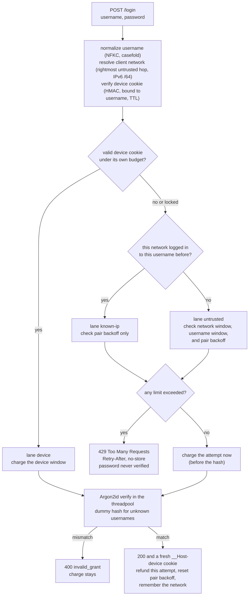

# Defending Auth and Token Endpoints Against Brute Force and Credential Stuffing Without Enabling Account-Lockout Denial of Service

> [!summary] Claim
> Throttle every credential-verifying endpoint on several keys at once (client network, username for untrusted clients, and the username-network pair with exponential backoff), give clients that already proved themselves (a signed device cookie or a network that logged in before) their own lane, charge each attempt before the hash runs, and never verify a password while throttled, so that guessing is bounded per account while the attacker can no longer lock the real user out.

Part of [API Authorization and OWASP Security](README.md) in [API Engineering](../README.md).

## TL;DR

Mechanism: an admission check runs before the password hash and charges the attempt to a per-network failure window, a per-username window that only untrusted clients spend, and a per-(username, network) counter with exponential backoff; a valid device cookie or a previously successful network moves the client into a lane the attacker cannot spend, and success refunds only that attempt's own charge.
Contract rule: the authorization server "MUST protect the endpoint against brute force attacks" (`(RFC 6749 Section 4.3.2)`), NIST caps consecutive failures at 100 per authenticator (`(NIST SP 800-63B-4 Section 3.2.2)`), and every failure looks identical (`400` with `invalid_grant`, or `429` with `Retry-After`) whether or not the account exists.
Trap: a per-account lockout counter is a remote "lock this user" button (`(RFC 6819 Section 5.1.4.2.3)`: "This measure can be abused to lock down legitimate service users"), and the usual fixes leak through `X-Forwarded-For` spoofing, case-variant usernames, check-then-record races, success resets, and a lockout that still answers whether the password was right.
Portability: the throttle is pure Python above HTTP, and the lab passes unchanged on CPython 3.12.13, 3.13.18, 3.14.6, 3.14.10, and 3.15.2 on macOS 27.3 arm64; what varies by server is client-address resolution (Uvicorn 0.54.0 trusts the leftmost `X-Forwarded-For` hop under `forwarded_allow_ips="*"`, Hypercorn 0.18.0 `ProxyFixMiddleware` counts hops without checking the peer, Granian 2.8.7 needs an opt-in wrapper that checks the peer).
When not to use it: throttling only slows online guessing, so it is never a substitute for MFA or phishing-resistant authenticators (Snowflake 2024 and 23andMe 2023 were valid-credential logins without MFA), it does nothing for offline cracking of a stolen hash table, and machine credentials (client secrets, refresh tokens, authorization codes) should be made unguessable (`(RFC 6749 Section 10.10)`: success probability at most `2^(-128)`) rather than throttled.

## Mental model



The request is normalized first, so `Alice`, `ALICE`, and a fullwidth spelling (`U+FF21` then `lice`) spend one budget and a spoofed `X-Forwarded-For` hop cannot mint a fresh network key.
The lane decision is where lockout denial of service is defeated: the attacker has neither the victim's signed device cookie nor the victim's previously successful network, so every attacker request lands in the untrusted lane, and exhausting that lane's per-username window blocks only other untrusted clients.
Admission charges the failure before the slow hash runs, so twenty concurrent guesses cannot all pass the check while the first is still hashing, and a throttled request returns `429` without ever consulting the password, so the lock is not an oracle.
On a match the attempt refunds only its own charge and resets only the backoff of the network that succeeded; the network window and the untrusted-username window keep every other charge.

## How it works

### Three attacks, three shapes, and why no single key sees all of them

OWASP separates three automated attacks that hit the same endpoint (`Credential Stuffing Prevention Cheat Sheet`, Introduction table):

| Attack | What varies | What stays fixed | Key that sees it |
|---|---|---|---|
| Brute force | password | one account | per-username |
| Credential stuffing | username and password, from a breach of another site | the pairs are real | per-network, if the attacker does not rotate addresses |
| Password spraying | username | one weak password | per-network, if the attacker does not rotate addresses |

A per-username counter catches brute force and nothing else, because stuffing and spraying try each account once or twice.
A per-network counter catches stuffing and spraying from one source, and fails the moment the attacker rotates addresses: the cheat sheet notes that toolkits such as Sentry MBA "offer built-in use of proxy networks to distribute requests across a large volume of unique IP addresses", which "may defeat both IP block-lists and rate limiting" (`Credential Stuffing Prevention Cheat Sheet`, IP Mitigation and Intelligence).
Microsoft's account of Midnight Blizzard (published 2024-01-25) is the canonical low-and-slow case: the actor "tailored their password spray attacks to a limited number of accounts, using a low number of attempts to evade detection and avoid account blocks based on the volume of failures", launched them "from a distributed residential proxy infrastructure", and compromised "a legacy, non-production test tenant account that did not have multifactor authentication (MFA) enabled".
No counter defeats a patient distributed spray on its own, which is why the lab layers keys, and why MFA sits above all of them in the security section.

### What the specifications actually require

- OAuth 2.0: for the password grant the authorization server "MUST protect the endpoint against brute force attacks (e.g., using rate-limitation or generating alerts)" (`(RFC 6749 Section 4.3.2)`), and the same MUST applies to any endpoint that authenticates clients with a password (`(RFC 6749 Section 2.3.1)`).
- The current OAuth security BCP says the resource owner password credentials grant "MUST NOT be used" (`(RFC 9700 Section 2.4)`), so passwords should be typed only into the authorization server's own login endpoint, which is exactly the endpoint this note protects; see [[OAuth-2-0-to-OAuth-2-1-and-RFC-9700-Security-BCP]].
- Credential guessing in general: the server "MUST prevent attackers from guessing access tokens, authorization codes, refresh tokens, resource owner passwords, and client credentials", generated tokens must have a guessing probability "less than or equal to 2^(-128)" and should be at most `2^(-160)`, and the server "MUST utilize other means to protect credentials intended for end-user usage" (`(RFC 6749 Section 10.10)`).
  That split is the design rule: make machine credentials unguessable, throttle human ones.
- The OAuth threat model lists account locking, a tar pit, and CAPTCHAs against online guessing (`(RFC 6819 Section 4.4.3.6)`), and attaches the warning to locking: "This measure can be abused to lock down legitimate service users" (`(RFC 6819 Section 5.1.4.2.3)`); its tar pit delays responses with a duration that "may increase with the number of failed attempts" and "may require a more complex and stateful design" (`(RFC 6819 Section 5.1.4.2.4)`).
- NIST SP 800-63B-4 (the page fetched on 2026-11-15 is served with `Last-Modified: Tue, 26 Aug 2025 13:56:12 GMT`): the verifier "SHALL limit consecutive failed authentication attempts using a specific authenticator on a single subscriber account to no more than 100 by disabling that authenticator", the 100 "is an upper bound", and "Additional techniques MAY be used to reduce the likelihood that an attacker will lock the legitimate claimant out", naming bot challenges, waits that increase "e.g., 30 seconds up to an hour", and risk signals such as "the claimant's IP address, geolocation, timing of request patterns, or browser metadata" (`(NIST SP 800-63B-4 Section 3.2.2)`).
  After a successful authentication "the verifier SHOULD disregard any previous failed attempts for the authenticators used" (same section).
- HOTP recommends a throttling parameter or a delay scheme where the server waits `T*A` seconds after failed attempt `A`, and requires that "The delay or lockout schemes MUST be across login sessions to prevent attacks based on multiple parallel guessing techniques" (`(RFC 4226 Section 7.3)`).
- OWASP API2:2023 lists as vulnerable an API that "Permits credential stuffing", "Permits attackers to perform a brute force attack on the same user account, without presenting captcha/account lockout mechanism", and demands that the anti-brute-force mechanism "should be stricter than the regular rate limiting mechanisms on your APIs" and that "Credential recovery/forgot password endpoints should be treated as login endpoints" (`OWASP API Security Top 10 2023, API2:2023 Broken Authentication`, How To Prevent).

### The lockout trap, mechanically

A naive lockout keys a counter on the submitted username and refuses every client once it reaches a threshold.
The attacker needs only the username, which for most APIs is an email address, so five bad passwords from anywhere refuse the real user's correct password for the lockout duration, and repeating the five keeps the account dark indefinitely.
The lab's `NaiveAccountLockout` reproduces it: five guesses from five addresses, then the victim's correct password from home gets `429`, and the verifier ran exactly five times (the victim was never even checked).
This is not hypothetical.
CVE-2026-105624 (published 2026-11-13) describes Zenitel Connect applying "per-account lockout on repeated failed login attempts, which allows remote attackers to cause a denial of service ... repeatable for as long as the attack continues".
CVE-2026-33935 describes MyTube sharing one file-backed attempt counter across three login endpoints, so an attacker can "progressively increase the lockout duration until it reaches 24 hours" and then "maintain the denial of service indefinitely".
CVE-2026-44367 describes Klaw, where "inconsistent handling of username case sensitivity" between registration and login led to "a targeted Denial of Service (DoS) and complete account lockout".
OWASP's own lockout guidance names the fix direction: "care must be taken to prevent it from being used to cause a denial of service by locking out other users' accounts" (`Authentication Cheat Sheet`, Account Lockout).

### The lanes: who is allowed to keep trying

The device-cookie protocol (`OWASP Slow Down Online Guessing Attacks with Device Cookies`, Protocol) issues a signed cookie to every client that authenticates successfully, counts failures per cookie for trusted clients and per user for clients without one, and on overflow locks out "ALL authentication attempts from untrusted clients for this specific user" while trusted clients continue.
The lab implements that as three lanes in `LoginGuard.admit`:

- `device`: a device cookie that verifies (HMAC-SHA256 over a domain-separated, length-prefixed message containing the username, issue time, and nonce, compared with `hmac.compare_digest`) and whose own window holds fewer than `device_max_failures` charges; nothing else is checked.
  A locked cookie "has the same effect as if the client had no device cookie" (OWASP, Notes), which the lab asserts: twelve attempts with one cookie produce ten `device` admissions and then `untrusted` ones.
- `known-ip`: the (username, network) pair logged in successfully within `known_ip_ttl`; only the pair's exponential backoff applies.
  This is the seed's "known IP" property and exists for API clients that do not keep cookies; its downside is that anyone behind the same address (carrier-grade NAT, an office egress) inherits the victim's lane for that account, bounded only by the pair backoff.
- `untrusted`: everyone else, checked against the network window (30 per 600 s), the username window (10 per 3600 s), and the pair backoff.

The per-username untrusted window is the bound that survives a botnet.
OWASP's arithmetic for `N = 10` and `T = 1h` is "240 attempts per day per user or 87600 attempts per user/year regardless of how large the botnet" (`OWASP Slow Down Online Guessing Attacks with Device Cookies`, Threat Analysis), and the lab reproduces the shape: 1,000 distinct addresses guessing once each yield exactly 10 admissions, every refusal is `blocked_by == ("user",)`, the last `retry_after` is 3600 s, and the lane reopens when the clock advances one window.
Meanwhile the real user's cookie still logs in from a new address (`200`), and so does the user's previously successful network without a cookie.
The cost is explicit in the lab: a brand-new laptop without a cookie, on a new network, is refused during the attack, and that user needs the out-of-band path OWASP describes ("allow the use of the forgotten password functionality to log in, even if the account is locked out"; `Authentication Cheat Sheet`, Account Lockout), a step-up challenge, or MFA.

### Charge before you hash

A password check takes tens of milliseconds by design: argon2-cffi 25.1.0 defaults to `RFC_9106_LOW_MEMORY` (`time_cost=3`, `memory_cost=65536` KiB, `parallelism=4`; `(argon2-cffi 25.1.0 src/argon2/profiles.py, get_default_parameters)`), the second recommended option of `(RFC 9106 Section 4)`, and one mismatching `PasswordHasher().verify` took a median of 0.0312 s (min 0.0308 s, max 0.0314 s, 7 runs) on an Apple M3 Pro under CPython 3.14.6 and macOS 27.3.
An async endpoint must not run that on the event loop, so the lab calls `starlette.concurrency.run_in_threadpool`, which awaits `anyio.to_thread.run_sync` (`(starlette 1.10.0 starlette/concurrency.py, run_in_threadpool)`).
The `await` is a yield point, and a limiter written as "check the counter, verify, then record the failure" lets every concurrent request pass the check before the first one records anything.
The lab fires 20 concurrent guesses from one address at one account: `LoginGuard` admits exactly 3 (the free pair budget), refuses 17 with `429`, and the verifier runs 3 times, because `admit` charges the failure inside the same lock acquisition that checked it and `settle_success` refunds it.
The same ordering protects the server: anyio's default thread limiter is `CapacityLimiter(40)` (`(anyio 4.16.0 src/anyio/_backends/_asyncio.py, current_default_thread_limiter)`), so an unthrottled burst can hold 40 concurrent Argon2 computations at 64 MiB each, about 2.5 GiB of hash memory (computed from the two pinned defaults, not measured), while also starving every other threadpool user; see [[Unrestricted-Resource-Consumption-API4-2023-Payload-Depth-and-Limit-Guards]] and [[Async-Def-vs-Def-Endpoints-and-AnyIO-Threadpool-Limiter-Semantics]].

### The lockout oracle

If a throttled request still verifies the password and answers differently when it is correct, the lock is decorative: the attacker keeps guessing at full speed and reads success off the response.
The lab's endpoint returns before touching the hash when `admission.allowed` is false; with the account's untrusted window exhausted, the correct password and a wrong one from new addresses both return `429` with byte-identical bodies, and the verifier call count does not move.

### Enumeration: same bytes, same work

OWASP requires a generic answer "regardless of whether" the user ID or password was wrong, "The account does not exist", or "The account is locked or disabled", and warns that a "quick exit" for unknown users creates a timing discrepancy (`Authentication Cheat Sheet`, Authentication Responses; the weakness is CWE-204, Observable Response Discrepancy, listed under API2:2023).
The lab hashes a random secret with the same `Verifier` at startup and verifies unknown usernames against it, so both failure paths call Argon2 exactly once with the same algorithm and cost parameters (the test compares the first four `$`-separated fields of both hashes), and the two `400` responses have identical status, headers, and bytes.
Throttle keys use the submitted, normalized username whether or not it exists, so a `429` also cannot reveal existence: an attacker can exhaust the window of `nobody@example.test` exactly like a real account.

### Success semantics: what a correct password may reset

- The pair backoff of the network that succeeded is reset, so a user who mistyped three times from home is not slowed after logging in.
- The network window keeps every other charge.
  An attacker who owns one account on the service could otherwise interleave a successful login to it between guesses at other accounts and reset the counter forever; the lab asserts that after 29 failures and a successful login to `mallory` the same address gets one more failure and then `429`.
- The username's untrusted window keeps every other charge too.
  Resetting it when the victim logs in from a trusted device would hand the botnet a fresh window every time the victim uses the service; the lab asserts that after 9 untrusted failures and the victim's success only one more untrusted guess is admitted.
  This is a deliberate reading of `(NIST SP 800-63B-4 Section 3.2.2)`: its SHOULD-reset applies to the consecutive-failure count that disables an authenticator at 100, which a deployment tracks separately, not to a rate window whose purpose is to bound guesses per hour.

### Who is the client: forwarded headers

Every per-network key is only as good as the address it is keyed on.
`Forwarded` (and by extension `X-Forwarded-For`) "cannot be relied upon to be correct, as it may be modified ... by every node on the way to the server, including the client making the request", and trusting known proxies still means "the chain of IP addresses listed before the request came to the proxy cannot be trusted" (`(RFC 7239 Section 8.1)`).
Each proxy appends the address it saw, so the only defensible client is the rightmost hop that is not one of your own proxies, and only when the TCP peer itself is a trusted proxy.
`resolve_client` implements exactly that and the lab asserts it: a direct client's `X-Forwarded-For: 6.6.6.6` is ignored; behind `10.0.0.2` with `6.6.6.6, 198.51.100.7` the client is `198.51.100.7`; a second trusted hop `10.0.0.3` is skipped; and 31 requests through a trusted proxy with a different spoofed leftmost hop each still spend one network budget (30 `400`, then `429`).

The pinned servers and libraries differ:

- Uvicorn 0.54.0 `ProxyHeadersMiddleware` honors `X-Forwarded-For` only when the peer is in `trusted_hosts`, joins repeated lines, and walks the list in reverse returning "the first 'untrusted' host" (`(uvicorn 0.54.0 uvicorn/middleware/proxy_headers.py, _TrustedHosts.get_trusted_client_address)`); the default `forwarded_allow_ips` is `FORWARDED_ALLOW_IPS` or `"127.0.0.1,::1"` (`(uvicorn 0.54.0 uvicorn/config.py, Config.__init__)`).
  With `"*"` the same function returns the leftmost entry, which the client wrote; the lab drives the middleware in-process and gets `6.6.6.6` under `"*"` and `198.51.100.7` under `"127.0.0.1"` for the same header.
- Hypercorn 0.18.0 `ProxyFixMiddleware` takes `values[-trusted_hops]` from the comma-split header without checking whether the peer is a proxy (`(hypercorn 0.18.0 src/hypercorn/middleware/proxy_fix.py, _get_trusted_value)`), so it is correct only when the app is unreachable except through exactly that many proxies (read in source, not exercised in the lab).
- Granian 2.8.7 has no server option for forwarded headers; the ASGI `client` it reports is the TCP peer unless the app is wrapped in `wrap_asgi_with_proxy_headers`, which honors `X-Forwarded-For` only from a peer in `trusted_hosts` (default `127.0.0.1`) and, like Uvicorn, returns the leftmost hop under `"*"` (`(granian 2.8.7 granian/utils/proxies.py, _Forwarders.get_client_host)`; read in source, not exercised in the lab).
- slowapi 0.1.10 `get_ipaddr` returns `request.headers["X_FORWARDED_FOR"]` verbatim when present (`(slowapi 0.1.10 slowapi/util.py, get_ipaddr)`); Starlette looks names up in lowercase, so it matches a header literally named `X_Forwarded_For` (underscores) and never the standard `X-Forwarded-For`, and returns whatever text the client sent.
  The lab asserts both halves; `get_remote_address` uses `request.client.host` and is the safe default.
- Litestar's `RateLimitMiddleware` trusted `X-Forwarded-For` unconditionally in 2.17.0, so "each different spoofed IP creates a separate rate limit bucket" (CVE-2025-59152, fixed in 2.18.0); in 2.25.0 the default `identifier_for_request` is `get_remote_address`, documented as "does *NOT* honour ``X-FORWARDED-FOR`` headers" (`(litestar 2.25.0 litestar/middleware/rate_limit.py, RateLimitConfig)`).

The bucket itself matters as much as its source.
`network_bucket` keys IPv4 per address and IPv6 per `/64`, because a single customer routinely holds a whole `/64` and per-address IPv6 keys hand the attacker `2^64` fresh buckets.
IPv4-mapped IPv6 addresses (`::ffff:198.51.100.7`) are unwrapped first; a naive `/64` of every mapped address is `::/64`, which would merge all IPv4 clients behind a dual-stack listener into one shared bucket and let one sprayer lock out everyone.
Anything unparseable, including a proxy that writes `host:port`, collapses into one `unparseable` bucket rather than becoming a fresh key per string.

### Who is the account: username normalization

The username key is `unicodedata.normalize("NFKC", raw).casefold().strip()`, so `Alice`, ` ALICE `, and `chr(0xFF21) + "lice"` (fullwidth Latin capital A, which NFKC folds to `A`) are one bucket; the lab sends 15 spellings from 15 addresses and gets ten `400` and then `429`.
The normalization must be the same one the account store uses at registration, which is precisely the Klaw failure in CVE-2026-44367.
Passwords are different: NIST says the verifier SHOULD apply Unicode NFC normalization before hashing and "SHALL verify the entire submitted password (e.g., not truncate it)" (`(NIST SP 800-63B-4 Section 3.1.1.2)`); never case-fold a password.

### Backoff arithmetic and the response contract

The pair schedule is `0` for the first `pair_free_failures` (3) failures, then `pair_base_delay * 2**k` capped at `pair_max_delay`; the lab measures the waits `1, 2, 4, 8, 16, 32, 64, 128, 256, 512, 900, 900, 900` seconds, in line with NIST's "30 seconds up to an hour" shape and RFC 4226's `T*A` linear alternative.
`backoff_delay` clamps the exponent at 32 before multiplying, because `1.0 * 2.0**1100` raises `OverflowError` in CPython and a long-running attack would otherwise turn the limiter into a `500`; the lab asserts `backoff_delay(10_000)` is 900.
A refusal is `429 Too Many Requests`, which "indicates that the user has sent too many requests in a given amount of time" and "MAY include a Retry-After header", while the RFC "does not define how the origin server identifies the user, nor how it counts requests", and "Responses with the 429 status code MUST NOT be stored by a cache" (`(RFC 6585 Section 4)`).
`Retry-After` carries `delay-seconds`, "a non-negative decimal integer" (`(RFC 9110 Section 10.2.3)`), so the lab rounds up with `math.ceil` and never sends `0`; NIST's usability guidance asks to "inform users how long they have to wait until the next attempt" (`(NIST SP 800-63B-4 Section 8.1)`).
Machine-readable quota headers are covered in [[Standard-RateLimit-Headers-IETF-Draft-and-429-Retry-After-Semantics]]; on a login endpoint, publishing the remaining guesses mostly helps the attacker pace the spray.
The same NIST section also asks to "Provide clear, meaningful feedback on the number of remaining allowed attempts", so that advice trades against pacing; one reading is to show the count in the human login UI and leave it out of machine-readable headers.
A bad credential is `400` with `{"error": "invalid_grant", ...}`, mirroring the token endpoint's error for invalid "resource owner credentials" (`(RFC 6749 Section 5.2)`), rather than `401`: a server generating `401` "MUST send a WWW-Authenticate header field ... containing at least one challenge applicable to the target resource" (`(RFC 9110 Section 15.5.2)`), and a JSON login body is not an HTTP authentication scheme.
Every response carries `Cache-Control: no-store`, which RFC 6749 requires on "any response containing tokens, credentials, or other sensitive information" (`(RFC 6749 Section 5.1)`).
The success cookie is `__Host-device`, which user agents accept only with `Secure`, `Path=/`, and no `Domain` (`(draft-ietf-httpbis-rfc6265bis-22 Section 4.1.3.2)`), plus `HttpOnly` and `SameSite=strict`; the lab asserts all five.

### State, memory, and more than one process

Each throttle table is an `OrderedDict` LRU bounded by `max_keys`, and each log holds at most its limit plus nothing more, because admission refuses before appending; the lab sprays 5,000 usernames from 5,000 addresses into `max_keys=1000` tables and all three stay at exactly 1,000 keys.
Eviction is a trade-off, not a free lunch: an evicted key forgets its charges, so an attacker who can fill the table faster than entries age out can flush a victim's window; size the table for the expected spray rate times the longest window, and alert on eviction.
In-process state is per worker, so four Uvicorn workers give an attacker four budgets; production stores the same logs in Redis or Valkey with an atomic script ([[GCRA-Generic-Cell-Rate-Algorithm-and-Atomic-Redis-Valkey-Lua-Limiters]]).
Generic limiters are a poor fit for the login path as shipped: `limits` 5.8.0 `MemoryStorage` reads `time.time()`, a wall clock that can step during NTP corrections (`(limits 5.8.0 limits/storage/memory.py, MemoryStorage)`), and its sliding-window counter estimates `previous_count * previous_expires_in / item.get_expiry() + current_count` rather than counting exact failures (`(limits 5.8.0 limits/strategies.py, SlidingWindowCounterRateLimiter._weighted_count)`); the lab uses an injected monotonic clock and exact logs.
Algorithm choice in general lives in [[Rate-Limiting-Algorithms-Token-Bucket-Leaky-Bucket-and-Sliding-Window]] and [[Multi-Tier-Rate-Limiting-Quotas-Concurrency-Limits-and-Cost-Budgets]].

### The other credential endpoints

- Count credential attempts, not HTTP requests: API2:2023 Scenario 1 bypasses a three-per-minute limit by batching many `login` mutations into one GraphQL `POST` ([[GraphQL-Security-Query-Depth-Complexity-Cost-Analysis-and-Batch-Limits]]); the admission call belongs next to the password comparison, not in an HTTP middleware.
- Client secrets on the token endpoint fall under `(RFC 6749 Section 2.3.1)`; make them high-entropy, hashed, and prefer non-password client authentication ([[API-Key-Engineering-Prefixed-Entropy-Hashed-Storage-and-Zero-Downtime-Rotation]], [[Password-and-Client-Secret-Hashing-with-Argon2id-and-Pwdlib]]).
- One-time codes: for out-of-band secrets shorter than 64 bits NIST requires the same Section 3.2.2 rate limiting and states that "Generating a new authentication secret SHALL NOT reset the failed authentication count" (`(NIST SP 800-63B-4 Section 3.1.3)`, Out-of-Band Verifiers), so "resend code" must not be a reset button; a TOTP verifier should allow "at most one time step" of network delay with a 30-second default step (`(RFC 6238 Section 5.2)`), and each extra accepted step multiplies an attacker's per-guess success.
- Device-flow user codes: RFC 8628 recommends rate-limiting user-code attempts and computes that an 8-character base-20 code (about 34.5 bits) needs the "rate-limiting interval and validity period" to "only allow 5 attempts" for a `2^-32` success probability (`(RFC 8628 Section 5.1)`).
- Password reset and recovery codes are credential endpoints too (API2:2023 How To Prevent; NIST says saved recovery codes "SHALL be subject to the throttling requirements in Sec. 3.2.2").

## Numbers and limits

| Quantity | Value | Source or measurement |
|---|---|---|
| NIST consecutive-failure cap per authenticator | at most 100, then disable and rebind | `(NIST SP 800-63B-4 Section 3.2.2)`, page `Last-Modified` 2025-08-26 (as of 2026-11) |
| Success chance of 100 guesses at a 6-digit OTP | `100 / 10^6 = 10^-4` | computed from the NIST rationale in Section 3.2.2 |
| NIST suggested increasing wait | "30 seconds up to an hour" | `(NIST SP 800-63B-4 Section 3.2.2)` |
| NIST single-factor password minimum length | 15 characters; 8 if only used with MFA; allow at least 64 | `(NIST SP 800-63B-4 Section 3.1.1.2)` |
| Guessing probability for generated tokens | MUST be `<= 2^(-128)`, SHOULD be `<= 2^(-160)` | `(RFC 6749 Section 10.10)` |
| Device-flow user code example | 8 chars base 20, about 34.5 bits, 5 attempts for `2^-32` | `(RFC 8628 Section 5.1)` |
| TOTP step and skew | 30 s default, at most one step of delay | `(RFC 6238 Section 5.2)` |
| HOTP delay scheme | wait `T*A` s after failure `A` (e.g. `T = 5`: 5 s, 10 s, ...) | `(RFC 4226 Section 7.3)` |
| Device-cookie bound, `N = 10`, `T = 1 h` | 240 guesses per user per day, 87,600 per year, independent of botnet size | OWASP device-cookie page, Threat Analysis |
| Lab untrusted username window | 10 per 3600 s: 1,000 addresses x 1 guess -> 10 admitted | lab test, CPython 3.14.6, macOS 27.3 arm64 |
| Lab pair backoff | free 3, then 1, 2, 4, ..., 512, 900 s cap; at the cap 96 guesses per (user, network) per day | lab test (schedule); 86,400 / 900 computed |
| Lab network window | 30 per 600 s, at most 4,320 failures per network per day | policy value; daily figure computed |
| Concurrent burst, 20 guesses, one address | 3 admitted, 17 `429`, 3 hashes | lab test |
| argon2-cffi 25.1.0 default parameters | Argon2id, `t=3`, `m=65536` KiB (64 MiB), `p=4`, 16-byte salt, 32-byte tag | `(argon2-cffi 25.1.0 src/argon2/profiles.py, RFC_9106_LOW_MEMORY)`, `(RFC 9106 Section 4)` |
| One default `verify` (mismatch) | median 0.0312 s, min 0.0308 s, max 0.0314 s over 7 runs; process max RSS 84.5 MiB | probe, `uv run --frozen python` timing `PasswordHasher().verify` with `time.perf_counter`, CPython 3.14.6, Apple M3 Pro (12 cores), macOS 27.3, re-measured 2026-11-15 |
| anyio default worker threads | 40 (`CapacityLimiter(40)`) -> up to 40 x 64 MiB = 2.5 GiB of concurrent hash memory | `(anyio 4.16.0 src/anyio/_backends/_asyncio.py, current_default_thread_limiter)`; product computed |
| Microsoft MFA estimate quoted by OWASP | "99.9% of account compromises" stopped by MFA | quoted in the OWASP Credential Stuffing cheat sheet; not independently verified here |
| Snowflake / UNC5537 (2024) | about 165 organizations notified; at least 79.7% of accounts had prior credential exposure; oldest infostealer infection November 2020 | Mandiant, published 2024-06-10 |
| 23andMe (2023) | credential stuffing April to September 2023; 155,592 UK residents affected; UK fine GBP 2.31 million | ICO, published 2025-06-17 |
| Lab suite | 23 tests, all `unit`; `23 passed in 0.81s` | `uv run --frozen pytest <lab> -q`, CPython 3.14.6, macOS 27.3 arm64, 2026-11-15 |

## Portability

Every CPython leg ran `uv run --frozen --python <interpreter> pytest <lab> -q -p no:cacheprovider` from `labs/` with its own `UV_PROJECT_ENVIRONMENT` on 2026-11-15 (macOS 27.3 arm64), except the workspace leg, which ran the gate command `uv run --frozen pytest <lab> -q`; `<lab>` is the path on the `- Lab:` line.
The independent fact-check on 2026-11-15 re-ran only the workspace leg; the other legs are the drafter's runs and were not re-executed, because matrix runs were paused on 2026-11-11.

| Leg | Result | Evidence |
|---|---|---|
| CPython 3.12.13 (uv-managed) | 23 passed | lab run; 3.12.16 was not available to `uv 0.11.26` here, so the matrix's 3.12.16 point release is not proven |
| CPython 3.13.18 (Homebrew) | 23 passed | lab run |
| CPython 3.14.6 (workspace `.python-version`) | 23 passed in 0.81 s | lab run, gate command, re-run by the fact-check |
| CPython 3.14.10 (Homebrew) | 23 passed | lab run |
| CPython 3.15.2 (Homebrew) | 23 passed | lab run |
| CPython 3.15.2t free-threaded | not run | `uv run --frozen` on the available `3.15.0b3+freethreaded` stops because `psycopg-binary==3.3.8` has no free-threaded wheel; the guard serializes `admit` and `settle_success` with one `threading.Lock`, so it does not rely on the GIL, but no free-threaded run backs that here |
| CPython 3.15.0b3 (uv-managed) | collection error | `ModuleNotFoundError: No module named 'hypothesis._native'` while loading the pinned `hypothesis` plugin; an environment failure on a beta, not a lab failure |
| `argon2-cffi` 25.1.0 | default profile `RFC_9106_LOW_MEMORY` | `(argon2-cffi 25.1.0 src/argon2/_password_hasher.py, PasswordHasher)`, whose docstring records `versionchanged:: 21.2.0` "Changed defaults to" `RFC_9106_LOW_MEMORY` |
| Uvicorn 0.54.0 | client address rewritten only from trusted peers; `"*"` trusts the leftmost hop | lab test drives `ProxyHeadersMiddleware` in-process; `(uvicorn 0.54.0 uvicorn/middleware/proxy_headers.py, _TrustedHosts.get_trusted_client_address)` |
| Hypercorn 0.18.0 | `ProxyFixMiddleware` picks `values[-trusted_hops]` and does not check the peer | source read only; `(hypercorn 0.18.0 src/hypercorn/middleware/proxy_fix.py, _get_trusted_value)` |
| Granian 2.8.7 | no CLI option and no built-in forwarded-header handling; `wrap_asgi_with_proxy_headers(app, trusted_hosts='127.0.0.1')` is opt-in, checks the peer, and walks `X-Forwarded-For` in reverse (leftmost hop only under `"*"`) | source read only, not exercised in the lab; `(granian 2.8.7 granian/utils/proxies.py, wrap_asgi_with_proxy_headers and _Forwarders.get_client_host)`; the `granian/cli.py` options contain no proxy or trusted-host flag, and the project README says it "doesn't provide any option to configure its behaviour around them" |
| slowapi 0.1.10 | `get_ipaddr` returns an underscore-named header verbatim; `get_remote_address` uses the peer | lab test |
| Litestar 2.17.0 vs 2.25.0 | 2.17.0 keyed limits on `X-Forwarded-For` (CVE-2025-59152); 2.25.0 defaults to the peer address | NVD record; `(litestar 2.25.0 litestar/middleware/rate_limit.py, get_remote_address)` |
| HTTP/1.1, HTTP/2, HTTP/3 | identical: the throttle reads the ASGI `client` tuple, headers, and cookies, which every protocol delivers the same way to ASGI | by construction; not exercised over sockets in this lab |

## Worked example

The [implementation](../labs/src/api_labs/f15_api_authorization_and_owasp_security/login_throttle.py) holds the normalization and client-resolution helpers, `LoginGuard` with its three lanes, the `NaiveAccountLockout` anti-pattern, the device-cookie codec, an Argon2id verifier, and the FastAPI `create_app` factory; the [test](../labs/tests/f15_api_authorization_and_owasp_security/test_credential_stuffing_brute_force_defense_and_account_lockout_traps.py) drives it all in-process with `httpx.ASGITransport`, a fake clock, a different `client=(ip, port)` per simulated attacker, and a counting Argon2id verifier with lab-sized parameters (`time_cost=1`, `memory_cost=64` KiB, `parallelism=1`; never use those in production).

Full source of the implementation, byte-identical to the lab file:

```python
"""Login throttling that stops online guessing without handing attackers a lockout switch.

Three lanes decide whether a login attempt may reach the password hash:

- ``device``: a valid, unlocked device cookie for this username (OWASP device-cookie protocol);
  only that cookie's own failure budget applies.
- ``known-ip``: the client network already logged in to this username; only the
  per-(username, network) exponential backoff applies.
- ``untrusted``: everything else; the per-network failure budget, the per-username
  untrusted-client budget, and the per-(username, network) backoff all apply.

Every admitted attempt is charged as a failure *before* the password is verified and refunded
on success, so a concurrent burst cannot slip past the counters while the hash is computing.
"""

from __future__ import annotations

import hashlib
import hmac
import ipaddress
import itertools
import math
import secrets
import threading
import unicodedata
from collections import OrderedDict
from dataclasses import dataclass
from typing import TYPE_CHECKING, Literal, Protocol

from argon2.exceptions import InvalidHashError, VerificationError
from fastapi import FastAPI, Request, Response
from fastapi.responses import JSONResponse
from pydantic import BaseModel, Field
from starlette.concurrency import run_in_threadpool

if TYPE_CHECKING:
    from collections.abc import Callable, Mapping, Sequence

    from argon2 import PasswordHasher

DEVICE_COOKIE = "__Host-device"
UNPARSEABLE = "unparseable"
INVALID_CREDENTIALS = {
    "error": "invalid_grant",
    "error_description": "invalid username or password",
}
TOO_MANY_ATTEMPTS = {"error": "too_many_attempts"}

type Lane = Literal["device", "known-ip", "untrusted"]
type Network = ipaddress.IPv4Network | ipaddress.IPv6Network
type Log = list[tuple[float, int]]  # (charged at, attempt id), oldest first


@dataclass(frozen=True, slots=True)
class ThrottlePolicy:
    ip_max_failures: int = 30  # per client network, all usernames
    ip_window: float = 600.0
    user_max_failures: int = 10  # per username, untrusted clients only (N per T)
    user_window: float = 3600.0
    pair_free_failures: int = 3  # per (username, network) before backoff starts
    pair_base_delay: float = 1.0
    pair_max_delay: float = 900.0
    pair_ttl: float = 86_400.0
    device_max_failures: int = 10
    device_window: float = 3600.0
    known_ip_ttl: float = 30 * 86_400.0
    max_keys: int = 100_000  # per table; bounds memory under username spraying


@dataclass(frozen=True, slots=True)
class Admission:
    allowed: bool
    retry_after: float
    lane: Lane
    blocked_by: tuple[str, ...]
    attempt_id: int
    user: str
    client: str
    device: str | None


class Throttle(Protocol):
    def admit(self, user: str, client: str, device: str | None) -> Admission: ...
    def settle_failure(self, admission: Admission) -> None: ...
    def settle_success(self, admission: Admission) -> None: ...


def normalize_username(raw: str) -> str:
    """NFKC then casefold, so look-alike spellings share one throttle bucket."""
    return unicodedata.normalize("NFKC", raw).casefold().strip()


def network_bucket(host: str) -> str:
    """IPv4 per address, IPv6 per /64, IPv4-mapped IPv6 as the IPv4 address it carries."""
    try:
        ip = ipaddress.ip_address(host)
    except ValueError:
        return UNPARSEABLE
    if isinstance(ip, ipaddress.IPv6Address):
        if ip.ipv4_mapped is not None:
            return str(ip.ipv4_mapped)
        return str(ipaddress.IPv6Network((int(ip) >> 64 << 64, 64)))
    return str(ip)


def _trusted(host: str, proxies: Sequence[Network]) -> bool:
    try:
        ip = ipaddress.ip_address(host)
    except ValueError:
        return False
    return any(ip in net for net in proxies)


def resolve_client(
    peer: str | None, forwarded_for: Sequence[str], proxies: Sequence[Network]
) -> str:
    """Rightmost untrusted hop: each trusted proxy appends the address it saw on the right."""
    hops = [hop.strip() for value in forwarded_for for hop in value.split(",")]
    chain = [*hops, peer or ""]
    if not _trusted(chain[-1], proxies):
        return network_bucket(chain[-1])  # direct client: X-Forwarded-For is attacker text
    for hop in reversed(chain):
        if not _trusted(hop, proxies):
            return network_bucket(hop)
    return network_bucket(chain[0])  # every hop is ours: the request came from inside


def backoff_delay(failures: int, policy: ThrottlePolicy) -> float:
    """0 for the free failures, then base * 2**k capped; k is clamped so floats never overflow."""
    if failures < policy.pair_free_failures:
        return 0.0
    exponent = min(failures - policy.pair_free_failures, 32)
    return min(policy.pair_base_delay * 2.0**exponent, policy.pair_max_delay)


class _LruTable[V]:
    """Size-bounded map; evicting the least recently used key forgets its counters."""

    def __init__(self, max_keys: int) -> None:
        self._data: OrderedDict[str, V] = OrderedDict()
        self._max_keys = max_keys

    def get(self, key: str) -> V | None:
        value = self._data.get(key)
        if value is not None:
            self._data.move_to_end(key)
        return value

    def put(self, key: str, value: V) -> None:
        self._data[key] = value
        self._data.move_to_end(key)
        while len(self._data) > self._max_keys:
            self._data.popitem(last=False)

    def pop(self, key: str) -> None:
        self._data.pop(key, None)

    def __len__(self) -> int:
        return len(self._data)


class LoginGuard:
    """Charge-then-verify throttle with device, known-network, and untrusted lanes."""

    def __init__(self, policy: ThrottlePolicy, clock: Callable[[], float]) -> None:
        self.policy = policy
        self._clock = clock
        self._lock = threading.Lock()
        self._ids = itertools.count(1)
        self.ips: _LruTable[Log] = _LruTable(policy.max_keys)
        self.users: _LruTable[Log] = _LruTable(policy.max_keys)
        self.devices: _LruTable[Log] = _LruTable(policy.max_keys)
        self.pairs: _LruTable[tuple[int, float]] = _LruTable(policy.max_keys)
        self.known: _LruTable[float] = _LruTable(policy.max_keys)

    @staticmethod
    def _live(table: _LruTable[Log], key: str, now: float, window: float) -> Log:
        return [entry for entry in table.get(key) or [] if entry[0] > now - window]

    def admit(self, user: str, client: str, device: str | None) -> Admission:
        p = self.policy
        with self._lock:
            now = self._clock()
            attempt = next(self._ids)
            if device is not None:
                log = self._live(self.devices, device, now, p.device_window)
                if len(log) < p.device_max_failures:
                    self.devices.put(device, [*log, (now, attempt)])
                    return Admission(True, 0.0, "device", (), attempt, user, client, device)
                # A locked device cookie counts as no cookie at all.
            pair_key = f"{user}\x00{client}"
            known_until = self.known.get(pair_key)
            is_known = known_until is not None and known_until > now
            lane: Lane = "known-ip" if is_known else "untrusted"
            count, last = self.pairs.get(pair_key) or (0, -math.inf)
            if now - last > p.pair_ttl:
                count = 0
            waits: dict[str, float] = {}
            pair_wait = last + backoff_delay(count, p) - now
            if count >= p.pair_free_failures and pair_wait > 0:
                waits["pair"] = pair_wait
            ip_log = self._live(self.ips, client, now, p.ip_window)
            user_log = self._live(self.users, user, now, p.user_window)
            if lane == "untrusted":
                if len(ip_log) >= p.ip_max_failures:
                    waits["ip"] = ip_log[0][0] + p.ip_window - now
                if len(user_log) >= p.user_max_failures:
                    waits["user"] = user_log[0][0] + p.user_window - now
            if waits:
                blocked = tuple(sorted(waits))
                return Admission(
                    False, max(waits.values()), lane, blocked, attempt, user, client, None
                )
            self.pairs.put(pair_key, (count + 1, now))
            if lane == "untrusted":
                self.ips.put(client, [*ip_log, (now, attempt)])
                self.users.put(user, [*user_log, (now, attempt)])
            return Admission(True, 0.0, lane, (), attempt, user, client, None)

    def settle_failure(self, admission: Admission) -> None:
        """Nothing to do: the failure was charged when the attempt was admitted."""

    def settle_success(self, admission: Admission) -> None:
        """Refund only this attempt's own charges; reset the backoff of the client that succeeded.

        The network and untrusted-account windows keep every *other* charge: logging in to an
        account you own must not reset the budget you are spending on someone else's account,
        and the victim's own login must not hand a botnet a fresh window.
        """
        with self._lock:
            now = self._clock()
            pair_key = f"{admission.user}\x00{admission.client}"
            self.pairs.pop(pair_key)
            if admission.device is not None:
                self.devices.pop(admission.device)
            for table, key in ((self.ips, admission.client), (self.users, admission.user)):
                log = table.get(key)
                if log is not None:
                    table.put(key, [e for e in log if e[1] != admission.attempt_id])
            self.known.put(pair_key, now + self.policy.known_ip_ttl)


class NaiveAccountLockout:
    """The anti-pattern: N failures for a username lock it for every client."""

    def __init__(self, clock: Callable[[], float], max_failures: int = 5, lockout: float = 900.0):
        self._clock = clock
        self._max_failures = max_failures
        self._lockout = lockout
        self._ids = itertools.count(1)
        self.failures: dict[str, int] = {}
        self.locked_until: dict[str, float] = {}

    def admit(self, user: str, client: str, device: str | None) -> Admission:
        wait = self.locked_until.get(user, 0.0) - self._clock()
        blocked = ("account",) if wait > 0 else ()
        return Admission(
            not blocked, max(wait, 0.0), "untrusted", blocked, next(self._ids), user, client, None
        )

    def settle_failure(self, admission: Admission) -> None:
        count = self.failures.get(admission.user, 0) + 1
        self.failures[admission.user] = count
        if count >= self._max_failures:
            self.locked_until[admission.user] = self._clock() + self._lockout
            self.failures[admission.user] = 0

    def settle_success(self, admission: Admission) -> None:
        self.failures.pop(admission.user, None)


def _cookie_mac(secret: bytes, user: str, issued: int, nonce: str) -> str:
    message = f"device-cookie-v1|{len(user)}|{user}|{issued}|{nonce}".encode()
    return hmac.new(secret, message, hashlib.sha256).hexdigest()


def issue_device_cookie(user: str, secret: bytes, *, now: float) -> str:
    issued, nonce = int(now), secrets.token_urlsafe(16)
    return f"{issued}.{nonce}.{_cookie_mac(secret, user, issued, nonce)}"


def verify_device_cookie(
    value: str | None, user: str, secret: bytes, *, now: float, ttl: float
) -> str | None:
    """Return the cookie's nonce if it was issued by us, to this username, within *ttl*."""
    if value is None or value.count(".") != 2:
        return None
    issued_text, nonce, mac = value.split(".")
    if not issued_text.isdigit() or len(issued_text) > 12 or not 0 <= now - int(issued_text) <= ttl:
        return None
    if not hmac.compare_digest(mac, _cookie_mac(secret, user, int(issued_text), nonce)):
        return None
    return nonce


class Verifier(Protocol):
    def hash(self, password: str) -> str: ...
    def verify(self, stored_hash: str, password: str) -> bool: ...


class Argon2Verifier:
    """argon2-cffi behind a boolean interface; a mismatch and a corrupt hash are both False."""

    def __init__(self, hasher: PasswordHasher) -> None:
        self.hasher = hasher

    def hash(self, password: str) -> str:
        return self.hasher.hash(password)

    def verify(self, stored_hash: str, password: str) -> bool:
        try:
            return self.hasher.verify(stored_hash, password)
        except (VerificationError, InvalidHashError):
            return False


class LoginRequest(BaseModel):
    username: str = Field(min_length=1, max_length=254)
    password: str = Field(min_length=1, max_length=1024)


def create_app(
    *,
    throttle: Throttle,
    users: Mapping[str, str],
    verifier: Verifier,
    device_secret: bytes,
    wall_clock: Callable[[], float],
    trusted_proxies: Sequence[str] = (),
    device_ttl: float = 365 * 86_400.0,
) -> FastAPI:
    """``users`` maps normalized usernames to password hashes made by ``verifier``."""
    proxies: tuple[Network, ...] = tuple(ipaddress.ip_network(net) for net in trusted_proxies)
    dummy_hash = verifier.hash(secrets.token_urlsafe(32))  # same parameters as real hashes
    app = FastAPI()

    @app.post("/login")
    async def login(body: LoginRequest, request: Request) -> Response:
        user = normalize_username(body.username)
        peer = request.client.host if request.client else None
        client = resolve_client(peer, request.headers.getlist("x-forwarded-for"), proxies)
        cookie = request.cookies.get(DEVICE_COOKIE)
        device = verify_device_cookie(cookie, user, device_secret, now=wall_clock(), ttl=device_ttl)
        admission = throttle.admit(user, client, device)
        if not admission.allowed:
            retry = str(max(1, math.ceil(admission.retry_after)))
            headers = {"Retry-After": retry, "Cache-Control": "no-store"}
            return JSONResponse(TOO_MANY_ATTEMPTS, status_code=429, headers=headers)
        stored = users.get(user)
        matched = await run_in_threadpool(verifier.verify, stored or dummy_hash, body.password)
        if stored is None or not matched:
            throttle.settle_failure(admission)
            return JSONResponse(
                INVALID_CREDENTIALS, status_code=400, headers={"Cache-Control": "no-store"}
            )
        throttle.settle_success(admission)
        response = JSONResponse({"authenticated": True}, headers={"Cache-Control": "no-store"})
        response.set_cookie(
            DEVICE_COOKIE,
            issue_device_cookie(user, device_secret, now=wall_clock()),
            max_age=int(device_ttl),
            path="/",
            secure=True,
            httponly=True,
            samesite="strict",
        )
        return response

    return app
```

Simplified excerpt of the test (the functions are copied verbatim; the `Lab` harness, `botnet` helper, and imports are omitted):

```python
@pytest.mark.unit
@pytest.mark.asyncio
async def test_naive_lockout_hands_the_attacker_a_denial_of_service() -> None:
    lab = Lab(naive=True)
    for ip in botnet(5):
        assert (await lab.login("alice", "guess", ip)).status_code == 400
    victim = await lab.login("alice", ALICE_PASSWORD, ALICE_HOME)
    assert victim.status_code == 429  # the right password, refused: the attacker owns the lock
    assert len(lab.verifier.calls) == 5


@pytest.mark.unit
@pytest.mark.asyncio
async def test_trusted_device_logs_in_during_a_distributed_attack() -> None:
    lab = Lab()
    first = await lab.login("alice", ALICE_PASSWORD, ALICE_HOME)
    assert first.status_code == 200
    cookie = device_value(first)
    statuses = [(await lab.login("alice", "guess", ip)).status_code for ip in botnet(25)]
    assert statuses == [400] * 10 + [429] * 15
    on_the_road = await lab.login("alice", ALICE_PASSWORD, "192.0.2.50", cookie=cookie)
    assert on_the_road.status_code == 200
    new_laptop = await lab.login("alice", ALICE_PASSWORD, "192.0.2.51")
    assert new_laptop.status_code == 429  # untrusted clients stay locked for this account


@pytest.mark.unit
@pytest.mark.asyncio
async def test_logging_in_to_your_own_account_does_not_reset_the_network_budget() -> None:
    lab = Lab()
    attacker = "203.0.113.9"
    for i in range(29):
        assert (await lab.login(f"victim{i}", "guess", attacker)).status_code == 400
    assert (await lab.login("mallory", MALLORY_PASSWORD, attacker)).status_code == 200
    assert (await lab.login("victim29", "guess", attacker)).status_code == 400
    assert (await lab.login("victim30", "guess", attacker)).status_code == 429


@pytest.mark.unit
@pytest.mark.asyncio
async def test_a_concurrent_burst_cannot_outrun_the_counter() -> None:
    lab = Lab()
    burst = [lab.login("alice", f"guess{i}", "203.0.113.9") for i in range(20)]
    statuses = sorted(r.status_code for r in await asyncio.gather(*burst))
    assert statuses == [400] * 3 + [429] * 17
    assert len(lab.verifier.calls) == 3


@pytest.mark.unit
@pytest.mark.asyncio
async def test_uvicorn_proxy_headers_with_star_trusts_the_leftmost_spoofed_hop() -> None:
    async def echo_client(scope: Scope, receive: Receive, send: Send) -> None:
        host = scope["client"][0].encode()
        await send({"type": "http.response.start", "status": 200, "headers": []})
        await send({"type": "http.response.body", "body": host})

    seen: dict[str, str] = {}
    for trusted in ("*", "127.0.0.1"):
        middleware = ProxyHeadersMiddleware(echo_client, trusted_hosts=trusted)  # type: ignore[arg-type]
        app = cast("ASGIApp", middleware)
        transport = httpx.ASGITransport(app=app, client=("127.0.0.1", 40000))
        async with httpx.AsyncClient(transport=transport, base_url="http://test") as client:
            response = await client.get("/", headers={"X-Forwarded-For": "6.6.6.6, 198.51.100.7"})
        seen[trusted] = response.text
    assert seen == {"*": "6.6.6.6", "127.0.0.1": "198.51.100.7"}
```

Captured run, CPython 3.14.6 on macOS 27.3 arm64 (Apple M3 Pro), 2026-11-15, from `labs/`:

```text
$ uv run --frozen pytest tests/f15_api_authorization_and_owasp_security/test_credential_stuffing_brute_force_defense_and_account_lockout_traps.py -q
.......................                                                  [100%]
23 passed in 0.81s
```

The first draft of `settle_success` reset the username's untrusted window on any success, following the NIST SHOULD literally; the device-cookie test then failed (`assert 200 == 429` for the cookie-less laptop), because the victim's own login had reopened the botnet's window, which is why the success semantics above refund only the attempt's own charge.

## Pitfalls

> [!warning] Per-account lockout as a remote off switch
> - **Trigger**: a counter keyed on the username that refuses every client after N failures (CVE-2026-105624 Zenitel Connect), or worse, one counter shared by every account and login endpoint (CVE-2026-33935 MyTube, escalating to 24 hours and then held indefinitely).
> - **Symptom**: the real user's correct password is refused; support tickets spike during spraying campaigns.
> - **Fix**: lock only the untrusted lane for that account and give device-cookie and known-network clients their own budgets; the lab's naive and guarded variants show both outcomes.

> [!warning] Trusting client-supplied forwarding headers
> - **Trigger**: keying limits on `X-Forwarded-For` without checking that the peer is your proxy, or taking its leftmost entry (CVE-2025-59152 Litestar 2.17.0, CVE-2020-35590 WordPress Limit Login Attempts Reloaded, CVE-2026-111934 Coder); Uvicorn with `--forwarded-allow-ips='*'` behaves the same way.
> - **Symptom**: per-address limits never trigger; logs show a different source address on every attempt.
> - **Fix**: rightmost untrusted hop, and only from trusted peers (`(RFC 7239 Section 8.1)`); the lab spends one budget across 31 spoofed hops.

> [!warning] Counter keyed on the raw username
> - **Trigger**: login compares usernames case-insensitively but the throttle keys on the submitted string, or registration and login normalize differently (CVE-2026-44367 Klaw).
> - **Symptom**: `alice`, `Alice`, and `ALICE` each get a full budget, or one spelling locks another.
> - **Fix**: one normalization function (`NFKC` plus `casefold`) for the store and the throttle.

> [!warning] Check, then hash, then record
> - **Trigger**: an async endpoint awaits the password hash in a thread between reading the counter and incrementing it.
> - **Symptom**: a burst of concurrent requests all pass the limit; the lab's 20-request burst would hash 20 times instead of 3.
> - **Fix**: charge at admission under one lock and refund on success.

> [!warning] Success resets the wrong counter
> - **Trigger**: a successful login clears the per-address or per-account window.
> - **Symptom**: an attacker who owns any account resets the per-address counter between guesses; the victim's routine logins reopen the botnet's window.
> - **Fix**: refund only the attempt's own charge and reset only the pair backoff; track the NIST consecutive-failure count separately.

> [!warning] The lock still answers
> - **Trigger**: a throttled request verifies the password and returns `200` if it happens to be right, or a different error for right and wrong.
> - **Symptom**: guessing continues at full speed behind the "lockout".
> - **Fix**: return `429` before the hash; the lab asserts byte-identical bodies and an unchanged hash count.

> [!warning] Quick exit for unknown users
> - **Trigger**: return immediately when the username is not found, or hash it with cheaper parameters.
> - **Symptom**: a 30 ms difference per request (the default Argon2id cost measured here) enumerates valid accounts for a later spray (CWE-204).
> - **Fix**: verify against a dummy hash made by the same hasher; return the same status, headers, and body.

> [!warning] IPv6 and dual-stack bucketing
> - **Trigger**: per-address IPv6 keys, or a `/64` mask applied to IPv4-mapped addresses.
> - **Symptom**: an attacker with one `/64` has `2^64` buckets, or every IPv4 client shares the `::/64` bucket and one sprayer locks out all of them.
> - **Fix**: `/64` for native IPv6, unwrap `::ffff:a.b.c.d` first, collapse unparseable values into one bucket.

> [!warning] Limiting HTTP requests instead of credential checks
> - **Trigger**: a gateway limit of N requests per minute in front of an endpoint that accepts batched operations.
> - **Symptom**: API2:2023 Scenario 1, many `login` mutations per GraphQL request.
> - **Fix**: call the admission check once per credential verification inside the resolver or service.

## Security and robustness

- **Threat model**: the attacker controls the request bytes, any number of source addresses (residential proxies, cloud ranges, IPv6 `/64`s), knows or can guess usernames (emails), holds breach corpora, and can run many concurrent connections; the attacker does not hold the victim's device cookie key, the victim's network, or a second factor.
  Guesses per account per day are bounded by the untrusted window (`240` at the lab policy) plus the pair backoff from any network the attacker shares with the victim.
- **MFA dominates**: Mandiant attributes the Snowflake compromises to accounts "not configured with multi-factor authentication enabled, meaning successful authentication only required a valid username and password", credentials "still valid, in some cases years after they were stolen", and instances without "network allow lists"; the ICO fined 23andMe for failing to implement "appropriate authentication and verification measures, such as mandatory multi-factor authentication".
  Valid stolen credentials pass every throttle in this note on the first try; only a second factor, a breached-password check, or anomaly detection stops them.
- **Breached and common passwords**: NIST requires comparing new passwords against "a blocklist that contains known commonly used, expected, or compromised passwords", and says such lists need only be large enough to cover what attackers "are likely to guess before reaching the attempt limit" (`(NIST SP 800-63B-4 Section 3.1.1.2)`), which ties the blocklist size to the throttle policy.
- **Step-up instead of refusal**: the OWASP cheat sheet recommends requiring MFA or a CAPTCHA only for suspicious attempts (new device or IP, an IP that tried many accounts, scripted traffic), and NIST lists bot challenges among the techniques that avoid locking the claimant out; bot defenses are in [[Protecting-Sensitive-Business-Flows-API6-2023-Anti-Automation-and-Bot-Defense]].
- **Device cookie hygiene**: sign with a key separate from session keys and domain-separate the MAC input (OWASP warns against confusing device cookies with other tokens), bind it to the username, expire it, reissue on every success, and protect it like a session cookie ([[CSRF-in-Cookie-Authenticated-APIs-SameSite-Double-Submit-and-Fetch-Metadata]], [[OAuth-2-0-for-Browser-Based-Applications-BFF-and-Cookies-RFC-10017]]); NIST says browser cookies do not satisfy the physical-authenticator requirements "except as short-term secrets for session maintenance" (NIST SP 800-63B-4, Physical Authenticators), so the cookie only changes which throttle applies and never counts as a factor.
- **Observability**: OWASP asks that each defense "generate volume metrics" for detected and mitigated attacks; export counts of admissions and refusals by lane and `blocked_by`, the global failure ratio, and LRU evictions, and never log submitted passwords or full usernames in plaintext ([[Structured-Log-Redaction-and-Preventing-PII-and-Token-Leaks]]).
- **User notification**: OWASP suggests notifying the user when the correct password was followed by a failed MFA check rather than on every failed attempt, and showing recent logins and sessions.
- **Resource consumption**: refusing before the hash caps CPU and memory per attacker; also cap password length at the schema (`max_length=1024` in the lab) and the threadpool size, and remember that per-worker state multiplies budgets ([[OWASP-API-Security-Top-10-2023-Complete-Threat-Model]]).
- **Where the check lives**: client-address resolution belongs at the edge ([[Forwarded-Header-RFC-7239-and-X-Forwarded-For-Spoofing]]), while the admission call sits next to the credential comparison in the identity service ([[Where-Authorization-Lives-Gateway-Middleware-vs-Domain-and-Query-Layer]], [[API-Authentication-Architecture-Edge-Verification-vs-Zero-Trust-Propagation]]).

## The principal's view

The decision is not "lockout or no lockout" but which population the throttle is allowed to inconvenience during an attack, and who owns the fallback path for them.
A per-account lockout puts that cost on the victim and lets any anonymous client trigger it; a per-address limit puts it on whoever shares an address with the attacker and does nothing against residential proxies; the lane design puts it on one narrow group, the real user on a new device and a new network during an active attack on their account, and that group needs a designed recovery path (an emailed sign-in link, MFA step-up, support) that is itself throttled.
The organizational trade-off is state: an exact, multi-key, charge-and-refund throttle needs a shared low-latency store with atomic scripts and an owner, and it must be the same code on every credential endpoint (web login, mobile token exchange, password reset, OTP, device-code entry, client secrets), which in practice means one identity service rather than per-team middleware.
The staff-level move is to treat the throttle as a backstop and spend the real effort on removing guessable credentials: passkeys or other phishing-resistant authenticators for users, mandatory MFA at least for administrators (the OWASP cheat sheet's minimum), high-entropy machine credentials and sender-constrained tokens for services ([[Sender-Constrained-Tokens-DPoP-RFC-9449-and-mTLS-Binding-RFC-8705]]), and a breached-password check at enrollment.
Choose a managed identity provider when the team cannot staff the store, metrics, and recovery flows; choose a WAF or bot-management product for distributed sprays only as an additional layer, because it sees requests, not credential checks, and cannot apply the device-cookie lane.

## Interview questions

> [!question] L5: Why is locking an account after five failed logins considered harmful, and what does the standard OAuth threat model say about it?
>
> > [!success]- Answer
> > The counter is keyed on something the attacker knows (the username), so anyone can lock any user out by sending five bad passwords, repeatedly.
> > RFC 6819 lists account locking as a countermeasure but adds "This measure can be abused to lock down legitimate service users" (`(RFC 6819 Section 5.1.4.2.3)`).
> > Real CVEs show it: CVE-2026-105624 (Zenitel) and CVE-2026-33935 (MyTube, held for 24 hours at a time).
> >
> > Follow-up: What does NIST SP 800-63B-4 Section 3.2.2 allow you to add so the legitimate claimant is less likely to be locked out?

> [!question] L5: What is the difference between brute force, credential stuffing, and password spraying, and which counter key sees each?
>
> > [!success]- Answer
> > Brute force tries many passwords on one account, so a per-username key sees it.
> > Credential stuffing replays username-password pairs from another site's breach, and spraying tries one common password on many accounts; both touch each account once or twice, so only a per-source key sees them, and only while the attacker does not rotate addresses.
> > A distributed spray through residential proxies, as in Midnight Blizzard, defeats both, which is why MFA and a per-account untrusted window are needed.
> >
> > Follow-up: Why does credential stuffing succeed on the first attempt so often, and what does that imply for throttling?

> [!question] L5: Why does the lab return `400` with `invalid_grant` for a wrong password instead of `401`, and why `Cache-Control: no-store`?
>
> > [!success]- Answer
> > A `401` obliges the server to send `WWW-Authenticate` with a challenge applicable to the resource (`(RFC 9110 Section 15.5.2)`), and a JSON login body is not an HTTP authentication scheme.
> > `invalid_grant` is the OAuth token endpoint's error for invalid resource owner credentials (`(RFC 6749 Section 5.2)`), so clients already handle it.
> > `no-store` is required on responses containing credentials or tokens (`(RFC 6749 Section 5.1)`), and `429` responses must not be cached anyway (`(RFC 6585 Section 4)`).
> >
> > Follow-up: What must stay identical between the unknown-user and wrong-password responses besides the status code?

> [!question] L6: Predict the output: Uvicorn 0.54.0 runs with `--forwarded-allow-ips='*'`, and a client connects directly and sends `X-Forwarded-For: 6.6.6.6, 198.51.100.7`; what does `request.client.host` contain, and what happens to a per-IP login limit?
>
> > [!success]- Answer
> > `6.6.6.6`: with `"*"`, `get_trusted_client_address` returns the first (leftmost) entry (`(uvicorn 0.54.0 uvicorn/middleware/proxy_headers.py, _TrustedHosts.get_trusted_client_address)`), which the lab reproduces in-process.
> > The client wrote that value, so changing it per request gives a fresh bucket each time and the limit never triggers, the CVE-2025-59152 pattern.
> > With `forwarded_allow_ips` set to the real proxy addresses, the same header yields the rightmost untrusted hop, and a direct client's header is ignored.
> >
> > Follow-up: How would you key IPv6 clients, and what goes wrong with IPv4-mapped addresses?

> [!question] L6: Debug this API: the login endpoint is limited to 5 failures per account per 15 minutes with an async counter in Redis, yet a pentest shows 40 password checks per second against one account, and the code reads the counter, `await`s the password hash in a thread, then increments on failure, so what is wrong?
>
> > [!success]- Answer
> > It is a check-then-act race: every concurrent request reads the counter before any of them increments it, because the hash `await` yields the event loop.
> > The ceiling is then the concurrency (40 anyio worker threads by default, `(anyio 4.16.0 src/anyio/_backends/_asyncio.py, current_default_thread_limiter)`), not the policy.
> > Fix: charge the attempt atomically at admission (a Lua script or `INCR` with the comparison in one round trip) and refund on success; the lab's 20-request burst admits exactly 3.
> >
> > Follow-up: Which counters may a successful login refund, and which must it never reset?

> [!question] L6: An attacker owns one legitimate account on your service; how can they defeat a per-IP failure counter that resets on any successful login from that IP, and what is the fix?
>
> > [!success]- Answer
> > They interleave a successful login to their own account between guesses at victims, and each success zeroes the IP counter.
> > The fix is to refund only the successful attempt's own charge and keep every other entry in the window; the lab asserts that after 29 failures and one success to `mallory` the address gets exactly one more failure before `429`.
> > The same logic applies to the per-account window: the victim's own login must not reopen the botnet's budget.
> >
> > Follow-up: NIST says the verifier SHOULD disregard previous failures after success; how do you reconcile that with this design?

> [!question] L6: How do you prevent the throttle and the error responses from becoming a username-enumeration oracle?
>
> > [!success]- Answer
> > Return the same status, headers, and body for unknown users and wrong passwords, and spend the same work by verifying unknown users against a dummy hash created with the same parameters (OWASP Authentication Cheat Sheet; CWE-204).
> > Key the throttle on the submitted, normalized username whether or not it exists, so `429` appears for nonexistent accounts exactly as for real ones.
> > Never verify the password while throttled, or the lock itself becomes an oracle for the password.
> >
> > Follow-up: Registration and password reset also reveal existence; what would you do there?

> [!question] L7+: Design brute-force protection for a consumer identity service with 50 million accounts, mobile and web clients, and several regions, so that a 100,000-address botnet cannot lock users out.
>
> > [!success]- Answer
> > One admission service in front of every credential check (password, OTP, reset, device code, client secret), counting credential checks rather than HTTP requests, with state in a regional Redis or Valkey cluster updated by atomic scripts.
> > Keys: network window, untrusted per-account window (`N` per `T`, which bounds guesses per account independently of botnet size), per-(account, network) exponential backoff, and per-device-cookie windows; trusted lanes for signed device cookies and previously successful networks.
> > Step-up (MFA, bot challenge) instead of refusal for suspicious untrusted attempts, a throttled recovery path for the new-device user, breached-password checks at enrollment, and metrics by lane and reason with alerting on global failure ratio and evictions.
> > Push users toward passkeys and MFA, because valid stolen credentials pass every throttle on the first try (Snowflake 2024, 23andMe 2023).
> >
> > Follow-up: What happens to your guarantees when the Redis cluster for one region is unavailable: fail open or fail closed, and for which lane?

> [!question] L7+: The NIST rule says to disable an authenticator after at most 100 consecutive failures; an attacker can produce 100 failures against any account in a day even through your 10-per-hour untrusted window, so how do you comply without reintroducing lockout denial of service?
>
> > [!success]- Answer
> > The 100 is an upper bound on consecutive failures and NIST resets the count after a successful authentication, so trusted-lane successes by the real user keep the count low in practice, and agencies may choose lower limits (`(NIST SP 800-63B-4 Section 3.2.2)`).
> > Make the untrusted window small enough that 100 takes days, use the "additional techniques" (bot challenge, increasing waits, risk signals) so most attacker attempts never count as authentication attempts, and notify the user well before the threshold.
> > When the cap is reached, require rebinding through a recovery flow that is itself throttled and phishing-resistant, and prefer authenticators that are not guessable at all, because a passkey cannot be sprayed.
> >
> > Follow-up: Should refusals in the untrusted lane, which never reach the hash, count toward the consecutive-failure total?

## Related

Prerequisites: [[Security-Headers-for-HTTP-APIs-HSTS-Nosniff-Cache-Control-and-Security-Txt]]

Next: [[Structured-Log-Redaction-and-Preventing-PII-and-Token-Leaks]]

See also: [[02-Programming-Languages/Python/Python-Backend-Interview-Prep/07-Auth-and-Security]], [[OWASP-API-Security-Top-10-2023-Complete-Threat-Model]], [[Protecting-Sensitive-Business-Flows-API6-2023-Anti-Automation-and-Bot-Defense]], [[Unrestricted-Resource-Consumption-API4-2023-Payload-Depth-and-Limit-Guards]], [[Password-and-Client-Secret-Hashing-with-Argon2id-and-Pwdlib]], [[OAuth-2-0-to-OAuth-2-1-and-RFC-9700-Security-BCP]], [[Forwarded-Header-RFC-7239-and-X-Forwarded-For-Spoofing]], [[Rate-Limiting-Algorithms-Token-Bucket-Leaky-Bucket-and-Sliding-Window]], [[GCRA-Generic-Cell-Rate-Algorithm-and-Atomic-Redis-Valkey-Lua-Limiters]], [[Standard-RateLimit-Headers-IETF-Draft-and-429-Retry-After-Semantics]], [[Async-Def-vs-Def-Endpoints-and-AnyIO-Threadpool-Limiter-Semantics]], [[GraphQL-Security-Query-Depth-Complexity-Cost-Analysis-and-Batch-Limits]], [[CSRF-in-Cookie-Authenticated-APIs-SameSite-Double-Submit-and-Fetch-Metadata]]

- Lab: `labs/tests/f15_api_authorization_and_owasp_security/test_credential_stuffing_brute_force_defense_and_account_lockout_traps.py`

## Further reading

- [OWASP API2:2023 Broken Authentication](https://owasp.org/API-Security/editions/2023/en/0xa2-broken-authentication/) - the API-specific statement of the risk, including the GraphQL batching bypass and the rule that recovery endpoints are login endpoints.
- [OWASP Credential Stuffing Prevention Cheat Sheet](https://cheatsheetseries.owasp.org/cheatsheets/Credential_Stuffing_Prevention_Cheat_Sheet.html) - the attack taxonomy, proxy-network evasion, and the layered defenses around MFA.
- [OWASP Slow Down Online Guessing Attacks with Device Cookies](https://owasp.org/www-community/Slow_Down_Online_Guessing_Attacks_with_Device_Cookies) - the protocol behind the lab's device lane and its per-user guessing bound.
- [NIST SP 800-63B-4](https://pages.nist.gov/800-63-4/sp800-63b.html) - Section 3.2.2 rate limiting, the 100-failure cap, and the techniques that avoid locking out the claimant.
- [RFC 6749: The OAuth 2.0 Authorization Framework](https://www.rfc-editor.org/rfc/rfc6749.html) - the brute-force MUSTs (Sections 2.3.1, 4.3.2), the guessing bound (Section 10.10), and the error and caching contract (Sections 5.1, 5.2).
- [RFC 6819: OAuth 2.0 Threat Model and Security Considerations](https://www.rfc-editor.org/rfc/rfc6819.html) - online guessing countermeasures and the explicit warning that account locking can be abused.
- [RFC 9700: Best Current Practice for OAuth 2.0 Security](https://www.rfc-editor.org/rfc/rfc9700.html) - why the password grant must not be used, which moves password entry to the authorization server's own login endpoint.
- [RFC 6585: Additional HTTP Status Codes](https://www.rfc-editor.org/rfc/rfc6585.html) - the definition of `429` and its caching rule.
- [RFC 7239: Forwarded HTTP Extension](https://www.rfc-editor.org/rfc/rfc7239.html) - Section 8.1 on why forwarded addresses cannot be trusted beyond your own proxies.
- [RFC 4226: HOTP](https://www.rfc-editor.org/rfc/rfc4226.html) - Section 7.3, the original throttling and delay-scheme requirements for short codes.
- [Uvicorn 0.54.0 `uvicorn/middleware/proxy_headers.py`](https://github.com/Kludex/uvicorn/blob/0.54.0/uvicorn/middleware/proxy_headers.py) - the trusted-peer check and reverse walk that decide the client address most Python APIs key on.
- [Microsoft: Midnight Blizzard guidance for responders](https://www.microsoft.com/en-us/security/blog/2024/01/25/midnight-blizzard-guidance-for-responders-on-nation-state-attack/) - a primary account of a low-volume password spray designed to stay under lockout thresholds.
- [Mandiant: UNC5537 targets Snowflake customer instances](https://cloud.google.com/blog/topics/threat-intelligence/unc5537-snowflake-data-theft-extortion) - valid infostealer credentials without MFA, the case throttling cannot stop.
