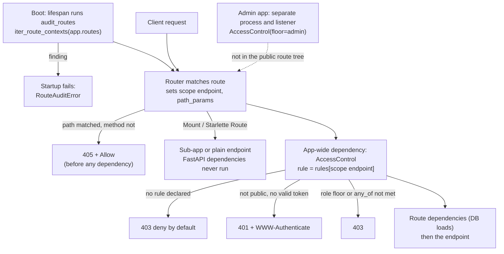

# Preventing Broken Function Level Authorization (BFLA, API5:2023): Deny-by-Default APIRouter Dependencies and Administrative Surface Isolation

> [!summary] Claim
> Function-level authorization fails by omission, not by a wrong comparison, so the only defensible design makes omission impossible to ship: one app-wide guard dependency that refuses any endpoint without a declared rule, a route-table audit that walks the effective (post-include) route tree and fails boot and CI on any route the guard does not cover, and administrative functions moved into a separate ASGI app on a separate listener so the public surface does not contain them at all.

Part of [API Authorization and OWASP Security](README.md) in [API Engineering](../README.md).

## TL;DR

Mechanism: a single `AccessControl` instance is installed with `FastAPI(dependencies=[Depends(acl)])`, runs before every route-level dependency, looks up the rule declared for the matched `scope["endpoint"]`, and answers `403` for any function that declared none, so a forgotten guard denies instead of exposing.
Contract rule: OWASP requires that "The enforcement mechanism(s) should deny all access by default, requiring explicit grants to specific roles for access to every function" (OWASP API5:2023, How To Prevent), and the Authorization Cheat Sheet adds that "Validating permissions correctly on just the majority of requests is insufficient".
Trap: on FastAPI 0.137.0 and later `include_router` no longer copies routes, so `app.routes` holds `_IncludedRouter` nodes and the classic audit loop `for r in app.routes: if isinstance(r, APIRoute)` sees zero included routes and passes silently; the lab's naive audit returns `[]` on an app whose `/v2/admin/users` answers anonymous callers with `200`.
Portability: the 22-test lab passed on CPython 3.14.6 with FastAPI 0.162.0 and Starlette 1.10.0; the mechanism is HTTP-version independent because it runs after routing, but it only covers `APIRoute` and `APIWebSocketRoute`: `Mount`, plain Starlette `Route` (including the four default docs routes), and `dependency_overrides` all bypass it, and the audit reports each.
When not to use it: object-level decisions ("may Alice see invoice 7") need the row and belong in the query ([[Defeating-BOLA-API1-2023-Tenant-Scoped-Queries-and-PostgreSQL-RLS]]), and a polyglot fleet with many frameworks may centralize function-level policy in a gateway or sidecar PDP instead, at the price of path-string matching ([[Where-Authorization-Lives-Gateway-Middleware-vs-Domain-and-Query-Layer]]).

## Mental model



Read the diagram from the two entry points.
At boot, the lifespan handler walks the effective route tree and refuses to start if any route is outside the guard; CI runs the same function as a test, so the omission is caught twice before traffic.
At request time the router matches first; a path match with the wrong method produces `405` with `Allow` before any dependency runs, and a `Mount` or plain Starlette route hands the request to code that FastAPI's dependency system never touches, which is why the boot audit must flag those route types rather than hope they are harmless.
For every `APIRoute`, the app-wide `AccessControl` dependency is the first node in the dependency graph, so it decides before any route dependency loads data: no declared rule is `403`, no credentials is `401`, a missing role is `403`, and only then do the handler's own dependencies run.
The administrative surface is a different ASGI application served on a different listener, so its routes are absent from the public router and a public request for them is a plain `404` for every caller, including administrators.

## How it works

### What API5:2023 is, and why it is a separate risk from BOLA

OWASP defines the exploit as sending "legitimate API calls to an API endpoint that they should not have access to as anonymous users or regular, non-privileged users", rates exploitability Easy, prevalence Common, detectability Easy, and technical impact Severe, and names administrative functions as the key target (OWASP API5:2023).
Its vulnerability questions are three: can a regular user reach administrative endpoints, can a user perform sensitive actions "by simply changing the HTTP method (e.g. from `GET` to `DELETE`)", and can a user of group X reach a function meant for group Y by guessing the URL and parameters (OWASP API5:2023).
The two attack scenarios are an invite-only app whose mobile client calls `GET /api/invites/{invite_guid}` during registration, while `POST /api/invites/new`, meant for admins, has no function-level check and accepts an invite carrying an admin role, and an admin-only `GET /api/admin/v1/users/all` that returns every user's details without a check (OWASP API5:2023).
OWASP maps it to CWE-285 Improper Authorization; the narrower child CWE-862 Missing Authorization reads "The product does not perform an authorization check when an actor attempts to access a resource or perform an action" (MITRE CWE-862), which is the usual BFLA root cause.

The difference from BOLA (API1) is the input to the decision.
A function-level decision needs only the principal and the identity of the function (route plus method), which the router knows before any data is read; an object-level decision needs the row.
So function-level checks can and should run before work, centrally, uniformly, and from a declarative table, while object-level checks belong in the `WHERE` clause ([[Where-Authorization-Lives-Gateway-Middleware-vs-Domain-and-Query-Layer]]).
OWASP also warns against inferring privilege from the path: "Don't assume that an API endpoint is regular or administrative only based on the URL path", because administrative endpoints often live under regular paths such as `/api/users` (OWASP API5:2023); the lab's `POST /users/{name}/unlock` (support or admin) and `POST /invites` (admin) are exactly such functions on user-looking paths.

### Why BFLA is an omission bug

A missing check is invisible in code review of the code that exists.
Every endpoint that has a guard looks correct; the defect is the endpoint that has none, and nothing in the diff points at it.
The OWASP Authorization Cheat Sheet's rules follow from that: "an application should be configured to deny access by default", "Permission should be validated correctly on every request", and "Validating permissions correctly on just the majority of requests is insufficient"; it says the checking technology "should allow for global, application-wide configuration rather than needing to be applied individually to every method or class", tells readers "Do not rely on default configurations", and its testing section asks "is access being denied by default?" (OWASP Authorization Cheat Sheet, Deny by Default; Validate the Permissions on Every Request; Thoroughly Review the Authorization Logic of Chosen Tools and Technologies; Create Unit and Integration Test Cases for Authorization Logic).
Opt-in guards (a `Depends(require_admin)` added to each admin route) satisfy none of these: the default for a new route is open.
The design below inverts the default at three points: runtime (undeclared function is denied), boot (undeclared or uncovered route stops startup), and CI (the same audit as a test).

### FastAPI's dependency graph: where an app-wide guard sits

Every `APIRoute` compiles its endpoint signature into a `Dependant` tree once, at registration (details in [[APIRoute-Compilation-Signature-Inspection-and-Dependant-Construction]]).
Decorator-level `dependencies=[...]` become parameterless sub-dependants inserted at the front of that tree: `_build_dependant_with_parameterless_dependencies` iterates `dependencies[::-1]` and calls `dependant.dependencies.insert(0, get_parameterless_sub_dependant(...))` `(fastapi 0.162.0 fastapi/routing.py, _build_dependant_with_parameterless_dependencies)`.
`APIRouter.add_api_route` merges the router's own list first, `current_dependencies = self.dependencies.copy()` then `extend(dependencies)` `(fastapi 0.162.0 fastapi/routing.py, APIRouter.add_api_route)`, and `FastAPI(dependencies=...)` simply passes the list to the app's root `APIRouter` `(fastapi 0.162.0 fastapi/applications.py, FastAPI.__init__)`.
`solve_dependencies` walks `dependant.dependencies` in order `(fastapi 0.162.0 fastapi/dependencies/utils.py, solve_dependencies)`, so the order at request time is: app-wide, then include-time, then router, then decorator, then the endpoint's own `Depends` parameters, then the endpoint.
That ordering is the reason an app-wide guard is "deny before work": the lab's `POST /users/bob/unlock` declares `users: Annotated[dict[str, set[str]], Depends(load_users)]`, and when Alice (role `user`) calls it the response is `403` with `store.reads == []`, while Sam (role `support`) gets `200` with `store.reads == ["users"]` (`test_guard_rejects_before_route_dependencies_run`).
FastAPI documents the app-wide form as dependencies that "will be applied to all the *path operations* in the application" (FastAPI docs, Global Dependencies, as of 2026-11); the next sections are about the routes that sentence does not cover.

The dependency cache deduplicates a guard declared at several levels: the cache key is `(dependant.call, scopes_for_cache, _get_computed_scope(dependant=dependant) or "")` `(fastapi 0.162.0 fastapi/dependencies/models.py, _get_cache_key)`, so the same `AccessControl` instance listed app-wide and again on a router runs once per request (a one-off check on FastAPI 0.162.0 listing one guard instance app-wide, on the router, on the include, and on the decorator counted one call per request).
Distinct guard objects (two `require_role("admin")` closures) have distinct keys and both run, which is harmless but wasteful.

### The guard: rules keyed by endpoint, looked up from the matched route

The lab keeps policy as data: `@acl.rule(...)` records an `AccessRule` for the endpoint function in a dictionary owned by the `AccessControl` instance, and the instance itself is the dependency.
Verbatim from the [implementation](../labs/src/api_labs/f15_api_authorization_and_owasp_security/function_level_guards.py):

```python
    async def __call__(self, conn: HTTPConnection) -> Principal | None:
        rule = self.rule_for(conn.scope.get("endpoint"))
        if rule is None:  # deny by default: no declaration, no access, for everyone
            raise HTTPException(status.HTTP_403_FORBIDDEN, "function has no access rule")
        if rule.public:
            return None
        principal = authenticate(conn)
        if principal is None:
            raise HTTPException(
                status.HTTP_401_UNAUTHORIZED,
                "authentication required",
                headers={"WWW-Authenticate": "Bearer"},
            )
        for required in (self.floor, rule.any_of):
            if required and required.isdisjoint(principal.roles):
                raise HTTPException(status.HTTP_403_FORBIDDEN, "insufficient role")
        conn.state.principal = principal
        return principal
```

`scope["endpoint"]` is set by route matching before any dependency runs: Starlette's `Route.matches` returns a child scope with `endpoint` and `path_params` `(starlette 1.10.0 starlette/routing.py, Route.matches)`, and for routes reached through `include_router` FastAPI's `_EffectiveRouteContext.matches` builds the same `{"endpoint": self.endpoint, "path_params": path_params}` `(fastapi 0.162.0 fastapi/routing.py, _EffectiveRouteContext.matches)`.
The parameter is typed `HTTPConnection`, not `Request`, so the same dependency resolves for WebSocket routes through `Dependant.http_connection_param_name` `(fastapi 0.162.0 fastapi/dependencies/models.py, Dependant)`; the lab does not exercise WebSockets, and a WebSocket guard should raise `WebSocketException` rather than `HTTPException`.

The status codes follow RFC 9110.
`401` "indicates that the request has not been applied because it lacks valid authentication credentials", and the server "MUST send a WWW-Authenticate header field" `(RFC 9110 Section 15.5.2)`; the lab asserts `WWW-Authenticate: Bearer` on every `401`, including the forged token `tok-forged`.
`403` means the server "understood the request but refuses to fulfill it" and, with credentials present, "considers them insufficient" `(RFC 9110 Section 15.5.4)`.
The undeclared-function case is also `403` and identical for every caller, including administrators, because the problem is in the server, not the credentials: `test_route_without_a_rule_is_denied_to_everyone` registers `DELETE /users/{name}` without a rule, and `tok-ops` gets `403 {"detail": "function has no access rule"}` with the user still present.

Keying rules by function object has a useful failure direction.
When another decorator wraps the function after the rule was attached, the route registers the wrapper, the lookup misses, and the request is denied rather than allowed; `test_rule_on_a_wrapped_function_fails_closed` stacks `@app.get`, a `functools.wraps` logging decorator, and `@acl.rule()`, and Alice gets `403`.
The opposite design, "routes are open unless marked", turns every decorator-order mistake into an exposure.

### Router-level and include-time guards: why the guard must not ride on `include_router`

FastAPI lets dependencies attach at three group levels: `APIRouter(dependencies=...)`, `include_router(router, dependencies=...)`, and `FastAPI(dependencies=...)`.
Since 0.137.0 an include is a node in a tree: `include_router` builds a `_RouterIncludeContext` whose `dependencies=[*parent_router.dependencies, *(dependencies or [])]` and appends `_IncludedRouter(original_router=router, include_context=include_context)` to `self.routes` `(fastapi 0.162.0 fastapi/routing.py, APIRouter.include_router; _RouterIncludeContext.for_include)`.
Each included `APIRoute` gets an `_EffectiveRouteContext`, built lazily per include and cached on the `_IncludedRouter` until the included router's routes change, whose dependencies are `[*include_context.dependencies, *route.dependencies]` and whose handler is built from that merged list `(fastapi 0.162.0 fastapi/routing.py, _EffectiveRouteContext.from_api_route)`.
So the include-time guard is a property of one include call, not of the router.
The same router included twice, once with `dependencies=[Depends(acl)]` and once under `/v2` without, serves two different policies; in `test_include_time_guard_is_lost_on_a_second_include` Alice gets `403` on `/admin/users`, and an anonymous caller gets `200` with the full role table on `/v2/admin/users`.
FastAPI's 0.32.0 release notes (2019-07-12) already advertised "using `.include_router()` with the same `APIRouter` *multiple* times, with different prefixes, e.g. `/api/v2` and `/api/latest`" (FastAPI release notes), which is precisely the move that drops an include-time guard.
With the guard app-wide (`test_app_wide_guard_covers_every_include`) both prefixes answer `401`, `403`, and `200` for anonymous, Alice, and ops, and the audit is empty.
The rule is: authentication and the deny-by-default lookup are app-wide, roles are declared on the function, and nothing security-relevant is passed to `include_router`.

### The audit: walking the effective route tree

The seed's plan, "fail CI if any non-public `APIRoute` lacks an explicit authentication and authorization dependency in `route.dependant`", needs two corrections on current FastAPI.
First, `app.routes` is no longer a flat list.
The 0.137.0 release notes (2026-06-14) state it directly: "Now `router.routes` is no longer a plain list of `APIRoute` objects, it can contain these intermediate objects that can contain additional routers, forming a tree", logic that iterated it "would not see all the routes in the app", and "`router.routes` should be considered an internal implementation detail" (FastAPI release notes, 0.137.0).
0.137.2 (2026-06-18) added `iter_route_contexts()` "for advanced use cases that used to use `router.routes`", and 0.143.1 (2026-10-14) fixed "included route metadata in `iter_route_contexts()`" (FastAPI release notes), so an audit built on it needs FastAPI 0.143.1 or later.
Second, the original `APIRoute.dependant` lacks include-time dependencies; the merged graph lives on the effective context, which `RouteContext` exposes through `__getattr__` forwarding to the `_EffectiveRouteContext` `(fastapi 0.162.0 fastapi/routing.py, RouteContext; iter_route_contexts)`.
FastAPI's own OpenAPI generator walks routes the same way, `for route_context in routing.iter_route_contexts(routes)` `(fastapi 0.162.0 fastapi/openapi/utils.py, get_openapi)`, which is a good sign the function is the supported traversal.

`test_flat_walk_of_app_routes_misses_included_routers` pins the failure: after `app.include_router(router, prefix="/v2")`, `[type(r).__name__ for r in app.routes] == ["_IncludedRouter"]`, zero elements are `APIRoute`, `iter_route_contexts` yields `/v2/admin/users` and `/v2/admin/users/{name}/roles`, the naive audit returns `[]`, and the correct audit returns two findings.
The audit, verbatim:

```python
def audit_routes(
    app: FastAPI, acl: AccessControl, *, allow_unguarded: frozenset[str] = frozenset()
) -> list[Finding]:
    """Every route the guard does not cover, from the effective (post-include) route tree."""
    findings: list[Finding] = []
    if app.dependency_overrides:
        findings.append(Finding("*", "", "dependency_overrides is not empty"))
    for ctx in iter_route_contexts(app.routes):
        path, methods = ctx.path or "?", frozenset(ctx.methods or ())
        label = ",".join(sorted(methods))
        if not isinstance(ctx.original_route, APIRoute | APIWebSocketRoute):
            if path not in allow_unguarded:
                kind = type(ctx.original_route).__name__
                findings.append(Finding(path, label, f"{kind} never runs FastAPI dependencies"))
            continue
        dependant = cast("Dependant", ctx.dependant)
        if not any(call is acl for call in dependency_calls(dependant)):
            findings.append(Finding(path, label, "access control is not in the dependency graph"))
        rule = acl.rule_for(ctx.endpoint)
        if rule is None:
            findings.append(Finding(path, label, "endpoint has no access rule"))
        elif rule.public and methods - SAFE_METHODS:
            findings.append(Finding(path, label, "public rule on an unsafe method"))
        elif methods & SAFE_METHODS and methods - SAFE_METHODS:
            findings.append(Finding(path, label, "one rule covers safe and unsafe methods"))
    return sorted(findings)
```

It checks five properties, each a real bypass in the lab:
the guard instance is in the flattened dependency graph (identity, `call is acl`, so a look-alike function does not count);
the endpoint has a declared rule;
no public rule sits on an unsafe method;
no single rule covers both safe and unsafe methods;
every non-FastAPI route type is either on an explicit allowlist or reported, and `dependency_overrides` is empty.
`SAFE_METHODS` is `GET`, `HEAD`, `OPTIONS`; RFC 9110 also lists `TRACE` as safe `(RFC 9110 Section 9.2.1)`, and the lab deliberately leaves it out so a `TRACE` route is treated as unsafe.

### Boot-time enforcement through lifespan

CI catches what is in the repository; a lifespan check catches what is in the running process, including routes added by plugins, environment-dependent routers, and configuration that differs between environments.
`audited_lifespan` raises `RouteAuditError` from the startup half of the lifespan context, and `test_lifespan_refuses_to_start_with_an_uncovered_route` shows `asgi_lifespan.LifespanManager` propagating `RouteAuditError` matching `/debug/env endpoint has no access rule`; Uvicorn, Hypercorn, and Granian each then fail to start, with the exit behavior in the Portability table, so the deploy fails rather than shipping the route (lifespan semantics in [[ASGI-Lifespan-Protocol-Startup-Shutdown-and-Scope-State]]).
The trade-off is availability: a new finding blocks the rollout, which is the intended behavior for a security invariant but requires the allowlist to be reviewed code, not an environment variable.

### Routes the guard cannot cover

`Mount`.
FastAPI describes mounting as "adding a completely "independent" application in a specific path" with its own docs (FastAPI docs, Sub Applications, as of 2026-11); the parent's dependency list belongs to the parent's `APIRouter`, and a `Mount` dispatches to the child ASGI app after appending the matched prefix to `root_path` in the child scope `(starlette 1.10.0 starlette/routing.py, Mount.matches)`.
In `test_mounted_sub_app_skips_the_parent_guard` the hardened public app mounts an internal FastAPI app at `/internal`, and an anonymous `PUT /internal/users/alice/roles` returns `200` and grants Alice `admin`; the audit reports `Finding("/internal", "", "Mount never runs FastAPI dependencies")`.
Mounted apps need their own app-wide guard and their own audit, and the parent audit should list them so a reviewer sees each one (mount mechanics in [[Mounting-Sub-Applications-WSGI-Legacy-Strangler-and-Static-Assets]] and [[Starlette-Routing-Internals-Regex-Compilation-and-Mount-Dispatch]]).

Plain Starlette routes, including the docs.
`FastAPI.setup` registers `openapi_url` (default `/openapi.json`), `docs_url` (default `/docs`), `swagger_ui_oauth2_redirect_url` (`/docs/oauth2-redirect`), and `redoc_url` (default `/redoc`) through `self.add_route(...)`, which creates Starlette routes outside the dependency system `(fastapi 0.162.0 fastapi/applications.py, FastAPI.setup)`.
`test_default_docs_routes_are_unguarded_and_list_privileged_paths` fetches `/openapi.json` anonymously from the public app built with docs enabled, gets `200`, and finds `/invites` and `/users/{name}/unlock` in `paths`: the schema is a map of the privileged functions for an attacker who would otherwise have to guess, which removes the guessing from OWASP's third vulnerability question ("by simply guessing the endpoint URL and parameters", OWASP API5:2023).
The audit reports exactly the four docs paths unless they are passed in `allow_unguarded`; the hardened public app disables them with `openapi_url=None`, and spec exposure policy belongs to inventory management ([[Improper-Inventory-Management-API9-2023-and-Unsafe-Consumption-of-APIs-API10-2023]]).
`include_in_schema=False` hides a route from `/openapi.json` but not from the router; it is documentation hygiene, not access control, and the audit, which walks routes rather than the schema, still sees such routes.

`dependency_overrides`.
FastAPI's testing docs say "you put as a key the original dependency (a function), and as the value, your dependency override", and an override applies to a dependency used "in a *path operation function*, a *path operation decorator* ..., a `.include_router()` call, etc." (FastAPI docs, Testing Dependencies with Overrides, as of 2026-11).
The lookup is a dictionary get on the app object at request time, `getattr(dependency_overrides_provider, "dependency_overrides", {}).get(original_call, original_call)` `(fastapi 0.162.0 fastapi/dependencies/utils.py, solve_dependencies)`, so one assignment disables the guard for every route of that app: `app.dependency_overrides[acl] = lambda: None` lets Alice create an admin invite (`201 {"invite": "inv-1", "role": "admin"}`) in `test_dependency_override_switches_the_guard_off`.
The audit treats a non-empty override map in a production app as a finding; test suites should build a fresh app per test (the lab's `build_public_app` factory) instead of mutating a module-level one (test patterns in [[Testing-FastAPI-Applications-AsyncClient-Lifespan-and-Dependency-Overrides]]).

### Methods: one function, two verbs, and the pre-auth `405`

OWASP's method question ("by simply changing the HTTP method") has two code shapes in FastAPI.
Separate routes per verb with separate functions are naturally separate rules; `@app.api_route(path, methods=["GET", "DELETE"])` binds both verbs to one function and therefore one rule.
In `test_one_rule_for_get_and_delete_lets_readers_delete` a rule meant for reading (`@acl.rule()`, any authenticated user) lets Alice `DELETE /users/bob` with `200`, and the audit reports `one rule covers safe and unsafe methods` for `DELETE,GET`.
A per-verb rule is the fix; a rule system keyed by `(endpoint, method)` would allow multi-verb functions, at the cost of a less obvious declaration.
Method-override conventions (`X-HTTP-Method-Override`, `_method` form fields) are not implemented by Starlette or FastAPI; if a middleware adds one, it must rewrite `scope["method"]` before routing so the route-bound guard sees the effective verb, and any edge rule keyed on the original verb becomes wrong.

Method mismatch is decided by routing, before dependencies.
Starlette's `Router.app` treats a path match with the wrong method as `Match.PARTIAL` and dispatches the first partial route "to deal with "405 Method Not Allowed"" `(starlette 1.10.0 starlette/routing.py, Router.app)`, and for included FastAPI routes `APIRoute.handle` raises `HTTPException(status_code=405, headers={"Allow": ...})` when `scope["method"] not in methods` `(fastapi 0.162.0 fastapi/routing.py, APIRoute.handle)`.
RFC 9110 requires it: the origin "MUST generate an Allow header field in a 405 response containing a list of the target resource's currently supported methods" `(RFC 9110 Section 15.5.6)`.
So an anonymous `DELETE /admin/users` on the admin app gets `405` with `Allow: GET`, while `GET /admin/users` gets `401` (`test_wrong_method_answers_405_before_authentication`): the route inventory and its verbs are enumerable without credentials.
The `Allow` value is `GET`, not `GET, HEAD`, because FastAPI sets `route.methods = {method.upper() for method in methods}` without the implicit `HEAD` that Starlette's `Route.__init__` adds when `GET` is present `(fastapi 0.162.0 fastapi/routing.py, _populate_api_route_state)` `(starlette 1.10.0 starlette/routing.py, Route.__init__)`; a `HEAD` probe of a FastAPI `GET` route is therefore also a `405` with `Allow: GET`, which the same test asserts.
Hiding admin routes behind `404` for non-admins (`RFC 9110 Section 15.5.4` permits it) does not survive this probe; removing the routes from the public app does.

### Administrative surface isolation

The strongest function-level control for administrative functions is that the public process does not contain them.
The lab's `build_admin_app` is a separate `FastAPI` instance with its own `AccessControl(floor=frozenset({"admin"}))`, docs disabled, and its own audited lifespan; it is meant to be served by a separate server process on a separate listener (an internal address, a separate port, a separate hostname behind a different load balancer and network policy).
`test_admin_surface_is_a_separate_app` checks the property structurally and behaviorally: no effective route of the public app starts with `/admin`, `tok-ops` (an administrator) gets `404` from the public app and `200` from the admin app, and `tok-sam` (support) gets `403` from the admin app.
The role floor makes the whole admin app deny non-admins even if a function's own rule is weaker, and it refuses `rule(public=True)` at declaration time with `ValueError`, so "a public endpoint on the admin surface" cannot be expressed.
OWASP's prevention text asks that "all of your administrative controllers inherit from an administrative abstract controller that implements authorization checks based on the user's group/role" (OWASP API5:2023); the floor is that abstract controller, and the separate app is the stronger form: a separate process also gets separate credentials (an admin-audience token), separate rate limits, separate logging, and a network boundary that no routing bug in the public app can cross.
Privileged functions that must stay on the public surface, such as support unlocking an account, keep explicit role rules there (`POST /users/{name}/unlock` with `any_of={"support", "admin"}`), which is OWASP's "administrative functions inside a regular controller" case.

### Where the incidents came from

Real BFLA-class incidents are usually a function reachable by a path its designers did not consider.
Confluence CVE-2023-22515 (NVD CVSS 3.1 9.8, CISA KEV added 2023-10-05) let attackers "create unauthorized Confluence administrator accounts" (NVD); Rapid7's analysis shows an unauthenticated `GET /server-info.action?bootstrapStatusProvider.applicationConfig.setupComplete=false` flipping the setup flag through XWork parameter binding, after which `POST /setup/setupadministrator.action`, a setup-only function, created an administrator (Rapid7 analysis of CVE-2023-22515); Atlassian's interim mitigation was to block `/setup/*` and its indicators include "requests to `/setup/*.action` in network access logs" (Atlassian security advisory).
That is the lifecycle variant of BFLA: functions that are legitimate during one phase (setup, migration, debug) stay registered afterwards, and the boot audit with a reviewed allowlist is where such routes become visible.
Ivanti EPMM CVE-2023-35078 (NVD CVSS 3.1 9.8, CWE-287) "allows unauthorized users to access restricted functionality or resources of the application without proper authentication" (NVD); no public primary source read for this note gives the code-level root cause: Rapid7 lists only a request to "a targeted API endpoint, containing /mifs/aad/api/v2/ in the path" as an indicator of compromise, Ivanti's blog defers to a separate advisory, and Tenable says "Additional details surrounding CVE-2023-35078 are currently restricted to a knowledge base article" (Rapid7 ETR on CVE-2023-35078; Ivanti blog; Tenable blog, all as of 2026-11), so the note uses the CVE only as an example of missing authentication on API functions and claims no mechanism.
JetBrains TeamCity CVE-2024-27198 (CVSS 3.1 9.8, CWE-288 from the JetBrains CNA) allowed "authentication bypass allowing to perform admin actions" before 2023.11.4 (NVD); Rapid7 traced it to a `jsp` request parameter that `BaseController.updateViewIfRequestHasJspParameter` used as the new view name after authentication had been decided, which let an unauthenticated `POST` reach `/app/rest/users` and create a `SYSTEM_ADMIN` user (Rapid7 analysis of CVE-2024-27198).
The common thread is a gap between where the access decision was made and the code that finally ran; a guard bound to the matched route and declared per function closes that gap inside one framework, and isolation closes it for the most dangerous functions.

## Numbers and limits

| Quantity | Value | Source |
|---|---|---|
| Lab module | 22 tests, 0.53 s wall (one run, 2026-11-15) | `uv run --frozen pytest ... -q -p no:cacheprovider`, CPython 3.14.6, macOS 27.3 arm64 (`uname -r` = `27.3.0`) |
| `isinstance(r, APIRoute)` hits in `app.routes` after one `include_router` | 0 (one `_IncludedRouter`) | lab, FastAPI 0.162.0 |
| Effective routes yielded by `iter_route_contexts` for the same app | 2 | lab |
| Naive audit findings on an app with 2 anonymous-reachable admin routes | 0 | lab |
| Default unguarded docs routes when `openapi_url` is set | 4 (`/openapi.json`, `/docs`, `/docs/oauth2-redirect`, `/redoc`) | `(fastapi 0.162.0 fastapi/applications.py, FastAPI.setup)`; lab |
| Route-dependency data loads before a denied function-level decision | 0 | lab (`store.reads == []`) |
| `Allow` on a `405` for a FastAPI `GET` route | `GET` (no implicit `HEAD`) | lab; `(fastapi 0.162.0 fastapi/routing.py, _populate_api_route_state)` |
| FastAPI `include_router` stops copying routes | 0.137.0 (2026-06-14) | FastAPI release notes |
| `iter_route_contexts()` added / included-route metadata fixed | 0.137.2 (2026-06-18) / 0.143.1 (2026-10-14) | FastAPI release notes |
| OWASP API5:2023 ratings | exploitability Easy, prevalence Common, detectability Easy, impact Severe | OWASP API5:2023 |
| CVE-2023-22515 (Confluence) | CVSS 3.1 9.8 (NIST); affected 8.0.0 to 8.5.1; fixed 8.3.3, 8.4.3, 8.5.2 | NVD; Atlassian advisory |
| CVE-2023-35078 (Ivanti EPMM) | CVSS 3.1 9.8 (NIST), CWE-287 | NVD |
| CVE-2024-27198 (TeamCity) | CVSS 3.1 9.8, CWE-288; fixed in 2023.11.4 | NVD |

The lab measures correctness, not latency, so this note states no per-request overhead figure for the guard.
Structurally, the guard is one `async` dependency that does one dictionary lookup keyed by the endpoint function and one token check, and the dependency cache runs it once per request however many levels list it (see the dedup paragraph above).
The audit is linear in the number of effective routes times the depth of each dependency graph and runs once at boot.

## Portability

| Runtime, library, or protocol | Behavior | Evidence |
|---|---|---|
| CPython 3.14.6 (workspace `.venv`) | 22 passed | `uv run --frozen pytest ... -q`, macOS 27.3 arm64 |
| CPython 3.12.16, 3.13.18, 3.14.10, 3.15.2, 3.15.2t | not run: lab checks paused by the user on 2026-11-11 | `report.md` |
| FastAPI 0.162.0 | `app.routes` holds `_IncludedRouter`; `iter_route_contexts` yields effective routes with merged dependencies | lab; `(fastapi 0.162.0 fastapi/routing.py, iter_route_contexts)` |
| FastAPI 0.137.0 to 0.143.0 | tree-shaped `router.routes`; `iter_route_contexts` absent before 0.137.2 and with an included-route metadata bug until 0.143.1 | FastAPI release notes (not run) |
| FastAPI before 0.137.0 | `include_router` cloned routes into the parent, so a flat `app.routes` walk saw merged dependencies | FastAPI release notes 0.137.0 (not run) |
| Starlette 1.10.0 | `Route` adds `HEAD` for `GET`; `Mount` dispatches to a child app; `Router.app` answers `405` on partial match | `(starlette 1.10.0 starlette/routing.py, Route.__init__; Mount.matches; Router.app)` |
| Uvicorn 0.54.0 | a `lifespan.startup.failed` message sets `should_exit`, and `Server.startup` then calls `sys.exit(STARTUP_FAILURE)`, which is `3` | `(uvicorn 0.54.0 uvicorn/lifespan/on.py, LifespanOn.startup)` `(uvicorn 0.54.0 uvicorn/server.py, Server.startup)` `(uvicorn 0.54.0 uvicorn/config.py, STARTUP_FAILURE)`; read, not run |
| Hypercorn 0.18.0 | the `startup.failed` message raises `LifespanFailureError` inside `Lifespan.asgi_send`, `handle_lifespan` re-raises it, and `worker_serve` raises the finished lifespan task's exception before opening sockets | `(hypercorn 0.18.0 hypercorn/asyncio/lifespan.py, Lifespan.asgi_send; Lifespan.handle_lifespan)` `(hypercorn 0.18.0 hypercorn/asyncio/run.py, worker_serve)`; read, not run |
| Granian 2.8.7 | `failure_startup` sets `interrupt`, and the worker logs `ASGI lifespan startup failed` and calls `sys.exit(1)` (multi-process and multi-thread runtimes); the supervisor stops instead of respawning unless `respawn_failed_workers` is set, which defaults to `False` | `(granian 2.8.7 granian/asgi.py, LifespanProtocol.startup)` `(granian 2.8.7 granian/server/mp.py, _spawn_asgi_lifespan_worker)` `(granian 2.8.7 granian/server/common.py, _serve_loop)`; read, not run |
| All three servers | the failure path needs the app to send `lifespan.startup.failed`, which Starlette's `Router.lifespan` does for any exception before `yield`; a bare ASGI app that raises instead makes Uvicorn (`lifespan=auto`), Hypercorn, and Granian log a warning and continue without lifespan support, so the boot gate must run through FastAPI or Starlette | `(starlette 1.10.0 starlette/routing.py, Router.lifespan)` `(uvicorn 0.54.0 uvicorn/lifespan/on.py, LifespanOn.main)` `(hypercorn 0.18.0 hypercorn/asyncio/lifespan.py, Lifespan.handle_lifespan)` `(granian 2.8.7 granian/asgi.py, LifespanProtocol.handle)` |
| Server effect on the guard | the guard runs after routing inside the app, so the server matters only through `path` decoding and lifespan support | [[Where-Authorization-Lives-Gateway-Middleware-vs-Domain-and-Query-Layer]] for path decoding |
| HTTP/1.1, HTTP/2, HTTP/3 | method and path reach the app as `scope["method"]` and `scope["path"]` regardless of version, so the decision is version independent | ASGI scope contract; not run per version |

## Worked example

The [implementation](../labs/src/api_labs/f15_api_authorization_and_owasp_security/function_level_guards.py) builds two apps over an in-memory `Store`: `build_public_app` (app-wide `AccessControl`, docs off, audited lifespan; `GET /health` public, `GET /me` authenticated, `POST /invites` admin, `POST /users/{name}/unlock` support or admin) and `build_admin_app` (separate app, role floor `admin`, `GET /admin/users` and `PUT /admin/users/{name}/roles`).
Three opaque tokens map to principals: `tok-alice` (`user`), `tok-sam` (`user`, `support`), `tok-ops` (`user`, `admin`).
The [test](../labs/tests/f15_api_authorization_and_owasp_security/test_defeating_bfla_api5_2023_function_level_guards_and_deny_by_default_routers.py) has 22 `unit` tests driven through `httpx.ASGITransport` and `asgi_lifespan.LifespanManager`.

The include-time guard and the flat-walk audit, verbatim from the test:

```python
@pytest.mark.unit
@pytest.mark.asyncio
async def test_include_time_guard_is_lost_on_a_second_include(
    store: Store, acl: AccessControl
) -> None:
    app = FastAPI(openapi_url=None)  # no app-wide guard: the guard rides on the include call
    router = build_admin_router(store, acl)
    app.include_router(router, dependencies=[Depends(acl)])
    app.include_router(router, prefix="/v2")  # e.g. a version alias added later
    assert (await call(app, "GET", "/admin/users", "tok-alice")).status_code == 403
    leaked = await call(app, "GET", "/v2/admin/users")  # anonymous
    assert leaked.status_code == 200
    assert leaked.json()["ops"] == ["admin", "user"]
    assert audit_routes(app, acl) == [
        Finding("/v2/admin/users", "GET", "access control is not in the dependency graph"),
        Finding(
            "/v2/admin/users/{name}/roles", "PUT", "access control is not in the dependency graph"
        ),
    ]


@pytest.mark.unit
@pytest.mark.asyncio
async def test_app_wide_guard_covers_every_include(store: Store, acl: AccessControl) -> None:
    app = FastAPI(openapi_url=None, dependencies=[Depends(acl)])
    router = build_admin_router(store, acl)
    app.include_router(router)
    app.include_router(router, prefix="/v2")
    for path in ("/admin/users", "/v2/admin/users"):
        assert (await call(app, "GET", path)).status_code == 401
        assert (await call(app, "GET", path, "tok-alice")).status_code == 403
        assert (await call(app, "GET", path, "tok-ops")).status_code == 200
    assert audit_routes(app, acl) == []


@pytest.mark.unit
def test_flat_walk_of_app_routes_misses_included_routers(store: Store, acl: AccessControl) -> None:
    app = FastAPI(openapi_url=None)
    router = build_admin_router(store, acl)
    app.include_router(router, prefix="/v2")  # completely unguarded
    assert [type(r).__name__ for r in app.routes] == ["_IncludedRouter"]
    assert sum(isinstance(r, APIRoute) for r in app.routes) == 0
    assert [ctx.path for ctx in iter_route_contexts(app.routes)] == [
        "/v2/admin/users",
        "/v2/admin/users/{name}/roles",
    ]
    assert naive_audit_routes(app, acl) == []  # silent pass on FastAPI >= 0.137
    assert len(audit_routes(app, acl)) == 2
```

The CI gate for a real service is one line in a test module, `assert audit_routes(app, acl, allow_unguarded=REVIEWED) == []`, which `test_hardened_apps_audit_clean_and_start` exercises for the public app before starting both apps under `LifespanManager`.

Captured run, from `labs/`, CPython 3.14.6 on macOS 27.3 arm64:

```text
$ uv run --frozen pytest tests/f15_api_authorization_and_owasp_security/test_defeating_bfla_api5_2023_function_level_guards_and_deny_by_default_routers.py -q -p no:cacheprovider
......................                                                   [100%]
22 passed in 0.53s
```

## Pitfalls

> [!warning] Opt-in guards on each admin route
> Trigger: every privileged route carries `Depends(require_admin)` and new routes are expected to remember it.
> Symptom: the one route that forgot is open, and review of the diff cannot see an absent line; this is CWE-862 Missing Authorization and the shape of OWASP API5 scenario 2.
> Fix: an app-wide guard that denies undeclared functions (`test_route_without_a_rule_is_denied_to_everyone`), plus the audit as a CI test and a lifespan check.

> [!warning] Guard passed to `include_router`
> Trigger: `app.include_router(admin, dependencies=[Depends(require_admin)])`, later followed by a second include of the same router under a version alias or an internal prefix.
> Symptom: the second prefix serves the same functions with no guard; the lab's anonymous `GET /v2/admin/users` returns `200` with every user's roles.
> Fix: keep authentication and the deny-by-default lookup app-wide and declare roles on the function; treat `dependencies=` on `include_router` as a code-review red flag.

> [!warning] Route audit that walks `app.routes` on FastAPI 0.137.0 or later
> Trigger: an audit or test written for older FastAPI, `for r in app.routes: if isinstance(r, APIRoute)`, kept through an upgrade.
> Symptom: included routers appear as `_IncludedRouter`, the loop sees none of their routes, and the audit passes while the app leaks (`test_flat_walk_of_app_routes_misses_included_routers`); the 0.137.0 release notes call `router.routes` "an internal implementation detail".
> Fix: walk `fastapi.routing.iter_route_contexts(app.routes)` (FastAPI 0.143.1 or later for correct included-route metadata) and inspect the effective `dependant`; make the audit fail if it sees zero routes.

> [!warning] Mounted sub-applications and plain Starlette routes
> Trigger: `app.mount("/internal", internal_app)`, `app.add_route(...)`, `StaticFiles`, or the default docs routes.
> Symptom: the parent's dependencies never run; the lab's anonymous `PUT /internal/users/alice/roles` grants `admin`, and `/openapi.json` lists every privileged path to anonymous callers.
> Fix: give every mounted app its own app-wide guard and audit, report non-`APIRoute` routes unless on a reviewed allowlist, and disable or separately protect docs in production.

> [!warning] `dependency_overrides` reaching production
> Trigger: a module-level `app` mutated by tests or by a "local auth bypass" flag.
> Symptom: one dictionary entry replaces the guard on every route at request time.
> Fix: build apps with a factory, never override the security dependency outside a test-local app, and make a non-empty override map an audit finding.

> [!warning] One function for `GET` and `DELETE`
> Trigger: `@app.api_route(path, methods=["GET", "DELETE"])` with a single rule.
> Symptom: readers can delete; OWASP's "changing the HTTP method" check succeeds.
> Fix: one function per verb, or rules keyed by `(endpoint, method)`; the audit flags rules that span safe and unsafe methods.

> [!warning] Lifecycle functions left registered
> Trigger: setup, migration, debug, or support endpoints that are meant for one phase or one environment.
> Symptom: Confluence CVE-2023-22515 reached `/setup/setupadministrator.action` after setup and created administrators (Atlassian advisory; Rapid7 analysis).
> Fix: register such routes conditionally at build time, never reachable by a runtime flag, and require each to appear on the boot audit's reviewed list.

## Security and robustness

Threat model.
The attacker is anonymous or holds a low-privilege token, can read the client application and any published OpenAPI document, and can try every method on every path; the asset is any function whose effect exceeds the caller's role (role grants, invites, exports, refunds, user lists, feature flags, cache purges).
OWASP API5 is the primary risk; it compounds with API9 (an unlisted or forgotten version that lacks the guard, [[Improper-Inventory-Management-API9-2023-and-Unsafe-Consumption-of-APIs-API10-2023]]), API1 (a function check that passes and an object check that is missing, [[Defeating-BOLA-API1-2023-Tenant-Scoped-Queries-and-PostgreSQL-RLS]]), API3 (an allowed function that accepts a `role` property it should not, [[Defeating-BOPLA-and-Mass-Assignment-API3-2023-Strict-Input-Output-Schemas]]), and API2 (weak authentication making every role reachable).

Defense in depth, from outermost to innermost:
network isolation for the admin app (separate listener, internal-only address, separate ingress);
an admin-specific token audience so a public-surface token is not valid on the admin surface;
coarse scopes at the edge as load shedding, never as the only check ([[Where-Authorization-Lives-Gateway-Middleware-vs-Domain-and-Query-Layer]]);
the app-wide deny-by-default guard with per-function rules;
object-level predicates in queries;
audit logging of every privileged call with the principal from `conn.state.principal`, never from a client-supplied header ([[Structured-Log-Redaction-and-Preventing-PII-and-Token-Leaks]] for what must not be logged).

Input edge cases the guard must survive.
A request with `Authorization: Bearer` and an unknown token is `401`, not `403`, so clients re-authenticate rather than conclude they lack a role (`tok-forged` in the matrix).
A scheme other than `Bearer` is treated as no credentials.
Role names are compared as exact strings from a closed set; roles never come from request bodies or headers set by clients.
Function-level checks alone do not stop a privileged function from being driven by a cross-site request when the API uses cookie authentication ([[CSRF-in-Cookie-Authenticated-APIs-SameSite-Double-Submit-and-Fetch-Metadata]]).

What the audit cannot prove.
It proves the guard is in the graph and a rule is declared; it does not prove the rule is the right one.
That needs a reviewed policy table (the rules are data, so they can be exported and diffed per release) and the OWASP-recommended review "keeping in mind the business logic of the application and groups hierarchy" (OWASP API5:2023), plus negative tests per role, as the lab's role matrix does.
Routes registered after startup (dynamic plugins) escape the boot audit but not the runtime guard, which still denies undeclared functions.

## The principal's view

The architectural decision is where the authoritative function-level policy lives and what the default is.
For a Python service fleet on FastAPI, the recommendation is: policy declared next to each function as data, enforced by one app-wide dependency, audited from the effective route tree at boot and in CI, and administrative functions deployed as a separate application.
The organizational cost is friction: every new endpoint needs a rule, a new route type needs an allowlist entry, and a FastAPI upgrade can change the traversal API, as 0.137.0 did; that friction is the point, because the alternative failure is a Severe-impact, Easy-exploitability defect that review cannot see.
Make the policy table a reviewed artifact owned jointly by the service team and security, and make the boot audit non-bypassable by configuration.

Separate admin apps cost a second deployment, a second set of dashboards, and duplicate shared code; teams resist that until the first incident.
The decision rule: any function that changes another principal's privileges, reads across tenants, or alters system configuration goes on the isolated surface; support-grade functions that act on a single customer may stay public with explicit role rules.

Choose differently when the fleet is polyglot or when policy must change without deploys.
Then a central PDP (OPA, Cedar, or an Envoy `ext_authz` service) makes the decision from method and route template, and each service still keeps a deny-by-default local guard so a PDP misconfiguration or bypass does not open the service; the gateway layer matches on path strings and inherits the parser-differential risks described in [[Where-Authorization-Lives-Gateway-Middleware-vs-Domain-and-Query-Layer]].
For relationship-shaped permissions (owners, editors, shared folders) the function-level guard stays as the coarse gate and the model moves to ReBAC ([[Authorization-Models-Scopes-RBAC-ABAC-and-Zanzibar-ReBAC]]).
Frameworks with route attributes compiled at build time (Spring method security, ASP.NET `[Authorize]` with a fallback policy) can express "deny by default" in configuration; the invariant is the same, only the enforcement point moves.

## Interview questions

> [!question] L5: What is the difference between BOLA (API1) and BFLA (API5), and why does it change where the check runs?
>
> > [!success]- Answer
> > BOLA is access to an object the caller may not touch through a function they may call; BFLA is calling a function the caller may not call at all.
> > A function-level decision needs only the principal and the matched route and method, which exist before any data is read.
> > So it can run centrally, before route dependencies, from a declarative table, as the lab's app-wide `AccessControl` does.
> > An object-level decision needs the row, so it belongs in the query predicate.
> >
> > Follow-up: Which of the two can an edge gateway enforce correctly, and what does it need to know?

> [!question] L5: Why is `FastAPI(dependencies=[Depends(acl)])` safer than adding `Depends(require_admin)` to each admin route?
>
> > [!success]- Answer
> > The per-route form is opt-in, so a new route is open by default and the omission is invisible in review.
> > The app-wide form is prepended to every `APIRoute`'s dependency graph, including routes reached through any `include_router` call.
> > Combined with a lookup that refuses undeclared functions, the default for a new route becomes `403`.
> > It also runs first, so denied requests cause no data loads.
> >
> > Follow-up: Which kinds of routes does an app-wide dependency still not cover?

> [!question] L5: A route has no access rule and an administrator calls it. What should the response be, and why not `401` or `200`?
>
> > [!success]- Answer
> > `403`, identical for every caller.
> > `401` would invite re-authentication although no credential can help, and `200` would make omission an exposure.
> > The missing rule is a server defect, so the boot audit should also refuse to start the app, making the runtime `403` a last line of defense.
> >
> > Follow-up: Would returning `500` instead be better operationally, and what does it cost?

> [!question] L6: Predict the output. On the lab's admin app, an anonymous client sends `DELETE /admin/users`, then `HEAD /admin/users`, then `GET /admin/users`.
>
> > [!success]- Answer
> > `405` with `Allow: GET`, then `405` with `Allow: GET`, then `401` with `WWW-Authenticate: Bearer`.
> > Method mismatch is a partial route match decided by routing, before any dependency runs, and RFC 9110 Section 15.5.6 requires the `Allow` header.
> > FastAPI's `APIRoute` does not add `HEAD` to a `GET` route, unlike Starlette's `Route`, so `HEAD` is also a `405`.
> > Only the matching `GET` reaches the guard.
> >
> > Follow-up: What does this mean for hiding admin routes from non-admins with `404`?

> [!question] L6: Debug this API. After upgrading FastAPI from 0.130 to 0.162, the CI test "every route has the auth guard" still passes, yet a pen test reads `/v2/admin/users` anonymously. The code includes `admin_router` twice, once with `dependencies=[Depends(require_admin)]` and once with `prefix="/v2"`. What happened?
>
> > [!success]- Answer
> > Two independent bugs line up.
> > The second include carries no guard, because include-time dependencies belong to one include call, not to the router.
> > The CI test walks `app.routes` for `APIRoute` objects, and since 0.137.0 included routers appear as `_IncludedRouter` nodes, so the test inspects zero included routes and passes.
> > Fix the guard placement (app-wide) and the audit (`iter_route_contexts`, effective `dependant`, and a failure if zero routes are seen).
> >
> > Follow-up: How would you make the audit itself fail if a future FastAPI changes the traversal again?

> [!question] L6: Your service mounts a legacy FastAPI app at `/internal` and has an app-wide guard. Is `/internal` protected?
>
> > [!success]- Answer
> > No.
> > A `Mount` hands the request to an independent ASGI app, and the parent's dependency list lives on the parent's router.
> > The lab's anonymous `PUT /internal/users/alice/roles` returns `200`.
> > The mounted app needs its own guard and audit, and the parent audit must report the `Mount`.
> >
> > Follow-up: Which other route types in a FastAPI app share this property?

> [!question] L6: Why is a non-empty `app.dependency_overrides` a security finding in production?
>
> > [!success]- Answer
> > The override map is consulted on every request and keyed by the original dependency callable.
> > One entry for the guard replaces it on every route of that app, including routes added through `include_router`.
> > The lab's override lets Alice create an admin invite with `201`.
> > Tests should build fresh apps through a factory rather than mutate a shared one.
> >
> > Follow-up: How would you make an accidental override impossible rather than detectable?

> [!question] L7: Design function-level authorization for 40 FastAPI services owned by 12 teams, with an admin console that can change any customer's plan.
>
> > [!success]- Answer
> > Ship a shared library with the app-wide deny-by-default guard, the rule decorator, and the audit, and make the audit a required CI check and a lifespan gate.
> > Export each service's rule table per release so security can diff policy changes.
> > Put plan changes and other cross-customer functions in separate admin applications on an internal listener with an admin-audience token and their own role floor.
> > Keep coarse scopes at the gateway for load shedding, and object-level checks in queries.
> >
> > Follow-up: What would push you to a central PDP instead of per-service rules, and what do you lose?

> [!question] L7: Compare enforcing "deny by default" at runtime, at boot, and in CI. Which do you need?
>
> > [!success]- Answer
> > All three, because each sees a different set of routes.
> > CI sees the repository configuration, boot sees the real process including environment-dependent routers and plugins, and runtime covers routes added after startup and any audit blind spot.
> > The runtime guard alone would hide omissions as `403` responses nobody reads, and the audit alone would miss dynamic routes.
> >
> > Follow-up: How do you keep the boot gate's allowlist from becoming a bypass?

> [!question] L7: OWASP asks whether a user can perform a sensitive action by changing `GET` to `DELETE`. How can that succeed in a FastAPI app whose guard is correct?
>
> > [!success]- Answer
> > When one function serves several verbs through `api_route(methods=[...])`, its single rule applies to all of them.
> > A rule meant for reading then authorizes deleting, as the lab shows with Alice deleting Bob.
> > Split functions per verb or key rules by `(endpoint, method)`, and have the audit flag rules that span safe and unsafe methods.
> > If a method-override middleware exists, it must rewrite `scope["method"]` before routing.
> >
> > Follow-up: Which RFC 9110 methods are safe, and should `TRACE` routes exist at all?

## Related

Prerequisites: [[Defeating-BOPLA-and-Mass-Assignment-API3-2023-Strict-Input-Output-Schemas]]

Next: [[Unrestricted-Resource-Consumption-API4-2023-Payload-Depth-and-Limit-Guards]]

See also: [[02-Programming-Languages/Python/Python-Backend-Interview-Prep/04-FastAPI]], [[02-Programming-Languages/Python/Python-Backend-Interview-Prep/07-Auth-and-Security]], [[Where-Authorization-Lives-Gateway-Middleware-vs-Domain-and-Query-Layer]], [[Authorization-Models-Scopes-RBAC-ABAC-and-Zanzibar-ReBAC]], [[OWASP-API-Security-Top-10-2023-Complete-Threat-Model]], [[Defeating-BOLA-API1-2023-Tenant-Scoped-Queries-and-PostgreSQL-RLS]], [[Improper-Inventory-Management-API9-2023-and-Unsafe-Consumption-of-APIs-API10-2023]], [[APIRoute-Compilation-Signature-Inspection-and-Dependant-Construction]], [[Dependency-Injection-Engine-DAG-Resolution-and-Use-Cache-Mechanics]], [[Class-Based-Dependencies-Callable-Objects-and-Parameterized-Guards]], [[FastAPI-Security-Utilities-OAuth2-SecurityScopes-and-OpenAPI-Wiring]], [[Structuring-Large-FastAPI-Applications-APIRouter-Lifespan-and-Domain-Modules]], [[Mounting-Sub-Applications-WSGI-Legacy-Strangler-and-Static-Assets]], [[Starlette-Routing-Internals-Regex-Compilation-and-Mount-Dispatch]], [[Testing-FastAPI-Applications-AsyncClient-Lifespan-and-Dependency-Overrides]], [[ASGI-Lifespan-Protocol-Startup-Shutdown-and-Scope-State]]

- Lab: `labs/tests/f15_api_authorization_and_owasp_security/test_defeating_bfla_api5_2023_function_level_guards_and_deny_by_default_routers.py`

## Further reading

- OWASP API Security Top 10 2023, API5:2023 Broken Function Level Authorization: the risk definition, ratings, the two attack scenarios, and the deny-by-default prevention rule.
- OWASP Authorization Cheat Sheet: deny by default, validate on every request, do not trust framework defaults, and test that access is denied by default.
- MITRE CWE-862 Missing Authorization (child of CWE-285): the weakness class behind most BFLA findings.
- RFC 9110 Sections 9.2.1, 15.5.2, 15.5.4, and 15.5.6: safe methods, `401` with `WWW-Authenticate`, `403` and the `404` hiding option, and the mandatory `Allow` on `405`.
- FastAPI release notes 0.137.0, 0.137.2, and 0.143.1: the route-tree refactor, `iter_route_contexts()`, and its included-route metadata fix.
- FastAPI 0.162.0 source `fastapi/routing.py` (`_IncludedRouter`, `_EffectiveRouteContext`, `iter_route_contexts`, `APIRoute.handle`) and `fastapi/dependencies/utils.py` (`solve_dependencies`, override lookup): the mechanics the audit relies on.
- Starlette 1.10.0 source `starlette/routing.py` (`Route`, `Mount`, `Router.app`): why mounts bypass parent dependencies and how `405` is produced.
- Atlassian advisory and Rapid7 analysis of CVE-2023-22515: a setup-phase function left reachable became administrator creation.
- Rapid7 analysis of CVE-2024-27198: an authentication decision made before the final dispatch target was known.
