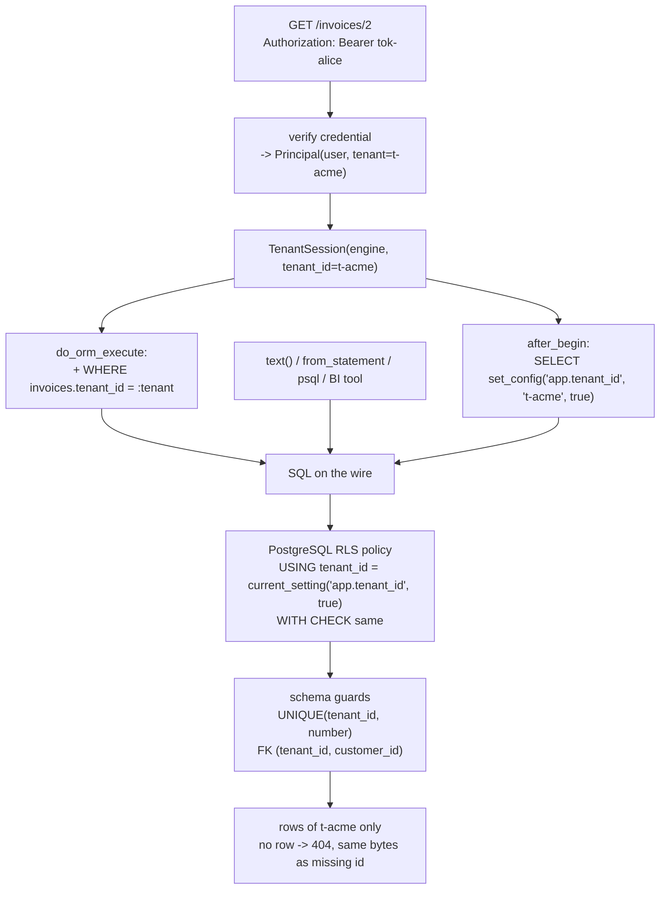

# Preventing Broken Object Level Authorization (BOLA / IDOR, API1:2023): Tenant-Scoped Repository Types and PostgreSQL Row-Level Security (RLS)

> [!summary] Claim
> BOLA disappears as a class only when no code path can name a row without also naming the caller's tenant: bind the tenant from the credential into a session type that rewrites every ORM query, make the schema refuse cross-tenant references, and let PostgreSQL row-level security filter whatever SQL slips past the ORM, with the tenant handed over by `set_config('app.tenant_id', $1, true)` so it dies with the transaction.

Part of [API Authorization and OWASP Security](README.md) in [API Engineering](../README.md).

## TL;DR

- Mechanism: a `TenantSession` (a SQLAlchemy `Session` subclass that cannot exist without a tenant) adds `with_loader_criteria(TenantScoped, cls.tenant_id == :tenant, include_aliases=True)` to every ORM `SELECT`, `UPDATE`, and `DELETE` from a `do_orm_execute` listener, stamps inserts in `before_flush`, and publishes the tenant to PostgreSQL in `after_begin`, where an RLS policy `USING (tenant_id = current_setting('app.tenant_id', true))` filters every row the role can reach.
- Contract rule: the tenant comes from the verified credential, never from the URL, body, or a header the client controls, and "exists but belongs to someone else" returns the same `404 Not Found` bytes as "does not exist" (OWASP IDOR Prevention Cheat Sheet).
- Trap: the ORM layer is not a security boundary: `text()` SQL, `select(...).from_statement(text(...))`, and `Session.get` served from the identity map all bypass it (proven in the lab), and with a mixin base class `with_loader_criteria` applies nothing at all unless `include_aliases=True` (`sqlalchemy 2.1.8 sqlalchemy/orm/context.py, _ORMSelectCompileState._get_extra_criteria`).
- Portability fact: the lab ran on CPython `3.14.6` with SQLAlchemy `2.1.8` and SQLite; the RLS behavior was captured once on PostgreSQL `18.7`, where the table owner bypasses policies until `FORCE ROW LEVEL SECURITY` and a view owned by a superuser bypasses them until `security_invoker = true` (PostgreSQL 15 and later).
- When not to use it: RLS adds a predicate to every query and turns tenant mistakes into empty results rather than errors, so a single-tenant service with object ownership checks in one repository, or a database-per-tenant deployment where the connection itself is the boundary, may not need it; never use it as the only layer, because superusers, `BYPASSRLS` roles, and owners skip it.

## Mental model



The tenant enters the system exactly once, from the verified credential, and every later arrow carries it implicitly, so a handler that only knows `invoice_id = 2` cannot form a query that reaches tenant `t-globex`.
The `do_orm_execute` arrow is the cheap, expressive layer: it rewrites ORM statements before compilation, so joins, aliases, subqueries, lazy loads, and bulk `UPDATE` and `DELETE` all receive the predicate.
The `Raw` arrow is why a second layer exists: any SQL that does not pass through ORM compilation reaches the database unfiltered, and only the database can still stop it.
The `set_config` arrow ties the two together: it publishes the same tenant as a transaction-local setting that the RLS policy reads, so both layers agree and the setting cannot outlive the transaction on a pooled connection.
The schema arrow covers what neither filter handles: constraint checks run without RLS, so keys are scoped per tenant and foreign keys include the tenant column.

## How it works

### What BOLA is, and what it is not

OWASP API Security Top 10 2023 ranks Broken Object Level Authorization first, with exploitability `Easy`, prevalence `Widespread`, detectability `Easy`, and technical impact `Moderate` (OWASP API1:2023).
The attack is substitution: the attacker is allowed to call the endpoint and simply changes an object identifier that the API uses to pick a record, in the path, query string, a header, or the body; the identifier may be an integer, a UUID, or a string (OWASP API1:2023).
OWASP states that comparing the user ID from a JWT with the ID parameter is not sufficient, because the vulnerable decision is about the object, not the caller (OWASP API1:2023).
Its three scenarios are a shop revenue chart at `/shops/{shopName}/revenue_data.json` iterated over every shop name, a car API that starts engines by VIN without checking the VIN belongs to the user, and a GraphQL `deleteReports` mutation on `POST /graphql` with no ownership check (OWASP API1:2023).
MITRE files the weakness as CWE-639, "Authorization Bypass Through User-Controlled Key", lists Insecure Direct Object Reference (IDOR) as an alternate term, and calls the same-privilege case "Horizontal Authorization" (CWE-639).

BOLA is the object-level failure on an endpoint the caller may legitimately use; reaching an endpoint the caller should not use at all is Broken Function Level Authorization, covered in [[Defeating-BFLA-API5-2023-Function-Level-Guards-and-Deny-By-Default-Routers]], and reading or writing a forbidden field of an allowed object is BOPLA, covered in [[Defeating-BOPLA-and-Mass-Assignment-API3-2023-Strict-Input-Output-Schemas]] (OWASP API1:2023 draws the BOLA versus BFLA line; BOPLA is API3:2023, Broken Object Property Level Authorization).
Which layer should own the decision in general (gateway, middleware, domain, query) is the subject of [[Where-Authorization-Lives-Gateway-Middleware-vs-Domain-and-Query-Layer]]; this note is the query-layer and database-layer implementation for the most common object rule, tenancy.

### Fetch-then-check versus scoped query

There are two shapes of an object check.
Fetch-then-check loads `invoice = session.get(Invoice, id)` and then compares `invoice.tenant_id` with the caller; it is correct only if every handler remembers the second line, and it leaks existence if the mismatch answers `403 Forbidden` while a missing row answers `404 Not Found`.
A scoped query asks `SELECT ... WHERE id = :id AND tenant_id = :tenant`; a foreign row and a missing row are then indistinguishable to the handler itself, so both become the same `404`, which the OWASP IDOR cheat sheet recommends when existence is sensitive (OWASP IDOR Prevention Cheat Sheet).
List endpoints, search, export, and bulk mutations have no single object to check after the fact, so only the scoped shape covers them.
The lab's `test_scoped_endpoint_answers_foreign_and_missing_ids_identically` asserts that `GET /invoices/2` (Globex's invoice, requested by Acme) and `GET /invoices/999` return identical status, header list, and body bytes `{"detail":"Not Found"}`.

Random identifiers do not fix BOLA.
OWASP lists "random and unpredictable values as GUIDs" among its prevention steps, and the IDOR cheat sheet frames them as "an additional defense-in-depth measure" while stating that "access control is crucial even with these identifiers", because "If attackers obtain URLs for unauthorized objects, the application should still block their access attempts" (OWASP API1:2023; OWASP IDOR Prevention Cheat Sheet).
Identifiers do get obtained: they travel in URLs, logs, referrers, shared links, and the responses of other endpoints.
The trade-offs of identifier formats are in [[Resource-Identifiers-UUIDv4-vs-UUIDv7-ULID-and-Public-IDs]].

### The tenant comes from the credential

`create_app` resolves `Authorization: Bearer <token>` to a `Principal(user_id, tenant_id)` and builds the session from `principal.tenant_id`; no route parameter can influence it.
A path such as `/tenants/{tenant_id}/invoices/{invoice_id}` is acceptable only as a redundant, checked assertion: if the path tenant differs from the credential tenant the answer is `404`, and the query still uses the credential tenant.
The lab's `test_list_and_auth_are_tenant_bound` shows that a token string equal to a tenant id (`Bearer t-acme`) is not a credential and gets `401` with `WWW-Authenticate: Bearer`.

### Layer 1: a session type that rewrites every ORM statement

SQLAlchemy calls every `do_orm_execute` listener from `Session._execute_internal` before compilation, passing an `ORMExecuteState` whose `statement` the listener may replace (`sqlalchemy 2.1.8 sqlalchemy/orm/session.py, Session._execute_internal`).
The listener is registered on the `TenantSession` class only, so other sessions in the process are untouched, and `TenantSession.__init__` refuses an empty tenant, so a session without a tenant cannot exist (`test_session_without_a_tenant_cannot_exist`).
The listener skips `is_column_load` and `is_relationship_load` (those statements inherit the option from their parent load) and statements that are not `is_select`, `is_update`, or `is_delete` (`sqlalchemy 2.1.8 sqlalchemy/orm/session.py, ORMExecuteState.is_column_load`).

`with_loader_criteria(entity_or_base, where_criteria, loader_only=False, include_aliases=False, propagate_to_loaders=True, track_closure_variables=True)` builds a `LoaderCriteriaOption` (`sqlalchemy 2.1.8 sqlalchemy/orm/_orm_constructors.py, with_loader_criteria`).
When `entity_or_base` is not mapped (a mixin), the option stores it as `root_entity` and sets `entity = None`, and `_all_mappers` walks `__subclasses__()` to find every mapped subclass (`sqlalchemy 2.1.8 sqlalchemy/orm/util.py, LoaderCriteriaOption.__init__ and _all_mappers`).
At compile time `get_global_criteria` appends the option under the key `("additional_entity_criteria", mapper)` for each of those mappers (`sqlalchemy 2.1.8 sqlalchemy/orm/util.py, LoaderCriteriaOption.get_global_criteria`).
For a `SELECT`, `_get_extra_criteria` then adds the resolved criteria for every entity in the statement, but only `if (ae.include_aliases or ae.entity is ext_info)` (`sqlalchemy 2.1.8 sqlalchemy/orm/context.py, _ORMSelectCompileState._get_extra_criteria`).
For an ORM `UPDATE` or `DELETE` the same condition appears in `_BulkUDCompileState._adjust_for_extra_criteria` (`sqlalchemy 2.1.8 sqlalchemy/orm/bulk_persistence.py`).
Because `entity` is `None` for a mixin, `ae.entity is ext_info` is never true, so the mixin form applies nothing unless `include_aliases=True`; the lab proves it in `test_mixin_criteria_without_include_aliases_scope_nothing`, where Acme's session sees all four invoices.
The upstream documentation example passes `include_aliases=True` without explaining why, which is how this trap survives code review (SQLAlchemy 2.1 ORM Events, "Adding global WHERE / ON criteria").

The criteria is a callable, which `LoaderCriteriaOption.__init__` wraps in a `lambdas.DeferredLambdaElement` (`sqlalchemy 2.1.8 sqlalchemy/orm/util.py, LoaderCriteriaOption.__init__`); SQLAlchemy's docstring warns that the lambda "is only invoked once per unique class" (`sqlalchemy 2.1.8 sqlalchemy/orm/_orm_constructors.py, with_loader_criteria`).
The closure variable `tenant` is extracted as a bound parameter on every execution rather than frozen into the cached SQL, which `test_tenant_is_a_bind_parameter_not_a_cached_literal` checks by alternating Acme, Globex, Acme on one engine.
`track_closure_variables=False` does not change that for this criteria: the docstring says it only stops closure variables from being "used as part of any cache key", and a one-off probe of the lab's listener with the flag set (SQLAlchemy `2.1.8`, CPython `3.14.6`, 2026-11-15) compiled one cached statement `WHERE invoices.tenant_id = ?` and bound `t-acme`, `t-globex`, `t-acme` in turn, returning `[1]`, `[2]`, `[1]` (`sqlalchemy 2.1.8 sqlalchemy/orm/_orm_constructors.py, with_loader_criteria`, parameter docs).
The flag is safe only under the docstring's condition that "the lambda ensures it returns the identical SQL every time given a particular class"; a closure that changes the SQL structure per tenant (for example a different column or operator) breaks that contract.

`propagate_to_loaders=True` attaches the option to loaded instances so lazy and `selectin` loads carry it; `test_lazy_load_carries_the_tenant_criteria` captures the lazy `SELECT` for `customer.invoices` and asserts it contains `invoices.tenant_id = ?`.
`test_aliases_joins_and_subqueries_are_scoped` shows `aliased(Invoice)`, a join through `Invoice.customer`, a scalar subquery, and a column-only `select(Customer.id)` are all filtered.
`test_orm_bulk_update_and_delete_are_scoped` runs `update(Invoice).values(amount_cents=0)` with no `WHERE` at all under Acme and gets `rowcount == 2`, and `delete(Invoice).where(Invoice.id == 2)` gets `rowcount == 0`, leaving Globex's rows untouched.

Writes need their own hook, because `INSERT` has no rows to filter.
`before_flush` sets `tenant_id` on new `TenantScoped` objects, raises `TenantScopeError` if a new object names another tenant, and raises if the attribute history of an existing object shows `tenant_id` changed (`test_inserts_are_stamped_and_cross_tenant_writes_rejected`).

What the layer cannot see, by construction:

- `session.execute(text(...))`: a `TextClause` has no ORM entities, so there is nothing to attach criteria to; the lab reads Globex's `INV-1` this way.
- `select(Invoice).from_statement(text(...))`: the ORM builds `Invoice` objects from rows it did not compile; the lab loads Globex's invoice into Acme's session this way.
- `Session.get`: unless `populate_existing` or `with_for_update` is passed, `_get_impl` calls `_identity_lookup` first and returns a cached instance without emitting SQL (`sqlalchemy 2.1.8 sqlalchemy/orm/session.py, Session._get_impl`); after the `from_statement` leak, `s.get(Invoice, 2)` returns the same foreign object with zero statements captured by `before_cursor_execute`.
- `Connection.execute` on a Core connection, other services, migrations, a `psql` prompt, and BI tools, none of which use the session.

`test_raw_sql_and_identity_map_bypass_the_orm_guard` pins all three in-process bypasses, which is the argument for layer 3.
The repository type (`InvoiceRepository`) narrows the surface further: handlers receive a repository that only exposes scoped `get` and `list`, so reaching raw SQL requires visibly leaving the abstraction, which a reviewer or a lint rule can catch.

### Layer 2: the schema refuses cross-tenant references

Two constraints make illegal states unrepresentable in the database.
`UniqueConstraint("tenant_id", "number")` makes business keys unique per tenant, so Acme can issue `INV-7` while Globex already has `INV-7` (`test_per_tenant_unique_key_gives_no_existence_oracle`); a global `UNIQUE(number)` would answer "duplicate key" and reveal that some other tenant used the value.
`ForeignKeyConstraint(["tenant_id", "customer_id"], ["customers.tenant_id", "customers.id"])`, backed by `UNIQUE(tenant_id, id)` on `customers`, means an invoice can only reference a customer of its own tenant; `test_composite_fk_rejects_a_reference_to_another_tenants_row` gets `FOREIGN KEY constraint failed` when Acme points an invoice at Globex's customer `20`.
This matters because PostgreSQL documents that "referential integrity checks, such as unique or primary key constraints and foreign key references, always bypass row security", and warns about "covert channel" leaks through them (PostgreSQL 18 Section 5.9).
`CREATE POLICY` notes give the two canonical leaks, inserting a duplicate into a unique column and inserting a reference to a hidden row, and recommend surrogate keys "instead of keys with external meanings" (PostgreSQL 18 CREATE POLICY, Notes).
A globally unique surrogate primary key still leaks existence if the client may choose it: the captured session below shows Acme inserting `id = 2` and getting `duplicate key value violates unique constraint "invoices_pkey"` for Globex's hidden row, so let the database generate primary keys.

### Layer 3: PostgreSQL row-level security

`ALTER TABLE ... ENABLE ROW LEVEL SECURITY` makes "all normal access to the table for selecting rows or modifying rows" depend on a policy, and with no policy "a default-deny policy is used" (PostgreSQL 18 Section 5.9).
`TRUNCATE` and `REFERENCES` are whole-table operations and are not subject to row security (PostgreSQL 18 Section 5.9).
Policies created on a table while RLS is disabled are ignored until it is enabled (PostgreSQL 18 ALTER TABLE).

`CREATE POLICY name ON table [AS {PERMISSIVE | RESTRICTIVE}] [FOR {ALL | SELECT | INSERT | UPDATE | DELETE}] [TO role] [USING (expr)] [WITH CHECK (expr)]` attaches two kinds of predicate (PostgreSQL 18 CREATE POLICY).
`USING` filters existing rows silently; `WITH CHECK` validates new rows and raises an error if the expression is false or null, aborting the whole command (PostgreSQL 18 CREATE POLICY).
An `ALL` or `UPDATE` policy with only `USING` uses the same expression as its `WITH CHECK` (PostgreSQL 18 Section 5.9; PostgreSQL 18 CREATE POLICY).
Per command: `SELECT` filters by `SELECT` policies; `INSERT` checks `WITH CHECK`; `UPDATE` filters the old row by `UPDATE` `USING`, checks the new row by `WITH CHECK`, and also applies `SELECT` policies when it reads columns in `WHERE` or `RETURNING`; `DELETE` filters by `DELETE` `USING`; `INSERT ... ON CONFLICT DO UPDATE` checks both the existing and new rows and never silently skips; `MERGE` has no policy of its own and uses the per-action ones (PostgreSQL 18 CREATE POLICY, Table "Policies Applied by Command Type").
`RETURNING` rows must pass the `SELECT` policies or the statement errors; they are "never silently ignored" (PostgreSQL 18 CREATE POLICY).
Several permissive policies combine with `OR`, restrictive ones with `AND`, so a restrictive tenant policy is a safe place for the invariant while permissive policies grant role-specific access inside it (PostgreSQL 18 Section 5.9).

Who is not filtered: "Superusers and roles with the `BYPASSRLS` attribute always bypass the row security system", and table owners bypass it too unless the table has `FORCE ROW LEVEL SECURITY` (PostgreSQL 18 Section 5.9; PostgreSQL 18 ALTER TABLE).
Only the table owner may enable RLS or create policies (PostgreSQL 18 Section 5.9).
The deployment consequence is three roles: a migration role that owns the tables, an application role that is not the owner, not a superuser, and not `BYPASSRLS`, and a separately audited `BYPASSRLS` role for backups and cross-tenant jobs.

Evaluation order: the policy expression "will be evaluated for each row prior to any conditions or functions coming from the user's query", except for `LEAKPROOF` functions, which the optimizer may run first (PostgreSQL 18 Section 5.9).
A function is leakproof if it reveals nothing about its arguments except by its return value; a function that raises for some inputs is not, and only a superuser may set the flag (PostgreSQL 18 CREATE FUNCTION).
The planner side of the same boundary was CVE-2019-10130: a user could read sampled column statistics through a leaky operator and see values from rows hidden by a policy; since 11.3, 10.8, 9.6.13, and 9.5.17 a non-leakproof operator may use those statistics only when no relevant policy exists (PostgreSQL CVE-2019-10130).

Views: by default a view reads base tables with the view owner's rights and the view owner's policies; with `security_invoker = true` the caller's policies apply (PostgreSQL 18 CREATE VIEW, Notes).
The invoker option arrived in PostgreSQL 15.0, released 2022-10-13 (PostgreSQL 15.0 release notes, "Allow table accesses done by a view to optionally be controlled by privileges of the view's caller").
`row_security = off` does not bypass anything; it makes a query that "would otherwise apply at least one policy" fail, which is how `pg_dump` avoids silently partial backups (PostgreSQL 18 Client Connection Defaults, `row_security`).

Policies that consult other tables through sub-`SELECT`s can race: PostgreSQL's own example shows a privilege downgrade being missed because the sub-`SELECT` reads the snapshot taken at query start, and the documented fixes are `SELECT ... FOR SHARE` in the policy or an `ACCESS EXCLUSIVE` lock on updates to the referenced table (PostgreSQL 18 Section 5.9).
A tenant policy comparing a column of the row itself with a setting avoids that whole class, which the documentation calls "the simplest and best-performing case" (PostgreSQL 18 Section 5.9).

### Handing the tenant to the database: custom settings

PostgreSQL "will accept a setting for any two-part parameter name" such as `app.tenant_id`, treated as a placeholder until an extension defines it (PostgreSQL 18 Section 19.16).
`current_setting(name, missing_ok)` returns the value, or `NULL` when the setting does not exist and `missing_ok` is `true`; without `missing_ok` it raises (PostgreSQL 18 Section 9.28.1).
`set_config(name, value, is_local)` sets it and returns the value; with `is_local = true` the value "will only apply during the current transaction" (PostgreSQL 18 Section 9.28.1).
`SET LOCAL` lasts "only till the end of the current transaction, whether committed or not", and outside a transaction block it "emits a warning and otherwise has no effect" (PostgreSQL 18 SET).
A plain `SET` (session scope) inside a committed transaction persists "until the end of the session" (PostgreSQL 18 SET).

Use `set_config(..., true)` rather than `SET LOCAL` from application code: `SET` is a utility command that takes no bind parameters (only `SELECT`, `INSERT`, `UPDATE`, `DELETE`, `MERGE`, and `VALUES` can be prepared, PostgreSQL 18 PREPARE), so a driver would have to interpolate the tenant into SQL text, whereas `set_config` is an ordinary function call with a bound argument.
The lab's `after_begin` listener emits `SELECT set_config('app.tenant_id', :tenant, true)` once per transaction, and `test_tenant_is_published_as_a_transaction_local_setting` checks the recorded calls are exactly `[("app.tenant_id", "t-acme", True), ("app.tenant_id", "t-globex", True)]` for two transactions issuing two queries each.

Connection poolers make the transaction scope mandatory, not stylistic.
PgBouncer in transaction pooling assigns a server connection "only during a transaction" and lists `SET/RESET` as never supported in that mode (PgBouncer features, as of 2026-11).
A session-level `SET app.tenant_id` therefore stays on a server connection that the next client's transaction may receive; step 7 of the captured session reproduces that leak on one connection.
How pool sizing and PgBouncer modes interact with SQLAlchemy pools is in [[Sizing-Connection-Pools-Across-Workers-Pods-and-PgBouncer-Transaction-Mode]].

### Captured PostgreSQL 18.7 session

Run once on a throwaway cluster (`initdb`, server on `127.0.0.1` only, `psql -X -f`, stopped and deleted afterwards) on macOS 27.3 arm64 with Homebrew PostgreSQL `18.7`; the application role `app_user` is not the owner, the table owner is `app_owner`, and the script runs as the bootstrap superuser with `SET ROLE` (excerpt, `psql:` file prefixes trimmed, blank lines removed).
An independent rerun on 2026-11-15 (same machine and PostgreSQL `18.7`, a rewritten script, `initdb -A trust`, `127.0.0.1:54329` with no Unix socket, cluster deleted afterwards) produced the same lines for all 14 steps; step 14 was planned with `enable_seqscan = off` so the four-row table uses the index.

```sql
CREATE POLICY tenant_isolation ON invoices
  USING (tenant_id = current_setting('app.tenant_id', true))
  WITH CHECK (tenant_id = current_setting('app.tenant_id', true));
```

```text
--- 1. RLS enabled, no policy: default deny
 count
-------
     0
--- 3. transaction-local tenant: foreign id is invisible, foreign UPDATE touches 0 rows
 id | tenant_id | number
----+-----------+--------
  1 | t-acme    | INV-1
  3 | t-acme    | INV-2
 id
----
UPDATE 0
DELETE 0
--- 4. after COMMIT the placeholder survives as an empty string, not NULL
 is_null | is_empty_string
---------+-----------------
 f       | t
ERROR:  invalid input syntax for type uuid: ""
--- 5. WITH CHECK blocks writing into, or moving a row to, another tenant
ERROR:  new row violates row-level security policy for table "invoices"
ERROR:  new row violates row-level security policy for table "invoices"
--- 6. SET LOCAL outside a transaction block
WARNING:  SET LOCAL can only be used in transaction blocks
--- 7. session-level SET leaks into the next request on the same pooled connection
 request 1 (globex) |     2
 request 2 (no tenant set) |     2
--- 8. bound value, not SQL: an injection string is just a tenant id that matches nothing
 t-acme' OR '1'='1
 count
-------
     0
--- 9. primary key check bypasses RLS: the error confirms a hidden id exists
ERROR:  duplicate key value violates unique constraint "invoices_pkey"
--- 10. policy quals run before non-LEAKPROOF user functions
NOTICE:  peek saw INV-1
NOTICE:  peek saw INV-2
--- 11. owner bypasses RLS until FORCE; superuser always bypasses
 owner, not forced |     4
 owner, forced |     0
 superuser |     4
--- 12. a view runs with its owner rights unless security_invoker
 view owned by superuser |     4
 security_invoker view |     0
--- 13. row_security = off makes filtering an error instead of silent
ERROR:  query would be affected by row-level security policy for table "invoices"
--- 14. the policy predicate is in the plan
 Index Scan using invoices_pkey on invoices
   Index Cond: (id = 3)
   Filter: (tenant_id = current_setting('app.tenant_id'::text, true))
```

Step 4 is the subtle one: once a placeholder has been set in a session, `current_setting('app.tenant_id', true)` returns the empty string after the transaction ends, not `NULL`, so a policy that casts the setting (`::uuid`, `::bigint`) raises `invalid input syntax` on the next untenanted query instead of returning zero rows; compare text to text, or write `NULLIF(current_setting('app.tenant_id', true), '')::uuid`.
Step 10 shows the evaluation-order guarantee: the `peek` function, declared with an absurdly low cost to tempt the planner, saw only Acme's two invoice numbers.
Step 14 shows the cost model: the policy is just another qual, here a `Filter` on top of a primary-key index scan, so an index on `tenant_id` (or a composite index led by it) is what keeps list queries fast.

### PostgreSQL CVEs in the RLS machinery

CVE-2023-2455: row security policies "disregard user ID changes after inlining", so a query planned under one role and executed under another (security definer functions, plan reuse across `SET ROLE`) may apply the wrong role's policies; fixed in 15.3, 14.8, 13.11, 12.15, and 11.20 on 2023-05-11, CVSS 3.0 4.2 (PostgreSQL CVE-2023-2455).
CVE-2024-10976 extended the same flaw to subqueries, `WITH` queries, security invoker views, and SQL-language functions; fixed in 17.1, 16.5, 15.9, 14.14, 13.17, and 12.21 on 2024-11-14, CVSS 3.0 4.2 (PostgreSQL CVE-2024-10976).
Both affect role-specific policies with role switching; a single application role whose policy reads a transaction-local setting does not depend on per-role plan selection, which is a further reason to prefer the setting over one database role per tenant (inference from the two advisories, not a claim made by them).

## Numbers and limits

| Quantity | Value | Source or measurement |
|---|---|---|
| OWASP API1:2023 ratings | exploitability `Easy`, prevalence `Widespread`, detectability `Easy`, technical impact `Moderate` | OWASP API1:2023 |
| Rows visible with RLS enabled and no policy | 0 | PostgreSQL 18 Section 5.9; captured step 1, PostgreSQL `18.7` |
| Lifetime of `set_config(..., true)` | until `COMMIT` or `ROLLBACK` | PostgreSQL 18 Section 9.28.1 and SET |
| `current_setting(name, true)` never set / set then transaction ended | `NULL` / empty string | PostgreSQL 18 Section 9.28.1; captured step 4 |
| PgBouncer transaction pooling and `SET/RESET` | never supported | PgBouncer features (as of 2026-11) |
| `security_invoker` views available from | PostgreSQL 15.0 (2022-10-13) | PostgreSQL 15.0 release notes |
| CVE-2023-2455 fixed in | 15.3, 14.8, 13.11, 12.15, 11.20 (2023-05-11), CVSS 3.0 score 4.2 | PostgreSQL security page |
| CVE-2024-10976 fixed in | 17.1, 16.5, 15.9, 14.14, 13.17, 12.21 (2024-11-14), CVSS 3.0 score 4.2 | PostgreSQL security page |
| CVE-2019-10130 fixed in | 11.3, 10.8, 9.6.13, 9.5.17 (2019-05-09), CVSS 3.0 score 3.1 | PostgreSQL security page |
| CVE-2025-48757 (insufficient RLS policy in Lovable-generated sites, Lovable through 2025-04-15) | CVSS 3.1 score 9.3, CWE-863, published 2025-05-30, disputed by the supplier | CVE record |
| USPS Informed Visibility API exposure | about 60 million users, unfixed more than a year after the researcher's report, API changed 2018-11-20 | KrebsOnSecurity, 2018-11-21 |
| Peloton class-stats API | classes of "800+ users", reported 2021-01-20, "largely fixed within 7 days" of the CISO's contact after a journalist approached Peloton (update dated 2021-05-05) | Pen Test Partners, 2021-05-05 |
| Lab statements per transaction added by the guard | 1 (`SELECT set_config(...)` in `after_begin`) | `test_tenant_is_published_as_a_transaction_local_setting` |
| Lab run | 15 passed in 1.53 s (one cold run; wall time includes imports) | `uv run --frozen pytest tests/f15_api_authorization_and_owasp_security/test_defeating_bola_api1_2023_tenant_scoped_queries_and_postgresql_rls.py -q`, CPython `3.14.6`, SQLAlchemy `2.1.8`, macOS 27.3 arm64, 2026-11-15 |

The per-query cost of RLS was not benchmarked here; the plan in step 14 shows the policy as one extra `Filter` qual, and its real cost depends on indexes and selectivity, and no latency number is claimed.

## Portability

Lab checks were paused by the user on 2026-11-11, so the lab ran once on the workspace interpreter; other cells cite sources or say they were not run.

| Leg | Behavior | Evidence |
|---|---|---|
| CPython `3.14.6` (macOS 27.3 arm64, workspace `.python-version` `3.14`) | 15 passed in 1.53 s (verifier rerun, 2026-11-15); ruff format and check, mypy strict, pyright strict clean over `src` and `tests` in the drafter's run, not rerun (lab checks paused) | Ran: pytest command in Numbers and limits |
| CPython `3.12.16`, `3.13.18`, `3.14.10`, `3.15.2`, `3.15.2t` | Not run (lab checks paused 2026-11-11), so no behavior is claimed for these legs; the lab imports only `sqlite3`, `dataclasses`, SQLAlchemy, FastAPI, Pydantic, httpx, and pytest from the locked workspace (`requires-python = ">=3.12,<3.16"`) | `labs/pyproject.toml`; imports in `tenant_scope.py` and the test module |
| SQLAlchemy `2.1.8` | Mixin criteria need `include_aliases=True`; `Session.get` identity-map short-circuit; ORM `UPDATE`/`DELETE` receive criteria | Source cited in How it works; lab tests |
| SQLAlchemy `2.0.57` (workspace `sqlalchemy20` group) | Lab not run on 2.0.57; its source has the same `if (ae.include_aliases or ae.entity is ext_info)` filter, the same `entity = None` for an unmapped base, and the same `_identity_lookup` short-circuit in `_get_impl` | `sqlalchemy 2.0.57 lib/sqlalchemy/orm/context.py, _ORMSelectCompileState._get_extra_criteria`; `bulk_persistence.py, _BulkUDCompileState._adjust_for_extra_criteria`; `util.py, LoaderCriteriaOption.__init__`; `session.py, Session._get_impl` (tag `rel_2_0_57`) |
| SQLite (lab) vs PostgreSQL | SQLite has no RLS; the lab registers a `set_config` shim that records calls, and enforces FKs with `PRAGMA foreign_keys = ON` | `make_engine` in the lab |
| PostgreSQL `18.7` | All 14 captured behaviors above | Ran twice (drafter, then an independent rerun on 2026-11-15) with identical output |
| PostgreSQL before 15 | No `security_invoker`; views always use the owner's policies | PostgreSQL 15.0 release notes |
| asyncpg `0.32.0`, psycopg `3.3.8` | Both send `SELECT set_config('app.tenant_id', $1, true)` as a parameterized extended-protocol statement; with the value `t-acme' OR '1'='1` as `app_user`, `count(*)` returned 0 on both | Ran once against the throwaway PostgreSQL `18.7` cluster with `log_statement = all`, which logged `execute <unnamed>` (psycopg) and `execute __asyncpg_stmt_1__` (asyncpg) with `$1`, 2026-11-15 |
| PgBouncer transaction mode | Session `SET` unsafe; transaction-local `set_config` is scoped to the transaction the pooler pins | PgBouncer features; captured step 7 shows the session-scope leak on one connection |
| Uvicorn, Hypercorn, Granian; HTTP/1.1, HTTP/2, HTTP/3 | Not run, so no behavior is claimed; by design (inference from the code, not a measurement) the tenant decision reads only the verified credential and the database session, never the transport | Lab used `httpx.ASGITransport` in-process; no server or HTTP version was exercised |

## Worked example

The [implementation](../labs/src/api_labs/f15_api_authorization_and_owasp_security/tenant_scope.py) defines the `TenantScoped` mixin, the schema guards, `TenantSession` with its three listeners, an `InvoiceRepository`, and a FastAPI app with `scoped=True` (fixed) and `scoped=False` (the classic bug); the [test](../labs/tests/f15_api_authorization_and_owasp_security/test_defeating_bola_api1_2023_tenant_scoped_queries_and_postgresql_rls.py) has 15 `@pytest.mark.unit` tests over in-memory SQLite.

The schema guards (excerpt, verbatim lines from `tenant_scope.py`):

```python
class Invoice(TenantScoped, Base):
    __tablename__ = "invoices"
    __table_args__ = (
        # Per-tenant uniqueness: a global UNIQUE(number) would let tenant A learn that tenant B
        # already issued "INV-1" from the constraint violation (a covert existence channel).
        UniqueConstraint("tenant_id", "number"),
        # Composite FK: an invoice can only point at a customer of the same tenant.
        ForeignKeyConstraint(["tenant_id", "customer_id"], ["customers.tenant_id", "customers.id"]),
    )
```

The session type and its three listeners (excerpt, verbatim lines from `tenant_scope.py`):

```python
class TenantSession(Session):
    """A Session bound to exactly one tenant for its whole life (one request)."""

    def __init__(self, bind: Engine, *, tenant_id: str) -> None:
        if not tenant_id:
            raise TenantScopeError("a TenantSession needs a non-empty tenant_id")
        super().__init__(bind=bind, info={"tenant_id": tenant_id})
```

```python
@event.listens_for(TenantSession, "do_orm_execute")
def _scope_orm_statements(state: ORMExecuteState) -> None:
    """Add ``tenant_id = :tenant`` to every TenantScoped entity in SELECT, UPDATE, DELETE."""
    if state.is_column_load or state.is_relationship_load:
        return  # already carries the option via propagate_to_loaders
    if not (state.is_select or state.is_update or state.is_delete):
        return
    tenant: str = state.session.info["tenant_id"]

    def same_tenant(cls: type[TenantScoped]) -> ColumnElement[bool]:
        return cls.tenant_id == tenant

    state.statement = state.statement.options(
        with_loader_criteria(
            TenantScoped,
            same_tenant,
            include_aliases=GUARD.include_aliases,
            propagate_to_loaders=GUARD.propagate_to_loaders,
        )
    )


@event.listens_for(TenantSession, "before_flush")
def _stamp_and_pin_tenant(session: Session, flush_context: object, instances: object) -> None:
    """New rows get the session tenant; existing rows may never change tenant."""
    tenant = session.info["tenant_id"]
    for obj in session.new:
        if isinstance(obj, TenantScoped):
            if obj.tenant_id is None:  # pyright: ignore[reportUnnecessaryComparison]
                obj.tenant_id = tenant
            elif obj.tenant_id != tenant:
                raise TenantScopeError(f"insert into tenant {obj.tenant_id!r} from {tenant!r}")
    for obj in session.dirty:
        if isinstance(obj, TenantScoped) and inspect(obj).attrs["tenant_id"].history.deleted:
            raise TenantScopeError("tenant_id is immutable once written")


@event.listens_for(TenantSession, "after_begin")
def _publish_tenant_guc(session: Session, transaction: SessionTransaction, connection: Any) -> None:
    """Make the tenant visible to PostgreSQL RLS for this transaction only.

    ``SET LOCAL`` cannot take a bind parameter, so ``set_config(name, value, true)`` is the
    injection-safe spelling of ``SET LOCAL app.tenant_id = ...``.
    """
    connection.execute(
        select(func.set_config(TENANT_GUC, session.info["tenant_id"], GUARD.publish_guc_local))
    )
```

The vulnerable and fixed lookups differ in one branch (excerpt, verbatim lines from `create_app` in `tenant_scope.py`):

```python
    def load(db: Session, invoice_id: int) -> Invoice:
        if isinstance(db, TenantSession):
            found = InvoiceRepository(db).get(invoice_id)
        else:
            found = db.get(Invoice, invoice_id)  # BOLA: trusts the client-supplied id
        if found is None:
            # Same status and body as "no such id": a 403 here would confirm the id exists.
            raise HTTPException(status_code=404, detail="Not Found")
        return found
```

The trap and the limit of the ORM layer (excerpt, verbatim lines from the test module):

```python
def test_mixin_criteria_without_include_aliases_scope_nothing(
    db: tuple[Engine, GucLog], monkeypatch: pytest.MonkeyPatch
) -> None:
    # with_loader_criteria(<unmapped mixin>, ...) has entity=None, and the compiler applies an
    # option only if include_aliases is set or option.entity is the queried entity.
    monkeypatch.setattr(GUARD, "include_aliases", False)
    with TenantSession(db[0], tenant_id=ACME) as s:
        assert ids(s, select(Invoice.id)) == [1, 2, 3, 4]
```

```python
def test_raw_sql_and_identity_map_bypass_the_orm_guard(db: tuple[Engine, GucLog]) -> None:
    # The ORM guard is a convenience layer, not a security boundary: this is why RLS exists.
    seen: list[str] = []
    with TenantSession(db[0], tenant_id=ACME) as s:
        raw = s.execute(text("SELECT number FROM invoices WHERE id = 2")).scalar_one()
        assert raw == "INV-1"  # Globex's row, unfiltered
        stmt = select(Invoice).from_statement(text("SELECT * FROM invoices WHERE id = 2"))
        leaked = s.scalars(stmt).one()
        assert leaked.tenant_id == GLOBEX

        @event.listens_for(db[0], "before_cursor_execute")
        def capture(*args: Any) -> None:
            seen.append(args[2])

        assert s.get(Invoice, 2) is leaked  # served from the identity map
    assert seen == []  # no SQL, so no criteria could have been applied
```

The fixture inserts tenants before customers with an explicit `flush()`, because with no `relationship()` between `Customer` and `Tenant` the unit of work inserted `customers` first and SQLite raised `FOREIGN KEY constraint failed` in the first run of the lab.

Captured run, from `labs/`, CPython `3.14.6`, `macOS-27.3-arm64-arm-64bit-Mach-O`:

```text
$ uv run --frozen pytest tests/f15_api_authorization_and_owasp_security/test_defeating_bola_api1_2023_tenant_scoped_queries_and_postgresql_rls.py -q
...............                                                          [100%]
15 passed in 1.53s
```

## Pitfalls

> [!warning] Authentication mistaken for authorization
> Trigger: an endpoint checks that the caller is logged in and then serves whatever record the request names, often with wildcard or bulk query support.
> Symptom: any account can read every account; at USPS the Informed Visibility API let any logged-in `usps.com` user view and, for some fields, request changes to other users' account data, exposing about 60 million users, and the researcher's report went unanswered for more than a year (KrebsOnSecurity, 2018-11-21).
> Fix: the object query carries the credential's tenant or owner; logging in only proves identity.

> [!warning] Fixing the authentication but not the object rule
> Trigger: an unauthenticated data endpoint is "fixed" by requiring a login.
> Symptom: Peloton's `POST /stats/workouts/details` first answered unauthenticated requests and after a silent partial fix on 2021-02-02 still returned other members' data, including members with private profiles, to any self-registered account (Pen Test Partners, 2021-05-05).
> Fix: write the cross-tenant test (two principals, each requesting the other's ids) for every read, write, export, and admin route, as the OWASP IDOR cheat sheet prescribes.

> [!warning] RLS enabled on some tables, or not at all
> Trigger: a client talks to the database directly (a PostgREST or Supabase-style API) and RLS is the only object check.
> Symptom: CVE-2025-48757 records that insufficient RLS policies in sites generated by Lovable allowed remote unauthenticated reads and writes of arbitrary tables, CVSS 3.1 9.3; the supplier disputes it as customer responsibility (CVE-2025-48757 record).
> Fix: CI that fails if any table in an exposed schema lacks `relrowsecurity` and a policy, plus `FORCE ROW LEVEL SECURITY` where the application connects as owner.

> [!warning] The mixin criteria silently applies nothing
> Trigger: `with_loader_criteria(TenantScoped, fn)` with the default `include_aliases=False`.
> Symptom: every query is unfiltered and nothing errors; `test_mixin_criteria_without_include_aliases_scope_nothing` returns all four invoices.
> Fix: pass `include_aliases=True` for a mixin base, and keep a test that fails when it is removed (`sqlalchemy 2.1.8 sqlalchemy/orm/context.py, _ORMSelectCompileState._get_extra_criteria`).

> [!warning] Session-scoped tenant on a pooled connection
> Trigger: `SET app.tenant_id = ...` or `set_config(..., false)` per request.
> Symptom: intermittent cross-tenant reads, only under load, only behind a pooler; step 7 of the captured session shows "request 2" with no tenant seeing request 1's two Globex rows.
> Fix: `set_config(..., true)` inside the request transaction, which ends with the transaction (PostgreSQL 18 Section 9.28.1); PgBouncer transaction mode never supports `SET/RESET` (PgBouncer features).

> [!warning] Application connects as the table owner or a superuser
> Trigger: migrations and the app share one role, or local development runs as `postgres`.
> Symptom: policies exist, tests against a non-owner pass, production returns everything; captured step 11 shows owner 4 rows, forced owner 0, superuser 4.
> Fix: separate owner and application roles, `ALTER TABLE ... FORCE ROW LEVEL SECURITY`, and a startup check that `current_user` is neither superuser nor `BYPASSRLS`.

> [!warning] Reporting views and functions that run as their owner
> Trigger: a view or `SECURITY DEFINER` function created by the owner or a superuser and granted to the app role.
> Symptom: captured step 12 shows a superuser-owned view returning all 4 rows to `app_user`.
> Fix: `security_invoker = true` on views (PostgreSQL 15 and later); for `SECURITY DEFINER` functions, filter explicitly and set `search_path` with `pg_temp` last (PostgreSQL 18 CREATE FUNCTION).

> [!warning] Casting an empty setting
> Trigger: `USING (tenant_id = current_setting('app.tenant_id', true)::uuid)`.
> Symptom: works in tests, then a later untenanted statement in a session that once set the value fails with `invalid input syntax for type uuid: ""` (captured step 4).
> Fix: `NULLIF(current_setting('app.tenant_id', true), '')::uuid`, which turns both unset and empty into `NULL`, and a policy comparison with `NULL` is never true.

> [!warning] `403` versus `404`
> Trigger: fetch-then-check returns `403 Forbidden` for a foreign id.
> Symptom: the API becomes an existence oracle over the whole id space, even with UUIDs.
> Fix: one code path that cannot distinguish the cases, asserted byte for byte as in `test_scoped_endpoint_answers_foreign_and_missing_ids_identically`.

## Security and robustness

Threat model: an authenticated tenant member (the common BOLA attacker, CWE-639 notes the attacker is "likely" authenticated) who can send arbitrary identifiers in any request field; an internal job or BI user with database access; and a developer who writes one raw query.
Layer 1 stops the first actor on every ORM path, layer 3 stops all three on every SQL path for non-bypass roles, and layer 2 keeps integrity checks from leaking what layers 1 and 3 hide.

Boundary rules worth enforcing mechanically:

- Every table with a `tenant_id` column has RLS enabled, forced, and a policy; every foreign key between tenant tables includes `tenant_id`; every business-key unique constraint leads with `tenant_id`.
- The application role is checked at startup: `SELECT rolsuper, rolbypassrls FROM pg_roles WHERE rolname = current_user` must return two `false` values.
- The tenant setting is only ever written with `is_local = true`, and the request transaction wraps every statement; in autocommit mode `set_config(..., true)` lasts one statement, so a later statement would run without it.
- Background jobs that legitimately span tenants run under a separate role and code path, and iterate tenants explicitly rather than using `BYPASSRLS` for convenience.
- Identifier inputs are typed (`int`, UUID) at the edge so malformed ids fail as `422` before any query; that is input hygiene, not authorization.

Injection: the tenant reaches PostgreSQL as a bound argument of `set_config`, so a hostile value is data; captured step 8 shows `t-acme' OR '1'='1` stored verbatim and matching zero rows.
Raw SQL that interpolates identifiers belongs to [[SQL-Injection-NoSQL-Injection-and-Order-By-Identifier-Escaping]].

Error and log channels: a `WITH CHECK` failure returns `new row violates row-level security policy for table "invoices"`, which is safe to log but should map to a generic `404` or `422` at the API, and constraint errors from layer 2 must not be echoed with the conflicting values; see [[Structured-Log-Redaction-and-Preventing-PII-and-Token-Leaks]].
Enumeration speed is an API4 and API6 concern, covered in [[Unrestricted-Resource-Consumption-API4-2023-Payload-Depth-and-Limit-Guards]] and [[Protecting-Sensitive-Business-Flows-API6-2023-Anti-Automation-and-Bot-Defense]]; rate limits slow a BOLA scan but never fix it.

Testing: the OWASP IDOR cheat sheet's recipe is several users, objects owned by each, and cross-access attempts over read, create, update, delete, export, and admin operations, with predictable and unpredictable ids alike (OWASP IDOR Prevention Cheat Sheet).
A route-table test that enumerates every route taking an id and runs the two-principal swap is the regression gate that keeps new endpoints honest.

## The principal's view

The decision is where tenancy is enforced, and the answer is "in the data access type and in the database, and never only in handlers".
Handler-level checks scale with the number of endpoints and reviewers; a session type and a policy scale with the number of tables, which grows far more slowly and can be linted.
The organizational trade-off is ownership: RLS moves part of the authorization model into migrations, so the platform or data team owns policies, roles, and the bypass process, and application teams lose the ability to "just run a query" across tenants, which is the point.
The cost is operational: every query carries a predicate that the planner must handle well, policy mistakes produce empty pages instead of exceptions, debugging requires knowing which role and setting were active, and bypass roles become crown jewels that need audit.

Choose differently when the isolation unit is larger.
Schema-per-tenant or database-per-tenant makes the connection string the boundary and removes the per-row predicate, at the price of migrations fanned out across N schemas and pool counts that grow with tenants; it suits few, large, regulated tenants.
For object rules richer than tenancy (sharing, folders, delegated access), RLS predicates become joins against ACL tables with the race conditions PostgreSQL documents, and a relationship-based authorization service is usually the better home; see [[Authorization-Models-Scopes-RBAC-ABAC-and-Zanzibar-ReBAC]].
For a NoSQL store with no RLS equivalent, layer 1 carries everything, so the repository type, partition keys that embed the tenant, and the two-principal test suite become non-negotiable.

## Interview questions

> [!question] L5: What distinguishes BOLA from BFLA and BOPLA, and why does OWASP say comparing the JWT user id with an id parameter is not enough?
>
> > [!success]- Answer
> > BOLA is a legitimate endpoint used with an object identifier the caller should not reach; BFLA is calling an endpoint the caller should not call at all; BOPLA is reading or writing a forbidden property of an object the caller may access.
> > Comparing the token's user id with a path parameter only works for endpoints keyed by user id; most endpoints are keyed by object ids, and the question is whether that object belongs to the caller, which needs the object's owner or tenant.
> > The robust form is a query that includes the caller's tenant, so the check cannot be forgotten per handler.
> >
> > Follow-up: Which of the three does a GraphQL `deleteReports(id)` mutation without an ownership check fall under?

> [!question] L5: Why return `404` rather than `403` when a caller asks for another tenant's object?
>
> > [!success]- Answer
> > A `403` for foreign ids and a `404` for missing ids turns the endpoint into an existence oracle over the identifier space.
> > A scoped query cannot tell the cases apart, so returning the same status, headers, and body for both is natural and leaks nothing.
> > `403` remains right when the caller can see that the object exists but lacks the action, for example read-only access to a shared document.
> >
> > Follow-up: How would you assert in a test that the two responses are indistinguishable?

> [!question] L6: Predict the output: with `with_loader_criteria(TenantScoped, lambda cls: cls.tenant_id == t)` added in `do_orm_execute`, `TenantScoped` an unmapped mixin, and `include_aliases` left at its default, what does Acme's session get from `select(Invoice.id)` over four invoices, two per tenant?
>
> > [!success]- Answer
> > All four ids, `[1, 2, 3, 4]`.
> > For an unmapped base the option stores `entity = None`, and the compiler includes criteria only when `include_aliases` is true or `option.entity is ext_info`, which can never hold.
> > Nothing errors, so the guard silently does nothing; the lab's `test_mixin_criteria_without_include_aliases_scope_nothing` pins this.
> >
> > Follow-up: Would passing the mapped class `Invoice` instead of the mixin change the result, and what would you lose?

> [!question] L6: List the ways a query can bypass a `do_orm_execute` tenant filter in SQLAlchemy 2.1.
>
> > [!success]- Answer
> > `text()` statements and Core `Connection.execute` have no ORM entities to filter.
> > `select(Entity).from_statement(text(...))` builds ORM objects from rows the ORM did not compile.
> > `Session.get` returns an identity-map hit without emitting SQL, so a foreign object already in the session is returned unfiltered.
> > Inserts are not filtered at all and need `before_flush` stamping, and anything outside the session (jobs, `psql`, BI) never sees the listener.
> >
> > Follow-up: Which of these does PostgreSQL RLS close, and which does it not?

> [!question] L6: Debug this API: a multi-tenant service on PgBouncer in transaction mode runs `SET app.tenant_id = $tenant` at the start of each request and occasionally shows a customer another tenant's invoices, never in staging and never on replay; what is happening and what is the fix?
>
> > [!success]- Answer
> > `SET` is session-scoped, so the value stays on the server connection after the request's transaction ends, and PgBouncer hands that server connection to another client's next transaction.
> > A request that fails before its own `SET`, or code that runs a query before setting the tenant, inherits the previous tenant; staging has too little concurrency to reuse connections that way.
> > PgBouncer documents `SET/RESET` as never supported in transaction pooling.
> > The fix is `SELECT set_config('app.tenant_id', $1, true)` as the first statement of every transaction, a policy that treats empty and `NULL` as no tenant, and a test that runs two tenants on one connection.
> >
> > Follow-up: Why is `set_config` preferable to `SET LOCAL` from a driver?

> [!question] L6: Your RLS policy is in place and tested, yet production returns every tenant's rows; name three causes.
>
> > [!success]- Answer
> > The application connects as the table owner and the table lacks `FORCE ROW LEVEL SECURITY`.
> > The application role is a superuser or has `BYPASSRLS`, which always bypass row security.
> > The queries go through a view owned by a privileged role without `security_invoker = true`, so the owner's rights and policies apply.
> >
> > Follow-up: What startup assertion catches the first two before traffic arrives?

> [!question] L7+: Even with RLS, how can a user learn that another tenant's object exists, and how do you design the schema to prevent it?
>
> > [!success]- Answer
> > Unique, primary key, and foreign key checks bypass row security, so a duplicate-key error or a successful reference proves a hidden value exists.
> > Make business keys unique per tenant with `UNIQUE(tenant_id, key)`, include `tenant_id` in every foreign key, and let the database generate primary keys so clients never choose them.
> > Map constraint errors to generic API errors and never echo the conflicting value.
> >
> > Follow-up: How would a policy that consults a sharing table through a sub-`SELECT` reintroduce leaks, and what does PostgreSQL suggest?

> [!question] L7+: Make the architecture call between row-level security in a shared schema, schema-per-tenant, and database-per-tenant for a B2B SaaS with 20000 small tenants and 5 regulated enterprise tenants.
>
> > [!success]- Answer
> > For the long tail, a shared schema with tenant-scoped sessions and forced RLS gives one migration path, one pool, and per-row isolation that is enforced in the database.
> > For the regulated few, a dedicated database gives a connection-level boundary, separate keys and backups, and per-tenant maintenance windows, at the cost of fan-out migrations and more pools.
> > The routing layer resolves tenant to placement from the credential, so the application code stays identical, and the same two-principal test suite runs against both placements.
> >
> > Follow-up: What data and tooling do you need before moving a tenant from the shared cluster to a dedicated one?

> [!question] L7+: Why prefer a transaction-local setting read by one policy over one database role per tenant with `SET ROLE`?
>
> > [!success]- Answer
> > Roles per tenant multiply catalog objects and grants, and pools cannot share connections across roles without switching identity per transaction.
> > Role switching with plan reuse has had its own vulnerabilities: CVE-2023-2455 and CVE-2024-10976 applied the wrong role's policies when a query planned under one role ran under another.
> > A single application role with a policy comparing a row column to `current_setting('app.tenant_id', true)` keeps one plan shape, works with transaction pooling, and keeps grants simple.
> >
> > Follow-up: What does the setting approach lose that roles provide, for example in audit logs?

## Related

Prerequisites: [[OWASP-API-Security-Top-10-2023-Complete-Threat-Model]]

Next: [[Defeating-BOPLA-and-Mass-Assignment-API3-2023-Strict-Input-Output-Schemas]]

See also: [[02-Programming-Languages/Python/Python-Backend-Interview-Prep/07-Auth-and-Security]], [[Where-Authorization-Lives-Gateway-Middleware-vs-Domain-and-Query-Layer]], [[Defeating-BFLA-API5-2023-Function-Level-Guards-and-Deny-By-Default-Routers]], [[Authorization-Models-Scopes-RBAC-ABAC-and-Zanzibar-ReBAC]], [[SQL-Injection-NoSQL-Injection-and-Order-By-Identifier-Escaping]], [[Structured-Log-Redaction-and-Preventing-PII-and-Token-Leaks]], [[Resource-Identifiers-UUIDv4-vs-UUIDv7-ULID-and-Public-IDs]], [[HTTP-Status-Code-Taxonomy-and-Selection-Decision-Trees]], [[Session-Internals-Identity-Map-Unit-of-Work-Flush-and-Expire-On-Commit]], [[Request-Scoped-Transaction-Patterns-Commit-As-You-Go-vs-Unit-of-Work]], [[Sizing-Connection-Pools-Across-Workers-Pods-and-PgBouncer-Transaction-Mode]], [[Yield-Dependencies-AsyncExitStack-Cleanup-Timing-and-Scope]]

- Lab: `labs/tests/f15_api_authorization_and_owasp_security/test_defeating_bola_api1_2023_tenant_scoped_queries_and_postgresql_rls.py`

## Further reading

- [OWASP API1:2023 Broken Object Level Authorization](https://api-security.owasp.org/editions/2023/en/0xa1-broken-object-level-authorization) - the definition, ratings, scenarios, and prevention list this note implements.
- [OWASP Insecure Direct Object Reference Prevention Cheat Sheet](https://cheatsheetseries.owasp.org/cheatsheets/Insecure_Direct_Object_Reference_Prevention_Cheat_Sheet.html) - scoped lookups, same response for missing and unauthorized, random ids as defense in depth only, and the cross-user test recipe.
- [CWE-639 Authorization Bypass Through User-Controlled Key](https://cwe.mitre.org/data/definitions/639.html) - the weakness taxonomy entry behind IDOR and horizontal authorization.
- [PostgreSQL 18 Row Security Policies](https://www.postgresql.org/docs/18/ddl-rowsecurity.html) - default deny, bypass rules, evaluation order, covert channels through constraints, and policy race conditions.
- [PostgreSQL 18 CREATE POLICY](https://www.postgresql.org/docs/18/sql-createpolicy.html) - the per-command policy table, `RETURNING` and `ON CONFLICT` rules, and the notes on indirect inference.
- [PostgreSQL 18 SET](https://www.postgresql.org/docs/18/sql-set.html) and [System Administration Functions](https://www.postgresql.org/docs/18/functions-admin.html) - the exact lifetimes of `SET`, `SET LOCAL`, `set_config`, and `current_setting`.
- [PostgreSQL 18 CREATE VIEW](https://www.postgresql.org/docs/18/sql-createview.html) - why views bypass the caller's policies unless `security_invoker` is set.
- [PostgreSQL CVE-2023-2455](https://www.postgresql.org/support/security/CVE-2023-2455/) and [CVE-2024-10976](https://www.postgresql.org/support/security/CVE-2024-10976/) - RLS applying the wrong role's policies after role switching; patch levels to require.
- [SQLAlchemy 2.1 ORM Events: Adding global WHERE / ON criteria](https://docs.sqlalchemy.org/en/21/orm/session_events.html) - the upstream recipe for `do_orm_execute` plus `with_loader_criteria`.
- [PgBouncer features](https://www.pgbouncer.org/features.html) - which session features break in transaction pooling, including `SET/RESET`.
