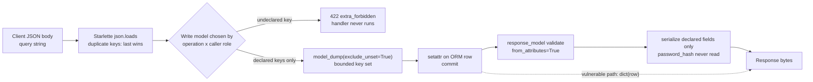

# Preventing Broken Object Property Level Authorization (BOPLA / Mass Assignment, API3:2023) with Strict Input/Output Pydantic Models

> [!summary] Claim
> Property-level authorization is a schema problem, not a check you remember to write: give every (operation, audience) pair its own closed write model (`extra="forbid"`) and its own read model, never bind a raw payload or return a raw row, and the set of properties a caller can change or see becomes a reviewable, testable, published contract.

Part of [API Authorization and OWASP Security](README.md) in [API Engineering](../README.md).

## TL;DR

- Mechanism: OWASP API3:2023 merges 2019's Excessive Data Exposure (read side) and Mass Assignment (write side); both happen when the API's wire shape is the persistence shape, so the fix is two closed allow-lists per endpoint - a write model that decides which keys may reach `setattr`, and a read model that decides which attributes may reach the response bytes.
- Contract rule: request models use `ConfigDict(extra="forbid")`, so `pydantic-core` turns every undeclared key into one `extra_forbidden` error and FastAPI answers `422` before the handler runs (`pydantic-core 2.50.4 src/validators/model_fields.rs, ModelFieldsValidationState::validate_extra_key_value`); handlers copy only `model_dump(exclude_unset=True)` onto the row, and return the row through a `response_model` that FastAPI re-validates with `from_attributes=True` and serializes field by field (`fastapi 0.162.0 fastapi/routing.py, serialize_response`).
- Trap: the default `extra="ignore"` is not a defense, it only hides the attack; `extra="forbid"` is per model and does not reach nested models, `dict[str, Any]` and `extra="allow"` re-open the hole, and `model_copy(update=...)` and `model_construct()` skip validation entirely, so a single raw dict anywhere between parse and `setattr` undoes the schema.
- Portability fact: the lab's 19 tests passed once on CPython `3.14.6` with `pydantic 2.14.3`, `pydantic-core 2.50.4`, `fastapi 0.162.0`, and `sqlalchemy 2.1.8`; the behavior is library-version-sensitive, not interpreter-sensitive (the per-call `extra=` override arrived in `pydantic 2.12.0`, `polymorphic_serialization` in `2.13`, FastAPI query-parameter models in `0.115.0`).
- When not to use it: if your clients round-trip a `GET` body into a `PUT` (tolerant readers, AIP-203 `OUTPUT_ONLY` semantics), a blanket `forbid` breaks them; there you declare the output-only properties in the write model and discard them, and keep `forbid` only for truly unknown keys.

## Mental model



Read it left to right as two gates around the persistence model.
The body is parsed into Python objects by Starlette's `Request.json` (`json.loads`), so a repeated key has already collapsed to its last value before any schema sees it.
FastAPI then validates that dict against the write model the route declares; because the route, not the payload, selects the model, a regular user's route physically has no `role` field to bind, and any undeclared key ends the request with `422` before the handler body runs.
Only keys the client actually sent and the model declares leave `model_dump(exclude_unset=True)`, so the `setattr` loop is bounded by the schema, not by the attributes the ORM class happens to have.
On the way out, FastAPI re-validates whatever the handler returned against the response model and serializes only that model's fields; the dashed arrow is the vulnerable shortcut that turns the row into a dict and ships every column.

## How it works

### What API3:2023 actually names

OWASP API Security Top 10 2023 lists two ways an endpoint is vulnerable to API3: it "exposes properties of an object that are considered sensitive and should not be read by the user" (previously named Excessive Data Exposure), or it "allows a user to change, add/or delete the value of a sensitive object's property which the user should not be able to access" (previously named Mass Assignment).
The 2023 page cross-references API3:2019 and API6:2019 as its predecessors and maps to CWE-213 and CWE-915.
CWE-915, "Improperly Controlled Modification of Dynamically-Determined Object Attributes", is the write half; its observed examples include `CVE-2012-2055` (GitHub), `CVE-2012-2054` (Redmine), and `CVE-2024-3283` (anything-llm).
The OWASP prevention list is short and blunt: avoid generic `to_json()`-style serializers, "avoid using functions that automatically bind a client's input into code variables, internal objects, or object properties", allow changes only to properties the client should update, and enforce a schema on responses.
BOPLA sits between BOLA and BFLA: BOLA asks "may this caller touch this object?" ([[Defeating-BOLA-API1-2023-Tenant-Scoped-Queries-and-PostgreSQL-RLS]]), BFLA asks "may this caller invoke this function?" ([[Defeating-BFLA-API5-2023-Function-Level-Guards-and-Deny-By-Default-Routers]]), and BOPLA asks "given both, which properties of the object may this caller read or write?".

### Why auto-binding is the root cause

Auto-binding is any code path where the set of keys in the request decides which attributes get written.
The canonical Python forms are `Model(**payload)`, `for k, v in payload.items(): setattr(row, k, v)`, `obj.__dict__.update(payload)`, and `select(Row).filter_by(**request.query_params)`.
SQLAlchemy's default declarative constructor shows why the obvious guard is not authorization: it raises `TypeError` only if `not hasattr(cls_, k)`, then calls `setattr(self, k, kwargs[k])` (`sqlalchemy 2.1.8 lib/sqlalchemy/orm/decl_base.py, _declarative_constructor`).
That guard rejects typos; it happily accepts `role`, `balance_cents`, `password_hash`, and `id`, because they are all mapped attributes.
The lab's vulnerable `PATCH /users/me` uses exactly that guard, and the exploit `{"display_name": "mallory", "role": "admin", "balance_cents": 99999900}` returns `200` and leaves the row as `("admin", 99999900, ...)`.
GitHub's 2012 incident is the textbook case: NVD's `CVE-2012-2055` says GitHub Enterprise "does not properly restrict the use of a hash to provide values for a model's attributes, which allows remote attackers to set the `public_key[user_id]` value via a modified URL for the public-key update form".

### Write side: how `extra="forbid"` is enforced inside `pydantic-core`

A Pydantic model's fields compile to a `ModelFieldsValidator` whose `extra_behavior` comes from the schema or config with `ExtraBehavior::Ignore` as the default (`pydantic-core 2.50.4 src/validators/model_fields.rs, ModelFieldsValidator::build`).
For Python dict input (which is what FastAPI passes, after `json.loads`), `validate_by_get_item` walks the declared fields and looks each one up in the dict, recording every key it consumed in a `used_keys` set.
The set is only allocated when extras matter: the source sets `used_keys` to `None` when `matches!(&state.extra_validator, ModelExtraValidator::Ignore) || dict.is_py_get_attr()` holds, and in that case the input dict is never iterated at all (`pydantic-core 2.50.4 src/validators/model_fields.rs, ModelFieldsValidator::validate_by_get_item`).
With `forbid` there is a second pass over the input, and every key not in `used_keys` goes to `validate_extra_key_value`, which pushes one `ValLineError` of type `ErrorTypeDefaults::ExtraForbidden` located at that key (`pydantic-core 2.50.4 src/validators/model_fields.rs, ModelFieldsValidationState::validate_extra_key_value`).
The message is the fixed string `Extra inputs are not permitted` (`pydantic-core 2.50.4 src/errors/types.rs, ErrorType::message_template_python`).
Errors accumulate rather than short-circuit, so one request reports every undeclared key; the lab's attack produces exactly two errors, `role` then `balance_cents`, in input order.
For JSON input (`model_validate_json`), `validate_json_by_iteration` makes one pass over the parsed key/value list, buffers keys that may be extra in an `IndexMap` called `possible_extra` (left `None` under `ignore`), marks the ones a field consumed, and reports the rest in order of appearance after the fields; the docstring states it "gives the same result as" the dict path (`pydantic-core 2.50.4 src/validators/model_fields.rs, ModelFieldsValidator::validate_json_by_iteration`).
FastAPI wraps each error with a `body` prefix in `loc`, so the client sees `{"type": "extra_forbidden", "loc": ["body", "role"], "msg": "Extra inputs are not permitted", "input": "admin"}` (captured below).
`422 Unprocessable Content` is the right class: the content type and syntax are fine, but the server "was unable to process the contained instructions" `(RFC 9110 Section 15.5.21)`.

The three `extra` modes differ in what they do with an undeclared key:

- `ignore` (the default): the key is never looked at, so it cannot be bound, but the attack also leaves no trace and a client typo such as `displayname` silently does nothing.
- `forbid`: the key is a validation error, and the OpenAPI schema says so (`additionalProperties: false`).
- `allow`: the key is stored in `__pydantic_extra__`, and the model serializer includes it on output because `has_extra` switches the fields mode to `FieldsMode::ModelExtra` (`pydantic-core 2.50.4 src/serializers/type_serializers/model.rs, has_extra`); an `allow` model fed to `model_dump()` and then to `setattr` is a mass-assignment primitive.

Since `pydantic 2.12.0` the validation methods take an `extra=` argument that overrides the model config for one call ("Add `extra` parameter to the validate functions", HISTORY.md, PR 12233); in `model_fields.rs` it is read through `state.extra_behavior_or(self.extra_behavior)`, which is why the lab shows the override reaching nested models while the class-level config does not.

### Write side: per-role write models and partial updates

The property-level policy lives in which model a route declares, so the policy for "a user updating themselves" and "an admin updating anyone" is two classes:

- `UserSelfUpdate` declares `display_name` and `bio`.
- `AdminUserUpdate(UserSelfUpdate)` adds `role`.
- Neither declares `balance_cents`, because money moves through a ledger operation, not a property write.

The function-level check that only admins may call the admin route is BFLA's job; the property-level guarantee is that even an admin cannot set `balance_cents` through it, and the lab's admin `PATCH` with `{"balance_cents": 1}` gets `422`.
For `PATCH`, `model_dump(exclude_unset=True)` emits only fields in `model_fields_set`, so omitted properties keep their stored values; this is the pattern FastAPI's body-updates tutorial documents.
`exclude_unset` keeps an explicit `null`, so `{"bio": null}` clears `bio`, which matches JSON Merge Patch where a `null` member means "remove" `(RFC 7396 Section 2)`.
For a non-nullable column, that same rule is a crash or a constraint violation, so the lab adds a `field_validator` that rejects `None`; it fires only for an explicit `null` because defaults are not validated unless `validate_default` is set.
Pydantic `2.14` also exports `MISSING` from the main `pydantic` module (the `pydantic.experimental.missing_sentinel` import now warns `PydanticDeprecatedSince214`), which can model "absent" separately from `null` at the type level.
`PATCH` semantics are the server's to define `(RFC 5789 Section 2)`, and JSON Patch makes the BOPLA surface explicit: every operation carries a `path` JSON Pointer that can name any member `(RFC 6902 Section 4)`, so a JSON Patch endpoint needs a path allow-list, the moral equivalent of `extra="forbid"`; see [[Partial-Updates-JSON-Merge-Patch-RFC-7396-vs-JSON-Patch-RFC-6902]] and [[Field-Masks-and-Update-Masks-AIP-134-and-AIP-161]].

### Write side: query strings and filters

Filters are property access too.
The lab's vulnerable `GET /users` runs `select(UserRow).filter_by(**dict(request.query_params))`, so `?role=admin` enumerates admins and `?password_hash=...` would turn the endpoint into a boolean oracle on a secret column.
Since `fastapi 0.115.0` (2024-09-17 release notes) a Pydantic model can declare query parameters with `Annotated[Model, Query()]`, and the FastAPI docs state that with `extra="forbid"` "any parameter outside that model is rejected"; the lab's `?role=admin` gets `422` with `loc` `["query", "role"]`.

### Read side: how the response model filters

FastAPI calls `serialize_response`, which runs `field.validate(response_content, {}, loc=("response",))` and then `field.serialize` or `field.serialize_json` with the route's include, exclude, and `by_alias` options (`fastapi 0.162.0 fastapi/routing.py, serialize_response`).
`ModelField.validate` is `self._type_adapter.validate_python(value, from_attributes=True)` (`fastapi 0.162.0 fastapi/_compat/v2.py, ModelField.validate`), so a returned SQLAlchemy row is read attribute by attribute for the declared fields only; `password_hash` is never even read.
Because the attribute path cannot be iterated, `validate_by_get_item` does not run the extras pass when `dict.is_py_get_attr()` is true, so `extra="forbid"` on a response model is silent for ORM objects and loud for dicts.
That asymmetry is useful: the lab's `/debug/leaky-dict` handler returns a hand-built dict with every column against a `forbid` response model and raises `ResponseValidationError` listing `balance_cents`, `email`, `password_hash`, and `role`, so a forgotten column becomes a `500` in tests instead of a leak in production.
With the default `ignore`, the same dict would have been filtered silently, which is safe but hides the bug.
When the handler returns a subclass instance (`Private(Public)`), validation passes it through and serialization still uses the declared class's fields, a deliberate v2 change that the Pydantic docs justify as helping "prevent surprises when adding sensitive information like secrets as fields of subclasses".
Three switches re-open that door: `ConfigDict(polymorphic_serialization=True)` (added in `2.13`), the `polymorphic_serialization=True` or `serialize_as_any=True` runtime arguments, and the `SerializeAsAny` annotation; the lab shows the first runtime argument and `serialize_as_any` both emitting `password_hash`.
FastAPI documents `response_model_include` and `response_model_exclude` as a "quick shortcut", but recommends separate classes because the OpenAPI schema "will still be the one for the complete model"; a deny-list also fails open when a new column is added.

### Published contract

For a class with `extra="forbid"`, `GenerateJsonSchema._update_class_schema` writes `additionalProperties: false`; for `ignore` it writes nothing (`pydantic 2.14.3 pydantic/json_schema.py, GenerateJsonSchema._update_class_schema`).
JSON Schema says that omitting `additionalProperties` "has the same assertion behavior as an empty schema", that is, anything goes (JSON Schema 2020-12 Core Section 10.3.2.3).
So the default model publishes an open contract that client generators, fuzzers such as Schemathesis, and gateways read as "extra keys welcome", while the forbid model publishes the allow-list the server enforces.
The lab's vulnerable `dict[str, Any]` body publishes `additionalProperties: true`.
JSON Schema's `readOnly` keyword says a server may ignore or reject attempts to modify such a property (JSON Schema 2020-12 Validation Section 9.4); Pydantic does not enforce `readOnly` on input, so a property marked `readOnly` in a shared model is documentation, not a control.

## Numbers and limits

| Quantity | Value | Source |
|---|---|---|
| `model_validate` cost, 2 declared keys, `extra="ignore"` | `410 ns` per call | Re-measured once by the fact-check (2026-11-15): median of `timeit.repeat(number=20000, repeat=15)` divided by `20000`, run with `uv run --frozen python` from `labs/`, CPython `3.14.6`, macOS `27.3` arm64 (`uname -r` `27.3.0`), `pydantic 2.14.3`, `pydantic-core 2.50.4` |
| Same input, `extra="forbid"` | `487 ns` per call (`+77 ns`, about `19%`) | Same run; the delta is the second pass over the input dict |
| `extra="ignore"`, 2 declared keys plus 20 undeclared keys | `410 ns` per call | Same run; matches the source: with `ignore` a dict input is not iterated, so extra keys cost nothing (and are invisible) |
| Errors per request with `forbid` | One `extra_forbidden` per undeclared key, all reported | Lab: two attack keys -> two errors, in input order; a one-off check of a 100000-key dict returned `100000` errors |
| Lab run | 19 tests, `19 passed in 0.66s` | `uv run --frozen pytest <module> -q`, CPython `3.14.6`, macOS `27.3` arm64 |
| GitHub 2012 incident window | Exploit at 8:49am PT, fix rolled out at 9:53am PT, 3 accounts compromised | GitHub blog, "Public Key Security Vulnerability and Mitigation", 2012-03-04 |
| `CVE-2012-2055` severity | CVSS v3.1 `7.5`, v2 `5.0` | NVD record (as of 2026-11) |
| `CVE-2024-3283` severity | CVSS v3.0 `7.2` | Secondary score from the CNA `huntr.dev` shown on the NVD record; NVD lists no primary score of its own (as of 2026-11) |
| Per-call `extra=` override | `pydantic >= 2.12.0` | `pydantic 2.14.3 HISTORY.md` (PR 12233) |
| `polymorphic_serialization` | `pydantic >= 2.13` | `docs/concepts/serialization.md` `version-added v2.13` |
| Query-parameter models with `extra="forbid"` | `fastapi >= 0.115.0` | FastAPI release notes, 0.115.0 (2024-09-17) |
| Lab property bounds | `display_name` 1-64 chars, `bio` <= 280 chars, `limit` 1-100 | Design choices in the lab, enforced by `Field` constraints |

Per-request cost is not the limit that matters: `77 ns` is noise next to a database round trip, and the measured `ignore` row shows the real cost of the default, which is that undeclared keys are not even looked at.

## Portability

The CPython row below ran `uv run --frozen pytest tests/f15_api_authorization_and_owasp_security/test_defeating_bopla_and_mass_assignment_api3_2023_strict_input_output_schemas.py -q` once on macOS `27.3` arm64.

| Runtime or component | Behavior | Verification |
|---|---|---|
| CPython `3.14.6` (workspace) | All 19 tests pass | Ran: `19 passed in 0.66s` |
| CPython `3.12.16`, `3.13.18`, `3.14.10`, `3.15.2`, free-threaded `3.15.2t` | Not run: lab checks were paused for this job (2026-11-11), so only the workspace interpreter ran; the lab needs `3.12+` because it uses the `type Role = ...` statement `(PEP 695)` | Not run |
| Debian Trixie and Alpine containers | Not run (paused) | - |
| `pydantic < 2.12` | No per-call `extra=` argument; class-level `extra` config works as described | `pydantic 2.14.3 HISTORY.md`, v2.12.0 entry for PR 12233; not run |
| `pydantic < 2.13` | No `polymorphic_serialization`; `SerializeAsAny` and `serialize_as_any` are the switches that expose subclass fields | `docs/concepts/serialization.md` at v2.14.3 (`version-added v2.13`); not run |
| Pydantic v1 | Nested subclass instances serialized all their fields, unlike v2 | `docs/concepts/serialization.md` "Migration Warning" at v2.14.3; not run |
| `fastapi < 0.115.0` | No Pydantic models for `Query`, `Header`, `Cookie`, so unknown query parameters cannot be forbidden declaratively | FastAPI release notes 0.115.0; not run |
| `sqlalchemy 2.1.8` vs `2.0.57` | The lab only uses `DeclarativeBase`, `Mapped`, `mapped_column`, `Session.get_one`, and `filter_by`; the `_declarative_constructor` guard was read only in `2.1.8` | Read `sqlalchemy 2.1.8 lib/sqlalchemy/orm/decl_base.py`; the `sqlalchemy20` group was not run |
| Uvicorn, Hypercorn, Granian; HTTP/1.1, HTTP/2, HTTP/3 | Schema enforcement runs on the reassembled body inside the ASGI app, after the server and the HTTP version are out of the picture | In-process `httpx.ASGITransport` only; not run over real servers |

## Worked example

The [implementation](../labs/src/api_labs/f15_api_authorization_and_owasp_security/bopla_mass_assignment.py) builds two FastAPI apps over the same in-memory SQLite database (`StaticPool`, three seeded users: `root` the admin, `alice`, and `mallory` the attacker), and the [test](../labs/tests/f15_api_authorization_and_owasp_security/test_defeating_bopla_and_mass_assignment_api3_2023_strict_input_output_schemas.py) runs the exploit against one and the same requests against the other.
The caller identity is an `X-User-Id` header because authentication is not the subject here.

The persistence model holds properties no client may read or write:

```python
class UserRow(Base):
    """Persistence model: it holds properties no client may read or write."""

    __tablename__ = "users"

    id: Mapped[int] = mapped_column(primary_key=True)
    email: Mapped[str]
    display_name: Mapped[str]
    bio: Mapped[str | None]
    role: Mapped[str] = mapped_column(default="user")
    balance_cents: Mapped[int] = mapped_column(default=0)
    password_hash: Mapped[str]
```

The vulnerable app binds, filters, and serializes generically (simplified excerpt: the read route is omitted):

```python
    @app.patch("/users/me")
    def update_me(
        payload: Annotated[dict[str, Any], Body()],
        caller: CallerId,
        session: SessionDep,
    ) -> dict[str, Any]:
        row = session.get_one(UserRow, caller)
        for key, value in payload.items():
            if hasattr(UserRow, key):  # the same guard as SQLAlchemy's default __init__
                setattr(row, key, value)
        session.commit()
        return row_to_dict(row)

    @app.get("/users")
    def list_users(request: Request, _caller: CallerId, session: SessionDep) -> list[int]:
        rows = session.scalars(select(UserRow).filter_by(**dict(request.query_params)))
        return [row.id for row in rows]
```

The secure app's contract is a set of small closed models, one per operation and audience:

```python
class WriteModel(BaseModel):
    """Base for request bodies: unknown keys are a 422, never silently dropped or bound."""

    model_config = ConfigDict(extra="forbid", strict=True)


class UserSelfUpdate(WriteModel):
    display_name: Annotated[str, Field(min_length=1, max_length=64)] | None = None
    bio: Annotated[str, Field(max_length=280)] | None = None

    @field_validator("display_name")
    @classmethod
    def display_name_not_null(cls, value: str | None) -> str | None:
        # Defaults are not validated, so this fires only for an explicit JSON null.
        if value is None:
            raise ValueError("display_name cannot be null")
        return value


class AdminUserUpdate(UserSelfUpdate):
    role: Role | None = None

    @field_validator("role")
    @classmethod
    def role_not_null(cls, value: Role | None) -> Role | None:
        if value is None:
            raise ValueError("role cannot be null")
        return value


class ReadModel(BaseModel):
    """Base for responses: a dict with an undeclared key fails loudly instead of leaking."""

    model_config = ConfigDict(extra="forbid", from_attributes=True)


class UserPublicView(ReadModel):
    id: int
    display_name: str
    bio: str | None


class UserSelfView(UserPublicView):
    email: str
    role: str
    balance_cents: int


class UserListQuery(BaseModel):
    model_config = ConfigDict(extra="forbid")

    limit: Annotated[int, Field(ge=1, le=100)] = 10


def apply_patch(row: UserRow, patch: UserSelfUpdate) -> None:
    """Copy only the keys the client sent; the key set is bounded by the write model."""
    for key, value in patch.model_dump(exclude_unset=True).items():
        setattr(row, key, value)
```

The routes return ORM rows and let the response model choose the properties (simplified excerpt: the list, admin, and debug routes are omitted):

```python
    @app.patch("/users/me", response_model=UserSelfView)
    def update_me(patch: UserSelfUpdate, caller: CallerId, session: SessionDep) -> UserRow:
        row = session.get_one(UserRow, caller)
        apply_patch(row, patch)
        session.commit()
        return row

    @app.get("/users/{user_id}", response_model=UserPublicView)
    def read_user(user_id: int, _caller: CallerId, session: SessionDep) -> UserRow:
        return session.get_one(UserRow, user_id)
```

The core assertions pair the exploit with the fix (simplified excerpt from the test module):

```python
ATTACK = {"display_name": "mallory", "role": "admin", "balance_cents": 99999900}

    response = await vulnerable.patch("/users/me", json=ATTACK, headers=MALLORY)
    assert response.status_code == 200
    assert stored(engine, 3) == ("admin", 99999900, "mallory", None)

    response = await secure.patch("/users/me", json=ATTACK, headers=MALLORY)
    assert response.status_code == 422
    errors = [(e["type"], e["loc"], e["input"]) for e in response.json()["detail"]]
    assert errors == [
        ("extra_forbidden", ["body", "role"], "admin"),
        ("extra_forbidden", ["body", "balance_cents"], 99999900),
    ]
    assert stored(engine, 3) == ("user", 0, "mallory", None)
```

The secure app's actual `422` response to the attack, captured with `httpx.ASGITransport` on CPython `3.14.6`:

```text
422 application/json
{
  "detail": [
    {
      "type": "extra_forbidden",
      "loc": [
        "body",
        "role"
      ],
      "msg": "Extra inputs are not permitted",
      "input": "admin"
    },
    {
      "type": "extra_forbidden",
      "loc": [
        "body",
        "balance_cents"
      ],
      "msg": "Extra inputs are not permitted",
      "input": 99999900
    }
  ]
}
```

The 19 tests cover the three exploits (role and balance escalation, another user's `password_hash` and `email` in a read, admin enumeration through a filter), the write-side controls (`422` and no write, `exclude_unset` partial updates, explicit-`null` rejection, last-wins duplicate keys, role writable only through the admin schema, unknown query parameter rejected), the read-side controls (public view only, leaked dict key becomes `ResponseValidationError`, `additionalProperties: false` in OpenAPI), and seven Pydantic mechanics the fix depends on.
Run from `labs/` on CPython `3.14.6`, macOS `27.3` arm64:

```text
$ uv run --frozen pytest tests/f15_api_authorization_and_owasp_security/test_defeating_bopla_and_mass_assignment_api3_2023_strict_input_output_schemas.py -q
...................                                                      [100%]
19 passed in 0.66s
```

## Pitfalls

> [!warning] Binding a request hash onto a model (GitHub, March 2012)
> Trigger: a form or JSON handler passes the request parameters straight to the model's attribute setter.
> Symptom: an attacker adds a field the form never showed; at GitHub it was `public_key[user_id]`, which let a user attach their own key to the `rails` organization and push to it (GitHub blog, 2012-03-04; NVD `CVE-2012-2055`).
> Fix: bind through a write model that declares only the fields the form exposes, and treat every other key as an error.

> [!warning] Accepting a whole settings object (anything-llm, `CVE-2024-3283`)
> Trigger: a preferences endpoint accepts "a full JSON object in the request body without proper validation of modifiable fields" (NVD).
> Symptom: manager-role users set `multi_user_mode`, which opened `/api/system/enable-multi-user` and let them create an admin user (CVSS v3.0 `7.2`, scored by the CNA `huntr.dev`).
> Fix: a per-role write model for the settings resource; system-level flags belong to an admin-only model on an admin-only route.

> [!warning] Relying on `extra="ignore"` as the control
> Trigger: a plain `BaseModel` request body, then `model_dump()` onto the row.
> Symptom: the attack is harmless only by accident, it leaves no log line or metric, and a new field added to the shared model for an admin screen silently becomes user-writable (lab: `test_default_extra_ignore_drops_attack_keys_silently`).
> Fix: `extra="forbid"` on a shared `WriteModel` base, and one write model per audience so adding a field is a reviewable decision.

> [!warning] `forbid` does not propagate into nested models
> Trigger: an outer write model with `extra="forbid"` and a nested `Profile` model with default config.
> Symptom: `{"profile": {"nickname": "m", "role": "admin"}}` validates and drops `role`, and an `allow` nested model would keep it (lab: `test_extra_forbid_does_not_reach_nested_models_but_runtime_override_does`).
> Fix: inherit every request model, nested ones included, from the same `forbid` base, or validate with the per-call `extra="forbid"` override (`pydantic >= 2.12`), which the lab shows reaching nested models.

> [!warning] Open containers inside a closed model
> Trigger: a `preferences: dict[str, Any]`, `Any`, `Json`, or `extra="allow"` field in a write model whose contents are later merged into an object.
> Symptom: `{"preferences": {"role": "admin"}}` passes a `forbid` model untouched (lab: `test_open_dict_field_accepts_any_property_name`), and an `allow` model re-serializes injected keys on output (lab: `test_extra_allow_stores_and_re_serializes_injected_keys`).
> Fix: type the container (`dict[Literal[...], ...]` or a nested closed model), or keep it opaque and never spread it into attributes.

> [!warning] `model_copy(update=...)` and `model_construct()` skip validation
> Trigger: `stored.model_copy(update=request_dict)` with a dict that did not come from a validated write model.
> Symptom: `Account().model_copy(update={"role": "admin", "is_staff": True})` sets `role` and even plants `is_staff` in `__dict__` (lab: `test_model_copy_update_and_model_construct_skip_validation`); the docstring says "no validation is performed on updated values", and `model_construct` ignores `forbid` by design (`pydantic 2.14.3 pydantic/main.py, BaseModel.model_copy` and `BaseModel.model_construct`).
> Fix: the update dict must be `write_model.model_dump(exclude_unset=True)`, which is why FastAPI's body-updates tutorial is safe as written.

> [!warning] Explicit `null` treated as "not sent"
> Trigger: optional-to-send fields typed `str | None = None` on a non-nullable column, applied with `exclude_unset=True`.
> Symptom: `{"display_name": null}` is in `model_fields_set`, so it is written, and the database rejects it with a `500` or, on a nullable column, a property is cleared that the client may not be allowed to clear.
> Fix: reject `None` for non-nullable properties in a validator (lab: `test_secure_patch_rejects_explicit_null_for_non_nullable_property`), or use the `MISSING` sentinel to separate absent from `null`.

> [!warning] Deny-list output filtering and polymorphic serialization
> Trigger: `response_model_exclude={"password_hash"}`, a hand-built dict returned under `-> dict[str, Any]`, or `polymorphic_serialization=True` / `SerializeAsAny` on a model that has private subclasses.
> Symptom: a new column ships to every caller the day it is added, or a subclass's `password_hash` is serialized under the base type (lab: `test_subclass_instance_serializes_as_declared_type_unless_polymorphic`).
> Fix: allow-list read models per audience, `extra="forbid"` on read models so stray dict keys fail tests, and no polymorphic serialization on types that cross a trust boundary.

> [!warning] Filters on hidden properties
> Trigger: `filter_by(**request.query_params)` or a generic "filter on any column" query language.
> Symptom: `?role=admin` enumerates admins (lab: `test_vulnerable_filter_on_hidden_property_enumerates_admins`), and an equality or prefix filter on a secret column is a boolean oracle that leaks it without ever returning it.
> Fix: a query-parameter model with `extra="forbid"`, and filterable properties as an explicit allow-list per audience; identifier handling for sort columns is in [[SQL-Injection-NoSQL-Injection-and-Order-By-Identifier-Escaping]].

## Security and robustness

- Threat model: the attacker is authenticated and owns a legitimate object; OWASP rates the risk "Exploitability Easy" and notes that "fuzzing is usually used to identify additional (hidden) properties" and that "side-effect analysis may be required if the target property is not returned".
  Assume the attacker knows every column name: they read your OpenAPI, your error messages, your mobile app, and your other endpoints' responses.
- Every input channel is a binding channel: JSON bodies, form fields, query strings, headers, cookies, GraphQL variables, and JSON Patch `path` values; the GraphQL specification is closed by default, since an input object "must not contain any entries with names not defined by a field of this input object type, otherwise a request error must be raised" (GraphQL September 2025 Section 3.10, Input Coercion), but its output side still needs per-field authorization ([[GraphQL-Field-Level-Authorization-and-Partial-Error-Null-Bubbling]]); OWASP's API3 Scenario 1 is a GraphQL mutation that returns `fullName` and `recentLocation` of the reported user.
- Parser differentials: RFC 8259 says object names "SHOULD be unique" and that with duplicates "the behavior of software that receives such an object is unpredictable" `(RFC 8259 Section 4)`; Python's `json.loads` keeps the last value, as does the `pydantic-core` JSON path, so a gateway or WAF that inspects the first `role` sees a different document from the app (lab: `test_duplicate_json_keys_resolve_last_wins_before_validation`).
  `extra="forbid"` neutralizes the differential for undeclared keys because the last `role` is still undeclared; for declared keys, the gateway must parse the way the app does or reject duplicates.
- Key spelling: keys are case-sensitive, so `Role` is just another undeclared key under `forbid` (checked here in a one-off script on `pydantic 2.14.3`); with an alias, the attribute name becomes an undeclared key unless `validate_by_name=True`, which doubles the accepted spellings (lab: `test_field_name_is_an_extra_key_when_the_field_has_an_alias`; see [[Aliases-AliasPath-AliasChoices-and-Bidirectional-Field-Mapping]]).
- Type confusion: `strict=True` on write models stops `"true"` from becoming `True` and `"1"` from becoming `1`, which matters when a boolean flag such as `is_verified` is ever legitimately writable ([[Lax-vs-Strict-Validation-Modes-and-Coercion-Tables]]); query models cannot be strict because every query value arrives as a string.
- Error echo: FastAPI's `422` body echoes each rejected `input`; that is the attacker's own data on the write side, but log pipelines that store request validation errors can capture secrets clients sent by mistake ([[Structured-Log-Redaction-and-Preventing-PII-and-Token-Leaks]]).
- Resource bounds: `forbid` reports every undeclared key, so a body with 100000 junk keys produces 100000 error objects (checked here with `model_validate` on `pydantic 2.14.3`); cap body size and key count before validation ([[Unrestricted-Resource-Consumption-API4-2023-Payload-Depth-and-Limit-Guards]]).
- Defense in depth: PostgreSQL supports column-level `GRANT UPDATE (column_name, ...)`, so the application role can be denied `UPDATE` on `role` and `balance_cents` entirely; the GRANT documentation warns that "granting the privilege at the table level and then revoking it for one column will not do what one might wish", so column grants must replace the table grant, not subtract from it.
- Response validation is the second net: a `forbid` read model turns a leaked dict key into a `500` in CI, and a contract test (Schemathesis against the published `additionalProperties: false`) catches routes that drift.

## The principal's view

The architectural decision is to make the schema the property-level authorization policy: one write model and one read model per (operation, audience), never the persistence model on the wire, and a review rule that a new field on a write model is a security change.
That costs classes: a resource with self, admin, and public audiences and create, update, and read operations can need six models, plus mapping code, and teams will drift toward one shared `UserSchema` to save typing.
Hold the line by making the safe path the short one: a `WriteModel` base with `forbid` and `strict`, a `ReadModel` base with `forbid` and `from_attributes`, a CI check that rejects `dict[str, Any]` bodies and handlers without a response model, and contract tests over the published OpenAPI.
The organizational trade-off with tolerant readers is real.
AIP-203 says that for an `OUTPUT_ONLY` field "the server must clear out any value in this field and must not throw an error as a result of the presence of a value in this field on input", which is the opposite of a blanket `forbid`, and it is right for clients that `GET`, modify, and `PUT` a whole resource ([[Field-Behavior-Semantics-Input-Only-Output-Only-and-Immutable-AIP-203]]).
The resolution is to separate "known but not writable here" from "unknown": declare output-only properties in the write model so they parse, discard them before `setattr`, and keep `forbid` for keys the resource has never had; or move updates to explicit field masks so the client names the paths it intends to change ([[Field-Masks-and-Update-Masks-AIP-134-and-AIP-161]]).
Where the property-level policy is truly dynamic (per-tenant field visibility, row-and-column ABAC), static classes stop scaling, and the decision moves to a policy engine that computes an allowed-field set per request ([[Authorization-Models-Scopes-RBAC-ABAC-and-Zanzibar-ReBAC]]); the schemas then become the upper bound and the engine the per-request filter.
GraphQL changes the default but not the problem: inputs are closed by the specification, outputs are client-selected, so authorization moves to field resolvers.
Language choice matters less than binding style: any framework with a "bind request to entity" convenience needs the same allow-list, and the 2012 GitHub incident shows that a mature framework's default is no substitute for one.

## Interview questions

> [!question] L5: What is the difference between BOLA (API1:2023) and BOPLA (API3:2023), and give one example of each on the same endpoint?
>
> > [!success]- Answer
> > BOLA is access to the wrong object: `PATCH /users/2` succeeds for user 3.
> > BOPLA is access to the wrong property of an object you may access: user 3's `PATCH /users/me` sets their own `role`.
> > The fixes live in different places: BOLA in the tenant- or owner-scoped query, BOPLA in the write and read schemas.
> > An endpoint can be safe from one and wide open to the other.
> >
> > Follow-up: Where does BFLA fit, and which of the three does an admin-only route with a too-wide write model violate?

> [!question] L5: Why is Pydantic's default `extra="ignore"` not considered a mass-assignment control, even though the attack payload does not get bound?
>
> > [!success]- Answer
> > It prevents binding only if the code never touches the raw payload, and it gives no signal when an attack happens.
> > In `pydantic-core` a dict input is not even iterated under `ignore`, so there is nothing to log or count.
> > It also makes the contract open: the JSON Schema omits `additionalProperties`, which means "anything allowed".
> > And when someone adds `role` to the shared model for an admin screen, every user can suddenly write it, with no failing test.
> >
> > Follow-up: What would you change so that adding a field to a write model becomes a reviewed security decision?

> [!question] L6 (Predict the output): What do `Outer.model_validate({"profile": {"nickname": "m", "role": "admin"}})` and the same call with `extra="forbid"` passed as an argument return?
> The models are `class Profile(BaseModel): nickname: str | None = None` and `class Outer(BaseModel)` with `model_config = ConfigDict(extra="forbid")` and `profile: Profile | None = None`.
>
> > [!success]- Answer
> > The first returns `Outer(profile=Profile(nickname='m'))`: `extra` is per model, and `Profile` has the default `ignore`.
> > The second raises one `extra_forbidden` error at `loc` `("profile", "role")`.
> > The per-call override (`pydantic >= 2.12`) is read from validation state via `extra_behavior_or`, so it applies to every nested model validator in that call.
> > The lab asserts both results.
> >
> > Follow-up: Which is the better production fix, the per-call override or a shared base class, and why?

> [!question] L6 (Debug this API): A `GET /users/{id}` handler annotated `-> dict[str, Any]` returns `{c.key: getattr(row, c.key) for c in User.__table__.columns}`, and after a review finds `password_hash` in responses the developer adds `response_model_exclude={"password_hash"}`; what is still wrong?
>
> > [!success]- Answer
> > The handler is a generic `to_json()`, the pattern OWASP API3 says to avoid; the next column added (say `mfa_secret`) will ship immediately.
> > With a `dict[str, Any]` response type there is no field list to exclude from; the exclusion must be paired with a real model, and FastAPI recommends separate classes because the OpenAPI still shows the full model with include or exclude.
> > The fix is a `UserPublicView` read model as `response_model`, returning the row so FastAPI validates it with `from_attributes=True` and serializes only declared fields.
> > Adding `extra="forbid"` to the read model makes any future hand-built dict with extra keys fail with `ResponseValidationError` in tests.
> >
> > Follow-up: Why does that same `forbid` read model not raise when the handler returns the ORM row itself?

> [!question] L6: Your `PATCH` handler does `stored.model_copy(update=await request.json())`; is it vulnerable, and how does FastAPI's own tutorial avoid the problem?
>
> > [!success]- Answer
> > Yes: `model_copy` performs no validation on `update`, and for non-`allow` models it does `copied.__dict__.update(update)`, so any field, including `role`, is overwritten and unknown keys land in `__dict__`.
> > FastAPI's tutorial passes `item.model_dump(exclude_unset=True)` from a validated request model, so the keys are bounded by that model before `model_copy` sees them.
> > The safety comes from the producer of the dict, not from `model_copy`.
> >
> > Follow-up: What does `model_construct` do with `extra="forbid"`, and when is it legitimately used?

> [!question] L6: How do you implement `PATCH` so that omitted properties are untouched, `null` clears nullable properties, and `null` is rejected for non-nullable ones?
>
> > [!success]- Answer
> > Validate into a closed write model whose fields all have defaults, and apply `model_dump(exclude_unset=True)`, which contains exactly `model_fields_set`.
> > Explicit `null` is in `model_fields_set`, matching RFC 7396's "null means remove" rule.
> > For non-nullable properties add a validator that rejects `None`; it runs only when the client sent the key because defaults are not validated.
> > Alternatively, type the field with the `MISSING` sentinel so absent and `null` are distinct at the type level.
> >
> > Follow-up: How does the design change if the endpoint accepts RFC 6902 JSON Patch instead?

> [!question] L7+: A platform team wants the company-wide rule "all request models use `extra=forbid`", and a mobile team objects that their app sends back the whole resource it fetched; who is right, and what do you ship?
>
> > [!success]- Answer
> > Both: AIP-203 requires servers to ignore, not reject, `OUTPUT_ONLY` fields on input, which supports round-tripping clients.
> > The unsafe behavior is binding, not receiving; the rule should be "no undeclared key is ever bound, and unknown keys are rejected".
> > Ship write models that declare output-only properties (parsed and discarded) and reject keys the resource never had, or move updates to field masks.
> > Enforce with base classes, a CI rule against `dict[str, Any]` bodies, and contract tests against the published schema.
> >
> > Follow-up: How would you migrate an API that has accepted unknown keys for years without breaking clients?

> [!question] L7+: How would you guarantee, for a 300-endpoint FastAPI service, that no endpoint leaks a column added next quarter?
>
> > [!success]- Answer
> > Make leaks a build failure: every route must declare a response model, read models inherit a `forbid` base, and handlers return ORM rows or read models, never hand-built dicts.
> > Add a startup or CI test that walks `app.routes` and fails on missing response models or `dict`/`Any` request bodies.
> > Add a snapshot test of the OpenAPI components, so a new property in any read model shows up as a reviewed diff.
> > For defense in depth, deny the application role `SELECT` on columns no endpoint needs, using column-level grants.
> >
> > Follow-up: What breaks if a team enables `polymorphic_serialization` on a base read model?

> [!question] L5: An attacker sends `{"bio": "a", "bio": "b"}` and a WAF in front of the API inspected the first `bio`; which value does the FastAPI handler see, and why does it matter more for declared than undeclared keys?
>
> > [!success]- Answer
> > The handler sees `"b"`: Starlette's `Request.json` uses `json.loads`, which keeps the last duplicate, and the lab asserts it.
> > RFC 8259 Section 4 leaves duplicate-name behavior unpredictable, so components can disagree.
> > For an undeclared key such as `role`, `forbid` rejects whichever copy survives, so the disagreement does not matter.
> > For a declared key, the WAF approved a value the app never used, so the gateway must parse identically or reject duplicates.
> >
> > Follow-up: Does `model_validate_json` behave the same way?

## Related

Prerequisites: [[Defeating-BOLA-API1-2023-Tenant-Scoped-Queries-and-PostgreSQL-RLS]]

Next: [[Defeating-BFLA-API5-2023-Function-Level-Guards-and-Deny-By-Default-Routers]]

See also: [[02-Programming-Languages/Python/Python-Backend-Interview-Prep/04-FastAPI]], [[02-Programming-Languages/Python/Python-Backend-Interview-Prep/07-Auth-and-Security]], [[OWASP-API-Security-Top-10-2023-Complete-Threat-Model]], [[Where-Authorization-Lives-Gateway-Middleware-vs-Domain-and-Query-Layer]], [[Authorization-Models-Scopes-RBAC-ABAC-and-Zanzibar-ReBAC]], [[Field-Behavior-Semantics-Input-Only-Output-Only-and-Immutable-AIP-203]], [[Partial-Updates-JSON-Merge-Patch-RFC-7396-vs-JSON-Patch-RFC-6902]], [[Field-Masks-and-Update-Masks-AIP-134-and-AIP-161]], [[Aliases-AliasPath-AliasChoices-and-Bidirectional-Field-Mapping]], [[Lax-vs-Strict-Validation-Modes-and-Coercion-Tables]], [[ORM-Mode-From-Attributes-and-Preventing-Accidental-Lazy-Loads]], [[Custom-Serialization-Field-Model-and-Wrap-Serializers]], [[Response-Serialization-Pipeline-Response-Model-and-Double-Validation-Cost]], [[Request-Parameter-Validation-Path-Query-Header-Cookie-and-Body-Models]], [[GraphQL-Field-Level-Authorization-and-Partial-Error-Null-Bubbling]], [[Structured-Log-Redaction-and-Preventing-PII-and-Token-Leaks]], [[Unrestricted-Resource-Consumption-API4-2023-Payload-Depth-and-Limit-Guards]], [[SQL-Injection-NoSQL-Injection-and-Order-By-Identifier-Escaping]]

- Lab: `labs/tests/f15_api_authorization_and_owasp_security/test_defeating_bopla_and_mass_assignment_api3_2023_strict_input_output_schemas.py`

## Further reading

- [OWASP API3:2023 Broken Object Property Level Authorization](https://owasp.org/API-Security/editions/2023/en/0xa3-broken-object-property-level-authorization/) - the definition, the three scenarios, and the merge of API3:2019 and API6:2019.
- [OWASP Mass Assignment Cheat Sheet](https://cheatsheetseries.owasp.org/cheatsheets/Mass_Assignment_Cheat_Sheet.html) - the cross-framework catalog of auto-binding features and allow-list fixes.
- [CWE-915](https://cwe.mitre.org/data/definitions/915.html) - the weakness definition and its curated CVE examples.
- [GitHub, Public Key Security Vulnerability and Mitigation (2012)](https://github.blog/news-insights/the-library/public-key-security-vulnerability-and-mitigation/) - the primary postmortem of the best-known mass-assignment incident.
- [NVD CVE-2024-3283](https://nvd.nist.gov/vuln/detail/CVE-2024-3283) - a recent privilege escalation through an unvalidated settings object.
- [pydantic-core 2.50.4 `model_fields.rs`](https://github.com/pydantic/pydantic/blob/v2.14.3/pydantic-core/src/validators/model_fields.rs) - where `ignore`, `forbid`, and `allow` are actually implemented, for both input paths.
- [Pydantic serialization docs, subclasses and polymorphic serialization](https://github.com/pydantic/pydantic/blob/v2.14.3/docs/concepts/serialization.md) - why v2 serializes by declared type and the switches that undo it.
- [FastAPI 0.162.0 `routing.py`](https://github.com/fastapi/fastapi/blob/0.162.0/fastapi/routing.py) - `serialize_response` and the request body path that feed the two gates.
- [FastAPI Query Parameter Models](https://github.com/fastapi/fastapi/blob/0.162.0/docs/en/docs/tutorial/query-param-models.md) - forbidding unknown query parameters.
- [RFC 7396 JSON Merge Patch](https://www.rfc-editor.org/rfc/rfc7396.html) - the `null`-means-remove rule partial updates must respect.
- [RFC 6902 JSON Patch](https://www.rfc-editor.org/rfc/rfc6902.html) - path-addressed operations that need a path allow-list.
- [AIP-203 Field behavior documentation](https://google.aip.dev/203) - `OUTPUT_ONLY`, `INPUT_ONLY`, and `IMMUTABLE`, the counterweight to blanket rejection.
- [JSON Schema 2020-12 Validation, Section 9.4](https://json-schema.org/draft/2020-12/json-schema-validation.html) - `readOnly` and `writeOnly` as annotations, not enforcement.
- [PostgreSQL GRANT](https://www.postgresql.org/docs/18/sql-grant.html) - column-level privileges as a database-side backstop.
