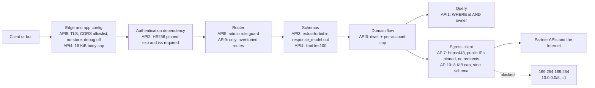

# OWASP API Security Top 10 (2023) Threat Modeling: Mapping API1 through API10 to Concrete Controls in a Python API Stack

> [!summary] Claim
> The OWASP API Security Top 10 (2023) becomes an engineering control only when each of the ten risks is pinned to one owning layer of the stack (query, schema, router, edge, egress client, deployment) and to a test that sends a benign request and an attack, so that removing any single control makes exactly one test go red; in a FastAPI 0.162.0 and Starlette 1.10.0 service no risk is fully closed by default (only fragments such as `debug=False` and httpx's `follow_redirects=False` are defaults), and several of the library-level traps are version-specific facts you can only learn from the source.

Part of [API Authorization and OWASP Security](README.md) in [API Engineering](../README.md).

## TL;DR

Mechanism: treat the list as a threat model with ten rows, give each row one control at one layer (owner-scoped queries for API1, pinned JWT verification for API2, `extra="forbid"` plus `response_model` for API3, page and body caps for API4, a router-level role dependency for API5, per-account flow limits for API6, an IP-pinning egress guard for API7, debug off plus a CORS allowlist plus `no-store` for API8, a route inventory diff for API9, and a no-redirect, size-capped, schema-validated partner client for API10).
Contract rule: a control is proven only by a benign-plus-attack probe, and the lab's leave-one-out test shows that with all controls but one enabled, exactly that one risk is exploitable and no benign call breaks.
The trap: the dangerous defaults are inside libraries, not your code: Starlette 1.10.0 reflects any `Origin` when `allow_origins=["*"]` meets `allow_credentials=True`, PyJWT 2.15.1's `verify_signature=False` silently disables `exp`, `aud`, and `iss` checks too, FastAPI 0.162.0 never wires Starlette's `max_body_size`, and CPython 3.14's `ipaddress` calls the NAT64 form of `169.254.169.254` global.
Portability fact: the lab's 51 cases pass on CPython 3.14.6 (macOS arm64); every control lives in the ASGI application, so it is independent of the server binary, but none of the other matrix interpreters or servers were run for this note (lab checks paused on 2026-11-11).
When not to use it: the Top 10 is an awareness document built by expert consensus because the 2022 call for data produced no usable data, it deliberately omits generic risks such as injection, and it is not a risk analysis of your business, so do not use it as a compliance checklist or as a substitute for a per-service threat model.

## Mental model



A request crosses six trust boundaries, and each OWASP risk has one boundary where it can be closed for good.
Configuration risks (API8) and raw volume (API4's byte cap) are cheapest at the outermost layer because they need no knowledge of the caller.
Identity (API2) must be settled before any routing decision, function-level permission (API5) and the exposed surface (API9) belong to the router, and property-level permission (API3) and page size (API4) belong to the schemas that bind input and shape output.
Business-flow abuse (API6) can only be judged by domain code that knows what a purchase is, and object ownership (API1) is only reliable when the owner is part of the database lookup itself.
The dotted edge is the part teams forget: the server is also a client, and API7 and API10 are the same boundary seen from two sides, user-chosen destinations and partner-chosen data.

## How it works

### What the 2023 list is, and what it is not

The 2023 edition is the second edition, "exactly four years after" the 2019 list, and its release notes name four structural changes: Excessive Data Exposure and Mass Assignment merged into one property-level authorization risk, more emphasis on resource consumption, a new Unrestricted Access to Sensitive Business Flows category, and a new Unsafe Consumption of APIs category (OWASP API Security 2023, Release Notes).
The project ran a public call for data from September 1 to November 30, 2022, but "this call for data did not result in data that would have enabled a relevant statistical analysis", so prevalence ratings "were decided from a consensus among the project team members" using the OWASP Risk Rating Methodology, informed by bug bounty and public reports from 2019 to 2022 (OWASP API Security 2023, Methodology and Data).
The scoring rates exploitability, prevalence, detectability, and technical impact on a 1 to 3 scale and explicitly leaves business impact and threat-agent likelihood to you (OWASP API Security 2023, API Security Risks).
Injection and "Vulnerable and Outdated Components" are absent on purpose because "these risks are generic, they don't behave differently in APIs" (OWASP API Security 2023, Methodology and Data); the 2019 list had `API8:2019 Injection` and `API10:2019 Insufficient Logging & Monitoring`, and neither survived (OWASP API Security 2019, Top 10 table).
The practical consequence is that a Top 10 threat model is necessary but not sufficient: injection is covered in [[SQL-Injection-NoSQL-Injection-and-Order-By-Identifier-Escaping]], and logging in [[Structured-Log-Redaction-and-Preventing-PII-and-Token-Leaks]].

### The threat model as data

The lab encodes the model as a tuple of rows, one per risk, and a test asserts that the rows are exactly API1 through API10 with the official 2023 titles, in order.

| Risk | OWASP 2023 ratings (exploit / prevalence / detect / technical) | CWE cited by OWASP | Owning layer | Control in the lab | Deep dive |
|---|---|---|---|---|---|
| API1 BOLA | Easy / Widespread / Easy / Moderate | 285, 639 | query | owner bound into the lookup, 404 for foreign ids | [[Defeating-BOLA-API1-2023-Tenant-Scoped-Queries-and-PostgreSQL-RLS\|BOLA]] |
| API2 Broken Authentication | Easy / Common / Easy / Severe | 204, 307 | auth dependency | `HS256` pinned, `exp` `iat` `sub` `aud` `iss` required | [[Credential-Stuffing-Brute-Force-Defense-and-Account-Lockout-Traps\|Credential stuffing]] |
| API3 BOPLA | Easy / Common / Easy / Moderate | 213, 915 | schema | `extra="forbid"` input, allowlisted `response_model` | [[Defeating-BOPLA-and-Mass-Assignment-API3-2023-Strict-Input-Output-Schemas\|BOPLA]] |
| API4 Resource Consumption | Average / Widespread / Easy / Severe | 770, 400, 799 | schema and ASGI middleware | `le=100` page size, 16 KiB body cap | [[Unrestricted-Resource-Consumption-API4-2023-Payload-Depth-and-Limit-Guards\|API4]] |
| API5 BFLA | Easy / Common / Easy / Severe | 285 | router | `APIRouter(dependencies=[Depends(require_admin)])` | [[Defeating-BFLA-API5-2023-Function-Level-Guards-and-Deny-By-Default-Routers\|BFLA]] |
| API6 Business Flows | Easy / Widespread / Average / Moderate | none listed | domain | 1 unit per account, 1 s view-to-buy dwell | [[Protecting-Sensitive-Business-Flows-API6-2023-Anti-Automation-and-Bot-Defense\|API6]] |
| API7 SSRF | Easy / Common / Easy / Moderate | 918 | egress client | https and 443 only, every resolved IP public, IP pinned | [[Preventing-SSRF-API7-2023-DNS-Pinning-and-Private-CIDR-Socket-Guards\|SSRF]] |
| API8 Misconfiguration | Easy / Widespread / Easy / Severe | 2, 16, 209, 319, 388, 444, 942 | app configuration | `debug=False`, origin allowlist, `no-store`, `nosniff` | [[Security-Headers-for-HTTP-APIs-HSTS-Nosniff-Cache-Control-and-Security-Txt\|Headers]] |
| API9 Inventory | Easy / Widespread / Average / Moderate | 1059 | deployment | `/v0` retired, docs off, route diff against inventory | [[Improper-Inventory-Management-API9-2023-and-Unsafe-Consumption-of-APIs-API10-2023\|API9 and API10]] |
| API10 Unsafe Consumption | Easy / Common / Average / Severe | 20, 200, 319 | egress client | no redirects, 8 KiB decoded cap, strict schema | [[Improper-Inventory-Management-API9-2023-and-Unsafe-Consumption-of-APIs-API10-2023\|API9 and API10]] |

Ratings and CWE numbers are copied from each risk page of the 2023 edition (OWASP API Security 2023, API1 through API10 pages).

### API1: object ownership belongs in the lookup

OWASP's definition is precise: in BOLA the caller is entitled to the endpoint and the violation happens "at the object level, by manipulating the ID", while reaching an endpoint the caller should not reach at all is BFLA (OWASP API Security 2023, API1).
It also warns that "comparing the user ID of the current session ... with the vulnerable ID parameter isn't a sufficient solution", because most object ids are not user ids (OWASP API Security 2023, API1).
The lab's control is `Store.order_for(owner, order_id)`, the in-memory equivalent of `WHERE id = :id AND owner_id = :owner`, so an unscoped lookup is simply not reachable from the handler when the control is on.
Both "absent" and "not yours" return the same `404` with byte-identical bodies (`test_api1_foreign_and_absent_ids_get_byte_identical_404s`), because a `403` for foreign ids tells an attacker which ids exist.
OWASP's advice to prefer "random and unpredictable values as GUIDs" reduces enumeration but is not an authorization control; the lab uses sequential integers on purpose to show that the owner predicate alone is sufficient.
PostgreSQL Row-Level Security and tenant-scoped repository types, which make the unscoped query impossible to write, are in [[Defeating-BOLA-API1-2023-Tenant-Scoped-Queries-and-PostgreSQL-RLS]].

### API2: token verification is a configuration of the library, not a call to it

OWASP lists "Accepts unsigned/weakly signed JWT tokens (`{"alg":"none"}`)" and "Doesn't validate the JWT expiration date" among the conditions that make an API vulnerable (OWASP API Security 2023, API2).
RFC 8725 explains the mechanism: the `alg` header lets the token choose its own algorithm, so "the algorithm can be changed to "none" by an attacker, and some libraries would trust this value" `(RFC 8725 Section 2.1)`, and libraries "MUST enable the caller to specify a supported set of algorithms" `(RFC 8725 Section 3.1)`.
PyJWT 2.15.1 enforces the allowlist only when it verifies: `decode_complete` raises `DecodeError` with "It is required that you pass in a value for the "algorithms" argument" when `verify_signature` is on, `algorithms` is empty, and the key is not a `PyJWK`, and `_verify_signature` raises `InvalidAlgorithmError("The specified alg value is not allowed")` when the header's `alg` is not in the list (pyjwt 2.15.1 `jwt/api_jws.py`, `PyJWS.decode_complete` and `PyJWS._verify_signature`).
Its `NoneAlgorithm.verify` always returns `False`, so an `alg: none` token can only pass when verification is skipped (pyjwt 2.15.1 `jwt/algorithms.py`, `NoneAlgorithm.verify`).
The less known trap is in `PyJWT._merge_options`: when `verify_signature` is `False`, it defaults `verify_exp`, `verify_nbf`, `verify_iat`, `verify_aud`, `verify_iss`, `verify_sub`, and `verify_jti` to `False` as well (pyjwt 2.15.1 `jwt/api_jwt.py`, `PyJWT._merge_options`).
So the common "decode without verifying, the gateway already checked it" shortcut also accepts tokens that expired years ago; `test_api2_pyjwt_verify_signature_false_also_skips_expiry_and_audience` decodes a 2001 token minted for a different audience without error.
A second trap is that `exp` is checked only when present: `_validate_claims` runs `_validate_exp` under `if "exp" in payload and options["verify_exp"]` (pyjwt 2.15.1 `jwt/api_jwt.py`, `PyJWT._validate_claims`), which is why the lab passes `options={"require": ["exp", "iat", "sub", "aud", "iss"]}` and tests a token with no `exp`.
`exp` itself is defined in `(RFC 7519 Section 4.1.4)`, and when one issuer serves several relying parties the token MUST carry `aud` and the recipient MUST reject a missing or foreign audience `(RFC 8725 Section 3.9)`.
On failure the lab answers `401` with `WWW-Authenticate: Bearer realm="orders"` when no token was sent and adds `error="invalid_token"` when one was, because a `401` "MUST send a WWW-Authenticate header field" `(RFC 9110 Section 15.5.2)` and a request without credentials "SHOULD NOT include an error code" `(RFC 6750 Section 3.1)`.
API2 also covers credential stuffing, weak passwords, and re-authentication for sensitive changes; those live in [[Credential-Stuffing-Brute-Force-Defense-and-Account-Lockout-Traps]] and [[JWT-Cryptographic-Pitfalls-and-RFC-8725-Best-Current-Practices]].

### API3: property-level authorization on the way in and the way out

API3 merges `API3:2019 Excessive Data Exposure` and `API6:2019 Mass Assignment` because both are a failure to authorize individual properties (OWASP API Security 2023, Top 10 table).
The lab's vulnerable handler is the canonical mass-assignment loop, `for key, value in changes.items(): if hasattr(user, key): setattr(user, key, value)`, so `{"display_name": "B", "role": "admin"}` promotes the caller, and it returns `asdict(user)`, which leaks `password_hash`.
The control has two independent halves.
On input, `UserPatch` uses `ConfigDict(extra="forbid")`, so an unknown property becomes a `422` whose single error has `type` `extra_forbidden` and `loc` `["body", "role"]`, and the stored user is unchanged (`test_api3_unknown_property_is_a_422_extra_forbidden_and_nothing_changes`).
On output, the hardened handlers still return `asdict(user)`, but `response_model=UserOut` makes FastAPI validate the return value against `UserOut` and serialize only its fields (fastapi 0.162.0 `fastapi/routing.py`, `serialize_response`, which calls `field.validate` and then `field.serialize`); the test asserts the body keys are exactly `id`, `email`, and `display_name`.
That output filter is the "schema-based response validation mechanism as an extra layer of security" OWASP recommends, but it is a backstop: the primary fix is to never build the dict with secrets in it.
`forbid` is a trade-off: it makes additive client changes a breaking change, which is why some teams use `extra="ignore"` on input and rely on an explicit field allowlist instead; see [[Defeating-BOPLA-and-Mass-Assignment-API3-2023-Strict-Input-Output-Schemas]].

### API4: every unbounded input is a budget someone else spends

OWASP lists the limits whose absence makes an API vulnerable: execution timeouts, memory, file descriptors, processes, upload size, operations per request, "Number of records per page", and third-party spending limits (OWASP API Security 2023, API4).
The lab closes two of them.
Page size is bounded in the schema with `Query(ge=1, le=MAX_PAGE)`: `limit=100` returns `200` and `limit=101` returns `422` with error type `less_than_equal`.
Body size is the subtle one, because nothing in the default stack bounds it.
Starlette's `Request.body()` appends every chunk from `Request.stream()` until `more_body` is false (starlette 1.10.0 `starlette/requests.py`, `Request.body`), Uvicorn 0.54.0's `Config` has `limit_concurrency` and `limit_max_requests` but no body size option (uvicorn 0.54.0 `uvicorn/config.py`, `Config.__init__`), and h11's `max_incomplete_event_size` (16 KiB by default) "mostly sets a limit on the maximum size of the request/response line + headers", not the body (h11 0.16.0 `h11/_connection.py`, `DEFAULT_MAX_INCOMPLETE_EVENT_SIZE` and the `Connection` docstring).
Starlette 1.10.0 does ship a limit: `Starlette(max_body_size=...)` inserts `RequestBodyLimitMiddleware` right inside `ServerErrorMiddleware`, and the `Starlette.__init__` docstring says the default `None` "does not limit request body size" (starlette 1.10.0 `starlette/applications.py`, `Starlette.__init__` and `Starlette.build_middleware_stack`); the parameter arrived in Starlette 1.6.0 (Starlette release notes, 1.6.0, PR 3431).
FastAPI 0.162.0 overrides `build_middleware_stack` and does not add that middleware, and `FastAPI.__init__` has no `max_body_size` parameter (fastapi 0.162.0 `fastapi/applications.py`, `FastAPI.build_middleware_stack`), so the lab adds it explicitly with `app.add_middleware(RequestBodyLimitMiddleware, max_body_size=MAX_BODY_BYTES)`.
The middleware has two paths: if `Content-Length` exceeds the cap it raises before reading, and otherwise `receive_with_limit` counts bytes as they arrive and raises `_RequestBodyTooLarge`, an `HTTPException(413, "Content Too Large")`, as soon as the running total exceeds the cap (starlette 1.10.0 `starlette/middleware/body_limit.py`, `RequestBodyLimitResponder.receive_with_limit`).
The lab proves both paths: a body of exactly 16,384 bytes succeeds and 16,385 bytes gets `413`, and a 64 KiB chunked body sent with no `Content-Length` also gets `413`.
`413 Content Too Large` is the RFC 9110 name `(RFC 9110 Section 15.5.14)`, and RFC 9110 names unbounded protocol elements as a denial-of-service vector `(RFC 9110 Section 17.5)`.
Multipart is a separate budget: `Request.form()` defaults to `max_files=1000`, `max_fields=1000`, and `max_part_size=1024 * 1024` (starlette 1.10.0 `starlette/requests.py`, `Request.form`), the kind of limits whose absence produced CVE-2023-30798 and CVE-2024-47874 (see Pitfalls).
Rate limits, concurrency limits, and spending caps are in [[Multi-Tier-Rate-Limiting-Quotas-Concurrency-Limits-and-Cost-Budgets]]; JSON depth and ReDoS are in [[Unrestricted-Resource-Consumption-API4-2023-Payload-Depth-and-Limit-Guards]].

### API5: deny by default at the router, not in each handler

OWASP's test for BFLA is whether "a regular user [can] access administrative endpoints", whether changing the method from `GET` to `DELETE` unlocks an action, and it insists the enforcement "should deny all access by default" (OWASP API Security 2023, API5).
The lab attaches the guard to the router, `APIRouter(prefix="/v1/admin", dependencies=[Depends(require_admin)])`, so a handler added to that router later inherits the check without anyone remembering it.
The test enumerates every route under `/v1/admin` from the live app, calls each with a user token, and requires `403`, then shows that the admin token can delete a user (`test_api5_every_admin_route_denies_a_user_and_admits_an_admin`).
That enumeration is itself version-sensitive, as API9 below shows.
OWASP's warning "Don't assume that an API endpoint is regular or administrative only based on the URL path" is the reason a path-prefix rule at a gateway is not a sufficient BFLA control; see [[Defeating-BFLA-API5-2023-Function-Level-Guards-and-Deny-By-Default-Routers]].

### API6: the flow is the asset

API6 "doesn't necessarily come from implementation bugs" (OWASP API Security 2023, Top 10 table): every request a scalper sends is individually valid.
OWASP's mitigations are business identification first and then engineering: device fingerprinting, human detection, and "non-human patterns", with the example of reaching "add to cart" and "complete purchase" "in less than one second" (OWASP API Security 2023, API6).
The lab implements two of them in domain code: a purchase is refused with `429` and `Retry-After` unless the same account viewed the drop at least 1.0 s earlier, and a second purchase by the same account gets `409 per-account purchase limit reached`.
`429` is defined for "too many requests in a given amount of time" and MAY carry `Retry-After` `(RFC 6585 Section 4)`; a per-account cap is not a time window, so the lab uses `409` for it.
The test drives a fake clock: no prior view gives `429`, a buy 0.4 s after viewing gives `429` with `Retry-After: 1`, a buy at 1.0 s succeeds, and the next buy gets `409`, leaving 9 of 10 units.
The limit of this control is Sybil accounts: a per-account cap is only as strong as account creation, which is why OWASP pairs it with device and human signals; see [[Protecting-Sensitive-Business-Flows-API6-2023-Anti-Automation-and-Bot-Defense]].

### API7: validate the address you will connect to, not the string you were given

OWASP's scenario is a webhook test that fetches `http://169.254.169.254/latest/meta-data/iam/security-credentials/...` and shows the response to the user; the mitigations are allowlists of origins, schemes, and ports, "Disable HTTP redirections", a "well-tested and maintained URL parser", and "Do not send raw responses to clients" (OWASP API Security 2023, API7).
The lab's `guard_outbound_url` parses once with `httpx.URL`, requires `https` and port 443, rejects userinfo, resolves the host, requires every resolved address to be public, and returns a URL rewritten to the first checked IP.
The request then goes to `https://93.184.215.14/e` with `Host: hooks.partner.example` and the httpcore `sni_hostname` request extension set to the original name, which httpcore 1.0.9 passes as `server_hostname` to the TLS handshake (httpcore 1.0.9 `httpcore/_async/connection.py`, `AsyncHTTPConnection._connect`), so certificate verification still checks the name.
Pinning closes the DNS-rebinding window between the check and the connect; checking every address closes the `mixed.attacker.example` case where one A record is public and one is `10.0.0.5`.
The surprising case is NAT64: CPython 3.14.6 reports `ipaddress.ip_address("64:ff9b::a9fe:a9fe").is_global` as `True`, yet on a NAT64 network that address reaches `169.254.169.254`, because `64:ff9b::/96` is the Well-Known Prefix that embeds an IPv4 address in its low 32 bits `(RFC 6052 Section 2.1)`.
The lab's `embedded_ipv4` extracts the IPv4 address from IPv4-mapped, 6to4, Teredo, and NAT64 forms and checks that instead (`test_api7_stdlib_is_global_alone_misses_nat64_but_the_guard_does_not`).
The CPython documentation says `is_private` and `is_global` "Fixed some false positives and false negatives" in 3.13, a change backported to 3.12.4, 3.11.10, 3.10.15, and 3.9.20, and that for IPv4-mapped addresses `is_global == address.ipv4_mapped.is_global` (Python docs, `ipaddress`, 3.9 through 3.15 editions, as of 2026-11); the flags therefore differ between patch releases of the same minor version, which is a reason not to depend on them alone.
The vulnerable path uses `follow_redirects=True`; httpx defaults to `follow_redirects=False` (httpx 0.28.1 `httpx/_client.py`, `AsyncClient.__init__`) and caps redirects at `DEFAULT_MAX_REDIRECTS = 20` (httpx 0.28.1 `httpx/_config.py`), so enabling redirects reopens SSRF through any open redirect on an allowed host.
Socket-level guards that check the address at `connect()` time are in [[Preventing-SSRF-API7-2023-DNS-Pinning-and-Private-CIDR-Socket-Guards]].

### API8: three misconfigurations the framework makes easy

OWASP's API8 conditions include missing "Security or cache control directives", a "Cross-Origin Resource Sharing (CORS) policy ... missing or improperly set", and "Error messages include stack traces" (OWASP API Security 2023, API8).
Debug tracebacks: with `debug=True`, Starlette's `ServerErrorMiddleware.debug_response` returns an HTML page if `Accept` contains `text/html` and otherwise a `PlainTextResponse` of `traceback.format_exception(...)`, with status `500`; with `debug=False` and no handler it returns `PlainTextResponse("Internal Server Error", status_code=500)` (starlette 1.10.0 `starlette/middleware/errors.py`, `ServerErrorMiddleware.debug_response` and `error_response`).
The lab's invoice route raises an exception whose message contains a database DSN; in debug mode the body starts with `Traceback (most recent call last):` and contains `db.internal`, and in hardened mode it is exactly `Internal Server Error`.
CORS: Starlette's `CORSMiddleware.send` contains the branch `if origin is not None and self.allow_all_origins and self.allow_credentials: self.allow_explicit_origin(headers, origin)`, with the comment "If credentials are allowed, then we must respond with the specific origin instead of '*'" (starlette 1.10.0 `starlette/middleware/cors.py`, `CORSMiddleware.send`).
That is correct protocol behavior, because the Fetch CORS check fails a credentialed request whose `Access-Control-Allow-Origin` is `*` (WHATWG Fetch, CORS check, as of 2026-11), but the effect is that `allow_origins=["*"], allow_credentials=True` sends `Access-Control-Allow-Origin: https://evil.example` and `Access-Control-Allow-Credentials: true` to any site; the lab asserts exactly that, and that the hardened allowlist echoes only `https://app.example.com`.
Cache directives: OWASP's second API8 scenario is private messages left in a browser cache because the response had no `Cache-Control`; the lab's `SecurityHeadersMiddleware` adds `Cache-Control: no-store`, which forbids any cache from storing the request or the response `(RFC 9111 Section 5.2.2.5)`, and `X-Content-Type-Options: nosniff`.
Middleware order matters here: both FastAPI and Starlette put `ServerErrorMiddleware` outside every user middleware (fastapi 0.162.0 `fastapi/applications.py`, `FastAPI.build_middleware_stack`), so the `500` it generates carries neither the security headers nor CORS headers; `test_api8_debug_mode_returns_the_traceback_and_hardened_mode_does_not` asserts that `x-content-type-options` is absent from the hardened `500`.
Request desynchronization across proxies is also API8 ("Ensure all servers in the HTTP server chain ... process incoming requests in a uniform manner"), covered by `(RFC 9112 Section 11.2)` and [[HTTP-Request-Smuggling-CL-TE-and-Desync-Mechanics]].
CORS in depth is in [[CORS-Protocol-Internals-Preflight-Caching-and-Origin-Reflection-Exploits]] and headers in [[Security-Headers-for-HTTP-APIs-HSTS-Nosniff-Cache-Control-and-Security-Txt]].

### API9: the API you forgot is the one without the new controls

OWASP describes two blindspots: a "documentation blindspot" (unclear environment, audience, version, or retirement plan) and a "data flow blindspot" (sensitive data shared with a third party without justification or inventory), and its first scenario is a beta host that ran the same password-reset API without the rate limiter that protected production (OWASP API Security 2023, API9).
The lab reproduces the shape of that scenario in one process: a `/v0/users/{user_id}` route that predates the auth dependency returns the root user's `password_hash` with no credentials even when every other control is on (`test_api9_legacy_version_bypasses_every_new_control`).
FastAPI publishes `/openapi.json`, `/docs`, and `/redoc` by default (fastapi 0.162.0 `fastapi/applications.py`, `FastAPI.__init__` defaults `openapi_url="/openapi.json"`, `docs_url="/docs"`, `redoc_url="/redoc"`); OWASP's guidance is to "Make API documentation available only to those authorized to use the API", so the hardened app sets all three to `None`.
The inventory control is a diff: `route_inventory(app)` lists every `(method, path)` the app answers, and `inventory_drift(app)` subtracts the declared `INVENTORY`; with the API9 control off the drift is exactly `/v0/users/{user_id}`, `/openapi.json`, `/docs`, `/docs/oauth2-redirect`, and `/redoc`, and with it on the drift is empty.
Building that diff exposed a FastAPI 0.162.0 internal: `include_router` appends a single `_IncludedRouter` node to `app.routes` instead of copying the router's routes (fastapi 0.162.0 `fastapi/routing.py`, `APIRouter.include_router` and `_IncludedRouter`), so the obvious `for route in app.routes` walk saw the documentation routes and the routes declared directly on the app but missed every route inside an included router, namely the whole admin router and the `/v0` router; with the API9 control off, `app.routes` holds 13 route objects plus two `_IncludedRouter` nodes, while the expanded inventory has 16 `(method, path)` pairs (checked on the lab app with CPython 3.14.6).
`fastapi.routing.iter_route_contexts`, which `get_openapi` itself uses to walk routes (fastapi 0.162.0 `fastapi/openapi/utils.py`, `get_openapi`), expands those nodes and also reports routes registered with `include_in_schema=False`, which is exactly what a shadow-route audit needs.
Host-level inventory, RFC 9727 catalogs, and retirement are in [[API-Estate-Inventory-Cataloging-RFC-9727-and-Shadow-API-Discovery]], [[Deprecation-Header-RFC-9745-and-Sunset-Header-RFC-8594]], and [[Improper-Inventory-Management-API9-2023-and-Unsafe-Consumption-of-APIs-API10-2023]].

### API10: a partner's response is untrusted input with better manners

OWASP's API10 conditions are an unencrypted channel, missing validation of data "gathered from other APIs prior to processing it", blindly following redirections, no limit on "resources available to process third-party services responses", and no timeouts (OWASP API Security 2023, API10).
Its second scenario is a partner that starts answering with `308 Permanent Redirect` to `https://attacker.com/`, so the client "will repeat the exact same request including the user's sensitive data".
That is precisely what httpx does when redirects are on: `_redirect_method` changes the method to `GET` only for `303`, for `302`, and for `POST` on `301`, and `_redirect_stream` returns the original body stream whenever the method is unchanged (httpx 0.28.1 `httpx/_client.py`, `BaseClient._redirect_method` and `BaseClient._redirect_stream`); RFC 9110 lets a user agent use the `308` `Location` "for automatic redirection" `(RFC 9110 Section 15.4.9)`.
The lab's vulnerable shipping-quote client posts `{"order_id": 1001, "ship_to": "1 Alice Way, Springfield"}`, receives `308`, and re-sends the same `POST` body to `attacker.example`; the test asserts the method and the address in the captured request.
The control, `fetch_quote_safely`, keeps `follow_redirects=False` (so a `308` is a non-`200` and becomes `502`), sets a 2 s timeout, streams with `aiter_bytes()` and aborts once the decoded total exceeds 8 KiB, and validates the bytes with a strict Pydantic model (`price_cents` in `0..1_000_000`, `eta_days` in `1..60`, `carrier` matching `^[A-Za-z0-9 .&-]{1,40}$`).
Counting decoded rather than raw bytes matters because `aiter_bytes` applies `Content-Encoding` decoding, so a small compressed body that inflates past the cap is stopped too.
The lab's partner can stream a 1 MiB body in 1 KiB chunks and counts what it produced: the hardened client stops after at most 10 KiB, while the vulnerable client pulls more than 1 MiB and echoes it (`test_api10_read_cap_stops_pulling_a_huge_partner_body`).
`502 Bad Gateway` is the right status, because the failure is an invalid response from an upstream the server depends on `(RFC 9110 Section 15.6.3)`.

### The audit harness: why leave-one-out is the real test

Each probe sends a benign request first and returns `BROKEN` if it fails, then sends the attack and returns `EXPLOITED` or `BLOCKED`.
`BROKEN` exists because a control that blocks everything passes a naive security test; the hardened audit must be ten `BLOCKED` and zero `BROKEN`.
Every control is keyed by its `Risk`, and `build_app(store, controls)` takes the set of enabled controls, so the parametrized test `test_each_control_closes_its_own_risk_and_no_other` builds ten apps, each missing one control, and requires the set of exploited risks to be exactly the missing one.
That is a mutation test that ships with the suite: each of the ten cases removes one mechanism and demands that its probe, and only its probe, notices.
It also catches coupling between controls: a probe that only works because a different control is on would show up as a second exploited risk or as `BROKEN` in one of the ten runs.

## Numbers and limits

| Quantity | Value | Source |
|---|---|---|
| Call for data window | 2022-09-01 to 2022-11-30; no statistically usable data | OWASP API Security 2023, Methodology and Data |
| Incident reports considered | issues reported 2019 to 2022 | OWASP API Security 2023, Methodology and Data |
| Risks rated `Severe` technical impact | 5 of 10: API2, API4, API5, API8, API10 | OWASP API Security 2023, API1 through API10 pages |
| OWASP API4 scenario costs | $0.05 per SMS; a cloud bill from US$13 to US$8k after a file grew from 15GB to 18GB | OWASP API Security 2023, API4 |
| OWASP API9 scenario scale | 270,000 consenting users exposed 50,000,000 users | OWASP API Security 2023, API9 |
| FastAPI docs routes by default | `/openapi.json`, `/docs`, `/docs/oauth2-redirect`, `/redoc` | lab, `test_api9_inventory_diff_names_the_shadow_routes`; fastapi 0.162.0 `FastAPI.__init__` |
| Starlette `max_body_size` default | `None` (no limit); FastAPI 0.162.0 does not wire it | starlette 1.10.0 `applications.py`; fastapi 0.162.0 `applications.py` |
| Uvicorn 0.54.0 body limit | none; `limit_concurrency=None`, `timeout_keep_alive=5` | uvicorn 0.54.0 `uvicorn/config.py`, `Config.__init__` |
| h11 incomplete event limit | 16 KiB (`16 * 1024`) | h11 0.16.0 `h11/_connection.py` |
| Starlette form limits | `max_files=1000`, `max_fields=1000`, `max_part_size=1048576` | starlette 1.10.0 `starlette/requests.py`, `Request.form` |
| httpx client defaults | `timeout=5.0`, `follow_redirects=False`, 20 max redirects, 100 connections, 20 keep-alive | httpx 0.28.1 `httpx/_config.py`, `httpx/_client.py` |
| Lab page cap | `limit <= 100`; `101` is `422 less_than_equal` | lab, `test_api4_page_size_cap_is_inclusive_at_max_page` |
| Lab body cap | 16,384 bytes accepted, 16,385 rejected with `413`; 64 KiB chunked rejected | lab, two `test_api4_body_cap_*` tests |
| Lab partner read cap | 8 KiB decoded; producer stopped at `<= 10 KiB` of a 1 MiB body | lab, `test_api10_read_cap_stops_pulling_a_huge_partner_body` |
| Lab flow limits | 1 unit per account, 1.0 s minimum view-to-buy dwell | lab, `test_api6_dwell_gate_then_per_account_cap` |
| SSRF guard rejections | 13 of 13 hostile URLs, including NAT64 and mixed A records | lab, `test_api7_guard_rejects_internal_targets` |
| Lab run | `51 passed in 1.51s` (wall time varies run to run) | `uv run --frozen pytest <test> -q` from `labs/`, CPython 3.14.6, macOS 27.3 arm64 (Darwin 27.3.0), Apple M3 Pro, 2026-11-15 |

## Portability

| Runtime, library, or layer | Behavior | Evidence |
|---|---|---|
| CPython 3.14.6 (workspace `.venv`, macOS arm64) | 51 passed | lab, `uv run --frozen pytest <test> -q`, 2026-11-15 |
| CPython 3.12.16, 3.13.18, 3.15.2, 3.15.2t | not run: the 2026-11-11 instruction paused matrix runs; the module needs 3.11+ (`StrEnum`) and 3.10+ (`match`, parenthesized `async with`) | not proven |
| `ipaddress.is_global` and `is_private` | changed in 3.13 and backported to 3.12.4, 3.11.10, 3.10.15, and 3.9.20 ("Fixed some false positives and false negatives"), so matrix interpreter 3.12.16 already has it; the NAT64 result above was observed on 3.14.6 only | Python docs, `ipaddress`, versioned editions (as of 2026-11); lab on 3.14.6 |
| Starlette 1.10.0 CORS `*` with credentials | reflects the request `Origin` and sends `Access-Control-Allow-Credentials: true` | source read; lab, `test_api8_starlette_star_plus_credentials_reflects_any_origin` |
| Starlette 1.10.0 `max_body_size` | available on `Starlette`, `Router`, `Route`, and `Mount`; added in Starlette 1.6.0 (2026-08-08), absent before | source read, `starlette/applications.py`, `starlette/routing.py`; Starlette release notes 1.6.0 |
| FastAPI 0.162.0 | no `max_body_size`; `include_router` stores an `_IncludedRouter` node, so `app.routes` is not a flat route list | source read; lab, `test_api9_inventory_diff_names_the_shadow_routes` |
| PyJWT 2.15.1 | `verify_signature=False` disables `exp`, `aud`, `iss`, and the other claim checks by default; `exp` is checked only if present | source read; lab, `test_api2_pyjwt_verify_signature_false_also_skips_expiry_and_audience` |
| PyJWT 1.5.0 up to 2.4.0 (exclusive) | key confusion through non-blocklisted public key formats (CVE-2022-29217) | OSV record |
| httpx 0.28.1 | `follow_redirects=False` by default; `307` and `308` keep method and body | source read; lab, `test_api10_308_from_partner_resends_the_post_body_unless_redirects_are_off` |
| Uvicorn 0.54.0 | the lab does not run it over sockets; all ten controls are ASGI application code, and Uvicorn's config has no body limit, so the cap must come from the app or a proxy | source read, `uvicorn/config.py` (uvicorn 0.54.0) |
| Hypercorn | the lab does not run it over sockets; its documented body limit `wsgi_max_body_size` applies "in WSGI mode" only (default `16MiB`), and the documented options include `h11_max_incomplete_size` (default `16KiB`), HTTP/2 limits, and `quic_bind` for HTTP/3, so for an ASGI app the body cap stays an application or proxy duty | Hypercorn configuring documentation (as of 2026-11), read |
| Granian | the lab does not run it over sockets; the README lists "Supports ASGI/3, RSGI and WSGI interface applications" and "HTTP/1 and HTTP/2 protocols", says HTTP/3 is not supported yet, and documents no request body size option | Granian README (as of 2026-11), read |
| HTTP/1.1, HTTP/2, HTTP/3 | the lab exercises only the in-process ASGI path; the ASGI scope field `http_version` is one of `"1.0"`, `"1.1"`, `"2"`, `"3"`, servers de-chunk request bodies and deliver them as `more_body` messages, and the spec says "Protocol version differences are largely at the transport level", so the body cap's streaming count (the path taken when `Content-Length` is absent) applies the same way on every version | ASGI HTTP specification, `asgi.readthedocs.io/en/latest/specs/www.html` (as of 2026-11), read; lab chunked test |
| Debian Trixie and Alpine musl containers | not run (paused) | not proven |

## Worked example

The [implementation](../labs/src/api_labs/f15_api_authorization_and_owasp_security/owasp_top10_threat_model.py) is one module: the threat model as data, a seeded in-memory store, a fake DNS table and fake Internet built on `httpx.MockTransport` (cloud metadata at `169.254.169.254`, an internal host at `10.0.0.5`, a shipping partner with honest, negative, redirect, and huge modes), `build_app(store, controls)`, and the ten probes.
The [test](../labs/tests/f15_api_authorization_and_owasp_security/test_owasp_api_security_top_10_2023_complete_threat_model.py) has 26 test functions that expand to 51 cases, all `@pytest.mark.unit` and all in-process through `httpx.ASGITransport(app=..., raise_app_exceptions=False)`, so the `500` path returns a response instead of raising into the test.

Authentication and object lookup inside `build_app` (verbatim excerpt):

```python
    async def current_user(
        credentials: Annotated[HTTPAuthorizationCredentials | None, Depends(bearer)],
    ) -> User:
        challenge = {"WWW-Authenticate": 'Bearer realm="orders"'}
        if credentials is None:
            raise HTTPException(401, "missing bearer token", challenge)
        token = credentials.credentials
        claims = verify_token(token) if Risk.API2 in on else read_token_unverified(token)
        user = store.users.get(str(claims.get("sub"))) if claims is not None else None
        if user is None:
            challenge["WWW-Authenticate"] += ', error="invalid_token"'
            raise HTTPException(401, "invalid bearer token", challenge)
        return user

    def load_order(user: User, order_id: int) -> Order:
        if Risk.API1 in on:
            order = store.order_for(user.id, order_id)
        else:
            order = store.orders.get(order_id)  # the BOLA: any caller, any id
        if order is None:  # the same 404 for "absent" and "not yours": no existence oracle
            raise HTTPException(404, "order not found")
        return order
```

The API2 verifier (verbatim excerpt):

```python
def verify_token(token: str) -> dict[str, Any] | None:
    """The API2 control: one pinned algorithm, a verified signature, and required claims."""
    try:
        claims: dict[str, Any] = jwt.decode(
            token,
            SIGNING_KEY,
            algorithms=["HS256"],
            audience=AUDIENCE,
            issuer=ISSUER,
            options={"require": ["exp", "iat", "sub", "aud", "iss"]},
        )
    except jwt.InvalidTokenError:
        return None
    return claims
```

The API7 egress guard (verbatim excerpt):

```python
def embedded_ipv4(ip: ipaddress.IPv6Address) -> ipaddress.IPv4Address | None:
    """IPv4 addresses that IPv6 forms smuggle: mapped, 6to4, Teredo, and NAT64 (RFC 6052)."""
    if ip.ipv4_mapped is not None:
        return ip.ipv4_mapped
    if ip.sixtofour is not None:
        return ip.sixtofour
    if ip.teredo is not None:
        return ip.teredo[1]
    if ip in NAT64_WELL_KNOWN:
        return ipaddress.IPv4Address(int(ip) & 0xFFFF_FFFF)
    return None


def is_public_address(ip: ipaddress.IPv4Address | ipaddress.IPv6Address) -> bool:
    if isinstance(ip, ipaddress.IPv6Address):
        inner = embedded_ipv4(ip)
        if inner is not None:
            return is_public_address(inner)
    return ip.is_global and not ip.is_multicast


def guard_outbound_url(raw: str, resolve: Callable[[str], list[str]]) -> PinnedTarget:
    """The API7 control: parse once, allowlist scheme and port, check every resolved address,
    and return a URL pinned to the checked address so a second DNS answer cannot change it."""
    try:
        url = httpx.URL(raw)
    except httpx.InvalidURL as exc:
        raise UnsafeTargetError("unparseable url") from exc
    if url.scheme != "https":
        raise UnsafeTargetError("scheme must be https")
    if url.port not in (None, 443):
        raise UnsafeTargetError("port must be 443")
    if url.userinfo:
        raise UnsafeTargetError("userinfo is not allowed")
    try:
        addresses = [ipaddress.ip_address(a) for a in resolve(url.host)]
    except LookupError as exc:
        raise UnsafeTargetError("host does not resolve") from exc
    if not addresses or not all(is_public_address(a) for a in addresses):
        raise UnsafeTargetError("host resolves to a non-public address")
    pinned = addresses[0]
    return PinnedTarget(url.host, str(pinned), str(url.copy_with(host=str(pinned))))
```

The API10 partner client (verbatim excerpt):

```python
async def fetch_quote_safely(transport: httpx.AsyncBaseTransport, order: Order) -> ShippingQuote:
    """The API10 control: no redirects, a timeout, a cap on decoded bytes, a strict schema."""
    payload = {"order_id": order.id, "ship_to": order.ship_to}
    async with (
        httpx.AsyncClient(
            transport=transport, follow_redirects=False, timeout=UPSTREAM_TIMEOUT
        ) as client,
        client.stream("POST", PARTNER_URL, json=payload) as response,
    ):
        if response.status_code != 200:
            raise UpstreamError(f"partner status {response.status_code}")
        body = bytearray()
        async for chunk in response.aiter_bytes():  # decoded bytes: a gzip bomb hits the cap too
            body += chunk
            if len(body) > MAX_UPSTREAM_BYTES:
                raise UpstreamError("partner response exceeds the read cap")
    try:
        return ShippingQuote.model_validate_json(bytes(body))
    except ValidationError as exc:
        raise UpstreamError("partner response failed validation") from exc
```

The API9 route inventory (verbatim excerpt):

```python
def route_inventory(app: FastAPI) -> frozenset[tuple[str, str]]:
    """Every (method, path) the app will actually answer, HEAD excluded.

    FastAPI 0.162.0 keeps an included router as one `_IncludedRouter` node in `app.routes`, so
    walking `app.routes` misses every route under it; `iter_route_contexts` (the walker that
    `get_openapi` uses) expands them, including routes hidden with `include_in_schema=False`."""
    found: set[tuple[str, str]] = set()
    for context in iter_route_contexts(app.routes):
        if context.path is not None:
            found.update((m, context.path) for m in context.methods or () if m != "HEAD")
    return frozenset(found)


def inventory_drift(app: FastAPI) -> frozenset[tuple[str, str]]:
    """The API9 gate: routes that are served but not declared in `INVENTORY`."""
    return route_inventory(app) - INVENTORY
```

The audit runner and the leave-one-out tests (verbatim excerpts of the module and the test module):

```python
async def audit(controls: Collection[Risk]) -> dict[Risk, Finding]:
    """Run every probe against a fresh store and app built with `controls`."""
    findings: dict[Risk, Finding] = {}
    for risk, probe in PROBES.items():
        store = seed_store()
        transport = httpx.ASGITransport(app=build_app(store, controls), raise_app_exceptions=False)
        async with httpx.AsyncClient(transport=transport, base_url="http://test") as client:
            tokens = {u: bearer(mint_token(u)) for u in ("u-alice", "u-bob", "u-root")}
            p = Probe(client, store, tokens["u-alice"], tokens["u-bob"], tokens["u-root"])
            findings[risk] = await probe(p)
    return findings
```

```python
@pytest.mark.unit
@pytest.mark.asyncio
async def test_with_no_controls_the_audit_exploits_all_ten() -> None:
    assert await audit(NO_CONTROLS) == dict.fromkeys(Risk, Finding.EXPLOITED)


@pytest.mark.unit
@pytest.mark.asyncio
async def test_with_all_controls_every_attack_is_blocked_and_no_benign_call_breaks() -> None:
    assert await audit(ALL_CONTROLS) == dict.fromkeys(Risk, Finding.BLOCKED)


@pytest.mark.unit
@pytest.mark.asyncio
@pytest.mark.parametrize("missing", list(Risk), ids=[r.name for r in Risk])
async def test_each_control_closes_its_own_risk_and_no_other(missing: Risk) -> None:
    findings = await audit(ALL_CONTROLS - {missing})
    exploited = {risk for risk, finding in findings.items() if finding is Finding.EXPLOITED}
    assert exploited == {missing}
    assert Finding.BROKEN not in findings.values()
```

Captured output, CPython 3.14.6, macOS 27.3 arm64 (Darwin 27.3.0), Apple M3 Pro, run from `labs/` on 2026-11-15:

```text
$ uv run --frozen pytest tests/f15_api_authorization_and_owasp_security/test_owasp_api_security_top_10_2023_complete_threat_model.py -q
...................................................                      [100%]
51 passed in 1.51s
```

## Pitfalls

> [!warning] `allow_origins=["*"]` plus `allow_credentials=True` in Starlette
> Trigger: a developer wants "any origin" and also needs cookies, so sets both flags on `CORSMiddleware`.
> Symptom: Starlette 1.10.0 does not send `*`; it reflects the caller's `Origin` with `Access-Control-Allow-Credentials: true`, so every website can read authenticated responses from a logged-in user's browser.
> Fix: an explicit origin allowlist, or `allow_origin_regex` anchored with `fullmatch` semantics (which `is_allowed_origin` uses), never `*` with credentials; the lab asserts both behaviors.

> [!warning] "Decode only, the gateway already verified it"
> Trigger: a service behind a gateway calls `jwt.decode(token, options={"verify_signature": False})` to read claims.
> Symptom: PyJWT 2.15.1 then also skips `exp`, `aud`, and `iss`, so a token for another audience that expired in 2001 is accepted, and any path that reaches the service without the gateway (API9) accepts `alg: none`.
> Fix: verify in every service with a pinned algorithm list and `require`, or pass identity as a signed internal assertion; see [[API-Authentication-Architecture-Edge-Verification-vs-Zero-Trust-Propagation]].

> [!warning] Algorithm confusion in old PyJWT
> Trigger: PyJWT 1.5.0 or later but before 2.4.0 with `algorithms=jwt.algorithms.get_default_algorithms()`.
> Symptom: "Key confusion through non-blocklisted public key formats": an attacker chooses the algorithm and can make an asymmetric public key act as an HMAC secret (CVE-2022-29217, GHSA-ffqj-6fqr-9h24, OSV record).
> Fix: upgrade, and pass exactly one algorithm per key, as RFC 8725 requires `(RFC 8725 Section 3.1)`.

> [!warning] No body cap anywhere in the stack
> Trigger: FastAPI on Uvicorn with no proxy limit, assuming "the framework handles it".
> Symptom: `Request.body()` buffers whatever arrives; Uvicorn 0.54.0 has no body-size setting, and FastAPI 0.162.0 does not wire Starlette's `max_body_size`.
> Fix: `app.add_middleware(RequestBodyLimitMiddleware, max_body_size=...)` plus a proxy limit, and test the no-`Content-Length` path, which the lab does.

> [!warning] Multipart parsing without limits
> Trigger: an upload endpoint on an old Starlette.
> Symptom: before 0.25.0 an attacker could send "any number of form fields or files" (CVE-2023-30798); before 0.40.0 non-file parts were buffered "with no size limit" until the OS killed the process (CVE-2024-47874); in 0.47.1 and below, rolling a large upload to disk blocked the event loop (CVE-2025-54121) (OSV records).
> Fix: stay current and pass explicit `max_files`, `max_fields`, and `max_part_size` to `Request.form()` for each endpoint's real need.

> [!warning] A regex in the request path
> Trigger: parsing an attacker-controlled header with a backtracking regex.
> Symptom: python-multipart before 0.0.7 parsed `Content-Type` with a regex that an attacker could stall "indefinitely (minutes or more) while holding the main event loop" (CVE-2024-24762, OSV record), which FastAPI form endpoints inherited.
> Fix: linear-time parsing, bounded header sizes, and timeouts; see [[Unrestricted-Resource-Consumption-API4-2023-Payload-Depth-and-Limit-Guards]].

> [!warning] Lenient HTTP parsing behind a proxy
> Trigger: a reverse proxy and an origin that disagree about message framing.
> Symptom: h11 before 0.16.0 accepted malformed chunked line terminators, which "can lead to request smuggling vulnerabilities" when combined with a buggy proxy (CVE-2025-43859, OSV record); this is OWASP API8's "discrepancies in the way incoming requests are processed by servers in the HTTP server chain".
> Fix: patch either side (the advisory notes fixing either is sufficient) and normalize at the edge; see [[HTTP-Desync-and-Header-Normalization-Across-Multi-Tier-Proxies]].

> [!warning] Inventory scripts that walk `app.routes`
> Trigger: a CI check that lists `app.routes` to find undocumented or unauthenticated endpoints.
> Symptom: on FastAPI 0.162.0 every router added with `include_router` appears as one `_IncludedRouter` node, so the check reports only top-level routes and passes while shadow routes ship.
> Fix: walk with `fastapi.routing.iter_route_contexts`, and pin the check with a test that expects a known included route, as `test_api9_inventory_diff_names_the_shadow_routes` does.

> [!warning] `is_global` as the whole SSRF check
> Trigger: `if not ipaddress.ip_address(addr).is_global: reject`.
> Symptom: on CPython 3.14.6, `64:ff9b::a9fe:a9fe` is `is_global`, and on a NAT64 network it is the metadata service; the flags also changed in CPython 3.13 and in backports to 3.12.4, 3.11.10, 3.10.15, and 3.9.20 per the docs.
> Fix: extract embedded IPv4 from mapped, 6to4, Teredo, and NAT64 forms, check every resolved address, pin the connection, and enforce egress at the network layer as well.

> [!warning] Following partner redirects with a body
> Trigger: `httpx.AsyncClient(follow_redirects=True)` for a third-party integration.
> Symptom: a compromised partner answers `308`, and httpx re-sends the same `POST` body, including personal data, to the new `Location`, exactly OWASP API10 scenario 2.
> Fix: keep httpx's default `follow_redirects=False`, or follow only to an allowlist of hosts.

> [!warning] Unauthenticated endpoints exposed by default
> Trigger: an endpoint left reachable without authentication on a public API.
> Symptom: Pen Test Partners reported on 2021-01-20 that Peloton's API let "unauthenticated users" read class statistics and that a GraphQL gateway "allowed unauthenticated users to make GraphQL queries to access data", exposing user IDs, location, workout stats, gender, and age even for private profiles; the post says the unauthenticated endpoint was "silently and partly resolved" on 2021-02-02 (Pen Test Partners, "Tour de Peloton: Exposed user data", 2021-05-05).
> Fix: deny by default at the router, authenticate every route including GraphQL gateways, and diff the served surface against the inventory.

## Security and robustness

Threat model scope: the attacker is any Internet client, including an authenticated low-privilege user, an automated buyer with many accounts, a site the victim visits while logged in (CORS), and a compromised or malicious partner (API10); the trusted computing base is the application process and its configuration.
Defense in depth: the lab puts each control at its owning layer and then backs some with a second layer, for example the BOLA predicate plus the identical `404`, the `extra="forbid"` input model plus the `response_model` output filter, and the egress guard plus pinning plus no redirects.
Layer ownership is the most important design choice: a gateway can carry API2 (token verification), API4 (bytes and rate), API8 (TLS, headers), and part of API9 (unknown hosts), but it cannot see object ownership (API1), property semantics (API3), or business flows (API6), and putting those at the edge produces controls that are either too coarse or bypassed by the next route.
Input validation edge cases the lab covers: integer bounds (`le=100`), exact byte boundaries (16,384 accepted, 16,385 rejected), bodies with and without `Content-Length`, unknown JSON properties, `alg: none`, wrong key, wrong audience, expired and missing `exp`, IPv6 literals in brackets, IPv4-mapped and NAT64 addresses, userinfo in URLs, non-443 ports, and DNS answers that mix public and private addresses.
What the lab does not model: credential stuffing and lockout (API2), GraphQL batching (OWASP's API2 and API4 scenarios), real sockets and TLS, a proxy chain, and logging; the [[Credential-Stuffing-Brute-Force-Defense-and-Account-Lockout-Traps]], [[Where-Authorization-Lives-Gateway-Middleware-vs-Domain-and-Query-Layer]], and [[Structured-Log-Redaction-and-Preventing-PII-and-Token-Leaks]] notes cover them.
Failure behavior: every control fails closed with a distinct, documented status (`401`, `403`, `404`, `409`, `413`, `422`, `429`, `400`, `502`), and the audit's `BROKEN` outcome guards against the opposite failure, a control that fails closed on legitimate traffic.

## The principal's view

The decision is not which risks to care about but where each one is owned, and the Top 10 is most useful as the row headers of that ownership table.
Make the table executable: one control per risk at one layer, one probe per control with a benign and a hostile request, and a leave-one-out suite that proves each control is necessary and none is collateral; a pentest report shows that a risk existed once, while this suite shows on every commit that the control still exists.
Ship the controls as a paved road rather than a policy document: a service template whose `APIRouter` is deny-by-default, whose models default to `extra="forbid"`, whose HTTP client has redirects off, a read cap, and an egress guard, and whose app factory sets `debug=False`, an origin allowlist, a body cap, and no public docs.
The organizational trade-off is autonomy: a paved road constrains teams, and the escape hatches (a public docs page, a webhook to an internal host) must be explicit, reviewed, and inventoried, which is itself the API9 control.
Spend review effort where the framework cannot help: API1 and API6 are business-logic risks that no middleware can close, so put authorization predicates in the data-access layer (or PostgreSQL RLS) and name the sensitive flows with product owners.
Choose a different tool when the risk calls for it: if per-object authorization is relational (sharing, folders, organizations), use a ReBAC service as in [[Authorization-Models-Scopes-RBAC-ABAC-and-Zanzibar-ReBAC]] rather than more predicates; if a GraphQL API is the surface, query cost analysis replaces page caps; and if partner data drives money, treat the partner as a hostile client with contract tests and canaries.
Do not mistake the list for coverage: it is consensus-rated, it omits generic risks such as injection by design, the 2019 logging risk was dropped, and OWASP itself says its purpose "is not to do this risk analysis for you".

## Interview questions

> [!question] L5: What distinguishes BOLA (API1) from BFLA (API5), and which status code should each return?
>
> > [!success]- Answer
> > In BOLA the caller is allowed to use the endpoint but changes an object id to reach another user's object.
> > In BFLA the caller reaches a function, such as an admin endpoint or a different HTTP method, that their role should not reach at all.
> > For BOLA, return `404` for both "absent" and "not yours" so the response is not an existence oracle.
> > For BFLA, `403` is acceptable because the function's existence is usually not secret, and a deny-by-default router dependency makes the check structural.
> >
> > Follow-up: Why is comparing the path's user id to the token's `sub` not a general BOLA fix?

> [!question] L5: Predict the output: with `CORSMiddleware(allow_origins=["*"], allow_credentials=True)` in Starlette 1.10.0, which `Access-Control-Allow-Origin` and `Access-Control-Allow-Credentials` values does a cookie-bearing `GET /v1/users/me` from `Origin: https://evil.example` receive?
>
> > [!success]- Answer
> > `Access-Control-Allow-Origin: https://evil.example` and `Access-Control-Allow-Credentials: true`.
> > `CORSMiddleware.send` has an explicit branch for "allow all origins and allow credentials" that reflects the request `Origin`, because the Fetch CORS check rejects `*` on credentialed requests.
> > The result is that every site can read the authenticated response, which is API8.
> > The lab's `test_api8_starlette_star_plus_credentials_reflects_any_origin` asserts exactly these two values.
> >
> > Follow-up: What does the same middleware send for a disallowed origin when the allowlist is explicit?

> [!question] L6: A service decodes JWTs with `jwt.decode(token, options={"verify_signature": False})` because "the gateway verifies signatures". Name every way this is exploitable.
>
> > [!success]- Answer
> > Any route that bypasses the gateway, such as an old host or an internal hop, accepts an `alg: none` or self-signed token.
> > In PyJWT 2.15.1, `verify_signature=False` also defaults `verify_exp`, `verify_aud`, `verify_iss`, and the other claim checks to `False`, so expired tokens and tokens for other audiences pass even through the gateway's path if the gateway only checks the signature.
> > Even with verification on, `exp` is only checked when the claim is present unless `require` lists it.
> > The fix is per-service verification with one pinned algorithm, `audience`, `issuer`, and `require`, per RFC 8725 Sections 3.1 and 3.9.
> >
> > Follow-up: How would you propagate identity between services without each one fetching JWKS?

> [!question] L6: Debug this API: a CI job that lists `app.routes` on a FastAPI 0.162.0 service to fail the build on unauthenticated routes passes, yet a pentest finds `GET /v0/users/{user_id}` open; what happened?
>
> > [!success]- Answer
> > In FastAPI 0.162.0, `include_router` appends a single `_IncludedRouter` node to `app.routes` instead of copying routes into it.
> > The check therefore saw only routes added directly to the app (such as `/openapi.json` and `/docs`) and never saw the `/v0` router.
> > Walk routes with `fastapi.routing.iter_route_contexts`, which expands included routers and includes `include_in_schema=False` routes, and diff the result against a declared inventory.
> > Add a test that expects a known included route so the check cannot silently go blind again.
> >
> > Follow-up: Which API9 problems can a route diff never find?

> [!question] L6: Your webhook tester rejects hosts that are private IPs and then calls `httpx.get(url)`; what are three bypasses and the fix for each?
>
> > [!success]- Answer
> > DNS rebinding: the name resolves to a public IP at check time and to `169.254.169.254` at connect time; fix by resolving once and pinning the connection to the checked IP with `Host` and SNI set to the name.
> > Embedded IPv4: `[::ffff:169.254.169.254]` or the NAT64 form `[64:ff9b::a9fe:a9fe]`, which CPython 3.14.6 calls `is_global`; fix by extracting embedded IPv4 and checking that.
> > Redirects: an allowed host returns `302` to an internal URL; fix with `follow_redirects=False` (the httpx default) or per-hop revalidation.
> > Also reject non-https schemes, non-443 ports, and userinfo, and check every resolved address, not just the first.
> >
> > Follow-up: Why is a network-level egress policy still needed after all of this?

> [!question] L6: Why does a `308` from a partner API leak data when a `302` might not, and what does httpx do by default?
>
> > [!success]- Answer
> > httpx changes the method to `GET` and drops the body on `303`, on `302`, and on `301` for `POST`, but keeps the method and the original body stream on `307` and `308`.
> > A client with `follow_redirects=True` therefore re-sends a `POST` body with personal data to whatever `Location` the partner names, which is OWASP API10 scenario 2.
> > httpx's default is `follow_redirects=False`, so the leak requires someone to turn redirects on.
> > Treat any `3xx` from a partner as an error, or follow only to an allowlisted host.
> >
> > Follow-up: What else should cap a partner response besides redirects?

> [!question] L7+: Which of the ten risks can an API gateway own, and which must stay in the service? Defend the boundary.
>
> > [!success]- Answer
> > A gateway can own token verification (API2), byte and request-rate limits (API4), TLS and headers (API8), and host-level inventory (part of API9), because those need no domain knowledge.
> > It cannot own API1, API3, or API6, because ownership, property sensitivity, and flow semantics live in the domain model, and it cannot fully own API5 when admin functions share paths with regular ones.
> > API7 and API10 are egress problems, so they belong to the service's outbound client and the network's egress policy, not the ingress gateway.
> > Duplicating edge controls in the service is cheap insurance against routes that bypass the gateway, which is the API9 failure mode.
> >
> > Follow-up: How do you prove in CI that a service is not reachable except through the gateway?

> [!question] L7+: As owner of security for 400 FastAPI services, how do you turn the OWASP API Top 10 into something that cannot silently regress?
>
> > [!success]- Answer
> > Encode the threat model as data with one owner layer per risk, and ship the controls in a service template: deny-by-default routers, `extra="forbid"` models, a hardened outbound client, a body cap, debug and public docs off.
> > Give every service a probe suite with a benign and a hostile request per risk and a leave-one-out run, so removing any control turns exactly one test red.
> > Inventory every served route from the live app and diff it against the declared contract in CI, and inventory hosts and partner data flows outside the code.
> > Track exceptions explicitly, and spend human review on API1 and API6, which no template can close.
> >
> > Follow-up: The list is consensus-rated and omits injection and logging; how do you prioritize beyond it?

> [!question] L6: Your hardened FastAPI app adds `X-Content-Type-Options: nosniff` and CORS headers in middleware, yet a scanner reports a response without them; which response is it, and why?
>
> > [!success]- Answer
> > The `500` produced by `ServerErrorMiddleware`.
> > FastAPI and Starlette place `ServerErrorMiddleware` outside every user middleware, so when an exception escapes, the error response is sent by a layer that user middleware never wraps.
> > The lab asserts that the hardened `500` lacks `x-content-type-options`.
> > Handle errors with an exception handler that returns a schema-conformant body, set the headers at the proxy as well, and keep `debug=False` so the body is only `Internal Server Error`.
> >
> > Follow-up: Why do browsers often report such failures as CORS errors?

## Related

Prerequisites: [[Where-Authorization-Lives-Gateway-Middleware-vs-Domain-and-Query-Layer]]

Next: [[Defeating-BOLA-API1-2023-Tenant-Scoped-Queries-and-PostgreSQL-RLS]]

See also: [[02-Programming-Languages/Python/Python-Backend-Interview-Prep/07-Auth-and-Security]], [[Authorization-Models-Scopes-RBAC-ABAC-and-Zanzibar-ReBAC]], [[Defeating-BOPLA-and-Mass-Assignment-API3-2023-Strict-Input-Output-Schemas]], [[Defeating-BFLA-API5-2023-Function-Level-Guards-and-Deny-By-Default-Routers]], [[Unrestricted-Resource-Consumption-API4-2023-Payload-Depth-and-Limit-Guards]], [[Preventing-SSRF-API7-2023-DNS-Pinning-and-Private-CIDR-Socket-Guards]], [[Protecting-Sensitive-Business-Flows-API6-2023-Anti-Automation-and-Bot-Defense]], [[Improper-Inventory-Management-API9-2023-and-Unsafe-Consumption-of-APIs-API10-2023]], [[CORS-Protocol-Internals-Preflight-Caching-and-Origin-Reflection-Exploits]], [[CSRF-in-Cookie-Authenticated-APIs-SameSite-Double-Submit-and-Fetch-Metadata]], [[SQL-Injection-NoSQL-Injection-and-Order-By-Identifier-Escaping]], [[Security-Headers-for-HTTP-APIs-HSTS-Nosniff-Cache-Control-and-Security-Txt]], [[Credential-Stuffing-Brute-Force-Defense-and-Account-Lockout-Traps]], [[Structured-Log-Redaction-and-Preventing-PII-and-Token-Leaks]], [[JWT-Cryptographic-Pitfalls-and-RFC-8725-Best-Current-Practices]], [[API-Authentication-Architecture-Edge-Verification-vs-Zero-Trust-Propagation]], [[Multi-Tier-Rate-Limiting-Quotas-Concurrency-Limits-and-Cost-Budgets]], [[HTTP-Request-Smuggling-CL-TE-and-Desync-Mechanics]], [[HTTP-Desync-and-Header-Normalization-Across-Multi-Tier-Proxies]], [[API-Estate-Inventory-Cataloging-RFC-9727-and-Shadow-API-Discovery]], [[Deprecation-Header-RFC-9745-and-Sunset-Header-RFC-8594]]

- Lab: `labs/tests/f15_api_authorization_and_owasp_security/test_owasp_api_security_top_10_2023_complete_threat_model.py`

## Further reading

- OWASP API Security Top 10 2023, https://owasp.org/API-Security/editions/2023/en/0x11-t10/ - the primary source for every risk definition, rating, scenario, and mitigation used here.
- OWASP API Security 2023 Methodology and Data, https://github.com/OWASP/API-Security/blob/master/editions/2023/en/0xd0-about-data.md - why the list is consensus-rated and why injection is excluded.
- RFC 8725, JSON Web Token Best Current Practices, https://www.rfc-editor.org/rfc/rfc8725.html - the `alg: none` and algorithm-confusion attacks and the MUST-level verification rules.
- RFC 7519, JSON Web Token, https://www.rfc-editor.org/rfc/rfc7519.html - the `exp`, `aud`, and `iss` claim definitions the verifier requires.
- RFC 6750, Bearer Token Usage, https://www.rfc-editor.org/rfc/rfc6750.html - the `401` challenge and `invalid_token` error codes.
- RFC 9110, HTTP Semantics, https://www.rfc-editor.org/rfc/rfc9110.html - `401`, `413`, `502`, `308`, and the protocol-element-length security considerations.
- RFC 9111, HTTP Caching, https://www.rfc-editor.org/rfc/rfc9111.html - `no-store` semantics behind OWASP's API8 caching scenario.
- RFC 9112, HTTP/1.1, https://www.rfc-editor.org/rfc/rfc9112.html - request smuggling and message framing, the API8 server-chain discrepancy.
- RFC 6585, Additional HTTP Status Codes, https://www.rfc-editor.org/rfc/rfc6585.html - `429 Too Many Requests` and `Retry-After`.
- RFC 6052, IPv6 Addressing of IPv4/IPv6 Translators, https://www.rfc-editor.org/rfc/rfc6052.html - the `64:ff9b::/96` Well-Known Prefix that defeats naive SSRF checks.
- WHATWG Fetch Standard, CORS check, https://fetch.spec.whatwg.org/#cors-check - why credentialed CORS cannot use `*`, and therefore why Starlette reflects.
- Starlette 1.10.0 source, https://github.com/encode/starlette/tree/1.10.0/starlette/middleware - `cors.py`, `errors.py`, and `body_limit.py` are the exact behaviors the lab pins.
