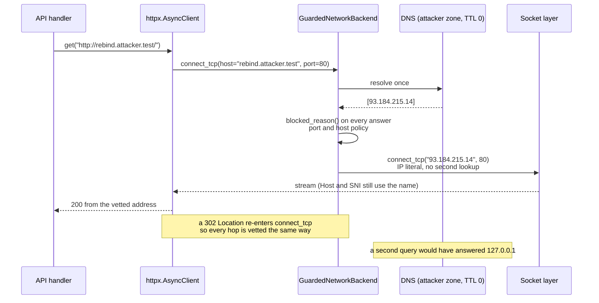

# Defending Against Server-Side Request Forgery (SSRF, API7:2023): Why URL String Validation Fails Against DNS Rebinding and How to Build a Safe httpx Transport

> [!summary] Claim
> An SSRF check is only sound if it runs on the exact IP address the socket dials: validating the URL string or pre-resolving the host leaves a gap that alternate address encodings, DNS answers with TTL 0, and `3xx` redirects walk through, so the guard belongs in the httpcore network backend, which resolves once, rejects the whole answer set if any address is special-purpose, and dials only the vetted IP literal.

Part of [API Authorization and OWASP Security](README.md) in [API Engineering](../README.md).

## TL;DR

- Mechanism: `httpx.AsyncClient` hands every hop, including every redirect hop, to its transport, and httpcore calls `network_backend.connect_tcp(host=...)` with the URL host (`(httpcore 1.0.9 httpcore/_async/connection.py, AsyncHTTPConnection._connect)`); a backend that resolves, vets, and then dials an IP literal closes the time-of-check to time-of-use gap, because anyio skips `getaddrinfo` for literals (`(anyio 4.16.0 src/anyio/_core/_sockets.py, connect_tcp)`).
- Contract rule: filter on the numeric address, never on the string, as RFC 3986 Section 7.4 says ("literals should be converted to numeric form and filtered based on the numeric value"), and do it at connect time for every connection, every address in the answer set, and every redirect hop.
- The trap: `naive_preflight_is_safe()` resolves `rebind.attacker.test` to a public address, the client resolves it a second time and gets `127.0.0.1`; the lab proves it with two DNS queries and a dial to loopback, and a second test shows a `302` to `169.254.169.254` doing the same with no DNS trick at all.
- Portability fact: `ipaddress.is_global` is a snapshot of the IANA registries that changed in CPython 3.12.4 and 3.13.0a6 (CVE-2024-4032) and still lags them: on 3.12.13, 3.13.18, 3.14.10, 3.15.2, and 3.15.0b3t, `64:ff9b::7f00:1` (NAT64 to loopback), `5f00::1`, and `100:0:0:1::1` report `is_global == True`, so the lab uses explicit CIDR tables instead.
- When not to use it: if the set of destinations is known, an allow list of hosts at an egress proxy beats any block list; a connect-time guard is the floor for user-supplied URLs (webhooks, link previews, importers), not a substitute for network isolation and IMDSv2.

## Mental model



The handler gives the client a user-supplied URL, and the client resolves nothing itself: it asks its transport, which asks httpcore's connection pool, which calls the network backend's `connect_tcp` with the host name from the URL.
The guarded backend performs the only DNS query of the connection, checks every address it got back against the special-purpose tables, the port allow list, and an optional host allow list, and then passes an IP literal to the real dialer, so the attacker's second answer is never asked for.
The HTTP `Host` header and the TLS `server_hostname` still carry the name, because httpcore takes both from the request URL rather than from the socket, so certificate verification and virtual hosting are unchanged.
A redirect is a new request to a new origin, so with redirects enabled it re-enters `connect_tcp` and gets vetted; with the lab's default (`follow_redirects=False`) the client returns the `302` instead.

## How it works

### What SSRF is and why APIs are where it lives

OWASP API Security Top 10 2023 lists SSRF as `API7:2023` with exploitability rated "Easy", prevalence "Common", detectability "Easy", and technical impact "Moderate" (as of 2026-11).
It defines the weakness as an API that fetches a remote resource from a user-supplied URL without validating it, so the attacker makes the server send requests to destinations the attacker cannot reach directly, including behind a firewall or VPN.
OWASP names the features that create it: webhooks, fetching files from URLs, custom SSO, and URL previews, and the targets that make it dangerous: cloud metadata, Kubernetes, and Docker management endpoints exposed over HTTP on predictable paths.
Its two scenarios are a profile-picture-by-URL endpoint used to port-scan `localhost` through response timing, and a webhook "test notification" that is pointed at `169.254.169.254` and echoes IAM credentials back in the API response.
CWE-918 is the weakness class.

SSRF has two shapes that need different defenses.
In full-read SSRF the API returns the fetched body (the webhook test scenario), so one request exfiltrates a secret.
In blind SSRF the API returns only a status or a timing, which still maps internal ports and can trigger state-changing `GET` endpoints on internal services.
Both are stopped by the same control: the server must never open a TCP connection to an address the policy forbids.

### Layer 1: the URL string, and why validating it fails

A URL host is a `reg-name`, an `IPv4address` in strict dotted-decimal, or a bracketed `IP-literal` (RFC 3986 Section 3.2.2).
The resolver that eventually receives a `reg-name` is not bound by that grammar.
RFC 3986 Section 7.4 warns that implementations hand host strings to `gethostbyname()` and `inet_aton()`, which accept forms such as a single 32-bit number, two or three dotted parts, and octal or hexadecimal parts, and concludes that filtering must be done "based on the numeric value, and not on a prefix or suffix of the string form".

The lab measures the chain on CPython 3.14.6 and macOS 27.3 arm64:

| Host string | `httpx.URL(...)` | `ipaddress.ip_address(...)` | `getaddrinfo(..., AI_NUMERICHOST)` |
|---|---|---|---|
| `2130706433` | host `2130706433` (a `reg-name`) | `ValueError` | `127.0.0.1` |
| `0x7f000001` | `reg-name` | `ValueError` | `127.0.0.1` |
| `017700000001` | `reg-name` | `ValueError` | `127.0.0.1` |
| `0x7f.0.0.1` | `reg-name` | `ValueError` | `127.0.0.1` |
| `0x7f.1` | host `0x7f.1` | `ValueError` | `127.0.0.1` |
| `0177.0.0.1` | `InvalidURL: Invalid IPv4 address` | `ValueError` | `177.0.0.1` on macOS |

httpx sends anything that matches `^[0-9]+\.[0-9]+\.[0-9]+\.[0-9]+$` through `ipaddress.IPv4Address`, which since CPython 3.9.5 rejects leading zeros (`(httpx 0.28.1 httpx/_urlparse.py, encode_host)`), and treats everything else as a lower-cased `reg-name` that goes to the resolver unchanged.
So the string `0x7f.1` passes a prefix blocklist, passes httpx's parser, and reaches loopback through libc; lab tests `test_string_blocklist_passes_hosts_that_libc_parses_as_loopback` (the last two columns for the first five rows) and `test_httpx_rejects_dotted_octal_but_passes_other_legacy_forms_to_the_resolver` (the `0177.0.0.1`, `0x7f.1`, and `2130706433` cells of the httpx column) pin most cells, and a one-off probe with `uv run --frozen python` on the same machine and interpreter (2026-11-15) reproduced the whole table.
The `0177.0.0.1` row is a platform difference measured here: macOS `getaddrinfo` read the dotted parts as decimal.
On Linux the same string is loopback: the `inet_aton(3)` man page documents that components "can be specified in decimal, octal (with a leading 0), or hexadecimal", glibc 2.40 parses each part with `__strtoul_internal (cp, &endp, 0, 0)` (base 0, so `0177` is octal 127) in `inet_aton_end` and `getaddrinfo` reaches it through `__inet_aton_exact` in `text_to_binary_address`, which `gaih_inet` calls (`(glibc 2.40 resolv/inet_addr.c, inet_aton_end)`, `(glibc 2.40 nss/getaddrinfo.c, text_to_binary_address)`), and musl's `__inet_aton` does `strtoul(s, &z, 0)` per part and is the first thing `__lookup_ipliteral` tries (`(musl master src/network/inet_aton.c, __inet_aton)`, `(musl master src/network/lookup_ipliteral.c, __lookup_ipliteral)`, source read 2026-11-15).
This was read in source, not run on a Linux or Alpine host in this job, and it is why httpx's rejection of dotted octal matters: on glibc and musl `http://0177.0.0.1/` would otherwise reach `127.0.0.1`.

String checks also lose to parser differentials, where the validator and the HTTP client disagree about which part of the string is the host.
CPython's `urllib.parse` had two such CVEs: leading blanks bypassed blocklists before 3.11.4 (CVE-2023-24329), and bracketed hosts that were not IPv6 or IPvFuture were accepted, which "potentially enabled SSRF if a URL is processed by more than one URL parser" (CVE-2024-11168).
The OWASP cheat sheet's rules are to avoid accepting complete URLs at all (accept an IP address or domain name, match it against an allow list, and build the request yourself) and to "Treat parser disagreement as a rejection", rejecting a URL "whose host is not read identically by every parser in play" (as of 2026-11).
The lab's own naive list shows a third failure: it lists `[::1]`, but `urllib.parse.urlsplit("http://[::1]/").hostname` is `"::1"`, so that entry can never match.

### Layer 2: resolving first, and why a pre-flight check fails

The next idea is to resolve the host, check the addresses, and then call the client.
The client then resolves the host again.
DNS gives the attacker full control of the second answer: a TTL of zero means "the RR can only be used for the transaction in progress, and should not be cached" (RFC 1035 Section 3.2.1), so a hostile authoritative server answers each query differently.
This is DNS rebinding applied to a server: the first answer (`93.184.215.14`) passes the check, the second (`127.0.0.1`) is dialed.
`test_preflight_check_is_bypassed_by_dns_rebinding` reproduces it with a scripted zone: `naive_preflight_is_safe()` returns `True`, the resolver records two queries, the fake network records one dial to `127.0.0.1:80`, and the response body is the internal admin page.

Caching resolvers do not save the pre-flight design: the check and the dial may hit different caches, workers, or resolvers, and the attacker can also return a set such as `[public, 10.0.0.5]` and rely on the dialer's fallback order.
anyio's `connect_tcp` resolves a host name with `getaddrinfo`, reorders the answers so an IPv6 address comes first and an IPv4 address second, and starts the next attempt as soon as the previous one fails or after `happy_eyeballs_delay` (default `0.25` seconds), until one connects (`(anyio 4.16.0 src/anyio/_core/_sockets.py, connect_tcp)`), which matches the 250 ms "Connection Attempt Delay" recommended by RFC 8305 Section 5.
A checker that vets only the first answer is therefore bypassed by an unreachable public first answer and a reachable internal second one.

### Layer 3: redirects

A `3xx` response with `Location` is an instruction to send a new request to a new URI (RFC 9110 Section 15.4 and Section 10.2.2).
A guard that runs once per user-supplied URL does not see that second URI.
`test_preflight_check_is_bypassed_by_a_redirect_to_metadata` shows it with no DNS trick: the public host answers `302 Found` with `Location: http://169.254.169.254/latest/meta-data/iam/`, the client follows it, and the response holds the fake IAM credentials.
httpx 0.28.1 defaults to `follow_redirects=False` and `max_redirects=20` (`(httpx 0.28.1 httpx/_client.py, AsyncClient.__init__)`, `(httpx 0.28.1 httpx/_config.py, DEFAULT_MAX_REDIRECTS)`), and its redirect loop calls `_send_single_request` for every hop, which routes through `_transport_for_url(request.url)` (`(httpx 0.28.1 httpx/_client.py, AsyncClient._send_handling_redirects)`).
That routing is the reason the guard sits below the client: every hop, every pool refill, and every retry passes through the same backend.
httpx strips `Authorization` on a cross-origin redirect unless it is an `http` to `https` upgrade of the same host from port `80` to port `443` (`(httpx 0.28.1 httpx/_client.py, BaseClient._redirect_headers)`), which RFC 9110 Section 15.4 recommends, but it does nothing about the destination address.

### Layer 4: the connect-time guard in httpx and httpcore

httpx's `AsyncHTTPTransport` builds an `httpcore.AsyncConnectionPool` in `__init__` and passes no `network_backend` (`(httpx 0.28.1 httpx/_transports/default.py, AsyncHTTPTransport.__init__)`), so the pool falls back to `AutoBackend`, which picks `AnyIOBackend` under asyncio.
The pool reuses an idle connection only when `connection.can_handle_request(origin)` is true, which compares the full `(scheme, host, port)` origin (`(httpcore 1.0.9 httpcore/_async/connection.py, AsyncHTTPConnection.can_handle_request)`), so a kept-alive connection to a vetted address never dials again.
A new connection runs `AsyncHTTPConnection._connect`, which calls `self._network_backend.connect_tcp(host=self._origin.host.decode("ascii"), port=..., timeout=timeouts.get("connect"), ...)` and, for `https`, `stream.start_tls(ssl_context, server_hostname=sni_hostname or self._origin.host.decode("ascii"))`.
The backend interface is three coroutines, `connect_tcp`, `connect_unix_socket`, and `sleep`, returning an `AsyncNetworkStream` with `read`, `write`, `aclose`, `start_tls`, and `get_extra_info` (`(httpcore 1.0.9 httpcore/_backends/base.py, AsyncNetworkBackend)`), so a wrapper can intercept every dial without touching HTTP framing.

The lab's `GuardedNetworkBackend.connect_tcp` does four things in order.
It rejects the port unless it is in `EgressPolicy.allowed_ports` (default `{80, 443}`) and the host unless it is in `allowed_hosts` when one is configured, before any DNS traffic.
It parses the host strictly with `ipaddress.ip_address`; a literal is vetted directly and the resolver is never called (`test_ip_literals_are_vetted_without_asking_the_resolver`).
Otherwise it resolves once inside `anyio.fail_after(timeout)`, so a hanging resolver becomes `httpcore.ConnectTimeout` and then `httpx.ConnectTimeout` (`test_slow_resolution_is_bounded_by_the_connect_timeout`).
It runs `blocked_reason()` on every answer and raises `SSRFBlockedError` if any is forbidden, then dials the vetted literals in order through the real backend, failing over only among them (`test_one_internal_answer_poisons_the_whole_answer_set`, `test_failover_only_walks_vetted_addresses`).
Because anyio's `connect_tcp` calls `ip_address(remote_host)` first and builds a single-element target list when it succeeds, the dial performs no second lookup.
`connect_unix_socket` always raises, so no configuration path can turn the guarded transport into a client for `/var/run/docker.sock`.

`SSRFBlockedError` is a plain `Exception`, and `map_httpcore_exceptions` re-raises any exception it has no mapping for unchanged (`(httpx 0.28.1 httpx/_transports/default.py, map_httpcore_exceptions)`), so callers see the guard's own type with `host`, `address`, and `reason` attributes rather than a generic `httpx.ConnectError`.
The trade-off is that code catching only `httpx.HTTPError` will not catch it, which is deliberate: a policy denial should not be retried like a network blip, and httpcore's `retries` loop in `_connect` retries only `ConnectError` and `ConnectTimeout` (`(httpcore 1.0.9 httpcore/_async/connection.py, AsyncHTTPConnection._connect)`), so a blocked address is raised on the first attempt.

### Layer 5: the address classifier

`blocked_reason()` encodes the IANA IPv4 and IPv6 Special-Purpose Address Registries (RFC 6890 Section 2.2.1 defines their columns, and RFC 8190 Section 2.1 renamed the `Global` column to `Globally Reachable`), taking every block whose "Globally Reachable" value is `False`, `N/A`, or blank (the deprecated `192.88.99.0/24` and `2001:10::/28` rows), plus multicast and the deprecated IPv6 site-local range.
IPv4: `0.0.0.0/8`, `10.0.0.0/8` (RFC 1918 Section 3), `100.64.0.0/10` (RFC 6598), `127.0.0.0/8`, `169.254.0.0/16` (RFC 3927), `172.16.0.0/12`, `192.0.0.0/24`, the three documentation nets, `192.88.99.0/24`, `192.168.0.0/16`, `198.18.0.0/15`, `224.0.0.0/4`, and `240.0.0.0/4` (which contains `255.255.255.255`).
IPv6: `::/96`, `64:ff9b:1::/48`, `100::/64`, `100:0:0:1::/64` (the RFC 9780 dummy prefix, in the registry as of 2026-11), `2001::/23`, `2001:db8::/32`, `3fff::/20`, `5f00::/16`, `fc00::/7`, `fe80::/10`, `fec0::/10` (site-local, deprecated per RFC 4291 Section 2.5.7 and not in the registry), and `ff00::/8` (multicast, not in the registry).

IPv6 can carry an IPv4 destination, so the classifier unwraps before it matches.
`::ffff:0:0/96` is the IPv4-mapped form (RFC 4291 Section 2.5.5.2): on a dual-stack socket `::ffff:169.254.169.254` reaches the metadata address, so it is judged as `169.254.169.254`.
`64:ff9b::/96` is the NAT64 well-known prefix (RFC 6052 Section 2.1); the IANA registry marks it globally reachable, yet a NAT64 gateway forwards `64:ff9b::7f00:1` to `127.0.0.1` inside its own network, so the low 32 bits are judged.
`2002::/16` is 6to4 and embeds an IPv4 address in bits 16 to 47 (`IPv6Address.sixtofour`).
`::/96` is the deprecated IPv4-compatible form (RFC 4291 Section 2.5.5.1 says it "is now deprecated"), and blocking the whole `/96` also covers `::` and `::1`.
`2001::/23` is blocked whole, which also blocks a few registry-global anycast addresses such as `2001:1::1`, and `192.0.0.0/24` is blocked whole, which also blocks the registry-global `192.0.0.9` and `192.0.0.10`; for a webhook fetcher that is the right side to err on.

The classifier does not call `is_global` or `is_private`, for three measured reasons.
CVE-2024-4032 records that `ipaddress` returned wrong `is_private` and `is_global` values for several blocks, fixed in CPython 3.12.4 and 3.13.0a6 and, per the record's affected ranges, in 3.8.20, 3.9.20, 3.10.15, and 3.11.10; the documentation lists the 3.13 changes (`192.0.0.0/24`, `64:ff9b:1::/48`, `2002::/16`, and the `2001::/23` exceptions).
The fix still copies a snapshot: on every interpreter in the matrix here `5f00::1` (SRv6 SIDs) and `100:0:0:1::1` (RFC 9780 dummy prefix), both not globally reachable in the registry as of 2026-11, are `is_global == True`, and `2001:1::3` (globally reachable in the registry) is `is_global == False`.
And `is_global` is defined on the registry, which correctly calls `64:ff9b::/96` global and `224.0.0.1` global, while an egress guard must judge where the packet actually lands.
`test_stdlib_is_global_says_true_where_the_guard_blocks` pins the five disagreements the guard depends on: `64:ff9b::7f00:1`, `::127.0.0.1`, `5f00::1`, `100:0:0:1::1`, and `224.0.0.1`.

### Layer 6: what the guard does not see

The socket layer is the right place to vet a destination only when the socket goes to the destination.
With a forward proxy the socket goes to the proxy, which resolves the target itself, so a guard in the client checks the proxy's address and nothing else.
httpx reads `HTTP_PROXY`, `HTTPS_PROXY`, `ALL_PROXY`, and `NO_PROXY` only when `trust_env and transport is None` (`(httpx 0.28.1 httpx/_client.py, AsyncClient.__init__, allow_env_proxies)`), so passing an explicit transport disables environment proxies; `test_explicit_transport_ignores_proxy_environment` sets both variables to `http://10.0.0.1:3128` and still sees the dial go to the vetted public address.
If the deployment needs a proxy, the proxy must enforce the policy, which is what Stripe's Smokescreen does: it is an HTTP `CONNECT` proxy that applies a hostname ACL and "resolves each domain name that is requested, and ensures that it is a publicly routable IP address" (Smokescreen README, as of 2026-11).

### The cloud metadata endpoint, the usual prize

AWS, Google Cloud, and Azure all serve instance metadata on `169.254.169.254`, and each now requires something a plain SSRF `GET` usually cannot add.
AWS IMDSv2 requires a session token obtained with `PUT /latest/api/token` and the header `X-aws-ec2-metadata-token-ttl-seconds` (at most 21,600 seconds), sent back as `X-aws-ec2-metadata-token`; `PUT` requests with `X-Forwarded-For` are rejected, and the `PUT` response has an IP hop limit of `1` by default (AWS EC2 User Guide, as of 2026-11).
IMDSv1, a plain `GET`, is still accepted unless the instance is configured to require IMDSv2, and the IPv6 endpoint is `fd00:ec2::254` on Nitro instances in IPv6-enabled subnets.
Google Cloud requires `Metadata-Flavor: Google` and rejects any request carrying `X-Forwarded-For`; Azure requires `Metadata: true`, rejects `X-Forwarded-For`, and says IMDS "is not intended to be used behind a proxy" (vendor documentation, as of 2026-11).
These checks stop the classic one-shot `GET`, but AWS's own announcement notes that many SSRF vulnerabilities let the attacker set arbitrary headers, so they are defense in depth behind the guard, not instead of it.

## Numbers and limits

| Quantity | Value | Source or measurement |
|---|---|---|
| OWASP `API7:2023` ratings | Exploitability Easy, Prevalence Common, Detectability Easy, Technical Moderate | OWASP API Security Top 10 2023 (as of 2026-11) |
| DNS TTL range | `0` to `2^31 - 1` seconds; `0` means use only for the current transaction | RFC 2181 Section 8; RFC 1035 Section 3.2.1 |
| Pre-flight vs dial lookups in the naive path | 2 queries, second answer dialed | lab, `resolver.queries == [REBIND, REBIND]` |
| Lookups in the guarded path, two requests on one keep-alive connection | 1 query, 1 dial | lab, `test_guard_resolves_once_and_dials_the_vetted_address` |
| anyio Happy Eyeballs delay | `0.25` s default | `(anyio 4.16.0 src/anyio/_core/_sockets.py, connect_tcp)`; RFC 8305 Section 5 recommends 250 ms |
| httpx redirect defaults | `follow_redirects=False`, `max_redirects=20` | `(httpx 0.28.1 httpx/_client.py, AsyncClient.__init__)`, `(httpx 0.28.1 httpx/_config.py, DEFAULT_MAX_REDIRECTS)` |
| httpx default timeout | `5.0` s per phase | `(httpx 0.28.1 httpx/_config.py, DEFAULT_TIMEOUT_CONFIG)`; the lab's `guarded_client` also passes `5.0` |
| Guard worst-case connect time | resolution `timeout` plus one `timeout` per vetted address | lab design: `vet` and each `inner.connect_tcp` receive the same `connect` timeout; not a shared budget |
| IANA special-purpose blocks encoded | 15 IPv4, 12 IPv6 (plus 3 unwrapping rules) | `BLOCKED_V4`, `BLOCKED_V6` in the lab, from the registry CSVs fetched 2026-11-15 |
| AWS IMDSv2 token TTL | 1 s to 21,600 s | AWS EC2 User Guide (as of 2026-11) |
| AWS IMDSv2 `PUT` response hop limit | `1` by default | AWS EC2 User Guide (as of 2026-11) |
| CPython `ipaddress` registry fix | 3.12.4 and 3.13.0a6; also 3.8.20, 3.9.20, 3.10.15, 3.11.10 | CVE-2024-4032 record (description and affected ranges) |
| CPython leading-zero rejection | 3.9.5 | `ipaddress` documentation; CVE-2021-29921 |
| Lab suite | 62 tests, `62 passed in 0.36s` | `uv run --frozen pytest tests/f15_api_authorization_and_owasp_security/test_preventing_ssrf_api7_2023_dns_pinning_and_private_cidr_socket_guards.py -q`, CPython 3.14.6, macOS 27.3 arm64 (Darwin 27.3.0), 2026-11-15 |

## Portability

| Dimension | Version | Result |
|---|---|---|
| CPython (workspace) | `3.14.6` | lab `62 passed`, macOS 27.3 arm64 |
| CPython `ipaddress` behavior | `3.12.13`, `3.13.18`, `3.14.10`, `3.15.2`, `3.15.0b3` free-threaded | a probe of every address this note cites for `is_global`, `is_private`, `is_loopback`, and `is_link_local` printed identical results on all five and on `3.14.6` (re-run 2026-11-15); the lab itself was not run on them (lab runs were paused for this job), and `3.12.16` and `3.15.2t` are not installed here |
| CPython before the fixes | `3.9.6` (macOS system Python, outside the matrix) | the same probe differed on five addresses: `::ffff:127.0.0.1` `is_loopback` False, `::ffff:169.254.169.254` `is_link_local` False, and `2002:7f00:1::`, `192.0.0.192`, `64:ff9b:1::a9fe:a9fe` `is_global` True; the mapped-loopback fix is gh-117566, backported to 3.12 in PR 118391 |
| CPython syntax floor | `>= 3.12` | the module uses the `type` alias statement (PEP 695), matching the workspace's `requires-python` |
| libc legacy IPv4 forms | macOS 27.3, glibc 2.40, musl master | macOS measured in the table above (`0177.0.0.1` read as decimal); glibc and musl read from source (base-0 `strtoul`, so `0177` is octal 127), not run here |
| httpx | `0.28.1` | no `network_backend` parameter on `AsyncHTTPTransport`, so the lab replaces `_pool`; a future httpx that renames `_pool` breaks `GuardedTransport` at construction, not silently |
| httpcore | `1.0.9` | backend interface and `_connect` call shape read in source; lab passes |
| anyio | `4.16.0` | literal fast path in `connect_tcp` read in source; httpcore's `AutoBackend` would pick `TrioBackend` under trio, but the guard's default inner backend is always `AnyIOBackend`, whose `anyio.connect_tcp` and `anyio.getaddrinfo` pick the running loop's backend with `get_async_backend()`; under trio the literal path ends in `trio_socket.connect((host, port))` and resolution in `trio.socket.getaddrinfo` (`(anyio 4.16.0 src/anyio/_backends/_trio.py, TrioBackend.connect_tcp)`); read in source, not run, because trio is not installed in the lab environment |
| HTTP/1.1 | via httpcore and h11 | proven in the lab (`Host` header bytes captured from the fake stream) |
| HTTP/2 | `GuardedTransport(http2=True)` | the dial path is the same `_connect` (ALPN is set after `connect_tcp`, in `start_tls`), per httpcore source: `AsyncHTTPConnection.handle_async_request` calls `_connect` first and only then inspects `selected_alpn_protocol() == "h2"` to build `AsyncHTTP2Connection` (`(httpcore 1.0.9 httpcore/_async/connection.py, AsyncHTTPConnection.handle_async_request)`), so `connect_tcp` receives the same host name and the guard vets it identically; no HTTP/2 lab test was run, and h2 multiplexes streams over one vetted connection, so a second request to the same origin never dials again |
| HTTP/3 | n/a | httpx 0.28.1's `AsyncHTTPTransport` exposes only `http1` and `http2` flags |
| Uvicorn, Hypercorn, Granian | n/a | SSRF is an outbound-client property; the server that hosts the handler does not change the dial path |

## Worked example

The [implementation](../labs/src/api_labs/f15_api_authorization_and_owasp_security/ssrf_guard.py) holds the classifier, the guarded backend and transport, and the two naive defenses the note shows failing; the [test](../labs/tests/f15_api_authorization_and_owasp_security/test_preventing_ssrf_api7_2023_dns_pinning_and_private_cidr_socket_guards.py) runs real `httpx.AsyncClient` and httpcore HTTP/1.1 framing over `FakeNetwork`, an httpcore network backend that routes IP literals to canned responses, and `ScriptedResolver`, an attacker zone that answers differently on each query.
No real socket is opened, so every test is marked `@pytest.mark.unit`.

The classifier, verbatim from the lab:

```python
def embedded_ipv4(address: ipaddress.IPv6Address) -> tuple[ipaddress.IPv4Address, str] | None:
    """Return the IPv4 address a v6 address reaches through mapping or translation."""
    if address.ipv4_mapped is not None:  # ::ffff:0:0/96, RFC 4291 Section 2.5.5.2
        return address.ipv4_mapped, "ipv4-mapped"
    if address in NAT64_WELL_KNOWN:  # a NAT64 gateway forwards to the low 32 bits
        return ipaddress.IPv4Address(int(address) & 0xFFFFFFFF), "nat64"
    if address.sixtofour is not None:  # 2002::/16, RFC 3056
        return address.sixtofour, "6to4"
    return None


def blocked_reason(address: IPAddress) -> str | None:
    """Return why `address` must not be dialed, or None if it is a public unicast address."""
    if isinstance(address, ipaddress.IPv6Address):
        inner = embedded_ipv4(address)
        if inner is not None:
            v4, via = inner
            reason = blocked_reason(v4)
            return None if reason is None else f"{via}:{reason}"
        for v6_net, v6_reason in BLOCKED_V6:
            if address in v6_net:
                return v6_reason
        return None
    for v4_net, v4_reason in BLOCKED_V4:
        if address in v4_net:
            return v4_reason
    return None
```

The guard, verbatim:

```python
    async def vet(self, host: str, port: int, resolve_timeout: float | None = None) -> list[str]:
        if port not in self.policy.allowed_ports:
            raise SSRFBlockedError(host, "", f"port {port} not allowed")
        if self.policy.allowed_hosts is not None and host not in self.policy.allowed_hosts:
            raise SSRFBlockedError(host, "", "host not in allow list")
        literal = parse_ip_literal(host)
        if literal is not None:
            candidates = [literal]
        else:
            try:
                with anyio.fail_after(resolve_timeout):
                    answers = await self.resolver.resolve(host, port)
            except TimeoutError as exc:
                raise httpcore.ConnectTimeout(f"resolving {host!r} timed out") from exc
            candidates = [ipaddress.ip_address(answer) for answer in answers]
        if not candidates:
            raise SSRFBlockedError(host, "", "no addresses")
        for candidate in candidates:  # one bad answer poisons the whole set
            reason = blocked_reason(candidate)
            if reason is not None:
                raise SSRFBlockedError(host, str(candidate), reason)
        return [candidate.compressed for candidate in candidates]

    async def connect_tcp(
        self,
        host: str,
        port: int,
        timeout: float | None = None,  # noqa: ASYNC109 - httpcore's backend signature
        local_address: str | None = None,
        socket_options: Iterable[SocketOption] | None = None,
    ) -> httpcore.AsyncNetworkStream:
        addresses = await self.vet(host, port, timeout)
        failures: list[httpcore.ConnectError] = []
        for address in addresses:  # sequential failover, only across vetted addresses
            try:
                stream = await self.inner.connect_tcp(
                    address, port, timeout, local_address, socket_options
                )
            except httpcore.ConnectError as exc:
                failures.append(exc)
                continue
            self.dials.append(Dial(host, address, port))
            return stream
        raise httpcore.ConnectError(f"all {len(addresses)} vetted addresses failed: {failures}")
```

Wiring it into httpx, verbatim:

```python
class GuardedTransport(httpx.AsyncHTTPTransport):
    """AsyncHTTPTransport whose connection pool dials through a GuardedNetworkBackend.

    httpx 0.28.1 does not expose `network_backend`, so the pool built by the base
    class is replaced before first use; no proxy is ever configured on this transport.
    """

    def __init__(
        self,
        backend: GuardedNetworkBackend,
        *,
        verify: ssl.SSLContext | bool = True,
        limits: httpx.Limits = DEFAULT_LIMITS,
        http2: bool = False,
    ) -> None:
        super().__init__(verify=verify, limits=limits, http2=http2, trust_env=False)
        self.backend = backend
        self._pool = httpcore.AsyncConnectionPool(
            ssl_context=httpx.create_ssl_context(verify=verify, trust_env=False),
            max_connections=limits.max_connections,
            max_keepalive_connections=limits.max_keepalive_connections,
            keepalive_expiry=limits.keepalive_expiry,
            http1=True,
            http2=http2,
            network_backend=backend,
        )
```

The rebinding attack and the defense against the same zone, verbatim from the test:

```python
async def test_preflight_check_is_bypassed_by_dns_rebinding() -> None:
    resolver = ScriptedResolver({REBIND: [[PUBLIC], ["127.0.0.1"]]})
    network = FakeNetwork(ROUTES)
    url = f"http://{REBIND}/"

    assert await naive_preflight_is_safe(url, resolver) is True
    async with unguarded_client(resolver, network, follow_redirects=False) as client:
        response = await client.get(url)

    assert response.text == "internal admin console"
    assert resolver.queries == [REBIND, REBIND]  # checked one answer, dialed another
    assert network.dialed() == [("127.0.0.1", 80)]
```

```python
async def test_guard_resolves_once_and_dials_the_vetted_address() -> None:
    resolver = ScriptedResolver({REBIND: [[PUBLIC], ["127.0.0.1"]]})
    network = FakeNetwork(ROUTES)
    async with guarded_client(resolver, inner=network) as client:
        response = await client.get(f"http://{REBIND}/")
        again = await client.get(f"http://{REBIND}/")  # keep-alive reuse, no new lookup

    assert (response.text, again.status_code) == ("public page", 200)
    assert resolver.queries == [REBIND]
    assert network.dialed() == [(PUBLIC, 80)]
    written = bytes(network.opened[0][2].written)
    assert b"Host: rebind.attacker.test\r\n" in written
```

The other tests cover the `302` to metadata (followed by the naive client, returned unfollowed by the guarded client, and blocked on the second hop when redirects are enabled), mixed answer sets, IP literals in mapped, NAT64, and AWS IPv6 IMDS form, `https` keeping `shop.example.test` as the TLS `server_hostname` while dialing the IP on port 443, failover, ports, host allow lists, empty answers, resolver timeouts, Unix sockets, environment proxies, and 24 blocked and 5 allowed addresses in the classifier.

Captured output (CPython 3.14.6, macOS 27.3 arm64, from `labs/`, 2026-11-15):

```text
$ uv run --frozen pytest tests/f15_api_authorization_and_owasp_security/test_preventing_ssrf_api7_2023_dns_pinning_and_private_cidr_socket_guards.py -q
..............................................................           [100%]
62 passed in 0.36s
```

The first run of the suite failed two tests, both in the test scaffolding and both instructive: the fake stream answered only one request per connection, so the keep-alive reuse in `test_guard_resolves_once_and_dials_the_vetted_address` raised `httpx.RemoteProtocolError: Server disconnected without sending a response.`, and the `127.1` case passed the naive prefix check's `127.` entry, so it was replaced by `0x7f.0.0.1`.
Mutation testing was not run for this job, because lab checks were paused by the user on 2026-11-11.

## Pitfalls

> [!warning] Validating the URL, then fetching it
> Trigger: `if is_safe(url): await client.get(url)`, where `is_safe` resolves the host or inspects the string.
> Symptom: DNS rebinding (two different answers for two queries), alternate IPv4 encodings, and parser differentials all pass the check and reach internal addresses; the lab reproduces the rebinding variant with two queries and a dial to `127.0.0.1`.
> Fix: move the check into the network backend so it runs on the address the socket dials, and dial the vetted literal.

> [!warning] Following redirects with a guard that runs once
> Trigger: `follow_redirects=True` on a client whose only check ran on the first URL.
> Symptom: a public page answering `302` with `Location: http://169.254.169.254/...` hands the metadata response to the attacker; OWASP lists "Disable HTTP redirections" for this reason.
> Fix: keep httpx's default `follow_redirects=False`, and if redirects are required, follow them through the guarded transport so each hop is vetted (`test_guard_vets_every_redirect_hop_when_redirects_are_enabled`).

> [!warning] Trusting `ipaddress.is_global` or `is_private`
> Trigger: `if not ip.is_global: reject`.
> Symptom: on CPython releases without the CVE-2024-4032 fix (before 3.12.4, 3.11.10, 3.10.15, 3.9.20, or 3.8.20) several blocks were misclassified; on every current release `64:ff9b::7f00:1`, `5f00::1`, and `100:0:0:1::1` are `is_global`, and `::ffff:127.0.0.1` was not `is_loopback` before the gh-117566 fix (measured on 3.9.6).
> Fix: an explicit, dated table from the IANA registries, unwrapping IPv4-mapped, NAT64, and 6to4 forms first.

> [!warning] Vetting only the first DNS answer
> Trigger: the check reads `getaddrinfo(...)[0]` and the dialer walks the whole list.
> Symptom: anyio's Happy Eyeballs walks every answer after 250 ms, so `[unreachable public, 10.0.0.5]` connects internally.
> Fix: reject the set if any answer is forbidden, and fail over only across vetted literals (`test_one_internal_answer_poisons_the_whole_answer_set`).

> [!warning] An environment proxy under the guard
> Trigger: a client built with `trust_env=True` and no explicit transport, on a host that sets `HTTPS_PROXY`.
> Symptom: the client dials the proxy, which resolves and connects to the target itself, so a client-side guard vets only the proxy's address.
> Fix: pass an explicit transport (httpx then ignores proxy variables) or enforce the policy in the proxy, as Smokescreen does.

> [!warning] Feature flags that re-open the internal network
> Trigger: an operator setting that allows webhooks to local or private addresses.
> Symptom: CVE-2021-22214: "When requests to the internal network for webhooks are enabled", GitLab CE/EE from 10.5 had an SSRF exploitable by an unauthenticated attacker, fixed in 13.10.5, 13.11.5, and 13.12.2.
> Fix: model internal destinations as an explicit allow list of hosts, not a switch that disables the classifier.

> [!warning] Leading zeros and lenient parsers
> Trigger: an IP allow or deny check built on a parser that accepts `010.8.8.8` style octets.
> Symptom: CVE-2021-29921: "In Python before 3,9,5, the ipaddress library mishandles leading zero characters", which "allows attackers to bypass access control that is based on IP addresses".
> Fix: parse with the strict parser and compare numbers, and never pass the original string onward.

## Security and robustness

- Threat model: the attacker controls the URL, the DNS zone for its host (including TTL and answer order), and the HTTP responses of the first server, including `Location`; the defender controls the client, its transport, and the network.
- Boundary enforcement: the decision is made on the IP literal at `connect_tcp`, the one point every hop and pool refill crosses; `Host` and SNI are unchanged, so certificate verification still names the original host.
- Port and scheme: only `80` and `443` by default; httpcore's pool raises `UnsupportedProtocol` for any scheme other than `http`, `https`, `ws`, and `wss` before dialing, so `gopher://` and `file://` never reach the backend (`(httpcore 1.0.9 httpcore/_async/connection_pool.py, AsyncConnectionPool.handle_async_request)`).
- Response handling: OWASP's "Do not send raw responses to clients" matters for full-read SSRF; return a normalized result (status class, content type, size) rather than the body, and keep the `SSRFBlockedError` address and reason in logs, not in the API response, which would hand the attacker an internal address oracle (see [[Structured-Log-Redaction-and-Preventing-PII-and-Token-Leaks]]).
- Resource bounds: a guarded fetch can still stream gigabytes or hang on a slowloris origin; cap bytes and total time as in [[Unrestricted-Resource-Consumption-API4-2023-Payload-Depth-and-Limit-Guards]], and note the guard's own timeout is per phase, not a total budget.
- Blind SSRF timing: responses that differ in latency between "blocked", "refused", and "timed out" leak internal topology; return one error shape for all of them.
- Untrusted upstream data: whatever the fetch returns is input from a third party, covered by `API10:2023` in [[Improper-Inventory-Management-API9-2023-and-Unsafe-Consumption-of-APIs-API10-2023]].
- Defense in depth: run the fetcher in a network segment with no route to `169.254.0.0/16`, RFC 1918 space, or the control plane; require IMDSv2 with a hop limit of `1`; and give the fetcher's identity no cloud permissions it does not need, so a bypass of the guard still finds nothing worth taking.

## The principal's view

The architectural decision is where egress policy lives, and the answer is "below every client, and again in the network".
A per-call `validate_url()` cannot be correct, because it is a check on a string that something else later turns into an address; the guard must own the step that turns the name into a socket.
For a service with a handful of user-facing fetch features (webhooks, previews, imports), the right shape is a single shared outbound client factory that every team must use, built on a guarded transport like this one, with the classifier table owned by the security team and dated against the IANA registries.
At organizational scale, centralize egress through a policy proxy (Smokescreen is one open-source example) in its own network segment, so policy, logging, and stable egress addresses are one system and application code cannot opt out by constructing its own client.
The trade-off is latency and a new tier-zero dependency: every webhook now depends on the proxy's availability, and the proxy must itself be hardened against exactly the bugs in this note.
When the destination set is known (payment partners, a fixed list of SaaS APIs), skip block lists entirely and allow-list hostnames at the proxy, because a block list is always one registry update or encoding trick behind.
The webhook delivery side of this design, including signing and retries, is in [[Webhook-Sender-Architecture-Standard-Webhooks-Signatures-and-Fan-Out]], and the incident shape this note prevents is dissected in [[Case-Study-Webhook-Self-DDoS-and-Cloud-Metadata-SSRF-Exploit]].

## Interview questions

> [!question] L5: Why is checking the URL's host against a list of private ranges not enough to stop SSRF?
>
> > [!success]- Answer
> > The string is not what gets dialed: libc turns `2130706433` or `0x7f.1` into `127.0.0.1`, and RFC 3986 Section 7.4 says to filter on the numeric value.
> > A host name has no address until it is resolved, and the client resolves it again after the check, so DNS rebinding returns a different answer.
> > A `3xx` response sends the client to a second URL that the check never saw.
> > The check must run on the IP literal at connect time for every hop.
> >
> > Follow-up: Which of those three bypasses still works if you resolve the host yourself before calling the client?

> [!question] L5: What is the cloud metadata endpoint, and what do IMDSv2 and the `Metadata-Flavor` header change for an SSRF attacker?
>
> > [!success]- Answer
> > It is an HTTP service on `169.254.169.254` that returns instance data and temporary credentials for the instance's role.
> > IMDSv2 requires a token from a `PUT` with `X-aws-ec2-metadata-token-ttl-seconds`, rejects token `PUT`s with `X-Forwarded-For`, and sets the `PUT` response hop limit to `1` by default.
> > Google requires `Metadata-Flavor: Google` and Azure requires `Metadata: true`, and both reject `X-Forwarded-For`.
> > They stop a plain `GET`, but an SSRF that controls method and headers still gets through, so they are defense in depth.
> >
> > Follow-up: Why does a hop limit of `1` matter for workloads running in containers on the instance?

> [!question] L6: Predict the output: with a TTL-0 zone answering `93.184.215.14` and then `127.0.0.1`, how many DNS queries and which dials happen when one guarded `AsyncClient` sends two `GET`s to `rebind.attacker.test`?
>
> > [!success]- Answer
> > One query and one dial to `93.184.215.14:80`.
> > The first request resolves inside `connect_tcp` and dials the literal; the second reuses the idle keep-alive connection because the pool matches on the `(scheme, host, port)` origin, so `connect_tcp` is not called again.
> > The lab asserts `resolver.queries == [REBIND]` and `network.dialed() == [(PUBLIC, 80)]`.
> >
> > Follow-up: What changes if the server sends `Connection: close` after the first response?

> [!question] L6: Debug this API: a link-preview endpoint resolves the URL, checks `ip.is_private`, and fetches with `httpx.AsyncClient(follow_redirects=True)`, yet a pentester reads instance credentials; name every hole.
>
> > [!success]- Answer
> > The resolve-then-fetch split allows DNS rebinding, because the client resolves again.
> > `follow_redirects=True` lets a public page `302` to `169.254.169.254`, and the check never sees the second URL.
> > `is_private` is a registry snapshot: `100.64.0.0/10` is neither private nor global, `64:ff9b::a9fe:a9fe` is global, and releases without the CVE-2024-4032 fix misclassify more.
> > If the host has `HTTPS_PROXY` set, the client dials the proxy, which resolves the target itself.
> > The fix is a guarded network backend, no redirects (or guarded redirects), an explicit transport, and IMDSv2.
> >
> > Follow-up: Which of these does an egress proxy fix for every service at once, and which still need code changes?

> [!question] L6: Why does the guard dial an IP literal but leave the URL host unchanged, and what breaks if you rewrite the URL to the IP instead?
>
> > [!success]- Answer
> > httpcore takes both the `Host` header and the TLS `server_hostname` from the request URL, and only the socket from `connect_tcp`, so dialing a literal pins the address without changing what the server and the certificate check see.
> > Rewriting the URL to `https://93.184.215.14/` sends SNI and `Host` as the IP, so virtual hosting fails and certificate verification fails unless the certificate lists the IP.
> > The lab test `test_https_dials_the_ip_but_keeps_the_host_name_for_sni_and_host` asserts the dial goes to the IP on 443 while `server_hostname` stays the name.
> >
> > Follow-up: httpcore also honors an `sni_hostname` request extension; when would you set it?

> [!question] L7+: You own outbound HTTP for 200 services; do you ship a guarded client library, an egress proxy, or both, and how do you roll it out?
>
> > [!success]- Answer
> > Both: the proxy is the enforcement point that application code cannot bypass, and the library makes the safe path the default and gives good errors before the proxy is mandatory.
> > Start with the proxy in log-only mode to inventory real destinations, then turn on deny for special-purpose ranges, then move services with fixed partners to hostname allow lists.
> > Block direct egress at the network layer last, once traffic shows nothing bypasses the proxy.
> > The cost is a tier-zero dependency and added latency, so the proxy needs its own capacity planning, multi-zone deployment, and an owner.
> >
> > Follow-up: How do you keep the special-purpose CIDR table current, and who is paged when IANA adds a block?

> [!question] L7+: Should `if not ipaddress.ip_address(ip).is_global: block` be the whole SSRF classifier?
>
> > [!success]- Answer
> > No, not as the whole classifier.
> > `is_global` answers "is this block globally reachable per the registry", while egress needs "where does this packet land from here", which differs for NAT64 (`64:ff9b::/96` is global but forwards to the embedded IPv4) and multicast.
> > CPython's table is a snapshot that changed in 3.12.4 and still lags: `5f00::1` is `is_global` on every current release though the registry marks it not globally reachable.
> > It is a reasonable second check behind an explicit, dated table that unwraps mapped, NAT64, and 6to4 forms.
> >
> > Follow-up: What would you add for a VPC that uses public address space internally?

> [!question] L7+: Is SSRF fully solvable in application code, and where does its responsibility end?
>
> > [!success]- Answer
> > No: OWASP itself says the risk cannot always be fully eliminated, because a legitimate public destination can still be an attacker's server that receives your credentials or data.
> > Application code can guarantee that no socket reaches a forbidden address, but the network must guarantee that the fetcher has no route to sensitive services and the identity model must guarantee that the fetcher holds nothing valuable.
> > The layered answer is a guarded transport, an egress proxy, network segmentation, IMDSv2 with hop limit `1`, and least-privilege credentials.
> >
> > Follow-up: Which of those layers would have stopped the second OWASP scenario on its own?

## Related

Prerequisites: [[Unrestricted-Resource-Consumption-API4-2023-Payload-Depth-and-Limit-Guards]]

Next: [[Protecting-Sensitive-Business-Flows-API6-2023-Anti-Automation-and-Bot-Defense]]

See also: [[02-Programming-Languages/Python/Python-Backend-Interview-Prep/07-Auth-and-Security]], [[OWASP-API-Security-Top-10-2023-Complete-Threat-Model]], [[Improper-Inventory-Management-API9-2023-and-Unsafe-Consumption-of-APIs-API10-2023]], [[Structured-Log-Redaction-and-Preventing-PII-and-Token-Leaks]], [[Outbound-Connection-Pools-Limits-and-DNS-TTL-Staleness]], [[Forwarded-Header-RFC-7239-and-X-Forwarded-For-Spoofing]], [[Webhook-Sender-Architecture-Standard-Webhooks-Signatures-and-Fan-Out]], [[Case-Study-Webhook-Self-DDoS-and-Cloud-Metadata-SSRF-Exploit]], [[Case-Study-JWT-Key-Confusion-and-Unverified-Header-KID-SSRF-Breaches]], [[In-Process-Testing-of-ASGI-Apps-with-HTTPX-ASGITransport]]

- Lab: `labs/tests/f15_api_authorization_and_owasp_security/test_preventing_ssrf_api7_2023_dns_pinning_and_private_cidr_socket_guards.py`

## Further reading

- [OWASP API Security Top 10 2023, API7:2023 Server Side Request Forgery](https://api-security.owasp.org/editions/2023/en/0xa7-server-side-request-forgery) - the risk definition, ratings, scenarios, and prevention list this note implements.
- [OWASP SSRF Prevention Cheat Sheet](https://cheatsheetseries.owasp.org/cheatsheets/Server_Side_Request_Forgery_Prevention_Cheat_Sheet.html) - the allow-list versus block-list cases and the connect-to-the-validated-IP rule.
- [RFC 3986 Sections 3.2.2 and 7.4](https://www.rfc-editor.org/rfc/rfc3986.html#section-7.4) - the strict host grammar and the warning about rare IP address formats.
- [RFC 9110 Section 15.4](https://www.rfc-editor.org/rfc/rfc9110.html#section-15.4) - redirect semantics, the header-stripping guidance, and the loop warning.
- [RFC 1035 Section 3.2.1](https://www.rfc-editor.org/rfc/rfc1035.html#section-3.2.1) and [RFC 2181 Section 8](https://www.rfc-editor.org/rfc/rfc2181.html#section-8) - TTL semantics that make rebinding possible.
- [IANA IPv4](https://www.iana.org/assignments/iana-ipv4-special-registry/) and [IPv6](https://www.iana.org/assignments/iana-ipv6-special-registry/) Special-Purpose Address Registries - the source of the classifier table; date every copy.
- [RFC 6052 Section 2.1](https://www.rfc-editor.org/rfc/rfc6052.html#section-2.1) and [RFC 4291 Section 2.5.5](https://www.rfc-editor.org/rfc/rfc4291.html#section-2.5.5) - the IPv6 forms that carry an IPv4 destination.
- [RFC 8305 Section 5](https://www.rfc-editor.org/rfc/rfc8305.html#section-5) - Happy Eyeballs connection attempts, the reason every answer must be vetted.
- [httpcore 1.0.9 `httpcore/_async/connection.py`](https://github.com/encode/httpcore/blob/1.0.9/httpcore/_async/connection.py) - `_connect`, where `connect_tcp` and `start_tls` receive the URL host.
- [anyio 4.16.0 `src/anyio/_core/_sockets.py`](https://github.com/agronholm/anyio/blob/4.16.0/src/anyio/_core/_sockets.py) - the literal fast path and Happy Eyeballs loop in `connect_tcp`.
- [CVE-2024-4032](https://cveawg.mitre.org/api/cve/CVE-2024-4032) - the CPython `ipaddress` registry fix and its affected versions.
- [AWS: defense in depth against open firewalls, reverse proxies, and SSRF with IMDSv2](https://aws.amazon.com/blogs/security/defense-in-depth-open-firewalls-reverse-proxies-ssrf-vulnerabilities-ec2-instance-metadata-service/) - the vendor's design rationale for session tokens and TTL 1.
- [Stripe Smokescreen](https://github.com/stripe/smokescreen) - a production egress proxy that resolves and vets destinations centrally.
