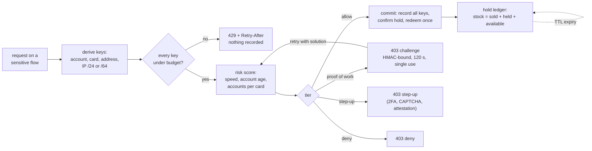

# Unrestricted Access to Sensitive Business Flows (API6:2023): Scalping, Coupon Enumeration, Reservation Holds, and Behavioral Rate Limits

> [!summary] Claim
> API6 is not a bug in any one request but a missing budget on a business action, so the fix is a per-flow policy enforced in the domain layer: cross-dimensional velocity keys (account, payment instrument, address, IP prefix) that a bot farm cannot rotate cheaply, bounded holds that expire, atomic single-use redemption, and graded friction (proof of work, step-up, deny) that raises the attacker's cost per attempt instead of pretending to detect every bot.

Part of [API Authorization and OWASP Security](README.md) in [API Engineering](../README.md).

## TL;DR

- Mechanism: name each sensitive flow (purchase, hold, redeem, sign-up, referral), give it a budget per business key over a sliding window, check every key before committing any, and escalate friction by a risk score rather than by a single yes or no (lab: 49 accounts sharing one card and address get 3 purchases, not 49).
- Contract rule: throttle with `429` plus `Retry-After` (RFC 6585 Section 4; RFC 9110 Section 10.2.3), never let a cache store it, keep holds bounded by count, quantity, and time, and make single-use actions a test-and-set with no `await` between the test and the set (CWE-837).
- Trap: keying only on the client IP, or on a header the client controls; `slowapi 0.1.10` `get_ipaddr` reads `X_FORWARDED_FOR` with underscores, ignores the real `X-Forwarded-For`, and returns whatever string the client typed (lab, `test_slowapi_get_ipaddr_trusts_an_underscore_header_and_ignores_the_real_one`).
- Portability: the 23-test lab passed on CPython 3.14.6 on macOS arm64; the other matrix legs were not run because lab checks are paused (2026-11-11); the controls sit above HTTP, so they behave the same over HTTP/1.1, HTTP/2, and HTTP/3 as long as the client address is derived from a trusted hop.
- When not to use it: if speed is the only thing that decides who wins (a first-come ticket drop), rate limits only slow the race; change the allocation mechanism (registration, invitation, lottery) so automation has nothing to win, and keep the limits as a backstop.

## Mental model



A request on a flow the business has declared sensitive is first mapped to several keys, because a bot farm rotates IP addresses and accounts cheaply but rotates payment instruments and delivery addresses expensively.
If any key is over its sliding-window budget the request gets `429 Too Many Requests` with `Retry-After`, and none of the keys is charged, so a denied attempt does not burn the honest user's quota in another dimension.
Otherwise a risk score sorts the request into a tier: most traffic is allowed, a suspicious request must pay a proof of work that is bound to the flow, the account, and a 120-second expiry, a more suspicious one must step up to a stronger human or device check, and the worst is refused.
Only an allowed or paid request commits: it records every key, converts the hold to an order, or redeems the code in one atomic step.
Holds return to stock when their TTL passes, so a farm that holds inventory without buying (OAT-021) loses it on a clock it does not control.
The lab proves each arrow: `test_velocity_catches_49_accounts_sharing_one_card_and_address`, `test_denied_request_consumes_no_quota_in_other_dimensions`, `test_instant_checkout_gets_a_pow_challenge_then_succeeds_once`, `test_new_account_instant_checkout_is_sent_to_step_up`, and `test_seventeen_accounts_deny_inventory_until_the_ttl_returns_it`.

## How it works

### What API6:2023 is, and what it is not

OWASP defines the weakness from the business side: an endpoint "is vulnerable if it exposes a sensitive business flow, without appropriately restricting the access to it" (OWASP API6:2023, "Is the API Vulnerable?").
Its ratings are Exploitability Easy, Prevalence Widespread, Detectability Average, and Technical impact Moderate, with business impact marked "Business Specific", because "in general technical impact is not expected".
The three canonical flows it names are purchasing (scalping), creating a comment or post (spam), and making a reservation (holding every slot), and its three scenarios are a console drop bought out by a script running "across different IP addresses and locations", an airline whose no-fee cancellation lets one user book 90% of a flight and cancel to force a discount, and a referral program farmed by scripted registration.
The OWASP text is explicit that sensitivity is a business decision: scripted posting may be spam on one social network and encouraged on another.

API6 differs from its neighbors by what is exhausted.
[[Unrestricted-Resource-Consumption-API4-2023-Payload-Depth-and-Limit-Guards|API4]] protects server resources (CPU, memory, bytes, money spent on third parties); API6 protects a business resource (stock, seats, coupons, referral credit, fairness) at request rates the servers handle easily.
[[Credential-Stuffing-Brute-Force-Defense-and-Account-Lockout-Traps|Credential stuffing]] is the authentication-side cousin (CWE-307 is a child of CWE-799), and authorization notes such as [[Defeating-BOLA-API1-2023-Tenant-Scoped-Queries-and-PostgreSQL-RLS|BOLA]] are about who may act on an object, while API6 is about how often and how fast a legitimate principal may act at all.

The OWASP Automated Threat Handbook gives the vocabulary that the rest of this note uses, and each entry maps to a different control:

| OAT | Name | Defining characteristic (OAT text) | Primary control in this note |
| --- | --- | --- | --- |
| OAT-005 | Scalping | "Obtain limited-availability and/or preferred goods/services by unfair methods" | cross-key purchase velocity, allocation design |
| OAT-021 | Denial of Inventory | "Deplete goods or services stock without completing the purchase or committing to the transaction" | bounded holds with TTL |
| OAT-002 | Token Cracking | "Mass enumeration of coupon numbers, voucher codes, discount tokens, etc." | code entropy, failure budgets, uniform errors |
| OAT-019 | Account Creation | "Create multiple accounts for subsequent misuse" | keys that outlive accounts, account-age signal |
| OAT-013 | Sniping | "Last minute bid or offer for goods or services" | allocation design, not rate limits |
| OAT-006 | Expediting | "Perform actions to hasten progress of usually slow, tedious or time-consuming actions" | timing signals, proof of work |
| OAT-009 | CAPTCHA Defeat | "Solve anti-automation tests" | treat CAPTCHA as one signal, never the control |

The CWE cross-references are CWE-799 Improper Control of Interaction Frequency ("does not properly limit the number or frequency of interactions that it has with an actor"), its child CWE-837 Improper Enforcement of a Single, Unique Action, and CWE-841 Improper Enforcement of Behavioral Workflow.

### Step 1: an inventory of flows, each with a budget

OWASP splits mitigation into two layers: "Business - identify the business flows that might harm the business if they are excessively used" and "Engineering - choose the right protection mechanisms" (OWASP API6:2023, "How To Prevent").
The engineering consequence is that the unit of control is the business action, not the HTTP request: one purchase may be five requests (`POST /holds`, `GET /cart`, `POST /checkout`, payment callbacks), and a per-route request limit either throttles honest browsing or lets the action through.
A flow budget is a tuple of (flow, key dimension, quota, window), for example (checkout, card fingerprint, 3, 24 h), stored next to the domain code that commits the action, because only that code knows which account, instrument, and address the action binds.
[[Where-Authorization-Lives-Gateway-Middleware-vs-Domain-and-Query-Layer]] makes the same argument for authorization; the gateway can carry coarse per-IP and per-token limits ([[External-Authorization-Ext-Authz-and-Global-Rate-Limit-Filters]]), but it cannot see the card on the order.

### Step 2: choosing keys an attacker cannot rotate cheaply

Every budget is only as strong as the cost of minting a fresh key.
The enforcement record says which keys are cheap:

- The three brokers in the FTC's first BOTS Act cases (2021-01-22) used "software to conceal their IP addresses" and "hundreds of fictitious Ticketmaster accounts and credit cards" to buy "more than 150,000 tickets"; the judgments exceeded $31 million, partially suspended, with more than $3.7 million to be paid (FTC press release).
- In its 2025 case against Key Investment Group, the FTC alleges the defendants "used 49 different accounts to purchase 273 tickets" to the 2023-03-25 Eras Tour show at Allegiant Stadium, against a six-ticket limit (FTC v. Key Investment Group, D. Md. 1:25-cv-02716, complaint filed 2025-08-18, paragraph 32; allegations, not findings, as of 2026-11).
- GiftGhostBot, reported by Distil Networks in March 2017, averaged about 6,400 unique device fingerprints and 29,000 IP addresses per hour while testing gift card numbers (Distil Networks post, now hosted by Imperva, 2017-03; SecurityWeek, 2017-03-27).

So IP addresses, accounts, and device fingerprints are cheap; payment instruments, delivery addresses, and verified phone numbers cost money or real-world effort.
The lab keys four dimensions (`VelocityPolicy.keys`): the account, a card fingerprint (a token from the payment processor, never the card number), a normalized shipping address, and the client IP collapsed to a prefix.
`normalize_address` case-folds and strips everything but `[0-9a-z]`, so `12 Main St., Apt 4`, `12 MAIN ST APT 4`, and `12 main st apt4` are one key; a production normalizer uses a postal address verification service, and the trade-off is false merges between neighbors in one building.
`ip_partition` keys IPv4 per `/24` and IPv6 per `/64`, because unicast interface identifiers are 64 bits (RFC 4291 Section 2.5.1), so a `/64` is the smallest normal subnet and a host that controls one can rotate through 2^64 addresses freely; BCP 157 recommends giving even home sites "significantly more than a single /64", with `/56` as its example (RFC 6177 Section 2), so one subscriber may hold 256 `/64`s and a looser `/56` key is a sensible second IPv6 dimension; keying on the full IPv6 address gives each request a fresh bucket (lab, `test_ipv6_rotation_inside_one_64_shares_a_bucket`).
The prefix is a trade-off: a `/24` or carrier-grade NAT puts many honest users behind one key, so the IP dimension gets the loosest quota (50 per day in the lab) and the expensive dimensions get the tight ones (3 per day).

The check is all-or-nothing (`VelocityPolicy.check`): every dimension is peeked first, and only if all allow are all of them charged.
If the denial in one dimension also charged the others, a fraudster using a victim's account with a stolen card would exhaust the victim's own budget; the lab proves the order matters (`test_denied_request_consumes_no_quota_in_other_dimensions`).
The opposite policy, charging denied attempts, is right for failure budgets (coupon guesses) and wrong for success budgets (purchases); `limits 5.8.0` `FixedWindowRateLimiter.hit` returns `storage.incr(...) <= item.amount`, so it increments the counter even when it refuses, which is the failure-budget behavior whether you wanted it or not (limits 5.8.0 limits/strategies.py, FixedWindowRateLimiter.hit).

### Step 3: deriving the client address from a trusted hop

The IP dimension is only meaningful if the address is the client's and not a header the client wrote.
Behind a proxy, the TCP peer is the proxy; Uvicorn's `ProxyHeadersMiddleware` rewrites `scope["client"]` from `X-Forwarded-For` only when the peer is in `trusted_hosts`, and it walks the list from the right, returning the first host that is not trusted, because "each proxy appends to the header list" (uvicorn 0.54.0 uvicorn/middleware/proxy_headers.py, `_TrustedHosts.get_trusted_client_address`).
The server's default trust list is `FORWARDED_ALLOW_IPS` or `127.0.0.1,::1` (uvicorn 0.54.0 uvicorn/config.py, `Config.__init__`), while the middleware constructed directly defaults to `trusted_hosts="127.0.0.1"` (uvicorn 0.54.0 uvicorn/middleware/proxy_headers.py, `ProxyHeadersMiddleware.__init__`).
The lab sends `X-Forwarded-For: 1.2.3.4, 198.51.100.7` through a trusted proxy at `10.0.0.1` and gets `198.51.100.7`; the leftmost value, typed by the client, is ignored, and the same header from an untrusted peer is ignored entirely (`test_uvicorn_proxy_headers_keys_on_the_rightmost_untrusted_hop`).

`slowapi 0.1.10` ships two key functions.
`get_remote_address` returns `request.client.host`, which is correct once a trusted proxy middleware has rewritten it.
`get_ipaddr` returns `request.headers["X_FORWARDED_FOR"]` if present (slowapi 0.1.10 slowapi/util.py, get_ipaddr); Starlette's `Headers.__contains__` lowercases the key and compares raw header names byte for byte (starlette 1.10.0 starlette/datastructures.py, Headers.__contains__), so the lookup is for the literal name `x_forwarded_for`, which no standard proxy emits.
The real `X-Forwarded-For` is ignored, and a client that sends `X_FORWARDED_FOR: <anything>` chooses its own rate-limit key on every request.
h11's header-name grammar is the RFC token, which includes `_` (h11 0.16.0 h11/_abnf.py, token), so an ASGI server built on h11 passes such a header through.
nginx drops it by default: `underscores_in_headers` defaults to `off`, and with `ignore_invalid_headers on` (also the default) a name with an underscore is "marked as invalid" and ignored (nginx `ngx_http_core_module` documentation); an app exposed directly, or behind a proxy that forwards underscores, is spoofable.

### Step 4: window algorithms and their boundary behavior

A fixed window counts per `floor(now / window)`; it is one integer per key, and it admits up to twice the limit across a boundary.
The lab's clock-aligned `FixedWindowCounter` admits 5 purchases at `t = 59.5` and 5 more at `t = 60.0`, 10 in half a second against a limit of 5 per minute, while the sliding log refuses the second five with `retry_after == 60` (`test_fixed_window_admits_twice_the_limit_across_a_boundary`).
`limits 5.8.0`'s `MemoryStorage.incr` sets the expiry only when the counter equals the increment, that is on the first hit (limits 5.8.0 limits/storage/memory.py, MemoryStorage.incr), so its fixed window is anchored to the first request of each window rather than to the wall clock; the boundary burst still exists, it just moves.

A sliding log stores one timestamp per admitted event and is exact: an event at `t0` stops counting at `t0 + window` (`SlidingLogLimiter._log` pops while `log[0] <= now - window`), and the honest `Retry-After` is `ceil(oldest + window - now)` (`test_sliding_log_retry_after_counts_down_to_the_oldest_event_expiry`).
Its cost is O(limit) memory per key, which is fine for business budgets of a handful per day and wrong for request budgets of thousands per second.
`limits 5.8.0` offers the log as `MovingWindowRateLimiter` and a two-counter approximation as `SlidingWindowCounterRateLimiter`, whose estimate is `previous_count * previous_expires_in / expiry + current_count` (limits 5.8.0 limits/strategies.py, SlidingWindowCounterRateLimiter._weighted_count); the memory storage's comment admits that under a race at the end of a window "less requests than expected are allowed" (limits/storage/memory.py, acquire_sliding_window_entry).
The algorithms, GCRA, and distributed atomicity are covered in [[Rate-Limiting-Algorithms-Token-Bucket-Leaky-Bucket-and-Sliding-Window]] and [[GCRA-Generic-Cell-Rate-Algorithm-and-Atomic-Redis-Valkey-Lua-Limiters]]; for API6 the choice is simple: business budgets are small, so use the exact log, stored where every worker sees it.

### Step 5: risk tiers instead of a single gate

OWASP's prevention list is a list of signals, not of gates: device fingerprinting (to force costlier tooling), human detection ("captcha or more advanced biometric solutions (e.g. typing patterns)"), non-human patterns ("the user accessed the 'add to cart' and 'complete purchase' functions in less than one second"), blocking Tor exit nodes and well-known proxies, and securing machine-to-machine and B2B APIs, which "often don't implement all the required protection mechanisms" (OWASP API6:2023).
Each signal has a cheap bypass (OAT-009 lists OCR, pre-solved image databases, and "human farms" for CAPTCHAs), so the lab combines them into a score and maps the score to graded friction (`risk_score`, `tier_for`):

| Signal | Points | Why |
| --- | --- | --- |
| hold to checkout under 1.0 s | 40 | OWASP's own non-human example |
| account younger than 24 h | 20 | OAT-019 farms create accounts just in time |
| accounts on this card beyond the first | 25 each, at most 75 | the KIG and FTC 2021 pattern |
| a velocity dimension already at zero remaining | 15 | the next attempt would be throttled anyway |

Below 30 points is `allow`, 30 to 59 is proof of work, 60 to 89 is step-up, and 90 or more is deny; an honest shopper scores 0, a fast checkout from an old account 40, a fast checkout from a 3-hour-old account 60, and a fast new account on a card shared by three accounts with no quota left 125 (`test_risk_tiers_escalate_on_owasp_non_human_signals`).
The weights are the lab's, not a standard; production weights come from labeled fraud outcomes and are retuned as attackers adapt, which is why the tier boundary, not each signal, is the stable interface.

### Step 6: proof of work as a priced speed bump

Hashcash defines a cost function that is "efficiently verifiable, but parameterisably expensive to compute": find a string whose hash has `k` leading zero bits, which takes 2^k hash evaluations on average and one to verify (Back 2002, Sections 2 and 3).
Back distinguishes non-interactive cost functions, where the client picks its own challenge, from interactive ones, where the server issues it, and notes that the interactive form prevents pre-computation, the attack in which "a determined adversary may spend a year pre-computing tokens to all be valid on the same day" (Back 2002, Sections 2 and 3; Section 4 defines interactive hashcash).
Hashcash is "publicly auditable" and "trapdoor-free": the server has no shortcut to mint tokens, and anyone can verify one (Back 2002, Sections 2.1 and 2.2).
The server "needs to keep a double spending database of spent tokens", and including the mint time lets it "discard entries from the spent database after they have expired" (Back 2002, Section 3).

The lab's `ProofOfWorkGate` is interactive hashcash with those two lessons applied:

- The challenge is a stateless HMAC-SHA-256-signed JSON payload holding the difficulty `b`, an expiry `e` 120 seconds out, the flow `f`, a 16-byte nonce `n`, and the subject `s`, so the server stores nothing per issued challenge.
- `verify` checks the MAC with `hmac.compare_digest` first (a forged lower difficulty is `BAD_MAC`), then expiry, then binding to the flow and account (a challenge solved for `alice` is `WRONG_BINDING` for `bob`), then the work (one SHA-256), and only then the spent set, so the expensive and stateful steps run last.
- The spent set maps nonce to expiry and is pruned on every verification, so it is bounded by the number of challenges solved within one TTL (`test_pow_spent_set_is_pruned_after_challenge_expiry`).

The work is a geometric distribution with mean 2^k and a long tail; over 64 deterministic challenges the lab measured mean attempts of 237.4 at 8 bits, 1,003.5 at 10, and 4,030.4 at 12, within 10% of 256, 1,024, and 4,096 (`test_pow_mean_work_tracks_two_to_the_bits`), while a separate 12-bit challenge took only 84 attempts (counter 83 in `test_pow_solution_verifies_once_and_then_is_a_replay`).

The economics are the limit.
Laurie and Clayton (2004) found that "work that might take 10 seconds on a 3GHz Pentium could take an hour or more on a Palm Pilot", that stopping spam from a million compromised machines needed about 346 seconds of work per message, and that a universal proof of work at the levels they derived would have inconvenienced 13% or 5% of legitimate senders on hourly rates ("Proof-of-Work" Proves Not to Work, Sections 2, 4, and 5).
The attacker in API6 owns faster hardware than the honest mobile user, and the business value of one scalped ticket dwarfs a few CPU-seconds, so proof of work cannot be the gate.
It is a tier: it costs the honest user nothing when the score is low, a fraction of a second when the score is middling, and it caps a farm's throughput per core at roughly `hash_rate / 2^k` attempts, which matters for flows like coupon guessing where the attacker needs millions of attempts and not for flows like checkout where it needs three.

On the wire the lab answers `403` with an `application/problem+json` body carrying the challenge and the difficulty, and the client retries with a `pow-solution: <challenge>:<counter>` header; both the problem type URIs under `https://api.example.com/problems/` and the header name are lab conventions, not registered names.
A standard-shaped alternative is `401` with a `WWW-Authenticate` challenge, which RFC 9110 Section 11.6.1 requires on every `401`; Privacy Pass does exactly that, but the response then competes with the bearer scheme that authenticates the account for the single `Authorization` field.
`403` is defensible because RFC 9110 Section 15.5.4 allows that "a request might be forbidden for reasons unrelated to the credentials"; its cost is that the same section says that when credentials were provided the client "SHOULD NOT automatically repeat the request with the same credentials", so generic clients will not retry and the retry contract must be documented.

### Step 7: attestation tokens instead of puzzles (Privacy Pass)

Privacy Pass separates the party that checks a human or device (the Attester) from the party that issues an unlinkable token (the Issuer) and the site that redeems it (the Origin); attestation "can be done via proof of solving a CAPTCHA, checking device or hardware attestation validity, etc." (RFC 9576 Section 3.1).
The Origin sends `WWW-Authenticate: PrivateToken challenge="...", token-key="..."` with an optional `max-age`, where the challenge is a base64url `TokenChallenge` struct of `token_type` (2 octets), `issuer_name`, a `redemption_context` that is either empty or exactly 32 bytes, and `origin_info` (RFC 9577 Sections 2.1.1 and 2.1.2).
The client redeems with `Authorization: PrivateToken token="..."`, where the token holds a 32-byte client nonce, the SHA-256 of the challenge, a key identifier, and an authenticator, and Origins "SHOULD implement some form of double-spend prevention that prevents a token with the same nonce from being redeemed twice" (RFC 9577 Sections 2.2.1 and 2.2.2).
RFC 9578 registers two issuance protocols: `0x0001`, VOPRF(P-384, SHA-384), privately verifiable, with a 48-octet authenticator, and `0x0002`, Blind RSA (2048-bit), publicly verifiable, with a 256-octet authenticator; both use a 32-octet key identifier (RFC 9578 Sections 8.2.1 and 8.2.2).
The same shape as the lab's challenge appears: a server-chosen context to prevent reuse, binding to the origin, and a spent set; the difference is that the proof is "someone trusted attested this client" rather than "this client burned CPU", which does not penalize slow honest devices.
Its limits are named in the RFC: cross-origin tokens with empty contexts can be reflected and exhausted (RFC 9577 Sections 5.3 and 5.4), and a token proves attestation once, not that the account behind the purchase is not the 49th in a farm, so it feeds the score and does not replace the velocity keys.

### Step 8: inventory holds that expire (OAT-021)

OAT-021 is "selection and holding of items from a limited inventory or stock, but which are never actually bought"; the handbook lists "Seat spinning" among its other names and reservations of hotel rooms, restaurant tables, flight seats, and availability slots among its variations.
The lab's `InventoryLedger` maintains one invariant, `stock = sold + held + available`, and four bounds:

- a per-account quantity limit counted across active holds and completed orders (`committed + quantity > per_account_limit` refuses with `account-limit`), so buying 4 and holding 3 more is refused at a limit of 6 (`test_one_account_is_capped_at_the_purchase_limit_across_holds_and_orders`);
- a cap on concurrent holds per account (`too-many-holds`);
- a TTL on every hold, enforced lazily from a min-heap of `(expires_at, hold_id)` on every read, so expiry costs O(log n) per expired hold and needs no timer thread;
- a rate limit on creating holds (`hold_rate`, 3 per hour in the lab), because a farm can otherwise re-hold the moment a hold expires.

The lab's denial-of-inventory run has 17 accounts hold all 100 seats; a fan is told `sold-out` at 599.9 seconds and gets seats at 600.0, when every bot hold expires together (`test_seventeen_accounts_deny_inventory_until_the_ttl_returns_it`).
A confirm after expiry reports `expired`, distinct from `unknown-hold`, so an honest slow user gets an accurate message while the ledger records which holds were abandoned; a hold-to-purchase ratio per key is a strong OAT-021 signal for the risk score.
`test_stock_is_conserved_through_holds_orders_and_expiry` drives 300 interleaved holds, confirms, and expiries and checks the invariant after each step.
In a database the same design is a `holds` row with `expires_at`, a conditional `UPDATE ... WHERE expires_at > now()` to confirm, and a periodic or lazy sweep; the TTL trades abandonment for fairness, since 10 minutes is long for a bot and short for a buyer typing card details on a phone.
OWASP's airline scenario shows the business half: a free cancellation turns a hold into an option, so fees, deposits, or cancellation limits per account are API6 controls even though no code path changes.

### Step 9: coupon and gift card enumeration (OAT-002)

Enumeration is a search, so its cost is the code space divided by the number of valid codes.
With 10,000 live codes, 6-digit numeric codes need 100 guesses per hit; at the 4 million requests per hour that GiftGhostBot peaked at on one retail site (Distil, 2017-03) that is 40,000 valid codes per hour, while 8-character Crockford base32 codes need about 1.1 x 10^8 guesses per hit, or 27.5 hours of the same traffic for one code (`test_code_space_decides_how_fast_an_enumerator_finds_value`).
`generate_code` maps each random byte with `b & 31` onto the 32-symbol Crockford alphabet, which omits `I`, `L`, `O`, and `U`; because 256 is a multiple of 32 this has no modulo bias, and the lab checks that all 256 byte values produce each symbol exactly 8 times.

Entropy alone fails against a distributed farm, so `CouponBook` adds three rules:

1. One uniform rejection: unknown, already redeemed, and expired codes all return the same `422` body, byte for byte, so a response is not an oracle for "this code exists" (`test_coupon_endpoint_rejects_uniformly_then_throttles`).
2. Failure budgets, charged only on rejection: 5 per account per hour and 50 per campaign per hour in the lab; the campaign budget is what stops 9 farm accounts guessing 5 times each, after which even a fresh account with a valid code is throttled until the window passes (`test_failure_budgets_stop_one_account_and_a_distributed_enumeration`).
   The campaign budget is a deliberate denial-of-service trade: an attacker can lock out a promotion for an hour, which is usually cheaper than the promotion being drained; a refinement is to apply step-up instead of a hard lock once the campaign budget trips.
3. Atomic single use: the membership test and the removal happen with no `await` between them; `RacyCouponBook` has the `await` in between, standing in for the database round trip between a `SELECT` and an `UPDATE`, and `asyncio.gather` of two redemptions redeems one single-use code twice (`test_check_then_act_redeems_a_single_use_code_twice`).
   In SQL the same rule is a conditional update (`UPDATE coupons SET redeemed_by = $1 WHERE code = $2 AND redeemed_by IS NULL`) with the row count as the answer, or a unique constraint on redemptions; see [[Atomic-Idempotency-Phases-and-Failure-Recovery-Across-Network-Drops]].

### Step 10: what the response says, and what it should not

`429` "indicates that the user has sent too many requests in a given amount of time", "MAY include a Retry-After header", and "MUST NOT be stored by a cache"; the RFC deliberately "does not define how the origin server identifies the user, nor how it counts requests" (RFC 6585 Section 4).
`Retry-After` is either an `HTTP-date` or `delay-seconds = 1*DIGIT` (RFC 9110 Section 10.2.3); the lab sends delay-seconds computed from the oldest event in the log.
The RateLimit fields draft (draft-ietf-httpapi-ratelimit-headers-11, 2026-05-23, an Internet-Draft and not an RFC, as of 2026-11) defines `RateLimit-Policy: "name";q=<quota>;w=<window>` and `RateLimit: "name";r=<remaining>;t=<seconds>` as Structured Field lists, requires `w` to be a "non-negative, non-zero" integer, says `Retry-After` "SHOULD NOT reference a point in time earlier than the end of the effective window", and defines the problem types `quota-exceeded` and `abnormal-usage-detected` (alongside `temporary-reduced-capacity` for `503`), each with a `violated-policies` member, which it asks IANA to register (draft-11 Sections 3.1.3, 5.1, 5.3, 6, and 10.2).
The lab's hold limiter sends all three fields with the `quota-exceeded` type; the checkout and coupon throttles send `RateLimit` and `Retry-After` but no `RateLimit-Policy`, because those budgets have no single `q` and `w` to publish (`test_hold_spinning_gets_429_with_retry_after_and_ratelimit_fields`).
For sensitive flows, publishing the quota is a choice with a cost: draft-11 Section 8.2 warns against disclosing "operational capacity information", and a precise remaining count lets a farm pace each account exactly one request under the threshold.
The recommendation is to publish quotas on developer and B2B APIs, where honest clients need them to back off, and to publish only `Retry-After` on consumer flows such as checkout and coupon redemption.
The broader header contract is in [[Standard-RateLimit-Headers-IETF-Draft-and-429-Retry-After-Semantics]], and error bodies follow RFC 9457, which also allows non-resolvable type URIs such as tag URIs (RFC 9457 Section 3.1.1).

## Numbers and limits

| Quantity | Value | Source |
| --- | --- | --- |
| OWASP API6:2023 ratings | Exploitability Easy, Prevalence Widespread, Detectability Average, Technical Moderate | OWASP API6:2023 page |
| OWASP non-human pattern | add to cart then complete purchase in under 1 s | OWASP API6:2023, "How To Prevent" |
| Fixed window boundary burst | 10 admitted in 0.5 s at a limit of 5 per 60 s; the sliding log admits 5 and returns `Retry-After: 60` | lab, `test_fixed_window_admits_twice_the_limit_across_a_boundary` |
| Cross-key velocity against a farm | 49 accounts, one card, three spellings of one address: 3 purchases admitted, the 4th blocked on `card` and `address` with `retry_after` 86,220 s | lab, `test_velocity_catches_49_accounts_sharing_one_card_and_address` |
| Proof-of-work mean attempts, 64 challenges each | 237.4 (8 bits), 1,003.5 (10 bits), 4,030.4 (12 bits) | lab, `test_pow_mean_work_tracks_two_to_the_bits` |
| `hashlib` SHA-256 work rate from Python | about 2.4 x 10^6 `work_digest` calls per second | `work_digest` on a 120-character challenge 200,000 times (0.083 s), `uv run --frozen python`, CPython 3.14.6, macOS 27.3 arm64 (Darwin 27.3.0); one run, not a benchmark |
| Proof-of-work verification cost | one HMAC-SHA-256 and one SHA-256 per attempt | lab source, `ProofOfWorkGate.verify` |
| Laurie and Clayton work per message to curb spam | 346 s per message for S = 0.01 with a million compromised machines; 13% or 5% of legitimate senders inconvenienced on hourly rates | Laurie and Clayton 2004, Sections 4 and 5 |
| Privacy Pass token sizes | `Nk` 48 (VOPRF P-384) or 256 (Blind RSA 2048), `Nid` 32, nonce 32, challenge digest 32 octets; `redemption_context` 0 or 32 bytes | RFC 9578 Sections 8.2.1 and 8.2.2; RFC 9577 Sections 2.1.1 and 2.2.1 |
| Denial of inventory, 100 seats, 6 per account, 600 s TTL | 17 accounts hold everything; stock returns at exactly 600.0 s | lab, `test_seventeen_accounts_deny_inventory_until_the_ttl_returns_it` |
| Coupon space, 10,000 live codes | 6 digits: 100 guesses per hit, 40,000 hits per hour at 4 x 10^6 requests per hour; 8 Crockford characters: 1.1 x 10^8 guesses per hit, 27.5 hours per hit | lab, `test_code_space_decides_how_fast_an_enumerator_finds_value`; rate from the Distil post, 2017-03 |
| GiftGhostBot | first seen 2017-02-26, nearly 1,000 sites, peaks above 4 million requests per hour on one retail site, an average of 29,000 IPs and 6,400 device fingerprints per hour | Distil Networks post (now on imperva.com), 2017-03; same figures in SecurityWeek 2017-03-27 |
| FTC first BOTS Act cases | 2021-01-22; more than 150,000 tickets; judgments over $31 million, more than $3.7 million to be paid | FTC press release |
| Ticketmaster Eras Tour presale | 3.5 billion total system requests, "4x our previous peak"; 3.5 million Verified Fan registrations, about 1.5 million invited, 2 million waitlisted | Ticketmaster statement, 2022-11-19 |
| Starbucks gift card race | two concurrent confirms turned $15 of balance into $20; a 2015-03-23 report went unanswered until 2015-04-29, then the bug was fixed "in like 10 days" | Homakov, sakurity.com, 2015-05-21 |
| Lab runtime | 23 tests in 0.55 s | `uv run --frozen pytest ... -q`, CPython 3.14.6, macOS 27.3 arm64 (Darwin 27.3.0) |

## Portability

| Dimension | Behavior | Evidence |
| --- | --- | --- |
| CPython 3.14.6 | 23 passed; `ruff`, `mypy --strict`, and `pyright` strict clean on the two lab files | lab, workspace `.venv` |
| CPython 3.12.16, 3.13.18, 3.14.10, 3.15.2, 3.15.2t | Not run: lab checks are paused (2026-11-11). The module uses the `type` statement (PEP 695, 3.12+) and `enum.StrEnum` (3.11+), so 3.12 is the floor; an unparenthesized `except ValueError, binascii.Error:` written in the first draft is valid only on 3.14+ (PEP 758) and `ruff` with `target-version = "py312"` rejected it | ruff output during the build; PEP 758 |
| Free-threaded 3.15t | Not run; the lab's limiters and ledger are single-threaded asyncio state with no locks, so under free threading they need a lock or a per-key shard before being shared across threads | design note, not tested |
| `limits 5.8.0` | Fixed window counts refused hits and anchors the window at the first hit; sliding window counter is a weighted two-counter estimate | source read, limits/strategies.py and limits/storage/memory.py |
| `slowapi 0.1.10` | Defaults to `fixed-window` strategy and `memory://` storage; `get_ipaddr` reads `X_FORWARDED_FOR` only | source read (slowapi/extension.py, `Limiter.__init__`; slowapi/util.py); lab, `test_slowapi_get_ipaddr_trusts_an_underscore_header_and_ignores_the_real_one` |
| Uvicorn 0.54.0 | `ProxyHeadersMiddleware` picks the rightmost untrusted `X-Forwarded-For` hop; trust defaults to `127.0.0.1,::1` | source read; lab, `test_uvicorn_proxy_headers_keys_on_the_rightmost_untrusted_hop` |
| Hypercorn 0.18.0, Granian 2.8.7 | Not checked; how each derives the client address behind a proxy must be verified before keying on it | not run |
| nginx in front | Drops underscore header names by default (`underscores_in_headers off`, `ignore_invalid_headers on`), which neutralizes the `get_ipaddr` spoof but not a direct exposure | nginx documentation |
| HTTP/1.1, HTTP/2, HTTP/3 | The controls key on application identities and on the client address after proxy processing, so the version does not change them; RFC 9110 defines the semantics "shared by all versions", including `Retry-After`, and RFC 6585's `429` is a status code within those semantics | RFC 9110 abstract and Section 10.2.3; RFC 6585 Section 4; the lab is in-process ASGI and exercises no wire version |

## Worked example

The [implementation](../labs/src/api_labs/f15_api_authorization_and_owasp_security/sensitive_business_flows.py) has the windowed counters, the multi-key velocity policy, the risk tiers, the proof-of-work gate, the hold ledger, the coupon books, and a Starlette app with `POST /holds`, `POST /checkout`, and `POST /coupons/redeem`; the [test](../labs/tests/f15_api_authorization_and_owasp_security/test_protecting_sensitive_business_flows_api6_2023_anti_automation_and_bot_defense.py) has 23 tests, all driven by an injected `ManualClock` and a SHA-256 counter in place of `os.urandom`, so every number is deterministic.

The all-or-nothing velocity check:

```python
    def check(self, ctx: PurchaseContext, *, record: bool) -> VelocityResult:
        keys = self.keys(ctx)
        decisions = {dim: lim.peek(keys[dim]) for dim, lim in self._limiters.items()}
        violated = tuple(dim for dim, d in decisions.items() if not d.allowed)
        if violated:
            retry = max(decisions[dim].retry_after for dim in violated)
            return VelocityResult(False, violated, 0, retry)
        if record:
            for dim, limiter in self._limiters.items():
                limiter.hit(keys[dim])
        spent = 1 if record else 0
        remaining = min(d.remaining for d in decisions.values()) - spent
        return VelocityResult(True, (), remaining, 0)
```

The checkout handler calls it with `record=False` before scoring and with `record=True` only after the tier allows or the proof of work verifies, so a refused or challenged attempt charges nothing.

```python
@pytest.mark.unit
def test_velocity_catches_49_accounts_sharing_one_card_and_address() -> None:
    clock = ManualClock(T0)
    policy = purchase_policy(clock)
    addresses = ["12 Main St., Apt 4", "12 MAIN ST APT 4", "12 main st apt4"]
    results: list[VelocityResult] = []
    for n in range(49):
        ctx = PurchaseContext(f"acct{n}", "card-A", addresses[n % 3], f"2001:db8::{n:x}")
        results.append(policy.check(ctx, record=True))
        clock.advance(60)
    assert [r.allowed for r in results].count(True) == 3
    assert results[3].violated == ("card", "address")
    assert results[3].retry_after == 86_400 - 3 * 60
```

`purchase_policy` allows 2 per account, 3 per card, 3 per address, and 50 per IP prefix per 24 hours; every account is fresh and every IPv6 address differs, so only the card and the normalized address stop the farm, and the 4th attempt, 180 seconds after the 1st, is told to wait 86,220 seconds.

The proof-of-work verifier, in the order that keeps cheap and stateless checks first:

```python
    def verify(self, challenge: str, counter: int, *, flow: str, subject: str) -> PowVerdict:
        try:
            payload_b64, mac_b64 = challenge.split(".")
            payload, mac = _unb64(payload_b64), _unb64(mac_b64)
        except ValueError:  # binascii.Error is a ValueError subclass
            return PowVerdict.MALFORMED
        expected = hmac.new(self._key, payload, hashlib.sha256).digest()
        if not hmac.compare_digest(mac, expected):
            return PowVerdict.BAD_MAC
        claims = json.loads(payload)
        now = int(self._clock())
        if now >= claims["e"]:
            return PowVerdict.EXPIRED
        if claims["f"] != flow or claims["s"] != subject:
            return PowVerdict.WRONG_BINDING
        if not 0 <= counter < 2**64:
            return PowVerdict.MALFORMED
        if leading_zero_bits(work_digest(challenge, counter)) < claims["b"]:
            return PowVerdict.INSUFFICIENT_WORK
        self._spent = {n: e for n, e in self._spent.items() if e > now}
        if claims["n"] in self._spent:
            return PowVerdict.REPLAYED
        self._spent[claims["n"]] = claims["e"]
        return PowVerdict.OK
```

The full HTTP flow: hold, check out 0.2 seconds later from an old account (40 points, proof of work), solve, pay, then try to reuse the solution on a second hold:

```python
@pytest.mark.unit
@pytest.mark.asyncio
async def test_instant_checkout_gets_a_pow_challenge_then_succeeds_once() -> None:
    clock = ManualClock(T0)
    alice = {"x-account": "alice"}
    order = {"card": "card-A", "address": "1 Fan Rd"}
    async with client_for(build_app(make_shop(clock))) as client:
        hold = await client.post("/holds", json={"sku": "seat", "quantity": 2}, headers=alice)
        assert hold.status_code == 201
        assert hold.json() == {"hold_id": "h1", "expires_in": 600}
        clock.advance(0.2)
        first = await client.post("/checkout", json={"hold_id": "h1", **order}, headers=alice)
        assert first.status_code == 403
        assert first.headers["content-type"] == "application/problem+json"
        problem = first.json()
        assert problem["type"].endswith("/proof-of-work-required")
        assert (problem["bits"], problem["reason"]) == (12, "malformed")
        counter = solve(problem["challenge"], problem["bits"])
        solved = {**alice, "pow-solution": f"{problem['challenge']}:{counter}"}
        paid = await client.post("/checkout", json={"hold_id": "h1", **order}, headers=solved)
        assert (paid.status_code, paid.json()) == (200, {"order": "h1", "tier": "proof-of-work"})
        await client.post("/holds", json={"sku": "seat", "quantity": 2}, headers=alice)
        clock.advance(0.2)
        replay = await client.post("/checkout", json={"hold_id": "h2", **order}, headers=solved)
        assert (replay.status_code, replay.json()["reason"]) == (403, "replayed")
        clock.advance(30)
        human = await client.post("/checkout", json={"hold_id": "h2", **order}, headers=alice)
        assert (human.status_code, human.json()["tier"]) == (200, "allow")
```

The replay is still inside the 120-second TTL, bound to the same flow and account, and carries enough work, so only the spent set refuses it; after 30 seconds of human-paced delay the same account checks out with no friction at all.

The atomic single-use rule and the race it prevents:

```python
    async def redeem(self, account: str, code: str) -> Redeem:
        if not self.throttle(account).allowed:
            return Redeem.THROTTLED
        await asyncio.sleep(0)  # the same round trip, but before the atomic step
        normalized = code.strip().upper()
        if normalized in self._unredeemed:  # test-and-set with no await in between
            self._unredeemed.remove(normalized)
            self.redemptions.append((normalized, account))
            return Redeem.REDEEMED
        self._per_account.hit(account)
        self._campaign.hit("*")
        return Redeem.REJECTED
```

```python
@pytest.mark.unit
@pytest.mark.asyncio
async def test_check_then_act_redeems_a_single_use_code_twice() -> None:
    racy = RacyCouponBook({"WELCOME10"})
    outcomes = await asyncio.gather(racy.redeem("a1", "WELCOME10"), racy.redeem("a2", "WELCOME10"))
    assert list(outcomes) == [Redeem.REDEEMED, Redeem.REDEEMED]
    assert len(racy.redemptions) == 2
    safe = CouponBook(
        {"WELCOME10"}, account_failures=5, campaign_failures=50, window=3600, clock=ManualClock()
    )
    outcomes = await asyncio.gather(safe.redeem("a1", "WELCOME10"), safe.redeem("a2", "WELCOME10"))
    assert list(outcomes) == [Redeem.REDEEMED, Redeem.REJECTED]
    assert safe.redemptions == [("WELCOME10", "a1")]
```

Both books yield to the event loop once per redemption; the only difference is whether the yield sits between the membership test and the removal.

Captured run, from `labs/`, CPython 3.14.6, macOS 27.3 on arm64:

```text
$ uv run --frozen pytest tests/f15_api_authorization_and_owasp_security/test_protecting_sensitive_business_flows_api6_2023_anti_automation_and_bot_defense.py -q
.......................                                                  [100%]
23 passed in 0.55s
```

## Pitfalls

> [!warning] Keying the budget on IP address alone
> Trigger: the purchase or redeem endpoint is limited per client IP, often by a gateway rule.
> Symptom: the farm spreads across addresses; OWASP's console scenario runs "across different IP addresses and locations", the FTC's 2021 defendants used "software to conceal their IP addresses", and GiftGhostBot averaged about 29,000 IPs per hour (Distil, 2017-03); on IPv6 a single subscriber's `/64` is 2^64 fresh keys.
> Fix: key the business budget on expensive identities (payment instrument, delivery address, verified phone) as well as the account, collapse IPs to `/24` and `/64` with a loose quota, and check all keys before charging any.

> [!warning] Trusting a client-controlled forwarding header for the key
> Trigger: a FastAPI or Starlette app uses `slowapi`'s `get_ipaddr` as `key_func`, or reads the leftmost `X-Forwarded-For` value itself.
> Symptom: `get_ipaddr` in `slowapi 0.1.10` reads only `X_FORWARDED_FOR` (underscores), ignores the standard header, and returns any string the client sends, so each request can carry a fresh key; the leftmost `X-Forwarded-For` entry is whatever the client typed.
> Fix: run Uvicorn's `ProxyHeadersMiddleware` (or `--forwarded-allow-ips`) with the exact proxy addresses, key on `request.client.host` via `get_remote_address`, and keep nginx's default of dropping underscore header names.

> [!warning] A rate limiter that only some request shapes reach (CVE-2026-55795)
> Trigger: the limiter is attached conditionally, for example only when a parameter is present.
> Symptom: in Craft Commerce 4.0.0 to 4.11.1 and 5.0.0 to 5.6.4 the `CartController` rate limiter was "only activated when the 'number' POST/GET parameter is explicitly provided", so coupon codes submitted to the session cart without `number` were unlimited (GHSA-h5gm-x9wr-vhcm, published 2026-06-16; CVSS 4.0 6.9).
> Fix: attach the budget to the business action (apply a coupon to any cart), not to a route variant, and test the bypass shape: the advisory's remediation is to "apply rate limiting unconditionally".

> [!warning] Check-then-act on a single-use value (CWE-837)
> Trigger: redemption reads "is this code or balance available?", awaits I/O, then writes "used".
> Symptom: concurrent requests both pass the check; Egor Homakov turned $15 of Starbucks gift card balance into $20 by confirming the same transfer from two sessions at once (sakurity.com, 2015-05-21); the lab redeems one single-use code twice with `asyncio.gather`.
> Fix: make the test and the set one atomic step, a conditional `UPDATE ... WHERE redeemed_by IS NULL` with the row count as the answer, a unique constraint, or a compare-and-set in the store; an idempotency key does not fix this, because the two racing requests are different requests.

> [!warning] Per-account limits with free account creation
> Trigger: "6 tickets per account" with sign-up that costs nothing.
> Symptom: OAT-019 turns one limit into N limits; the FTC's 2021 defendants used "hundreds of fictitious Ticketmaster accounts and credit cards" to exceed posted limits.
> Fix: count the limit on the expensive keys too, add an account-age and accounts-per-instrument signal, and gate high-value flows on verified attributes.

> [!warning] Holds without bounds (OAT-021)
> Trigger: add-to-cart or seat selection reserves stock with no TTL, no per-account cap, or no limit on re-holding.
> Symptom: a handful of accounts take the whole inventory out of circulation without paying, the "seat spinning" of OAT-021; in the lab 17 accounts hold all 100 seats until the TTL fires.
> Fix: TTL every hold, cap quantity across holds and orders and concurrent holds per account, rate-limit hold creation, and track hold-to-purchase ratio per key as a risk signal.

> [!warning] Fixed windows on a flow with a release time
> Trigger: a "5 per minute" fixed window on a drop that opens at a known second.
> Symptom: a bot sends 5 at the end of one window and 5 at the start of the next, 10 in half a second (lab).
> Fix: use an exact sliding log for small business budgets; it is O(limit) memory per key, which is trivial at these quotas.

> [!warning] In-process limiter state across workers
> Trigger: `slowapi`'s defaults, `fixed-window` with `memory://` storage (slowapi 0.1.10 slowapi/extension.py), or any dict in a module, behind several Uvicorn or Gunicorn workers.
> Symptom: each worker counts separately, so N workers admit N times the budget, and a restart forgets everything.
> Fix: keep business budgets in the shared store that already holds the orders, or in Redis or Valkey with atomic scripts as in [[GCRA-Generic-Cell-Rate-Algorithm-and-Atomic-Redis-Valkey-Lua-Limiters]].

> [!warning] Response differences that turn redemption into an oracle
> Trigger: `404 unknown code`, `409 already used`, and `410 expired` are distinct, or the timing differs.
> Symptom: an enumerator learns which codes exist and which are still live; GiftGhostBot worked precisely because a balance response told it the number was valid and funded (Distil, 2017-03).
> Fix: one status and one body for every non-success, as the lab's `422 coupon-not-applicable`, failure budgets charged per rejection, and high-entropy codes.

> [!warning] Treating a demand spike as only a bot problem
> Trigger: a high-demand release where protections run after expensive work.
> Symptom: Ticketmaster's Eras Tour presale saw "3.5 billion total system requests - 4x our previous peak", which it attributed partly to "the staggering number of bot attacks" and partly to fans without invite codes (Ticketmaster statement, 2022-11-19).
> Fix: shed and queue at the edge before business logic, put the cheapest checks (token, budget peek) first, and change allocation (registration and invitation) so a burst does not decide the outcome.

## Security and robustness

Threat model, from cheapest to most expensive for the attacker:

| Capability | Cost to the attacker | What it defeats | What still holds |
| --- | --- | --- | --- |
| Many IP addresses (proxies, cloud, IPv6 `/64`) | low | per-IP limits | account, instrument, address keys |
| Many accounts (OAT-019) | low unless sign-up is verified | per-account limits | instrument and address keys, account-age signal |
| Headless browsers and fingerprint rotation | low to medium | device fingerprint allowlists | velocity, timing signals |
| CAPTCHA solving (OAT-009, "human farms") | medium, per solve | CAPTCHA as a gate | velocity, holds, single use |
| Many payment instruments and addresses | high | instrument and address keys | allocation design, post-purchase review |
| Real humans paid per action | highest | every automation detector | purchase limits per verified identity, allocation design |

Defense in depth places each control where it has the right information:

1. Edge: coarse per-IP and per-token limits, bot management, Tor and known-proxy lists as OWASP suggests, and load shedding ([[Load-Shedding-Priority-Traffic-Classes-and-LIFO-Queue-Management]]); fail open on the edge if its store is down, because the domain checks still stand.
2. Gateway: authentication, per-client quotas for B2B and developer APIs, which OWASP singles out because they "often don't implement all the required protection mechanisms".
3. Domain: the flow budgets, holds, single-use atomicity, and risk tiers; fail closed on the business budget store, because an unbounded purchase path is the incident.
4. After the fact: order review, cancellation of orders that violate limits, and refunds, the backstop for limits that automation slipped past.

Input edge cases that matter here: normalize codes before lookup (the lab strips and upper-cases, so `hx6syq0m2a ` redeems), normalize addresses consistently on write and on check, parse IP addresses with `ipaddress` rather than strings (zone IDs, IPv4-mapped IPv6), and bound the `pow-solution` counter to 64 bits before hashing.
Proof-of-work keys are secrets: a leaked HMAC key lets anyone mint easy challenges, so rotate it like a signing key and include a key identifier if you rotate without downtime.
Card fingerprints are processor tokens, not card numbers, and addresses and device fingerprints are personal data, so the velocity store needs a retention period no longer than its longest window and redaction in logs ([[Structured-Log-Redaction-and-Preventing-PII-and-Token-Leaks]]).
Every friction tier has a false-positive cost that falls on real people, including users with assistive technology for whom a visual CAPTCHA is a wall; attestation tokens (RFC 9576 to 9578) and proof of work at low difficulty are the lower-friction rungs for that reason.

## The principal's view

The decision a staff-plus engineer owns is where API6 lives organizationally: a per-flow budget catalogue, owned jointly by the product owner who knows the business harm and the engineers who know the keys, enforced in the domain service, with the edge bot vendor treated as a filter that reduces load and not as the control.
A vendor sees requests and devices; only the order service sees that 49 accounts paid with one card.
The cost is that every new sensitive flow needs a budget review, a store for its counters, and metrics (attempts, throttles, challenges, step-ups, and the conversion of honest users through each tier), and that product teams feel friction as lost conversion; publish that trade-off as numbers per tier so it is a business decision and not a security veto.

The deeper lever is the allocation mechanism.
Rate limits and puzzles only slow a race; if the scarce good goes to whoever is fastest, automation always wins eventually.
Registration with verified identity, invitation, a randomized draw within an entry window, a queue that randomizes arrival order, or a purchase that requires an attested identity all make speed worthless, after which the budgets catch the residue.
Ticketmaster's own statement describes the shape: 3.5 million Verified Fan registrations, about 1.5 million invited, and 2 million waitlisted, which is allocation by registration rather than by speed (Ticketmaster statement, 2022-11-19).
For referral and promotion flows (OWASP scenario 3), the equivalent lever is paying the reward only after the referred account does something costly, such as a first paid ride, so a farm of fresh accounts earns nothing.

Choose a different tool when the abuse is not about rate: a business-logic flaw (negative quantities, price tampering, coupon stacking rules) needs a validation fix ([[Defeating-BOPLA-and-Mass-Assignment-API3-2023-Strict-Input-Output-Schemas]]), and an authorization flaw needs an authorization fix ([[Defeating-BFLA-API5-2023-Function-Level-Guards-and-Deny-By-Default-Routers]]); no rate limit fixes a coupon that can be applied twice to one order.

## Interview questions

> [!question] L5: Why is a per-IP rate limit on `POST /checkout` not a fix for API6 scalping?
>
> > [!success]- Answer
> > IP addresses are the cheapest key an attacker can rotate: proxies, cloud ranges, and a single IPv6 `/64` give effectively unlimited fresh keys.
> > OWASP's own scenario runs the bot "across different IP addresses and locations", and the FTC's 2021 defendants used software to conceal their IPs.
> > The budget must also be keyed on identities that cost money to multiply, such as the payment instrument and the delivery address, and the IP should be collapsed to `/24` or `/64` with a loose quota.
> >
> > Follow-up: Which key would you add for a digital good with no delivery address?

> [!question] L5: What does RFC 6585 require of a `429` response, and what does it leave to you?
>
> > [!success]- Answer
> > It says the user sent too many requests in a given time, the response MAY carry `Retry-After`, and it MUST NOT be stored by a cache (RFC 6585 Section 4).
> > It explicitly does not define how the server identifies the user or counts requests.
> > That is exactly the API6 design work: the keys, the window, and whether refused attempts count.
> >
> > Follow-up: When would you send the RateLimit fields with the `429`, and when would you deliberately omit them?

> [!question] L6: Predict the output: a clock-aligned fixed window of 5 per 60 s and an exact sliding log of 5 per 60 s both receive 5 requests at `t = 59.5` and 5 at `t = 60.0`; how many does each admit, and what `Retry-After` does the log return?
>
> > [!success]- Answer
> > The fixed window admits all 10, because `t = 60.0` starts a new window with a fresh counter.
> > The sliding log admits the first 5 and refuses the next 5, with `Retry-After` `ceil(59.5 + 60 - 60.0) = 60`.
> > This is `test_fixed_window_admits_twice_the_limit_across_a_boundary` in the lab.
> >
> > Follow-up: How does `limits 5.8.0`'s memory fixed window differ, given that it sets the expiry on the first hit?

> [!question] L6: Debug this API: coupon guessing is "rate limited" with `slowapi` using `key_func=get_ipaddr`, the app runs directly on Uvicorn, and logs show one attacker making 200,000 guesses an hour with no `429`; what is wrong?
>
> > [!success]- Answer
> > `slowapi 0.1.10` `get_ipaddr` returns the value of a header literally named `X_FORWARDED_FOR` when present, and Starlette matches header names exactly after lowercasing, so the attacker sends a fresh `X_FORWARDED_FOR` value on every request and gets a fresh bucket.
> > It also ignores the standard `X-Forwarded-For`, so it never gives the right answer behind a proxy either.
> > Fix it by keying on `get_remote_address` after `ProxyHeadersMiddleware` with an exact trusted proxy list, and add per-account and per-campaign failure budgets, because guesses are a business budget, not an IP budget.
> >
> > Follow-up: Would putting nginx in front with default settings have hidden the bug, and why is that not a fix?

> [!question] L6: Two concurrent requests redeem the same single-use coupon and both succeed; the code checks `redeemed_at IS NULL` before updating; explain and fix.
>
> > [!success]- Answer
> > The check and the write are separate statements, so both requests read "unused" before either writes; this is CWE-837 and the Starbucks gift card race of 2015.
> > Make it one atomic step: `UPDATE coupons SET redeemed_by = $1, redeemed_at = now() WHERE code = $2 AND redeemed_at IS NULL` and treat a row count of 0 as rejection, or insert into a redemptions table with a unique constraint on the code.
> > An idempotency key does not help, because the racing requests come from different clients with different keys.
> >
> > Follow-up: How would you test this so the test fails without the fix?

> [!question] L6: How do you size coupon codes and budgets against an enumerator running 4 million guesses an hour?
>
> > [!success]- Answer
> > Guesses per hit are the code space divided by the live codes; with 10,000 live codes, 6 digits give 100 guesses per hit (40,000 hits an hour), while 8 Crockford base32 characters give about 1.1 x 10^8 (27.5 hours per hit).
> > Add failure budgets per account and per campaign, charged only on rejection, and return one uniform error so responses are not an oracle.
> > The campaign budget can be tripped deliberately to lock out a promotion, so pair it with step-up rather than a hard lock when the promotion matters.
> >
> > Follow-up: Why does `b & 31` have no modulo bias while `b % 36` would?

> [!question] L7+: Design proof of work for a checkout step-up; what binds the challenge, what state does the server keep, and why is it not the main defense?
>
> > [!success]- Answer
> > Issue an HMAC-signed challenge holding the difficulty, a short expiry, the flow, the account, and a random nonce, so the server keeps no per-challenge state and a solution cannot be moved to another account or flow or precomputed (Back 2002 on interactive hashcash).
> > Keep a spent set of nonces until their expiry, the hashcash double-spending database, so each solution pays for one attempt.
> > Mean work is 2^k and verification is one hash; but attackers own faster hardware than honest phones, and Laurie and Clayton showed a universal puzzle hard enough to deter abuse burdens a significant share of legitimate users, so it is a tier for suspicious traffic, not a gate for everyone.
> >
> > Follow-up: When would you prefer RFC 9577 `PrivateToken` attestation to a puzzle?

> [!question] L7+: A ticket drop is bought out in seconds despite per-account limits, CAPTCHAs, and a bot vendor; what do you change?
>
> > [!success]- Answer
> > Change the allocation so speed has no value: verified registration and invitation, a randomized draw or randomized queue order within an entry window, and purchase limits per verified identity and per payment instrument rather than per account.
> > Keep velocity budgets on instrument and address, bounded holds with TTL, and post-sale cancellation of orders that break limits as the backstop.
> > Measure honest-user conversion and the share of inventory that reaches the secondary market, so the business can see the trade-off of each layer.
> >
> > Follow-up: What does the BOTS Act enforcement history suggest about which limits a platform must actually enforce?

> [!question] L7+: Should a consumer checkout API publish `RateLimit-Policy` and `RateLimit`? Should a B2B ordering API?
>
> > [!success]- Answer
> > For consumer sensitive flows, publish `Retry-After` only: draft-11 Section 8.2 warns against disclosing operational capacity, and an exact remaining count lets a farm pace each account just under the threshold.
> > For B2B and developer APIs, publish the quotas, because honest automated clients need them to back off and the partner is identified and contractually bound.
> > In both cases `w` must be a non-zero integer and `Retry-After` should not point earlier than the end of the effective window.
> >
> > Follow-up: The draft's own example shows `HTTP/1.1 429 Bad Request`; what is wrong with it?

## Related

Prerequisites: [[Preventing-SSRF-API7-2023-DNS-Pinning-and-Private-CIDR-Socket-Guards]]

Next: [[Improper-Inventory-Management-API9-2023-and-Unsafe-Consumption-of-APIs-API10-2023]]

See also: [[02-Programming-Languages/Python/Python-Backend-Interview-Prep/07-Auth-and-Security]], [[OWASP-API-Security-Top-10-2023-Complete-Threat-Model]], [[Credential-Stuffing-Brute-Force-Defense-and-Account-Lockout-Traps]], [[Unrestricted-Resource-Consumption-API4-2023-Payload-Depth-and-Limit-Guards]], [[Where-Authorization-Lives-Gateway-Middleware-vs-Domain-and-Query-Layer]], [[Defeating-BFLA-API5-2023-Function-Level-Guards-and-Deny-By-Default-Routers]], [[Defeating-BOPLA-and-Mass-Assignment-API3-2023-Strict-Input-Output-Schemas]], [[Structured-Log-Redaction-and-Preventing-PII-and-Token-Leaks]], [[Rate-Limiting-Algorithms-Token-Bucket-Leaky-Bucket-and-Sliding-Window]], [[GCRA-Generic-Cell-Rate-Algorithm-and-Atomic-Redis-Valkey-Lua-Limiters]], [[Multi-Tier-Rate-Limiting-Quotas-Concurrency-Limits-and-Cost-Budgets]], [[Standard-RateLimit-Headers-IETF-Draft-and-429-Retry-After-Semantics]], [[Atomic-Idempotency-Phases-and-Failure-Recovery-Across-Network-Drops]], [[Load-Shedding-Priority-Traffic-Classes-and-LIFO-Queue-Management]], [[External-Authorization-Ext-Authz-and-Global-Rate-Limit-Filters]]

- Lab: `labs/tests/f15_api_authorization_and_owasp_security/test_protecting_sensitive_business_flows_api6_2023_anti_automation_and_bot_defense.py`

## Further reading

- [OWASP API6:2023](https://api-security.owasp.org/editions/2023/en/0xa6-unrestricted-access-to-sensitive-business-flows): the definition, ratings, the three scenarios, and the prevention signals this note builds on.
- [OWASP Automated Threats, OAT definitions](https://github.com/OWASP/www-project-automated-threats-to-web-applications/tree/master/assets/oats/EN): the vocabulary (OAT-002, 005, 013, 019, 021) with CWE and CAPEC cross-references.
- [RFC 6585 Section 4](https://www.rfc-editor.org/rfc/rfc6585.html#section-4): `429 Too Many Requests` and its no-cache rule.
- [RFC 9110 Sections 10.2.3, 11.6.1, 15.5.2, and 15.5.4](https://www.rfc-editor.org/rfc/rfc9110.html): `Retry-After`, `WWW-Authenticate`, `401`, and `403`, the vocabulary for challenge responses.
- [draft-ietf-httpapi-ratelimit-headers-11](https://www.ietf.org/archive/id/draft-ietf-httpapi-ratelimit-headers-11.txt): `RateLimit` and `RateLimit-Policy`, the `quota-exceeded` and `abnormal-usage-detected` problem types, and the disclosure warning.
- [RFC 9576](https://www.rfc-editor.org/rfc/rfc9576.html), [RFC 9577](https://www.rfc-editor.org/rfc/rfc9577.html), and [RFC 9578](https://www.rfc-editor.org/rfc/rfc9578.html): Privacy Pass architecture, the `PrivateToken` HTTP scheme, and the two issuance protocols.
- [Back, Hashcash - A Denial of Service Counter-Measure (2002)](http://www.hashcash.org/papers/hashcash.pdf): cost functions, interactive versus non-interactive, and the double-spend database.
- [Laurie and Clayton, "Proof-of-Work" Proves Not to Work (2004)](https://www.cl.cam.ac.uk/~rnc1/proofwork2.pdf): why a universal puzzle cannot separate abusers from heavy honest users.
- [GHSA-h5gm-x9wr-vhcm](https://github.com/craftcms/commerce/security/advisories/GHSA-h5gm-x9wr-vhcm): a coupon-enumeration rate limit that only some request shapes reached.
- [FTC, first BOTS Act cases (2021)](https://www.ftc.gov/news-events/news/press-releases/2021/01/ftc-brings-first-ever-cases-under-bots-act): what scalping farms actually rotate: IPs, accounts, and cards.
- [uvicorn 0.54.0 proxy_headers.py](https://github.com/Kludex/uvicorn/blob/0.54.0/uvicorn/middleware/proxy_headers.py): the rightmost-untrusted algorithm for deriving the client address.
