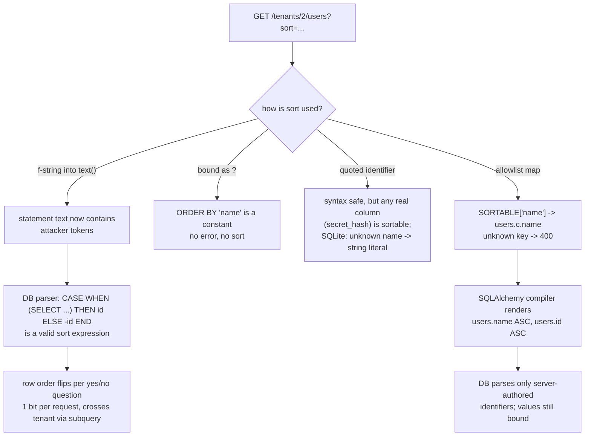

# Preventing Injection in Data-Backed APIs: Why Parameterized Queries Do Not Protect Dynamic Column/Table Identifiers and How to Whitelist Them

> [!summary] Claim
> A bind parameter can only stand where the SQL grammar expects a value, so a client-chosen sort column, sort direction, or table name either gets pasted into the statement text (injectable: the lab reads another tenant's 16-character secret through `ORDER BY` in 109 requests while the `WHERE` clause stays fully parameterized) or gets bound as a constant (silently no sort at all), and the only correct fix is a server-owned map from public names to column objects; NoSQL stores fail the same way one level up, when a JSON object such as `{"$ne": null}` arrives where the code expected a string.

Part of [API Authorization and OWASP Security](README.md) in [API Engineering](../README.md).

## TL;DR

Mechanism: the database parses and plans the statement text before any value exists (PostgreSQL sends the text in a `Parse` message and the values later in `Bind`, PostgreSQL 18 Section 54.7), so identifiers and keywords are fixed at parse time and a placeholder can only ever be a value.
Contract rule: every structural token a client can influence (column, table, schema, `ASC`/`DESC`, `NULLS FIRST`, JSON field names used as keys) comes from an application-owned allowlist that maps a public name to a column object, and anything else is rejected with `400 Bad Request` (JSON:API 1.1 "Sorting") or `422` at the schema layer.
Trap: `ORDER BY ?` is legal SQL that sorts by a constant (the lab gets insertion order back with no error), quoting the name stops syntax injection but still lets the client sort by `secret_hash` (an ordering oracle), and SQLite turns an unknown double-quoted name into a string literal instead of an error.
Portability: all 21 lab tests pass on CPython 3.12.13, 3.13.18, 3.14.6, 3.14.10, and 3.15.2 with SQLAlchemy 2.1.8 and SQLite 3.53.1 or 3.54.1; quoting rules differ per dialect (`"` doubled on PostgreSQL and SQLite, backticks on MySQL, `]` doubled on SQL Server), which is exactly why the allowlist, not the quoter, is the control.
When not to use this: do not build an allowlist for a real query language (search syntax, AIP-160 filters, GraphQL); compile that to an AST and then to column objects (see [[Structured-Filter-Expressions-and-AST-Compilation-AIP-160]]), and do not accept free-form identifiers at all when the set of sortable fields is small enough to put in the OpenAPI `enum`.

## Mental model



A request parameter can reach the statement in four ways.
Pasted into text, it becomes part of what the parser sees, and an `ORDER BY` clause accepts arbitrary expressions, including scalar subqueries that read any table the database role can read, so the visible row order leaks one bit per request.
Bound as a placeholder, it never reaches the parser as structure, which is why it is safe for values, but in `ORDER BY` the grammar treats it as a constant expression and the query silently stops sorting.
Quoted as an identifier, it cannot break out of the name, but the client still chooses which column, and SQLite's compatibility rule resolves a quoted name that matches no column to a string constant.
Mapped through an allowlist, the client chooses only among keys the server wrote, the value is a column object rather than a string, and the compiler emits identifiers the server authored, which is the only arrow in the diagram that ends with no residual risk.

## How it works

### What a bind parameter is, down to the wire

PEP 249 defines five placeholder spellings (`qmark` `?`, `numeric` `:1`, `named` `:name`, `format` `%s`, `pyformat` `%(name)s`) and says, in its footnote on binding, that "the input value is directly used as a value in the operation" and "the client should not be required to escape the value" (PEP 249, `paramstyle` and footnote 5).
In the PostgreSQL extended query protocol the separation is physical: the `Parse` message carries "the query string to be parsed" with `$1`-style placeholders, and the later `Bind` message carries an `Int16` "number of parameter values" followed by the values themselves (PostgreSQL 18 Section 54.7, `Parse` and `Bind`).
Parsing resolves every identifier and keyword in the `Parse` text against the catalog before any `Bind` arrives, so there is no point at which a bound value could become a column name; that is the property that makes binding safe, and the same property makes it useless for identifiers.
SQLite works the same way in-process: Python's `sqlite3` prepares the statement text and binds `?` values separately, and its documentation tells callers to "always use placeholders instead of string formatting" (Python `sqlite3` tutorial).
psycopg 3 sends query and parameters separately by default ("the parameters will not be really merged to the query") and states the limit explicitly: "Only query values should be bound via this method: it shouldn't be used to merge table or field names to the query" (psycopg docs, "Passing parameters to SQL queries").
The OWASP cheat sheet gives the same rule from the defender's side: "Parameter markers represent data values, not table names, column names, or SQL keywords such as ASC and DESC" (OWASP SQL Injection Prevention Cheat Sheet).

### Why a placeholder in ORDER BY does not fail loudly

PostgreSQL defines a sort expression as "any expression that would be valid in the query's select list", or an output column label, or an output column number, and notes that an output column name "has to stand alone" (PostgreSQL 18 Section 7.5).
The documented forms are an output-column label, an output-column number, or an expression, and a placeholder is neither a label nor a number written in the statement text, so `ORDER BY $1` can only be read as an expression whose value is the same for every row.
The lab shows the consequence on SQLite: `SELECT name FROM t ORDER BY ?` with `("name",)` returns the rows in insertion order (`c`, `a`, `b`), while `ORDER BY name` returns `a`, `b`, `c`, and neither raises.
A team that "parameterized the sort" therefore ships an endpoint that ignores the sort parameter, and the first symptom is a pagination bug, not a security finding.
PostgreSQL accepts the same shape rather than rejecting it, per its parser source (not executed here, no PostgreSQL server in this environment): a `Parse` parameter type of zero is "equivalent to leaving the type unspecified" (PostgreSQL 18 Section 54.7, `Parse`), `PREPARE` documents that an unspecified type is inferred from context (PostgreSQL 18 `PREPARE`), and `addTargetToSortList` turns a sort expression of type `unknown` into `text` through `coerce_type`, which records `text` for the `$1` placeholder via `variable_coerce_param_hook` (`postgres REL_18_STABLE src/backend/parser/parse_clause.c, addTargetToSortList`; `src/backend/parser/parse_param.c, variable_coerce_param_hook`).
The result is a sort by one text value that is the same for every row, so it cannot sort by the named column on any engine.

### The ORDER BY oracle: injection without stacked queries

The vulnerable handler binds the tenant and pastes the sort, exactly the shape of the seed's lab plan:

```python
def list_users_vulnerable(engine: Engine, tenant_id: int, sort: str) -> list[str]:
    """The tenant filter is a bind parameter; the sort column is pasted into the SQL text."""
    stmt = text(
        f"SELECT name FROM users WHERE tenant_id = :tenant ORDER BY {sort}"  # noqa: S608 - the bug under study
    )
    with engine.connect() as conn:
        return list(conn.execute(stmt, {"tenant": tenant_id}).scalars())
```

Classic stacked injection (`name; DROP TABLE users`) fails on this stack: `sqlite3` refuses a second statement with `ProgrammingError: You can only execute one statement at a time.`, SQLAlchemy re-raises it as `sqlalchemy.exc.ProgrammingError`, and the lab confirms all four rows survive.
That refusal is a property of the driver call, not a defense; the Python documentation lists it as the condition under which `Cursor.execute()` raises `ProgrammingError` and points to `executescript()` for multiple statements.
The attack that works needs only one statement: a `CASE` expression whose branches sort ascending or descending, so the response order answers a yes/no question about any value a subquery can reach.
The lab's attacker is authenticated in tenant 2 and asks, for each character position of tenant 1's `secret_hash`, whether `unicode(substr((SELECT secret_hash FROM users WHERE tenant_id = 1 AND name = 'admin'), i, 1)) > mid`, sending `CASE WHEN <question> THEN id ELSE -id END` as `sort`.
A binary search over the 95 printable ASCII code points needs at most `ceil(log2(95)) = 7` probes per character; the measured run recovered `c0ffee15deadbeef` in 109 calls (one baseline plus 108 probes), 7.7 ms in process on the first extraction and 3.7 to 3.9 ms on four warm repeats.
The parameterized `WHERE tenant_id = :tenant` never changes, and the response only ever contains tenant 2's names; the leak is entirely in the ordering, which is why response-schema filtering and output allowlists do not catch it.
Over HTTP the same bit is visible: the lab's `/v0` endpoint returns tenant 2's names in ascending `id` order when the first character of the secret is `c` and in reverse order when the question asks about `d`.

### Quoting identifiers: what each dialect does, and why it is not the control

Every engine has a delimited-identifier syntax, and escaping inside it means doubling the closing delimiter.
PostgreSQL: "Quoted identifiers can contain any character, except the character with code zero. (To include a double quote, write two double quotes.)", quoting makes the name case-sensitive while unquoted names fold to lower case, and names longer than `NAMEDATALEN - 1` = 63 bytes are truncated rather than rejected (PostgreSQL 18 Section 4.1.1).
SQLAlchemy encodes the per-dialect rule in `IdentifierPreparer`: `quote_identifier()` wraps the name in `initial_quote` and `final_quote` after `_escape_identifier()` replaces `escape_quote` with `escape_to_quote`, and `quote()` only quotes a plain string when `_requires_quotes()` sees an empty name, a reserved word, an illegal first character, a character outside `legal_characters`, or a case difference, or when the name is a `quoted_name` with `quote=True` (`sqlalchemy 2.1.8 lib/sqlalchemy/sql/compiler.py, IdentifierPreparer.quote_identifier, IdentifierPreparer._requires_quotes`).
The lab compiles the hostile name `` a"b`c]d `` on four dialects and gets `` "a""b`c]d" `` on PostgreSQL and SQLite, ``` `a"b``c]d` ``` on MySQL, and `` [a"b`c]]d] `` on SQL Server.
psycopg composes identifiers with `sql.Identifier`, which uses libpq `PQescapeIdentifier` when a connection is available and otherwise an "approximation of PQescapeIdentifier taking no connection" that doubles `"` (`psycopg 3.3.8 psycopg/sql.py, Identifier._escape_identifier`); the lab renders `ORDER BY "x""; DROP TABLE users; --" DESC`.
psycopg 3.3 added template-string queries ("Add template strings queries (ticket #1054)", psycopg news), where `{name:i}` marks an identifier, `{value:l}` a client-side literal, and `{fragment:q}` a verbatim `sql.SQL` or template, while a bare `{value}` becomes a server-side `$n` parameter on the default cursor and a client-side literal on a `ClientCursor` (`psycopg 3.3.8 psycopg/_tstrings.py, TemplateProcessor._process_template`; `psycopg 3.3.8 psycopg/_queries.py, PostgresClientQuery._convert_template`); on CPython 3.14+ the lab builds such a template with `string.templatelib` and gets the same doubled-quote identifier, and, per the source (not exercised by the lab), the `:q` path raises `ProgrammingError` for a plain `str`, so raw text cannot be smuggled through it.
asyncpg has no public identifier quoting; its only helper is the private `_quote_ident`, which doubles `"` (`asyncpg 0.32.0 asyncpg/utils.py, _quote_ident`).
Inside PostgreSQL itself, `quote_ident()` and `format('%I', ...)` do the same for dynamic SQL in PL/pgSQL, and `%I` raises on `NULL` (PostgreSQL 18 Section 9.4 and 9.4.1).
Quoting solves syntax only, and the lab proves the three residual failures.
First, authorization: `order_by("secret_hash")` or `order_by(column("secret_hash"))` is perfectly quoted and returns `bob_ops`, `mallory`, `bobXops`, which is the order of their secrets (`111...` < `777...` < `eee...`), so a client who can choose any real column has the same oracle with fewer characters.
Second, SQLite's double-quoted string literal rule: "SQLite will also interpret a double-quotes string as string literal if it does not match any valid identifier" (SQLite "Quirks", Section 8), so the quoted payload `name" DESC, (SELECT 1) --` sorts by a constant and returns insertion order with no error.
The rule can be switched off per connection (`SQLITE_DBCONFIG_DQS_DML`, SQLite 3.29.0 and later), Python exposes that through `Connection.setconfig()` since 3.12, and after `setconfig(sqlite3.SQLITE_DBCONFIG_DQS_DML, False)` the lab gets `OperationalError: no such column: "nmae" - should this be a string literal in single-quotes?`.
Third, identity rules: PostgreSQL's 63-byte truncation and case folding mean that two different client strings can name the same object, so any check that compares raw strings before quoting is comparing the wrong thing.

### SQLAlchemy's coercion rules and their history

Through 1.2.17, SQLAlchemy coerced a plain string passed to `order_by()` or `group_by()` into raw SQL text with a warning, which became CVE-2019-7164 ("SQLAlchemy through 1.2.17 and 1.3.x through 1.3.0b2 allows SQL Injection via the order_by parameter") and CVE-2019-7548 (`group_by`).
In the upstream discussion the maintainer's position was that "All elements of the select() object accept plain SQL as an argument which is assumed to be programmatic input" (sqlalchemy issue #4481), and the fix in 1.3.0b3 (2019-02-08) "Fully removed the behavior of strings passed directly as components of a select() or Query object being coerced to text() constructs automatically", raising `ArgumentError`, or `CompileError` for `order_by()` and `group_by()` (SQLAlchemy 1.3 changelog, ticket #4481).
In 2.1.8 a plain string in `order_by()` becomes a `_textual_label_reference`, and `SQLCompiler.visit_textual_label_reference` looks it up in the statement's `_label_resolve_dict`; a miss calls `coercions._no_text_coercion`, which raises `CompileError` (`sqlalchemy 2.1.8 lib/sqlalchemy/sql/compiler.py, SQLCompiler.visit_textual_label_reference`).
The lab's exact message is `Can't resolve label reference for ORDER BY / GROUP BY / DISTINCT etc. Textual SQL expression 'name; DROP TABLE users' should be explicitly declared as text('name; DROP TABLE users')`, and `select(...).where("a=1")` raises `ArgumentError` with the same "should be explicitly declared as text" wording.
The lookup table includes the columns of the `FROM` tables, not only the selected ones: `select(users.c.id).order_by("password_hash")` compiles to `ORDER BY users.password_hash`, so passing the request string straight into `order_by()` is injection-safe and still an authorization bug.
`text()` and `literal_column()` are the explicit escape hatches and render verbatim; the `literal_column` docstring says "Quoting rules will not be applied", and the lab asserts that both end the compiled statement with the raw payload.
Other string-taking constructs carry warnings in the source, for example `extract(field, ...)`: "This field is used as a literal SQL string. DO NOT PASS UNTRUSTED INPUT TO THIS STRING" (`sqlalchemy 2.1.8 lib/sqlalchemy/sql/_elements_constructors.py, extract`).
Django followed the same path: CVE-2021-35042 ("Django 3.1.x before 3.1.13 and 3.2.x before 3.2.5 allows QuerySet.order_by SQL injection if order_by is untrusted input"; the Django release post explains that "Unsanitized user input passed to QuerySet.order_by() could bypass intended column reference validation in path marked for deprecation") and CVE-2022-28346 (column aliases in `annotate()`, `aggregate()`, and `extra()` via a crafted dictionary passed as `**kwargs`), the second showing that dictionary keys are identifiers too.

### The allowlist, designed

The fix maps a public sort name to a column object and never to a string:

```python
SORTABLE: Final[Mapping[str, ColumnElement[Any]]] = MappingProxyType(
    {"name": users.c.name, "created_at": users.c.created_at}
)
MAX_SORT_KEYS: Final = 3


class SortError(ValueError):
    """The client asked for a sort the API does not offer (JSON:API: 400 Bad Request)."""


def parse_sort(
    raw: str,
    allowed: Mapping[str, ColumnElement[Any]] = SORTABLE,
    max_keys: int = MAX_SORT_KEYS,
) -> tuple[UnaryExpression[Any], ...]:
    """Map a JSON:API style `sort=-created_at,name` string to column objects, never to text."""
    fields = raw.split(",")
    if len(fields) > max_keys:
        raise SortError(f"at most {max_keys} sort fields")
    seen: set[str] = set()
    clauses: list[UnaryExpression[Any]] = []
    for field in fields:
        descending = field.startswith("-")
        key = field[1:] if descending else field
        column = allowed.get(key)
        if column is None:
            raise SortError(f"unsupported sort field {key[:64]!r}")
        if key in seen:
            raise SortError(f"duplicate sort field {key!r}")
        seen.add(key)
        clauses.append(column.desc() if descending else column.asc())
    clauses.append(users.c.id.asc())  # unique tie-breaker: a total order for stable pages
    return tuple(clauses)
```

Each design choice has a reason.
The map's values are `ColumnElement` objects, so the compiler, not the request, decides how the identifier is spelled and quoted, and `text()` never appears on the path.
The keys are public API names, decoupled from column names: renaming `created_at` in the schema changes one map entry, not the contract, and an internal column such as `secret_hash` or `id` is unsortable by construction (the lab rejects both).
Direction is a boolean derived from a `-` prefix and turned into `.asc()` or `.desc()`; the text `ASC` or `DESC` is never copied from input, which is the OWASP instruction to "map a requested sort direction the same way, to the literal ASC or DESC, rather than appending the supplied text".
The syntax follows JSON:API 1.1 (`sort=-created,title`; a leading minus means descending; comma-separated fields), which also fixes the error contract: "If the server does not support sorting as specified in the query parameter sort, it MUST return 400 Bad Request."
`MappingProxyType` makes the map read-only at runtime, and `allowed.get(key)` is a dictionary lookup, unlike `getattr(Model, key)`, which would also resolve relationships, hybrid properties, and dunder attributes.
The key count cap and duplicate rejection bound the work a client can request, and the appended `users.c.id` gives a total order so offset or keyset pages do not skip or repeat rows (see [[Keyset-Seek-Pagination-and-Composite-Tie-Breaker-Cursors]]); which sort combinations an index can serve is covered in [[Multi-Column-Sorting-Order-By-Whitelisting-and-Index-Coverage]].
At the HTTP edge the lab adds a cheap shape check, `Query(max_length=101, pattern=r"^-?[a-z_]{1,32}(,-?[a-z_]{1,32}){0,2}$")`, which makes FastAPI answer `422` for the `CASE WHEN` payload before the handler runs, while a well-shaped but unknown name such as `secret_hash` reaches the allowlist and gets `400` with `{"detail": "unsupported sort field 'secret_hash'"}`.
The regular expression is defense in depth, not the control: it would also admit `secret_hash`, and only the map knows which names are public.

### Values that are still structure: LIKE patterns and filter operators

A bound value is never SQL, but some operators interpret their operand as a pattern.
`LIKE` treats `%` and `_` as wildcards inside the bound string, so a search for `bob_ops` also matches `bobXops` in the lab.
SQLAlchemy's `contains(value, autoescape=True)` escapes the wildcards and renders `LIKE '%' || :name_1 || '%' ESCAPE '/'`, and the lab's escaped query matches only `bob_ops` (`sqlalchemy 2.1.8 lib/sqlalchemy/sql/operators.py, ColumnOperators.contains`).
Wildcard abuse is not injection, but a leading `%` defeats B-tree indexes, which is a resource-consumption problem for [[Unrestricted-Resource-Consumption-API4-2023-Payload-Depth-and-Limit-Guards]].
Filter languages that let the client choose the operator (`price[gte]=10`, `filter=price > 10`) have the same structure as sort: the operator token must come from a map of allowed operators per field, as [[Query-Parameter-Filtering-Brackets-RHS-Colon-and-Validation]] and [[Structured-Filter-Expressions-and-AST-Compilation-AIP-160]] develop.

### NoSQL operator injection: the type is the attack

MongoDB's own FAQ explains why string injection mostly disappears: "As a client program assembles a query in MongoDB, it builds a BSON object, not a string. Thus traditional SQL injection attacks are not a problem" (MongoDB FAQ: Fundamentals).
The query document is still a little language, though: a field whose value is a document of `$`-prefixed keys is an operator expression, so the attack moves from characters to types.
CWE-943 names the general class ("Improper Neutralization of Special Elements in Data Query Logic"), with SQL injection (CWE-89) as one child.
If a handler copies a JSON body field into the filter, the client can send `{"email": "admin@example.test", "reset_token": {"$ne": null}}`, and `$ne` "selects documents where the value of the field is not equal to the specified value. This includes documents that do not contain the field" (MongoDB manual, `$ne`).
The lab models those documented top-level semantics in about 40 lines (`mongo_match`, a model, not pymongo, which is not pinned in the workspace) and shows the `/v0/password-reset` endpoint, which accepts `dict[str, Any]`, resetting the admin account without the token.
The OWASP API Security 2019 edition used exactly this shape as its NoSQL example, `DELETE /api/bookings?bookingId[$ne]=678`, which deletes another user's booking (OWASP API8:2019 Injection, scenario 2).
That URL form depends on a query-string parser that builds nested objects from brackets; Starlette parses with `urllib.parse.parse_qsl` (`starlette 1.10.0 starlette/datastructures.py, QueryParams.__init__`), so `email[$ne]=x` arrives as the literal key `email[$ne]`, and the lab asserts it.
JSON bodies have no such protection, so in a Python API the fix is the schema: a Pydantic model with `email: str` and `reset_token: str` rejects an object where a string is expected, and the lab's `/v1` endpoint returns `422` with error type `string_type`.
`ConfigDict(strict=True, extra="forbid")` adds two guarantees the default lax mode does not give: a JSON number is not coerced to a string token, and unexpected top-level keys are refused (see [[Lax-vs-Strict-Validation-Modes-and-Coercion-Tables]] and [[Defeating-BOPLA-and-Mass-Assignment-API3-2023-Strict-Input-Output-Schemas]]).
Where an endpoint legitimately accepts free-form JSON that will later be used as a filter or an update document, a recursive guard that rejects keys starting with `$` or containing `.` (the lab's `reject_operator_keys`) closes the operator and dotted-path channels, at the cost of forbidding those characters in user-defined keys.
Server-side JavaScript is the remaining string-injection channel in MongoDB: `$where`, `mapReduce`, `$accumulator`, and `$function` "permit you to run arbitrary JavaScript expressions directly on the server", and the documented switch is `security.javascriptEnabled: false` or `--noscripting` (MongoDB FAQ; `$where` reference); `$where` also cannot use indexes, so it is both an injection and a resource risk.

### Escaping versus binding, and why encoding bugs settle the argument

Escaping rewrites a value so that a lexer will read it as a literal, which only works if the escaper and the server agree on the lexer.
CVE-2006-2314 is the canonical failure: in client encodings such as SJIS, BIG5, GBK, GB18030, and UHC the byte `0x5c` (backslash) can be the trailing byte of a multibyte character, so a client that escaped byte-wise produced text the server read differently, bypassing "SQL injection protection methods in applications that use multibyte encodings" (CVE-2006-2314: PostgreSQL 8.1.x before 8.1.4, 8.0.x before 8.0.8, 7.4.x before 7.4.13, 7.3.x before 7.3.15, and earlier).
OWASP lists the same class of hazard for MySQL's `NO_BACKSLASH_ESCAPES` mode and marks manual escaping "STRONGLY DISCOURAGED".
PostgreSQL's own default moved toward fewer escape semantics: `standard_conforming_strings` has been `on` since 9.1, so backslashes are literal outside `E'...'` strings (PostgreSQL 18 Section 4.1.2.2).
Binding has no such failure mode because the value never passes through the lexer, which is why identifiers, the one thing binding cannot carry, should not be escaped either but chosen from a closed set.

## Numbers and limits

| Quantity | Value | Source |
|---|---|---|
| ORDER BY oracle cost, 16-char secret | 109 requests (1 baseline + 108 probes); 7.7 ms first extraction, 3.7 to 3.9 ms on 4 warm repeats | lab `extract_via_order_by` timed with `time.perf_counter` via `uv run --frozen python`, CPython 3.14.6, SQLite 3.53.1, macOS 27.3 arm64 (`uname -r` 27.3.0), measured 2026-11-15 |
| Probes per printable ASCII character | at most `ceil(log2(95)) = 7` | arithmetic over code points 32..126 |
| PostgreSQL identifier length | 63 bytes (`NAMEDATALEN` 64 minus 1), longer names truncated | PostgreSQL 18 Section 4.1.1 |
| PostgreSQL characters forbidden in a quoted identifier | only the zero byte | PostgreSQL 18 Section 4.1.1 |
| PostgreSQL `Bind` parameter count field | `Int16` | PostgreSQL 18 Section 54.7 |
| SQLite host parameters per statement | 32766 since 3.32.0 (2020-05-22), 999 before | SQLite limits, item 17 |
| SQLite statement text length | 1,000,000,000 bytes default | SQLite limits, item 6 |
| SQLite DQS switch | per connection since 3.29.0; CLI off by default since 3.41.0 | SQLite quirks Section 8 |
| Python `Connection.setconfig()` | CPython 3.12 and later | Python `sqlite3` docs |
| psycopg template strings | psycopg 3.3.0, CPython 3.14+ | psycopg news; t-strings docs |
| Lab sort parameter cap | 3 keys, 32 chars each, 101 chars total | lab `SORT_SHAPE`, `MAX_SORT_KEYS` |
| Lab runtime | 21 tests in `2.04s` (one run, 2026-11-15) | `uv run --frozen pytest ... -q`, CPython 3.14.6, macOS 27.3 arm64 |
| SQLAlchemy `order_by` CVE | CVE-2019-7164, published 2019-02-20, through 1.2.17 and 1.3.0b2; fixed in 1.3.0b3 (2019-02-08) | CVE record; SQLAlchemy 1.3 changelog |
| Django `order_by` CVE | CVE-2021-35042, published 2021-07-02, fixed 3.2.5 and 3.1.13 | CVE record; Django security release |
| MOVEit Transfer SQL injection | CVE-2023-34362, published 2023-06-02; exploitation from 2023-05-27 per CISA | CVE record; CISA AA23-158A |

## Portability

| Behavior | 3.12.13 | 3.13.18 | 3.14.6 | 3.14.10 | 3.15.2 | 3.15.0b3t |
|---|---|---|---|---|---|---|
| ORDER BY oracle recovers the other tenant's secret | pass | pass | pass | pass | pass | segfault |
| Stacked statement refused, table survives | pass | pass | pass | pass | pass | segfault |
| Allowlist rejects 7 payloads, maps keys, appends tie-breaker | pass | pass | pass | pass | pass | segfault |
| `ORDER BY ?` sorts by a constant | pass | pass | pass | pass | pass | segfault |
| DQS literal fallback, then `OperationalError` after `setconfig` | pass | pass | pass | pass | pass | segfault |
| Quoting stops syntax, not the `secret_hash` oracle | pass | pass | pass | pass | pass | segfault |
| SQLAlchemy `CompileError` / `ArgumentError`, `text()` verbatim | pass | pass | pass | pass | pass | segfault |
| Dialect quoting (PostgreSQL, SQLite, MySQL, SQL Server) | pass | pass | pass | pass | pass | segfault |
| psycopg `sql.Identifier`; t-string `:i` | pass (`ImportError` branch) | pass (`ImportError` branch) | pass (template branch) | pass (template branch) | pass (template branch) | segfault |
| `LIKE` autoescape, HTTP oracle and `422`/`400`, NoSQL `$ne`, Starlette flat keys | pass | pass | pass | pass | pass | segfault |
| Linked SQLite library | 3.53.1 | 3.54.1 | 3.53.1 | 3.54.1 | 3.54.1 | 3.53.1 |

Every "pass" cell is one run of the 21-test module on that interpreter on macOS 27.3 arm64, each leg in its own locked environment (`UV_PROJECT_ENVIRONMENT`), with SQLAlchemy 2.1.8, FastAPI 0.162.0, Starlette 1.10.0, Pydantic 2.14.3, and psycopg 3.3.8.
The matrix pins 3.12.16 and 3.15.2t; neither is installed here, so 3.12.13 and the 3.15.0b3 free-threaded build were used.
On 3.15.0b3t the locked workspace cannot install (`psycopg-binary==3.3.8` has no wheel), so a minimal environment with the lab's direct imports was built, and the first test that executes a statement segfaulted in `sqlalchemy/sql/cache_key.py` line 244 (`_generate_cache_key`) during `make_engine`; that is a beta-interpreter environment failure, not a behavior of the code under test.
The psycopg template test takes a different branch below 3.14 (it asserts that `string.templatelib` does not exist), so the 3.12 and 3.13 cells prove only the `sql.Identifier` half.
Database engines change the details the lab can only compile, not execute: the quoting outputs for PostgreSQL, MySQL, and SQL Server come from SQLAlchemy's dialect compilers, the DQS rule is SQLite-only, and the `ORDER BY $1` behavior on PostgreSQL rests on the parser source cited above, not on a run (no server here); MySQL drivers were not examined.
ASGI servers (Uvicorn, Hypercorn, Granian) and HTTP versions (HTTP/1.1, HTTP/2, HTTP/3) do not affect any of this: the vulnerable input is an ordinary query parameter or JSON body that every server delivers unchanged, and the lab drives the app through `httpx.ASGITransport` without a server.
Debian and Alpine container legs were not run (lab checks paused).
Provenance: the fact-check on 2026-11-15 reran only the 3.14.6 workspace leg (21 passed); the 3.12.13, 3.13.18, 3.14.10, 3.15.2, and 3.15.0b3t cells record the drafter's runs and were not repeated, because matrix checks were paused by the user on 2026-11-11.

## Worked example

The [implementation](../labs/src/api_labs/f15_api_authorization_and_owasp_security/identifier_injection.py) builds one in-memory SQLite database (`StaticPool`, `check_same_thread=False` so FastAPI's threadpool shares it) with a `users` table in two tenants, the vulnerable and allowlisted list functions shown above, the binary-search oracle, a FastAPI app with `/v0` and `/v1` versions of a list endpoint and a password-reset endpoint, and the NoSQL model.
The [test](../labs/tests/f15_api_authorization_and_owasp_security/test_sql_injection_nosql_injection_and_order_by_identifier_escaping.py) has 15 test functions (21 cases after parametrization), all `@pytest.mark.unit`.

The oracle (excerpt, byte-identical to the implementation):

```python
def extract_via_order_by(
    probe: Callable[[str], list[str]], scalar_sql: str, length: int
) -> tuple[str, int]:
    """Recover a string one character at a time through a boolean ORDER BY oracle.

    `probe(sort)` returns the visible row order. Ordering by `id` versus `-id` flips
    that order, so a CASE expression turns any yes/no question into a visible bit.
    Returns the recovered text and the number of probe calls made.
    """
    ascending = probe("id")
    calls = 1
    recovered: list[str] = []
    for position in range(1, length + 1):
        low, high = 32, 126  # printable ASCII code points
        while low < high:
            mid = (low + high) // 2
            question = f"unicode(substr(({scalar_sql}), {position}, 1)) > {mid}"
            calls += 1
            if probe(f"CASE WHEN {question} THEN id ELSE -id END") == ascending:
                low = mid + 1
            else:
                high = mid
        recovered.append(chr(low))
    return "".join(recovered), calls
```

The HTTP layer (excerpt, byte-identical to the implementation):

```python
    @app.get("/v1/tenants/{tenant_id}/users")
    def list_users_v1(
        tenant_id: int,
        sort: Annotated[str, Query(max_length=101, pattern=SORT_SHAPE)] = "name",
    ) -> list[str]:
        try:
            return list_users_safe(engine, tenant_id, sort)
        except SortError as exc:
            raise HTTPException(status_code=400, detail=str(exc)) from exc
```

Two of the tests (simplified excerpt; fixtures and imports omitted):

```python
def test_order_by_oracle_reads_another_tenants_secret_despite_bound_where(engine):
    def probe(sort):
        return list_users_vulnerable(engine, 2, sort)

    assert probe("name") == ["bobXops", "bob_ops", "mallory"]  # tenant 2; BINARY: X < _
    recovered, calls = extract_via_order_by(probe, ADMIN_DIGEST_SQL, len(ADMIN_DIGEST))
    assert recovered == ADMIN_DIGEST
    assert 1 + 6 * 16 <= calls <= 1 + 7 * 16  # ceil(log2(95)) = 7 probes per character


def test_bind_parameter_in_order_by_sorts_by_a_constant():
    conn = sqlite3.connect(":memory:")
    conn.execute("CREATE TABLE t (id INTEGER PRIMARY KEY, name TEXT)")
    conn.executemany("INSERT INTO t (name) VALUES (?)", [("c",), ("a",), ("b",)])
    by_name = conn.execute("SELECT name FROM t ORDER BY name").fetchall()
    by_param = conn.execute("SELECT name FROM t ORDER BY ?", ("name",)).fetchall()
    assert by_name == [("a",), ("b",), ("c",)]
    assert by_param == [("c",), ("a",), ("b",)]  # no error, and no sort either
    conn.close()
```

Captured run from `labs/` on CPython 3.14.6 (the workspace interpreter), SQLite 3.53.1, macOS 27.3 arm64:

```text
$ uv run --frozen pytest tests/f15_api_authorization_and_owasp_security/test_sql_injection_nosql_injection_and_order_by_identifier_escaping.py -q
.....................                                                    [100%]
21 passed in 2.04s
```

The first run failed one assertion, and the failure corrected the author, not the code: the expected name order was `bob_ops`, `bobXops`, but SQLite's default `BINARY` collation compares bytes and `X` (`0x58`) sorts before `_` (`0x5F`).
That detail matters for real APIs too: a sort key's collation is part of its contract, and a database migration that changes collation reorders pages.
The oracle's call count (109) and timing (7.7 ms cold, 3.7 to 3.9 ms warm) come from a separate script that calls `extract_via_order_by` five times on the same interpreter; the test asserts only the 97 to 113 range that the binary search guarantees.

## Pitfalls

> [!warning] The f-string in text() that everyone "already parameterized"
> Trigger: a list endpoint binds its `WHERE` values and builds `text(f"... ORDER BY {sort}")` because a placeholder "did not work" for the column.
> Symptom: no error and no visible data leak, but `sort` accepts any expression, and an ordering oracle reads any table the role can reach; the lab crosses a tenant boundary in 109 requests.
> Fix: replace the f-string with a map from public names to column objects; ruff's `S608` ("Possible SQL injection vector through string-based query construction") flags the vulnerable line in this lab, so keep it enabled and require a reviewed `noqa` for every exception.

> [!warning] Binding the sort column
> Trigger: a developer moves the sort column into the parameters (`ORDER BY ?` or `ORDER BY :sort`).
> Symptom: the endpoint silently ignores the sort; SQLite returns insertion order with no error (lab), and keyset pagination built on that order skips or repeats rows.
> Fix: bind values only; choose identifiers from the allowlist, and add a test that two different `sort` values produce two different orders.

> [!warning] Passing the request string to SQLAlchemy order_by()
> Trigger: `select(User).order_by(request.query_params["sort"])` on current SQLAlchemy (2.1.8 in the lab), which is injection-safe because unresolvable strings raise `CompileError`.
> Symptom: any column of any `FROM` table is sortable, including `password_hash` or `secret_hash`, so the ordering oracle survives without a single SQL metacharacter (lab: `bob_ops`, `mallory`, `bobXops`, the order of their secrets); on 1.2.17 and earlier the same code was CVE-2019-7164.
> Fix: the allowlist; also avoid `getattr(Model, sort)` and `Table.c[sort]`, which expose every attribute or column.

> [!warning] Dictionary keys from the client become identifiers
> Trigger: `queryset.annotate(**request_json)` in Django, or `update(users).values(**body)` in SQLAlchemy.
> Symptom: Django's CVE-2022-28346 made crafted alias keys an SQL injection; even when the ORM quotes keys correctly, the client chooses which columns are written, which is mass assignment.
> Fix: typed input models with `extra="forbid"` and explicit field-to-column mapping, as in [[Defeating-BOPLA-and-Mass-Assignment-API3-2023-Strict-Input-Output-Schemas]].

> [!warning] The quoted identifier that SQLite turns into a string
> Trigger: a sort or column name is quoted before use, and a typo or hostile value names no existing column.
> Symptom: SQLite treats `"nmae"` as the string `'nmae'` (SQLite quirks Section 8), the query sorts by a constant, and tests with valid names never notice.
> Fix: the allowlist removes unknown names before SQL exists; in addition, disable DQS per connection with `Connection.setconfig(sqlite3.SQLITE_DBCONFIG_DQS_DML, False)` on CPython 3.12+, as the lab does.

> [!warning] A JSON object where the handler expected a string
> Trigger: a password-reset, login, or lookup handler copies body fields into a MongoDB filter (`find_one({"reset_token": body["reset_token"]})`) and the body is an untyped `dict`.
> Symptom: `{"reset_token": {"$ne": null}}` matches the first account whose token is not null or that has no token at all, because `$ne` also matches documents missing the field; the lab's `/v0` resets the admin account.
> Fix: a Pydantic model with `str` fields (`422 string_type` in the lab), strict mode for tokens, and `reject_operator_keys` wherever free-form JSON is unavoidable.

> [!warning] Escaping instead of binding in a multibyte encoding
> Trigger: an application escapes quotes byte-wise and connects with a client encoding such as GBK or SJIS.
> Symptom: the escape character is absorbed into a multibyte character and the quote it was meant to neutralize terminates the literal (CVE-2006-2314).
> Fix: bind values; never escape them manually, as OWASP's cheat sheet now states.

> [!warning] Dynamic SQL inside a stored procedure
> Trigger: an API binds every argument of `CALL search(:col, :term)`, and the procedure concatenates `col` into an `EXECUTE` string.
> Symptom: the outer call is parameterized and the inner statement is injectable; OWASP: "Binding procedure arguments protects the call, not dynamic SQL constructed inside the procedure."
> Fix: inside PL/pgSQL, check the name against a fixed list and build the statement with `format('... ORDER BY %I', col)` and `USING` for values.

## Security and robustness

Threat model: the attacker is an authenticated, low-privilege API client who controls query parameters and JSON bodies and can send many requests; the asset is any row the API's database role can read, not only the rows the endpoint returns.
The ORDER BY oracle shows why "the endpoint only returns tenant 2 data" is not a security property: confidentiality has to hold for everything the statement can reference, so the database role and row-level security matter as a second line.
With PostgreSQL Row-Level Security bound to a per-request tenant setting, the injected subquery would see only the caller's tenant, turning a cross-tenant breach into a self-read; that backstop is developed in [[Defeating-BOLA-API1-2023-Tenant-Scoped-Queries-and-PostgreSQL-RLS]].
OWASP's API Top 10 2023 has no standalone injection category (the 2019 edition had API8:2019 Injection); in 2023 injection appears through API10:2023 Unsafe Consumption of APIs, whose scenarios include an SQL injection payload stored in a third party and a git repository named `'; drop db;--` used as "safe input" (OWASP API10:2023).
That 2023 framing is the second-order lesson: a value read back from your own database or from a partner API, such as a saved view's sort column, is client-controlled data when it is used as an identifier, and it goes through the same allowlist.
The impact ceiling is high: CVE-2023-34362 in MOVEit Transfer was an unauthenticated SQL injection that, per CISA advisory AA23-158A, the CL0P group used from 2023-05-27 to install the `LEMURLOOT` web shell ("begins with a SQL injection to infiltrate the MOVEit Transfer web application").
Input validation edge cases for sort parameters: an empty string (the lab rejects `""`), repeated keys, too many keys, very long keys (truncated in the error message to 64 characters so the response does not reflect arbitrary payloads), case variants (the shape regex accepts only lower case), and Unicode look-alikes (excluded by the ASCII character class).
Errors: behind a real server, the vulnerable `/v0` endpoint's database exceptions become `500` responses through Starlette's `ServerErrorMiddleware` (not exercised by the lab, whose transport re-raises them), and a verbose error page would hand the attacker an error-based oracle in addition to the ordering one; map validation failures to `400` or `422` and keep driver messages in logs, redacted as in [[Structured-Log-Redaction-and-Preventing-PII-and-Token-Leaks]].
Resource limits: a sort on an unindexed column forces a full sort per request, so the allowlist should contain only indexed combinations and the API should cap page size, which is the API4:2023 side of the same parameter.
Least privilege: the API role should not own tables, should not have `DROP` or DDL, and should not be able to read secrets it never returns; store credential hashes behind a separate role or service so an oracle cannot reach them.
Detection: oracle extraction is a burst of near-identical requests whose `sort` values differ by one character; length and shape validation at the gateway turns that burst into a stream of `422` responses that rate limiting and alerting can see (see [[Protecting-Sensitive-Business-Flows-API6-2023-Anti-Automation-and-Bot-Defense]]).
A web application firewall is not a substitute: the payload `CASE WHEN unicode(substr((...),1,1)) > 79 THEN id ELSE -id END` contains no quote, no comment, and no `UNION`, and is trivially reformulated.

## The principal's view

The decision is architectural, not per-endpoint: make the query builder the only path from HTTP to SQL, and make every client-chosen identifier a key in a typed, per-resource registry that also generates the OpenAPI `enum` for `sort` and `fields`.
That turns the review question from "is this string safe?" into "is this key in the registry?", which a linter, a contract test, and a code owner can all answer mechanically.
The organizational trade-off is flexibility: product teams lose "sort by anything" and must request each new sortable field, which is also when someone checks for an index and for a confidentiality problem, so the friction is the control.
Ban `text()` with interpolation by lint (`S608`) and allow it only in a small, owned module of reviewed raw SQL; escape hatches such as `literal_column()` belong to the same module.
For NoSQL stores the equivalent decision is "no untyped body reaches a filter": every handler that builds a query document takes a typed model, and the few endpoints that accept arbitrary JSON pass through an operator-key guard and a schema for the stored document.
Choose a different design when the client really needs a query language: compile a constrained grammar (AIP-160 filters, a search DSL, GraphQL arguments) into an AST and then into column objects, or hand the problem to a search engine whose query parser is the product; in each case the allowlist moves into the compiler but does not disappear.
Language choice changes little, because the separation lives in the database protocol (`Parse` versus `Bind`) rather than in the client language, so the registry pattern transfers to any stack; a statically typed query builder can check server-authored identifiers at compile time, but a client-chosen name is a runtime string in every language and still needs the runtime map.

## Interview questions

> [!question] L5: Why can a bind parameter not be used for a column name in `ORDER BY` or a table name in `FROM`?
>
> > [!success]- Answer
> > The database parses the statement text and resolves identifiers and keywords before any parameter value exists; in PostgreSQL the text travels in `Parse` and the values later in `Bind`.
> > A placeholder can therefore only occupy a value position in the grammar.
> > In `FROM` that is a syntax error, and in `ORDER BY` it is legal but sorts by a constant.
> >
> > Follow-up: Which other tokens in a `SELECT` have the same limitation?

> [!question] L5: Predict the output: SQLite table `t(name)` holds `c`, `a`, `b` inserted in that order; what does `conn.execute("SELECT name FROM t ORDER BY ?", ("name",)).fetchall()` return?
>
> > [!success]- Answer
> > `[("c",), ("a",), ("b",)]`, the insertion order, with no error.
> > The placeholder binds the string `'name'`, which is a constant expression, so every row has the same sort key.
> > The lab asserts exactly this, next to `ORDER BY name` returning `a`, `b`, `c`.
> >
> > Follow-up: What would `ORDER BY "nmae"` (a typo, double-quoted) return on a default SQLite connection, and how do you make it fail instead?

> [!question] L5: What does a NoSQL injection look like against a Python API backed by MongoDB, and what is the first-line fix?
>
> > [!success]- Answer
> > The client sends an object where the code expected a string, for example `{"reset_token": {"$ne": null}}`, and the handler copies it into the filter.
> > `$ne` matches every document whose token differs, including documents with no token, so the check passes.
> > The fix is a typed request model with `str` fields, which makes FastAPI return `422` with `string_type`.
> >
> > Follow-up: Why does `?reset_token[$ne]=x` not work against Starlette, and which frameworks does it work against?

> [!question] L6: Your list endpoint binds `tenant_id` and interpolates only `sort`, and the response never contains another tenant's rows; is it safe, and how would you prove your answer?
>
> > [!success]- Answer
> > It is not safe, because `ORDER BY` accepts any expression, including a scalar subquery over another tenant's data, and the row order leaks one bit per request.
> > A `CASE WHEN <question> THEN id ELSE -id END` sort turns each question into ascending or descending order, and binary search recovers a printable character in at most 7 requests.
> > The lab recovers a 16-character secret from tenant 1 while authenticated as tenant 2 in 109 requests.
> >
> > Follow-up: Which database feature would have limited the damage even with the injection present?

> [!question] L6: Debug this API: after a security review, a team changed `text(f"... ORDER BY {sort}")` to `select(Item).order_by(sort)`; the pentest still reports "sort parameter leaks data", but every SQL metacharacter now raises `CompileError`. What is still wrong?
>
> > [!success]- Answer
> > SQLAlchemy resolves a plain string in `order_by()` as a label reference against the selected columns and the columns of every `FROM` table.
> > So `sort=password_hash` compiles to `ORDER BY items.password_hash` and the response order reveals the hash order, which is an oracle without injection.
> > The fix is a map from public names to the specific columns the API wants to expose, with unknown names returning `400`.
> >
> > Follow-up: Which SQLAlchemy versions turned this same code into CVE-2019-7164, and what changed?

> [!question] L6: Is quoting a client-supplied identifier with `sql.Identifier` or `quote_identifier()` an acceptable fix?
>
> > [!success]- Answer
> > It prevents breaking out of the identifier, because each dialect doubles its closing delimiter.
> > It does not decide which identifiers the client may name, so secret or unindexed columns become sortable, and on SQLite an unknown quoted name silently becomes a string literal.
> > Quoting is the right tool for server-authored names in generated DDL or migrations, and the allowlist is the right tool for client choices.
> >
> > Follow-up: How do PostgreSQL's 63-byte truncation and case folding interact with a check done before quoting?

> [!question] L6: Why is `LIKE :q` with a bound `q` still a problem for a search endpoint, and how does SQLAlchemy help?
>
> > [!success]- Answer
> > `%` and `_` inside the bound value are wildcards, so a user can match more rows than intended, and a leading `%` defeats B-tree indexes.
> > `contains(value, autoescape=True)` escapes them and renders `ESCAPE '/'`; the lab's `bob_ops` search then stops matching `bobXops`.
> > It is not SQL injection, but it is a correctness and resource-consumption issue.
> >
> > Follow-up: When would you move search to a full-text index instead?

> [!question] L7+: Design the sort and filter contract for 200 list endpoints across 30 teams so that identifier injection is impossible by construction.
>
> > [!success]- Answer
> > Put a per-resource registry of public field names mapped to column objects in a shared library, and generate the OpenAPI `enum` for `sort` and the filter operators from it.
> > Make the shared query builder the only way handlers reach SQL, ban interpolated `text()` with `S608` outside a reviewed raw-SQL module, and add contract tests that unknown keys return `400`.
> > Adding a sortable field requires a registry change, which is the point where index coverage and confidentiality are reviewed.
> > Back it with least-privilege roles and row-level security so a missed case cannot cross tenants.
> >
> > Follow-up: How do you migrate 30 existing endpoints that accept arbitrary sort strings without breaking clients?

> [!question] L7+: OWASP removed injection as a standalone category in the API Top 10 2023; was that the right call, and what does it mean for how you run a security program?
>
> > [!success]- Answer
> > It reflects that frameworks with bound parameters made classic value injection rarer in APIs, while authorization and business-logic failures dominate.
> > Injection did not disappear: it moved to identifiers, NoSQL operator documents, and data consumed from third parties, which 2023 covers under API10 Unsafe Consumption.
> > A program should therefore test identifier and type-confusion inputs explicitly and treat upstream data as untrusted, rather than reading the list as permission to stop.
> >
> > Follow-up: Which incident from 2023 shows that classic SQL injection still has a catastrophic ceiling?

## Related

Prerequisites: [[CSRF-in-Cookie-Authenticated-APIs-SameSite-Double-Submit-and-Fetch-Metadata]]

Next: [[Security-Headers-for-HTTP-APIs-HSTS-Nosniff-Cache-Control-and-Security-Txt]]

See also: [[02-Programming-Languages/Python/Python-Backend-Interview-Prep/06-SQL-and-SQLAlchemy]], [[02-Programming-Languages/Python/Python-Backend-Interview-Prep/07-Auth-and-Security]], [[OWASP-API-Security-Top-10-2023-Complete-Threat-Model]], [[Defeating-BOLA-API1-2023-Tenant-Scoped-Queries-and-PostgreSQL-RLS]], [[Defeating-BOPLA-and-Mass-Assignment-API3-2023-Strict-Input-Output-Schemas]], [[Unrestricted-Resource-Consumption-API4-2023-Payload-Depth-and-Limit-Guards]], [[Improper-Inventory-Management-API9-2023-and-Unsafe-Consumption-of-APIs-API10-2023]], [[Where-Authorization-Lives-Gateway-Middleware-vs-Domain-and-Query-Layer]], [[Structured-Log-Redaction-and-Preventing-PII-and-Token-Leaks]], [[Multi-Column-Sorting-Order-By-Whitelisting-and-Index-Coverage]], [[Keyset-Seek-Pagination-and-Composite-Tie-Breaker-Cursors]], [[Query-Parameter-Filtering-Brackets-RHS-Colon-and-Validation]], [[Structured-Filter-Expressions-and-AST-Compilation-AIP-160]], [[Lax-vs-Strict-Validation-Modes-and-Coercion-Tables]], [[SQLAlchemy-2-x-Architecture-Core-vs-ORM-Engine-and-Unified-Select]]

- Lab: `labs/tests/f15_api_authorization_and_owasp_security/test_sql_injection_nosql_injection_and_order_by_identifier_escaping.py`

## Further reading

- [OWASP SQL Injection Prevention Cheat Sheet](https://cheatsheetseries.owasp.org/cheatsheets/SQL_Injection_Prevention_Cheat_Sheet.html) - the allowlist rule for table names, column names, and sort direction, and why manual escaping is strongly discouraged.
- [PEP 249, Python Database API Specification v2.0](https://peps.python.org/pep-0249/) - the five `paramstyle` spellings and the definition of binding that every Python driver implements.
- [PostgreSQL 18 Section 54.7, Message Formats](https://www.postgresql.org/docs/current/protocol-message-formats.html) - `Parse` and `Bind`, the wire-level reason values and statement text never mix.
- [PostgreSQL 18 Section 4.1, Lexical Structure](https://www.postgresql.org/docs/current/sql-syntax-lexical.html) - quoted identifiers, case folding, the 63-byte limit, and `standard_conforming_strings`.
- [PostgreSQL 18 Section 7.5, Sorting Rows](https://www.postgresql.org/docs/current/queries-order.html) - what a sort expression may be, which is why `ORDER BY` is such a wide injection sink.
- [SQLite Quirks, Section 8](https://www.sqlite.org/quirks.html) - the double-quoted string literal misfeature and the `SQLITE_DBCONFIG_DQS_*` switches.
- [SQLAlchemy issue #4481](https://github.com/sqlalchemy/sqlalchemy/issues/4481) - the CVE-2019-7164 discussion that ended implicit text coercion in `order_by()` and `group_by()`.
- [Django security releases, 2021-07-01](https://www.djangoproject.com/weblog/2021/jul/01/security-releases/) - CVE-2021-35042, the same bug class in another ORM's `order_by()`.
- [psycopg 3: template string queries](https://www.psycopg.org/psycopg3/docs/basic/tstrings.html) - the `:i`, `:l`, and `:q` format specifiers that separate identifiers, literals, and fragments on CPython 3.14.
- [JSON:API 1.1, Sorting](https://jsonapi.org/format/#fetching-sorting) - the `sort=-field,field` syntax and the mandatory `400 Bad Request` for unsupported sorts.
- [MongoDB FAQ: How does MongoDB address SQL or Query injection?](https://www.mongodb.com/docs/manual/faq/fundamentals/) - BSON queries, the server-side JavaScript operators, and `--noscripting`.
- [OWASP API Security Top 10, API8:2019 Injection](https://api-security.owasp.org/editions/2019/en/0xa8-injection) - the `bookingId[$ne]=678` NoSQL scenario and the original injection guidance for APIs.
- [CISA AA23-158A](https://www.cisa.gov/news-events/cybersecurity-advisories/aa23-158a) - the MOVEit Transfer SQL injection campaign, a primary account of the impact ceiling.
