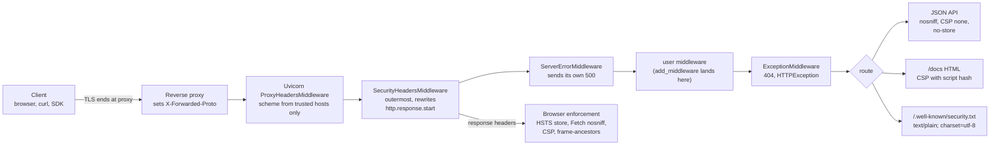

# Security Response Headers for Pure JSON APIs vs HTML Documentation Endpoints (RFC 6797 HSTS, X-Content-Type-Options, CSP, and RFC 9116 security.txt)

> [!summary] Claim
> Security response headers are instructions to browsers, so a pure JSON API needs a small, fixed set whose job is to stop a browser from ever treating the JSON as something else (`X-Content-Type-Options: nosniff`, `Content-Security-Policy: default-src 'none'; frame-ancestors 'none'`, `Cache-Control: no-store`, and HSTS sent only over HTTPS), while the HTML documentation page is a real web application that needs its own policy built from the exact bytes it serves; both must be applied by a middleware placed outside every component that can emit a response on its own, including Starlette's `ServerErrorMiddleware`.

Part of [API Authorization and OWASP Security](README.md) in [API Engineering](../README.md).

## TL;DR

- Mechanism: HSTS is a per-host policy a browser stores after one valid `Strict-Transport-Security` field received over error-free TLS (RFC 6797 Section 8.1), `nosniff` makes Fetch block a `script`-like or `style` load whose `Content-Type` is not JavaScript or `text/css` (Fetch Section 3.6.1), CSP is a directive set the browser enforces on a document, and `security.txt` is a UTF-8 text file at `/.well-known/security.txt` with at least one `Contact` and exactly one `Expires` (RFC 9116 Sections 2.5.3, 2.5.5, 3).
- Contract rule: send exactly one STS field and never over plain HTTP (RFC 6797 Sections 7.1, 7.2), make only the first `X-Content-Type-Options` member `nosniff`, give every API response an explicit `Content-Type` and a fail-closed `Cache-Control: no-store`, put `frame-ancestors 'none'` explicitly because it does not fall back to `default-src` (CSP3 Section 6.4.2), and allow inline docs scripts by hash, not `'unsafe-inline'`.
- The trap: `app.add_middleware(...)` in Starlette 1.10.0 runs inside `ServerErrorMiddleware`, so every unhandled-exception `500` leaves without the headers (the lab proves it); HSTS keyed on `scope["scheme"]` is silently never sent behind a TLS-terminating proxy that Uvicorn does not trust, or spoofable when it trusts everyone.
- Portability fact: none of the pinned Python clients or servers (httpx 0.28.1, Starlette 1.10.0, FastAPI 0.162.0, Uvicorn 0.54.0, Hypercorn 0.18.0, Litestar 2.25.0) mentions `Strict-Transport-Security` at all, so HSTS protects browsers and `curl --hsts` only; the lab's 50 tests pass on CPython 3.12.13, 3.13.18, 3.14.6, 3.14.10, 3.15.2, and 3.15.0b3 free-threaded.
- When not to use it: do not expect any of these headers to protect a server-to-server or mobile client, do not ship HSTS `includeSubDomains` or `preload` before every subdomain serves valid HTTPS (RFC 6797 Section 14.5), do not put a host-allowlist CSP on the docs page and call it XSS protection, and do not publish a `security.txt` you will not keep current, because a stale file is worse than none (RFC 9116 Section 5.3).

## Mental model



A request reaches the application through a proxy that terminated TLS, so the only evidence that the client used HTTPS is a forwarded header, and Uvicorn's `ProxyHeadersMiddleware` rewrites `scope["scheme"]` from it only when the TCP peer is a trusted proxy.
The security-header middleware must sit outside Starlette's whole stack, because `ServerErrorMiddleware` is installed first and sends its own `500` without passing through anything added with `add_middleware`.
Every response, from the JSON routes, the docs page, `security.txt`, a `404`, or a crash, then crosses one place where the policy is applied with replace semantics, so each header appears exactly once.
The headers have no effect on the server or on a non-browser client; their effect happens in the browser, which stores HSTS, applies the Fetch `nosniff` check to subresource loads, and enforces CSP and `frame-ancestors` on documents.

## How it works

### Which header matters for which response

The OWASP REST Security Cheat Sheet states the distinction this note is built on: some headers "are intended to be used with HTML responses", and "if the API is only consumed by non-browser clients (e.g. mobile apps, server-to-server calls, command-line tools), most of these headers will have no effect since they are directives for browsers".
The headers matter for a JSON API anyway because a browser can be pointed at any URL: a victim can navigate to it, a hostile page can embed it with `<script src>` or `<iframe>`, and a response stored in a browser cache outlives the session.

| Header | JSON API response | HTML docs page | `security.txt` | Enforced by | Source |
|---|---|---|---|---|---|
| `Content-Type` | `application/json` | `text/html; charset=utf-8` | `text/plain; charset=utf-8` (MUST) | every recipient | RFC 9110 Section 8.3, RFC 9116 Section 3 |
| `X-Content-Type-Options` | `nosniff` | `nosniff` | `nosniff` | browser Fetch | Fetch Section 3.6 |
| `Strict-Transport-Security` | one field, HTTPS only | same | same | browsers, `curl --hsts` | RFC 6797 Sections 7.1, 7.2 |
| `Content-Security-Policy` | `default-src 'none'; frame-ancestors 'none'` | a real policy, hashes for inline scripts | `default-src 'none'; frame-ancestors 'none'` | browser, on documents | CSP3 Sections 2.2, 6.4.2 |
| `Cache-Control` | `no-store`, or `private` for credentialed reuse | route decides | route decides | browser and shared caches | RFC 9111 Section 5.2.2.5 |
| `X-Frame-Options` | `DENY` (legacy) | `DENY` | `DENY` | browsers without `frame-ancestors` | RFC 7034 Section 2.1 |
| `Cross-Origin-Resource-Policy` | `same-origin` unless embedded cross-origin by design | `same-origin` | `same-origin` or omit | browser, `no-cors` loads only | Fetch Section 3.7 |
| `Referrer-Policy` | `no-referrer` | site choice | `no-referrer` | browser | OWASP REST Security Cheat Sheet |

### HSTS: the wire grammar (RFC 6797 Section 6.1)

The field is `[ directive ] *( ";" [ directive ] )` with `directive = directive-name [ "=" directive-value ]` and `directive-value = token | quoted-string`, so `max-age="31536000"` is legal and empty directives between semicolons are allowed (RFC 6797 Section 6.1).
Five rules govern every directive: order is not significant, every directive "MUST appear only once", names are case-insensitive, a UA "MUST ignore any STS header field" with non-conforming syntax, and unrecognized directives are ignored while the recognized ones are still processed (RFC 6797 Section 6.1, items 1 to 5).
`max-age` is REQUIRED and is `delta-seconds = 1*DIGIT` after unquoting; `max-age=0` makes the UA forget the host, `includeSubDomains` included (RFC 6797 Sections 6.1.1, 6.2).
`includeSubDomains` is OPTIONAL and valueless (RFC 6797 Section 6.1.2).
`preload` is not in RFC 6797 at all: it is an unknown directive that a conforming UA ignores and that only the Chromium preload-list checker reads.
The lab's `parse_sts` transcribes these rules, so `max-age=1; max-age=2`, `max-age=1, includeSubDomains`, `includeSubDomains=yes`, `max-age=1.5`, and `max-age=` followed by an Arabic-Indic digit (for which `str.isdigit()` is true) all return `None`.

### HSTS: the server rules (RFC 6797 Section 7)

Over secure transport an HSTS host SHOULD send the field and, if it does, "MUST include only one such header field" (RFC 6797 Section 7.1).
Over plain HTTP it SHOULD answer with a permanent redirect, such as `301`, to the `https` URI, and it "MUST NOT include the STS header field in HTTP responses conveyed over non-secure transport" (RFC 6797 Section 7.2).
The server cannot see TLS when a proxy terminated it, so in ASGI the only input is `scope["scheme"]`, and the lab's middleware sends HSTS if and only if that is `https`, removing any copy a route set otherwise.
Starlette 1.10.0 `HTTPSRedirectMiddleware` redirects `http` and `ws` requests with `307`, not `301`, and answers `400` with `Invalid host header` when the URL has no host (starlette 1.10.0 starlette/middleware/httpsredirect.py, HTTPSRedirectMiddleware.__call__); the lab asserts the `307` and its `Location`.
For an API the redirect is the wrong primary control: by the time the server can redirect, the client has already sent its `Authorization` header or cookie in cleartext, and a `307` asks the client to resend the body and credentials to the new URL.
The better API posture is to not listen on port 80 at all, or to answer plain-HTTP API requests with an error and revoke any credential that arrived over it; the redirect remains appropriate for the HTML docs host, where a human types the URL.

### HSTS: the user-agent rules (RFC 6797 Section 8)

A UA notes or updates the policy only from a conforming field received over secure transport with "no underlying secure transport errors or warnings", and "MUST process only the first such header field" if several arrive (RFC 6797 Section 8.1).
A field received over insecure transport MUST be ignored, and a host whose name is an IP literal or IPv4 address MUST NOT be noted (RFC 6797 Sections 8.1, 8.1.1), so HSTS never protects `https://192.0.2.1/` and the lab's `received_sts` returns `None` for `192.0.2.1` and `[2001:db8::1]`.
Matching is label by label, right to left, ASCII case-insensitive; a congruent match or a superdomain match with `includeSubDomains` rewrites an `http` URI to `https` before any byte is sent, converting an explicit port `80` to `443` and preserving any other port (RFC 6797 Sections 8.2, 8.3).
Once a host is known, any TLS error, including a certificate validity, revocation, or name-check failure, MUST terminate the connection (RFC 6797 Section 8.4), and RFC 6797 Section 12.1 advises "no user recourse", which is why a misissued or expired certificate on an HSTS host is an outage rather than a warning page.
`<meta http-equiv="Strict-Transport-Security">` MUST NOT be heeded (RFC 6797 Section 8.5), and a later response without the field does not remove the policy before `max-age` elapses (RFC 6797 Section 8.6).

Chromium's parser (`net/http/http_security_headers.cc`, `ParseHSTSHeader`, on `main` as of 2026-11, last changed 2024-10-02) rejects a repeated `max-age`, a repeated `includeSubDomains`, and an `includeSubDomains` with a value, requires every unknown directive name and unquoted value to be a token, and clips `max-age` to `kMaxHSTSAgeSecs = 86400 * 365`, one year (`net/http/http_security_headers.h`).
The OWASP HTTP Headers Cheat Sheet recommends `max-age=63072000` (two years); Chromium stores at most one year of it, and the lab's `parse_sts(..., max_age_cap=ONE_YEAR)` models that clamp.
The lab clamps by length before calling `int()`, because CPython refuses to convert strings over 4300 digits by default and a 5000-digit `max-age` would otherwise raise.

### HSTS for clients that are not browsers

A `grep` for `strict-transport-security` across the installed httpx 0.28.1, httpcore 1.0.9, h11 0.16.0, Starlette 1.10.0, FastAPI 0.162.0, Uvicorn 0.54.0, Hypercorn 0.18.0, and Litestar 2.25.0 packages finds no occurrence (as of 2026-11), so a Python SDK will follow an `http://` base URL forever no matter what the API sends.
curl added HSTS "as experimental in curl 7.74.0", supports it "for real" since 7.77.0, enables it only with `--hsts [filename]`, and since 8.20.0 keeps at most the 10,000 most recently added hostnames (curl.se/docs/hsts.html).
For SDKs and service-to-service calls, the equivalent of HSTS is configuration: an `https://` base URL compiled into the SDK, a client that refuses plain `http`, and a server that never answers on port 80.

### HSTS preload

The preload list removes the first-visit gap that RFC 6797 Section 14.6 calls the bootstrap MITM vulnerability.
The Chromium checker (chromium/hstspreload `header.go`, `preloadableHeaderMaxAge`, `preloadableHeaderSubDomains`, `preloadableHeaderPreload`, as of 2026-11) requires `max-age` of at least `31536000` (one year; 18 weeks for its `Bulk18Weeks` policy), `includeSubDomains`, and `preload`, and its `redirects.go` flags an HTTP site that does not redirect, that redirects to `www` before HTTPS, or whose first redirect is not to HTTPS on the same host, plus a warning, "Unnecessary HSTS header over HTTP".
The lab's `preload_eligible` encodes the three header checks.
`includeSubDomains` is what protects domain cookies: without it, an attacker who makes the victim request `https://uxdhbpahpdsf.example.com/` on an attacker-controlled server receives the `Secure` domain cookie if the user clicks through a certificate warning, or if the attacker obtained a certificate for that name so no warning appears (RFC 6797 Section 14.4).
The same directive is a denial-of-service hazard when any subdomain, for example an OCSP or CRL host, serves only HTTP (RFC 6797 Sections 11.4.1, 14.5).
`hstspreload.org` (as of 2026-11) states the same header rules plus a valid certificate, an HTTP-to-HTTPS redirect "on the same host, if you are listening on port 80", and HTTPS on all subdomains, and warns that new entries "can take several months" to reach stable Chrome and that removal "takes months" to reach users.

### `X-Content-Type-Options`: the Fetch algorithm

RFC 9110 Section 8.3 says a recipient without `Content-Type` "MAY either assume a media type of "application/octet-stream"" or "examine the data to determine its type", and warns that "MIME sniffing" "might expose the user to additional security risks".
The Fetch Standard (Living Standard, last updated 14 November 2026) defines the header precisely.
"Determine nosniff" gets, decodes, and splits all `X-Content-Type-Options` lines, returns false if there are none, and returns true only "If values[0] is an ASCII case-insensitive match for "nosniff"" (Fetch Section 3.6).
Get, decode, and split joins the lines with `, ` and splits on commas outside quoted strings, so `X-Content-Type-Options: sniff, nosniff` is not `nosniff`, `NoSniff` is, and two lines `nosniff` then `foo` still are; the lab reproduces Fetch's own examples (`nosniff,` yields `["nosniff", ""]`).
"Should response to request be blocked due to nosniff?" then blocks a `script`-like destination when the MIME type is failure or not a JavaScript MIME type, and a `style` destination when the essence is not `text/css`; no other destination is checked, because "considering "image" was not compatible with deployed content" (Fetch Section 3.6.1).
`script`-like means `audioworklet`, `paintworklet`, `script`, `serviceworker`, `sharedworker`, or `worker` (Fetch Section 2.2.5).
A JavaScript MIME type is one of 16 essences, from `application/ecmascript` to `text/x-javascript`, and `application/json` is not one of them (MIME Sniffing Standard Section 4.6, last updated 19 October 2026).
Without `nosniff`, Fetch blocks a script load only for `audio/*`, `image/*`, `video/*`, and `text/csv` (Fetch Section 2.10), which means `<script src="https://api.example.com/v1/me">` on a hostile page is allowed to execute an `application/json` response; the lab's `test_json_loaded_as_a_script_runs_without_nosniff_and_is_blocked_with_it` pins both halves.
Main fetch applies the mixed-content, CSP, MIME-type, and `nosniff` checks in one step and turns a blocked response into a network error (Fetch Section 4.1, main fetch).

`nosniff` is only half of the control; the other half is a correct `Content-Type` on every response.
Starlette 1.10.0 `JSONResponse` sets `media_type = "application/json"` with no `charset`, and `Response.init_headers` appends `; charset=utf-8` only to `text/*` types (starlette 1.10.0 starlette/responses.py, JSONResponse and Response.init_headers); the lab's captured headers show exactly `content-type: application/json` and `content-type: text/plain; charset=utf-8`.
Media-type negotiation and charsets are covered in [[Content-Negotiation-Media-Types-and-Charsets]].

### `Cache-Control` on API responses

`no-store` means a cache "MUST NOT store any part of either the immediate request or the response", applies to private and shared caches, and "is not a reliable or sufficient mechanism for ensuring privacy" (RFC 9111 Section 5.2.2.5).
OWASP API8:2023 lists "Security or cache control directives are not sent to clients" as a vulnerability indicator, and its Scenario #2 is a direct-message API whose responses lack `Cache-Control`, so "private conversations end-up cached by the web browser".
The lab's policy fails closed: a response with no `Cache-Control` gets `no-store`, and a response to a request carrying `Authorization` or `Cookie` gets `no-store` unless the route chose `no-store` or `private`, which overrides a route that wrongly set `public, max-age=60`.
The OWASP REST Security Cheat Sheet adds that `no-store` "does not prevent storage by application code", because the Cache API does not honor HTTP caching headers.
The directive semantics are in [[Cache-Control-Directives-and-Freshness-Lifetime-Calculation]], and shared-cache keying for authenticated responses is in [[Caching-Authenticated-and-Multi-Tenant-API-Responses]].

### CSP for a JSON response

A CSP applies to a `Document`, `WorkerGlobalScope`, or `WorkletGlobalScope` (CSP3 Section 2.2), so on a JSON response it matters only when a browser renders that response as a document, for example after a direct navigation or if the `Content-Type` is wrong.
`default-src 'none'` then forbids every fetch and script from that document, and the OWASP REST Security Cheat Sheet recommends exactly `Content-Security-Policy: default-src 'none'` for that defense-in-depth case.
`frame-ancestors` must be written out, because it "will not fall back to the default-src directive's value", so "a policy that declares default-src 'none' will still allow the resource to be embedded by anyone" (CSP3 Section 6.4.2); the lab's `framing_allowed` returns true for `default-src 'none'` alone.
`frame-ancestors` "MUST be ignored when contained in a policy declared via a meta element" (CSP3 Section 6.4.2), so it only works as a response header.
When an enforced policy contains `frame-ancestors`, `X-Frame-Options` is ignored "per HTML's processing model" (CSP3 Section 6.4.2.2); `X-Frame-Options: DENY` (RFC 7034 Section 2.1, an Informational RFC) remains only for browsers without CSP Level 2.

The parser rules matter when two components each emit a policy.
Directive names are ASCII-lowercased, and a repeated directive is ignored, so in `script-src 'none'; script-src *` the first wins (CSP3 Section 2.2.1).
Several `Content-Security-Policy` lines, or one line with comma-separated policies, form a CSP list, and a load is blocked if any enforced policy in the list blocks it (CSP3 Sections 2.2.2, 4.1.3), so adding a second, stricter policy can only tighten; it can never relax a policy an earlier layer set.

### CSP for the HTML documentation page

FastAPI 0.162.0's Swagger UI page is an HTML document that loads `https://cdn.jsdelivr.net/npm/swagger-ui-dist@5/swagger-ui-bundle.js` and `swagger-ui.css`, a favicon from `https://fastapi.tiangolo.com/img/favicon.png`, and runs one inline `<script>` that calls `SwaggerUIBundle({url: '<openapi_url>', ...})` (fastapi 0.162.0 fastapi/openapi/docs.py, get_swagger_ui_html).
The parameters inside that script are serialized by `_html_safe_json`, which escapes `<`, `>`, and `&` as the JSON escapes `<`, `>`, and `&` to prevent breaking out of the `<script>` element (fastapi 0.162.0 fastapi/openapi/docs.py, _html_safe_json).
ReDoc's page additionally links Google Fonts when `with_google_fonts` is true and carries an inline `<style>` element (fastapi 0.162.0 fastapi/openapi/docs.py, get_redoc_html).
A JSON-API policy of `default-src 'none'` blocks all of it; the lab's `test_docs_without_their_own_policy_get_the_api_default_that_blocks_swagger` shows that is what the docs page receives if it does not set its own policy.

The CSP-native way to allow one inline script is a hash source, `hash-source = "'" hash-algorithm "-" base64-value "'"` with `hash-algorithm = "sha256" / "sha384" / "sha512"`, where base64 and base64url encodings are treated as equivalent for hashes (CSP3 Section 2.3.1).
The browser hashes the UTF-8 encoding of the element's text (CSP3 Section 6.7.3.3), and a list containing any hash or nonce no longer "allows all inline behavior" even if it also contains `'unsafe-inline'` (CSP3 Section 6.7.3.2), which is how one policy can be both strict for new browsers and tolerant for old ones.
The lab's docs route calls `get_swagger_ui_html`, extracts the inline script with `html.parser`, and emits `script-src https://cdn.jsdelivr.net 'sha256-...'`; the test proves the hash is of exactly the bytes served and that appending one space would not match.
The inline script embeds `root_path + openapi_url` (fastapi 0.162.0 fastapi/applications.py, FastAPI.setup), so the hash differs between a direct deployment and one mounted at `/api`, and the lab asserts that; a hash precomputed at build time is wrong as soon as the deployment prefix changes.

The script hash is the strong part of that policy; the host allowlist `https://cdn.jsdelivr.net` is the weak part, because it admits every file every npm package publishes through that CDN.
Weichselbaum, Spagnuolo, Lekies, and Janc (CCS 2016) analyzed 26,011 unique policies on 1,680,867 hosts and found bypasses in 94.72% of distinct policies, with "75.81% of distinct policies" using script allowlists that allow attackers to bypass CSP; they proposed nonces with `'strict-dynamic'` instead.
FastAPI's default URL is a floating major tag (`swagger-ui-dist@5`) with no `integrity` attribute, and on 2026-11-15 the npm registry's `latest` for `swagger-ui-dist` was 5.35.0, so the code a docs page runs changes without a deploy.
The robust posture is to self-host pinned assets under `'self'`, pass the self-hosted URLs through `get_swagger_ui_html`'s `swagger_js_url` and `swagger_css_url` parameters, and keep the inline-script hash.
Inspection of the `swagger-ui-dist` 5.35.0 tarball found one `new Function("return this")` in `swagger-ui-bundle.js` and `data:image/svg+xml` URIs in `swagger-ui.css`, so `img-src` needs `data:`.
Measured on 2026-11-15 (the lab app served by Uvicorn 0.54.0 on CPython 3.14.6, macOS 27.3 arm64, loaded in headless Chrome 157.0.0.0 through `chrome-devtools-axi open http://127.0.0.1:8765/docs`): the page, whose floating `swagger-ui-dist@5` URL resolved to 5.35.0 (`x-jsd-version: 5.35.0` and the jsDelivr resolve API), rendered the three operations `GET /v1/me`, `GET /v1/catalog`, and `GET /v1/boom` under the emitted policy with no `'unsafe-eval'` and no `'unsafe-inline'`, and the console held no Content Security Policy violation.
The negative control is the same app with `docs_csp=False` on another port: the page then received the API default policy, and the console reported five CSP errors, covering the CDN stylesheet, the CDN script, the favicon (twice), and the inline script (with the message naming the `sha256` hash that would have allowed it).
That shows the console would have reported a violation under the working policy.
The check covers the initial render of that one release in that one browser; it did not execute "Try it out" requests, and a later 5.x release served through the floating tag can behave differently.

### The other headers, briefly

`Cross-Origin-Resource-Policy` is checked only when a request's mode is `no-cors` (Fetch Section 3.7), so `same-origin` blocks a hostile page's `<script src>` or `` of an API URL without affecting CORS-mode `fetch()` calls; CORS itself is in [[CORS-Protocol-Internals-Preflight-Caching-and-Origin-Reflection-Exploits]].
`Referrer-Policy: no-referrer` costs nothing on a response that "should not trigger additional requests" (OWASP REST Security Cheat Sheet).
`X-XSS-Protection` should be absent or `0`, because in some cases the filter "can create XSS vulnerabilities in otherwise safe websites" (OWASP HTTP Headers Cheat Sheet); `Public-Key-Pins` and `Expect-CT` are dead and should be removed (same source).
`Server: uvicorn` is added by Uvicorn 0.54.0 unless `server_header=False` or `--no-server-header` (uvicorn 0.54.0 uvicorn/config.py, Config.load), and Hypercorn 0.18.0 adds `server: hypercorn-<protocol>` while `include_server_header` is true (hypercorn 0.18.0 hypercorn/config.py, Config.response_headers); both are added by the server outside the ASGI app, so no middleware can remove them.

### Where the middleware has to sit in Starlette 1.10.0

`Starlette.build_middleware_stack` builds `[ServerErrorMiddleware]`, then `RequestBodyLimitMiddleware` if `max_body_size` is set, then `self.user_middleware`, then `ExceptionMiddleware`, wrapping them in reverse so the first one is outermost (starlette 1.10.0 starlette/applications.py, Starlette.build_middleware_stack).
On an unhandled exception, `ServerErrorMiddleware.__call__` builds a response itself (`PlainTextResponse("Internal Server Error", status_code=500)` by default, or an HTML traceback when `debug` is on and the request `Accept` contains `text/html`), sends it on the original `send` if no response had started, and re-raises (starlette 1.10.0 starlette/middleware/errors.py, ServerErrorMiddleware.__call__, error_response, debug_response).
That `500` never passes through user middleware, so `app.add_middleware(SecurityHeadersMiddleware)` misses it, while a `404` raised as `HTTPException` is converted by `ExceptionMiddleware`, inside, and gets the headers; the lab asserts both.
`RequestBodyLimitResponder` likewise sends its own `PlainTextResponse("Content Too Large", status_code=413)` on the outer `send`, from outside user middleware, both when the body overflows and when a declared `Content-Length` is too large (starlette 1.10.0 starlette/middleware/body_limit.py, RequestBodyLimitResponder.__call__, RequestBodyLimitResponder.send_with_limit); this was read in source, not exercised by the lab.
The fix is to wrap the finished application, `secure(app)`, and hand that to the server; ordering of pure ASGI wrappers is covered in [[Pure-ASGI-Middleware-Onion-Architecture-and-Send-Receive-Wrapping]], and exception routing in [[Exception-Handling-in-FastAPI-HTTPException-vs-RequestValidationError]].

The scheme decision must come from a trusted source.
Uvicorn 0.54.0 defaults to `proxy_headers=True` and `forwarded_allow_ips` from `FORWARDED_ALLOW_IPS` or `127.0.0.1,::1` (uvicorn 0.54.0 uvicorn/config.py, Config.__init__), and `ProxyHeadersMiddleware` sets `scope["scheme"]` from `X-Forwarded-Proto` only when the peer is trusted and the value is `http`, `https`, `ws`, or `wss` (uvicorn 0.54.0 uvicorn/middleware/proxy_headers.py, ProxyHeadersMiddleware.__call__).
A proxy on another host is therefore untrusted by default, the scheme stays `http`, and HSTS is never sent; `--forwarded-allow-ips '*'` fixes that and lets any client that reaches the app directly claim `https`.
The lab's `test_hsts_follows_the_scheme_only_a_trusted_proxy_may_assert` sends the same `X-Forwarded-Proto: https` from `10.0.0.1` (trusted) and `203.0.113.9` and gets HSTS only for the first; forwarded-header trust in general is in [[Forwarded-Header-RFC-7239-and-X-Forwarded-For-Spoofing]].

### security.txt (RFC 9116)

For web services the file MUST be at `/.well-known/security.txt` (RFC 8615 well-known URI, registered in IANA's well-known URI registry on 2021-07-13), MUST be fetched over `https`, and MUST have `Content-Type` `text/plain` with `charset` `utf-8`; a legacy top-level `/security.txt` may exist or redirect, and when both exist the `/.well-known/` one MUST be used (RFC 9116 Section 3).
The file applies only to the exact domain or IP address in the URI used to fetch it, not to subdomains or parents (RFC 9116 Section 3.1), so every API host such as `api.example.com` needs its own.
Each line is `field-name ":" SP value` ending in CRLF or LF, names are case-insensitive, `#` starts a comment, and unknown fields MUST be ignored by researchers (RFC 9116 Sections 2, 2.1, 2.2, 2.4, 4).
`Contact` MUST be present at least once, its value is a URI (`mailto:`, `tel:`, or `https://`), and `Contact` lines SHOULD be listed in order of preference, first preferred (RFC 9116 Section 2.5.3).
`Expires` MUST appear exactly once, is an RFC 3339 `date-time`, and is RECOMMENDED to be "less than a year into the future" (RFC 9116 Section 2.5.5).
`Preferred-Languages` MUST NOT appear more than once (RFC 9116 Section 2.5.8), and every field that holds a web URI MUST begin with `https://` (RFC 9116 Sections 2.5.1 to 2.5.7).
`Canonical` lists the URIs where the file lives, and if the retrieval URI is not among them "the contents of the file SHOULD NOT be trusted" (RFC 9116 Section 2.5.2).
An OpenPGP cleartext signature is RECOMMENDED, together with `Canonical`, so the signature also authenticates the location (RFC 9116 Section 2.3).
The ABNF comment beside `contact-field` points to "Section 3.5.3" for the priority rule, which does not exist; the rule is in Section 2.5.3.
The IANA "security.txt Fields" registry (last updated 2026-03-07) holds ten fields: the eight from RFC 9116 plus `CSAF` (registered by OASIS) and `Bug-Bounty`.

Consumers are told to defend themselves: researchers "may choose to have the code not parse files larger than 32 KBs, those with fields longer than 2,048 characters, or those containing more than 1,000 lines" (RFC 9116 Section 5.4), and the lab's validator enforces those three limits.
RFC 9116's own example file carries `Expires: 2021-12-31T18:37:07z`, which is expired, and uses a lowercase `z` that RFC 3339 permits; CPython's `datetime.fromisoformat` raises `ValueError` on it on every version in the lab matrix, while accepting a naive `2021-12-31T18:37:07` and the basic format `20211231T183707Z`, neither of which is an RFC 3339 `date-time`.
The lab therefore matches the RFC 3339 shape with a regular expression first and only then calls `fromisoformat`.
Publishing the file is not a grant of testing permission (RFC 9116 Section 5.5), and in multi-tenant hosting the operator should reserve both `/security.txt` and `/.well-known/security.txt` so a tenant cannot claim them (RFC 9116 Section 5.6).

## Numbers and limits

| Quantity | Value | Source |
|---|---|---|
| RFC 6797 example lifetimes | `31536000` (about one year), `15768000` (about six months), `7776000` (90 days) | RFC 6797 Sections 6.2, 11.2 |
| Chromium HSTS `max-age` cap | `86400 * 365` = 31,536,000 seconds | chromium `net/http/http_security_headers.h`, `kMaxHSTSAgeSecs` (main, as of 2026-11) |
| Preload minimum `max-age` | 31,536,000 (one year); 18 weeks for the `Bulk18Weeks` policy | chromium/hstspreload `header.go`, `hstsMinimumMaxAge` (as of 2026-11) |
| OWASP recommended HSTS | `max-age=63072000; includeSubDomains; preload` (two years) | OWASP HTTP Headers Cheat Sheet (as of 2026-11) |
| curl HSTS cache size | at most 10,000 hostnames, since curl 8.20.0 | curl.se/docs/hsts.html (as of 2026-11) |
| `script`-like destinations | 6 | Fetch Section 2.2.5 |
| JavaScript MIME type essences | 16 | MIME Sniffing Section 4.6 |
| CSP hash algorithms | `sha256`, `sha384`, `sha512` | CSP3 Section 2.3.1 |
| CSP policies bypassable (2016 study) | 94.72% of 26,011 distinct policies on 1,680,867 hosts | Weichselbaum et al., CCS 2016 |
| `security.txt` consumer limits | 32 KB file, 2,048-character field, 1,000 lines | RFC 9116 Section 5.4 |
| `security.txt` `Expires` horizon | RECOMMENDED less than one year ahead | RFC 9116 Section 2.5.5 |
| IANA `security.txt` fields | 10 (registry updated 2026-03-07) | IANA security-txt-fields registry |
| CPython integer string limit | 4300 digits by default | CPython `sys.get_int_max_str_digits()` default; the lab clamps at 18 digits before `int()` |
| Lab run time | `50 passed in 0.48s` | `uv run --frozen pytest ... -q` from `labs/`, CPython 3.14.6, `macOS-27.3-arm64-arm-64bit-Mach-O`, 2026-11-15, verifier's run; one run, not a benchmark |

## Portability

| Dimension | Version | Behavior | Evidence |
|---|---|---|---|
| CPython | `3.12.13` | 50 passed; `3.12.16` from the contract matrix is not installed here | lab, `UV_PROJECT_ENVIRONMENT=<tmp> uv run --frozen --python 3.12 pytest ...` |
| CPython | `3.13.18` | 50 passed | lab, same with `--python 3.13` |
| CPython | `3.14.6` (workspace `.venv`) | 50 passed | lab, `uv run --frozen pytest ...` |
| CPython | `3.14.10` | 50 passed | lab, `--python 3.14.10` |
| CPython | `3.15.2` | 50 passed | lab, `--python /opt/homebrew/bin/python3.15`; `--python 3.15` resolved to 3.15.0b3, where the frozen lock's hypothesis failed to import `hypothesis._native` |
| CPython | `3.15.0b3` free-threaded (`Py_GIL_DISABLED=1`, `sys._is_gil_enabled()` False) | 50 passed | lab via `uv run --no-project --python 3.15t` with the 22 pinned packages this lab imports; the only 3.15t build available here; `3.15.2t` not run |
| CPython stdlib | all six above | `datetime.fromisoformat` rejects `...07z`, accepts naive and basic-format timestamps | lab, `test_stdlib_fromisoformat_is_not_an_rfc_3339_parser` |
| Containers | Debian Trixie, Alpine | not run (lab checks paused, 2026-11-11) | none |
| Starlette | `1.10.0` | `ServerErrorMiddleware` outside user middleware; `HTTPSRedirectMiddleware` uses `307` | lab, `test_add_middleware_misses_the_500_from_server_error_middleware`, `test_starlette_https_redirect_is_a_307_after_the_request_was_sent` |
| FastAPI | `0.162.0` | one inline script on the Swagger UI page; its hash depends on `root_path` | lab, `test_docs_csp_allows_exactly_the_inline_script_that_was_served`, `test_the_docs_hash_depends_on_root_path` |
| Uvicorn | `0.54.0` | `ProxyHeadersMiddleware` sets `scheme` only for trusted peers; adds `server: uvicorn` unless disabled | lab for the scheme, `test_hsts_follows_the_scheme_only_a_trusted_proxy_may_assert`; source read for `server` (uvicorn/config.py, Config.load) |
| Hypercorn | `0.18.0` | adds `server: hypercorn-<protocol>` when `include_server_header` | source read (hypercorn/config.py, Config.response_headers); not exercised |
| Granian | `2.8.7` | not inspected for these headers | none |
| httpx, httpcore, h11 | `0.28.1`, `1.0.9`, `0.16.0` | no HSTS implementation (no `strict-transport-security` string in the packages) | `grep -rli` of the installed packages, 2026-11-15 |
| HTTP/1.1, HTTP/2, HTTP/3 | RFC 9112, RFC 9113, RFC 9114 | all headers here are ordinary fields; HSTS depends only on whether the transport was secure, not the HTTP version | RFC 6797 Section 8.1 conditions on secure transport, not version; not exercised by the lab |
| Browsers | Chromium `main` | clamps HSTS `max-age` to one year, rejects a repeated `max-age` or `includeSubDomains` (repeated unknown directives are not rejected) | chromium `http_security_headers.cc`, `ParseHSTSHeader` |
| Browsers | Firefox before 55 | two STS fields made HSTS not enabled at all | CVE-2017-7789 (NVD) |

## Worked example

The lab is one module with a server half and a user-agent half: [implementation](../labs/src/api_labs/f15_api_authorization_and_owasp_security/security_headers.py) and [test](../labs/tests/f15_api_authorization_and_owasp_security/test_security_headers_for_http_apis_hsts_nosniff_cache_control_and_security_txt.py).
The server half is a FastAPI app with a JSON API, a Swagger UI page, and `security.txt`, wrapped by a pure ASGI middleware; the user-agent half transcribes RFC 6797, the Fetch `nosniff` algorithm, the CSP3 parser, and RFC 9116 so that tests assert what a browser or researcher would do with the headers, not just that they are present.

The policy itself, with replace semantics so every name appears once (verbatim excerpt from `security_headers.py`):

```python
def apply_policy(
    headers: RawHeaders, *, https: bool, credentialed: bool, policy: HeaderPolicy
) -> RawHeaders:
    """The header policy for one response; replace semantics, so each name appears once."""
    out = _replace(headers, b"x-content-type-options", "nosniff")
    # RFC 6797 Section 7.2: MUST NOT send STS over non-secure transport.
    out = _replace(out, b"strict-transport-security", policy.hsts if https else None)
    for name, default in (
        (b"content-security-policy", policy.api_csp),
        (b"x-frame-options", policy.frame_options),
        (b"referrer-policy", policy.referrer_policy),
        (b"cross-origin-resource-policy", policy.resource_policy),
    ):
        if not _values(out, name):
            out = _replace(out, name, default)  # a route may set its own, e.g. the docs CSP
    members = get_decode_split(_values(out, b"cache-control")) or []
    names = {m.split("=", 1)[0].strip(" \t").lower() for m in members if m}
    if not names or (credentialed and not names & {"no-store", "private"}):
        out = _replace(out, b"cache-control", "no-store")  # fail closed
    return out
```

The middleware only rewrites `http.response.start`, so it never buffers a body and works for streaming responses (verbatim excerpt):

```python
class SecurityHeadersMiddleware:
    """Pure ASGI; rewrites `http.response.start`, never buffers the body."""

    def __init__(self, app: ASGIApp, policy: HeaderPolicy | None = None) -> None:
        self.app = app
        self.policy = policy or HeaderPolicy()

    async def __call__(self, scope: Scope, receive: Receive, send: Send) -> None:
        if scope["type"] != "http":
            await self.app(scope, receive, send)
            return
        https = scope.get("scheme") == "https"
        request_names = {name.lower() for name, _ in scope["headers"]}
        credentialed = bool(request_names & {b"authorization", b"cookie"})

        async def send_with_headers(message: Message) -> None:
            if message["type"] == "http.response.start":
                headers = apply_policy(
                    list(message.get("headers", [])),
                    https=https,
                    credentialed=credentialed,
                    policy=self.policy,
                )
                message = {**message, "headers": headers}
            await send(message)

        await self.app(scope, receive, send_with_headers)


def secure(app: ASGIApp, policy: HeaderPolicy | None = None) -> ASGIApp:
    """Wrap the whole application, outside Starlette's ServerErrorMiddleware."""
    return SecurityHeadersMiddleware(app, policy)
```

The docs policy is computed from the HTML actually served (verbatim excerpt):

```python
def csp_hash(source: str) -> str:
    """A hash-source for an inline script: base64 SHA-256 of its UTF-8 text."""
    digest = hashlib.sha256(source.encode("utf-8")).digest()
    return f"'sha256-{base64.b64encode(digest).decode('ascii')}'"


def swagger_ui_csp(
    html: str,
    *,
    asset_origin: str = "https://cdn.jsdelivr.net",
    favicon_origin: str = "https://fastapi.tiangolo.com",
) -> str:
    """A docs-page policy: no 'unsafe-inline'; each inline script allowed by its hash."""
    hashes = " ".join(csp_hash(source) for source in inline_scripts(html))
    return "; ".join(
        (
            "default-src 'none'",
            f"script-src {asset_origin} {hashes}",
            f"style-src {asset_origin}",
            f"img-src {favicon_origin} data:",
            "connect-src 'self'",
            "frame-ancestors 'none'",
            "base-uri 'none'",
            "form-action 'none'",
        )
    )
```

The placement trap, as two tests (verbatim excerpt from the test module):

```python
async def test_add_middleware_misses_the_500_from_server_error_middleware() -> None:
    app = build_app(security_txt=_security_txt)
    app.add_middleware(SecurityHeadersMiddleware)
    response = await _get(app, "/v1/boom")
    assert response.status_code == 500
    assert response.headers["content-type"] == "text/plain; charset=utf-8"
    assert "x-content-type-options" not in response.headers
    assert "strict-transport-security" not in response.headers
    handled = await _get(app, "/missing")  # 404 comes from ExceptionMiddleware, inside
    assert handled.headers["x-content-type-options"] == "nosniff"


@pytest.mark.unit
@pytest.mark.asyncio
async def test_wrapping_the_whole_app_covers_the_500_too() -> None:
    response = await _get(secure(build_app(security_txt=_security_txt)), "/v1/boom")
    assert response.status_code == 500
    assert response.headers["x-content-type-options"] == "nosniff"
    assert response.headers["cache-control"] == "no-store"
    assert response.headers["strict-transport-security"].startswith("max-age=31536000")
```

The remaining tests cover the RFC 6797 Section 6.2 examples, case folding, empty directives, invalid and Unicode-digit `max-age`, repeated directives, unknown directives and `preload`, non-conforming syntax, the length clamp and the one-year cap, IP-literal hosts, plain-HTTP receipt, first-field-only processing, preload eligibility, Fetch's get-decode-split examples, first-member `nosniff`, JSON as a script with and without `nosniff`, the image and CSV script block, CSP parsing and duplicates, `frame-ancestors` without fallback, the docs hash and its `root_path` dependence, the full JSON header set, HSTS over HTTP, a single HSTS field, credentialed `Cache-Control` override and `private` preservation, proxy-asserted scheme, Starlette's `307`, and the `security.txt` route, expiry, `Contact`, `https://`, `Canonical`, syntax, size limits, and the stdlib date parser.

Headers captured from the lab app with a throwaway script (not part of the lab) that called `secure(build_app(...))` through `httpx.ASGITransport` with base URL `https://api.example.com`, run with `uv run --frozen python` from `labs/` on CPython 3.14.6, macOS 27.3 arm64, 2026-11-15 (`content-length` lines omitted):

```text
GET /v1/me -> 200
content-type: application/json
x-content-type-options: nosniff
strict-transport-security: max-age=31536000; includeSubDomains
content-security-policy: default-src 'none'; frame-ancestors 'none'
x-frame-options: DENY
referrer-policy: no-referrer
cross-origin-resource-policy: same-origin
cache-control: no-store

GET /docs -> 200
content-type: text/html; charset=utf-8
content-security-policy: default-src 'none'; script-src https://cdn.jsdelivr.net 'sha256-P28/j37f0MgfkZ2lTEH5bnnfZ8YlHZ4cHtK+EWL/Qhw='; style-src https://cdn.jsdelivr.net; img-src https://fastapi.tiangolo.com data:; connect-src 'self'; frame-ancestors 'none'; base-uri 'none'; form-action 'none'
x-content-type-options: nosniff
strict-transport-security: max-age=31536000; includeSubDomains
x-frame-options: DENY
referrer-policy: no-referrer
cross-origin-resource-policy: same-origin
cache-control: no-store

GET /.well-known/security.txt -> 200
content-type: text/plain; charset=utf-8
x-content-type-options: nosniff
strict-transport-security: max-age=31536000; includeSubDomains
content-security-policy: default-src 'none'; frame-ancestors 'none'
x-frame-options: DENY
referrer-policy: no-referrer
cross-origin-resource-policy: same-origin
cache-control: no-store
Contact: mailto:security@example.com
Expires: 2027-05-14T00:00:00Z
Canonical: https://api.example.com/.well-known/security.txt
Preferred-Languages: en
```

The `/docs` and `security.txt` responses got `cache-control: no-store` only because their routes set none; that is the fail-closed default doing its job, and a route that wants caching sets its own `Cache-Control`.

Captured run, command `uv run --frozen pytest tests/f15_api_authorization_and_owasp_security/test_security_headers_for_http_apis_hsts_nosniff_cache_control_and_security_txt.py -q` from `labs/`, CPython 3.14.6, `macOS-27.3-arm64-arm-64bit-Mach-O`, 2026-11-15:

```text
..................................................                       [100%]
50 passed in 0.48s
```

The first run of the module failed two docs tests with `422`, because the docs route's `Request` annotation was imported under `TYPE_CHECKING` while the module uses `from __future__ import annotations`, so FastAPI could not resolve it and treated `request` as a required query parameter; the import was moved to runtime.
Mutation testing was not run for this note (lab checks paused by the user on 2026-11-11).

## Pitfalls

> [!warning] HSTS silently never sent behind a TLS-terminating proxy
> Trigger: the header middleware decides on the request scheme, TLS ends at a load balancer, and the app server does not trust that load balancer's forwarded headers.
> Symptom: CVE-2026-53624 (published 2026-07-08): Fiber's helmet middleware before 3.4.0 "never sets the Strict-Transport-Security response header even when HSTSMaxAge is configured because it checks c.Protocol() for https instead of c.Scheme()".
> In Uvicorn 0.54.0 the same outcome follows from the default `forwarded_allow_ips` of `127.0.0.1,::1` when the proxy is on another host.
> Fix: configure the exact proxy addresses as trusted, assert `strict-transport-security` in an end-to-end test through the real proxy, and monitor it from outside.

> [!warning] Trusting a forwarded scheme from anyone
> Trigger: `--forwarded-allow-ips '*'`, or a framework that reads `X-Forwarded-Proto` unconditionally, on an app reachable without the proxy.
> Symptom: CVE-2026-118657 (published 2026-10-28): Echo before 4.16.0 and 5.4.0 "unconditionally trusts forwarded scheme headers from any client", so a plaintext client "can claim an HTTPS scheme and bypass HTTPSRedirect", and an attacker-controlled header behind a TLS proxy "can suppress the Strict-Transport-Security header".
> Fix: trust forwarded headers only from the proxy's addresses, block direct access to the app port, and have the proxy overwrite rather than append `X-Forwarded-Proto`; the lab's trusted-versus-spoofed test pins the behavior.

> [!warning] Two `Strict-Transport-Security` fields
> Trigger: the proxy, the CDN, and the application each add HSTS.
> Symptom: RFC 6797 Section 7.1 says the host MUST send only one; CVE-2017-7789: in Firefox before 55, two STS headers "will be rejected as invalid and HTTP Strict Transport Security (HSTS) will not be enabled for the connection", while RFC 6797 Section 8.1 tells a conforming UA to use only the first, which may be the weaker one.
> Fix: assign HSTS to exactly one layer, use replace semantics there (the lab's `test_exactly_one_hsts_field_even_when_the_route_also_sets_one`), and check `headers.get_list("strict-transport-security")` has length 1 in a contract test.

> [!warning] Case-sensitive header handling in an HSTS client
> Trigger: a client library matches the header name with exact case.
> Symptom: CVE-2023-32762 (published 2023-05-28): Qt Network before 5.15.14, 6.2.9, and 6.5.1 "incorrectly parses the strict-transport-security (HSTS) header, allowing unencrypted connections to be established" when "the case used for this header does not exactly match".
> Fix: field names are case-insensitive in HTTP and directive names are case-insensitive in RFC 6797 Section 6.1; the lab's parser lowercases names and its tests send `MAX-AGE` and `INCLUDESUBDOMAINS`.

> [!warning] Reflection endpoints without `Content-Type` or `nosniff`
> Trigger: an API echoes request data, or wraps JSON in a caller-chosen callback, without an explicit type and `nosniff`.
> Symptom: CVE-2026-43644 (published 2026-05-14): podinfo through 6.11.2 `/echo` and `/api/echo` wrote the request body "without setting explicit Content-Type or X-Content-Type-Options headers", so a cross-origin auto-submitting form got its script "served as text/html due to Go's content type detection".
> CVE-2026-58371 (published 2026-06-30): SeaweedFS before 4.30 reflected a `callback` parameter into `application/javascript` responses "with no callback-name validation, no X-Content-Type-Options: nosniff header, and no CORS allow-list", letting any page read cluster topology through a `<script>` tag.
> Fix: never serve JSONP, always set `Content-Type: application/json`, send `nosniff` on every response, and add `Cross-Origin-Resource-Policy: same-origin` so `no-cors` embedding fails too.

> [!warning] Middleware registered inside the error handler
> Trigger: `app.add_middleware(SecurityHeadersMiddleware)` in Starlette 1.10.0 or FastAPI 0.162.0.
> Symptom: every unhandled exception returns `500` `text/plain` without `nosniff`, HSTS, CSP, or `Cache-Control`; in `debug` mode it is an HTML traceback page with no CSP; a `413` from `max_body_size` is also outside.
> Fix: wrap the built application (`secure(app)`) so the policy is the outermost layer, and include a crashing route in the header contract test, as the lab does.

> [!warning] A docs-page CSP that allowlists a CDN and loads a floating tag
> Trigger: `script-src https://cdn.jsdelivr.net` with FastAPI's default `swagger-ui-dist@5` URLs.
> Symptom: the allowlist admits any script published on that CDN, which is the bypass class found in 75.81% of distinct policies in the CCS 2016 study, and the docs page runs whatever `5.x` is newest (5.35.0 on 2026-11-15) without an `integrity` check.
> Fix: self-host pinned Swagger UI assets under `'self'`, allow the one inline script by hash computed per `root_path`, and if the docs must stay on a CDN, pin an exact version.

> [!warning] `includeSubDomains` or `preload` before every subdomain is ready
> Trigger: HSTS with `includeSubDomains` on the registrable domain while some subdomain serves only HTTP or a private CA certificate.
> Symptom: those subdomains become unreachable from every browser that saw the policy until `max-age` passes, with no click-through (RFC 6797 Sections 8.4, 11.4.1, 12.1, 14.5).
> Fix: inventory subdomains first, ramp `max-age` from minutes to a year, and request preload last; RFC 6797 Section 11.2 even suggests configuration systems default `max-age` to zero so enabling HSTS is deliberate.

> [!warning] A stale or unparseable `security.txt`
> Trigger: a file written once with a far-future or soon-past `Expires`, or validated with `datetime.fromisoformat`.
> Symptom: researchers treat the data as stale after `Expires` (RFC 9116 Section 2.5.5) and reports go nowhere; RFC 9116 Section 5.3 says not having the file "may be preferable to having stale information"; `fromisoformat` rejects the RFC's own `...07z` example and accepts offset-free timestamps.
> Fix: generate the file at deploy time with `Expires` under a year ahead, validate it in CI with an RFC 3339 parser, and alert before expiry.

## Security and robustness

Threat model: the attacker controls a web page the victim visits and the network path on first contact, but not the API's TLS keys.
From the page, the attacker can navigate the victim to an API URL, embed it with `<script>`, `<link rel=stylesheet>`, ``, or `<iframe>`, and submit forms to it; on the network, the attacker can strip TLS on any `http://` request the browser makes.
`nosniff` and an explicit `Content-Type` stop the JSON from executing as script or rendering as HTML, `default-src 'none'` neutralizes it if it is rendered anyway, `frame-ancestors 'none'` and `X-Frame-Options: DENY` stop framing, `Cross-Origin-Resource-Policy: same-origin` stops `no-cors` embedding, `Cache-Control: no-store` keeps responses out of the browser cache after logout, and HSTS removes the `http://` request on every visit after the first, or the first too with preload.

What these headers do not do: they do not authenticate or authorize anything, so BOLA and BFLA remain the job of the query and router layers ([[Defeating-BOLA-API1-2023-Tenant-Scoped-Queries-and-PostgreSQL-RLS]]); they do not stop cross-origin `fetch()` reads, which is CORS ([[CORS-Protocol-Internals-Preflight-Caching-and-Origin-Reflection-Exploits]]); and they do not stop a cookie-authenticated state change from a cross-site form, which is CSRF ([[CSRF-in-Cookie-Authenticated-APIs-SameSite-Double-Submit-and-Fetch-Metadata]]).
RFC 9111 Section 5.2.2.5 is explicit that `no-store` is not a privacy guarantee, and RFC 6797 Section 14.8 notes HSTS does nothing against a rogue root CA certificate the user was phished into installing combined with DNS cache poisoning, which "leverages vectors that are outside of the scope of HSTS".

OWASP API Security Top 10 2023 mapping:
- API8:2023 Security Misconfiguration lists missing TLS, missing "Security or cache control directives", and stack traces in error messages, and says browser-facing APIs "should, at least" implement CORS and "include applicable Security Headers"; the `500` placement trap is all three at once.
- API9:2023 Improper Inventory Management: `/docs`, `/redoc`, and `/openapi.json` are an inventory decision before they are a CSP decision; see [[Improper-Inventory-Management-API9-2023-and-Unsafe-Consumption-of-APIs-API10-2023]].
- API4:2023 Unrestricted Resource Consumption applies to every parser here: the lab clamps `max-age` by length before `int()`, and RFC 9116 Section 5.4 bounds a `security.txt` consumer at 32 KB, 2,048 characters per field, and 1,000 lines.

Defense in depth for an API platform:
- One owner for the header policy, at the outermost layer of each service, with replace semantics, and a second copy only at the edge if the edge also strips duplicates.
- A contract test per service that requests a normal route, an error route, a `404`, the docs page, and `security.txt`, over both schemes, and asserts the exact header list.
- External monitoring of the live headers, because a proxy configuration change can remove HSTS without any code change.
- `Server` and similar banners removed at the server (`--no-server-header` in Uvicorn) or the edge, since the application cannot.
- Secrets never placed in headers this policy might log or echo; see [[Structured-Log-Redaction-and-Preventing-PII-and-Token-Leaks]].

## The principal's view

The decision is ownership: security headers are a platform property, not a per-route one, and the cheapest reliable design is one versioned policy object applied by the outermost ASGI wrapper in every service plus one edge configuration, each tested from outside.
Splitting the policy into two classes keeps it simple: a strict, constant API class that every JSON response gets, and an HTML class owned by whichever team owns the docs or a web UI, computed from the bytes that page serves.
The organizational trade-off is friction: a fail-closed `no-store` default and a hash-based docs CSP will break the first route that wanted caching and the first docs customization, and the platform team has to make the opt-in path easy, or teams will turn the policy off.
HSTS deserves a staged rollout owned by whoever owns DNS and certificates, because `includeSubDomains` and preload are commitments for every hostname under the domain for a year or longer, enforced by browsers you do not control.
Whether to expose `/docs` on the production API host at all is a separate call: serving it from a separate origin keeps the HTML attack surface, the CDN dependency, and its CSP away from the API origin and its cookies, at the cost of CORS configuration for the docs origin.
`security.txt` is cheap only if it is generated and monitored; treat it as a release artifact with an expiry alert, one per host.
Choose differently when the API is never reached by a browser and never will be (gRPC between services, a private mobile backend behind certificate pinning): the headers then cost nothing but protect nothing, and the real controls are mTLS, client-side TLS configuration, and refusing plaintext ports.

## Interview questions

> [!question] L5: Why does a JSON API that browsers never render need `X-Content-Type-Options: nosniff`?
>
> > [!success]- Answer
> > A hostile page can still load the API URL as a subresource, for example with `<script src>`, in the victim's browser and with the victim's cookies.
> > Without `nosniff`, Fetch blocks a script load only for `audio/*`, `image/*`, `video/*`, and `text/csv` (Fetch Section 2.10), so an `application/json` response is handed to the JavaScript engine.
> > With `nosniff`, Fetch blocks any `script`-like destination whose type is not one of the 16 JavaScript MIME types (Fetch Section 3.6.1).
> > It also stops a browser from rendering mislabelled or unlabelled content as HTML after sniffing.
> >
> > Follow-up: Which destinations does `nosniff` not check, and why did Fetch leave `image` out?

> [!question] L5: Can another site frame an API response whose only policy is `Content-Security-Policy: default-src 'none'`?
>
> > [!success]- Answer
> > Yes.
> > `frame-ancestors` does not fall back to `default-src`, so a policy with only `default-src 'none'` "will still allow the resource to be embedded by anyone" (CSP3 Section 6.4.2).
> > Add `frame-ancestors 'none'`, and keep `X-Frame-Options: DENY` for browsers without CSP Level 2.
> > `frame-ancestors` is ignored in a `<meta>` policy, so it must be a response header.
> >
> > Follow-up: What happens when both `frame-ancestors` and `X-Frame-Options` are present and disagree?

> [!question] L5: Predict the output: in the lab, what does `parse_sts` return for `MAX-AGE=10;;INCLUDESUBDOMAINS;`, for `max-age=1; max-age=2`, and for `max-age=60; preload; report-uri="x;y"`?
>
> > [!success]- Answer
> > `StsPolicy(max_age=10, include_subdomains=True, preload=False)`, because names are case-insensitive and empty directives are allowed by the grammar (RFC 6797 Section 6.1).
> > `None`, because every directive MUST appear only once and a non-conforming field is ignored entirely.
> > `StsPolicy(max_age=60, include_subdomains=False, preload=True)`, because unknown directives are ignored and the quoted value may contain `;`.
> > `preload` is recorded only because the preload checker reads it; RFC 6797 does not define it.
> >
> > Follow-up: What does Chromium store for `max-age=63072000`?

> [!question] L6: A teammate adds HSTS with `app.add_middleware(SecurityHeadersMiddleware)` in FastAPI. What is still missing the headers, and why?
>
> > [!success]- Answer
> > Starlette 1.10.0 builds the stack as `ServerErrorMiddleware`, optional `RequestBodyLimitMiddleware`, user middleware, then `ExceptionMiddleware` (Starlette.build_middleware_stack).
> > An unhandled exception propagates past user middleware, and `ServerErrorMiddleware` sends its own `500` on the original `send`, so that response has no security headers; a `413` from the body limit is also outside.
> > `HTTPException` responses such as `404` are made by `ExceptionMiddleware`, inside, so they do get the headers, which hides the bug in casual testing.
> > The fix is to wrap the finished app, and test a crashing route.
> >
> > Follow-up: What extra exposure does `debug=True` add to that `500`?

> [!question] L6: Debug this API: browsers never record HSTS for `api.example.com` although the app sets the header on HTTPS requests, TLS terminates at a load balancer on `10.0.0.1`, and Uvicorn runs with default flags on another host; what happened?
>
> > [!success]- Answer
> > The app decides on `scope["scheme"]`, which is `http` because the connection from the load balancer is plain HTTP.
> > Uvicorn 0.54.0 rewrites the scheme from `X-Forwarded-Proto` only for peers in `forwarded_allow_ips`, which defaults to `127.0.0.1,::1`, so the load balancer is not trusted and the header is ignored.
> > The middleware therefore treats every request as plain HTTP and correctly, per RFC 6797 Section 7.2, never sends HSTS.
> > Set `--forwarded-allow-ips 10.0.0.1` (not `*`), block direct access to the app port, and assert the header end to end; CVE-2026-53624 in Fiber is the same failure from a different cause.
> >
> > Follow-up: What would `--forwarded-allow-ips '*'` break instead, and which CVE shows it?

> [!question] L6: How do you write a CSP for FastAPI's Swagger UI page without `'unsafe-inline'`, and what makes the hash fragile?
>
> > [!success]- Answer
> > Render the page with `get_swagger_ui_html`, extract the one inline script, and add `'sha256-<base64 of its UTF-8 bytes>'` to `script-src` (CSP3 Sections 2.3.1, 6.7.3.3).
> > Allow the bundle and stylesheet origin, `img-src data:` for the CSS icons, `connect-src 'self'` for `/openapi.json`, and `frame-ancestors 'none'`.
> > The inline script embeds `root_path + openapi_url` and every `swagger_ui_parameters` value, so any change to the mount prefix or parameters changes the hash; compute it per response or per deployment, not once in a build.
> > The CDN allowlist is the weak part; self-host pinned assets under `'self'`.
> >
> > Follow-up: Why does adding `'unsafe-inline'` next to the hash not weaken the policy in a CSP Level 3 browser?

> [!question] L7+: What do you require before approving `includeSubDomains; preload` on the company's apex domain next quarter?
>
> > [!success]- Answer
> > A complete inventory of hostnames under the apex, with proof each serves valid publicly trusted HTTPS, because `includeSubDomains` makes any HTTP-only or private-CA subdomain unreachable with no click-through (RFC 6797 Sections 8.4, 14.5).
> > A staged `max-age` ramp with monitoring, since the policy outlives a rollback by its `max-age`.
> > Checker compliance: at least one year, `includeSubDomains`, `preload`, and an HTTP-to-HTTPS redirect on the same host before any `www` hop (chromium/hstspreload `header.go`, `redirects.go`).
> > Agreement that preload is effectively permanent product policy, and a plan for non-browser clients, which ignore HSTS entirely.
> >
> > Follow-up: Which RFC 6797 section explains why `includeSubDomains` is needed to protect `Secure` domain cookies?

> [!question] L7+: Which of these headers would you drop for a gRPC-only internal service, and what replaces them?
>
> > [!success]- Answer
> > All of the browser-directed ones, because no browser fetches it; the OWASP REST Security Cheat Sheet says non-browser clients get no effect from them.
> > Transport policy replaces HSTS: refuse plaintext listeners, require TLS or mTLS in client configuration, and pin service identities.
> > Caching rules move into the protocol design, and error hygiene still matters because API8:2023 covers stack traces in any protocol.
> > If the same service later gains a gRPC-Web or REST gateway reachable from browsers, that gateway needs the full policy.
> >
> > Follow-up: Does HTTP/2 or HTTP/3 change any HSTS rule?

> [!question] L6: What must a `security.txt` for `api.example.com` contain, and what does a careful consumer reject?
>
> > [!success]- Answer
> > At least one `Contact` URI and exactly one `Expires` in RFC 3339 form, served at `https://api.example.com/.well-known/security.txt` as `text/plain; charset=utf-8` (RFC 9116 Sections 2.5.3, 2.5.5, 3).
> > It applies only to that host, not to `example.com` (RFC 9116 Section 3.1).
> > A consumer flags an expired file, a repeated `Expires` or `Preferred-Languages`, `http://` URIs, a `Canonical` list that does not contain the retrieval URI, and files over 32 KB, fields over 2,048 characters, or more than 1,000 lines (RFC 9116 Sections 2.5.2, 5.4).
> > Signing with an OpenPGP cleartext signature plus `Canonical` authenticates the location.
> >
> > Follow-up: Why does `datetime.fromisoformat` fail on the RFC's own example?

## Related

Prerequisites: [[SQL-Injection-NoSQL-Injection-and-Order-By-Identifier-Escaping]]

Next: [[Credential-Stuffing-Brute-Force-Defense-and-Account-Lockout-Traps]]

See also: [[02-Programming-Languages/Python/Python-Backend-Interview-Prep/07-Auth-and-Security]], [[CORS-Protocol-Internals-Preflight-Caching-and-Origin-Reflection-Exploits]], [[CSRF-in-Cookie-Authenticated-APIs-SameSite-Double-Submit-and-Fetch-Metadata]], [[OWASP-API-Security-Top-10-2023-Complete-Threat-Model]], [[Improper-Inventory-Management-API9-2023-and-Unsafe-Consumption-of-APIs-API10-2023]], [[Structured-Log-Redaction-and-Preventing-PII-and-Token-Leaks]], [[Cache-Control-Directives-and-Freshness-Lifetime-Calculation]], [[Caching-Authenticated-and-Multi-Tenant-API-Responses]], [[Web-Cache-Poisoning-and-Cache-Deception-Attacks]], [[Forwarded-Header-RFC-7239-and-X-Forwarded-For-Spoofing]], [[Pure-ASGI-Middleware-Onion-Architecture-and-Send-Receive-Wrapping]], [[Exception-Handling-in-FastAPI-HTTPException-vs-RequestValidationError]], [[Content-Negotiation-Media-Types-and-Charsets]]

- Lab: `labs/tests/f15_api_authorization_and_owasp_security/test_security_headers_for_http_apis_hsts_nosniff_cache_control_and_security_txt.py`

## Further reading

- [RFC 6797, HTTP Strict Transport Security](https://www.rfc-editor.org/rfc/rfc6797.html): the grammar, the server and UA processing models, and the threat analysis in Section 14.
- [RFC 9116, security.txt](https://www.rfc-editor.org/rfc/rfc9116.html): the file location, fields, ABNF, and the consumer-side security considerations.
- [Fetch Standard, Sections 2.10, 3.6, and 3.7](https://fetch.spec.whatwg.org/): the exact `nosniff`, MIME-type, and `Cross-Origin-Resource-Policy` checks browsers run.
- [MIME Sniffing Standard, Section 4.6](https://mimesniff.spec.whatwg.org/): the JavaScript and JSON MIME type groups that `nosniff` compares against.
- [Content Security Policy Level 3](https://www.w3.org/TR/CSP3/): policy parsing, hash sources, and `frame-ancestors` without `default-src` fallback.
- [RFC 9110 Section 8.3](https://www.rfc-editor.org/rfc/rfc9110.html#section-8.3): why `Content-Type` must be sent and what sniffing risks.
- [RFC 9111 Section 5.2.2.5](https://www.rfc-editor.org/rfc/rfc9111.html#section-5.2.2.5): what `no-store` does and does not promise.
- [RFC 7034, X-Frame-Options](https://www.rfc-editor.org/rfc/rfc7034.html): the legacy framing header that `frame-ancestors` supersedes.
- [Chromium `http_security_headers.cc`](https://source.chromium.org/chromium/chromium/src/+/main:net/http/http_security_headers.cc): a production HSTS parser, including the one-year clamp.
- [chromium/hstspreload](https://github.com/chromium/hstspreload): the source of truth for preload eligibility checks.
- [Weichselbaum et al., CSP Is Dead, Long Live CSP!, CCS 2016](https://research.google/pubs/csp-is-dead-long-live-csp-on-the-insecurity-of-whitelists-and-the-future-of-content-security-policy/): the measurement that host allowlists rarely stop XSS.
- [OWASP API8:2023 Security Misconfiguration](https://owasp.org/API-Security/editions/2023/en/0xa8-security-misconfiguration/): the risk category these headers belong to.
