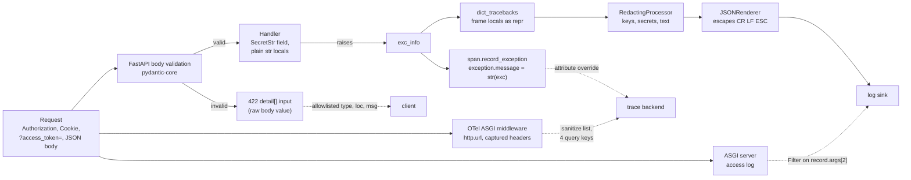

# Preventing Secret and PII Leakage in Logs, Trace Attributes, and Error Payloads: Pydantic SecretStr and structlog Redaction Processors

> [!summary] Claim
> `SecretStr` only protects a value while it stays wrapped, and in a stock FastAPI 0.162.0 plus structlog 26.1.0 plus OpenTelemetry stack the raw value escapes through at least four doors that never call its `__repr__` (the default `422` body's `input` member, `dict_tracebacks` frame locals, `record_exception`'s `str(exc)`, and the access-log query string), so the fix is one redaction processor placed after the exception renderer, an allowlisted error schema, and an attribute override at every span sink, each proven by a test that first shows the leak.

Part of [API Authorization and OWASP Security](README.md) in [API Engineering](../README.md).

## TL;DR

Mechanism: `SecretStr` masks only `repr`, `str`, and JSON-mode serialization (`'**********'`), so every path that reads the raw input before validation, or reads a plain `str` local, bypasses it; a structlog processor that deep-copies the event dict, redacts by normalised key name, and scrubs free text closes the log path when it runs after `dict_tracebacks` and before the renderer.
Contract rule: bearer tokens "SHOULD NOT be passed in page URLs" because they get logged `(RFC 6750 Section 5.3)`, and the OWASP Logging Cheat Sheet lists access tokens, session identifiers, passwords, and connection strings as data that should be "removed, masked, sanitized, hashed, or encrypted" before it reaches a log.
Trap: `ConfigDict(hide_input_in_errors=True)` masks `str(ValidationError)` but not `errors()` or `json()`, and FastAPI builds its default `422` body from `exc.errors()`, so a too-short password comes back verbatim, and a missing `username` echoes the whole body including the password; the lab proves both.
Portability: the 28-test lab passes unchanged on CPython 3.12.13, 3.13.18, 3.14.6, 3.14.10, 3.15.2, and free-threaded 3.15.0b3 (GIL off); the leak surface differs by server, because Uvicorn 0.54.0 logs the query string by default while Hypercorn 0.18.0 and Granian 2.8.7 default formats log only the path.
When not to use it: text scrubbing is a backstop, not a control; for request and response bodies, log an allowlist of fields you chose, never "everything minus a denylist", and do not run a regex scrubber over attacker-sized strings without a length cap (the lab measured a quadratic pattern at 96 ms for 8000 characters).

## Mental model



A request carries secrets in three places that different components read independently: headers (read by the OTel middleware when header capture is on), the target URI (read by the server's access logger and by the OTel `http.url` builder), and the body (read by FastAPI's validator).
Validation failure sends the raw input straight into the `422` body without ever constructing a `SecretStr`, which is why the wrapper cannot help there.
A handler exception travels two ways: into structlog, where `dict_tracebacks` turns it into frames whose locals are `repr` strings and the redacting processor must run after that expansion, and into the span, where the SDK copies `str(exc)` and the full formatted traceback into event attributes unless the caller overrides them.
Dotted arrows are the controls this note builds; every solid arrow is a default path that leaks in the lab.

## How it works

### What `SecretStr` actually guarantees

`SecretStr` stores the raw value in `self._secret_value` and returns it from `get_secret_value()` `(pydantic 2.14.3 pydantic/types.py, _SecretBase)`.
`__str__` and `__repr__` both go through `_display()`, which returns `'**********'` for a non-empty value and `''` for an empty one `(pydantic 2.14.3 pydantic/types.py, _secret_display)`, so a log line still reveals whether a secret was empty.
Serialization is a plain function serializer with `when_used='unless-none'` on fields: in JSON mode it returns the mask, in Python mode it returns the `SecretStr` object itself `(pydantic 2.14.3 pydantic/types.py, _serialize_secret_field)`.
That is why `model_dump()` yields `{'password': SecretStr('**********')}` and `model_dump_json()` yields `"**********"`, both asserted in `test_secretstr_masks_repr_str_and_json_but_python_dump_keeps_the_object`.
Equality returns `False` for anything that is not a `SecretStr` and otherwise compares UTF-8 bytes with `secrets.compare_digest` `(pydantic 2.14.3 pydantic/types.py, SecretStr.__eq__)`, while `__hash__` is `hash()` of the raw value `(pydantic 2.14.3 pydantic/types.py, SecretStr.__hash__)`.
So `SecretStr("a") == "a"` is `False` and `{SecretStr("a"): 1}.get("a")` is `None`, even though `hash(SecretStr("a")) == hash("a")` is `True` (checked in the lab environment on CPython 3.14.6); a set of `SecretStr` values leaks nothing through `repr`, but its hashes are the raw strings' hashes.
The JSON schema marks the field `writeOnly: true, format: password` `(pydantic 2.14.3 pydantic/types.py, _SecretField.__get_pydantic_core_schema__)`, which documents intent to clients but enforces nothing on the server.
The wrapper therefore protects exactly one thing: code that renders the validated object.
It does nothing for the raw input before validation, for copies made with `get_secret_value()`, for `Field(min_length=12)` failures (the error's `msg` is the generic `Value should have at least 12 items after validation, not 7`, but `input` is the raw string), or for any other variable that happens to hold the same bytes.

### Validation errors: `hide_input_in_errors` is display-only

pydantic documents `hide_input_in_errors` as "Whether to hide inputs when printing errors" `(pydantic 2.14.3 pydantic/config.py, ConfigDict.hide_input_in_errors)`, and that word "printing" is exact.
The lab model sets it and the test shows the split: `str(exc)` drops `input_value=...`, while `exc.errors()[0]["input"] == "hunter2"` and `exc.json()` still contains `hunter2`; only `exc.errors(include_input=False)` removes the member.
FastAPI 0.162.0 validates the body through a `TypeAdapter` and collects `exc.errors(include_url=False)`, keeping `input` `(fastapi 0.162.0 fastapi/_compat/v2.py, ModelField.validate)`.
The default handler then returns `JSONResponse(status_code=422, content={"detail": jsonable_encoder(exc.errors())})` `(fastapi 0.162.0 fastapi/exception_handlers.py, request_validation_exception_handler)`.
Two consequences follow, both asserted in `test_default_422_echoes_password_despite_secretstr_and_hide_input`.
A too-short password returns `"input": "hunter2"`, because the length check fails before a `SecretStr` exists.
A request missing `username` returns a `missing` error whose `input` is the entire object, `{"password": "correct-horse-battery"}`, because the error location is the parent model and its input is the whole dict.
`RequestValidationError.__str__` formats every error dict with `f"  {err}\n"` `(fastapi 0.162.0 fastapi/exceptions.py, ValidationException.__str__)`, so `logger.exception(exc)` or an APM that records `str(exc)` writes the same raw input into logs and spans.
The exception also keeps the raw body as `exc.body`, and for malformed JSON FastAPI sets `body=e.doc`, the undecoded document `(fastapi 0.162.0 fastapi/routing.py, get_request_handler)`.
The fix is an allowlist, not a scrub: `redacted_validation_errors` keeps `type`, `loc`, and `msg` and drops `input` and `ctx` (`ctx` can carry the original `ValueError` text a custom validator wrote, which often interpolates the value).
The response keeps its diagnostic value because `loc` names the field and `msg` names the rule; the client already knows what it sent.
How that body maps onto RFC 9457 Problem Details is the topic of [[Mapping-Pydantic-Validation-Errors-to-RFC-9457-Problem-Details]].

### structlog exceptions: locals are on by default in the dict path

`structlog.processors.dict_tracebacks` is `ExceptionRenderer(ExceptionDictTransformer())` `(structlog 26.1.0 src/structlog/processors.py, dict_tracebacks)`.
`ExceptionDictTransformer.__init__` defaults `show_locals` to the module constant `SHOW_LOCALS = True`, while the lower-level `extract()` function defaults `show_locals=False` `(structlog 26.1.0 src/structlog/tracebacks.py, ExceptionDictTransformer and extract)`; the structured-JSON processor most production configs copy from the docs is the one with locals on.
For each frame, `extract()` walks `frame_summary.f_locals.items()` and stores `to_repr(value, max_length=10, max_string=80)` per variable, skipping names that start with `__` by default (`locals_hide_dunder=True`) but not single-underscore names (`locals_hide_sunder=False`).
`to_repr` deliberately calls `repr()` even on strings "so that secret wrappers that inherit from str and overwrite `__repr__()` are handled correctly" `(structlog 26.1.0 src/structlog/tracebacks.py, to_repr)`, which is why a `SecretStr` local renders as `SecretStr('**********')` and a plain `str` local renders as its quoted value.
With `rich` installed (15.0.0 in this lock), `to_repr` uses `rich.pretty.traverse(...).render()`; a string longer than 80 characters is cut and suffixed `+N`, the number of dropped characters, which the lab asserts.
The rendered exception is a list of stack dicts with keys `exc_type`, `exc_value`, `exc_notes`, `syntax_error`, `is_cause`, `frames`, `is_group`, and `exceptions`, so a secret can arrive through `exc_value` (`str(exc)`), through `exc_notes` (anything passed to `add_note`), through `frames[].locals`, and through nested `exceptions` for an `ExceptionGroup`.
The redacting processor sees all of it only if it runs after `dict_tracebacks`; placed before, it sees an opaque `exc_info=True` and the expansion happens afterwards, unredacted, which `test_redaction_before_dict_tracebacks_lets_locals_escape` proves.
`format_exc_info` (the string traceback) calls `traceback.print_exception` with no locals `(structlog 26.1.0 src/structlog/_frames.py, _format_exception)`, so switching renderers removes the locals door but keeps `str(exc)`.
`ExceptionDictTransformer(show_locals=False)` closes the locals door at the source and is the right default for production; the processor in this note still has to handle `exc_value`, context variables, and ordinary event keys.

### The redacting processor

A structlog processor is a callable `(logger, method_name, event_dict) -> event_dict`, and the chain runs in list order with the last one rendering.
The lab's `RedactingProcessor` calls `redact_value`, which returns a new structure and never mutates the caller's objects, because event values are often the caller's live request dicts (`test_redaction_returns_a_copy_and_never_mutates_the_callers_dict`).
Three rules apply in order of precedence.
First, a value under a sensitive key is replaced wholesale; the key is normalised by lower-casing, mapping `-` to `_`, and keeping the last dotted segment, so `Set-Cookie`, `X-API-Key`, and the OTel-style `http.request.header.authorization` all match.
Second, `SecretStr`, `SecretBytes`, and `Secret` become `[REDACTED]`, and a `BaseModel` is walked as `model_dump(mode="json")`, so masked secrets stay masked and plain `api_key: str` fields are caught by the key rule.
Third, an exact `str` is passed through `scrub_text`; a `str` subclass is rendered through `repr` instead, mirroring structlog's own reasoning, and anything unknown is rendered through a `repr` that cannot raise.
Failure is closed: if the walk raises, the processor returns `{"event": "log_redaction_failed", "error_type": ...}` and drops the original event.
That trades a lost log line for a guaranteed non-leak, and the error type makes the drop visible to whoever alerts on it.

Simplified excerpt of the key rule:

```python
def normalize_key(key: str) -> str:
    return key.lower().replace("-", "_").rsplit(".", 1)[-1]


def is_sensitive_key(key: str) -> bool:
    name = normalize_key(key)
    return name in SENSITIVE_KEYS or name.endswith(SENSITIVE_SUFFIXES)
```

The walker, copied from the lab:

```python
def redact_value(value: object, depth: int = 0) -> object:
    """Return a redacted deep copy; never mutates the caller's objects."""
    if depth > MAX_DEPTH:
        return "[MAX_DEPTH]"
    if value is None or isinstance(value, bool | int | float):
        return value
    if isinstance(value, SecretStr | SecretBytes | Secret):
        return REDACTED
    if type(value) is str:
        # Exact type only: a str subclass may mask itself in __repr__ (see the last line).
        return scrub_text(value)
    if isinstance(value, bytes | bytearray):
        return scrub_text(bytes(value).decode("utf-8", "replace"))
    if isinstance(value, BaseModel):
        # mode="json" turns SecretStr into "**********"; key rules then cover plain str fields.
        return redact_value(value.model_dump(mode="json"), depth + 1)
    if isinstance(value, Mapping):
        out: dict[str, object] = {}
        for raw_key, item in cast("Mapping[object, object]", value).items():
            key = str(raw_key)
            out[key] = REDACTED if is_sensitive_key(key) else redact_value(item, depth + 1)
        return out
    if isinstance(value, list | tuple | set | frozenset):
        return [redact_value(item, depth + 1) for item in cast("Iterable[object]", value)]
    if isinstance(value, BaseException):
        return scrub_text(f"{type(value).__name__}: {value}")
    return scrub_text(_safe_repr(value))
```

### Free-text scrubbing and why it is only a backstop

`scrub_text` applies five patterns, each with a named source for its shape.
`Bearer` and `Basic` credentials follow the `b64token` grammar, `1*( ALPHA / DIGIT / "-" / "." / "_" / "~" / "+" / "/" ) *"="` `(RFC 6750 Section 2.1)`.
A JWS compact serialization is `BASE64URL(UTF8(JWS Protected Header)) || '.' || BASE64URL(JWS Payload) || '.' || BASE64URL(JWS Signature)` `(RFC 7515 Section 7.1)`, and a protected header serialized with no whitespace after the opening brace begins `{"`, so its base64url encoding begins `eyJ`.
JSON permits that whitespace, so a header written as `{ "alg"` encodes as `eyAi...` and evades an `eyJ` prefix pattern; the prefix rule catches what common JOSE libraries emit, not every valid JWS.
URL userinfo is redacted because "Use of the format "user:password" in the userinfo field is deprecated" and applications "should not render as clear text any data after the first colon" `(RFC 3986 Section 3.2.1)`.
`name=value` pairs and quoted `'name': 'value'` pairs cover query strings and the `repr` of dicts, which is how `dict_tracebacks` shows a request body held in a local.

```python
def scrub_text(text: str) -> str:
    """Pattern-based scrubbing for free text; a backstop, never the primary control."""
    if len(text) > MAX_SCRUB_CHARS:
        # Bound the cost of attacker-sized strings; the dropped tail is never emitted.
        text = f"{text[:MAX_SCRUB_CHARS]}...[TRUNCATED {len(text) - MAX_SCRUB_CHARS} chars]"
    text = _AUTH_SCHEME.sub(lambda m: f"{m.group(1)} {REDACTED}", text)
    text = JWT_PREFIX.sub(REDACTED_JWT, text)
    text = _URL_USERINFO.sub(lambda m: f"{m.group(1)}{REDACTED}@", text)
    text = _KV_PAIR.sub(lambda m: f"{m.group(1)}={REDACTED}", text)
    return _QUOTED_PAIR.sub(
        lambda m: (
            f"{m.group(1)}{m.group(2)}{m.group(1)}{m.group(3)}{m.group(4)}{REDACTED}{m.group(4)}"
        ),
        text,
    )
```

Truncation is the reason the JWT pattern is a prefix pattern.
structlog cuts a local after 80 characters, and the lab JWT (a 20-character header and a 79-character payload) is cut 59 characters into segment two, so a strict three-segment regex finds nothing and the header plus most of the claims leak; `test_truncated_jwt_in_a_local_evades_strict_regex_but_not_prefix_regex` asserts `JWT_STRICT.search(rendered) is None` and `JWT_PREFIX.search(rendered) is not None` on the same rendered local.
This is the same class of bug the Snowflake connector shipped: before 3.12.3 its `SecretDetector` logging formatter "contained bugs which caused it to not fully redact JWT tokens and certain private key formats" `(CVE-2024-49750)`.
Encoding is the second hole.
`scrub_text("/cb?access%5Ftoken=tok-abc")` returns its input unchanged because the regex never sees the literal `access_token`, so the access-log filter decodes names with `parse_qsl` before matching (`test_access_log_filter_redacts_query_values_including_percent_encoded_names`).
Semantics is the third and unfixable hole: `str(RequestValidationError)` prints `'loc': ('body', 'password'), 'input': 'hunter2'`, and no pattern can know that this particular `input` was a password without parsing the structure; the lab asserts the scrubber leaves it in place, which is the argument for logging structured `exc.errors(include_input=False)` instead of `str(exc)`.
Cost is the fourth.
The first version of the userinfo pattern started with `\b`, and on `"a." * 4000` every letter is a word boundary, so the engine restarted a scan to the end of the scheme run at each one; the lab probe measured 23.802 ms at 4000 characters and 95.832 ms at 8000, so doubling the input quadrupled the time, which is quadratic.
A negative lookbehind `(?<![a-z0-9+.-])` lets a match start only at the first character of a scheme run and measured 0.064 ms and 0.124 ms on the same inputs, and `MAX_SCRUB_CHARS = 8192` bounds every call; the denial-of-service side of regexes is covered in [[Unrestricted-Resource-Consumption-API4-2023-Payload-Depth-and-Limit-Guards]].

### The access log

Uvicorn 0.54.0 logs `'%s - "%s %s HTTP/%s" %d'` with the arguments `(client_addr, method, get_path_with_query_string(scope), http_version, status)` `(uvicorn 0.54.0 uvicorn/protocols/http/h11_impl.py, RequestResponseCycle.send)`, and `get_path_with_query_string` appends `scope["query_string"].decode("ascii")` raw `(uvicorn 0.54.0 uvicorn/protocols/utils.py, get_path_with_query_string)`.
Any `?access_token=` therefore reaches the `uvicorn.access` logger, which is exactly the risk RFC 6750 Section 2.3 names when it says the query method "SHOULD NOT be used" because of "the high likelihood that the URL containing the access token will be logged".
RFC 9110 makes the general point: "Many servers, proxies, and user agents log or display the target URI in places where it might be visible to third parties" `(RFC 9110 Section 17.9)`.
`AccessLogQueryRedactor` is a `logging.Filter` that rewrites `record.args[2]` in place before formatting, so it works with Uvicorn's own `AccessFormatter` and with a structlog `ProcessorFormatter` alike.
Hypercorn 0.18.0's default `access_log_format` uses `%(r)s`, built as `f"{method} {request['path']} {protocol}"` without the query, but it also logs `%(f)s` (the `Referer` header, which can carry another site's tokenized URL) and `%(a)s` (`User-Agent`); the query-bearing atoms `R`, `Uq`, and `q` exist for custom formats, and `accesslog` defaults to `None` `(hypercorn 0.18.0 hypercorn/config.py and hypercorn/logging.py, AccessLogAtoms)`.
Granian 2.8.7's default `'[%(time)s] %(addr)s - "%(method)s %(path)s %(protocol)s" %(status)d %(dt_ms).3f'` omits the query, passes a dict rather than a tuple as `args`, and its access log is off unless `--access-log` is given `(granian 2.8.7 granian/log.py, DEFAULT_ACCESSLOG_FMT)` `(granian 2.8.7 granian/cli.py, --access-log/--no-access-log option, default=False)`; the lab's tuple filter does not apply there.

### Trace attributes

The OpenTelemetry semantic conventions say `url.full` "MUST NOT contain credentials passed via URL" and that query values for `X-Amz-Signature`, `X-Amz-Credential`, `X-Amz-Security-Token`, `AWSAccessKeyId`, `Signature`, `sig`, and `X-Goog-Signature` "SHOULD be redacted by default", with that key list marked Development (OTel semantic-conventions `url` registry, as of 2026-11).
`opentelemetry-util-http` 0.66b2 implements four of those seven, `PARAMS_TO_REDACT = ["AWSAccessKeyId", "Signature", "sig", "X-Goog-Signature"]`, plus `remove_url_credentials`, combined in `redact_url` `(opentelemetry-util-http 0.66b2 src/opentelemetry/util/http/__init__.py, redact_url)`.
The ASGI middleware applies `redact_url` only to the legacy `http.url` attribute; under the stable conventions (`OTEL_SEMCONV_STABILITY_OPT_IN=http`) it sets `url.query` from the raw query string with no redaction `(opentelemetry-instrumentation 0.66b2 opentelemetry/instrumentation/_semconv.py, _set_http_target)`, although the same registry says the seven keys above SHOULD be redacted in `url.query` too; this note read that path in source but the lab does not exercise it.
In the default mode the lab records `http.url == "http://test/items?access_token=tok-abc&sig=REDACTED"`: the scheme redacts the AWS-style `sig` and keeps the OAuth token.
Header capture is opt-in through `http_capture_headers_server_request` or `OTEL_INSTRUMENTATION_HTTP_CAPTURE_HEADERS_SERVER_REQUEST`, matched with `fullmatch`, and values are replaced with `[REDACTED]` only when the header name `search`-matches a regex in the sanitize list `(opentelemetry-util-http 0.66b2 src/opentelemetry/util/http/__init__.py, SanitizeValue.sanitize_header_values)`; the lab captures `authorization` and `cookie`, sanitizes only `authorization`, and gets the cookie back verbatim.
The SDK's `record_exception` builds `exception.message` from `str(exception)` and `exception.stacktrace` from `traceback.format_exception(exception)`, then calls `_attributes.update(attributes)` with whatever the caller passed `(opentelemetry-sdk 1.45.2 opentelemetry/sdk/trace/__init__.py, Span.record_exception)`.
That update order is the hook: `record_exception_redacted` passes scrubbed values for both keys and they replace the defaults.
The ASGI middleware itself calls `span.record_exception(exc)` on failures inside user hooks, so instrumented code paths you do not own still produce the default attributes; the durable fix there is a redaction stage in the collector or exporter, not in application code.
Span attributes are immutable once the span ends, because `end()` sets the attribute container's `_immutable` flag and `ReadableSpan.attributes` returns a `MappingProxyType` `(opentelemetry-sdk 1.45.2 opentelemetry/sdk/trace/__init__.py, Span.end and ReadableSpan.attributes)`, so a Python `SpanProcessor.on_end` cannot rewrite them through the public API; redaction must happen at `set_attribute` time, at `record_exception` time, or downstream of the SDK.
Propagated context is a separate door: anything placed in W3C baggage is sent to every downstream service, which is why identifiers belong there and secrets never do ([[Distributed-Tracing-W3C-Trace-Context-and-Baggage-Propagation]]).

### Error payloads beyond `422`

Starlette's `ServerErrorMiddleware` returns `PlainTextResponse("Internal Server Error", status_code=500)` unless `debug=True`, in which case it returns the formatted traceback as text, or HTML with source context for an `Accept: text/html` request, and the HTML builder calls `traceback.TracebackException.from_exception(exc, capture_locals=True)` `(starlette 1.10.0 starlette/middleware/errors.py, ServerErrorMiddleware.generate_html)`.
The HTML page renders the exception message and source lines rather than the captured locals, but both the message and the code are OWASP "Data to exclude" items, and `capture_locals=True` still calls `repr` on every local of every frame.
OWASP API8:2023 lists "Error messages include stack traces, or expose other sensitive information" as a security misconfiguration, and CWE-209 names the class: "The product generates an error message that includes sensitive information about its environment, users, or associated data."
The exception hierarchy that decides which handler runs is in [[Starlette-Exception-Hierarchy-ServerErrorMiddleware-vs-ExceptionMiddleware]].

### Log injection is the other half of log integrity

CWE-117 covers log messages built from external input without neutralization, and the OWASP Logging Cheat Sheet says "Parameterized logging alone does not prevent CR/LF log injection; use a structured encoder that escapes values correctly".
`JSONRenderer` defaults to `json.dumps` with `_json_fallback_handler`, which tries `obj.__structlog__()` and falls back to `repr(obj)` `(structlog 26.1.0 src/structlog/processors.py, _json_fallback_handler)`; `json.dumps` escapes control characters, so a value of `"alice\r\n{...}\x1b[2J"` stays on one line and the terminal escape is inert (`test_json_renderer_escapes_crlf_and_ansi_injection`).
Uvicorn has history here: CVE-2020-7694 records that its request logger applied `urllib.parse.unquote` before logging, so percent-encoded ANSI escape sequences in a URL reached the terminal.
The OTel ASGI middleware still applies `urllib.parse.unquote` to the query string before building `http.url` `(opentelemetry-instrumentation-asgi 0.66b2 src/opentelemetry/instrumentation/asgi/__init__.py, collect_request_attributes)`, so the trace backend's UI, not the SDK, must escape what it displays.

## Numbers and limits

| Quantity | Value | Source |
|---|---|---|
| `SecretStr` display, non-empty / empty | `'**********'` (10 chars) / `''` | pydantic 2.14.3 `pydantic/types.py`, `_secret_display` |
| `dict_tracebacks` locals default | on (`SHOW_LOCALS = True`) | structlog 26.1.0 `tracebacks.py` |
| Local string cut / container cut | 80 chars / 10 items | structlog 26.1.0 `LOCALS_MAX_STRING`, `LOCALS_MAX_LENGTH` |
| Frames kept per stack | 50 (`MAX_FRAMES`), middle elided | structlog 26.1.0 `tracebacks.py` |
| OTel query keys redacted by util-http | 4 | opentelemetry-util-http 0.66b2 `PARAMS_TO_REDACT` |
| OTel query keys listed by semconv | 7 | semantic-conventions `url` registry (as of 2026-11) |
| Span attribute / event count limit | 128 / 128 | opentelemetry-sdk 1.45.2 `_DEFAULT_OTEL_SPAN_ATTRIBUTE_COUNT_LIMIT`, `_DEFAULT_OTEL_SPAN_EVENT_COUNT_LIMIT` |
| Default `422` members per error | `type`, `loc`, `msg`, `input`, `ctx` when present | fastapi 0.162.0, lab assertion |
| Lab `MAX_SCRUB_CHARS` / `MAX_DEPTH` | 8192 / 10 | lab design choice |
| `info` event, no redaction / with redaction | 3.23 us / 10.20 us | measured, below |
| Error event with `dict_tracebacks`, no redaction / with | 49.91 us / 150.27 us | measured, below |
| `scrub_text`, 8000 plain chars / 8000 adversarial | 0.288 ms / 0.912 ms | measured, below |
| Userinfo regex with `\b`, 4000 / 8000 chars of `a.` | 23.802 ms / 95.832 ms | measured, below |
| Userinfo regex with lookbehind, 4000 / 8000 chars | 0.064 ms / 0.124 ms | measured, below |

Measured values come from one run of a `timeit` probe (best of 5 repeats for events and `scrub_text`, best of 3 for the two regexes) run by the verifier as a throwaway script (`uv run --frozen python ../tmp/probe.py` from `labs/`, deleted afterwards) on 2026-11-21, CPython 3.14.6, macOS 27.3 arm64 (`uname -r` = `27.3.0`), Apple M3 Pro, with the `ReturnLogger` sink, so they exclude I/O.
The `info` event is `log.info("request", user="alice", route="/x")` through `unredacted_processors()` and `safe_processors()`; the error event raises from a handler with the lab's four locals and logs `exc_info=True` one frame up; the plain text is `"x" * 8000` and the adversarial text is `"a." * 4000`.
The redaction processor roughly triples the cost of a small `info` event and adds about 100 us to an error event whose two frames carry locals; at 1000 error events per second that is about 0.1 CPU-seconds per second, which argues for `show_locals=False` in production more than it argues against redaction.

## Portability

| Dimension | Result | Evidence |
|---|---|---|
| CPython 3.12.13 | 28 passed | lab, locked env via `uv run --frozen --python 3.12.13` (3.12.16 is not installed here) |
| CPython 3.13.18 | 28 passed | lab, locked env |
| CPython 3.14.6 | 28 passed | lab, workspace `.venv` |
| CPython 3.14.10 | 28 passed | lab, locked env |
| CPython 3.15.2 | 28 passed | lab, locked env |
| CPython 3.15t free-threaded | 28 passed on 3.15.0b3, `sys._is_gil_enabled()` is `False` after import | lab, minimal venv pinned to the lock (the full lock has no `psycopg-binary` wheel for 3.15t) |
| `ExceptionGroup` frames | walked on every version above | lab; `ExceptionGroup` is built in since 3.11 |
| structlog without `rich` | same `'...'+N` cut format in the fallback branch | structlog 26.1.0 `to_repr` source; the lab ran only with `rich` 15.0.0 |
| `hide_input_in_errors` | masks `str` only | pydantic 2.14.3, lab |
| FastAPI default `422` | includes `input` | fastapi 0.162.0, lab |
| OTel legacy `http.url` vs stable `url.query` | `redact_url` applied / raw query | opentelemetry-instrumentation-asgi 0.66b2 source; only legacy is exercised by the lab |
| Uvicorn 0.54.0 access log | query string included, on by default | `h11_impl.py`, `config.py` (`access_log: bool = True`) |
| Hypercorn 0.18.0 access log | path only in default format, off by default | `config.py`, `logging.py` |
| Granian 2.8.7 access log | path only in default format, off by default | `log.py`, `cli.py` |
| HTTP/1.1 vs HTTP/2 vs HTTP/3 | no difference at the application layer: secrets reach the app as ASGI `headers`, `query_string`, and body bytes on every version | ASGI scope; protocol-level header compression is out of scope here |

## Worked example

The [implementation](../labs/src/api_labs/f15_api_authorization_and_owasp_security/log_redaction.py) has four layers, one per leak door, and the [test](../labs/tests/f15_api_authorization_and_owasp_security/test_structured_log_redaction_and_preventing_pii_and_token_leaks.py) pairs each with a test that first shows the leak.

The processor and the safe pipeline, copied from the lab:

```python
class RedactingProcessor:
    """structlog processor; place it after ``dict_tracebacks`` and before the renderer."""

    def __call__(self, logger: WrappedLogger, method_name: str, event_dict: EventDict) -> EventDict:
        try:
            redacted = redact_value(event_dict)
        except Exception as exc:
            # Fail closed: drop the whole event rather than emit it unredacted.
            return {"event": "log_redaction_failed", "error_type": type(exc).__name__}
        assert isinstance(redacted, dict)  # noqa: S101 - a Mapping always maps to a dict
        return redacted  # pyright: ignore[reportUnknownVariableType]


def safe_processors() -> list[Processor]:
    return [
        structlog.contextvars.merge_contextvars,
        structlog.processors.add_log_level,
        structlog.processors.dict_tracebacks,
        RedactingProcessor(),
        structlog.processors.JSONRenderer(sort_keys=True),
    ]
```

The truncation test, copied from the lab:

```python
@pytest.mark.unit
def test_truncated_jwt_in_a_local_evades_strict_regex_but_not_prefix_regex() -> None:
    rendered = frame_locals(render_error(unredacted_processors()))["token"]
    assert rendered.endswith("'+" + str(len(JWT) - 80))
    assert JWT_STRICT.search(rendered) is None
    assert JWT_PREFIX.search(rendered) is not None
    assert scrub_text(rendered) == "'[REDACTED_JWT]'+" + str(len(JWT) - 80)
```

The `422` leak, copied from the lab:

```python
@pytest.mark.unit
@pytest.mark.asyncio
async def test_default_422_echoes_password_despite_secretstr_and_hide_input() -> None:
    short = await post_login(False, {"username": "alice", "password": "hunter2"})
    assert short.status_code == 422
    assert short.json()["detail"][0]["input"] == "hunter2"
    missing = await post_login(False, {"password": "correct-horse-battery"})
    assert missing.json()["detail"][0]["type"] == "missing"
    assert missing.json()["detail"][0]["input"] == {"password": "correct-horse-battery"}
```

The trace-attribute gap, copied from the lab:

```python
@pytest.mark.unit
@pytest.mark.asyncio
async def test_asgi_instrumentation_redacts_sig_but_keeps_access_token_in_http_url() -> None:
    attrs = await traced_request("/items?access_token=tok-abc&sig=s-abc", {}, [])
    assert attrs["http.url"] == "http://test/items?access_token=tok-abc&sig=REDACTED"
```

Output captured by the verifier from `labs/` on 2026-11-21, CPython 3.14.6, macOS 27.3 arm64:

```text
$ uv run --frozen pytest tests/f15_api_authorization_and_owasp_security/test_structured_log_redaction_and_preventing_pii_and_token_leaks.py -q -p no:cacheprovider
............................                                             [100%]
28 passed in 0.86s
```

What a safe error line looks like for the lab's failing handler, with the frame trimmed to the `locals` member (simplified excerpt: the `locals` member from one real run of the safe pipeline, reformatted; the test asserts the first three values):

```json
{"locals": {"password": "[REDACTED]",
            "body": "{'username': 'alice', 'password': '[REDACTED]'}",
            "token": "[REDACTED]",
            "secret": "[REDACTED]"}}
```

`token` is replaced by the key rule before the JWT pattern runs, and `secret` is replaced by the key rule even though its rendered value was already the mask.

## Pitfalls

> [!warning] Passwords logged before hashing
> Trigger: a request logger or debug log that records the login body before the password is hashed.
> Symptom: Meta reported on 2019-03-21 that "some user passwords were being stored in a readable format within our internal data storage systems", estimating it would notify hundreds of millions of Facebook Lite users, tens of millions of other Facebook users, and tens of thousands of Instagram users; a 2019-04-18 update reported "additional logs of Instagram passwords being stored in a readable format" and raised the Instagram estimate to millions.
> Fix: never log request bodies by default; log an allowlist of fields per route, type password fields as `SecretStr`, and run the redacting processor as a backstop.

> [!warning] Secrets in crash dumps and debug artifacts
> Trigger: a process snapshot taken at crash time contains key material, and the snapshot moves to a less-protected debugging environment.
> Symptom: Microsoft's 2023-09-06 investigation of Storm-0558 stated that "a race condition allowed the key to be present in the crash dump" and that "The key material's presence in the crash dump was not detected by our systems"; a 2024-03-12 addendum says "we have not found a crash dump containing the impacted key material" and that the race condition "did not impact whether the key could be present in the crash dump, but rather whether the crash dump could be removed from the secure token signing environment", so treat the specific path as a hypothesis the company later qualified.
> Fix: `show_locals=False` in production structlog, no `capture_locals` in production error pages, and secret scanning on every artifact that leaves production, including dumps and HAR files.

> [!warning] Session tokens in support uploads
> Trigger: customers upload HTTP Archive files for troubleshooting, and HAR files contain request headers and cookies.
> Symptom: Okta's 2023-11 root-cause analysis says that between 2023-09-28 and 2023-10-17 an attacker accessed files of 134 customers, that "Some of these files were HAR files that contained session tokens", and that those tokens were used "to hijack the legitimate Okta sessions of 5 customers".
> Fix: sanitize diagnostic artifacts before storage, and treat any system that stores raw HTTP exchanges as a credential store.

> [!warning] Regex redaction that misses truncated or reformatted tokens
> Trigger: a formatter that matches complete token shapes only.
> Symptom: CVE-2024-49750, Snowflake Connector for Python before 3.12.3, logged Duo passcodes and Azure SAS tokens at `DEBUG`, and its `SecretDetector` formatter did not fully redact JWT tokens and some private key formats.
> Fix: match prefixes, decode before matching, cap input length, and prefer key-based redaction on structured data so the regex is the second line.

> [!warning] `hide_input_in_errors` treated as a privacy control
> Trigger: setting the config flag and assuming the `422` body is now clean.
> Symptom: the lab's default app returns `"input": "hunter2"` and, for a missing field, the whole body.
> Fix: register a `RequestValidationError` handler that emits only `type`, `loc`, and `msg`, and log `exc.errors(include_input=False)`, never `str(exc)`.

> [!warning] Redaction placed before the exception renderer
> Trigger: a processor list with the redactor near the top, "so everything after it is clean".
> Symptom: `dict_tracebacks` expands `exc_info` after the redactor ran, and frame locals are emitted verbatim (`test_redaction_before_dict_tracebacks_lets_locals_escape`).
> Fix: renderers last, redactor immediately before them, and a test that logs a real exception with a plain-`str` secret local.

> [!warning] Denylisted header capture
> Trigger: `OTEL_INSTRUMENTATION_HTTP_CAPTURE_HEADERS_SERVER_REQUEST=".*"` with a sanitize list naming only `authorization`.
> Symptom: `Cookie`, `X-API-Key`, and `Proxy-Authorization` reach the trace backend in clear text; the lab shows the cookie case.
> Fix: capture an explicit list of non-sensitive headers, and keep the sanitize list as a second line.

> [!warning] Log injection through access logs
> Trigger: a server or formatter that decodes percent-encoding before writing a human-readable line.
> Symptom: CVE-2020-7694, all Uvicorn versions at the time, allowed ANSI escape sequences in crafted URLs to reach the console or log file after `urllib.parse.unquote`.
> Fix: structured JSON logs (the encoder escapes control characters), and never render decoded URLs to a terminal.

## Security and robustness

The threat model has three attacker positions.
An outsider who receives an error payload learns whatever the `422` or `500` body echoes, which for the default FastAPI app includes another user's input only if a proxy or cache mixes responses, but always includes the caller's own input; the real risk is the body landing in browser-side telemetry, support tickets, and HAR files.
An insider or a compromised log pipeline reads everything the application logged, which is why OWASP lists access tokens, session identifiers, passwords, and connection strings as data to exclude, and why CWE-532 exists as its own weakness.
A third party that hosts logs or traces (an APM vendor, a SIEM) becomes a holder of every secret the application emitted, with its own retention and its own breach surface.
Map to OWASP API Security 2023: API8 (Security Misconfiguration) covers verbose errors and debug mode, API2 (Broken Authentication) is the consequence when a leaked bearer token or session cookie is replayed, and API3 (BOPLA) is the response-side twin of this note, because a response model that includes a secret field leaks it to the client rather than to the log ([[Defeating-BOPLA-and-Mass-Assignment-API3-2023-Strict-Input-Output-Schemas]]).
Defense in depth, in order of strength:
1. Do not receive what you cannot log: bearer tokens in `Authorization`, never in the query (RFC 6750 Section 5.3), and short-lived tokens so a leaked one expires.
2. Type secrets: `SecretStr` on every inbound password, client secret, and API key, and on configuration ([[Pydantic-Settings-Environment-Secret-Files-and-Source-Priority]]).
3. Allowlist what leaves: response models, `422` bodies, captured headers, and per-route log fields are chosen, not filtered.
4. Redact at the last processor before each sink: the structlog processor, the access-log filter, and the span attribute override.
5. Scrub downstream: a collector or SIEM stage catches what instrumented libraries you do not own emit.
6. Detect: run a canary secret through staging and alert if it ever appears in a log index or trace backend.
Robustness of the redactor itself matters as much: it must not mutate caller state, must not raise into the logging call, must bound its CPU per event, and must fail closed when it cannot finish; the lab tests each of those four.
Retention is the last control: a secret that does leak should age out quickly, and the log store should be access-controlled like the systems the secret unlocks ([[Audit-Logging-for-Regulated-APIs-Tamper-Evident-Hash-Chains-and-Who-Did-What]] covers the logs that must instead be kept).

## The principal's view

The architectural decision is where redaction is owned: in each service's logging configuration, in a shared library, or in the telemetry pipeline.
Per-service configuration drifts within months, because every team copies the structlog example and the example has `dict_tracebacks` with locals on.
A shared library (one `configure_logging()` that installs the processor chain, the access-log filter, the safe `422` handler, and a `record_exception` wrapper) makes the safe path the default path, and its test suite is the lab in this note: one test per door that first proves the leak.
The telemetry pipeline is the backstop for code you do not own, but it sees text, not types, so it inherits every limit of regex scrubbing and none of the precision of key-based redaction.
The organizational trade-off is debuggability against exposure.
Engineers want locals and request bodies in error logs because they make incidents shorter; security wants neither.
The resolution that holds up is tiered: production logs carry identifiers (request ID, user ID, tenant ID, route, error type, `loc` of validation errors) and no values, and a break-glass path captures full detail for a single request ID into a short-retention, access-logged store.
Choose differently when the data is regulated so that even identifiers are sensitive (health, payment card data), where the right design is tokenization before the data enters the service, so logs can never contain the raw value; and when you control both ends of a high-volume internal API, where removing logging of bodies entirely is cheaper than redacting them.
A language choice does not change this picture: Go's `slog` `HandlerOptions.ReplaceAttr` is "called to rewrite each non-group attribute before it is logged" (key rules), Logback's `%replace(p){r, t}` conversion word regex-replaces the output of a sub-pattern (last-stage text replacement), and Rust's `secrecy` crate wraps values in `SecretBox` with the stated goal to "Prevent accidental leakage of secrets" (typed secrets) (pkg.go.dev `log/slog`, logback.qos.ch Layouts manual, docs.rs `secrecy`, as of 2026-11).

## Interview questions

> [!question] L5: What exactly does `SecretStr` protect, and what does it not?
>
> > [!success]- Answer
> > It masks the value in `repr`, `str`, and JSON-mode serialization, returning `'**********'` for non-empty and `''` for empty values.
> > `model_dump()` in Python mode returns the `SecretStr` object itself, so a later `get_secret_value()` call can still unwrap it.
> > It does not protect the raw input before validation, error payloads built from that input, plain `str` copies, or anything you unwrap with `get_secret_value()`.
> >
> > Follow-up: why does an empty `SecretStr` still leak one bit of information in logs?

> [!question] L5: Predict the output: for a FastAPI 0.162.0 body model with `model_config = ConfigDict(hide_input_in_errors=True)` and `password: SecretStr = Field(min_length=12)`, what is `response.json()["detail"][0]["input"]` after a client posts `{"username": "alice", "password": "hunter2"}`?
>
> > [!success]- Answer
> > The string `"hunter2"`.
> > `hide_input_in_errors` only affects how `ValidationError` prints; `errors()` still includes `input`.
> > FastAPI's default handler serializes `exc.errors()`, and the length check fails before a `SecretStr` is constructed.
> >
> > Follow-up: what does the same field contain if the client omits `username` instead?

> [!question] L5: Why do OAuth bearer tokens belong in the `Authorization` header rather than a query parameter?
>
> > [!success]- Answer
> > RFC 6750 Section 2.3 says the query method SHOULD NOT be used because of "the high likelihood that the URL containing the access token will be logged".
> > Uvicorn 0.54.0's default access log writes the raw query string, and OTel's legacy `http.url` keeps `access_token` because its redaction list has only four AWS and Google signature keys.
> > Headers are not logged by default by either component.
> >
> > Follow-up: which other header can carry a tokenized URL into an access log even when your own API never accepts query tokens?

> [!question] L6: Debug this API: structured JSON logging uses structlog's documented `dict_tracebacks` processor with a redaction processor at the top of the chain, yet a scan finds plaintext passwords in error logs that no code logged explicitly; what happened?
>
> > [!success]- Answer
> > `dict_tracebacks` uses `ExceptionDictTransformer`, whose `show_locals` defaults to `True`, so every frame's locals are rendered with `repr`, including a plain `str` password variable in the login handler.
> > The redactor ran before `dict_tracebacks` expanded `exc_info`, so it never saw the frames.
> > Fix the order (redactor after the exception renderer, before the renderer), set `show_locals=False` in production, and add a test that logs a real exception with a secret local.
> >
> > Follow-up: why does the same local typed as `SecretStr` not leak, and what does that rely on inside `to_repr`?

> [!question] L6: Your redactor uses a regex for JWTs, so how does a partial JWT still show up in logs?
>
> > [!success]- Answer
> > structlog truncates each local's `repr` at 80 characters and appends `+N`, so a JWT can be cut inside its payload segment.
> > A strict three-segment pattern requires two dots and does not match the cut token, leaving the header and most claims visible.
> > Match the `eyJ` prefix with optional segments, and prefer key-based redaction so the regex is only a backstop.
> >
> > Follow-up: what did CVE-2024-49750 report about the Snowflake connector's `SecretDetector`?

> [!question] L6: With OpenTelemetry header capture on and `OTEL_INSTRUMENTATION_HTTP_CAPTURE_HEADERS_SANITIZE_FIELDS=authorization`, what still leaks, and what would you change?
>
> > [!success]- Answer
> > Any captured header not matched by the sanitize regex, for example `Cookie`, `X-API-Key`, or `Proxy-Authorization`, is recorded verbatim.
> > The capture list is matched with `fullmatch` and the sanitize list with `search`, so it is a denylist over whatever you chose to capture.
> > Capture an explicit allowlist of non-sensitive headers and keep a broad sanitize list such as `authorization,cookie,set-cookie,.*api.?key.*,.*token.*` as the second line.
> >
> > Follow-up: under the stable HTTP semantic conventions, which query attribute does the 0.66b2 ASGI middleware emit without any redaction?

> [!question] L7+: How would you design, place, and prove the organization-wide control for secrets in logs and traces across 200 Python services?
>
> > [!success]- Answer
> > A shared logging package installs the processor chain (exception renderer, then redactor, then JSON renderer), the access-log filter, the safe `422` handler, and a `record_exception` wrapper, so the default path is the safe path.
> > The telemetry pipeline adds a text-based scrubber for code nobody owns, accepting that it is weaker than key-based redaction.
> > Proof is a test per door that first shows the leak with the control off, plus a canary secret injected in staging and alerted on in every log and trace index.
> > Production logs carry identifiers, not values, and a break-glass path captures full detail for one request ID into short-retention storage.
> >
> > Follow-up: how do you stop a team from bypassing the shared package with a direct `logging.basicConfig()`?

> [!question] L7+: A regulated customer asks for proof that no cardholder data ever enters your logs; is a redaction processor sufficient evidence?
>
> > [!success]- Answer
> > No, because a redactor is a denylist over text that some code path already produced; it cannot prove absence, only reduce frequency.
> > The defensible design keeps the raw value out of the service: tokenize at the edge so services only ever see a token, and the logs can at most contain the token.
> > Then the redactor, canary tests, and log-index scans become supporting evidence rather than the primary control.
> >
> > Follow-up: what remains in scope for the logging system even after tokenization?

> [!question] L7+: Your redaction processor adds about 100 us per error event and the team proposes redacting only 10 percent of events; what do you say?
>
> > [!success]- Answer
> > Redaction is a safety property, so it cannot be sampled; one unredacted event is a leak.
> > Reduce the cost instead: set `show_locals=False`, which removes most of the work, cap scrubbed text length, and keep the key rules before any regex.
> > If volume is still the problem, sample the log events themselves after redaction, which loses data but never leaks it.
> >
> > Follow-up: what failure mode must the redactor have when it cannot finish within its budget?

## Related

Prerequisites: [[Credential-Stuffing-Brute-Force-Defense-and-Account-Lockout-Traps]]

Next: [[Rate-Limiting-Algorithms-Token-Bucket-Leaky-Bucket-and-Sliding-Window]]

See also: [[02-Programming-Languages/Python/Python-Backend-Interview-Prep/07-Auth-and-Security]], [[Structured-Logging-with-Structlog-and-Stripe-Canonical-Log-Lines]], [[Exception-Handling-in-FastAPI-HTTPException-vs-RequestValidationError]], [[Mapping-Pydantic-Validation-Errors-to-RFC-9457-Problem-Details]], [[Starlette-Exception-Hierarchy-ServerErrorMiddleware-vs-ExceptionMiddleware]], [[Pydantic-Settings-Environment-Secret-Files-and-Source-Priority]], [[Distributed-Tracing-W3C-Trace-Context-and-Baggage-Propagation]], [[RED-and-USE-Metrics-and-OpenTelemetry-HTTP-Semantic-Conventions]], [[Audit-Logging-for-Regulated-APIs-Tamper-Evident-Hash-Chains-and-Who-Did-What]], [[JWT-JWS-JWK-Structure-and-RFC-9068-Access-Token-Profile]], [[Defeating-BOPLA-and-Mass-Assignment-API3-2023-Strict-Input-Output-Schemas]], [[Unrestricted-Resource-Consumption-API4-2023-Payload-Depth-and-Limit-Guards]], [[OWASP-API-Security-Top-10-2023-Complete-Threat-Model]]

- Lab: `labs/tests/f15_api_authorization_and_owasp_security/test_structured_log_redaction_and_preventing_pii_and_token_leaks.py`

## Further reading

- [RFC 6750](https://www.rfc-editor.org/rfc/rfc6750.html) - Sections 2.1, 2.3, and 5.3 define the `b64token` shape and explain why query-string tokens end up in logs.
- [RFC 9110 Section 17.9](https://www.rfc-editor.org/rfc/rfc9110.html#section-17.9) - why URIs are shared, logged, and displayed, and so must not carry secrets.
- [RFC 3986 Section 3.2.1](https://www.rfc-editor.org/rfc/rfc3986.html#section-3.2.1) - deprecates `user:password` in userinfo and forbids rendering it in clear text.
- [RFC 7515 Section 7.1](https://www.rfc-editor.org/rfc/rfc7515.html#section-7.1) - the JWS compact form whose `eyJ` prefix makes JWTs detectable.
- [OWASP Logging Cheat Sheet](https://cheatsheetseries.owasp.org/cheatsheets/Logging_Cheat_Sheet.html) - the "Data to exclude" list and the log injection guidance.
- [OpenTelemetry `url` attribute registry](https://github.com/open-telemetry/semantic-conventions/blob/main/docs/registry/attributes/url.md) - the normative redaction rules for `url.full` and `url.query`.
- [structlog 26.1.0 `tracebacks.py`](https://github.com/hynek/structlog/blob/26.1.0/src/structlog/tracebacks.py) - `ExceptionDictTransformer`, `SHOW_LOCALS`, and `to_repr`, the source of the locals door.
- [pydantic 2.14.3 `types.py`](https://github.com/pydantic/pydantic/blob/v2.14.3/pydantic/types.py) - `SecretStr`, `_secret_display`, and `_serialize_secret_field`.
- [FastAPI 0.162.0 `exception_handlers.py`](https://github.com/fastapi/fastapi/blob/0.162.0/fastapi/exception_handlers.py) - the default `422` handler that serializes `exc.errors()`.
- [opentelemetry-util-http 0.66b2](https://github.com/open-telemetry/opentelemetry-python-contrib/blob/v0.66b2/util/opentelemetry-util-http/src/opentelemetry/util/http/__init__.py) - `PARAMS_TO_REDACT`, `redact_url`, and `SanitizeValue`.
- [MSRC Storm-0558 key acquisition investigation](https://www.microsoft.com/en-us/msrc/blog/2023/09/results-of-major-technical-investigations-for-storm-0558-key-acquisition) - key material in a crash dump, with the 2024 addendum that qualifies it.
- [Okta support system root cause](https://sec.okta.com/articles/2023/11/unauthorized-access-oktas-support-case-management-system-root-cause/) - session tokens in HAR files used to hijack sessions.
- [CVE-2024-49750](https://nvd.nist.gov/vuln/detail/CVE-2024-49750) - a production log redactor that did not fully redact JWTs.
