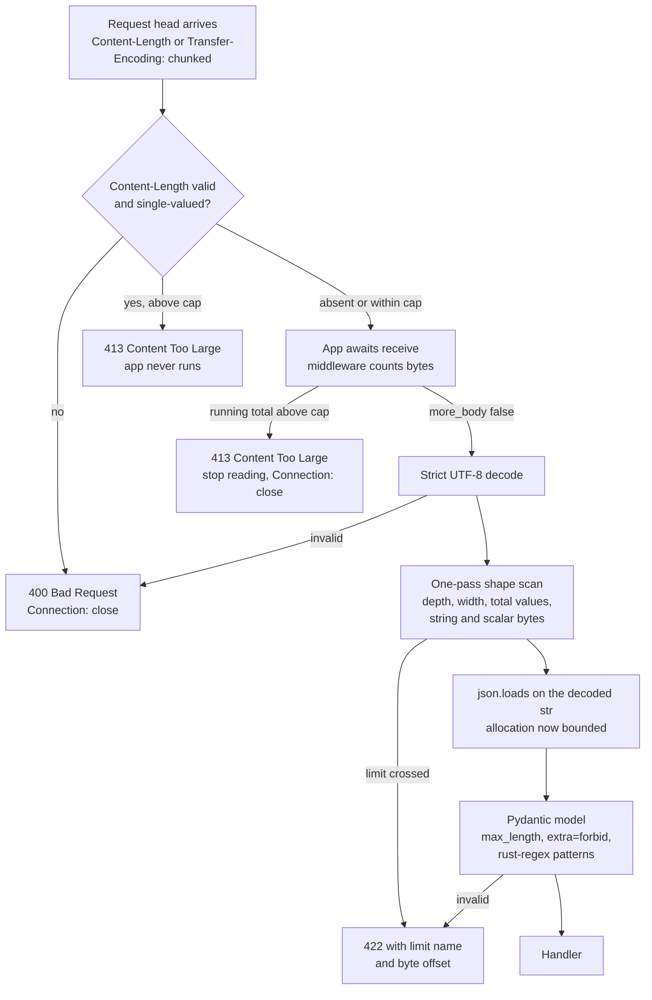

# Defending Against Unrestricted Resource Consumption (API4:2023): Max Body Bytes, JSON Nesting Depth, Array Caps, and ReDoS-Safe Regexes

> [!summary] Claim
> Every byte, nesting level, element, and regex step an unauthenticated client can make your API spend must be bounded before the expensive stage runs: cap streamed body bytes in pure ASGI (chunked bodies have no `Content-Length` to check), bound JSON shape on the raw UTF-8 bytes before any parser allocates, and use a matcher that cannot backtrack, because the Python stack ships none of these by default (FastAPI `0.162.0`, Uvicorn `0.54.0`, stdlib `json`, and `re` all leave them to you).

Part of [API Authorization and OWASP Security](README.md) in [API Engineering](../README.md).

## TL;DR

Mechanism: three ordered gates, cheapest first - a byte counter wrapped around ASGI `receive()` that answers `413` with `Connection: close`, a one-pass structural scan that rejects depth, width, value count, and token length on the raw bytes, then schema caps (`max_length`) and a linear-time regex engine.
Contract rule: decide from the header section when you can (`Content-Length` above the cap means `413` before the app runs), count streamed bytes when you cannot, and map every hostile-input failure to a `4xx` instead of letting it reach `RecursionError` or a generic catch-all.
Trap: schema caps run after the parse, so `Field(max_length=3)` on a list still lets pydantic-core build all 50,000 elements before saying `too_long`, and stdlib `json.loads(bytes)` sniffs UTF-16, which blinds any byte-level pre-scan unless you decode as UTF-8 first.
Portability fact: the stdlib JSON depth ceiling is an accident of the interpreter, not a policy - about 10,000 on CPython 3.12 and 3.13 (`C_RECURSION_LIMIT` and `Py_C_RECURSION_LIMIT`), a C-stack measurement on 3.14+ that ranged from 37,185 to 130,735 levels across builds here - while jiter stops at 201 and orjson at 1,024.
When not to use it: do not scan or parse multi-megabyte uploads in the API process at all; issue a presigned direct-to-storage upload and validate asynchronously, and put the coarse byte cap at the edge proxy as well as in the app.

## Mental model



The arrows are ordered by cost per rejected byte.
The first branch costs nothing but header parsing, because RFC 9110 lets a server refuse content it is unwilling to process with `413 (Content Too Large)` `(RFC 9110 Section 15.5.14)` and the declared length is known before the body.
When the client streams with `Transfer-Encoding: chunked` there is no declared length, so the only enforcement point is the running total inside `receive()`, which aborts on the chunk that crosses the cap and never asks for the next.
Only a body that fits is decoded, and only a decoded body is scanned; the scan walks bytes once without building objects and stops at the first violation, so the parser after it can only ever see documents whose allocation is bounded by the limits you chose.
The schema layer is last because it needs a fully built Python object graph, which is exactly the thing an attacker is trying to make expensive.

## How it works

### What API4:2023 asks for

OWASP API Security Top 10 2023 lists API4 as vulnerable when "at least one of" a set of limits "is missing or set inappropriately": execution timeouts, maximum allocable memory, file descriptors, processes, upload file size, operations per request (GraphQL batching), records per page, and third-party spending limits.
Its prevention list opens with container or serverless limits on memory, CPU, restarts, file descriptors, and processes, then says "Define and enforce a maximum size of data on all incoming parameters and payloads", naming string lengths, array element counts, and upload sizes, and adds rate limiting, per-operation throttles, server-side validation of query and body parameters, container resource caps, and spending limits.
It maps to CWE-770 (allocation without limits), CWE-400 (uncontrolled resource consumption), and CWE-799 (improper control of interaction frequency).
This note owns the per-request payload half of that list: body bytes, JSON shape, element counts, and regex cost.
Request frequency and quota belong to [[Rate-Limiting-Algorithms-Token-Bucket-Leaky-Bucket-and-Sliding-Window]] and [[Multi-Tier-Rate-Limiting-Quotas-Concurrency-Limits-and-Cost-Budgets]], GraphQL batching and query cost to [[GraphQL-Security-Query-Depth-Complexity-Cost-Analysis-and-Batch-Limits]], page sizes to [[Offset-Limit-Pagination-Mechanics-Cost-and-Window-Drift]], and business-flow abuse such as the SMS-reset scenario to [[Protecting-Sensitive-Business-Flows-API6-2023-Anti-Automation-and-Bot-Defense]].

### What the protocol gives you, and what it does not

HTTP has no protocol-level body limit.
A request body is delimited by `Content-Length` or by the chunked transfer coding; "Request messages are never close-delimited" and a request with neither has a zero-length body `(RFC 9112 Section 6.3)`.
`Content-Length` is `1*DIGIT`, "there is no predefined limit to the length of content", and a recipient "MUST anticipate potentially large decimal numerals" `(RFC 9110 Section 8.6)`.
A `Content-Length` that is not valid, unless it is a comma-separated list of identical valid values, is an unrecoverable framing error for which the server "MUST respond with a 400 (Bad Request) status code and then close the connection" `(RFC 9112 Section 6.3)`.
Chunked framing is a sequence of `chunk-size` hex numbers each followed by that many octets, ending at a zero-size chunk `(RFC 9112 Section 7.1)`; nothing in that grammar declares a total, and the same section says "HTTP/1.1 does not define any means to limit the size of a chunked response such that an intermediary can be assured of buffering the entire response", which holds for a chunked request just as well, so the receiver learns the total only by counting.
The server "MAY reject a request that contains a message body but not a Content-Length by responding with 411 (Length Required)" `(RFC 9112 Section 6.3)`, which is the bluntest way to make every limit decidable from headers, at the cost of breaking every streaming client.
HTTP/2 and HTTP/3 forbid `Transfer-Encoding` `(RFC 9113 Section 8.2.2; RFC 9114 Section 4.1)` and frame content as `DATA` frames; a `content-length` that does not equal the sum of `DATA` payloads makes the request malformed `(RFC 9113 Section 8.1.1; RFC 9114 Section 4.1.2)`, but the field is still optional, so an HTTP/2 client can stream an unbounded body exactly like a chunked HTTP/1.1 client.
The ASGI server hides all of this: the application sees `http.request` events with `body` and `more_body`, never the framing, so the same counter covers all three HTTP versions.

Field sections are the one place servers do impose defaults, because they must buffer headers before routing.
RFC 9110 requires a server that receives fields "larger than it wishes to process" to answer with an appropriate `4xx` rather than ignore them `(RFC 9110 Section 5.4)`, and HTTP/2 offers the advisory `SETTINGS_MAX_HEADER_LIST_SIZE` `(RFC 9113 Section 10.5.1)`.
h11 refuses to buffer more than `DEFAULT_MAX_INCOMPLETE_EVENT_SIZE = 16 * 1024` bytes of an incomplete event `(h11 0.16.0 h11/_connection.py, DEFAULT_MAX_INCOMPLETE_EVENT_SIZE)`, exposed in Uvicorn as `h11_max_incomplete_event_size` `(uvicorn 0.54.0 uvicorn/config.py, Config.__init__)`; Hypercorn has `h11_max_incomplete_size = 16 * 1024 * BYTES` (with `BYTES = 1`) and `h2_max_header_list_size = 2**16` `(hypercorn 0.18.0 hypercorn/config.py, Config)`.

Body bytes are another matter.
Uvicorn's h11 protocol appends each `h11.Data` event to `self.cycle.body` and calls `pause_reading()` once the buffer exceeds `HIGH_WATER_LIMIT = 65536` `(uvicorn 0.54.0 uvicorn/protocols/http/h11_impl.py, H11Protocol.handle_events; uvicorn/protocols/http/flow_control.py, HIGH_WATER_LIMIT)`.
That bounds what the server buffers per connection while the app is not reading, but the moment the app calls `await request.body()`, Starlette joins every chunk into one `bytes` object with no ceiling `(starlette 1.10.0 starlette/requests.py, Request.body)`.
Uvicorn has `limit_concurrency` and `limit_max_requests` but no body-size option `(uvicorn 0.54.0 uvicorn/config.py, Config.__init__)`.
Hypercorn's `wsgi_max_body_size = 16 * 1024 * 1024 * BYTES` reaches only `WSGIWrapper`; `wrap_app` builds `ASGIWrapper(app)` with no size for ASGI apps `(hypercorn 0.18.0 hypercorn/utils.py, wrap_app; hypercorn/app_wrappers.py, WSGIWrapper)`.

### Layer 1: the byte cap as pure ASGI middleware

The middleware must be pure ASGI, wrapping `receive` and `send`, because the counting has to happen per chunk as the app pulls it; see [[Pure-ASGI-Middleware-Onion-Architecture-and-Send-Receive-Wrapping]] for the onion model and [[Why-BaseHTTPMiddleware-Hurts-Performance-Streaming-and-ContextVars]] for why `BaseHTTPMiddleware` is the wrong tool.
It makes four decisions:

1. Parse `Content-Length` strictly before calling the app; conflicting duplicates (`10` and `11`, or `10, 11`), a sign, or hex is a `400`, because treating an unparsable length as "absent" turns the declared-length fast path into a bypass and leaves you disagreeing with any proxy in front about where the message ends (the request smuggling hazard RFC 9110 Section 8.6 warns about).
2. If the declared length exceeds the cap, answer `413` without calling the app; the app never runs, so no handler code, no dependency, and no database connection is spent.
3. Otherwise wrap `receive`: add `len(body)` of every `http.request` message to a running total and raise as soon as it exceeds the cap, which is the only check that works for chunked HTTP/1.1 and length-less HTTP/2.
4. Catch that exception at the middleware; if the app has not yet sent `http.response.start`, send `413`, otherwise re-raise, because an ASGI app cannot replace a response that has started and the only honest signal left is aborting the connection.

Every rejection carries `Connection: close`.
This is not decoration: when a response completes while the client is still sending, Uvicorn keeps reading and discards the rest of the body (`if self.conn.our_state is h11.DONE: continue`) so it can reuse the connection, and only closes when h11's state is `MUST_CLOSE` or keep-alive is off `(uvicorn 0.54.0 uvicorn/protocols/http/h11_impl.py, H11Protocol.handle_events and RequestResponseCycle.send)`.
Without `Connection: close`, your `413` saves memory but the server still drains the attacker's gigabytes off the socket.
RFC 9110 explicitly allows the alternative: the server "MAY terminate the request, if the protocol version in use allows it; otherwise, the server MAY close the connection" `(RFC 9110 Section 15.5.14)`; on HTTP/2 the protocol-native version is a `RST_STREAM` with `NO_ERROR` after the complete response `(RFC 9113 Section 8.1)`, which an ASGI app has no message to request, so whether the client stops sending is up to the server implementation.
Add `Retry-After` only when the condition is temporary, as Section 15.5.14 says; a fixed policy cap is not.
Clients that use `Expect: 100-continue` can be refused before sending any body byte; [[100-Continue-Expect-Header-and-Large-Upload-Admission]] covers which servers make that possible.

Starlette `1.10.0` ships the same idea as `RequestBodyLimitMiddleware`, enabled with `Starlette(max_body_size=...)` or per route with `Route(..., max_body_size=...)` (also accepted by `Mount` and `Router`) `(starlette 1.10.0 starlette/applications.py, Starlette.build_middleware_stack; starlette/routing.py, Route.__init__)`.
Its `receive_with_limit` raises `_RequestBodyTooLarge` (an `HTTPException` with status `413`) when the declared `Content-Length` is above the cap or the running total crosses it, and its `send_with_limit` replaces a response that an app starts without reading the body when the declared length was over the cap `(starlette 1.10.0 starlette/middleware/body_limit.py, RequestBodyLimitResponder)`.
Nested limits are resolved through a scope key so a route-level limit can tighten or loosen the app-level one for that request.
Three differences matter in practice: an unparsable `Content-Length` is silently treated as absent (`_get_content_length` returns `None` on `ValueError`), the `413` carries no `Connection: close`, and FastAPI `0.162.0` does not expose it (as of 2026-11), because `FastAPI.__init__` and `APIRoute.__init__` have no `max_body_size` parameter and FastAPI's own `build_middleware_stack` override never inserts the middleware `(fastapi 0.162.0 fastapi/applications.py, FastAPI.build_middleware_stack)`.
In FastAPI you add it with `app.add_middleware(...)`, or use a middleware like the lab's.

### Layer 2: why parsed JSON is the real amplifier

A 1 MiB body cap does not bound memory, because a parser turns bytes into objects that are much larger than the bytes.
Measured with `tracemalloc` on CPython `3.14.6`, `json.loads` of a 1 MiB array of empty objects (`[{},{},...]`) peaked at 25.1 MiB of traced allocations, 25 times the input; empty arrays reached 22.5 times, `0` elements 5.5 times, and `1.5` floats 9.2 times (lab measurement below).
Depth is worse than width for a recursive-descent parser, because each level costs C stack, not heap.

CPython's C scanner recurses once per nested container and guards each level with `_Py_EnterRecursiveCall`, passing the message `" while decoding a JSON array from a unicode string"` (split across two C string literals in the source) and the object equivalent `(CPython v3.14.0 Modules/_json.c, scan_once_unicode)`.
On 3.12 and 3.13 that guard is a counter: non-debug builds other than Windows, s390x, Android, WASI, and AddressSanitizer use `C_RECURSION_LIMIT 10000` on 3.12 and `Py_C_RECURSION_LIMIT 10000` on 3.13 `(CPython v3.12.13 Include/cpython/pystate.h, C_RECURSION_LIMIT; CPython v3.13.0 Include/cpython/pystate.h, Py_C_RECURSION_LIMIT)`, and the lab measured a maximum parsable depth of 9,997 on 3.12.13 and 9,998 on 3.13.18, independent of `sys.getrecursionlimit()` (1000).
On 3.14 the guard became a machine stack measurement: `_Py_CheckRecursiveCall` compares the stack pointer to a soft limit and raises `RecursionError` with "Stack overflow (used %d kB)" `(CPython v3.14.0 Python/ceval.c, _Py_CheckRecursiveCall)`.
The measured ceiling therefore depends on the build and thread: 37,185 levels on the `uv` build of 3.14.6 (main thread), 74,799 in a `threading.Thread` on the same build, 116,209 on the Homebrew 3.14.10 build, and 130,735 on 3.15.2 (binary search over `json.loads("[" * n + "]" * n)` called from a helper function, so a different caller stack depth shifts these by a few levels).
The lesson is that no stdlib depth limit exists that you could document to clients; whatever you observe is an interpreter implementation detail that moved by an order of magnitude between minor versions.

Two stdlib failure modes are not `json.JSONDecodeError`.
`RecursionError` derives from `RuntimeError`, not `ValueError`, and integer literals longer than `sys.get_int_max_str_digits()` (default 4300) raise a plain `ValueError` ("Exceeds the limit (4300 digits) for integer string conversion"), the mitigation CPython added for CVE-2020-10735, whose NVD record cites 50 ms for 100,000 digits and 5 s for 1,000,000 because non-binary base conversion is quadratic.
FastAPI `0.162.0` parses JSON bodies through Starlette's `Request.json`, which is `json.loads(body)` on the bytes `(starlette 1.10.0 starlette/requests.py, Request.json)`, inside `get_request_handler`; it maps `json.JSONDecodeError` to a `422` and every other exception to `HTTPException(status_code=400, detail="There was an error parsing the body")` `(fastapi 0.162.0 fastapi/routing.py, get_request_handler)`.
So the lab's unguarded route answers `400` to a 400,000-deep document and to a 5,000-digit integer, which looks safe, but only after the parser has already recursed to the stack limit or scanned the digits; the cost is paid, then hidden.

Other parsers bound depth by policy:

- jiter, the parser inside pydantic-core `2.50.4` (`jiter = { version = "0.18.0" }` in its `Cargo.toml`), has `DEFAULT_RECURSION_LIMIT: u8 = 200` `(jiter v0.18.0 crates/jiter/src/errors.rs, DEFAULT_RECURSION_LIMIT)`; the lab measured 201 nested arrays accepted and 202 rejected with "recursion limit exceeded".
- orjson `3.13.0` documents that it "raises `JSONDecodeError` if a combination of array or object recurses 1024 levels deep" (README), enforced in its vendored yyjson reader by `container_depth >= YYJSON_READER_DEPTH_LIMIT` `(orjson 3.13.0 include/yyjson/yyjson.c, read_root_minify)`, a macro that `yyjson.c` defaults to `0` (disabled) and that orjson's build sets with `.define("YYJSON_READER_DEPTH_LIMIT", "1024")` `(orjson 3.13.0 build.rs, main)`; measured: 1,024 accepted, 1,025 rejected, and its `JSONDecodeError` subclasses `json.JSONDecodeError`.
- msgspec `0.22.0` behaved like the 3.14 stdlib in the lab: `RecursionError` with "Stack overflow (used 8144 kB) while deserializing an object" at depth 24,788 on 3.14.6.

Pydantic validation is parse-then-validate.
`SchemaValidator._validate_json` calls `jiter::JsonValue::parse_with_config(json_data, true, allow_partial)` and only then `self._validate(...)` on the resulting tree `(pydantic-core 2.50.4 src/validators/mod.rs, SchemaValidator::_validate_json)`.
Every constraint, including `max_length` on a list, therefore runs after the whole array exists: the lab's `Field(max_length=3)` model rejects a 50,000-element array with `ctx == {"field_type": "List", "max_length": 3, "actual_length": 50000}`, which proves the parser counted all 50,000.
Schema caps are still essential, because they bound what your handler, ORM, and downstream calls do with the data, but they are not a parse-time defense; [[Single-Pass-JSON-Validation-Model-Validate-JSON-vs-JSON-Loads]] covers the performance side of the same pipeline.

### The shape scan: bounding the parse before it starts

`scan_json_shape` walks the raw bytes once with two compiled byte regexes: outside strings it jumps to the next structural byte (`[`, `]`, `{`, `}`, `"`, `,`, `:`), inside strings it jumps to the next `"` or `\` and skips the byte after every backslash.
It keeps a stack of per-container item counts and enforces five limits, each named in the error with the byte offset where it tripped:

| Limit | What it bounds | Why |
|---|---|---|
| `max_depth` | Open containers | C stack in recursive parsers, Python frames in validators |
| `max_container_items` | Commas plus one in the innermost container | Width of one list or dict, the `too_long` you would otherwise learn after parsing |
| `max_total_values` | Containers, strings (keys included), and scalars | Total objects allocated, which drives the 5x to 25x amplification |
| `max_string_bytes` | Raw bytes between quotes, escapes included | One huge string, which the body cap alone permits up to the full body |
| `max_scalar_bytes` | Bytes of an unquoted token | Number literals, the CVE-2020-10735 class, before `int()` sees them |

The scan does not validate JSON grammar; the parser after it does.
Its only job is the invariant "if the parser accepts this document, the parse cannot exceed these limits", and that invariant holds only if the scanner and the parser agree on where strings start and end.
The lab found the case where they do not: `json.loads(bytes)` sniffs UTF-16 and UTF-32 from the first bytes, and in UTF-16-LE the code unit U+5C41 is the byte pair `41 5C`, whose second byte is an ASCII backslash.
A byte scanner reads that as an escape, skips the real closing quote (`22 00`), stays "inside a string" for the rest of the document, and reports depth 1 for a 400,000-deep payload that `json.loads(doc)` then parses into `RecursionError`.
The fix is to decode strictly as UTF-8 and parse the resulting `str`, which turns sniffing off; RFC 8259 already requires that "JSON text exchanged between systems that are not part of a closed ecosystem MUST be encoded using UTF-8" `(RFC 8259 Section 8.1)`, and in UTF-8 no byte below `0x80` ever appears inside a multibyte sequence, so the byte-level scan sees exactly the structure the parser sees.
RFC 8259 permits all of these limits: "An implementation may set limits on the size of texts ... the maximum depth of nesting ... the range and precision of numbers ... the length and character contents of strings" `(RFC 8259 Section 9)`.

The scan is pure Python, so its cost is real and must be bounded by the same limits it enforces.
Measured on 3.14.6, scanning a full 1 MiB array of `{}` with limits set high enough not to trip took 278 ms against 15 ms for `json.loads` itself; with the default limits the same body is rejected at byte 3000 in 0.80 ms, and a 3,211-byte order with 100 lines scans under `ORDER_LIMITS` in 0.32 ms.
The rule that falls out: the scan is cheap exactly when the limits are tight, so set them from the schema (the lab's order endpoint uses depth 4, width 100, 1,000 values) rather than generically.
If profiles show the scan on a hot path, the alternative is a parser with policy limits (orjson's 1,024, jiter's 200) plus a body cap sized so that width-times-amplification fits your memory budget.

### Array and field caps at the schema layer

After the parse is bounded, the model enforces the contract: `Field(min_length=1, max_length=100)` on `lines`, `max_length` on every string, `ge` and `le` on quantities, and `ConfigDict(extra="forbid")` so unknown keys cannot ride along (the BOPLA defense in [[Defeating-BOPLA-and-Mass-Assignment-API3-2023-Strict-Input-Output-Schemas]]).
The response side needs the same discipline: the "Number of records per page" item in API4 is a server-side ceiling on `limit` or `page_size`, enforced in the query, which [[Offset-Limit-Pagination-Mechanics-Cost-and-Window-Drift]] and [[Streaming-Exports-and-NDJSON-for-Unbounded-Collections]] cover.
Error responses are part of the resource budget: FastAPI's default `request_validation_exception_handler` returns `jsonable_encoder(exc.errors())`, and each error includes `input` `(fastapi 0.162.0 fastapi/exception_handlers.py, request_validation_exception_handler)`, so the lab's 800,003-byte valid array sent to a `dict` endpoint came back as a `422` whose body was larger than the request.

### Layer 3: ReDoS and why the engine matters more than the pattern

Python's `re` is a backtracking matcher.
For `^(\w+\s?)*$` against `"a" * n + "!"`, the group can split the run of `a` into any composition of `n`, and each of the `2**(n-1)` splits is tried before the final `!` proves none matches.
The lab measured the doubling directly on 3.14.6: 3.4 ms at n=16, 13.2 ms at 18, 52.5 ms at 20, 208.9 ms at 22, and 843.4 ms at 24, four times per two characters; at n=40 the child process was still running when the test killed it after 2 s.
`re` has no timeout parameter; its functions take only `pattern`, `string`, and `flags` (plus `count`, `maxsplit`, or `repl`), and `pos` and `endpos` limit the region, not the time (Python `re` documentation).
Because the match runs synchronously inside the handler, a ReDoS in an `async def` handler freezes the whole event loop, every connection on the worker with it ([[Case-Study-Blocking-Call-Inside-Async-Def-Freezing-the-Entire-Worker-Fleet]]).

Three defenses, strongest first:

1. Use a linear-time engine.
   Pydantic's default `regex_engine` is `'rust-regex'`, documented as "non-backtracking and therefore more DDoS resistant" `(pydantic 2.14.3 pydantic/config.py, ConfigDict.regex_engine)`; pydantic-core compiles a string pattern with `regex::Regex::new` `(pydantic-core 2.50.4 src/validators/string.rs, Pattern::compile)`, and the Rust `regex` crate guarantees "a `O(m * n)` worst case time and space bound" and lacks look-around and backreferences, features "that are not known how to implement efficiently" (regex crate documentation).
   The lab's `OrderIn.note` field deliberately uses the catastrophic pattern above and still rejects `"a" * 250 + "!"` instantly.
2. Make the backtracking impossible in the pattern.
   Python 3.11 added possessive quantifiers (`*+`, `++`, `?+`, `{m,n}+`) and atomic groups (`(?>...)`), which "do not allow back-tracking when the expression following it fails to match" (Python `re` documentation).
   `^(?:\w+\s?)*+$` commits to the greedy parse, which already consumes the longest prefix the group can match, so it accepts exactly the same strings (a Hypothesis property in the lab checks this) and failed a 1,000,001-character subject in 1.7 ms.
   This option does not exist on 3.10 and earlier.
3. Bound the input before the matcher: pydantic-core checks `max_length` before `pattern` in the same validator `(pydantic-core 2.50.4 src/validators/string.rs, StrConstrainedValidator::validate)`, and the lab proves the order by getting `string_too_long`, not `string_pattern_mismatch`, for a 257-character note.
   A length cap turns exponential into "exponential in a small constant", which is a mitigation, not a fix: 2**24 steps is already most of a second.

One trap defeats defense 1 silently: if you pass a compiled `re.Pattern` instead of a string, pydantic-core uses `RegexEngine::PythonRe` "so that any flags, etc. are preserved" `(pydantic-core 2.50.4 src/validators/string.rs, Pattern::compile)`, and pydantic documents that "the `'python-re'` engine will be used regardless of this setting" `(pydantic 2.14.3 pydantic/config.py, ConfigDict.regex_engine)`; the lab's subprocess with `Field(pattern=re.compile(r"^(\w+\s?)*$"))` hangs past its 3 s timeout on 41 characters.

### Multipart: the same three limits, already built into Starlette

Starlette's `MultiPartParser` enforces `max_files=1000`, `max_fields=1000`, and `max_part_size=1024 * 1024` for parts without a filename, and spools file parts to a `SpooledTemporaryFile(max_size=self.spool_max_size)` with the class attribute `spool_max_size = 1024 * 1024` `(starlette 1.10.0 starlette/formparsers.py, MultiPartParser.__init__, MultiPartParser.on_headers_finished, and MultiPartParser.on_part_data)`.
File parts have no size limit in that code path: `on_part_data` appends file chunks to `_file_parts_to_write` without checking `max_part_size`, so an upload is bounded only by disk until you add a body cap.
FastAPI calls `await request.form()` with these defaults `(fastapi 0.162.0 fastapi/routing.py, get_request_handler)`.
The defaults exist because of two CVEs: CVE-2023-30798 (Starlette before 0.25.0 accepted any number of form fields or files) and CVE-2024-47874 (before 0.40.0, parts without a filename were buffered "with no size limit").
The `Content-Type` header parser itself was the ReDoS in CVE-2024-24762: python-multipart used a regular expression for `Content-Type` options that could stall "indefinitely (minutes or more) while holding the main event loop", fixed in 0.0.7 (NVD).

## Numbers and limits

Lab measurements: Apple M3 Pro, macOS 27.3 arm64 (`uname -r` = `27.3.0`), CPython `3.14.6` (`uv` build) unless stated, re-measured 2026-11-15 by the fact-check with one run each of `uv run --frozen python -I <probe>.py` from `labs/` (depth probes ran each listed interpreter directly); byte counts are exact, timings are single samples and indicate magnitude only.

| Quantity | Value | Source |
|---|---|---|
| HTTP body size limit | None defined | `(RFC 9110 Section 8.6; RFC 9112 Section 7.1)` |
| h11 incomplete event (header) buffer | 16 KiB default | `(h11 0.16.0 h11/_connection.py, DEFAULT_MAX_INCOMPLETE_EVENT_SIZE)` |
| Uvicorn read pause threshold | 65,536 bytes buffered | `(uvicorn 0.54.0 uvicorn/protocols/http/flow_control.py, HIGH_WATER_LIMIT)` |
| Hypercorn HTTP/2 header list | `2**16` | `(hypercorn 0.18.0 hypercorn/config.py, Config)` |
| Starlette multipart fields, files, part size, spool | 1000, 1000, 1 MiB, 1 MiB | `(starlette 1.10.0 starlette/formparsers.py, MultiPartParser)` |
| Stdlib `json` max depth, 3.12.13 / 3.13.18 | 9,997 / 9,998 | Lab probe; `C_RECURSION_LIMIT 10000` in 3.12.13 and `Py_C_RECURSION_LIMIT 10000` in 3.13.0 source |
| Stdlib `json` max depth, 3.14.6 main thread / worker thread | 37,185 / 74,799 | Lab probe, `uv` build |
| Stdlib `json` max depth, 3.14.10 / 3.15.2 (Homebrew) | 116,209 / 130,735 | Lab probe |
| Stdlib `json` max depth, 3.14.6t / 3.15.0b3t (GIL disabled) | 37,184 / 65,072 | Lab probe |
| Pure-Python `json` scanner max depth (all versions above) | 496 | Lab probe, `json.scanner.py_make_scanner`, bounded by `sys.getrecursionlimit()` (1000) |
| `int` digits accepted from a string | 4300 (`sys.get_int_max_str_digits()`) | Lab run; CVE-2020-10735 |
| jiter (pydantic-core 2.50.4) depth | 201 accepted, 202 rejected | Lab test; `DEFAULT_RECURSION_LIMIT: u8 = 200` |
| orjson 3.13.0 depth | 1,024 accepted, 1,025 rejected | Lab test; orjson README |
| msgspec 0.22.0 depth | 24,787 accepted | Lab probe (C stack, `RecursionError`) |
| `json.loads` memory, 1 MiB `[{},...]` / `[[],...]` / `[1.5,...]` / `[0,...]` / `["",...]` | 25.1x / 22.5x / 9.2x / 5.5x / 3.8x peak traced | Lab, `tracemalloc` |
| `json.loads` time, 1 MiB `[{},...]` | 15 ms | Lab |
| `scan_json_shape`, 1 MiB `[{},...]`, limits not tripped / default limits | 278 ms / 0.80 ms (rejects at byte 3000) | Lab |
| `scan_json_shape`, 400,000-deep body, default limits | 15 us (rejects at byte 32) | Lab |
| `scan_json_shape`, 3,211-byte 100-line order, `ORDER_LIMITS` | 0.32 ms | Lab |
| `^(\w+\s?)*$` on `"a"*n + "!"`, n = 16, 20, 24 | 3.4 ms, 52.5 ms, 843.4 ms | Lab |
| `^(?:\w+\s?)*+$` on `"a"*1_000_000 + "!"` | 1.7 ms | Lab |
| Cloudflare WAF regex outage, 2019-07-02 | 27 minutes, CPUs "nearly 100%" | Cloudflare postmortem |

## Portability

| Runtime, library, or protocol | Body cap behavior | JSON depth and shape behavior | Evidence |
|---|---|---|---|
| CPython `3.12.13` | Lab middleware identical | Stdlib ceiling ~10,000 (counter) | `29 passed` with `uv run --frozen --python 3.12.13`, macOS 27.3 arm64 |
| CPython `3.13.18` | Identical | Same counter, `Py_C_RECURSION_LIMIT 10000` | `29 passed`; CPython v3.13.0 `Include/cpython/pystate.h` |
| CPython `3.14.6` (workspace) and `3.14.10` | Identical | C-stack measured ceiling, build-dependent | `29 passed` on each |
| CPython `3.15.2` | Identical | Same mechanism as 3.14 | `29 passed` |
| CPython `3.14.6t` free-threaded | Not run | Depth probe only: 37,184 | Lab install failed: `orjson==3.13.0` has no free-threaded wheel and its `maturin` build failed; `3.15.2t` is not installed here |
| CPython 3.10 and earlier | Not applicable | No possessive quantifiers or atomic groups | Python `re` docs: "Added in version 3.11" |
| Starlette `1.10.0` | `max_body_size` on `Starlette` and `Route`; no `Connection: close`; bad `Content-Length` treated as absent | Not applicable | Lab `test_starlette_builtin_body_limit_also_cuts_a_chunked_stream`; source |
| FastAPI `0.162.0` | No `max_body_size` parameter; add middleware yourself | Stdlib `json.loads`; non-`JSONDecodeError` becomes `400` | Lab `test_naive_fastapi_body_pays_the_full_parse_then_reports_400_or_echoes_422`; source |
| pydantic `2.14.3` / pydantic-core `2.50.4` | Not applicable | jiter depth 201; constraints after full parse; `rust-regex` default | Lab tests |
| Uvicorn `0.54.0` | No body option; drains unread body unless `Connection: close` | Not applicable | Source only, not run on sockets |
| Hypercorn `0.18.0` | `wsgi_max_body_size` for WSGI only; none for ASGI | Not applicable | Source only, `hypercorn/utils.py` `wrap_app` |
| Granian `2.8.7` | No request body option: `HTTP1Settings` and `HTTP2Settings` have none, `--http1-buffer-size` (default `8192 + 4096 * 100`) "Sets the maximum buffer size for HTTP/1 connections", and ASGI `receive` streams hyper's `body::Incoming` | Not applicable | Source only, not run: `(granian v2.8.7 granian/http.py, HTTP1Settings; granian/cli.py; src/asgi/io.rs)` |
| HTTP/1.1 | `Content-Length` or chunked; chunked has no declared total | Same | `(RFC 9112 Section 6.3, Section 7.1)` |
| HTTP/2 | No chunked; `content-length` optional but must match `DATA` sum | Same | `(RFC 9113 Section 8.1.1, Section 8.2.2)`; not run |
| HTTP/3 | Same rule as HTTP/2 | Same | `(RFC 9114 Section 4.1, Section 4.1.2)`; not run |

Container legs (Debian Trixie, Alpine musl) were not run.
The stdlib depth figures are expected to differ under musl and in containers with a different main-thread stack; they were not measured there.

## Worked example

The lab is [implementation](../labs/src/api_labs/f15_api_authorization_and_owasp_security/payload_limits.py) and [test](../labs/tests/f15_api_authorization_and_owasp_security/test_unrestricted_resource_consumption_api4_2023_payload_depth_and_limit_guards.py).
It builds a FastAPI app with a guarded `POST /orders` and an unguarded `POST /naive`, and tests each layer in-process through `httpx.ASGITransport`.

The byte cap (simplified excerpt; the full file also defines `_send_problem`, which writes an `application/problem+json` body with `Connection: close`):

```python
def declared_length(scope: Scope) -> int | None:
    values: list[bytes] = [v for k, v in scope["headers"] if k == b"content-length"]
    if not values:
        return None
    parts = {p.strip() for v in values for p in v.split(b",")}
    if len(parts) != 1:
        raise ValueError("conflicting Content-Length values")
    (only,) = parts
    if not only.isdigit():
        raise ValueError("Content-Length is not 1*DIGIT")
    return int(only)


class BodyLimitMiddleware:
    async def __call__(self, scope: Scope, receive: Receive, send: Send) -> None:
        if scope["type"] != "http":
            await self.app(scope, receive, send)
            return
        try:
            declared = declared_length(scope)
        except ValueError as exc:
            await _send_problem(send, 400, "Bad Request", str(exc))
            return
        if declared is not None and declared > self.max_bytes:
            # Decided from the header section alone: the app never runs.
            detail = f"declared {declared} bytes exceeds limit {self.max_bytes}"
            await _send_problem(send, 413, "Content Too Large", detail)
            return

        received = 0
        response_started = False

        async def limited_receive() -> Message:
            nonlocal received
            message = await receive()
            if message["type"] == "http.request":
                received += len(message.get("body", b""))
                if received > self.max_bytes:
                    raise BodyTooLargeError
            return message

        async def tracking_send(message: Message) -> None:
            nonlocal response_started
            if message["type"] == "http.response.start":
                response_started = True
            await send(message)

        try:
            await self.app(scope, limited_receive, tracking_send)
        except BodyTooLargeError:
            if response_started:
                raise  # Too late for a 413: let the server abort the connection.
            detail = f"streamed body exceeds limit {self.max_bytes}"
            await _send_problem(send, 413, "Content Too Large", detail)
```

The guarded parse (simplified excerpt; `scan_json_shape` is the loop described above):

```python
def parse_json_guarded(data: bytes, limits: JsonShapeLimits) -> Any:
    text = data.decode("utf-8")  # UnicodeDecodeError is a ValueError -> 400
    scan_json_shape(data, limits)
    return json.loads(text)


ORDER_LIMITS: Final = JsonShapeLimits(
    max_depth=4,
    max_container_items=100,
    max_total_values=1_000,
    max_string_bytes=1_024,
    max_scalar_bytes=16,
)
```

The chunked test is the one the seed asked for: 64 chunks of 64 KiB with no `Content-Length`, and the middleware must stop pulling at the 17th (16 chunks are exactly 1 MiB, which the inclusive limit allows).
Simplified excerpt of the test module:

```python
@pytest.mark.unit
@pytest.mark.asyncio
async def test_chunked_upload_without_content_length_is_cut_at_the_crossing_chunk() -> None:
    inner = BodyCounter()
    source = ChunkSource(chunks=64)  # 4 MiB offered, no Content-Length
    async with client(BodyLimitMiddleware(inner, max_bytes=MIB)) as c:
        response = await c.post("/", content=source)
    assert response.request.headers["transfer-encoding"] == "chunked"
    assert "content-length" not in response.request.headers
    assert response.status_code == 413
    assert response.json()["detail"] == f"streamed body exceeds limit {MIB}"
    # 16 chunks are exactly 1 MiB; the 17th crosses the cap and nothing more is read.
    assert source.pulled == 17
    assert inner.receives == 16


@pytest.mark.unit
def test_utf16_body_blinds_a_byte_scanner_so_the_guard_requires_utf8() -> None:
    # U+5C41 encodes as 41 5C in UTF-16-LE: the 5C looks like a backslash that
    # escapes the closing quote, so the scanner never leaves the string.
    doc = ('["\u5c41", ' + "[" * 400_000 + "]" * 400_000 + "]").encode("utf-16-le")
    assert scan_json_shape(doc, LIMITS).max_depth == 1
    with pytest.raises(RecursionError):
        json.loads(doc)  # bytes input: the stdlib sniffs UTF-16 and parses it
    # Every byte here is ASCII, so it decodes as UTF-8; parsing the decoded str
    # disables sniffing, and the NUL bytes are then plain invalid JSON.
    with pytest.raises(json.JSONDecodeError, match="Expecting value: line 1 column 2"):
        parse_json_guarded(doc, LIMITS)
```

Other tests pin the declared-length fast path (`receives == 0`), the inclusive boundary at exactly 1 MiB for both framings, `400` for conflicting or non-digit `Content-Length`, re-raising after a response has started, the Starlette built-in, each scan limit at and one past its value, the parser depth ceilings, the parse-then-validate order in pydantic, the unguarded FastAPI behavior, the guarded route's status mapping, and the three regex properties (equivalence, exponential versus linear in a killed subprocess, and the compiled-pattern fallback).

Command, from `labs/`, on CPython `3.14.6`, macOS 27.3 arm64:

```text
$ uv run --frozen pytest tests/f15_api_authorization_and_owasp_security/test_unrestricted_resource_consumption_api4_2023_payload_depth_and_limit_guards.py -q -p no:cacheprovider
.............................                                            [100%]
29 passed in 5.77s
```

The guarded route's mapping, from `test_guarded_route_maps_every_hostile_body_to_a_4xx`: a valid order is `201`; a 400,000-deep `lines` is `422` with `"max_depth exceeded at byte 13"`; a 5,000-digit number is `422` with `"max_scalar_bytes exceeded at byte 11"`; 101 lines is `422` `max_container_items`; an extra `admin` key plus an empty `lines` is `422` with `"2 errors"`; truncated JSON is `400`; and a 1 MiB plus one byte body is `413` before the route runs.

## Pitfalls

> [!warning] Capping only `Content-Length`
> Trigger: a limit implemented as `if int(request.headers["content-length"]) > MAX` in a dependency or handler.
> Symptom: chunked HTTP/1.1 and length-less HTTP/2 uploads skip the check entirely, and a non-numeric value raises `ValueError` into a `500`.
> Fix: count bytes in `receive()` as the lab and Starlette `1.10.0` do, and treat an invalid `Content-Length` as `400` per RFC 9112 Section 6.3.

> [!warning] A limit that runs after the body is already in memory
> Trigger: checking `len(await request.body())`, or a FastAPI dependency, because FastAPI reads and parses the body in `get_request_handler` before dependencies resolve.
> Symptom: the `413` is correct and useless; the process already joined every chunk into one `bytes` object.
> Fix: enforce in ASGI middleware that wraps `receive`, outside the router.

> [!warning] `413` without `Connection: close`
> Trigger: returning `413` from middleware while the client is still sending, on Uvicorn `0.54.0`.
> Symptom: memory is protected, but Uvicorn reads and discards the remainder of the upload to keep the connection alive, so bandwidth and a worker's read loop are still consumed.
> Fix: send `Connection: close` (RFC 9110 Section 15.5.14 permits closing), and enforce the coarse cap at the proxy too.

> [!warning] Trusting the parser's own recursion guard (CVE-2020-10735 class)
> Trigger: relying on `RecursionError` or `int()` limits as the depth and number policy.
> Symptom: depth ceilings move by 10x between CPython 3.13 and 3.14 builds, the failure is not a `JSONDecodeError`, and FastAPI `0.162.0` reports it as a generic `400` after the cost is paid; huge integers were quadratic before the 4300-digit default (NVD CVE-2020-10735: 5 s for 1,000,000 digits).
> Fix: bound depth and token length before parsing, or use a parser with a documented limit (orjson 1,024, jiter 200).

> [!warning] Byte-scanning bytes the parser will decode differently
> Trigger: a pre-parse scanner over raw bytes followed by `json.loads(raw_bytes)`.
> Symptom: the stdlib sniffs UTF-16 or UTF-32, a code unit containing `0x5C` or `0x22` desynchronizes the scanner, and a 400,000-deep document passes as depth 1 (reproduced in the lab).
> Fix: decode as UTF-8 (RFC 8259 Section 8.1) and parse the `str`; any scanner and parser pair must agree on the exact same input.

> [!warning] Schema caps mistaken for parse caps
> Trigger: `Field(max_length=100)` on a list as the only array defense.
> Symptom: pydantic-core builds the entire array before reporting `too_long` (`actual_length` in the error is the real count), so a 1 MiB body of tiny objects still costs about 25 MiB of objects with the stdlib parser.
> Fix: keep the cap for the contract, and bound width before the parse with a shape scan or a smaller body cap.

> [!warning] Validation errors that echo the attack (FastAPI default handler)
> Trigger: the default `RequestValidationError` handler, which includes each error's `input`.
> Symptom: in the lab an 800,003-byte array sent to a `dict` endpoint produced a `422` body larger than the request, doubling egress and log volume.
> Fix: install a `RequestValidationError` handler that drops or truncates `input`; see [[Structured-Log-Redaction-and-Preventing-PII-and-Token-Leaks]] for the logging side.

> [!warning] Catastrophic backtracking in a WAF or validator (Cloudflare, 2019-07-02)
> Trigger: a rule containing `.*(?:.*=.*)` deployed globally to Cloudflare's WAF.
> Symptom: per Cloudflare's postmortem, CPUs serving HTTP spiked "to nearly 100%" across the network and the outage lasted 27 minutes; remediations included switching to "the re2 or Rust regex engine" with "run-time guarantees" and re-introducing CPU usage protection.
> Fix: a linear-time engine for any pattern on untrusted input (pydantic's default `rust-regex`), possessive or atomic constructs where you must use `re`, and length caps before the matcher.

> [!warning] Passing `re.compile(...)` to `Field(pattern=...)`
> Trigger: reusing a compiled pattern object for flags or for sharing.
> Symptom: pydantic-core switches to `PythonRe` regardless of `regex_engine`, restoring backtracking; the lab's 41-character input runs past a 3 s timeout.
> Fix: pass the pattern as a `str`, and add a lint for `pattern=re.compile`.

> [!warning] Regex in header parsing (CVE-2024-24762)
> Trigger: python-multipart before 0.0.7 parsing `Content-Type` options with a regex.
> Symptom: a crafted header stalled the event loop "minutes or more" (NVD), before any body limit could apply, because headers are parsed first.
> Fix: upgrade, and remember that header parsing sits in front of your body cap; the header size cap (h11 16 KiB) bounds the input to such parsers.

> [!warning] Unbounded multipart parts (CVE-2023-30798, CVE-2024-47874)
> Trigger: Starlette before 0.25.0 (unlimited fields and files) or before 0.40.0 (filename-less parts buffered without limit).
> Symptom: memory growth until swap or OOM kill from a single request, or a few in parallel, "even if reasonable request size" limits exist elsewhere (NVD wording for CVE-2024-47874).
> Fix: Starlette `1.10.0` defaults (1000 fields, 1000 files, 1 MiB per field part); file parts still have no per-part cap, so the body cap is mandatory for upload routes.

## Security and robustness

Threat model: an unauthenticated client on the public internet with a cheap HTTP client, a botnet, or a serverless fleet (the OWASP threat agents), aiming to exhaust memory, CPU, stack, event-loop time, disk, bandwidth, or someone else's money.
The attacker controls framing (chunked versus length), encoding, every byte of structure, and timing; you control only the order of checks and the cost of each one.

Defense in depth, each layer bounding the next:

- Edge: a body cap and header cap at the load balancer or gateway ([[API-Gateway-Architecture-Responsibilities-and-Anti-Patterns]]), which is coarse and per-route at best, and keeps the bulk of an oversized upload off your workers.
- Server: header buffer caps (h11 16 KiB), slow-client timeouts ([[Timeout-Taxonomy-Connect-Read-Write-Pool-and-Deadline-Propagation]]), and concurrency limits so one worker is not holding thousands of trickling uploads ([[Adaptive-Concurrency-Limits-Littles-Law-Vegas-and-Gradient2]]).
- App edge: the ASGI byte cap with per-route values; a JSON API route rarely needs more than 1 MiB, an upload route should not stream through the app at all.
- Parse: strict UTF-8, shape scan or a depth-limited parser, and an `int` digit cap (keep the 4300 default; never raise it globally to accept one partner's big numbers, parse those as strings).
- Schema: `max_length` on every list and string, `extra="forbid"`, numeric bounds, and patterns compiled by `rust-regex`.
- Work after validation: page-size ceilings, fan-out caps for batch endpoints ([[JSON-RPC-2-0-Specification-Batching-Notifications-and-Error-Codes]]), GraphQL cost limits, timeouts on downstream calls, and spending caps on paid third-party APIs (OWASP scenario 1, SMS at $0.05 per message).
- Rate and quota: per-identity limits so that "within limits" requests cannot be multiplied ([[Credential-Stuffing-Brute-Force-Defense-and-Account-Lockout-Traps]] for authentication endpoints specifically).

Edge cases that must be decided explicitly: an empty body with `Content-Length: 0` (passes); `Content-Length: 42, 42` (RFC 9112 allows treating it as 42, the lab does); a `Content-Length` larger than the bytes actually sent (the server times out the read; not a body-cap concern); compressed request bodies (`Content-Encoding: gzip`), where the cap must apply to decompressed bytes too or a 1 MiB gzip becomes a gigabyte of JSON; WebSocket messages, which this middleware ignores by design (`scope["type"] != "http"`) and which need per-message caps in the server ([[ASGI-WebSockets-Lifecycle-Subprotocols-and-Backpressure]]).
Status code choice: `413` is reserved for size; shape violations are `422 (Unprocessable Content)` in the lab because the content is well-formed but violates processing limits, and malformed JSON is `400`.
Never answer `500` for hostile input: a 5xx triggers retries in clients and proxies ([[Retry-Budgets-and-Preventing-Cascading-Retry-Amplification-Storms]]) and pages your on-call for an attack that the system handled.

## The principal's view

The decision is not "add a body limit"; it is "which tier owns each resource budget, and how is the budget derived".
A staff-plus engineer sets per-route budgets from the schema (maximum lines times maximum line size, plus overhead) rather than one global number, because a global 10 MiB cap is simultaneously too large for a login endpoint and too small for an import endpoint, and a too-small global cap is quietly raised until it protects nothing.
The budget is documented in the API contract (OpenAPI `maxItems`, `maxLength`, a stated body size) so clients can stay inside it and so a change to it is reviewed like any other breaking change ([[Anatomy-of-Breaking-Changes-in-HTTP-and-JSON-APIs]]).

Organizationally, the failure mode is diffusion of responsibility: the platform team assumes the gateway caps bodies, the gateway team assumes services validate, and each service assumes the framework does it, while FastAPI `0.162.0` ships no body cap at all.
Put the byte cap and the parse guard in a shared, versioned middleware package owned by one team, enabled by default in the service template, with an explicit opt-out that requires review.
Measure what the guards reject (limit name and route as metric labels) so tightening is evidence-driven and a sudden spike is visible as an attack.

When to choose differently: for large or binary payloads, do not route bytes through Python at all; hand out presigned direct-to-storage URLs or resumable upload sessions and validate asynchronously.
For high-throughput JSON, prefer a parser with a documented depth limit (orjson's 1,024, jiter's 200) and a tight body cap over a pure-Python scan; the scan is the right tool when you need the stdlib parser's exact semantics or per-route shape policy.
For CPU-heavy validation that cannot be bounded tightly, move it off the event loop ([[Offloading-CPU-Bound-Work-ProcessPoolExecutor-vs-Free-Threaded-Python-3-15t]]) so a slow request costs one worker thread, not the whole loop.
For untrusted regular expressions supplied by users (search features), only a linear-time engine is acceptable; no amount of review makes user-supplied backtracking patterns safe.

## Interview questions

> [!question] L5: Why is a check on the `Content-Length` header not sufficient to cap request body size?
>
> > [!success]- Answer
> > A request can be framed with `Transfer-Encoding: chunked` and no `Content-Length`, and HTTP/2 and HTTP/3 make `content-length` optional.
> > The chunked grammar in RFC 9112 Section 7.1 carries only per-chunk sizes and no total, so the receiver learns the total only by counting.
> > The cap must therefore count bytes as the application pulls them through ASGI `receive()`, and treat the header only as a fast path for early rejection.
> >
> > Follow-up: What should the server do with `Content-Length: 10, 11`?

> [!question] L5: Predict the output: on CPython 3.13 and on 3.14, what does `json.loads("[" * 50_000 + "]" * 50_000)` do, and what does FastAPI 0.162.0 return for that body sent to a `dict` endpoint with `Content-Type: application/json`?
>
> > [!success]- Answer
> > On 3.13 it raises `RecursionError` ("maximum recursion depth exceeded while decoding a JSON array"), because the C scanner's counter stops near `Py_C_RECURSION_LIMIT` 10000.
> > On 3.14 it can succeed: the guard measures C stack instead, and the lab parsed 116,209 levels on a Homebrew 3.14.10 build and 37,185 on a `uv` 3.14.6 build, so 50,000 succeeds on one build and fails on the other.
> > If parsing succeeds, FastAPI answers `422` because a list is not a dict; if it raises, FastAPI's catch-all in `get_request_handler` answers `400` "There was an error parsing the body".
> >
> > Follow-up: Why is "it depends on the build" itself the bug?

> [!question] L5: Why does `Field(max_length=100)` on a list field not protect the parser from a 1 MiB array?
>
> > [!success]- Answer
> > pydantic-core parses the whole document into a jiter `JsonValue` in `_validate_json` and validates afterward, so every element already exists when `max_length` runs.
> > The lab's error reports `actual_length` 50000 for a cap of 3, which proves the full count happened.
> > The cap protects everything after validation; the parse needs a body cap, a shape scan, or a parser limit.
> >
> > Follow-up: How much memory can a 1 MiB JSON body become with the stdlib parser?

> [!question] L6: Debug this API: a FastAPI service has `if int(request.headers.get("content-length", 0)) > 1_000_000: raise HTTPException(413)` in a dependency, yet a pod OOMs on a 2 GB upload; what happened, and what is the fix?
>
> > [!success]- Answer
> > The upload was chunked (or HTTP/2 without `content-length`), so the header was absent and the check compared 0.
> > Even with a header, the check runs in a dependency, and FastAPI reads and parses the body in `get_request_handler` before dependencies resolve, so the body was already joined in memory.
> > The fix is a pure ASGI middleware that counts bytes in `receive()`, answers `413` with `Connection: close` before the app reads further, and treats invalid `Content-Length` as `400`; the edge proxy should cap too.
> >
> > Follow-up: Why does the `413` need `Connection: close` on Uvicorn?

> [!question] L6: Explain why `^(\w+\s?)*$` is exponential on `"a" * 30 + "!"` and give two fixes that keep the same language.
>
> > [!success]- Answer
> > The nested quantifiers let the group split a run of n word characters in 2**(n-1) ways, and the backtracking engine tries every split before the trailing `!` proves none can match; the lab measured 4x per two characters.
> > Fix one: the possessive form `^(?:\w+\s?)*+$` (Python 3.11+) commits to the greedy parse, which already consumes the longest matchable prefix, so it accepts the same strings and fails in linear time.
> > Fix two: a linear-time engine such as pydantic's default `rust-regex`, which guarantees O(m * n).
> >
> > Follow-up: What silently disables fix two in pydantic?

> [!question] L6: You add a byte-level pre-parse scanner that rejects depth above 32 and then call `json.loads(body_bytes)`. How can an attacker still deliver a 400,000-deep document?
>
> > [!success]- Answer
> > `json.loads` on bytes sniffs UTF-16 and UTF-32, so the attacker sends UTF-16-LE.
> > A code unit such as U+5C41 encodes as `41 5C`, and the scanner reads `5C` as a backslash escape, skips the real closing quote, and stays inside a string for the rest of the document, reporting depth 1.
> > Decode strictly as UTF-8 and parse the `str`, as RFC 8259 Section 8.1 requires UTF-8; then scanner and parser see the same structure.
> >
> > Follow-up: What general rule about validators and parsers does this illustrate?

> [!question] L6: Which status codes should a payload guard return for oversize bodies, excessive nesting, malformed JSON, and invalid `Content-Length`, and why not `500`?
>
> > [!success]- Answer
> > `413 (Content Too Large)` for size, per RFC 9110 Section 15.5.14, without `Retry-After` because the limit is not temporary.
> > `422` for well-formed content that violates processing limits such as depth or width, `400` for malformed JSON and for invalid `Content-Length` (RFC 9112 Section 6.3 requires `400` and closing the connection).
> > A `500` invites retries from clients and proxies, pages on-call for handled attacks, and hides the attack in error-rate noise.
> >
> > Follow-up: When would `411 (Length Required)` be a reasonable choice?

> [!question] L7+: Design the resource-limit architecture for a multi-tenant public API platform with 200 services: who owns which limit?
>
> > [!success]- Answer
> > The edge owns coarse caps (body and header bytes, connection and request rates) because it is the only tier that can keep bytes off the workers.
> > A shared middleware package owns per-route byte caps, strict UTF-8, and parse guards, enabled by default in the service template with reviewed opt-outs, because FastAPI and Uvicorn ship none.
> > Each service owns schema caps derived from its contract and published in OpenAPI (`maxItems`, `maxLength`), plus page-size ceilings and downstream spending limits.
> > Rejections are counted per limit and route so budgets are tuned from evidence and spikes alert as attacks.
> >
> > Follow-up: How do you roll out a tighter limit without breaking existing clients?

> [!question] L7+: When is a pure-Python shape scan the wrong tool, and what replaces it?
>
> > [!success]- Answer
> > The lab measured 278 ms per MiB when limits are loose, against 15 ms for `json.loads`, so on high-throughput routes with large legitimate bodies the scan dominates CPU.
> > Replace it with a parser that has policy limits (orjson depth 1,024, jiter 200) plus a tight body cap sized so that body bytes times the measured amplification fits the memory budget.
> > For bulk data, move the bytes out of the request path entirely with presigned uploads and asynchronous validation.
> >
> > Follow-up: How would you measure amplification for your own payload shapes?

## Related

Prerequisites: [[Defeating-BFLA-API5-2023-Function-Level-Guards-and-Deny-By-Default-Routers]]

Next: [[Preventing-SSRF-API7-2023-DNS-Pinning-and-Private-CIDR-Socket-Guards]]

See also: [[02-Programming-Languages/Python/Python-Backend-Interview-Prep/07-Auth-and-Security]], [[OWASP-API-Security-Top-10-2023-Complete-Threat-Model]], [[Defeating-BOPLA-and-Mass-Assignment-API3-2023-Strict-Input-Output-Schemas]], [[Protecting-Sensitive-Business-Flows-API6-2023-Anti-Automation-and-Bot-Defense]], [[100-Continue-Expect-Header-and-Large-Upload-Admission]], [[HTTP-1-1-Framing-Keep-Alive-and-Chunked-Encoding]], [[Pure-ASGI-Middleware-Onion-Architecture-and-Send-Receive-Wrapping]], [[Starlette-Request-Internals-Stream-Consumption-and-Body-Caching]], [[Uvicorn-Internals-Server-Lifecycle-Protocols-and-Flow-Control]], [[Single-Pass-JSON-Validation-Model-Validate-JSON-vs-JSON-Loads]], [[Pydantic-v2-Performance-Engineering-vs-MsgSpec-and-ORJSON]], [[GraphQL-Security-Query-Depth-Complexity-Cost-Analysis-and-Batch-Limits]], [[Case-Study-GraphQL-Batching-and-Circular-Fragment-DoS-Outage]], [[Multi-Tier-Rate-Limiting-Quotas-Concurrency-Limits-and-Cost-Budgets]], [[End-to-End-Backpressure-TCP-Windows-ASGI-Send-Await-and-Bounded-Queues]], [[Case-Study-Blocking-Call-Inside-Async-Def-Freezing-the-Entire-Worker-Fleet]]

- Lab: `labs/tests/f15_api_authorization_and_owasp_security/test_unrestricted_resource_consumption_api4_2023_payload_depth_and_limit_guards.py`

## Further reading

- [OWASP API4:2023 Unrestricted Resource Consumption](https://api-security.owasp.org/editions/2023/en/0xa4-unrestricted-resource-consumption) - the risk definition, the list of limits, and the three attack scenarios this note implements against.
- [RFC 9110](https://www.rfc-editor.org/rfc/rfc9110.html) - Section 8.6 (`Content-Length` has no limit and must be parsed defensively), Section 5.4 (field limits), and Section 15.5.14 (`413` and closing the connection).
- [RFC 9112](https://www.rfc-editor.org/rfc/rfc9112.html) - Section 6.3 (message body length, invalid `Content-Length` is `400`, `411`) and Section 7.1 (chunked coding has no size limit).
- [RFC 9113](https://www.rfc-editor.org/rfc/rfc9113.html) - Sections 8.1.1, 8.2.2, and 10.5 on HTTP/2 malformed messages, the `Transfer-Encoding` ban, and denial-of-service considerations.
- [RFC 9114](https://www.rfc-editor.org/rfc/rfc9114.html) - Sections 4.1 and 4.1.2 on HTTP/3 framing and `Content-Length` mismatch.
- [RFC 8259](https://www.rfc-editor.org/rfc/rfc8259.html) - Section 8.1 (UTF-8 required) and Section 9 (parsers may limit size, depth, numbers, and strings).
- [CPython v3.14.0 Python/ceval.c](https://raw.githubusercontent.com/python/cpython/v3.14.0/Python/ceval.c) - `_Py_CheckRecursiveCall`, the stack-based guard that made JSON depth build-dependent.
- [pydantic-core 2.50.4 src/validators/mod.rs](https://raw.githubusercontent.com/pydantic/pydantic/v2.14.3/pydantic-core/src/validators/mod.rs) - `_validate_json`, which parses fully before validating.
- [pydantic-core 2.50.4 src/validators/string.rs](https://raw.githubusercontent.com/pydantic/pydantic/v2.14.3/pydantic-core/src/validators/string.rs) - the regex engine selection and the `max_length` before `pattern` order.
- [jiter v0.18.0 errors.rs](https://raw.githubusercontent.com/pydantic/jiter/v0.18.0/crates/jiter/src/errors.rs) - `DEFAULT_RECURSION_LIMIT`.
- [Python re documentation](https://docs.python.org/3/library/re.html) - possessive quantifiers and atomic groups, added in 3.11.
- [Rust regex crate documentation](https://docs.rs/regex/latest/regex/) - the untrusted-input section and its `O(m * n)` guarantee.
- [Cloudflare outage postmortem, 2019-07-02](https://blog.cloudflare.com/details-of-the-cloudflare-outage-on-july-2-2019/) - a global outage from one backtracking regex, and the remediation list.
- [NVD CVE-2020-10735](https://services.nvd.nist.gov/rest/json/cves/2.0?cveId=CVE-2020-10735) - quadratic `int()` parsing, the reason for the 4300-digit default.
- [NVD CVE-2024-47874](https://services.nvd.nist.gov/rest/json/cves/2.0?cveId=CVE-2024-47874) - Starlette's unbounded multipart fields.
- [NVD CVE-2024-24762](https://services.nvd.nist.gov/rest/json/cves/2.0?cveId=CVE-2024-24762) - ReDoS in python-multipart's `Content-Type` parsing.
