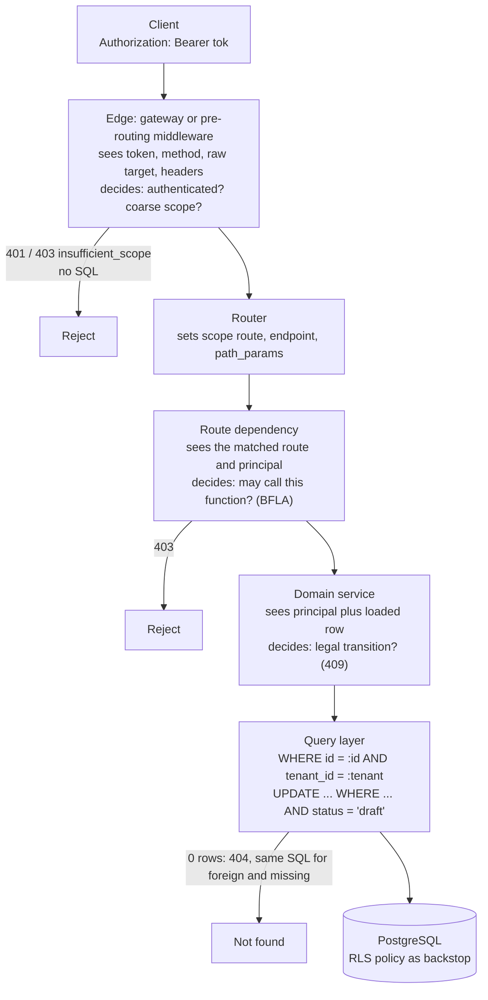

# Architectural Placement of Authorization: Why Coarse Scopes Belong at the Edge and Object-Level Checks Must Bind to the Database Query

> [!summary] Claim
> An authorization decision can only run where its inputs exist, so the edge (gateway or pre-routing middleware) owns authentication and coarse scopes because it sees only the token, method, and request target, while every object-level decision belongs inside the `WHERE` clause of the read or write that touches the row, because loading by id and checking afterwards leaks existence through status codes and timing, breaks pagination, and leaves a check-then-act window that only a predicate in the `UPDATE` itself closes.

Part of [API Authorization and OWASP Security](README.md) in [API Engineering](../README.md).

## TL;DR

Mechanism: authorization is a stack of decisions with different inputs (token validity, scope per route, function per route, visibility of a row, legality of a state transition), and each runs at the first layer that can see its inputs: the edge for scopes, a route-bound dependency for functions, and the query for rows.
Contract rule: every resource server must verify "for every request" that the token was meant "for that particular action on the particular resource" `(RFC 9700 Section 2.3)`, and OWASP puts the object check "in every function that uses an input from the client to access a record in the database" (OWASP API1:2023).
Trap: fetch-then-check (`session.get(Invoice, id)`, then `if invoice.tenant_id != me`) answers `403` versus `404` for foreign versus missing ids, and even when both answer `404` the lab measures 944 us versus 658 us p50 because the foreign row and its lines were loaded; a query-bound check runs byte-identical SQL for both (676 us versus 670 us).
Portability: the 19-test lab passed on CPython 3.14.6 with SQLAlchemy 2.1.8, Starlette 1.10.0, and FastAPI 0.162.0; the other matrix interpreters were not run because lab checks are paused (2026-11-11); Uvicorn 0.54.0, Hypercorn 0.18.0, and Granian 2.8.7 all percent-decode `path` and keep `raw_path` encoded, which is the parser differential that defeats path rules at the edge.
When not to use it: a rule that needs the loaded object (an invoice is `paid`, an approver is not the submitter) is a domain check after a tenant-scoped load, not a `WHERE` clause, and a policy too rich to compile to SQL needs a policy engine's list-filtering mode, at the price of a second system and its consistency window.

## Mental model



Each arrow down the diagram adds an input that the layer above did not have.
The edge has only the request line and headers, so it can reject a missing token with `401` or a token without `invoices:write` with `403` before any SQL runs, which is why coarse scopes belong there and why that layer is cheap (90 us p50 in the lab versus about 670 us for a query).
The router is the first component that knows which route matched; a guard bound to the route object, not to a path string, is immune to the encoding tricks that defeat string rules at the edge.
The domain service is where rules about the object's current state live, and the query layer is where visibility lives: the tenant predicate rides inside the `SELECT` or `UPDATE`, so a row the caller may not see is never read, never counted, and never modified, and a foreign id becomes indistinguishable from a missing one.
Row-level security in the database is the backstop for the query layer, not a replacement for any layer above it.

## How it works

### A decision runs where its inputs exist

The OAuth profile for JWT access tokens says what a token can carry and what it leaves to the server: scope strings "MUST have meaning for the resources indicated in the "aud" claim" `(RFC 9068 Section 2.2.3)`, tokens may embed `groups`, `roles`, and `entitlements` `(RFC 9068 Section 2.2.3.1)`, and a resource server "SHOULD use them in combination with any other contextual information available to determine whether the current call should be authorized or rejected", with the details "beyond the scope of this profile specification" `(RFC 9068 Section 4)`.
So the token answers "may this client do this kind of thing at this API", and the server's own data answers "may this principal touch this row".
RFC 9700 requires both: tokens SHOULD be audience-restricted and also "restricted to certain resources and actions", and "every resource server is obliged to verify, for every request, whether the access token sent with that request was meant to be used for that particular action on the particular resource" `(RFC 9700 Section 2.3)`.

| Decision | Inputs it needs | Earliest layer that has them | Failure response |
|---|---|---|---|
| Authenticated? | `Authorization` header, keys | edge | `401` + `WWW-Authenticate` `(RFC 9110 Section 15.5.2)` |
| Token meant for this API (`aud`) and action class (scope)? | claims, method, coarse target | edge | `403` `insufficient_scope` `(RFC 6750 Section 3.1)` |
| May call this function (admin, export, refund)? | matched route, principal | route dependency | `403` |
| May see this row (tenant, owner, ACL)? | row columns or relationship tuples | query (`WHERE`) | `404` |
| May see this field? | schema, principal | response model | field omitted ([[Defeating-BOPLA-and-Mass-Assignment-API3-2023-Strict-Input-Output-Schemas]]) |
| Is this transition legal now (`draft` -> `void`)? | current row state | domain, inside the write predicate | `409` |
| Which rows appear in a list? | every candidate row | query (`WHERE`, `ORDER BY`, `LIMIT` together) | shorter list |

NIST SP 800-207 gives the reason no single layer can do it all: the "implicit trust zone" is the area where entities are "trusted to at least the level of the last PDP/PEP gateway", and "The PDP/PEP cannot apply additional policies beyond its location in the flow of traffic" `(NIST SP 800-207 Section 2)`.
A gateway is a policy enforcement point positioned before the data, so it can enforce only policies expressible over what passes through it.
Zero trust is "moving the PDP/PEPs closer to the resource" `(NIST SP 800-207 Section 2)`; for object-level policy, closest to the resource means inside the statement that reads it.

### The edge: what it can see and what it decides well

A gateway's external authorization filter gets the request's attributes, not the application's rows.
Envoy's `ext_authz` filter "calls an external gRPC or HTTP service to determine whether an incoming HTTP request is authorized" and answers `403 (Forbidden)` when it is not; the request body reaches the authorization service only if `with_request_body` is set, which buffers it (Envoy `ext_authz` filter documentation, as of 2026-11).
Its failure behavior is fail-closed by default: `failure_mode_allow` "Defaults to `false`", and `status_on_error`, the status returned "when the authorization server returns an error or cannot be reached", defaults to `HTTP 403 Forbidden` (Envoy `ext_authz.proto` v3, as of 2026-11).
Per-route `disabled` can switch the filter off for a vhost or route, and the most specific per-filter config wins (Envoy `ExtAuthzPerRoute`), which is one more place where an exemption is decided by path matching.

An in-process middleware has the same visibility as a gateway because it runs before routing.
Starlette builds its stack as `ServerErrorMiddleware` (followed by `RequestBodyLimitMiddleware` when `max_body_size` is set), then the user middleware, then `ExceptionMiddleware`, then the router `(starlette 1.10.0 starlette/applications.py, Starlette.build_middleware_stack)`.
The router is the component that sets `scope["router"]`, `scope["route"]`, and, through the route's `matches`, `scope["endpoint"]` and `scope["path_params"]` `(starlette 1.10.0 starlette/routing.py, Router.app)` `(starlette 1.10.0 starlette/routing.py, Route.matches)`, so none of those keys exists while user middleware decides.
The lab's `EdgeScopeGate` therefore keys its rule on the method and the raw target, exactly as a gateway does:

```python
    def required_scope(self, method: str, raw_path: bytes) -> str:
        # Path rules on the raw target, as many gateways match; the router sees `path`.
        if raw_path.startswith(b"/admin"):
            return ADMIN_SCOPE
        return READ_SCOPE if method in {"GET", "HEAD"} else WRITE_SCOPE
```

What the edge does well it does cheaply and uniformly.
It answers a request with no credentials with `401` and a bare challenge, because when the request "lacks any authentication information" the server "SHOULD NOT include an error code" `(RFC 6750 Section 3.1)`, and the lab asserts exactly `WWW-Authenticate: Bearer realm="invoices"` with zero SQL statements executed.
It answers a valid token that lacks the action's scope with `403` and `error="insufficient_scope", scope="invoices:write"`, the code RFC 6750 assigns to a request that "requires higher privileges than provided by the access token" `(RFC 6750 Section 3.1)`, again before any SQL.
In the lab's probe an edge rejection costs 90.2 us p50 against 670.1 us for the cheapest query-bound miss, so scope checks at the edge are also load shedding: a token minted for a read-only client never reaches the connection pool.

What the edge cannot do is the rest of the table.
The lab's `EDGE_ONLY` placement passes Alice (tenant `acme`, a valid `invoices:read` token) through to `GET /invoices/2` and serves globex's invoice with `200`, because "scope `invoices:read`" is true of Alice and says nothing about invoice 2.
OWASP describes exactly this: comparing the session's user id to the id parameter "isn't a sufficient solution to solve Broken Object Level Authorization (BOLA)", and the check must use "the authorization mechanism to check if the logged-in user has access to perform the requested action on the record" (OWASP API1:2023).

### Middleware is one bypass away: CVE-2025-29927

Next.js applications commonly put authorization checks in middleware, and CVE-2025-29927 showed what that placement costs: "it is possible to bypass authorization checks within a Next.js application, if the authorization check occurs in middleware", in versions from 1.11.4 up to the fixes in 12.3.5, 13.5.9, 14.2.25, and 15.2.3, CVSS 3.1 base score 9.1 from the GitHub CNA, the only score NVD lists (NVD CVE-2025-29927, as of 2026-11).
The mechanism was an internal header, `x-middleware-subrequest`, that Next.js used "to detect and prevent recursion" and to "bypass the execution of Middleware" (Vercel, Postmortem on Next.js Middleware bypass); the advisory's workaround is to "prevent external user requests which contain the `x-middleware-subrequest` header from reaching your Next.js application" (GHSA-f82v-jwr5-mffw).
Vercel's postmortem draws the architectural conclusion: "We do not recommend Middleware to be the sole method of protecting routes in your application" (Vercel, Postmortem on Next.js Middleware bypass).
The Next.js data-security guide now recommends a Data Access Layer that will "Perform authorization checks" and "Return safe, minimal Data Transfer Objects (DTOs)", and its audit list asks of every server action "Does the action check ownership of the resource (authorization, not just authentication)?" (Next.js Data Security guide, last updated 2026-10-06).
The general lesson is not about one framework: any check that sits in front of the handler can be skipped by whatever mechanism lets requests skip it (an internal header, a second ingress, a mis-scoped matcher, a sidecar left out of one deployment), while a predicate inside the data access cannot be skipped without skipping the data.

### Path rules versus route-bound guards

String rules on the request target fail whenever the rule and the router parse the target differently.
RFC 9110 makes the differential legal: for `http` and `https` URIs, "Characters other than those in the "reserved" set are equivalent to their percent-encoded octets", and "any HTTP component MAY perform normalization" `(RFC 9110 Section 4.2.3)`, so `/%61dmin` and `/admin` identify the same resource.
Python ASGI servers decode the path and keep the raw target: Uvicorn's h11 protocol sets `path = unquote(raw_path.decode("ascii"))` and passes the undecoded bytes as `raw_path` `(uvicorn 0.54.0 uvicorn/protocols/http/h11_impl.py, H11Protocol.handle_events)`, its httptools protocol unquotes when the path contains `%` `(uvicorn 0.54.0 uvicorn/protocols/http/httptools_impl.py, HttpToolsProtocol.on_headers_complete)`, Hypercorn does the same `(hypercorn 0.18.0 src/hypercorn/protocol/http_stream.py, HTTPStream.handle)`, Granian sets `path` to `percent_decode_str(raw_path).decode_utf8_lossy()` and `raw_path` to the undecoded bytes `(granian 2.8.7 src/asgi/utils.rs, build_scope_common)`, and httpx's in-process transport sets `"path": request.url.path` (decoded) next to `raw_path` `(httpx 0.28.1 httpx/_transports/asgi.py, ASGITransport.handle_async_request)`.
Starlette routes on the decoded form through `get_route_path(scope)`, which reads `scope["path"]` and strips `root_path` `(starlette 1.10.0 starlette/_utils.py, get_route_path)`.
The lab reproduces the bypass: with the route guard off, `GET /admin/stats` with Alice's token gets `403`, while `GET /%61dmin/stats` passes the gate (raw `b"/%61dmin/stats"` does not start with `b"/admin"`), matches the `/admin/stats` route, and returns the cross-tenant counts `{"acme": 4, "globex": 2}` with `200`.

Production gateways have shipped the same bug class.
Envoy through 1.18.2 did not decode `%2F` and `%5C`, so "`/something%2F..%2Fadmin`" could bypass "a block on `/admin`" while the backend decoded and normalized it, with "Escalation of Privileges when using RBAC or JWT filters with enforcement based on URL path" (NVD CVE-2021-29492, CVSS 3.1 8.1 from the GitHub CNA, 8.3 from NVD); the fix was a new normalization option, not a default change.
Spring Security's `RegexRequestMatcher` "can easily be misconfigured to be bypassed on some servlet containers" when the regex contains `.` (NVD CVE-2022-22978, CVSS 3.1 9.8), `**` in WebFlux configuration "creates a mismatch in pattern matching between Spring Security and Spring WebFlux" (NVD CVE-2023-34034, 9.8 from NVD, 9.1 from the VMware CNA), and WebFlux static-resource rules could be bypassed (NVD CVE-2024-38821, 9.1 from the VMware CNA).
OWASP's guidance for function-level authorization follows: "Don't assume that an API endpoint is regular or administrative only based on the URL path" (OWASP API5:2023).

The fix is to bind the function-level guard to the route object rather than to a string.
In FastAPI a route's `dependencies` run after the router has matched, so the guard is attached to `/admin/stats` itself whatever bytes the client sent; with `route_guard=True` the encoded request gets `403` with `scope="admin"`, and the `ops` principal, which holds `admin`, gets `200`.
Starlette's own `requires` decorator works the same way at the endpoint: it checks `conn.auth.scopes` and raises `HTTPException(status_code=403)` by default, or closes a WebSocket `(starlette 1.10.0 starlette/authentication.py, requires)`.
Enumerating routes so that none lacks a guard (deny by default at the router) is the subject of [[Defeating-BFLA-API5-2023-Function-Level-Guards-and-Deny-By-Default-Routers]]; the edge can keep its path rule as a coarse first filter, as long as nothing relies on it alone.

### Fetch-then-check: three separate leaks

The most common placement of the object check is in the handler, after a primary-key load, and the Next.js guide's own mutation example has that shape: `findUnique({ where: { id: postId } })`, compare `post.authorId`, `throw new Error('Forbidden')`, then `delete({ where: { id: postId } })` (Next.js Data Security guide).
The lab's `FETCH_THEN_CHECK_403` and `FETCH_THEN_CHECK_404` placements implement it in SQLAlchemy:

```python
    loaded = await session.get(Invoice, invoice_id, options=[selectinload(Invoice.lines)])
    if loaded is None:
        raise _not_found()
    if placement is Placement.EDGE_ONLY or loaded.tenant_id == principal.tenant_id:
        return loaded
    raise _forbidden() if placement is Placement.FETCH_THEN_CHECK_403 else _not_found()
```

That is correct about who gets the data and still wrong in three ways.

Leak 1, the status oracle.
With `403` for a foreign row and `404` for a missing one, the status code is a membership test over the whole id space; the lab's Alice gets `403` for globex's invoice 2 and `404` for 999.
HTTP explicitly allows the fix: "An origin server that wishes to "hide" the current existence of a forbidden target resource MAY instead respond with a status code of 404 (Not Found)" `(RFC 9110 Section 15.5.4)`, and `404` means the server "did not find a current representation for the target resource or is not willing to disclose that one exists" `(RFC 9110 Section 15.5.5)`.
GitHub's REST API does this for private resources, using "a `404 Not Found` response instead of a `403 Forbidden` response to avoid confirming the existence of private" repositories (GitHub REST API troubleshooting guide, as of 2026-11).

Leak 2, the work oracle.
Answering `404` in both branches fixes the status code, not the work.
In the lab the foreign request emits two SQL statements (the invoice, then its lines through `selectinload`) and materializes invoice 2, while the missing request emits one and materializes nothing, and the two `404` bodies are byte-identical.
The probe turns that into time: 944.0 us p50 for the foreign id versus 657.8 us for the missing id, a 286 us gap that survives network jitter after enough samples and grows with every relationship, decryption, or audit write that happens before the check.

Leak 3, side effects before the decision.
Everything the load path does happens to rows the caller may not see: the ORM's `loaded_as_persistent` hook fired for globex's invoice (that is how the lab counts materialized rows), relationship loaders ran, and any cache warming, logging, or event emission attached to loading would have run too.
Log redaction and caching are separate notes ([[Structured-Log-Redaction-and-Preventing-PII-and-Token-Leaks]], [[Caching-Authenticated-and-Multi-Tenant-API-Responses]]); the placement point is that a check after the load cannot prevent effects of the load.

### Query-bound checks: the predicate inside the statement

The `QUERY_BOUND` placement puts the tenant into the read:

```python
    if placement is Placement.QUERY_BOUND:
        stmt = (
            select(Invoice)
            .where(Invoice.id == invoice_id, Invoice.tenant_id == principal.tenant_id)
            .options(selectinload(Invoice.lines))
        )
        invoice = (await session.scalars(stmt)).one_or_none()
        if invoice is None:
            raise _not_found()
        return invoice
```

For a foreign id and a missing id the lab records the same single statement, containing `invoices.id = ? AND invoices.tenant_id = ?`, zero materialized rows, and the same `404`; the probe measures 675.7 us versus 670.1 us p50, a 6 us difference inside the run's noise.
The caller's own invoice costs two statements and 977.4 us, which is information the caller is entitled to.
`tenant_id` comes from the verified principal, never from the request body or a header, which is what separates this from the identity-header trap in [[API-Authentication-Architecture-Edge-Verification-vs-Zero-Trust-Propagation]].

Lists are where the placement matters most.
The fetch-then-check style applied to lists is a post-filter: `SELECT ... WHERE id > :after ORDER BY id LIMIT 3`, then drop foreign rows in Python.
The lab's Alice owns invoices 1, 3, 5, and 6, yet her `limit=3` page under post-filtering holds `[1, 3]` with `next_after` 3, and the ORM materialized `[1, 2, 3]`, globex's row included.
A short page with a cursor breaks clients that stop on a short page, any `total` count computed before filtering leaks the size of other tenants' data, and the obvious repair, looping until the page fills, turns one query into an unbounded scan when the caller can see little.
With the predicate in `WHERE`, `LIMIT` and `ORDER BY` operate on visible rows only: the lab returns `[1, 3, 5]` then `[6]` with `next_after: null`, and materializes only Alice's rows; cursor design itself is in [[Bidirectional-Keyset-Pagination-and-Relay-Cursor-Connections]].

Mutations need the predicate in the write, not before it.
Check-then-act has a window between the ownership check and the `UPDATE ... WHERE id = :id`; the lab's `between_check_and_act` hook transfers invoice 1 to globex inside that window (simulated in the same transaction, which is what a concurrent commit looks like to the next statement under read committed), and Alice's request voids an invoice that globex owns by the time the write runs: the row ends as `("globex", "void")`.
The query-bound write carries every condition:

```python
            voided = await session.execute(
                update(Invoice)
                .where(
                    Invoice.id == invoice_id,
                    Invoice.tenant_id == principal.tenant_id,
                    Invoice.status == "draft",
                )
                .values(status="void")
                .returning(Invoice.id)
            )
```

PostgreSQL makes this atomic under its default isolation level, read committed: a concurrent `UPDATE` waits for the first updater, and if that one commits, "The search condition of the command (the `WHERE` clause) is re-evaluated to see if the updated version of the row still matches the search condition" (PostgreSQL 18 documentation, Section 13.2.1).
So if the transfer commits first, the void finds no matching row and the lab answers `404` with the row left `("globex", "draft")`; if the void commits first, it voided Alice's own draft, which is correct.
An empty `RETURNING` cannot say why nothing matched, so the lab explains the miss with a second query bound to the same tenant: `409 invoice is void` for Alice's own already-voided invoice, `404` for Bob asking about it, because a `409` to Bob would be the status oracle again.
A state rule that is easier to evaluate in code than in SQL is still fine after a tenant-scoped `SELECT ... FOR UPDATE`, which takes the row lock that read committed would otherwise not hold between statements.

### The ORM traps: `Session.get` and the identity map

Binding the check to the query only works if a query actually runs.
`Session.get` first looks in the identity map and returns a cached instance without SQL unless `populate_existing`, `with_for_update`, or `always_refresh` is set `(sqlalchemy 2.1.8 lib/sqlalchemy/orm/session.py, Session._get_impl)`; only on a miss does it build `select(mapper)` and pass it to `_load_on_pk_identity`, which adds the primary-key criteria and calls `session.execute` `(sqlalchemy 2.1.8 lib/sqlalchemy/orm/loading.py, _load_on_pk_identity)`, which is where `do_orm_execute` hooks and `with_loader_criteria` get to add the tenant predicate.
The lab installs such a hook for tenant `acme` and shows both sides: a cold `session.get(Invoice, 2)` returns `None` because the criteria reach the SQL, but after an unscoped admin path in the same session loads invoice 2 (`execution_options(skip_tenant=True)`), `session.get(Invoice, 2)` returns globex's invoice with zero SQL statements, while `select(Invoice).where(Invoice.id == 2)` in the same session emits one statement and returns nothing.
The identity map holds instances weakly (`identity._WeakInstanceDict` in `Session.__init__`), so the leak depends on object lifetime: the lab's first draft of this test kept no reference to the admin-loaded object, it was collected, and `Session.get` went back to SQL and returned `None`.
A bug that appears only when another code path in the same unit of work happens to hold a reference is the kind that passes review and tests and fails in production; the rule is that authorization-relevant lookups use `select()` with an explicit predicate and never `Session.get`, and sessions are not shared across principals.
Global tenant criteria through `do_orm_execute`, a tenant-scoped repository type, and their test strategy are covered in [[Defeating-BOLA-API1-2023-Tenant-Scoped-Queries-and-PostgreSQL-RLS]].

### Integrity constraints read across every row

Row filters do not cover constraint checks.
PostgreSQL states it for row-level security: "Referential integrity checks, such as unique or primary key constraints and foreign key references, always bypass row security", so policies must be designed "to avoid "covert channel" leaks of information through such referential integrity checks" (PostgreSQL 18 documentation, Section 5.9).
The same holds for application-level filters, because a `UNIQUE` index is evaluated over the whole table.
With a global `UNIQUE (number)` the lab's Alice gets `409` for invoice number `G-1` (globex's) and `201` for `G-9`, an enumeration oracle; with the per-tenant `UNIQUE (tenant_id, number)` the same request creates `acme`'s own `G-1` with `201`, and a duplicate inside her tenant (`A-1`) still gets `409`.
The same reasoning makes foreign keys composite in multi-tenant schemas, `(tenant_id, parent_id)` referencing `(tenant_id, id)`, so a reference to another tenant's row fails as "not found" rather than succeeding or revealing existence.

### The database as backstop

Row-level security is the layer under the query layer: with RLS enabled and no policy, "a default-deny policy is used, meaning that no rows are visible or can be modified", but "Superusers and roles with the `BYPASSRLS` attribute always bypass the row security system", and table owners do too unless the table is altered with `FORCE ROW LEVEL SECURITY` (PostgreSQL 18 documentation, Section 5.9).
A policy with only `USING` implicitly gets an identical `WITH CHECK`; rows filtered by `USING` disappear silently, while a row that fails `WITH CHECK` raises `new row violates WITH CHECK OPTION` (PostgreSQL 18 documentation, Section 5.9).
That silence is the point: under RLS a foreign id behaves like a missing one, which is the property the query-bound check provides in application code.
RLS does not replace the application predicate, because the application role often owns the tables, because connection pools must reset the session variable that carries the tenant, and because the query planner still needs the predicate to use the `(tenant_id, ...)` index; the setup, `SET LOCAL` per transaction, and pooling hazards are in [[Defeating-BOLA-API1-2023-Tenant-Scoped-Queries-and-PostgreSQL-RLS]].

### Externalized policy: where a PDP plugs into this stack

When object-level policy lives in a separate decision point (a Zanzibar-style relationship store, OPA, Cedar), the placement question becomes how its answer reaches the query.
OpenFGA documents three patterns for lists: "Search, then check" (pre-filter in the database, then a batch check, appropriate when the search returns few results), "Build a local index from changes endpoint, search, then check", and "Build a list of IDs, then search" through `list-objects`, which it calls workable when the number of objects of a type a user can reach is low (about 1000) and is also a low percentage of all objects, and "impractical" as that number grows; it also warns that a partial list "is not enough, because you won't be able to sort using it" (OpenFGA, Search with Permissions, as of 2026-11).
OPA's answer is partial evaluation: "OPA can be used to derive the needed SQL filter at run time, leveraging OPA's partial evaluation feature", returning a condition such as `WHERE employees.department = 'engineering'` that the application appends to its query (OPA Data Filtering documentation, as of 2026-11).
Both are this note's rule with a remote policy: the decision is still compiled into, or intersected with, the statement that reads the rows; a per-row `check` call after an unfiltered `SELECT` is the post-filter with a network hop added.
Model choice (RBAC, ABAC, ReBAC) and Zanzibar's consistency tokens are in [[Authorization-Models-Scopes-RBAC-ABAC-and-Zanzibar-ReBAC]].

## Numbers and limits

| Quantity | Value | Source |
|---|---|---|
| Edge rejection, no token (`401`) | 90.2 us p50, 107.3 us p90 | measured |
| Fetch-then-check-404, foreign id | 944.0 us p50, 1155.2 us p90 | measured |
| Fetch-then-check-404, missing id | 657.8 us p50, 752.8 us p90 | measured |
| Query-bound, foreign id | 675.7 us p50, 774.1 us p90 | measured |
| Query-bound, missing id | 670.1 us p50, 766.7 us p90 | measured |
| Query-bound, own id (row plus lines) | 977.4 us p50, 1185.8 us p90 | measured |
| SQL statements, fetch-then-check foreign / missing | 2 / 1 | lab assertion |
| SQL statements, query-bound foreign / missing / own | 1 / 1 / 2 | lab assertion |
| SQL statements before an edge `401` or `403` | 0 | lab assertion |
| Post-filtered `limit=3` page for Alice | 3 rows read, 2 returned, 1 foreign materialized | lab assertion |
| `Session.get` identity-map hit | 0 statements, tenant criteria not applied | lab assertion |
| OpenFGA "list of IDs" pattern | practical near ~1000 accessible objects per type | OpenFGA docs (as of 2026-11) |
| Envoy `ext_authz` `failure_mode_allow` / `status_on_error` defaults | `false` / `403` | Envoy `ext_authz.proto` v3 (as of 2026-11) |
| CVE-2025-29927 (Next.js middleware bypass) | CVSS 3.1 9.1 (GitHub CNA) | NVD (as of 2026-11) |
| CVE-2021-29492 (Envoy escaped slash) | CVSS 3.1 8.1 (GitHub CNA), 8.3 (NVD) | NVD (as of 2026-11) |
| CVE-2022-22978 / CVE-2023-34034 / CVE-2024-38821 (Spring Security) | 9.8 (NVD) / 9.8 (NVD), 9.1 (VMware CNA) / 9.1 (VMware CNA) | NVD (as of 2026-11) |
| Lab module | 19 tests, 1.77 s (first, cold run) | `pytest -q`, CPython 3.14.6 |

Measured rows come from one run of a probe script (`probe/probe.py` in the verify job, removed after the run; command `uv run --frozen python ../probe/probe.py` from `labs/`) on an Apple M3 Pro, macOS 27.3 arm64 (`uname -r` 27.3.0), CPython 3.14.6, SQLAlchemy 2.1.8 with aiosqlite 0.22.1 on an in-memory SQLite database, FastAPI 0.162.0, httpx 0.28.1 `ASGITransport` with one reused `AsyncClient` per placement: 100 warm-up rounds, then 1500 interleaved rounds per case, single process, p90 from `statistics.quantiles(n=10)`.
They include the full in-process ASGI path (httpx request building, middleware, FastAPI dependency resolution, SQLAlchemy, aiosqlite's worker thread), so the absolute values are a lower bound for a networked deployment and the differences are what matter.
The derived figure: the fetch-then-check timing gap (286 us) is about 50 times the query-bound gap (6 us).
The figures are in-process timings only; they show that the two designs leak differently, not how detectable the gap is from a remote client.

## Portability

| Runtime, library, or protocol | Behavior | Evidence |
|---|---|---|
| CPython 3.14.6 (workspace `.venv`) | 19 passed | `uv run --frozen pytest ... -q`, macOS 27.3 arm64 |
| CPython 3.12.16, 3.13.18, 3.14.10, 3.15.2, 3.15.2t | not run: lab checks paused by the user on 2026-11-11 | `report.md` |
| SQLAlchemy 2.1.8 | `Session.get` identity-map shortcut; weak identity map; `Result.tuples()` emits `SADeprecationWarning` "deprecated since: 2.1.0" | `(sqlalchemy 2.1.8 lib/sqlalchemy/orm/session.py, Session._get_impl)`; lab run |
| SQLAlchemy 2.0.57 (`sqlalchemy20` group) | not run | - |
| Starlette 1.10.0 | user middleware runs before `Router.app` sets `route`, `endpoint`, `path_params`; routing uses decoded `path` | `(starlette 1.10.0 starlette/routing.py, Router.app)`; lab |
| FastAPI 0.162.0 | route `dependencies` run after routing, so a guard is bound to the route | lab (`test_route_level_guard_closes_the_encoding_gap`) |
| httpx 0.28.1 `ASGITransport` | `path` decoded, `raw_path` as sent | `(httpx 0.28.1 httpx/_transports/asgi.py, ASGITransport.handle_async_request)`; lab |
| Uvicorn 0.54.0 (h11 and httptools) | `path` unquoted, `raw_path` raw | installed source, see How it works |
| Hypercorn 0.18.0 | `path` unquoted, `raw_path` raw | `(hypercorn 0.18.0 src/hypercorn/protocol/http_stream.py, HTTPStream.handle)` |
| Granian 2.8.7 | `path` percent-decoded (invalid UTF-8 replaced lossily), `raw_path` raw | `(granian 2.8.7 src/asgi/utils.rs, build_scope_common)`, read at the `v2.8.7` tag |
| HTTP/1.1, HTTP/2, HTTP/3 | the request target travels as the request line or the `:path` pseudo-header with "the path and query parts of the target URI", so the encoding differential is version-independent | `(RFC 9113 Section 8.3.1)`, `(RFC 9114 Section 4.3.1)` |
| PostgreSQL read committed | `UPDATE` re-evaluates `WHERE` against a concurrently committed row version | PostgreSQL 18 docs Section 13.2.1 |
| SQLite (lab) | single connection, no concurrent writers; the race is simulated inside one transaction | lab design |

## Worked example

The [implementation](../labs/src/api_labs/f15_api_authorization_and_owasp_security/authz_placement.py) is one FastAPI invoice API over in-memory SQLite with two tenants, an `EdgeScopeGate` ASGI middleware that authenticates opaque tokens and enforces one coarse scope per method, and a `Placement` enum that moves the object-level check between `EDGE_ONLY`, `FETCH_THEN_CHECK_403`, `FETCH_THEN_CHECK_404`, and `QUERY_BOUND`.
A `Store` records every SQL statement through the engine's `before_cursor_execute` event and every invoice built from a row through the session's `loaded_as_persistent` event, which is how the tests see work that responses hide.
The [test](../labs/tests/f15_api_authorization_and_owasp_security/test_where_authorization_lives_gateway_middleware_vs_domain_and_query_layer.py) has 19 `unit` tests driven through `httpx.ASGITransport`.

The status and work oracles, verbatim from the test:

```python
@pytest.mark.unit
@pytest.mark.asyncio
async def test_fetch_then_check_404_still_reads_the_foreign_row(store: Store) -> None:
    app = create_app(store, Placement.FETCH_THEN_CHECK_404)
    foreign = await call(app, "GET", "/invoices/2", "tok-alice")
    foreign_sql, foreign_rows = sql(store), list(store.materialized)
    store.reset()
    missing = await call(app, "GET", "/invoices/999", "tok-alice")
    assert foreign.status_code == missing.status_code == 404
    assert foreign.json() == missing.json()
    # Same response, different work: the foreign row and its lines were loaded.
    assert (len(foreign_sql), foreign_rows) == (2, [2])
    assert (len(sql(store)), store.materialized) == (1, [])


@pytest.mark.unit
@pytest.mark.asyncio
async def test_query_bound_foreign_and_missing_ids_run_identical_sql(store: Store) -> None:
    app = create_app(store, Placement.QUERY_BOUND)
    foreign = await call(app, "GET", "/invoices/2", "tok-alice")
    foreign_sql, foreign_rows = sql(store), list(store.materialized)
    store.reset()
    missing = await call(app, "GET", "/invoices/999", "tok-alice")
    assert foreign.status_code == missing.status_code == 404
    assert foreign_sql == sql(store)
    assert len(foreign_sql) == 1
    assert "invoices.id = ? AND invoices.tenant_id = ?" in foreign_sql[0]
    assert foreign_rows == store.materialized == []
```

The check-then-act race, verbatim:

```python
async def transfer_to_globex(session: AsyncSession, invoice_id: int) -> None:
    """A concurrent transaction that commits between the check and the act."""
    await session.execute(
        update(Invoice).where(Invoice.id == invoice_id).values(tenant_id="globex")
    )


@pytest.mark.unit
@pytest.mark.asyncio
async def test_check_then_act_voids_an_invoice_transferred_mid_request(store: Store) -> None:
    app = create_app(
        store, Placement.FETCH_THEN_CHECK_404, between_check_and_act=transfer_to_globex
    )
    r = await call(app, "POST", "/invoices/1/void", "tok-alice")
    assert r.status_code == 200
    # Alice voided an invoice that globex owned by the time the UPDATE ran.
    assert await row_state(store, 1) == ("globex", "void")
```

Captured run, from `labs/`, CPython 3.14.6 on macOS 27.3 arm64 (Apple M3 Pro):

```text
$ uv run --frozen pytest tests/f15_api_authorization_and_owasp_security/test_where_authorization_lives_gateway_middleware_vs_domain_and_query_layer.py -q
...................                                                      [100%]
19 passed in 1.77s
```

An earlier draft of `test_session_get_identity_map_hit_skips_tenant_criteria` failed with `assert None is not None`: the test did not keep a reference to the admin-loaded invoice, the weak identity map dropped it, and `Session.get` queried again with the tenant criteria; holding the reference (as any real code path that uses the object does) produced the green run above.
A one-off check repeated the unreferenced case on the same setup: `session.get(Invoice, 2)` returned `None` after emitting one `SELECT`.

## Pitfalls

> [!warning] Authorization only in middleware or at the gateway
> Trigger: the gateway or a pre-routing middleware is the only place that checks permissions, because it is central and easy to audit.
> Symptom: any path around it is a full bypass; CVE-2025-29927 let a request with `x-middleware-subrequest` skip Next.js middleware entirely (NVD, CVSS 9.1), and the lab's `EDGE_ONLY` placement serves another tenant's invoice to a valid token.
> Fix: keep scopes at the edge as a coarse filter and repeat every object-level decision in the data access, as Vercel's postmortem and the Next.js Data Access Layer guidance now say.

> [!warning] Path-string rules at the edge
> Trigger: a gateway rule such as "require `admin` for `/admin*`" while the backend decodes or normalizes the path differently.
> Symptom: `/%61dmin/stats` or `/x%2F..%2Fadmin` reaches the admin handler without the admin check (CVE-2021-29492 in Envoy, CVE-2023-34034 and CVE-2022-22978 in Spring Security; the lab's `test_raw_path_edge_rule_is_bypassed_by_percent_encoding`).
> Fix: attach function-level guards to route objects after routing, and normalize identically at the edge if path rules remain.

> [!warning] `403` for foreign objects
> Trigger: the handler distinguishes "not yours" (`403`) from "does not exist" (`404`).
> Symptom: id enumeration across tenants; the status code is a membership oracle.
> Fix: answer `404` for both, which RFC 9110 Section 15.5.4 permits explicitly and GitHub's API does for private repositories.

> [!warning] Uniform `404` but load-then-check
> Trigger: `session.get` or `findUnique` by id, then compare owner, then `404`.
> Symptom: foreign ids cost measurably more (944 us versus 658 us p50 in the lab) and run relationship loaders, hooks, and logging on rows the caller may not see.
> Fix: put the tenant or owner predicate in the `WHERE` clause so foreign and missing ids run identical SQL.

> [!warning] Post-filtering lists
> Trigger: fetch a page, then drop unauthorized rows in application code or through per-row policy checks.
> Symptom: short pages, wrong totals, cursors that skip or repeat, and unauthorized rows read into memory; loop-until-full variants become unbounded scans.
> Fix: filter in SQL, or compile the policy to SQL (OPA partial evaluation) or intersect with an authorized-id set (OpenFGA `list-objects`) before `ORDER BY` and `LIMIT`.

> [!warning] Check, then write by id
> Trigger: ownership or state is checked, then `UPDATE ... WHERE id = :id` or `DELETE ... WHERE id = :id` runs as a separate statement.
> Symptom: a concurrent transfer or state change between the two statements lets the write hit a row the caller no longer owns (the lab's `("globex", "void")`).
> Fix: repeat the full predicate in the write (`AND tenant_id = :t AND status = 'draft'`) and use `RETURNING`, or lock the row with `SELECT ... FOR UPDATE` inside the same transaction.

> [!warning] `Session.get` after any unscoped load in the same session
> Trigger: global tenant criteria through `do_orm_execute`, plus `Session.get` for lookups, plus an admin or background path that loads rows without criteria in the same session.
> Symptom: an identity-map hit returns another tenant's object with no SQL; whether it happens depends on whether something still references the object, so it is intermittent.
> Fix: never use `Session.get` for authorization-relevant lookups, and never share a session across principals or between scoped and unscoped code.

> [!warning] Global unique constraints in a multi-tenant table
> Trigger: `UNIQUE (number)` or `UNIQUE (email)` across tenants, with a `409` on violation.
> Symptom: any tenant can test whether a value exists anywhere; PostgreSQL documents unique and foreign key checks as bypassing RLS.
> Fix: make uniqueness and foreign keys tenant-composite, and treat any remaining global uniqueness as a deliberate, documented disclosure.

## Security and robustness

Threat model: an authenticated attacker with a valid, correctly scoped token for their own tenant who controls every id, query parameter, and path byte, and who can measure response time; this is OWASP API1:2023's attacker, and the scope check at the edge does not stop them by design.
Unauthenticated attackers and wrongly scoped clients are the edge's job, and the lab shows the edge rejecting both before any SQL.

Mapping to OWASP API Security Top 10 2023:
API1 (BOLA) is the query-bound predicate; API5 (BFLA) is the route-bound guard, with OWASP's rule that enforcement "should deny all access by default, requiring explicit grants to specific roles for access to every function" (OWASP API5:2023); API3 (BOPLA) is the response model; API4 (resource consumption) benefits from edge rejection before the database and suffers from post-filter loops.
The OWASP Authorization Cheat Sheet's principles map onto placement: "Deny by Default", "Validate the Permissions on Every Request" because "Validating permissions correctly on just the majority of requests is insufficient", "Perform access control checks on every request for the specific object or functionality being accessed", and "Do not let the capabilities of any library, platform, or framework guide your authorization requirements" (OWASP Authorization Cheat Sheet).

Fail closed at every layer.
The lab's `principal_dep` raises `401` if no principal is in the ASGI scope, so removing or reordering the middleware cannot silently grant access; Envoy's `ext_authz` defaults to the same posture (`failure_mode_allow: false`, `403` on error).

Defense in depth is ordered, not redundant.
The edge sheds unauthenticated and under-scoped traffic, the route guard pins functions to routes, the query predicate decides visibility and atomic writes, and RLS catches the query that someone wrote without the predicate.
Each layer catches a failure mode the others cannot: the edge cannot see rows, the query cannot see that a route should not exist, and RLS cannot see application roles unless they are passed into the session.

Robustness of the responses themselves: `404` for invisible objects, `409` only after a tenant-scoped re-read, `403 insufficient_scope` only for token-level deficits that the client can remedy by obtaining a different token, and `401` with a challenge only for missing or invalid credentials `(RFC 6750 Section 3.1)`.
A `404` is "heuristically cacheable" `(RFC 9110 Section 15.5.5)`, so authorization-dependent `404` responses must not be cached by a shared cache keyed without the principal; see [[Caching-Authenticated-and-Multi-Tenant-API-Responses]].

## The principal's view

The decision a staff-plus engineer makes is not "gateway or service" but which decisions each layer owns, and the answer follows from data dependency: the platform team owns authentication and token-level scopes at the edge, every product team owns object visibility in its data access layer, and nobody owns a check that is placed where its inputs do not exist.
Writing that down as an ownership table (the one in How it works) stops the two recurring organizational failures: the platform team asked to "add tenant checks to the gateway", which it cannot do without copying the domain's data, and product teams assuming "the gateway handles auth".

The engineering lever is to make the safe placement the only convenient one.
A repository type that cannot be constructed without a principal, a lint or startup check that rejects routes without a guard, and a test harness that runs every endpoint as a second tenant and expects `404` turn an architecture principle into something CI enforces; the same harness should assert that foreign and missing ids produce identical SQL, which is cheap and catches post-filters and load-then-check paths.

The trade-offs are real.
Query-bound checks spread authorization predicates across many queries, which is harder to audit than one policy file; the mitigation is to generate them from one place (a repository base class, ORM criteria, or a policy engine's partial evaluation) and to use RLS as the independent backstop.
Externalizing object policy to a Zanzibar-style service centralizes it and supports cross-service sharing, at the cost of a network call per decision, a consistency window between writes and checks, and the list-filtering problem, which forces either a local index or an id-list intersection; choose it when relationships cross services or tenants, and keep tenant isolation in the database regardless.
Where a GraphQL or gRPC layer replaces REST routes, the same placement rules hold per resolver or per method: field resolvers that load by id are the fetch-then-check pattern multiplied by the query's breadth.

## Interview questions

> [!question] L5: Why can't an API gateway enforce "users may only read their own orders"?
>
> > [!success]- Answer
> > The gateway sees the token, method, path, and headers, while ownership is a property of the order row in the service's database.
> > To decide it, the gateway would need to read that row, which means duplicating the service's data or calling the service, and then the service is making the decision anyway.
> > The gateway can enforce that the token has `orders:read` for this API, which is a coarse scope, and the service must add `WHERE owner_id = :me` to the query.
> >
> > Follow-up: What should the service return when the order exists but belongs to someone else, and why?

> [!question] L5: Your handler loads a document by id and returns `403` if the caller does not own it. What is wrong?
>
> > [!success]- Answer
> > The status code distinguishes "exists but not yours" (`403`) from "does not exist" (`404`), so any caller can enumerate which ids exist across tenants.
> > RFC 9110 Section 15.5.4 allows an origin server to answer `404` to hide the existence of a forbidden resource, and GitHub does this for private repositories.
> > Switching to `404` is necessary but not sufficient: the load still happens, so timing and side effects still differ unless the predicate moves into the query.
> >
> > Follow-up: When is `403` still the right answer for an authorization failure?

> [!question] L6: Predict the output. In the lab, Alice owns invoices 1, 3, 5, and 6; globex owns 2 and 4. Under post-filtering, what does `GET /invoices?limit=3` return, and how many invoice rows were materialized?
>
> > [!success]- Answer
> > The query selects ids 1, 2, and 3 ordered by id with `LIMIT 3`, then drops globex's invoice 2 in Python.
> > The response has items `[1, 3]` and `next_after` 3, a short page even though Alice owns four invoices.
> > Three rows were materialized, `[1, 2, 3]`, including one she may not see.
> > With the tenant predicate in `WHERE`, the page is `[1, 3, 5]` with `next_after` 5, and only Alice's rows are read.
> >
> > Follow-up: Why is "keep fetching until the page is full" a bad fix for the short page?

> [!question] L6: Debug this API. Tenants report that invoices they own are occasionally voided by another tenant's user, and every void endpoint checks ownership. What do you look for?
>
> > [!success]- Answer
> > A check-then-act sequence: the handler loads the invoice, checks `tenant_id`, and then runs `UPDATE invoices SET status = 'void' WHERE id = :id` as a separate statement.
> > If ownership can change (transfer, merge, reassignment) between the check and the write, the write hits a row the caller no longer owns; the lab reproduces this and ends with `("globex", "void")`.
> > The fix is to repeat the full predicate in the write, `WHERE id = :id AND tenant_id = :t AND status = 'draft' RETURNING id`, which PostgreSQL read committed re-evaluates against a concurrently committed row version, or to lock the row with `SELECT ... FOR UPDATE` first.
> > I would also look for `Session.get` lookups that could return a cached object loaded by an unscoped code path.
> >
> > Follow-up: The fixed `UPDATE` returns no row. How do you tell the caller "already void" without creating an existence oracle?

> [!question] L6: Your edge config requires the `admin` scope for every path starting with `/admin`. A pentester reaches the admin endpoint with a normal token. How?
>
> > [!success]- Answer
> > The edge matched the raw request target while the backend matched a decoded or normalized path, for example `/%61dmin/stats`, which RFC 9110 Section 4.2.3 says is equivalent to `/admin/stats`.
> > Uvicorn and Hypercorn put the decoded string in the ASGI `path` and the original bytes in `raw_path`, and Starlette routes on `path`, so a rule on `raw_path` and a router on `path` disagree.
> > Envoy CVE-2021-29492 (`%2F`) and Spring Security CVE-2023-34034 are production instances of the same differential.
> > The fix is a guard bound to the route object after routing, with the edge rule kept only as a coarse filter.
> >
> > Follow-up: Why doesn't normalizing at the edge alone close this class of bug permanently?

> [!question] L6: You enabled tenant criteria on every ORM query through `do_orm_execute`. Can a handler still return another tenant's row?
>
> > [!success]- Answer
> > Yes, through `Session.get`, which returns an object from the identity map without emitting SQL, so the hook never runs.
> > If an unscoped code path (an admin job, a migration helper) loaded that object earlier in the same session and something still references it, `Session.get` returns it; the lab shows zero statements and globex's invoice.
> > Because the identity map is weak-referencing, it happens only when the object is still alive, which makes it intermittent.
> > Use `select()` with an explicit predicate for authorization-relevant lookups and never share sessions between scoped and unscoped code.
> >
> > Follow-up: What other ORM features read rows without running your query hook?

> [!question] L7+: Design authorization placement for a multi-tenant platform where object permissions come from a Zanzibar-style service and list endpoints must support sorting and pagination.
>
> > [!success]- Answer
> > Keep authentication and token scopes at the edge, function guards bound to routes, and tenant isolation in the database (query predicate plus RLS) regardless of the relationship service.
> > For single-object reads, check the relationship service after a tenant-scoped load, or batch checks, and answer `404` on denial.
> > For lists, choose among OpenFGA's documented patterns by cardinality: an id list from `list-objects` intersected in SQL works near ~1000 accessible objects, a local index fed by the changes stream scales further at the cost of a staleness window that must be filtered at read time, and search-then-check fits only searches that already return few rows.
> > Name the consistency trade-off explicitly: a revoked permission may still be visible in a local index until it catches up, so sensitive actions re-check at write time.
> >
> > Follow-up: How do you test that the local index never shows an object after its permission was revoked for longer than your stated bound?

> [!question] L7+: An engineer proposes removing all application-level tenant predicates because PostgreSQL RLS now enforces isolation. Do you approve?
>
> > [!success]- Answer
> > No; RLS is the backstop, not the primary placement.
> > Table owners bypass RLS unless `FORCE ROW LEVEL SECURITY` is set and `BYPASSRLS` roles always bypass it, and the tenant setting must be correctly scoped per transaction in a pooled connection, so a misconfiguration silently disables isolation.
> > Unique and foreign key checks bypass RLS, so constraint design still matters, and the planner benefits from the explicit predicate for index use.
> > Two independent mechanisms with different failure modes are what defense in depth means; keep both and test that each alone blocks cross-tenant reads.
> >
> > Follow-up: How would you prove in CI that RLS alone, with the application predicate removed, still blocks every cross-tenant read?

> [!question] L7+: After CVE-2025-29927, your organization asks whether middleware-based authorization should be banned. What policy do you write?
>
> > [!success]- Answer
> > Middleware and gateways remain the right place for authentication and coarse, token-level scopes, because they are cheap, uniform, and shed load before the database.
> > The policy forbids middleware as the sole enforcement of any object-level or function-level decision: those must be enforced at the route and in the data access, as Vercel's postmortem and the Next.js Data Access Layer guidance now say.
> > It requires fail-closed defaults (Envoy `failure_mode_allow: false`), stripping internal control headers at ingress, and a CI test that calls every endpoint as another tenant and with an under-scoped token.
> >
> > Follow-up: How do you detect, after the fact, whether the bypass was exploited, given that the middleware never ran?

## Related

Prerequisites: [[Authorization-Models-Scopes-RBAC-ABAC-and-Zanzibar-ReBAC]]

Next: [[OWASP-API-Security-Top-10-2023-Complete-Threat-Model]]

See also: [[02-Programming-Languages/Python/Python-Backend-Interview-Prep/07-Auth-and-Security]], [[Defeating-BOLA-API1-2023-Tenant-Scoped-Queries-and-PostgreSQL-RLS]], [[Defeating-BFLA-API5-2023-Function-Level-Guards-and-Deny-By-Default-Routers]], [[Defeating-BOPLA-and-Mass-Assignment-API3-2023-Strict-Input-Output-Schemas]], [[API-Authentication-Architecture-Edge-Verification-vs-Zero-Trust-Propagation]], [[Caching-Authenticated-and-Multi-Tenant-API-Responses]], [[Structured-Log-Redaction-and-Preventing-PII-and-Token-Leaks]], [[Bidirectional-Keyset-Pagination-and-Relay-Cursor-Connections]]

- Lab: `labs/tests/f15_api_authorization_and_owasp_security/test_where_authorization_lives_gateway_middleware_vs_domain_and_query_layer.py`

## Further reading

- [RFC 9700 Section 2.3](https://www.rfc-editor.org/rfc/rfc9700.html): OAuth security BCP requiring every resource server to verify the token for "that particular action on the particular resource" on every request.
- [RFC 9068](https://www.rfc-editor.org/rfc/rfc9068.html): JWT access token profile; Sections 2.2.3 and 4 define what authorization claims a token carries and leave the resource-level decision to the server.
- [RFC 6750 Section 3.1](https://www.rfc-editor.org/rfc/rfc6750.html): the `invalid_token` / `insufficient_scope` to `401` / `403` mapping the edge uses.
- [RFC 9110 Sections 4.2.3, 15.5.4, 15.5.5](https://www.rfc-editor.org/rfc/rfc9110.html): URI equivalence under percent-encoding, and `404` as the sanctioned way to hide a forbidden resource.
- [NIST SP 800-207 Sections 2 and 3](https://nvlpubs.nist.gov/nistpubs/SpecialPublications/NIST.SP.800-207.pdf): implicit trust zones and why a PEP cannot enforce policy beyond its position.
- [OWASP API1:2023 BOLA](https://api-security.owasp.org/editions/2023/en/0xa1-broken-object-level-authorization): the object check belongs in every function that uses client input to access a record.
- [OWASP API5:2023 BFLA](https://api-security.owasp.org/editions/2023/en/0xa5-broken-function-level-authorization): deny by default and do not classify endpoints by URL path.
- [GHSA-f82v-jwr5-mffw](https://github.com/vercel/next.js/security/advisories/GHSA-f82v-jwr5-mffw) and [Vercel's postmortem](https://vercel.com/blog/postmortem-on-next-js-middleware-bypass): the canonical middleware-only authorization failure.
- [NVD CVE-2021-29492](https://nvd.nist.gov/vuln/detail/CVE-2021-29492): Envoy's escaped-slash path rule bypass, the gateway form of the parser differential.
- [PostgreSQL Row Security Policies](https://www.postgresql.org/docs/current/ddl-rowsecurity.html): default deny, bypass rules, and the covert channel through integrity checks.
- [PostgreSQL Transaction Isolation](https://www.postgresql.org/docs/current/transaction-iso.html): why a predicate inside `UPDATE` is re-checked against concurrent commits under read committed.
- [OpenFGA Search with Permissions](https://openfga.dev/docs/interacting/search-with-permissions) and [OPA Data Filtering](https://www.openpolicyagent.org/docs/filtering): how external policy engines reach the query instead of post-filtering it.
- [SQLAlchemy 2.1.8 `orm/session.py`](https://github.com/sqlalchemy/sqlalchemy/blob/rel_2_1_8/lib/sqlalchemy/orm/session.py): `Session._get_impl`, the identity-map shortcut that skips query hooks.
