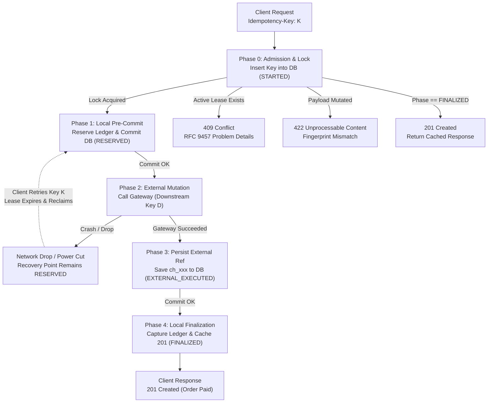

# Multi-Phase Idempotency with Recovery Points: Handling Process Crashes Between External Side Effects and Database Commits

> [!summary] Claim
> Executing non-transactional network side effects across external HTTP APIs creates an uncurbed dual-write hazard that cannot be solved by two-phase commit or naive database locks, requiring engineers to decompose operations into deterministic forward-recovering atomic phases where local reservations, derived downstream idempotency keys, and external confirmation tokens are durably checkpointed before advancing.

Part of [Resilience Rate Limiting and Idempotency](README.md) in [API Engineering](../README.md).

## TL;DR

- Mechanism: Every mutating workflow splits into sequential atomic phases committed to an ACID database (`STARTED` -> `RESERVED` -> `EXTERNAL_EXECUTED` -> `FINALIZED`), where each phase advances a durable recovery point and retries resume forward from the last successful checkpoint instead of re-executing completed side effects.
- Contract rule: Downstream calls to external providers MUST use a deterministic idempotency key derived from the upstream client key (such as `uuid5(NAMESPACE_URL, f"urn:idempotency:{upstream}:{step}")`), so that a retry after an unacknowledged network drop returns the existing external transaction rather than creating a duplicate charge, as long as the retry lands inside the provider's key-retention window (Stripe API v1 may prune keys after 24 hours, as of 2026-11).
- Trap: Wrapping an external HTTP call inside an open database transaction holds connection pool slots and row locks across arbitrary WAN latency, causing database pool exhaustion under load and leaving orphaned external side effects when network timeouts force the local transaction to roll back.
- Portability fact: The multi-phase state machine needs only local ACID transactions, a composite uniqueness constraint (`UNIQUE(scope, idempotency_key)`), and conditional `UPDATE ... WHERE fencing_epoch = ?` writes, which every mainstream relational engine offers; this note's lab exercises it on SQLite `3.53.1` under CPython `3.14.6` on macOS 27.3 arm64 (as of 2026-11), including concurrent admission and reclaim within one event loop, and PostgreSQL and MySQL are not run.
- When not to use it: Do not use multi-phase recovery points for read-only operations, naturally idempotent HTTP methods (`PUT`, `DELETE`), or single-database operations that can commit atomically inside a single ACID transaction; see [[Idempotency-Key-Header-Specification-and-State-Machine-Draft-08]].

## Mental model



The request enters Phase 0, where the server computes a canonical SHA-256 fingerprint of the method, URL path, and request body, acquiring a mutual exclusion lease in the relational database.
If a concurrent request holds an unexpired lease, the server halts immediately with `409 Conflict`, while payload mutations on a known key trigger `422 Unprocessable Content` (draft-ietf-httpapi-idempotency-key-header-08 Section 2.7).
In Phase 1, the worker records its local intent by reserving ledger balances and generating a deterministic downstream idempotency key inside a local ACID transaction, setting the durable recovery point to `RESERVED`.
In Phase 2, the worker issues an out-of-transaction HTTP call to the external gateway using the derived downstream key; if the process crashes or the network drops during this transmission, a subsequent retry detects the `RESERVED` checkpoint, re-invokes the gateway with the identical derived key, and safely retrieves the existing external charge without double-charging.
In Phase 3 and Phase 4, the external reference ID is durably recorded (`EXTERNAL_EXECUTED`), the local ledger hold is captured, the final `201 Created` response payload is cached, and the execution lock is cleared (`FINALIZED`), allowing subsequent client retries to immediately serve the cached response without touching external systems.

## How it works

### The dual-write impossibility across autonomous administrative domains

Every distributed system that coordinates state between a local relational database and an external third-party API (such as Stripe, Adyen, Twilio, or AWS S3) faces the fundamental distributed systems problem known as the Dual-Write Hazard.
Two-Phase Commit (2PC / XA) is not viable across public HTTP interfaces because external SaaS platforms do not expose prepare, commit, and abort hooks to arbitrary clients, nor can an enterprise allow third-party network partitions to hold locks inside its core transactional database.
HTTP itself offers no escape: `POST` is not idempotent, and a client "SHOULD NOT automatically retry a request with a non-idempotent method unless it has some means to know that the request semantics are actually idempotent" (RFC 9110 Section 9.2.2); an idempotency key is that means.
Engineers frequently attempt to solve this by opening a database transaction, issuing the external HTTP call inside the transaction block, and committing the transaction upon receiving a successful response.
This anti-pattern creates two severe failure modes:

1. Connection pool and lock exhaustion: The database transaction holds an open connection and row-level locks across the full WAN round trip and processing time of the external provider, which the local database does not control.
Under modest concurrency spikes, this exhausts the database connection pool, blocking unrelated read and write queries throughout the entire application.

2. Phantom side effects on local abort: If the database transaction rolls back due to a local constraint violation, serialization conflict, or local network drop after the external HTTP call succeeded, the database has no record of the payment, but the external gateway has already debited the customer's funds.
When the client receives the resulting `500 Internal Server Error` and retries the request, the server executes the entire method again, debiting the customer a second time.

The inverse anti-pattern-executing the external HTTP call first and only then opening a database transaction-is equally fatal.
If the application process is terminated by an out-of-memory killer, a SIGKILL signal during a deployment rollout, or a hardware failure immediately after the external API returns `200 OK` but before the local transaction commits, the customer has been charged, but the database contains zero record of the transaction.
When the customer or client retries the request, the application treats it as an unfulfilled order and charges the customer again.

```
Anti-Pattern A: External Call Inside Open Transaction
BEGIN TX
  UPDATE balance SET amount = amount - 100 WHERE id = 1;  -- Row locked
  HTTP POST https://api.stripe.com/v1/charges ---------> [Gateway Debits Card]
  <-- Local network drop before COMMIT or timeout occurs --
ROLLBACK TX
Result: Gateway charged customer $100. Local DB has no record.

Anti-Pattern B: External Call Before Local Transaction
  HTTP POST https://api.stripe.com/v1/charges ---------> [Gateway Debits Card]
  <-- Process crashes (SIGKILL / OOM / Host Reboot) -----
BEGIN TX (never reached)
Result: Gateway charged customer $100. Local DB has no record. Next retry double-charges.
```

### Anatomizing the multi-phase state machine

The solution to the dual-write impossibility is decomposing the business process into discrete, non-overlapping atomic phases separated by durable recovery points persisted in an ACID-compliant database.
This is the design Brandur Leach published for Stripe-style keys: "An atomic phase is a set of local state mutations that occur in transactions between foreign state mutations", and "Atomic phases should be safely committed before initiating any foreign state mutation" (brandur.org, "Implementing Stripe-like Idempotency Keys in Postgres", 2017-10-27); his Rocket Rides reference uses the recovery points `started`, `ride_created`, `charge_created`, and `finished`, and runs each phase at `SERIALIZABLE` isolation.
Each phase contains mutations against exactly one system: either exclusively local database mutations, or exclusively external network RPCs.
The relational schema for the idempotency coordinator requires explicit tracking of phases, leases, fencing epochs, request fingerprints, and downstream keys.

```sql
CREATE TABLE idempotency_keys (
    id                     INTEGER PRIMARY KEY AUTOINCREMENT,
    idempotency_key        TEXT NOT NULL,
    scope                  TEXT NOT NULL,
    request_hash           TEXT NOT NULL,
    phase                  TEXT NOT NULL,
    locked_at              REAL,
    lease_timeout_seconds  REAL NOT NULL,
    worker_id              TEXT,
    fencing_epoch          INTEGER NOT NULL DEFAULT 1,
    downstream_key         TEXT NOT NULL,
    external_reference_id  TEXT,
    response_status        INTEGER,
    response_body          TEXT,
    created_at             REAL NOT NULL,
    updated_at             REAL NOT NULL,
    UNIQUE(scope, idempotency_key)
);
```

This is the lab's schema (`init_schema` in `multi_phase_idempotency.py`); `AUTOINCREMENT` is SQLite syntax, and PostgreSQL would use `BIGSERIAL` or an identity column.
The lifecycle proceeds through five phases (0 to 4) separated by four recovery points:

#### Phase 0: Admission, fingerprinting, and lock acquisition

The server extracts the `Idempotency-Key` header from the incoming HTTP request.
Under `draft-ietf-httpapi-idempotency-key-header-08 Section 2.1`, the header value is an Item Structured Header Field whose value MUST be a String (RFC 9651 Section 3.3.3), so on the wire it is quoted: `Idempotency-Key: "8e03978e-40d5-43e8-bc93-6894a57f9324"`.
The lab does not parse Structured Fields: `handle_payment` stores `request.headers.get("Idempotency-Key")` verbatim, so a conformant `"k1"` is keyed with its quotes and an unquoted `k1` is accepted; a production server should parse the String and reject anything else.
If the header is missing on an endpoint requiring idempotency, the server SHOULD reply with `400 Bad Request` and a body linking to documentation (draft-08 Section 2.7), shown in the draft as an `application/problem+json` object (RFC 9457 Section 3).

The server calculates an SHA-256 fingerprint of the request to detect key reuse with a different payload.
Section 2.4 of the draft only says a fingerprint MAY be used and is "generated from request payload data", listing options such as a checksum of the entire payload, a checksum of selected elements, field matches, or a request digest or signature; it does not mention the method or URI.
The lab adds the method and path so a key reused on another endpoint also mismatches, and hashes the re-serialized parsed body (`json.dumps(payload, sort_keys=True)`), not the raw bytes (`compute_request_fingerprint` in `multi_phase_idempotency.py`):

$$\text{fingerprint} = \text{SHA-256}(\text{METHOD} \parallel \text{"|"} \parallel \text{PATH} \parallel \text{"|"} \parallel \text{hex}(\text{SHA-256}(\text{canonical BODY})))$$

The server must perform an atomic check-and-insert against the `idempotency_keys` table, for example `INSERT ... ON CONFLICT (scope, idempotency_key) DO NOTHING` followed by a read, or Brandur's `SERIALIZABLE` phase transaction.
The lab uses the single-statement upsert and branches on the row count (`execute_payment` in `multi_phase_idempotency.py`): exactly one of several simultaneous first requests inserts the row, and the others fall into the existing-key branch below, so the `UNIQUE` constraint never surfaces as an unhandled `IntegrityError`.
`test_concurrent_first_requests_admit_exactly_one_worker` fires eight simultaneous first requests and asserts one gateway call and one order, with every result either a success or a `ConcurrentRequestConflictError`.
If the insert succeeds (row count 1), the new record has `phase = 'STARTED'`, `locked_at = now()`, `fencing_epoch = 1`, and a freshly derived `downstream_key`.
If the key exists:
- The stored `request_hash` is compared against the incoming fingerprint; if they differ, the server aborts with `422 Unprocessable Content` (draft-ietf-httpapi-idempotency-key-header-08 Section 2.7).
- If the record has `phase = 'FINALIZED'`, the server bypasses execution entirely and returns the cached `response_status` and `response_body`.
- If the record is not finalized and `now() - locked_at < lease_timeout_seconds`, an active worker is currently executing the workflow; the server rejects the concurrent retry with `409 Conflict`.
- If the lease has expired (`now() - locked_at >= lease_timeout_seconds`), the previous worker is presumed crashed or stalled; the server claims the lock, increments `fencing_epoch = fencing_epoch + 1`, and resumes forward from the recorded `phase`.
- The reclaim itself must be a conditional write: the lab's `UPDATE` sets the new epoch `WHERE fencing_epoch = :seen AND phase != 'FINALIZED' AND (locked_at IS NULL OR :now - locked_at >= lease_timeout_seconds)` and checks the row count, raising `ConcurrentRequestConflictError` on zero rows; without the epoch predicate, two retries that both read the expired lease both compute the same new epoch and both believe they own it (`test_concurrent_reclaimers_share_one_epoch_winner` asserts one gateway call and a final epoch of 2).
- The draft's own mismatch code is `422`; Brandur's reference implementation answers a parameter mismatch with `409` instead, so check each provider's documentation.

#### Phase 1: Local intent reservation (`RESERVED`)

Before touching the external network, the system commits its local state mutations in a dedicated database transaction.
In a billing or e-commerce system, this transaction:
1. Validates account status and balance constraints.
2. Inserts a pending ledger hold in `ledger_reservations` with status `PENDING_HOLD`.
3. Verifies that its `fencing_epoch` is still active.
4. Updates the recovery point in `idempotency_keys` to `phase = 'RESERVED'`.
5. Commits the transaction to durable storage.

Once committed, the local database contains an immutable record that an external mutation is intended.
If the worker crashes immediately after this commit, the local reservation remains safely recorded.

#### Phase 2: Foreign state mutation with deterministic downstream keys

The worker exits the database transaction and executes the network RPC against the external provider.
To ensure safety across network drops, the worker MUST pass a deterministic downstream idempotency key to the external service.
The worker transmits the derived key in the downstream request (for example, via the `Idempotency-Key` header to Stripe or Adyen).
Three distinct outcomes can occur:

1. Definitive success: The external gateway processes the transaction and returns HTTP `200 OK` or `201 Created` with an external reference ID (such as `ch_3MvY2...`).
2. Definitive failure: The gateway returns an unrecoverable client error such as `402 Payment Required` (`card_declined`).
The worker transitions the local workflow to an aborted state, releases the ledger hold, and returns the definitive error to the client; the lab does not implement this branch (the mock gateway has a `decline` flag, but the coordinator never passes it and there is no aborted phase).
3. Ambiguous failure / network drop: The TCP connection drops, a TLS handshake resets, or the gateway takes longer than the client read timeout.
The worker does NOT know whether the external gateway committed the charge or dropped the packet before processing.

Because the downstream key was derived deterministically, recovery resolves this ambiguity by re-sending the same request with the same key, provided the provider still retains the key.
Stripe API v1 "saves the status code and body of the first request made with a given idempotency key after endpoint execution begins" and returns that saved response on retries, "including 500 errors"; it does not save a result when parameters fail validation or the request conflicts with a concurrent one (Stripe docs, Idempotent requests, as of 2026-11).
A replayed `500` is therefore still ambiguous, and recovery must fall back to reconciliation (for example, listing charges by a metadata reference) rather than retrying the same key forever.

#### Phase 3: External confirmation checkpoint (`EXTERNAL_EXECUTED`)

Upon receiving a successful external response, the worker enters a short local database transaction to persist the proof of external execution:
1. It updates `idempotency_keys` setting `external_reference_id = 'ch_...'` and `phase = 'EXTERNAL_EXECUTED'`.
2. It verifies `fencing_epoch` matches its assigned epoch.
3. It commits the transaction.

At this point, both the local database and the external system agree that the foreign state mutation succeeded.

#### Phase 4: Local finalization and response caching (`FINALIZED`)

The final phase closes the local workflow:
1. The pending hold in `ledger_reservations` transitions to `CAPTURED`.
2. An order record is inserted into `orders` with status `PAID`.
3. The HTTP response status code (e.g., `201`) and serialized JSON body are written into `idempotency_keys`; the lab stores no response headers, so a production version that must replay headers needs another column.
4. The lock is released by setting `locked_at = NULL` and `phase = 'FINALIZED'`.
5. The transaction commits.

The worker transmits the final HTTP response to the caller.

### Deterministic downstream key derivation

Forwarding an upstream client's raw `Idempotency-Key` directly to downstream providers introduces severe architectural vulnerabilities.
If a single incoming API request triggers two distinct downstream side effects (for example, charging a credit card via Stripe and provisioning cloud infrastructure via AWS), sending the raw client key to both services couples their namespace and length constraints.
Furthermore, if a downstream call requires a UUID but the upstream client sent an arbitrary alphanumeric string, forwarding fails.

The coordinator derives downstream idempotency keys deterministically using a name-based UUID version 5 under RFC 9562 Section 5.5.
UUIDv5 computes SHA-1 over a Namespace ID concatenated with the name, keeps the leftmost 128 bits, and overwrites the version and variant bits (RFC 9562 Section 5.5); the lab uses Python's `uuid.NAMESPACE_URL`, `6ba7b811-9dad-11d1-80b4-00c04fd430c8`, the URL namespace from RFC 9562 Section 6.6 Table 3 (`derive_downstream_key` in `multi_phase_idempotency.py`).
The name here is a URN rather than a URL, so a dedicated, fixed namespace UUID owned by the service would be cleaner; any constant namespace gives the same determinism.
RFC 9562 Section 5.5 says SHA-256-based name UUIDs MUST use UUIDv8 instead of UUIDv5 where SHA-1 is disallowed by policy; collision resistance is not the property relied on here, only determinism:

$$\text{DownstreamKey} = \text{UUIDv5}(\text{NAMESPACE\_URL}, \text{"urn:idempotency:"} \parallel \text{UpstreamKey} \parallel \text{":"} \parallel \text{StepName})$$

Because UUIDv5 is pure and deterministic, any worker retrying the identical upstream key for the step `payment_charge` generates the exact same byte sequence.
Downstream providers receiving this key recognize subsequent requests as retries of the original call, returning the previously generated resource rather than creating a duplicate, but only while they retain the key: Stripe API v1 keys can be removed "after they're at least 24 hours old", and "We generate a new request if a key is reused after the original is pruned" (Stripe docs, as of 2026-11).
Recovery that can run later than the provider's retention window must reconcile by business reference instead of relying on the key.

### Crash recovery matrix across network drops

The table below details every failure boundary across the multi-phase lifecycle and the exact recovery mechanism executed when a client retries or a background recovery reaper awakens.

| Crash Boundary | Local State in DB | External Gateway State | Recovery Action on Retry | Risk Prevented |
|---|---|---|---|---|
| Crash before Phase 0 DB commit | No record | No request received | Fresh request executes Phase 0 from scratch | None; cleanly treated as a new request |
| Crash after Phase 0, before Phase 1 | `STARTED` | No request received | Lease expires; retry reclaims lock and advances to Phase 1 reservation | Deadlock avoided via lease timeout |
| Crash after Phase 1, before Phase 2 HTTP call | `RESERVED` | No request received | Retry sees `RESERVED`, invokes gateway with deterministic downstream key | Lost update prevented; order fulfilled |
| Network drop during Phase 2 (packet lost in flight) | `RESERVED` | No request received | Retry calls gateway with same downstream key; gateway processes fresh charge | Request loss recovered without duplicate |
| Network drop during Phase 2 (ACK lost after charge) | `RESERVED` | Charge committed (`ch_123`) | Retry calls gateway with same downstream key; gateway returns existing `ch_123` | **Double-charge prevented** |
| Crash after Phase 2, before Phase 3 DB commit | `RESERVED` | Charge committed (`ch_123`) | Retry re-queries/re-sends downstream key, gets `ch_123`, advances to Phase 3 | Orphaned external charge reconciled |
| Crash after Phase 3, before Phase 4 DB commit | `EXTERNAL_EXECUTED` | Charge committed (`ch_123`) | Retry skips gateway entirely; completes ledger capture and commits `FINALIZED` | Duplicate gateway traffic prevented |
| Network drop returning final 201 response to client | `FINALIZED` | Charge committed (`ch_123`) | Retry queries DB, sees `FINALIZED`, replays cached status and body (the lab stores no headers) | Duplicate processing prevented |

### Distributed fencing tokens and zombie worker isolation

A critical vulnerability in lease-based recovery is the "zombie worker" problem, analyzed by Martin Kleppmann in "How to do distributed locking" (2016-02-08), whose fix is to "include a fencing token with every write request to the storage service", where the token is "a number that increases (e.g. incremented by the lock service) every time a client acquires the lock".
Suppose Worker A acquires the lock for key `K` with a lease of 30 seconds.
Worker A enters a prolonged pause caused by a major garbage collection freeze, an asynchronous event loop stall, or a temporary operating system network partition.
While Worker A is suspended, the 30-second lease expires.
Worker B receives a retry from the client, observes the expired lease, reclaims the lock, advances the workflow, and successfully executes the external payment.
Worker A suddenly awakens and attempts to commit its stale phase update to the database.

Without fencing, Worker A's stale write overwrites Worker B's progress, causing state corruption or duplicate executions.
To prevent this, the multi-phase state machine utilizes monotonic fencing epochs:
1. Every time a worker claims or reclaims an idempotency key, it increments `fencing_epoch = fencing_epoch + 1`.
2. Every database mutation within subsequent phases MUST include an optimistic concurrency predicate enforcing the exact epoch:
   ```sql
   UPDATE idempotency_keys
   SET phase = 'RESERVED', updated_at = :now
   WHERE scope = :scope AND idempotency_key = :key AND fencing_epoch = :current_epoch;
   ```
3. If the update affects 0 rows, the worker knows its lease was superseded by a newer worker.
The worker immediately raises `ZombieWorkerFencedError` and rolls back its local transaction, preventing split-brain corruption.
Fencing only protects writes to the database that checks the epoch: it cannot stop a zombie from re-sending the external charge, which is why the downstream key, not the epoch, is what prevents a double charge in Phase 2.

```
Time  Worker A (Epoch 1)                  Worker B (Epoch 2)               Database Record
 |
 00s  Claim Lock (Epoch 1) ----------------------------------------------> epoch=1, locked_at=00s
 01s  [Worker A Enters Stalled State / GC Pause]
 30s  [Lease Expires: 30 seconds elapsed]
 31s                                      Retry Claims Lock (Epoch 2) ---> epoch=2, locked_at=31s
 32s                                      Executes Gateway & Finalizes --> phase=FINALIZED
 35s  Worker A Awakens!
 35s  UPDATE ... WHERE fencing_epoch = 1 --------------------------------> 0 Rows Updated! (REJECTED)
 35s  Worker A Aborts (Zombie Fenced)
```

## Numbers and limits

The following operational limits bound the execution, latency, and storage parameters of multi-phase idempotency implementations (as of 2026-11).

| Parameter | Value / Upper Bound | Architectural Justification and Primary Source |
|---|---|---|
| `Idempotency-Key` max length | No limit in the draft; Stripe: up to 255 characters; Brandur's reference schema: 100 | Stripe docs, Idempotent requests: "Idempotency keys are up to 255 characters long" (as of 2026-11); brandur.org schema `CHECK (char_length(idempotency_key) <= 100)`; draft-08 Section 2.1 only requires an RFC 9651 String and Section 5 asks resources to publish and validate a fixed key format |
| Request fingerprint hash | 256 bits (32 bytes raw, 64 hex characters) | SHA-256 (FIPS PUB 180-4); accidental collisions are negligible at any body size, and the lab stores the 64-character hex digest in `request_hash` |
| Lock lease duration | No standard value; lab default `lease_timeout_seconds=2.0`, tests use 0.1 to 10.0 | `MultiPhasePaymentCoordinator.__init__`; the lease must exceed the worst-case time from claim to finalize, including the downstream timeout and its retries, or a live worker is fenced out and the retry waits a full lease |
| Downstream key representation | 36 characters (canonical UUID string, 32 hex digits and 4 hyphens) | RFC 9562 Section 4 (string format) and Section 5.5 (UUIDv5); deterministic per name, not a uniqueness guarantee beyond SHA-1's 122 usable bits |
| Idempotency record TTL | Provider-defined; Stripe v1: removable after 24 hours; Brandur suggests a reaper threshold of about 72 hours | draft-08 Section 2.3: the resource SHOULD define an expiration policy and publish it; Stripe docs (as of 2026-11); brandur.org "The reaper"; the AWS Builders' Library article bounds token life by the resource lifetime "plus an interval" for late-arriving requests and gives no fixed number |
| Database transaction duration | Not measured in this lab | Each phase is one local commit with no network call inside it, so its duration is bounded by local commit latency, not by the provider |
| Cached response size | About 147 bytes for the lab's response shape | `json.dumps` of the six-field `final_response` with the test values (`acct_100`, `5000`, a 19-character `ch_` id), computed with the lab venv's CPython `3.14.6`; the lab stores status and body only |
| Concurrent in-flight retry code | HTTP `409 Conflict` | draft-08 Section 2.7: the resource SHOULD reply with `409` when the request is retried while the original is still being processed; RFC 9110 Section 15.5.10 |
| Payload mismatch error code | HTTP `422 Unprocessable Content` | draft-08 Section 2.7: the resource SHOULD reply with `422` when a key is reused with a different payload; RFC 9110 Section 15.5.21 |

## Portability

The table below documents cross-runtime compatibility, server framework support, database transaction primitives, and standards conformance across the ecosystem (as of 2026-11).

| Environment / Engine | Conformance Level | Implementation Mechanism and Verification Status |
|---|---|---|
| CPython 3.12 (`3.12.16`) | Not run | Matrix leg not run (lab checks paused by the user on 2026-11-11); the code uses `enum.StrEnum` (added in 3.11) and no newer stdlib API |
| CPython 3.13 (`3.13.18`) | Not run | Matrix leg not run (lab checks paused) |
| CPython 3.14 (`3.14.6`, workspace interpreter) | Passes | **Verified in lab**: 10 tests passed in `2.77s` on macOS 27.3 arm64 (`uname -r` 27.3.0); the matrix pin `3.14.10` was not run |
| CPython 3.15 (`3.15.2` and `3.15.2t`) | Not run | Matrix legs not run (lab checks paused); the lab is single-threaded `asyncio`, and its fencing lives in SQLite, so the free-threaded build exercises nothing new |
| PostgreSQL | Not run | The lab has no PostgreSQL leg; `SELECT ... FOR UPDATE` with `NOWAIT` or `SKIP LOCKED` is documented in the PostgreSQL `SELECT` locking clause (docs current version 19, as of 2026-11) and suits a reconciliation reaper that claims unfinalized keys |
| SQLite (`3.53.1`, bundled with the lab's CPython) | Passes | **Verified in lab**: sequential recovery, plus eight concurrent first requests and two concurrent reclaimers, each on its own `aiosqlite` connection in one event loop; `init_schema` sets `PRAGMA journal_mode = WAL`; multi-process or multi-host concurrency was not run |
| MySQL / MariaDB (`InnoDB`) | Not run | No lab leg; the pattern needs only a unique index and conditional `UPDATE`, which `InnoDB` provides |
| Starlette (`1.10.0`) | Passes | **Verified in lab** through `httpx` `0.28.1` `ASGITransport` (including a `400` for a malformed body); passing `Content-Type: application/problem+json` in `headers` suppresses the default media type because `populate_content_type = b"content-type" not in keys` (starlette 1.10.0 starlette/responses.py, Response.init_headers) |
| Uvicorn, Hypercorn, Granian | Not run | The test drives the app in-process; no server was started |
| HTTP/1.1, HTTP/2, HTTP/3 | Version-independent by specification | `Idempotency-Key` is an ordinary request header field, and field semantics are defined once in RFC 9110 for HTTP/1.1 (RFC 9112), HTTP/2 (RFC 9113), and HTTP/3 (RFC 9114) all carry; not exercised over a real transport here |
| IETF draft-08 conformance | Partial | Implements Section 2.6 (first request, completed-retry replay, concurrent `409`) and Section 2.7 (`400`, `409`, `422` problem bodies whose `title` strings match the draft's examples, without the `Content-Language` header); Section 2.4 fingerprint is a whole-payload checksum plus method and path; Section 2.1 String parsing is not implemented |

## Worked example

The executable lab implements the state machine in [implementation](../labs/src/api_labs/f16_resilience_rate_limiting_and_idempotency/multi_phase_idempotency.py) and proves failure recovery across simulated network drops in [test](../labs/tests/f16_resilience_rate_limiting_and_idempotency/test_atomic_idempotency_phases_and_failure_recovery_across_network_drops.py).

Below is a simplified excerpt of the core execution loop from `MultiPhasePaymentCoordinator.execute_payment` (the `time.time()` calls and the `msg` variables are inlined for display) demonstrating forward recovery from durable checkpoints:

```python
# Simplified excerpt from api_labs/f16_resilience_rate_limiting_and_idempotency/multi_phase_idempotency.py

# State machine forward recovery loop (admission and the lease reclaim UPDATE precede it)
while current_phase != IdempotencyPhase.FINALIZED:
    if phase_hook is not None:
        await phase_hook(current_phase)  # test seam: lets a test stall a worker

    if current_phase == IdempotencyPhase.STARTED:
        if crash_at == "after_started":
            raise RuntimeError("Simulated crash: worker died after phase STARTED")

        async with aiosqlite.connect(self.db_path) as db:
            cursor = await db.execute(
                """
                UPDATE idempotency_keys
                SET phase = ?, updated_at = ?
                WHERE scope = ? AND idempotency_key = ? AND fencing_epoch = ?
                """,
                (IdempotencyPhase.RESERVED.value, time.time(), scope, idempotency_key, current_epoch),
            )
            if cursor.rowcount == 0:
                raise ZombieWorkerFencedError("Worker epoch superseded during reservation")

            await db.execute(
                """
                INSERT INTO ledger_reservations (
                    idempotency_key, account_id, amount, currency, status, created_at
                ) VALUES (?, ?, ?, ?, 'PENDING_HOLD', ?)
                """,
                (idempotency_key, account_id, amount, currency, time.time()),
            )
            await db.commit()
        current_phase = IdempotencyPhase.RESERVED

    elif current_phase == IdempotencyPhase.RESERVED:
        if crash_at == "after_reserved":
            raise RuntimeError("Simulated crash: worker died after phase RESERVED")

        network_drop = crash_at == "during_gateway_drop"
        charge_record = await self.gateway.charge(
            downstream_key=downstream_key,
            amount=amount,
            currency=currency,
            crash_network_drop=network_drop,
        )
        external_ref = charge_record.charge_id

        async with aiosqlite.connect(self.db_path) as db:
            cursor = await db.execute(
                """
                UPDATE idempotency_keys
                SET phase = ?, external_reference_id = ?, updated_at = ?
                WHERE scope = ? AND idempotency_key = ? AND fencing_epoch = ?
                """,
                (IdempotencyPhase.EXTERNAL_EXECUTED.value, external_ref, time.time(), scope, idempotency_key, current_epoch),
            )
            if cursor.rowcount == 0:
                raise ZombieWorkerFencedError("Worker epoch superseded during external confirmation")
            await db.commit()
        current_phase = IdempotencyPhase.EXTERNAL_EXECUTED

    elif current_phase == IdempotencyPhase.EXTERNAL_EXECUTED:
        if crash_at == "after_external_executed":
            raise RuntimeError("Simulated crash: worker died after phase EXTERNAL_EXECUTED")

        order_id = f"ord_{idempotency_key[:12]}"
        final_response = {
            "order_id": order_id,
            "account_id": account_id,
            "amount": amount,
            "currency": currency,
            "charge_id": external_ref,
            "status": "paid",
        }
        body_json = json.dumps(final_response)

        async with aiosqlite.connect(self.db_path) as db:
            cursor = await db.execute(
                """
                UPDATE idempotency_keys
                SET phase = ?, locked_at = NULL, response_status = 201,
                    response_body = ?, updated_at = ?
                WHERE scope = ? AND idempotency_key = ? AND fencing_epoch = ?
                """,
                (IdempotencyPhase.FINALIZED.value, body_json, time.time(), scope, idempotency_key, current_epoch),
            )
            if cursor.rowcount == 0:
                raise ZombieWorkerFencedError("Worker epoch superseded during finalization")

            await db.execute(
                "UPDATE ledger_reservations SET status = 'CAPTURED' WHERE idempotency_key = ?",
                (idempotency_key,),
            )
            await db.execute(
                """
                INSERT INTO orders (order_id, idempotency_key, account_id, amount, status, external_charge_id, created_at)
                VALUES (?, ?, ?, ?, 'PAID', ?, ?)
                """,
                (order_id, idempotency_key, account_id, amount, external_ref, time.time()),
            )
            await db.commit()

        current_phase = IdempotencyPhase.FINALIZED
        return 201, final_response
```

Executing the lab suite from `labs/` under CPython `3.14.6` on macOS 27.3 arm64 (2026-11-21) covers the happy path, `409`, `422`, three crash points, the network drop, a stalled worker fenced by the coordinator, concurrent first requests, concurrent reclaimers, and the ASGI contract; absolute paths in the output are shortened to `labs/`:

```text
$ uv run --frozen pytest tests/f16_resilience_rate_limiting_and_idempotency/test_atomic_idempotency_phases_and_failure_recovery_across_network_drops.py -v
============================= test session starts ==============================
platform darwin -- Python 3.14.6, pytest-9.2.0, pluggy-1.7.0 -- labs/.venv/bin/python
cachedir: .pytest_cache
hypothesis profile 'default'
rootdir: labs
configfile: pyproject.toml
plugins: platformdirs-4.14.5, schemathesis-4.33.1, cov-7.1.0, hypothesis-6.170.14, inline-snapshot-0.36.1, Faker-40.44.0, locust-2.47.0, typeguard-4.6.0, anyio-4.16.0, asyncio-1.4.1.post1, respx-0.23.1
asyncio: mode=Mode.STRICT, debug=False, asyncio_default_fixture_loop_scope=function, asyncio_default_test_loop_scope=function
collecting ... collected 10 items

tests/f16_resilience_rate_limiting_and_idempotency/test_atomic_idempotency_phases_and_failure_recovery_across_network_drops.py::test_happy_path_initial_execution_and_replay PASSED [ 10%]
tests/f16_resilience_rate_limiting_and_idempotency/test_atomic_idempotency_phases_and_failure_recovery_across_network_drops.py::test_concurrent_in_flight_request_returns_409 PASSED [ 20%]
tests/f16_resilience_rate_limiting_and_idempotency/test_atomic_idempotency_phases_and_failure_recovery_across_network_drops.py::test_payload_tampering_returns_422 PASSED [ 30%]
tests/f16_resilience_rate_limiting_and_idempotency/test_atomic_idempotency_phases_and_failure_recovery_across_network_drops.py::test_crash_after_reservation_resumes_cleanly PASSED [ 40%]
tests/f16_resilience_rate_limiting_and_idempotency/test_atomic_idempotency_phases_and_failure_recovery_across_network_drops.py::test_crash_during_gateway_network_drop_recovers_without_double_charge PASSED [ 50%]
tests/f16_resilience_rate_limiting_and_idempotency/test_atomic_idempotency_phases_and_failure_recovery_across_network_drops.py::test_crash_after_external_executed_resumes_to_finalized PASSED [ 60%]
tests/f16_resilience_rate_limiting_and_idempotency/test_atomic_idempotency_phases_and_failure_recovery_across_network_drops.py::test_zombie_worker_fenced_out_by_epoch PASSED [ 70%]
tests/f16_resilience_rate_limiting_and_idempotency/test_atomic_idempotency_phases_and_failure_recovery_across_network_drops.py::test_concurrent_first_requests_admit_exactly_one_worker PASSED [ 80%]
tests/f16_resilience_rate_limiting_and_idempotency/test_atomic_idempotency_phases_and_failure_recovery_across_network_drops.py::test_concurrent_reclaimers_share_one_epoch_winner PASSED [ 90%]
tests/f16_resilience_rate_limiting_and_idempotency/test_atomic_idempotency_phases_and_failure_recovery_across_network_drops.py::test_asgi_http_contracts_and_problem_details PASSED [100%]

============================== 10 passed in 2.77s ==============================
```

## Pitfalls

> [!warning] Long WAN HTTP calls inside ACID database transactions cause catastrophic connection pool exhaustion
> - Trigger: Wrapping a third-party payment gateway or webhook call inside an active relational database transaction (`BEGIN ... COMMIT`).
> - Symptom: Under traffic bursts or third-party latency spikes, database active connection pools fill completely; healthy read endpoints freeze with connection timeout errors, cascading into system-wide `500 Internal Server Error` outages.
> - Fix: Never allow an external network socket call inside an open database transaction.
> Isolate local state mutations into atomic pre-commit and post-commit phases that contain no network call, releasing database connection slots before initiating outbound HTTP requests.

> [!warning] Raw upstream key reuse across multiple downstream steps causes state collisions
> - Trigger: Forwarding the client's raw `Idempotency-Key` directly to downstream providers when a single API call coordinates multiple distinct remote operations (such as auth hold and shipping label creation).
> - Symptom: The secondary downstream service rejects the key or associates two disparate business actions with the same identifier, causing downstream validation failures or silent state corruption.
> - Fix: Derive downstream keys deterministically per step using RFC 9562 UUIDv5 scoped by step names (`uuid5(NAMESPACE_URL, f"urn:idempotency:{upstream_key}:{step_name}")`).

> [!warning] Stale zombie workers committing after lease timeout cause split-brain data corruption
> - Trigger: A worker process experiences a long stop-the-world garbage collection pause or network blip; its lease expires, a second worker reclaims the key and completes recovery, and the first worker awakens and issues its queued SQL commit.
> - Symptom: Stale writes overwrite recovered records, reverting state or double-capturing balances.
> The best-documented public loss from unguarded concurrent writes is Flexcoin, which shut down on 2014-03-03 after losing 896 BTC; its own notice blamed "a flaw within the front-end", and Emin Gun Sirer's analysis describes thousands of simultaneous transfer requests overdrawing an account "before balances were updated".
> That was a read-modify-write race, not a lease expiry, but the root cause is the same: a write that does not check the state it was computed from.
> - Fix: Implement monotonic fencing tokens (`fencing_epoch` integer incremented on every lock claim) and enforce optimistic checks (`WHERE fencing_epoch = :epoch`) on all phase updates.

> [!warning] Caching transient 5xx infrastructure errors as terminal responses
> - Trigger: Storing temporary upstream infrastructure faults (e.g., `503 Service Unavailable`, `504 Gateway Timeout`) into the idempotency table's cached response fields.
> - Symptom: Subsequent retries by the client immediately receive the cached `503` or `504` error without re-evaluating the system, permanently wedging the operation until the key expires.
> - Fix: Cache only terminal domain outcomes (such as `200`, `201`, `400`, `402`, `422`) and leave transient failures uncached and unfinalized so retries can resume forward recovery.
> This is a design choice, not a draft rule: draft-08 Section 2.7 says only that for other errors such as `500`, `502`, `503`, `504`, and `429` the client "SHOULD act appropriately by following the resource's documentation".
> Expect the opposite downstream: Stripe API v1 returns a saved first response on retry "including 500 errors" (Stripe docs, as of 2026-11), so a replayed `500` for a derived key must trigger reconciliation, not an endless retry.

> [!warning] Non-canonical JSON serialization triggering spurious 422 payload mismatch errors
> - Trigger: Hashing incoming request bodies using raw byte serialization where dictionary keys are unordered or whitespace varies between client retries.
> - Symptom: Legitimate retries with identical semantic JSON payloads are rejected with `422 Unprocessable Content` due to trivial whitespace or key reordering.
> - Fix: Normalize incoming request payloads by parsing and re-serializing with sorted keys and fixed separators prior to computing the SHA-256 fingerprint (`json.dumps(payload, sort_keys=True)`, as the lab does).
> This is not full canonicalization: number formatting and string escaping can still differ across serializers, and RFC 8785 (JSON Canonicalization Scheme) defines a cross-language canonical form when that matters.

## Security and robustness

### Threat modeling and cross-tenant isolation

An idempotency engine is a high-value attack target for resource exhaustion and financial double-spend exploits.
The threat model must guard against:

1. Cross-tenant denial of service via key collisions:
If idempotency keys are indexed globally across all users (`UNIQUE(idempotency_key)`), an attacker can front-run legitimate UUIDs or guess sequential keys, inserting dummy records that block victim tenants with `409 Conflict` or trigger `422 Unprocessable Content` errors.
Enforce composite tenant scoping on all uniqueness constraints:
```sql
CREATE UNIQUE INDEX idx_idempotency_tenant_key ON idempotency_keys (scope, idempotency_key);
```
Here, `scope` represents the cryptographically verified tenant ID or authenticated user ID extracted from a validated JWT or API token, completely isolating key namespaces.
draft-08 Section 5 recommends the same "unique composite key" built from the client's key and "other client specific attributes known only to the resource", and warns that low-entropy keys let attackers fetch other clients' cached entries; Brandur's schema scopes uniqueness to `(user_id, idempotency_key)`.
The lab does not meet this bar: `handle_payment` takes `scope` from a client-supplied `X-Scope` header (default `tenant_default`), so any caller can choose another tenant's namespace; derive it from authentication in production.
Three more lab simplifications break tenant isolation below the `idempotency_keys` table: `derive_downstream_key` hashes only the upstream key and step, so two tenants reusing one key string share a downstream key; and `ledger_reservations` and `orders` are `UNIQUE(idempotency_key)` without the scope.
A production schema carries the scope into all three.

2. Parameter tampering and replay attacks:
An attacker intercepting an in-flight API call could replay the victim's `Idempotency-Key` with altered destination accounts or higher financial amounts.
The SHA-256 fingerprint computed in Phase 0 detects key reuse with a different payload; it is not authentication, and it does nothing against a byte-identical replay, which by design gets the cached response.
Any alteration to the request parameters causes the stored fingerprint to mismatch, terminating execution with `422 Unprocessable Content`; logging that event as a security signal is worthwhile, though the lab does not log.
The lab rejects an unparseable or non-object JSON body with a `400` problem response before admission, so malformed bodies never share a fingerprint (`test_asgi_http_contracts_and_problem_details`).

3. OWASP API Security alignment:
- API4:2023 Unrestricted Resource Consumption: Preventing indefinite locking.
Unbound lock leases allow malicious or crashing clients to hold database locks permanently.
Every idempotency record MUST enforce a strict timeout (`lease_timeout_seconds`), after which stalled keys are automatically eligible for reclamation.
- API8:2023 Security Misconfiguration: Ensuring problem details conformance.
Uncaught internal errors in idempotency layers frequently leak stack traces, database table schemas, and external provider credentials.
All error branches MUST return standardized RFC 9457 Problem Details objects with sanitized error titles and URIs.

## The principal's view

At staff-plus and principal level, choosing how to coordinate distributed side effects is a foundational architectural decision that dictates the reliability, throughput, and operational complexity of an entire organization.
The table below frames the architectural trade-offs between the four major coordination paradigms:

| Architecture | Operational Complexity | Network / Storage Overhead | Failure Semantics | When to Choose |
|---|---|---|---|---|
| **Multi-Phase Recovery Points** (This Pattern) | Moderate; requires relational state machine table and forward-recovery loop | One local transaction per phase (four commits on the lab's happy path); latency not measured here | Effectively-once external effect, conditional on the provider honoring the derived key inside its retention window; fenced database writes reject stale epochs | Synchronous, user-facing mutating HTTP APIs (payments, billing, order placement) requiring instant feedback |
| **Transactional Outbox Pattern** | Low-to-moderate; requires outbox table and background poller/CDC (Debezium) | 1 local DB write; asynchronous queue broker publishing | At-least-once asynchronous delivery; requires idempotent downstream consumer | Asynchronous event publishing, notifications, email delivery, background sync |
| **Sagas (Choreography / Orchestration)** | High; requires saga coordinator (e.g. Temporal, AWS Step Functions) or distributed compensating events | High; message bus hops, event history persistence, event stream state machines | Eventual consistency via compensating rollback transactions (refunds/cancellations) | Multi-step cross-service workflows taking seconds to hours across internal microservices |
| **Two-Phase Commit (2PC / XA)** | Extreme; blocking coordinator, synchronous distributed locking | Extreme; network roundtrip storm, shared lock contention across nodes | Atomic all-or-nothing commit; blocks completely during network partitions | Homogeneous database clusters under single administrative domain; NEVER across public HTTP APIs |

The principal engineer establishes the following rule:
Use Multi-Phase Recovery Points for any synchronous, client-facing HTTP API that performs an external side effect before returning an HTTP response.
If the business operation can be fulfilled asynchronously, choose the Transactional Outbox Pattern to decouple the client response from the external side effect entirely.
Reserve full Saga orchestration engines for complex long-running business workflows involving three or more autonomous internal services.

## Interview questions

> [!question] L5: Why is it an architectural anti-pattern to execute an external payment gateway HTTP call inside an open database transaction?
>
> > [!success]- Answer
> > Holding an open database transaction during an external HTTP request couples local database connection pool utilization to public WAN network latency, causing rapid connection pool exhaustion and transaction lock contention during external latency spikes.
> > Furthermore, if the local transaction aborts due to a serialization error or network timeout after the external payment gateway successfully debited the customer's account, the database rolls back, leaving no local record of the payment and causing duplicate charges upon client retry.
> >
> > Follow-up: How does separating the workflow into atomic pre-commit and post-commit phases solve this problem?

> [!question] L5 (Predict the output): What status code and headers does a concurrent retry receive?
> A client submits `POST /v1/payments` with `Idempotency-Key: "k1"` and payload `{"amount": 500}`.
> While that request is mid-flight in Phase 2, a network retry arrives with `Idempotency-Key: "k1"` and payload `{"amount": 500}`.
> What HTTP status code and response headers should the second request receive?
>
> > [!success]- Answer
> > The second request receives HTTP `409 Conflict` with `Content-Type: application/problem+json` and a problem details body indicating an active request is outstanding for this key under draft-ietf-httpapi-idempotency-key-header-08 Section 2.6 and Section 2.7.
> > The server must not execute the second request concurrently because doing so would trigger race conditions and double charges against the downstream gateway.
> >
> > Follow-up: What should happen if the second request arrives after the 30-second lease has expired?

> [!question] L6 (Debug this API): Why do Python clients encounter sporadic 422 errors on retried requests?
> A developer implements payload fingerprinting by hashing the request dictionary: `hashlib.sha256(str(request_dict).encode()).hexdigest()`.
> In production, customers using Python clients report random `422 Unprocessable Content` errors on identical retries, while Go clients never experience this issue.
> What is the root cause?
>
> > [!success]- Answer
> > Standard Python string representations of dictionaries (`str(dict)`) or un-sorted JSON serialization reflect insertion order; if dictionary keys are inserted or deserialized in varying orders across requests or worker processes, the serialized string produces completely different SHA-256 hashes for identical data.
> > Python dicts keep insertion order (guaranteed since Python 3.7), so the variance comes from clients that build or merge the payload in a different order on each attempt.
> > Go's `encoding/json` documents that when marshaling a map "The map keys are sorted", so Go clients that marshal maps emit a stable order; Go structs marshal in field declaration order, which is also stable.
> > The fix is canonicalizing payloads using sorted-key serialization: `hashlib.sha256(json.dumps(payload, sort_keys=True).encode("utf-8")).hexdigest()`.
> >
> > Follow-up: Why must the HTTP method and request path also be included in the canonical fingerprint?

> [!question] L6: How does deriving a deterministic downstream idempotency key prevent double-charging when a network drop severs the connection after a payment gateway processes a charge?
>
> > [!success]- Answer
> > When a network drop occurs after the gateway commits the charge, the client receives no acknowledgment, and the local recovery point remains at `RESERVED`.
> > Because the downstream key is derived deterministically from the upstream key (e.g., via RFC 9562 UUIDv5), the retry worker generates the exact same downstream key and sends it to the gateway.
> > The gateway recognizes the key as an already-completed transaction, returns the existing charge record (`ch_xxx`) without debiting the customer again, and allows the recovery worker to advance to `EXTERNAL_EXECUTED` and finalize the order.
> > The guarantee holds only while the gateway retains the key; Stripe API v1 may prune keys after 24 hours and then treats a reused key as a new request (as of 2026-11).
> >
> > Follow-up: What failure occurs if the worker instead generated a fresh random UUIDv4 downstream key on every retry?

> [!question] L6: What is a fencing token, and why is a simple lease expiration timer insufficient to prevent duplicate database mutations in a distributed system?
>
> > [!success]- Answer
> > A lease expiration timer allows a new worker to take over a stalled request, but it cannot prevent the original "zombie" worker from awakening (after a GC pause or network partition) and executing its stale write.
> > A fencing token is a monotonically increasing integer (`fencing_epoch`) incremented every time a lock is acquired or reclaimed.
> > Database updates validate this token in their optimistic `WHERE` clause (`WHERE fencing_epoch = :epoch`); if the epoch has incremented, the zombie worker's write matches zero rows, forcing it to abort and preventing split-brain corruption.
> >
> > Follow-up: How do you implement fencing tokens in PostgreSQL without distributed lock managers like ZooKeeper?

> [!question] L7: Design the complete crash recovery and reconciliation architecture for an asynchronous multi-phase payment API processing 5,000 requests per second.
>
> > [!success]- Answer
> > The architecture pairs synchronous API workers with an asynchronous reconciliation reaper and dead-letter queues.
> > API workers execute Phase 0 admission in Redis/PostgreSQL, commit Phase 1 reservations in partitioned database shards, call external payment gateways with deterministic downstream keys, and commit Phase 3 and Phase 4.
> > A background reconciliation worker periodically queries for unfinalized keys whose leases have expired (`locked_at < NOW() - INTERVAL '60 seconds' AND phase != 'FINALIZED'`), determines the true external status by re-sending the request with the same deterministic key (which providers such as Stripe answer with the saved result while the key is retained) or by looking the charge up by a business reference stored in provider metadata, and drives the workflow forward to finalization or cancellation.
> > The reaper must finish well inside the provider's key-retention window, and a replayed `500` from the provider counts as unknown, not as failure.
> >
> > Follow-up: How do you partition the database to prevent the idempotency table from becoming a global write bottleneck at 50,000 requests per second?

> [!question] L7: Compare and contrast Multi-Phase Idempotency with Recovery Points against the Transactional Outbox Pattern and Two-Phase Commit (2PC).
>
> > [!success]- Answer
> > Two-Phase Commit requires all participating resources to support XA/2PC protocols and holds blocking locks across network roundtrips, making it impossible across public HTTP APIs.
> > The Transactional Outbox pattern writes local state and an event record atomically in a single local transaction, relying on asynchronous CDC or background pollers to dispatch side effects, which introduces eventual consistency and prevents immediate synchronous responses to the caller.
> > Multi-Phase Idempotency with Recovery Points executes the external side effect synchronously while ensuring safety through durable checkpoints and deterministic forward recovery, providing immediate synchronous responses without holding open database transactions.
> >
> > Follow-up: Under what business conditions would you migrate a service from Multi-Phase Recovery Points to Transactional Outbox?

> [!question] L7: How do you design an idempotency state machine when calling a legacy external gateway that does NOT support idempotency keys?
>
> > [!success]- Answer
> > When the external provider lacks native idempotency key support, the coordinator must implement an active inquiry pattern or pre-flight verification step.
> > In Phase 1, the coordinator embeds a deterministic unique business token (such as the internal order reference or hash) into an external metadata or reference field supported by the gateway.
> > During crash recovery from `RESERVED`, the coordinator first issues a read query (`GET /charges?reference=...`) to determine if a charge matching the unique business token exists before deciding whether to invoke the charge endpoint or proceed directly to Phase 3.
> >
> > Follow-up: What race condition remains if the legacy gateway experiences read-after-write replication lag on its search endpoint?

## Related

Prerequisites: [[Idempotency-Key-Header-Specification-and-State-Machine-Draft-08]]

Next: [[Timeout-Taxonomy-Connect-Read-Write-Pool-and-Deadline-Propagation]]

See also: [[API-Fundamentals]], [[02-Programming-Languages/Python/Python-Backend-Interview-Prep/08-Microservices-and-Messaging]], [[Case-Study-Double-Spend-Race-Condition-from-Non-Atomic-Idempotency-and-Read-Committed]], [[System-Design-Drill-Ledger-and-Payment-Processing-API-with-Idempotency-and-Webhooks]], [[Project-3-Stripe-Grade-Versioned-API-and-Multi-Phase-Idempotency-Engine]]

- Lab: `labs/tests/f16_resilience_rate_limiting_and_idempotency/test_atomic_idempotency_phases_and_failure_recovery_across_network_drops.py`

## Further reading

- `draft-ietf-httpapi-idempotency-key-header-08`: The official IETF Internet-Draft specifying the HTTP `Idempotency-Key` header field, fingerprinting, and error semantics.
- RFC 9110 HTTP Semantics Section 9.2.2: Defines idempotent method contracts and expectations for safe retries across transport drops.
- RFC 9651 Structured Field Values for HTTP: Specifies the item string syntax required for parsing and serializing `Idempotency-Key` headers.
- RFC 9457 Problem Details for HTTP APIs: The normative standard for structured machine-readable error responses (`400`, `409`, `422`).
- RFC 9562 Universally Unique Identifiers (UUIDs) Section 5.5: Specifies UUID Version 5 used for deterministic downstream idempotency key derivation.
- Brandur Leach, "Implementing Stripe-like Idempotency Keys in Postgres" (brandur.org, 2017-10-27): The reference design that defines atomic phases, recovery points, `locked_at` leases, and the completer and reaper processes.
- Malcolm Featonby, "Making retries safe with idempotent APIs" (AWS Builders' Library): Client request tokens, semantically equivalent responses, late-arriving requests and token life span, and rejecting a reused token with different parameters.
- Martin Kleppmann, "How to do distributed locking" (2016-02-08): Why lease expiry alone is unsafe and how fencing tokens checked by the storage layer fix it.
- Stripe API reference, "Idempotent requests": A production provider's concrete key length, retention, and replay rules, including replay of saved `500` responses.
- Hector Garcia-Molina and Kenneth Salem, "Sagas" (ACM SIGMOD 1987): Foundational systems paper on decomposing long-lived transactions into compensable atomic steps.
