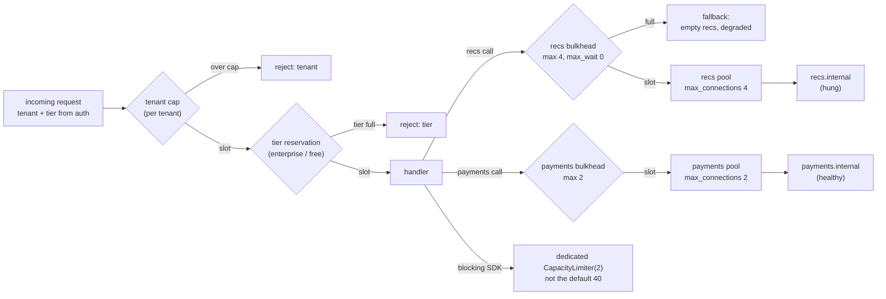

# The Bulkhead Pattern: Isolating Connection Pools, Threadpools, and Semaphores Per Downstream Dependency and Per Tenant Tier

> [!summary] Claim
> Every finite resource that a request holds while it waits on a dependency (a pooled connection, a worker thread, a semaphore slot) is a shared fate domain, so a single hung dependency or a single noisy tenant drains it for everyone; a bulkhead gives each dependency and each tenant tier its own small, bounded, fail-fast partition of that resource, so the blast radius of one failure is the partition, not the process.

Part of [Resilience Rate Limiting and Idempotency](README.md) in [API Engineering](../README.md).

## TL;DR

- Mechanism: give each downstream dependency its own connection pool (in httpx, a separate transport per origin through `mounts`), put a semaphore bulkhead (`anyio.CapacityLimiter` with a per-call borrower) in front of it that rejects instead of queueing, and give blocking SDKs their own thread limiter instead of AnyIO's shared 40 tokens.
- Contract rule: a bulkhead must be smaller than or equal to the resource beneath it, must fail fast (`max_wait` of zero or a few milliseconds), and must be paired with a timeout, because a slot that is never released is a leak no partition can contain.
- Trap: one `httpx.AsyncClient` has one pool whose `max_connections` (default 100) is a single budget across every origin, so in the lab four hung calls to a recommendations service make `POST /checkout` fail with `PoolTimeout` while the payments service sees zero requests.
- Portability: the drafting run passed 8/8 on CPython 3.12.13, 3.13.18, 3.14.6, 3.14.10, 3.15.2, and a free-threaded 3.15.0b3 with the GIL disabled (only 3.14.6 was re-run in verification); nothing in the pattern depends on the GIL, but HTTP/2 multiplexing makes connection limits stop bounding concurrency, so the semaphore layer becomes the real bulkhead.
- When not to use it: when the dependency is not shared (one caller, one callee), when static partitions would strand capacity you cannot afford (prefer adaptive limits), or when the failure domain is the whole host (use cells, pods, or shuffle sharding, not in-process semaphores).

## Mental model



A request is first admitted against two nested partitions taken from the authenticated principal: a per-tenant cap that, when set below the tier's size, stops one tenant from occupying its tier, and a per-tier reservation that stops one tier from occupying the process.
Inside the handler, every outbound call takes a slot in its dependency's bulkhead before it may touch that dependency's connection pool; when the slot is not free the call is rejected at once and the handler serves a fallback instead of waiting.
Each pool is private to one dependency, so the hung recommendations service can hold at most its own four connections, and the payments pool stays empty and ready.
Blocking work that has to run in a thread goes through its own limiter, so it cannot consume the event loop's shared thread tokens that every sync dependency in the process also needs.
The arrows that end in a rejection are the point of the pattern: each partition converts "wait for a resource that may never come back" into an immediate, typed, observable failure inside one compartment.

## How it works

### 1. Why shared resources turn one slow dependency into a total outage

Nygard's *Release It!* (second edition, January 2018) lists Bulkheads among its Stability Patterns, next to Timeouts and Circuit Breaker, and lists Blocked Threads, Cascading Failures, Slow Responses, and Unbalanced Capacities among the Stability Antipatterns it answers (publisher contents page).
The name comes from "the sectioned partitions (bulkheads) of a ship's hull": if the hull is breached, only the damaged section fills with water, so the ship does not sink (Azure Architecture Center, Bulkhead pattern).
The mechanism behind the antipattern is resource coupling: a request that waits on a dependency keeps holding whatever it acquired on the way in, and the slowest dependency therefore holds resources the longest.
By Little's law the number of held resources is the arrival rate multiplied by the holding time, so when one dependency's latency goes from 50 ms to a 5 s timeout, its share of a common pool grows a hundredfold at constant traffic and crowds out every other dependency.
Google's SRE book describes the end state: thread starvation "can directly cause errors or lead to health check failures", and running out of file descriptors can prevent new network connections, which also fails health checks ("Addressing Cascading Failures", section Resource Exhaustion).
Failed health checks then remove the instance from the load balancer, which pushes its load onto the survivors, which is how a slow non-critical dependency becomes a fleet outage.

### 2. The httpx and httpcore pool: one budget for every origin

`httpx.AsyncClient` builds one `AsyncHTTPTransport`, which builds one `httpcore.AsyncConnectionPool` with `max_connections=limits.max_connections`, `max_keepalive_connections`, and `keepalive_expiry` taken from `Limits` (httpx 0.28.1 httpx/_transports/default.py, AsyncHTTPTransport.__init__).
The client default is `DEFAULT_LIMITS = Limits(max_connections=100, max_keepalive_connections=20)` with `keepalive_expiry=5.0`, and `DEFAULT_TIMEOUT_CONFIG = Timeout(timeout=5.0)` (httpx 0.28.1 httpx/_config.py).
Every request enters `AsyncConnectionPool.handle_async_request`, which appends an `AsyncPoolRequest` to the single list `self._requests` and calls `_assign_requests_to_connections` (httpcore 1.0.9 httpcore/_async/connection_pool.py).
That method walks queued requests in list order and, for each, tries three cases: reuse an available connection to the same origin, create a new connection if `len(self._connections) < self._max_connections`, or close an idle connection to any origin and open a new one in its place.
The cap is `len(self._connections)` across all origins; there is no per-host limit in httpx 0.28.1 or httpcore 1.0.9.
When all connections are active (none idle, none available for the origin), the request waits in `pool_request.wait_for_connection(timeout=timeout)`, where `timeout` is `request.extensions["timeout"]["pool"]`.
The wait is an `AsyncEvent.wait` wrapped in `anyio.fail_after(timeout)` with `TimeoutError` mapped to `httpcore.PoolTimeout` (httpcore 1.0.9 httpcore/_synchronization.py, AsyncEvent.wait), and httpx maps that to `httpx.PoolTimeout` in `map_httpcore_exceptions`.
The httpx documentation defines the pool timeout as "the maximum duration to wait for acquiring a connection from the connection pool" (httpx Timeouts page).
So with a single client, 100 hung calls to one origin leave every request to every other origin waiting up to the pool timeout and then failing, even though those origins are healthy; the lab reproduces this with four connections.
One more detail from the same method: the keep-alive pruning branch compares `len([connection.is_idle() for connection in self._connections])` with `_max_keepalive_connections`, and that list has one entry per connection, idle or not, so as written it closes idle connections whenever the total connection count exceeds the keep-alive limit (a reading of the 1.0.9 source; not measured here).

The fix inside one client is `mounts`: `AsyncClient(mounts={"http://recs.internal": transport_a, "http://payments.internal": transport_b})` routes each origin to its own transport, and each transport owns its own pool and its own `max_connections` (httpx 0.28.1 httpx/_client.py, AsyncClient.__init__ builds `self._mounts` from `mounts`).
Separate `AsyncClient` instances per dependency achieve the same and also give each dependency its own default timeouts, headers, and event hooks; the trade-off is more objects to close in the application lifespan.

### 3. Thread isolation versus semaphore isolation (Hystrix and resilience4j)

Hystrix "employs the bulkhead pattern to isolate dependencies from each other and to limit concurrent access to any one of them", using "separate, per-dependency thread pools" so that latency "will saturate the available threads only in that pool" (Hystrix wiki, How it Works, Isolation).
Thread isolation lets the caller "walk away" from a dependency call that is taking too long (same page, Threads and Thread Pools), but the Hystrix thread itself keeps running unless the wrapped code honours `InterruptedException`: "Most Java HTTP client libraries do not interpret InterruptedExceptions.", so the pool can still saturate (same page, step 6, `HystrixObservableCommand.construct()` or `HystrixCommand.run()`).
Semaphore isolation (`execution.isolation.strategy=SEMAPHORE`) limits concurrent callers without a thread hop, "but it does not allow for timing out and walking away"; if the dependency becomes latent "the parent threads will remain blocked until the underlying network calls timeout" (same page, Semaphores).
Netflix measured the cost of thread isolation on one command executed at 60 requests per second on a single API instance (of about 350 threaded executions per second per server): no cost at the median, 3 ms at the 90th percentile, and 9 ms at the 99th percentile; each API instance ran 40+ thread pools with 5 to 20 threads each, most set to 10, and the API processed "10+ billion Hystrix Command executions per day" (same page, Cost of Threads; Netflix's numbers, not measured here).
Hystrix is in maintenance mode at 1.5.18, and its README points new work at resilience4j and at adaptive concurrency limits instead of preconfigured sizes (Hystrix README).
resilience4j offers a `SemaphoreBulkhead` (`maxConcurrentCalls` default 25, `maxWaitDuration` default 0) and a `FixedThreadPoolBulkhead` (`maxThreadPoolSize` default `availableProcessors()`, `coreThreadPoolSize` default `availableProcessors() - 1`, `queueCapacity` default 100, `keepAliveDuration` default 20 ms), and notes that unlike Hystrix it offers no "shadow" thread pool option for the semaphore variant (resilience4j Bulkhead docs).

In `asyncio` the distinction collapses for non-blocking code: a coroutine waiting on a socket can be cancelled at its `await`, so a semaphore plus a deadline already gives the walk-away property that Hystrix needed threads for.
It does not collapse for blocking code run through `anyio.to_thread.run_sync`, because a worker thread cannot be killed; there the thread limiter is the bulkhead, and the only exit is a timeout inside the blocking library itself.

### 4. AnyIO `CapacityLimiter`: the semaphore under the lab's bulkhead

On the asyncio backend a `CapacityLimiter` is a set of borrowers, a total, and an `OrderedDict` wait queue of `asyncio.Event` objects (anyio 4.16.0 src/anyio/_backends/_asyncio.py, CapacityLimiter).
`acquire_on_behalf_of_nowait` raises `RuntimeError` if the borrower already holds a token, and raises `WouldBlock` if the wait queue is non-empty or the borrowers fill the total, so a newcomer never barges past a waiter even when a token is momentarily free.
`acquire_on_behalf_of` parks on an event in the queue; on any exception, including cancellation, it removes itself from the queue, and if the token had already been handed to it, it discards the token and wakes the next waiter, so a cancelled waiter cannot leak capacity.
`release_on_behalf_of` removes the borrower and calls `_notify_next_waiter`, which pops the oldest waiter, adds it to the borrowers, and sets its event: tokens are handed off FIFO rather than competed for.
The `total_tokens` setter accepts only an `int` or `math.inf`, rejects negatives, and wakes as many waiters as the new size allows, so a bulkhead can be resized at runtime without a restart.
The default borrower is `current_task()`, so the same task cannot hold two tokens of one limiter; the lab's `Bulkhead` passes a fresh `object()` per call so it counts calls rather than tasks, which matters when one task holds two streamed responses from the same dependency.
The default thread limiter is created lazily as `CapacityLimiter(40)` per event loop through a `RunVar` (same file, `current_default_thread_limiter` and `_default_thread_limiter`).

### 5. Admission policy: reject, bounded wait, or queue

A bulkhead that queues without bound is not a bulkhead; it just moves the pile-up from the pool to the semaphore.
Hystrix defaults its thread pool to `maxQueueSize=-1` (a `SynchronousQueue`, so no queue at all) with `coreSize=10`, and offers `queueSizeRejectionThreshold` (default 5) as a dynamically adjustable cap when a queue is configured (Hystrix wiki, Configuration).
resilience4j defaults `maxWaitDuration` to 0, which is reject-on-full (resilience4j Bulkhead docs).
The lab's `Bulkhead` follows the same rule: `max_wait=0` uses `acquire_on_behalf_of_nowait` and raises `BulkheadFullError` on `WouldBlock`; a positive `max_wait` wraps the blocking acquire in `anyio.move_on_after`, so waiters are admitted FIFO and a waiter that times out leaves no trace in the queue.
A short wait is useful only to absorb jitter, for example a burst that arrives a few milliseconds before slots free up; anything longer than a small fraction of the caller's deadline converts the rejection back into latency.

### 6. Sizing: the formula and the multiplication trap

Hystrix gives the sizing formula "requests per second at peak when healthy" multiplied by "99th percentile latency in seconds + some breathing room" and the principle to "keep the pool as small as possible, as it is the primary tool to shed load" (Hystrix wiki, Configuration, ThreadPool Properties).
That is Little's law applied at the healthy p99: a dependency taking 200 requests per second at a p99 of 0.25 s needs about 50 concurrent slots, plus headroom (arithmetic, not a measurement).
Netflix reported "30+ of its threadpools set at 10, two at 20, and one at 25", and that such a pool "will typically only have 1 or 2 threads active at any given time to serve mostly 40ms median calls" (same page).
Every in-process limit multiplies by the number of processes: a bulkhead of 10 per Uvicorn worker, with 4 workers per pod and 25 pods, permits 1000 concurrent calls to the dependency, which is what the dependency's own capacity plan must absorb (arithmetic).
Static partitions also strand capacity: the sum of the bulkheads is usually larger than the total the process can serve (overcommit, betting that not every dependency peaks together) or smaller (reservation, paying for idle slots to guarantee isolation), and the choice between the two is the real design decision.
Google's per-customer quota example overcommits explicitly: a backend with 10,000 CPUs grants Gmail 4,000, Calendar 4,000, Android 3,000, and Google+ 2,000 CPU-seconds per second, and notes the numbers "may add up to more than" the allocation (SRE book, "Handling Overload", Per-Customer Limits).

### 7. Per-tenant and per-tier bulkheads

Dependency bulkheads protect the process from its callees; tenant bulkheads protect tenants from each other.
Stripe's concurrent requests limiter says "You can only have 20 API requests in progress at the same time", and its fleet usage load shedder reserves a fraction of infrastructure for critical methods: "If our reservation number is 20%, then any non-critical request over their 80% allocation would be rejected with status code 503" (Stripe, "Scaling your API with rate limiters", 2017-03-30).
Google classifies every request with one of four criticalities (`CRITICAL_PLUS`, `CRITICAL`, `SHEDDABLE_PLUS`, `SHEDDABLE`) and expects services to provision for all `CRITICAL` and `CRITICAL_PLUS` traffic (SRE book, "Handling Overload", Criticality).
Kubernetes API Priority and Fairness, stable since v1.29, partitions kube-apiserver concurrency into priority levels so that "an ill-behaved Pod that floods the API server with requests cannot prevent leader election or actions by the built-in controllers from succeeding"; a level of type `Reject` returns `429 Too Many Requests` immediately, and a level of type `Queue` assigns flows to queues by shuffle sharding with tunable `queues`, `queueLengthLimit`, and `handSize` (Kubernetes docs, API Priority and Fairness).
The same page counts concurrency in "seats", and some large `LIST` requests occupy more than one seat, which is the cost-weighted variant of a bulkhead slot.
The lab's `TenantBulkheads` nests two semaphore bulkheads: a per-tenant cap (`tenant_limit`) inside a per-tier reservation (`tier_limit`); a tier's slots can never be used by another tier, and one tenant cannot take all of its tier as long as `tenant_limit < tier_limit`; `TierPolicy` does not enforce that inequality, and the lab's enterprise policy (`tier_limit=3, tenant_limit=3`) deliberately lets a single tenant fill its tier.
It creates a tenant's bulkhead on first use and deletes it when its last slot is released, so memory is bounded by concurrent tenants, not by every tenant ID an attacker can invent.

### 8. Shuffle sharding: bulkheads when you cannot afford one partition per tenant

Plain sharding puts each tenant on one shard, so a poison tenant takes down everyone on that shard: with 8 workers in 4 shards of 2, one bad tenant affects "one quarter of the overall service" (AWS Builders' Library, "Workload isolation using shuffle-sharding", 2019-12-05).
Shuffle sharding gives each tenant its own combination of workers: "With eight workers, there are 28 unique combinations of two workers", so "the scope of impact due to a problem is just 1/28th", which the article calls "7 times better than regular sharding".
Route 53 arranges capacity into 2048 virtual name servers and assigns each customer domain a shuffle shard of four, giving "730 billion possible shuffle shards"; the lab computes `math.comb(2048, 4) == 730_862_190_080`.
The isolation holds only "If the requestors are fault tolerant and can work around this (with retries for example)": a tenant that shares one worker with the poison tenant still has its other worker, but only if its client retries elsewhere.
The lab's `shuffle_shard` uses rendezvous (highest random weight) hashing over `sha256(tenant/worker)`, so assignment is stateless and deterministic, and adding a ninth worker moves a tenant only onto the new worker; `shard_overlap_histogram` confirms that of the 28 two-worker shards, 1 is identical to a given shard, 12 share one worker, and 15 share none.

### 9. Bulkheads below and above the application

Envoy enforces "fully distributed (not coordinated)" limits per upstream cluster and per priority: maximum connections, pending requests, requests, active retries, and connection pools, with defaults of 1024, 1024, 1024, 3, and unlimited (Envoy docs, Circuit breaking and `circuit_breaker.proto`, 1.41.0-dev as of 2026-11).
Worker threads share those limits, but "since the implementation is eventually consistent, races between threads may allow limits to be potentially exceeded"; overflow increments counters such as `upstream_cx_overflow`, `upstream_rq_pending_overflow`, and `upstream_rq_active_overflow`, and the router sets `x-envoy-overloaded` on the downstream response (Envoy docs, Circuit breaking and router filter).
For HTTP/2, if max concurrent streams and max requests per connection are not configured, all requests are multiplexed over the same connection and the pending-requests limit "will only be hit when no connection is already established".
The same is true in-process: with `http2=True`, httpcore reports an HTTP/2 connection `is_available()` while it is open and has stream IDs left (httpcore 1.0.9 httpcore/_async/http2.py, AsyncHTTP2Connection.is_available), so the pool keeps assigning new requests to that one connection instead of opening more, and an HTTPS connection that is still connecting already counts as available (httpcore 1.0.9 httpcore/_async/connection.py, AsyncHTTPConnection.is_available).
Streams per connection are bounded by an `AsyncSemaphore` (`_max_streams_semaphore`) sized to the minimum of the server's `SETTINGS_MAX_CONCURRENT_STREAMS` and httpcore's own advertised value of 100 (httpcore 1.0.9 httpcore/_async/http2.py: the semaphore is created in `AsyncHTTP2Connection.handle_async_request` starting at 1 stream, the local 100 is set in `_send_connection_init`, and the minimum is applied in `_receive_remote_settings_change`); the server's setting is initially unlimited and recommended to be no smaller than 100 (RFC 9113 Section 6.5.2; stream concurrency is Section 5.1.2).
So over HTTP/2 one connection of a `max_connections=4` pool can carry up to 100 concurrent calls to a hung origin, and further requests wait on that connection's stream semaphore, which has no timeout and sits after the pool wait, so `PoolTimeout` never fires; only a semaphore bulkhead bounds them (a reading of the 1.0.9 source; not run in the lab).
At the server edge, Uvicorn's `--limit-concurrency` answers `503` and logs the warning `Exceeded concurrency limit.` once connections or tasks reach the limit (uvicorn 0.54.0 uvicorn/protocols/http/h11_impl.py and httptools_impl.py; `service_unavailable` in flow_control.py); that is a whole-process bulkhead, not a per-dependency one.
Above the process, Azure describes the same pattern, "also known as a cell-based architecture": partition service instances into groups based on consumer load and availability requirements, deploy partitions into separate VMs, containers, or processes, and isolate asynchronous consumers through separate queues (Azure Architecture Center, Bulkhead pattern).

## Numbers and limits

| Quantity | Value | Source |
| --- | --- | --- |
| httpx client default pool | `max_connections=100`, `max_keepalive_connections=20`, `keepalive_expiry=5.0`; one pool for all origins | httpx 0.28.1 httpx/_config.py, `DEFAULT_LIMITS` |
| httpx default timeout | `Timeout(timeout=5.0)`, so the pool wait is 5 s unless overridden | httpx 0.28.1 httpx/_config.py, `DEFAULT_TIMEOUT_CONFIG` |
| httpcore pool default when used directly | `max_connections=10` | httpcore 1.0.9 connection_pool.py, `AsyncConnectionPool.__init__` |
| AnyIO default thread limiter | `CapacityLimiter(40)` per event loop | anyio 4.16.0 _backends/_asyncio.py |
| SQLAlchemy `QueuePool` defaults | `pool_size=5`, `max_overflow=10`, `timeout=30.0` | sqlalchemy 2.1.8 sqlalchemy/pool/impl.py, `QueuePool.__init__` |
| asyncpg `create_pool` defaults | `min_size=10`, `max_size=10`, `max_queries=50000`, `max_inactive_connection_lifetime=300.0` | asyncpg 0.32.0 asyncpg/pool.py |
| Hystrix thread pool defaults | `coreSize=10`, `maximumSize=10`, `maxQueueSize=-1`, `queueSizeRejectionThreshold=5`, `keepAliveTimeMinutes=1` | Hystrix wiki, Configuration |
| Hystrix semaphore and timeout defaults | `maxConcurrentRequests=10`, `timeoutInMilliseconds=1000` | Hystrix wiki, Configuration |
| Hystrix thread overhead (Netflix, one command at 60 rps on one API instance) | no cost at the median, 3 ms p90, 9 ms p99 | Hystrix wiki, How it Works |
| resilience4j `SemaphoreBulkhead` defaults | `maxConcurrentCalls=25`, `maxWaitDuration=0` | resilience4j docs |
| resilience4j `FixedThreadPoolBulkhead` defaults | `maxThreadPoolSize` = CPUs, `coreThreadPoolSize` = CPUs - 1, `queueCapacity=100`, `keepAliveDuration=20 ms` | resilience4j docs |
| Envoy per-cluster thresholds | 1024 connections, 1024 pending, 1024 requests, 3 retries; retry budget 20% with `min_retry_concurrency=3` | Envoy `circuit_breaker.proto` (1.41.0-dev, as of 2026-11) |
| Stripe concurrency and reservation | example limit of 20 requests in progress at the same time; 20% fleet reserved for critical methods, overflow gets `503` | Stripe blog, 2017-03-30 |
| Shuffle sharding combinatorics | C(8,2) = 28; C(2048,4) = 730,862,190,080 | AWS Builders' Library; computed in the lab |
| HTTP/2 stream cap | `SETTINGS_MAX_CONCURRENT_STREAMS` initially unlimited, recommended >= 100; httpcore advertises 100 and uses min(server, 100) per connection | RFC 9113 Section 6.5.2; httpcore 1.0.9 httpcore/_async/http2.py, `AsyncHTTP2Connection._send_connection_init` |
| Lab run time | 8 tests in 1.04 s | measured in verification (2026-11-21): `uv run --frozen pytest <module> -v` from `labs/`, Apple M3 Pro, macOS 27.3 (Darwin 27.3.0) arm64, CPython 3.14.6 |

## Portability

| Leg | Result | Evidence |
| --- | --- | --- |
| CPython 3.12.13 | 8/8 pass (drafting run) | `uv run --frozen --python 3.12`; not re-run in verification; 3.12.16 is not installed here, 3.12.13 ran instead |
| CPython 3.13.18 | 8/8 pass (drafting run) | `uv run --frozen --python 3.13`; not re-run in verification |
| CPython 3.14.6 (workspace interpreter) | 8/8 pass in 1.04 s | `uv run --frozen pytest`, re-run in verification on 2026-11-21 |
| CPython 3.14.10 | 8/8 pass (drafting run) | `uv run --frozen --python 3.14.10`; not re-run in verification |
| CPython 3.15.2 | 8/8 pass (drafting run) | `uv run --frozen --python /opt/homebrew/bin/python3.15`; not re-run in verification |
| CPython 3.15.2t free-threaded | not run: not installable here | `--python 3.15t` resolved to 3.15.0b3t, and the locked workspace fails on it (`psycopg-binary==3.3.8` has no wheel) |
| CPython 3.15.0b3t, `-X gil=0` (`sys._is_gil_enabled()` returned `False`) | 8/8 pass (drafting run) in a reduced venv with only the pinned anyio, httpx, httpcore, h11, starlette, pytest, pytest-asyncio | not re-run in verification; the limiter is event-loop state, so the GIL does not change its semantics |
| anyio 4.16.0 | FIFO handoff, no barging, per-borrower uniqueness, cancellation cleanup | `_backends/_asyncio.py`, `CapacityLimiter`; lab tests 4 and 7 |
| httpx 0.28.1 / httpcore 1.0.9 | one global `max_connections` per pool; `mounts` gives one pool per origin; no HTTP/3 transport (`http1` and `http2` flags only) | `_transports/default.py`, `connection_pool.py`; lab tests 1 and 2 |
| HTTP/1.1 | one in-flight request per connection, so `max_connections` bounds concurrency per origin | lab (h11 over the in-memory backend) |
| HTTP/2 | one connection multiplexes up to min(server, 100) streams in httpcore; `max_connections` stops bounding concurrency, a semaphore bulkhead must | httpcore 1.0.9 `_async/http2.py`; RFC 9113 Section 5.1.2; Envoy circuit breaking docs; not run in the lab |
| HTTP/3 | not available in httpx 0.28.1; at a proxy, Envoy applies the same per-cluster limits, with max concurrent streams as the HTTP/3 equivalent | httpx transport signature; Envoy circuit breaking docs |
| Uvicorn 0.54.0, Hypercorn, Granian | in-app bulkheads are per process and per event loop, so totals multiply by workers; only Uvicorn's `--limit-concurrency` (process-wide `503`) was read in source | uvicorn h11_impl.py, httptools_impl.py; Hypercorn and Granian not run |

## Worked example

The [implementation](../labs/src/api_labs/f16_resilience_rate_limiting_and_idempotency/bulkhead_isolation.py) runs two fake dependencies, a hung `recs.internal` and a healthy `payments.internal`, behind a custom `httpcore.AsyncNetworkBackend`, so the real `httpcore.AsyncConnectionPool` queueing and `PoolTimeout` paths execute over HTTP/1.1 bytes parsed by h11 without opening a socket.
A Starlette storefront serves `GET /home` (recommendations, degradable) and `POST /checkout` (payments, must succeed), and the [test](../labs/tests/f16_resilience_rate_limiting_and_idempotency/test_bulkhead_isolation_and_per_dependency_resource_partitioning.py) drives it in-process with `httpx.ASGITransport`.

The semaphore bulkhead, verbatim from the implementation:

```python
class BulkheadFullError(Exception):
    """Raised instead of queueing when a bulkhead has no free slot within ``max_wait``."""

    def __init__(self, bulkhead: str) -> None:
        super().__init__(f"bulkhead {bulkhead!r} is full")
        self.bulkhead = bulkhead


class Bulkhead:
    """Semaphore bulkhead: at most ``max_concurrent`` calls in flight, bounded FIFO wait."""

    def __init__(self, name: str, max_concurrent: int, max_wait: float = 0.0) -> None:
        if max_concurrent < 1:
            raise ValueError("max_concurrent must be >= 1")
        if max_wait < 0:
            raise ValueError("max_wait must be >= 0")
        self.name = name
        self.max_wait = max_wait
        self._limiter = anyio.CapacityLimiter(max_concurrent)
        self.admitted = 0
        self.rejected = 0

    @property
    def in_use(self) -> int:
        return self._limiter.borrowed_tokens

    @property
    def waiting(self) -> int:
        return self._limiter.statistics().tasks_waiting

    @asynccontextmanager
    async def slot(self) -> AsyncGenerator[None]:
        # One borrower per call, not per task: a task that holds two calls holds two slots.
        borrower = object()
        await self._enter(borrower)
        try:
            yield
        finally:
            self._limiter.release_on_behalf_of(borrower)

    async def _enter(self, borrower: object) -> None:
        if self.max_wait == 0:
            try:
                self._limiter.acquire_on_behalf_of_nowait(borrower)
            except anyio.WouldBlock:
                self.rejected += 1
                raise BulkheadFullError(self.name) from None
            self.admitted += 1
            return
        with anyio.move_on_after(self.max_wait):
            await self._limiter.acquire_on_behalf_of(borrower)
            self.admitted += 1
            return
        self.rejected += 1
        raise BulkheadFullError(self.name)
```

The headline failure, verbatim from the test: four hung `/home` calls hold all four connections of a shared pool, and checkout fails with `PoolTimeout` without the payments service ever seeing a request.

```python
@pytest.mark.unit
@pytest.mark.asyncio
async def test_hung_recs_exhaust_shared_pool_and_checkout_fails_with_pool_timeout() -> None:
    network, recs, payments = network_with_hung_recs()
    upstream = shared_client(network, max_connections=4, pool_timeout=0.05)
    homes: list[dict[str, Any]] = []

    async with (
        upstream,
        client_for(build_storefront(upstream)) as client,
        anyio.create_task_group() as tg,
    ):

        async def home() -> None:
            homes.append((await client.get("/home")).json())

        for _ in range(4):
            tg.start_soon(home)
        await wait_until(lambda: recs.waiting_at_gate == 4)

        checkout = await client.post("/checkout")
        assert checkout.status_code == 503
        assert checkout.json() == {"charged": False, "error": "PoolTimeout"}
        assert payments.requests_seen == 0  # the healthy dependency was never reached
        assert recs.open_connections == 4

        recs.gate.set()

    assert homes == [{"recs": ["a", "b"], "degraded": None}] * 4
```

The other seven tests prove the fixes and the edge cases:
- `test_per_dependency_pools_keep_checkout_alive_while_recs_hang`: with `partitioned_client(limits={RECS: 4, PAYMENTS: 2})`, six `/home` calls yield four held connections and two `PoolTimeout` fallbacks inside the recs pool, while three checkouts return `200` over one reused keep-alive connection.
- `test_bulkhead_rejects_excess_immediately_where_pool_alone_makes_them_wait`: ten `/home` calls against the recs pool alone produce six `PoolTimeout` fallbacks (each excess caller waited 50 ms); with `Bulkhead(RECS, 4, max_wait=0.0)` in front, the same six get `BulkheadFullError` fallbacks with zero wait, and `admitted, rejected` end at `4, 6`.
- `test_bounded_wait_admits_in_fifo_order_and_timed_out_waiter_leaves_no_trace`: waiters are admitted in arrival order, and a waiter that exceeds `max_wait` leaves `in_use` and `waiting` unchanged.
- `test_tenant_tiers_reserve_capacity_and_cap_each_noisy_tenant`: `free-a`'s second call is rejected by `tenant:free:free-a`, `free-c` by `tier:free`, the enterprise tier still admits three, and the registry is empty afterwards.
- `test_dedicated_thread_limiter_leaves_the_default_40_tokens_untouched`: three blocking SDK calls against `CapacityLimiter(2)` hold two tokens and queue one, while the default limiter shows 0 of 40 borrowed and still runs other thread work.
- `test_raw_capacity_limiter_is_per_task_but_bulkhead_counts_calls`: a second `acquire()` from the same task raises `RuntimeError`, while the per-call borrower lets one task hold two slots and rejects the third.
- `test_shuffle_shard_combinatorics_match_the_builders_library_numbers`: 28 and 730,862,190,080, the overlap histogram `{2: 1, 1: 12, 0: 15}`, and rendezvous stability when a worker is added.

Output captured in verification on 2026-11-21 on CPython 3.14.6, macOS 27.3 arm64 (Apple M3 Pro), from `labs/`:

```text
$ uv run --frozen pytest tests/f16_resilience_rate_limiting_and_idempotency/test_bulkhead_isolation_and_per_dependency_resource_partitioning.py -v
platform darwin -- Python 3.14.6, pytest-9.2.0, pluggy-1.7.0
collected 8 items

...::test_hung_recs_exhaust_shared_pool_and_checkout_fails_with_pool_timeout PASSED [ 12%]
...::test_per_dependency_pools_keep_checkout_alive_while_recs_hang PASSED [ 25%]
...::test_bulkhead_rejects_excess_immediately_where_pool_alone_makes_them_wait PASSED [ 37%]
...::test_bounded_wait_admits_in_fifo_order_and_timed_out_waiter_leaves_no_trace PASSED [ 50%]
...::test_tenant_tiers_reserve_capacity_and_cap_each_noisy_tenant PASSED [ 62%]
...::test_dedicated_thread_limiter_leaves_the_default_40_tokens_untouched PASSED [ 75%]
...::test_raw_capacity_limiter_is_per_task_but_bulkhead_counts_calls PASSED [ 87%]
...::test_shuffle_shard_combinatorics_match_the_builders_library_numbers PASSED [100%]

============================== 8 passed in 1.04s ===============================
```

The node IDs are shortened to `...::` here; the venv path in the `platform` line is also trimmed.

## Pitfalls

> [!warning] One client, one pool, every dependency
> Trigger: a module-level `httpx.AsyncClient()` shared by every outbound call, with the default `max_connections=100`.
> Symptom: when one dependency hangs, calls to healthy dependencies fail with `httpx.PoolTimeout` and their services see no traffic at all, so their dashboards look fine while yours is red.
> Fix: one transport per origin through `mounts`, or one client per dependency, each with its own `Limits` and timeouts; the lab's first two tests show both sides.

> [!warning] A bulkhead without a timeout is a slow leak
> Trigger: a semaphore or pool around a call with no read timeout or deadline.
> Symptom: the partition fills with hung calls and stays full; Hystrix documents the same for semaphore isolation, where parent threads "remain blocked until the underlying network calls timeout" (Hystrix wiki, How it Works).
> Fix: every bulkhead slot is held under a deadline shorter than the caller's budget; see [[Timeout-Taxonomy-Connect-Read-Write-Pool-and-Deadline-Propagation]].

> [!warning] Nested partitions sized inconsistently deadlock
> Trigger: two partitions acquired in sequence where the outer one is larger, such as FastAPI `def` endpoints running in AnyIO's 40-thread pool while a `yield` dependency holds one of only 4 SQLAlchemy connections.
> Symptom: FastAPI issue #3205 (2021-05-10) reports that with `pool_size=4`, `max_overflow=0`, `pool_timeout=None`, and 100 concurrent requests, "only around 5 requests are served, and then the app freezes"; a commenter's diagnosis is that blocked `def` path operations hold every worker, so dependency generators never reach the `finally` that would return connections.
> Fix: acquire partitions in one fixed order, size the outer partition no larger than the inner one, never wait forever on the inner one, and keep the teardown path off the partition it is trying to free.

> [!warning] Bulkhead larger than the pool beneath it
> Trigger: a semaphore bulkhead of 50 in front of a pool of 10.
> Symptom: 40 admitted calls queue inside the pool and fail with `PoolTimeout` after holding a slot and a server task each, which is the queueing the bulkhead was meant to prevent.
> Fix: size the semaphore at or below the pool, and reject at the semaphore; the lab's third test shows the difference between the two rejection points.

> [!warning] Static limits that ignore process count
> Trigger: a per-process bulkhead of 10 deployed to 4 workers per pod and 25 pods.
> Symptom: the dependency receives up to 1000 concurrent calls, and its own pool or database is the bottleneck you moved the outage to.
> Fix: derive the per-process number from the dependency's capacity divided by the process count, and recompute it when autoscaling changes the count; see [[Sizing-Connection-Pools-Across-Workers-Pods-and-PgBouncer-Transaction-Mode]].

> [!warning] Retries inside the partition
> Trigger: a retry loop that re-enters the same bulkhead, or retries that do not count against it.
> Symptom: under failure each logical call holds a slot for the sum of its attempts, and rejected callers retry into the same full partition; Envoy caps parallel retries per cluster at 3 by default for this reason and recommends retry budgets (Envoy circuit breaking docs).
> Fix: one slot per attempt, a retry budget per dependency, and no retry on `BulkheadFullError`; see [[Retry-Budgets-and-Preventing-Cascading-Retry-Amplification-Storms]].

> [!warning] Re-entrant acquisition with a per-task limiter
> Trigger: the same task enters one `anyio.CapacityLimiter` twice, for example a helper that wraps a call already wrapped by its caller.
> Symptom: `RuntimeError: this borrower is already holding one of this CapacityLimiter's tokens` (anyio 4.16.0 src/anyio/_backends/_asyncio.py, CapacityLimiter.acquire_on_behalf_of_nowait), or with a per-call borrower and a limit of 1, a self-wait that only `max_wait` ends (or an immediate `BulkheadFullError` when `max_wait` is 0).
> Fix: acquire the bulkhead in exactly one layer, the outbound client wrapper, and never inside business code.

## Security and robustness

OWASP lists missing or misconfigured limits on "Execution timeouts", "Maximum allocable memory", "Maximum number of file descriptors", and "Maximum number of processes" as what makes an API vulnerable to API4:2023 Unrestricted Resource Consumption; bulkheads are how those limits are scoped so one actor exhausts only its own share.
The tenant and tier keys must come from the authenticated principal, never from a client-supplied header, or an attacker claims the enterprise tier and spends its reservation.
Tenant IDs are attacker-controlled cardinality: a registry that creates a bulkhead per tenant must evict idle entries, as `TenantBulkheads.slot` does, or a flood of random IDs becomes a memory exhaustion attack against the limiter itself.
An unknown tier must fail closed (the lab raises `KeyError` before any slot is taken) rather than fall back to an unbounded default.
A slow-read client against a streaming endpoint holds a slot for as long as it reads, so the slot must cover the whole response lifetime and must be bounded by a write or idle timeout.
Rejections should be cheap and typed: return `503` (dependency or tier full) or `429` (tenant over its cap) with `Retry-After`, and never spend more work rejecting than serving, the trade-off Google's SRE book notes for very cheap requests ("Handling Overload", Client-Side Throttling); see [[Standard-RateLimit-Headers-IETF-Draft-and-429-Retry-After-Semantics]].
Defense in depth stacks the layers: per-tenant caps at the gateway, per-dependency bulkheads in the process, per-cluster limits in the sidecar, and cells or shuffle shards in the fleet, each catching what leaks past the one above.
Per-bulkhead metrics (`in_use`, `waiting`, `admitted`, `rejected`) are the observability contract: Hystrix's argument for per-dependency pools was as much that misbehaviour becomes visible per dependency as that it is contained.

## The principal's view

The decision is not whether to bulkhead but at which layer each failure domain is cut: in-process semaphores and pools for dependencies, gateway or middleware partitions for tenants and tiers, sidecar limits for polyglot fleets, and cells or shuffle shards for whole-host failures and poison tenants.
In-process bulkheads are the cheapest and the most precise, because only the application knows that recommendations are degradable and payments are not, but they multiply by process count and drift with every deploy; mesh limits are uniform and centrally owned but cannot tell a degradable call from a critical one.
Static partitions trade utilization for predictability, and the organizational cost is that every partition is a number someone must own, review, and resize as traffic shifts.
That cost is why Netflix moved its emphasis from preconfigured Hystrix pools to adaptive concurrency limits; the mature design is a small static floor per critical dependency or tier plus an adaptive limit above it, see [[Adaptive-Concurrency-Limits-Littles-Law-Vegas-and-Gradient2]].
Treat each dependency's bulkhead size as part of the contract with the team that owns the dependency: it is the maximum concurrency you promise to send them, and it belongs in their capacity plan.
Choose a different tool when the problem is different: a [[Circuit-Breakers-State-Machines-Half-Open-Probing-and-When-Not-to-Use-Them|circuit breaker]] stops calling a dependency that is failing fast, [[Load-Shedding-Priority-Traffic-Classes-and-LIFO-Queue-Management|load shedding]] drops work when the whole process is saturated, and a durable queue decouples a slow consumer entirely; a bulkhead only bounds how much of you a slow or noisy party can hold.
When isolation must survive a crashed process or a noisy host, it has to move out of the language runtime into separate deployments, cgroups, or cells, because no semaphore in the process survives the process.

## Interview questions

> [!question] L5: Your service calls five internal APIs through one `httpx.AsyncClient()` with default settings and one of them starts hanging; what happens to calls to the other four, and why?
>
> > [!success]- Answer
> > The client has one `httpcore.AsyncConnectionPool` with `max_connections=100` shared across all origins.
> > Hung calls hold their connections until the read timeout, so the pool fills with connections to the hung origin.
> > Calls to the other four origins then wait in the pool's queue and fail with `httpx.PoolTimeout` after the pool timeout (5 s by default), without ever reaching their healthy services.
> > The fix is one transport per origin through `mounts`, or one client per dependency.
> >
> > Follow-up: Why does a shorter read timeout reduce the damage but not remove it?

> [!question] L5: What is the difference between a semaphore bulkhead and a thread-pool bulkhead, and which one do you need in an `asyncio` service?
>
> > [!success]- Answer
> > A thread-pool bulkhead runs the call on a dedicated pool so the caller can walk away on timeout; a semaphore bulkhead only limits how many callers may be inside at once.
> > Hystrix notes that semaphores do not let you time out and walk away, which is why it defaulted to threads.
> > In `asyncio`, non-blocking calls can be cancelled at their `await`, so a semaphore plus a deadline gives the same walk-away property without a thread hop.
> > Blocking SDK calls still need a dedicated thread limiter, because a worker thread cannot be cancelled.
> >
> > Follow-up: What happens to the thread after `anyio.to_thread.run_sync` is cancelled with `abandon_on_cancel=True`?

> [!question] L6: Predict the output: with a shared pool of `max_connections=4` and `pool=0.05`, and four `GET /home` requests blocked on a hung recommendations service, what status code and body does a following `POST /checkout` (which calls payments) return, and how many requests did payments receive?
>
> > [!success]- Answer
> > `503` with `{"charged": false, "error": "PoolTimeout"}`.
> > Payments received zero requests: the checkout call waited 50 ms in the shared pool's queue for a connection that never freed up, and the pool raised `PoolTimeout` before any connection to payments was created.
> > This is the lab's first test, and the `payments.requests_seen == 0` assertion is the point: the healthy dependency's own metrics show nothing wrong.
> >
> > Follow-up: With `partitioned_client(limits={RECS: 4, PAYMENTS: 2})`, what does the same checkout return, and how many payments connections are opened for three sequential checkouts?

> [!question] L6: Debug this API: a FastAPI service with sync `def` endpoints and a `yield` dependency that opens a SQLAlchemy session (`pool_size=4`, `max_overflow=0`, `pool_timeout=None`) serves about five requests under 100 concurrent users and then stops responding with CPU near zero; what is happening, and what do you change?
>
> > [!success]- Answer
> > Two partitions are nested in an inconsistent order: endpoint threads come from AnyIO's 40-token limiter, and database connections from a pool of 4 that waits forever.
> > Threads blocked waiting for a connection hold thread tokens, and the dependency teardown that would return connections cannot run, so every thread waits on a connection that only a waiting thread could release.
> > This is FastAPI issue #3205.
> > Fix it by giving the pool a finite `pool_timeout`, sizing the outer partition no larger than the inner one, keeping teardown off the saturated limiter, or moving to async endpoints with an async driver.
> >
> > Follow-up: How would you detect this state from metrics before users report it?

> [!question] L6: How do you size a bulkhead for a dependency that takes 300 requests per second with a p50 of 20 ms and a p99 of 200 ms, served by 12 processes?
>
> > [!success]- Answer
> > Size on the healthy p99 as Hystrix suggests: 300 x 0.2 = 60 concurrent calls fleet-wide, plus headroom, for example 80.
> > Divide by the process count: about 7 per process, rounded up.
> > Check that the dependency can absorb 80 concurrent calls, and that the per-process connection pool is at least 7.
> > Recompute when autoscaling changes the process count, or use an adaptive limit with this as the floor.
> >
> > Follow-up: Why size on p99 and not on the p50, which gives a concurrency of 6?

> [!question] L6: Why does `max_connections` stop being a bulkhead when you enable HTTP/2, and what replaces it?
>
> > [!success]- Answer
> > HTTP/1.1 carries one request per connection at a time, so a connection cap is a concurrency cap.
> > HTTP/2 multiplexes streams, so one connection can carry as many concurrent requests as the server's `SETTINGS_MAX_CONCURRENT_STREAMS` allows, which RFC 9113 recommends be at least 100.
> > httpcore keeps an HTTP/2 connection available while it is open, so one connection of a `max_connections=4` pool carries up to 100 concurrent calls (httpcore's own advertised limit), and further requests wait on its stream semaphore with no pool timeout.
> > A semaphore bulkhead in front of the client is what bounds concurrency; Envoy documents the same effect for its pending-requests limit.
> >
> > Follow-up: What would you put in the bulkhead's metrics to see this in production?

> [!question] L7+: For a multi-tenant API with enterprise and free tiers, design the isolation so that one free tenant cannot hurt other free tenants and the free tier cannot hurt enterprise, and explain where each piece lives.
>
> > [!success]- Answer
> > Use two nested partitions taken from the authenticated principal: a per-tenant concurrency cap inside a per-tier reservation, so the free tier's slots can never be used by enterprise traffic or the reverse, and, with the tenant cap set below the tier size, one tenant can never take its whole tier.
> > Put the tenant cap at the gateway or first middleware so it is rejected before any work, and return `429` with `Retry-After`; return `503` when the tier is full.
> > Evict idle per-tenant state so random tenant IDs cannot exhaust memory, and fail closed on unknown tiers.
> > For poison tenants that crash hosts rather than saturate slots, add shuffle sharding at the fleet level, so a tenant shares all of its workers with almost no other tenant, and make clients retry onto their other workers.
> > Decide between reservation and overcommit per tier: reserve for enterprise, overcommit free.
> >
> > Follow-up: How does Kubernetes API Priority and Fairness implement both layers, and what does `handSize` trade off?

> [!question] L7+: Netflix put Hystrix into maintenance mode and moved toward adaptive concurrency limits; does that make static bulkheads obsolete?
>
> > [!success]- Answer
> > No: adaptive limits change how the size is chosen, not whether partitions exist.
> > An adaptive limit per dependency is still a per-dependency bulkhead whose size follows measured latency instead of a configured number.
> > Static floors still matter for critical dependencies and tiers, because an adaptive limit can shrink a critical partition during an incident caused elsewhere.
> > The cost of static limits is ownership and drift across deploys and scaling; the cost of adaptive limits is a control loop that can oscillate or be gamed.
> > A mature design uses a small static reservation for what must never be starved plus an adaptive limit above it.
> >
> > Follow-up: Which signal would you feed the adaptive limit for a dependency whose latency is dominated by queueing in its own pool?

> [!question] L7+: With shuffle sharding over 8 workers and shards of 2 (28 combinations), what fraction of tenants loses all capacity when one tenant's poison request kills both of its workers, and what assumption makes that number true?
>
> > [!success]- Answer
> > Only the tenants assigned the identical pair lose everything, which is 1 of 28 combinations; 12 of the 28 share exactly one worker, and 15 share none.
> > With plain sharding into 4 shards of 2, a quarter of tenants would lose everything, so the AWS article calls shuffle sharding 7 times better.
> > The number holds only if clients are fault tolerant: a tenant sharing one dead worker must retry on its other worker.
> > Route 53 uses 2048 virtual name servers with shards of 4, giving about 730 billion combinations.
> >
> > Follow-up: Why is rendezvous hashing a good way to assign shuffle shards when the fleet grows?

## Related

Prerequisites: [[Load-Shedding-Priority-Traffic-Classes-and-LIFO-Queue-Management]]

Next: [[Hedged-Requests-and-Tail-Latency-Taming-at-Scale]]

See also: [[02-Programming-Languages/Python/Python-Backend-Interview-Prep/08-Microservices-and-Messaging]], [[02-Programming-Languages/Python/Python-Backend-Interview-Prep/17-Concurrency-in-Web-Services-and-Coding]], [[Circuit-Breakers-State-Machines-Half-Open-Probing-and-When-Not-to-Use-Them]], [[Adaptive-Concurrency-Limits-Littles-Law-Vegas-and-Gradient2]], [[Timeout-Taxonomy-Connect-Read-Write-Pool-and-Deadline-Propagation]], [[Retry-Budgets-and-Preventing-Cascading-Retry-Amplification-Storms]], [[Multi-Tier-Rate-Limiting-Quotas-Concurrency-Limits-and-Cost-Budgets]], [[Standard-RateLimit-Headers-IETF-Draft-and-429-Retry-After-Semantics]], [[Async-Def-vs-Def-Endpoints-and-AnyIO-Threadpool-Limiter-Semantics]], [[Async-Synchronization-Primitives-Locks-Semaphores-and-Reentrant-Deadlocks]], [[AnyIO-Structured-Concurrency-TaskGroups-CancelScopes-and-ExceptionGroups]], [[Cancellation-Semantics-CancelledError-Swallowing-and-Shielded-Cleanup]], [[Connection-Pooling-Internals-QueuePool-AsyncAdaptedQueuePool-and-Pre-Ping]], [[Sizing-Connection-Pools-Across-Workers-Pods-and-PgBouncer-Transaction-Mode]], [[Backend-for-Frontend-BFF-Aggregation-Fan-Out-and-Partial-Degradation]], [[Offloading-CPU-Bound-Work-ProcessPoolExecutor-vs-Free-Threaded-Python-3-15t]], [[In-Process-Testing-of-ASGI-Apps-with-HTTPX-ASGITransport]]

- Lab: `labs/tests/f16_resilience_rate_limiting_and_idempotency/test_bulkhead_isolation_and_per_dependency_resource_partitioning.py`

## Further reading

- [Release It! Second Edition (Pragmatic Bookshelf)](https://pragprog.com/titles/mnee2/release-it-second-edition/) - Nygard's Stability Patterns chapter, where Bulkheads sits beside Timeouts and Circuit Breaker.
- [Hystrix wiki: How it Works](https://raw.githubusercontent.com/wiki/Netflix/Hystrix/How-it-Works.md) - thread versus semaphore isolation, why Netflix chose threads, and the measured thread overhead.
- [Hystrix wiki: Configuration](https://raw.githubusercontent.com/wiki/Netflix/Hystrix/Configuration.md) - the sizing formula, queue and rejection properties, and Netflix's real pool sizes.
- [Hystrix README](https://raw.githubusercontent.com/Netflix/Hystrix/master/README.md) - maintenance-mode status and the move to resilience4j and adaptive limits.
- [resilience4j Bulkhead](https://resilience4j.readme.io/docs/bulkhead) - the semaphore and fixed-thread-pool bulkheads with their defaults.
- [Azure Architecture Center: Bulkhead pattern](https://learn.microsoft.com/en-us/azure/architecture/patterns/bulkhead) - consumer and service partitioning, cells, and when the pattern might not be suitable.
- [AWS Builders' Library: Workload isolation using shuffle-sharding](https://builder.aws.com/content/3F06NpJ8YeoIGP8VHTw4n81pFn8/workload-isolation-using-shuffle-sharding) - the combinatorics and the Route 53 deployment.
- [Envoy: Circuit breaking](https://www.envoyproxy.io/docs/envoy/latest/intro/arch_overview/upstream/circuit_breaking) - per-cluster, per-priority limits at the proxy, and their HTTP/2 behaviour.
- [Envoy: `circuit_breaker.proto`](https://www.envoyproxy.io/docs/envoy/latest/api-v3/config/cluster/v3/circuit_breaker.proto) - threshold fields, defaults, and retry budgets.
- [Kubernetes: API Priority and Fairness](https://kubernetes.io/docs/concepts/cluster-administration/flow-control/) - priority levels, seats, and shuffle-sharded fair queuing in a production API server.
- [Stripe: Scaling your API with rate limiters](https://stripe.com/blog/rate-limiters) - concurrent request limits and capacity reserved for critical traffic.
- [Google SRE book: Addressing Cascading Failures](https://sre.google/sre-book/addressing-cascading-failures/) - how resource exhaustion turns into fleet-wide failure.
- [Google SRE book: Handling Overload](https://sre.google/sre-book/handling-overload/) - per-customer limits, overcommit, and request criticality.
- [RFC 9113](https://www.rfc-editor.org/rfc/rfc9113.html) - HTTP/2 stream concurrency (Section 5.1.2) and `SETTINGS_MAX_CONCURRENT_STREAMS` (Section 6.5.2).
- [httpx: Resource limits](https://www.python-httpx.org/advanced/resource-limits/) and [Timeouts](https://www.python-httpx.org/advanced/timeouts/) - the client-side knobs the lab partitions.
- [FastAPI issue #3205](https://github.com/fastapi/fastapi/issues/3205) - a real deadlock from nesting a large thread partition over a small connection partition.
- [OWASP API4:2023 Unrestricted Resource Consumption](https://owasp.org/API-Security/editions/2023/en/0xa4-unrestricted-resource-consumption/) - the threat model bulkheads answer.
