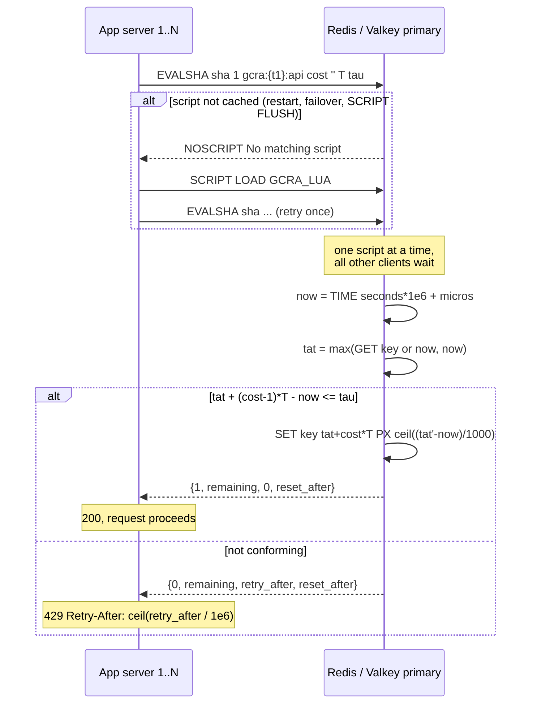

# Distributed Rate Limiting with GCRA (Generic Cell Rate Algorithm) and Atomic Redis/Valkey Lua Scripts

> [!summary] Claim
> GCRA reduces a token bucket to one integer per key, the theoretical arrival time (TAT), and a single Lua script that reads the server clock, tests `TAT - now <= tau`, and writes the new TAT with a matching TTL makes the decision atomic across every app server, so 50 concurrent callers against a burst of 10 get exactly 10 admissions where a GET-then-SET limiter admits all 50.

Part of [Resilience Rate Limiting and Idempotency](README.md) in [API Engineering](../README.md).

## TL;DR

- Mechanism: GCRA(I, L) keeps one theoretical arrival time per key; a request at time `now` conforms when `TAT <= now + L`, and a conforming request sets `TAT = max(TAT, now) + I` (ATM Forum TM 4.0 Section 4.4.2, Figure 4-1); for an API quota `I = T = period / rate` and `L = tau = (burst - 1) * T`.
- Contract rule: the read, the decision, and the write must be one atomic step on the store, so run them as one `EVALSHA` script (Redis and Valkey block every other client for the script's whole runtime), read "now" with `TIME` inside the script, and pass every key through `KEYS` so Redis Cluster can route it.
- Trap: the state is a 16-digit microsecond integer, and Lua 5.1 `tostring` formats numbers with `"%.14g"`, so `tostring(tat)` stores `1.7631648001235e+15` and silently loses 2 digits, while passing the number straight to `redis.call` stays exact (lab, and Redis 8.10.3 src/script_lua.c, luaArgsToRedisArgv).
- Portability: the lab passes 31 of 31 tests on CPython 3.12.13, 3.13.18, 3.14.6, 3.14.10, and 3.15.2 (Homebrew); 3.15.2t was not available, the full workspace does not build on 3.15.0b3t, and in a minimal 3.15.0b3t venv `lupa` 2.8 re-enables the GIL on import (31 of 31 pass with and without `PYTHON_GIL=0`); the script runs unchanged on Redis 7+ and Valkey, and Dragonfly also ships the algorithm natively as `CL.THROTTLE`.
- When not to use it: GCRA limits request rate, not concurrency or cost, so use a concurrency limiter for long requests ([[Adaptive-Concurrency-Limits-Littles-Law-Vegas-and-Gradient2]]) and skip the shared store when one process owns the quota; if a store round trip per request is too expensive, accept per-node local limits with approximate global totals.

## Mental model



Every app server sends the same cached script by its SHA1, and only falls back to `SCRIPT LOAD` when the server answers `NOSCRIPT`, which happens after a restart, a failover, or `SCRIPT FLUSH` because the script cache is never persisted (Redis docs, Scripting with Lua, Cache volatility).
The server runs one script at a time, so the `TIME`, `GET`, compare, and `SET` inside it are a single indivisible step that no other client can interleave with (Redis docs, Redis programmability).
The clock is the store's clock, read once per decision, so app servers with skewed clocks cannot disagree about "now".
A conforming request moves the TAT forward by `cost * T` and sets the key's TTL to exactly the time until the TAT falls back to "now", so an idle key deletes itself at the moment it would have meant "full burst available" anyway.
A non-conforming request writes nothing, which is the TM 4.0 rule that only conforming cells update GCRA state, and gets back the exact microsecond wait that the app rounds up into `Retry-After`.
The lab proves the arrows: `test_fifty_concurrent_coroutines_admit_exactly_burst_with_one_key`, `test_script_flush_is_recovered_by_the_evalsha_fallback`, `test_retry_after_is_exact_to_the_microsecond`, and `test_key_ttl_equals_reset_after_rounded_up_to_milliseconds`.

## How it works

### Origin: GCRA(I, L) in ATM Forum TM 4.0

The ATM Forum Traffic Management Specification 4.0 (`af-tm-0056.000`, April 1996) defines conformance of a cell stream with "the Generic Cell Rate Algorithm" and two parameters, the Increment `I` and the Limit `L`, written `GCRA(I, L)` (TM 4.0 Section 4.4.2).
It gives two flowcharts that it declares equivalent "for any sequence of cell arrival times": the virtual scheduling algorithm and the continuous-state leaky bucket algorithm (TM 4.0 Section 4.4.2, Figure 4-1).
Virtual scheduling keeps one variable, the Theoretical Arrival Time.
At the first arrival `TAT = ta(1)`.
At each later arrival: if `TAT < ta(k)` then `TAT = ta(k)`; if `TAT > ta(k) + L` the cell is non-conforming and TAT is unchanged; otherwise the cell conforms and `TAT = TAT + I` (TM 4.0 Figure 4-1).
The continuous-state leaky bucket keeps two variables, the bucket content `X` and the Last Compliance Time `LCT`: it drains `X' = max(X - (ta(k) - LCT), 0)`, rejects when `X' > L`, and otherwise sets `X = X' + I` and `LCT = ta(k)` (TM 4.0 Figure 4-1).
The specification states the bridge between them: after each arrival `TAT = X + LCT` (TM 4.0 Section 4.4.2), and Annex C.1 explains it as a bucket "whose real-valued content drains out at a continuous rate of 1 unit of content per time-unit" with capacity `L + I` (TM 4.0 Annex C.1).
`test_virtual_scheduling_matches_continuous_state_leaky_bucket` runs both flowcharts over 5,000 seeded random arrivals and asserts identical verdicts and `TAT == X + LCT` after every one.
TM 4.0 attributes Figure 4-1 to "Figure 1 in Annex 1 of I.371-draft", the ITU-T recommendation that carries the same algorithm (TM 4.0 Section 4.4.2); this note relies on the TM 4.0 text, which was fetched, not on I.371.

TM 4.0 also gives the burst that a GCRA admits when cells arrive back to back at a peak spacing `T` shorter than the sustained increment `Ts`: `MBS = 1 + floor(tau_s / (Ts - T))`, and conversely `tau_s = (MBS - 1)(Ts - T)` by convention (TM 4.0 Annex C.4).
An HTTP API has no peak cell rate, so arrivals can coincide (`T = 0`), and the formula collapses to `burst = 1 + floor(tau / T)`, which is why this note sets `tau = (burst - 1) * T`.
`test_burst_at_peak_spacing_matches_tm40_mbs_formula` checks the general formula: with `T = 100 us` and `tau = 500 us`, spacings of 0, 10, 40, 60, 75, and 99 us admit 6, 6, 9, 13, 21, and 501 back-to-back requests before the first rejection.
Annex C.4 bounds the number of conforming cells in any closed interval of length `t` by `min(1 + floor((t + tau_s) / Ts), 1 + floor(t / T))` (TM 4.0 Annex C.4).
An API has no peak spacing `T`, so only the first term binds, and it is the honest answer to "how many requests can a client make in one minute".
Derived from that bound, not measured: a policy of 100 per minute with burst 20 has `T = 600 ms` and `tau = 11.4 s`, so the worst 60-second window admits `1 + floor(71.4 / 0.6) = 120` requests, the burst of 20 plus 100 at the sustained rate.
TM 4.0 composes several GCRA instances: a cell conforms only if it conforms to every instance that tests it, and an instance's state is updated only by cells that conform (TM 4.0 Section 4.4.2), which is exactly the all-or-nothing rule the multi-key script below enforces.

### Mapping GCRA onto an API quota

The lab's `GcraPolicy` takes `rate` requests per `period_us` and a `burst`.
The emission interval is `T = period_us // rate`, floored to whole microseconds, so the effective rate errs high by less than 1 us per request (for 7 per second, `T = 142,857 us`).
The tolerance is `tau = (burst - 1) * T`.
A request of `cost` units at time `now` is treated as `cost` cells arriving together, so it conforms when the last of them does: `max(TAT, now) + (cost - 1) * T - now <= tau`.
For `cost = 1` this is exactly TM 4.0's test `TAT <= now + L`.
On conformance the new TAT is `max(TAT, now) + cost * T`.
Three useful outputs fall out of the same arithmetic, all in the implementation's `gcra_virtual_scheduling` and mirrored in the Lua script:

| Output | Formula | Meaning |
| --- | --- | --- |
| `remaining` | `floor((now + tau - TAT) / T) + 1`, clamped at 0 | Unit-cost requests that would still conform right now |
| `retry_after_us` | `max(TAT, now) + (cost - 1) * T - tau - now` | Exact wait until this request would conform; `None` when `(cost - 1) * T > tau` |
| `reset_after_us` | `TAT - now` after the decision | Time until the full burst is available again; also the key's TTL |

The equivalence with a token bucket is one line of algebra: with `tau = (burst - 1) * T`, the token count is `burst - (TAT - now) / T`, and "at least one token" is the same inequality as `TAT - now <= tau`.
GCRA stores the bucket as a single timestamp instead of a `(tokens, last_refill)` pair and never runs a refill step, which is what Brandur Leach's 2015 write-up means by tracking the remaining limit through one time, the theoretical arrival time (brandur.org, Rate Limiting, Cells, and GCRA, 2015-09-18).
`test_retry_after_is_exact_to_the_microsecond` shows the outputs on the policy 5 per second with burst 3 (`T = 200,000 us`, `tau = 400,000 us`): three admissions report `remaining` 2, 1, 0; the fourth is denied with `retry_after_us = 200000` and `reset_after_us = 600000`; at `now + 199,999 us` it is still denied, and at `now + 200,000 us` it is admitted.
A request whose cost can never fit, `(cost - 1) * T > tau`, is reported with no retry time at all, because no amount of waiting makes `burst + 1` cells conform at once; `test_cost_larger_than_burst_never_conforms_and_leaves_state` asserts it writes nothing and that a request of exactly `burst` still passes.
Throttled, the Go library whose GCRA Brandur's article points to, uses the same shape: `delayVariationTolerance = period * (MaxBurst + 1)`, `allowAt = newTat - delayVariationTolerance`, and sets `RetryAfter` only when the increment fits within that tolerance (throttled v2.15.1 rate.go, GCRARateLimiterCtx.RateLimitCtx; master is byte-identical as of 2026-11).
redis-cell and Dragonfly name the parameter `max_burst` and report a total limit of `max_burst + 1` (redis-cell README; Dragonfly `CL.THROTTLE` reference), so `max_burst` there is `burst - 1` here.

### Why one integer per key is the whole state

The script stores one string per (caller, policy): the TAT as a decimal integer of microseconds, 16 bytes today, and nothing else (`test_fifty_concurrent_coroutines_admit_exactly_burst_with_one_key` asserts `DBSIZE` is 1 and the value is 16 digits after 50 calls).
A sliding-window log needs one entry per admitted request inside the window: the `limits` 5.8.0 moving-window script `LPUSH`es a timestamp per hit and `LTRIM`s the list to `limit` entries, so its state per key grows with the limit (limits 5.8.0 limits/resources/redis/lua_scripts/acquire_moving_window.lua).
The key's TTL is set to `ceil((TAT - now) / 1000)` milliseconds with `SET ... PX`, so expiry deletes a key exactly when its absence and its value mean the same thing, since a missing key is treated as `TAT = now`.
Expiry is therefore only garbage collection, never part of correctness: an expired key and an old TAT give the same decision, so an eviction policy or a lagging expire cycle cannot over-admit beyond what GCRA itself allows.
`test_key_ttl_equals_reset_after_rounded_up_to_milliseconds` checks the TTL is 200 ms after one admission on the 5 per second policy.

### Atomicity: why a script, and what the alternatives cost

The decision is a read-modify-write.
Redis documents that "all server activities are blocked during its entire runtime" of a script, so "all of the script's effects either have yet to happen or had already happened" (Redis docs, Scripting with Lua), and Valkey's documentation carries the same guarantee for its single Lua 5.1 engine (valkey.io, eval-intro).
The obvious alternative, `GET` in the app, decide, then `SET`, puts a network round trip between the read and the write, and every concurrent caller that reads before the first write sees the same old TAT.
`test_naive_get_then_set_admits_every_concurrent_request` runs the lab's `NaiveGetSetGcraLimiter` with 50 coroutines on the hourly policy with burst 10 and gets 50 admissions; the script version under the same load gets exactly 10, with `remaining` values 0 through 9 each handed out once.
One honest detail of the lab: fakeredis answers in-process, and without the `asyncio.sleep(0)` that stands in for the network round trip, its async client ran each coroutine's `GET` and `SET` back to back (a probe on fakeredis 2.40.0, CPython 3.14.6, with the yield removed admitted exactly 10 of 50), which would hide the race a real network exposes.
fakeredis models the server's atomicity with one `threading.Lock` per `FakeServer`, taken around each command including `EVAL` (fakeredis 2.40.0 fakeredis/_core/_server.py, FakeServer; fakeredis/_socket/_base.py, BaseFakeSocket._process_command), and `test_threads_sharing_one_server_admit_exactly_burst` shows 4 OS threads with 25 calls each admit exactly 10 in total.

There are three other ways to get atomicity, each with a cost:

| Approach | How it is atomic | Cost |
| --- | --- | --- |
| Lua script (`EVAL`/`EVALSHA`) | Server runs the whole script without interleaving | Script cache management, Lua CVE surface, script blocks the server while it runs |
| Optimistic CAS (`WATCH`/`MULTI`/`EXEC`, or a store CAS) | Retry when the key changed between read and write | 2 or more round trips; under contention retries pile up, so throttled caps them at `maxCASAttempts = 10` by default (`SetMaxCASAttemptsLimit` changes it) and returns an error (throttled v2.15.1 rate.go) |
| Server module: redis-cell `CL.THROTTLE` | Native command | A Rust module to deploy; the README says it is in "best effort" maintenance mode (redis-cell README, as of 2026-11) |
| Native command: Dragonfly `CL.THROTTLE` | Native command, `O(1)`, ACL categories `@throttle @fast @write` | Only on Dragonfly (Dragonfly command reference, as of 2026-11) |

fakeredis 2.40.0 also emulates Dragonfly's `CL.THROTTLE`, keeping `tat` in nanoseconds with the same `allow_at = new_tat - delay_variation_tolerance` test (fakeredis 2.40.0 fakeredis/server_specific_commands/dragonfly_mixin.py, DragonflyCommandsMixin.cl_throttle); that is an emulation, not Dragonfly's source, and the lab does not use it.

### Whose clock: `TIME` inside the script

`TIME` returns two integers, seconds and microseconds, and the script combines them as `tonumber(t[1]) * 1000000 + tonumber(t[2])`.
Reading the clock on the store means every app server's decision uses one clock, the primary's.
Passing `now` from the app is the common alternative, and it is what `limits` 5.8.0 does: `RedisStorage.acquire_entry` calls `time.time()` in the client and passes it as `ARGV[1]` to its moving-window script (limits 5.8.0 limits/storage/redis.py, RedisStorage.acquire_entry).
`test_app_server_clock_skew_over_admits_but_server_time_does_not` shows the cost: two limiters sharing one key, one with its clock an hour ahead, admit 20 requests for a burst of 10, because the fast server sees the stored TAT as already in the past; two limiters on the server clock admit 10 and deny the next 10.
`TIME` inside a writing script was not always legal.
Before effects replication, Redis replicated the script source and blocked a write after a "random" command such as `TIME`; effects replication arrived in Redis 3.2, became the default in 5.0, and is the only mode since 7.0, and under effects replication "the restrictions on non-deterministic functions are removed" (Redis docs, Scripting with Lua, Script replication).
On Redis 3.2 to 4.x the script would need `redis.replicate_commands()` before its first write; the lab's script targets Redis 7+ and Valkey, whose documentation states verbatim replication "was removed in 7.0" (valkey.io, eval-intro).
With effects replication the replica receives the `SET` with the already-computed TAT wrapped in `MULTI`/`EXEC`, so the replica never re-reads its own clock (Redis docs, Scripting with Lua, Replicating commands instead of scripts).
The server clock is still a wall clock: a failover to a replica whose clock differs moves "now" for every key at once, which is a smaller version of the app-server skew problem and is bounded by the hosts' NTP discipline.

### Lua numbers: exact storage, lossy formatting, truncated replies

Redis and Valkey embed Lua 5.1, which has one number type, a C `double` (Redis docs, Redis Lua API reference).
Integers are exact up to 2^53, about 9.007e15; a microsecond epoch timestamp is about 1.79e15 in 2026, so microseconds stay exact for about 285 years from 1970, while nanoseconds (about 1.79e18) would not.
Three conversions matter.
First, `tostring` and string concatenation use `LUA_NUMBER_FMT "%.14g"` (Redis 8.10.3 deps/lua/src/luaconf.h), which keeps 14 significant digits: `test_number_arguments_stay_exact_but_tostring_keeps_14_digits` stores `tostring(1763164800123457)` and reads back `1.7631648001235e+15`.
Second, a number passed straight to `redis.call` is converted without `lua_tolstring`, because, in the source's words, "Lua uses a format specifier that loses precision"; Redis prints it with `ll2string` when `double2ll` says it is integral and with `fpconv_dtoa` otherwise (Redis 8.10.3 src/script_lua.c, luaArgsToRedisArgv), and the same test reads back `1763164800123457` exactly.
fakeredis 2.40.0 formats numeric arguments with `"%.17g"`, which gives the same digits for integers below 10^17 (fakeredis 2.40.0 fakeredis/commands_mixins/scripting_mixin.py, _convert_redis_arg).
Third, a Lua number returned from the script becomes a RESP integer with "the decimal part of the number" removed (Redis docs, Redis Lua API reference, Lua to RESP2 type conversion), implemented as `addReplyLongLong(c,(long long)lua_tonumber(lua,-1))` (Redis 8.10.3 src/script_lua.c, luaReplyToRedisReply); `test_lua_number_replies_are_truncated_to_integers` gets `[2, -2, b"2.9"]` back from `return {2.9, -2.9, '2.9'}`.
The design consequence is to keep every quantity an integer number of microseconds, pass numbers to `redis.call` as numbers, and return integers only.

### Script cache lifecycle

`EVAL` sends the source every time; `SCRIPT LOAD` compiles and caches it under its SHA1 and `EVALSHA` runs it by digest (Redis docs, Scripting with Lua, Script cache).
The cache "is always volatile": it is not persisted and "may be cleared when the server restarts, during fail-over when a replica assumes the master role, or explicitly by `SCRIPT FLUSH`", and a missing digest returns `NOSCRIPT No matching script` (Redis docs, Scripting with Lua, Cache volatility).
redis-py 8.1.0 `register_script` returns a `Script` (sync) or `AsyncScript` (asyncio) object that precomputes the SHA1, calls `evalsha`, and on `NoScriptError` calls `script_load` and retries once (redis-py 8.1.0 redis/commands/core.py, AsyncScript.__call__); valkey-py 6.2.0 has the same `AsyncScript` class (valkey 6.2.0 valkey/commands/core.py).
`test_script_flush_is_recovered_by_the_evalsha_fallback` flushes the cache between two calls and gets `remaining` 1 on the second call, proving the TAT survived and the script was reloaded, and `SCRIPT EXISTS` then reports the digest present.
In a pipeline a `NOSCRIPT` reply cannot be handled because other clients' commands may be interleaved (Redis docs, Scripting with Lua, EVALSHA in the context of pipelining); redis-py works around it by adding the script to the pipeline's `scripts` set (redis-py 8.1.0 redis/commands/core.py, Script.__call__), and the pipeline sends `SCRIPT EXISTS` and then `SCRIPT LOAD` for any missing digest before executing (redis-py 8.1.0 redis/client.py, Pipeline.load_scripts).
Generating script text per request is an anti-pattern because every distinct text is a new cache entry (Redis docs, Scripting with Lua, Script parameterization), and both servers evict scripts that arrived through `EVAL` once there are 500 of them, while scripts loaded with `SCRIPT LOAD` are never evicted (Redis 8.10.3 src/eval.c, luaScriptsLRUAdd; Valkey 9.1.3 src/eval.c; both `#define LRU_LIST_LENGTH 500`).
Redis 7.0 added Functions, "scripts that are first-class database elements", loaded once with `FUNCTION LOAD` and called with `FCALL` (Redis docs, Redis programmability, Running scripts); for a limiter that many services share, a Function turns script deployment into an administrative step rather than something every client does on `NOSCRIPT`.

### Several policies in one script: dual GCRA and Redis Cluster

The lab's script loops over `#KEYS`, each with its own `T` and `tau` in `ARGV`, and reads every key before writing any, so a request is admitted only if it conforms to every policy, and a denial changes nothing.
`test_dual_gcra_is_all_or_nothing` pairs a sustained policy (100 per hour, burst 20) with a TM 4.0 style peak-rate check `GCRA(T, 0)` (2 per second, burst 1): the second request within 500 ms is denied with `retry_after_us = 500000`, the sustained key's stored value is byte-identical before and after, and the request is admitted at `now + 500,000 us`.
A Lua script has no rollback, so this read-everything-first structure is the only thing that keeps a multi-key decision consistent if a later `redis.call` fails.
Redis Cluster splits the keyspace into 16384 slots by `HASH_SLOT = CRC16(key) mod 16384`, and hash tags make several keys share a slot by hashing only the substring between the first `{` and the next `}` when it is non-empty (Redis docs, Redis cluster specification, Key distribution model and Hash tags).
Scripts must receive every key name through `KEYS` and "should never access keys with programmatically-generated names" (Redis docs, Scripting with Lua, Script parameterization), because the cluster routes the script by its declared keys.
The lab names keys `gcra:{t1}:sustained` and `gcra:{t1}:peak`; `test_hash_tags_put_both_policy_keys_in_one_cluster_slot` uses redis-py's `key_slot` to show both land in the slot of `t1`, while the untagged names land in different slots.
A script that starts with a `#!lua` shebang gets the flag defaults, and those "cannot" access keys in different slots unless they declare `allow-cross-slot-keys`; a script without a shebang keeps the old permissive behavior (Redis docs, Scripting with Lua, Eval flags; Redis Lua API reference, Script flags); the lab's script has no shebang and relies on hash tags instead.

### Failure semantics

A script that runs longer than `busy-reply-threshold` (alias `lua-time-limit`, default 5000 ms; Valkey 9.1.3 src/config.c) is not stopped: the server starts answering other clients with `BUSY`, `SCRIPT KILL` works only if the script has not written, and otherwise the only way out is `SHUTDOWN NOSAVE` (Redis docs, Redis programmability, Maximum execution time).
The GCRA script does `1 + 2k` commands for `k` policies and no loops over data, so its runtime is bounded by `k`.
Under `maxmemory`, a script without flags aborts at its first write that needs more memory (Redis docs, Scripting with Lua, Execution under low memory conditions); because the script writes only after every read, an out-of-memory abort happens before any key changes.
Replication is asynchronous, so a failover can lose the most recent TAT writes and briefly re-admit up to one burst per affected key; the new primary's empty script cache then costs every client one `NOSCRIPT` round trip.
When the store is unreachable the limiter must choose: fail open (admit, as Stripe describes for its Redis-backed limiters: errors "would fail open and the API would still stay functional"; stripe.com, Scaling your API with rate limiters, 2017) or fail closed (reject).
The lab's `RedisGcraLimiter` fails closed by default, marks the decision `degraded`, and catches only `ConnectionError` and `TimeoutError`; a script bug raises `ResponseError` and propagates, so a broken limiter is loud rather than silently open (`test_unreachable_store_fails_closed_by_default_and_open_on_request`).

### The HTTP surface

`429 Too Many Requests` "indicates that the user has sent too many requests in a given amount of time", MAY carry `Retry-After`, and "MUST NOT be stored by a cache" (RFC 6585 Section 4).
`Retry-After` is `HTTP-date / delay-seconds` with `delay-seconds = 1*DIGIT` (RFC 9110 Section 10.2.3), so a microsecond wait must be rounded to whole seconds, and rounding down turns a 200 ms wait into `Retry-After: 0`, an invitation to retry immediately.
The lab's `retry_after_seconds` rounds up and never returns 0 (`test_retry_after_header_rounds_up_and_never_reaches_zero`), and the ASGI test sees `Retry-After: 1` for a 200,000 us wait.
When the store is down and the limiter fails closed, the lab's app answers `503` with no `Retry-After`, because the limit was not exceeded and the wait is unknown (`test_asgi_app_returns_429_with_retry_after_then_503_when_store_down`).
GCRA outputs map onto the IETF `RateLimit` field (`r` remaining quota, `t` effective window; draft-ietf-httpapi-ratelimit-headers-11 Section 4.1) and `RateLimit-Policy` (`q` quota, `w` window; Section 3.1), but the mapping of a GCRA burst onto a quota-per-window is a modeling choice; it is covered in [[Standard-RateLimit-Headers-IETF-Draft-and-429-Retry-After-Semantics]].

## Numbers and limits

| Quantity | Value | Source |
| --- | --- | --- |
| GCRA state per (caller, policy) | 1 key, one 16-digit integer string | Lab (`test_fifty_concurrent_coroutines_admit_exactly_burst_with_one_key`), CPython 3.14.6, fakeredis 2.40.0, macOS 27.3 arm64 |
| 50 concurrent callers, burst 10, script | 10 admitted, `remaining` 0..9 each once | Lab, same run |
| 50 concurrent callers, burst 10, GET then SET | 50 admitted | Lab (`test_naive_get_then_set_admits_every_concurrent_request`) |
| 4 threads x 25 calls, burst 10 | 10 admitted | Lab (`test_threads_sharing_one_server_admit_exactly_burst`) |
| Worst-case requests in any 60 s window, 100/min burst 20 | 120 | Derived from TM 4.0 Annex C.4 bound `1 + floor((t + tau) / T)`, not measured |
| Commands per decision | `1 + 2k` (`TIME`, `k` `GET`, `k` `SET`) for `k` policies | Lab script |
| Exact integers in a Lua 5.1 number | up to 2^53 (about 9.007e15) | IEEE 754 double; Lua 5.1 in Redis (Redis Lua API reference) |
| Lua `tostring` precision | 14 significant digits (`"%.14g"`) | Redis 8.10.3 deps/lua/src/luaconf.h; lab |
| Script time before `BUSY` replies | 5000 ms default `busy-reply-threshold` | Valkey 9.1.3 src/config.c; Redis docs (as of 2026-11) |
| `EVAL` scripts kept before LRU eviction | 500 (`SCRIPT LOAD` scripts exempt) | Redis 8.10.3 and Valkey 9.1.3 src/eval.c |
| Redis Cluster hash slots | 16384, `CRC16(key) mod 16384` | Redis cluster specification |
| Optimistic CAS retries in throttled | 10 (`maxCASAttempts`, the default) | throttled v2.15.1 rate.go (identical to master as of 2026-11) |
| redis-cell / Dragonfly reply | 5 integers: limited, limit (`max_burst + 1`), remaining, retry seconds or -1, reset seconds | redis-cell README; Dragonfly reference (as of 2026-11) |
| CVE-2025-49844 (Lua use-after-free) | CVSS 9.9, fixed in Redis 6.2.20, 7.2.11, 7.4.6, 8.0.4, 8.2.2 | GHSA-4789-qfc9-5f9q (published 2025-10-03) |
| Lab runtime | 31 tests in 1.02 s (one run; wall time varies run to run) | Lab, `uv run --frozen pytest <test file> -v -p no:cacheprovider` from `labs/`, CPython 3.14.6, macOS 27.3 arm64 (Darwin 27.3.0), 2026-11-21 |

## Portability

| Leg | Result | Evidence |
| --- | --- | --- |
| CPython 3.12 | 31 passed on 3.12.13 (3.12.16 not available to `uv` here) | Lab, `uv run --python 3.12` |
| CPython 3.13.18 | 31 passed | Lab, `uv run --python 3.13` |
| CPython 3.14 | 31 passed on 3.14.6 (workspace) and on 3.14.10 (Homebrew) | Lab |
| CPython 3.15.2 | 31 passed (Homebrew build); `uv`'s 3.15.0b3 fails at plugin load with `ModuleNotFoundError: No module named 'hypothesis._native'` | Lab |
| CPython 3.15.2t | Not available; full workspace sync on 3.15.0b3t fails (`psycopg-binary` has no wheel, `pylsqpack` and `orjson` fail to build) | Lab attempt |
| CPython 3.15.0b3t, minimal venv with the lab's pinned deps | 31 passed; importing `lupa.lua51` (lupa 2.8) re-enables the GIL with a `RuntimeWarning`; with `PYTHON_GIL=0` 31 passed | Lab |
| Debian Trixie and Alpine containers | Not run (lab checks paused, 2026-11-11) | - |
| fakeredis 2.40.0 vs a real server | fakeredis runs scripts on lupa's Lua 5.1 and serializes commands with one server lock; it is an emulation, so every server behavior above is cited to Redis or Valkey source or docs as well | fakeredis 2.40.0 source; lab |
| Redis 7.0+ | Script runs as is: effects replication only, `TIME` before writes allowed | Redis docs, Scripting with Lua |
| Redis 3.2 to 4.x | Needs `redis.replicate_commands()` before the first write, because verbatim replication is the default | Redis docs, Scripting with Lua |
| Redis 5.0 to 6.2 | Runs as is: effects replication is the default | Redis docs, Scripting with Lua |
| Valkey 9.1.3 | Same Lua 5.1 scripting model and cache volatility (valkey.io eval-intro), same 500-entry `EVAL` LRU and 5000 ms `busy-reply-threshold` (source); 9.1.3 keeps the Lua engine under `src/modules/lua` behind `src/scripting_engine.c` | valkey.io eval-intro; Valkey 9.1.3 source tree |
| Dragonfly | Native `CL.THROTTLE` with redis-cell argument order; this note's Lua script was not run against it | Dragonfly reference (as of 2026-11) |
| Python clients | redis-py 8.1.0 `AsyncScript` and valkey-py 6.2.0 `AsyncScript` both retry once after `NoScriptError` | Package source |
| ASGI servers (Uvicorn, Hypercorn, Granian) | Not exercised; the limiter reads only one request header and the store, so the server choice does not enter the decision | Lab uses `httpx.ASGITransport` only |
| HTTP/1.1, HTTP/2, HTTP/3 | Not exercised; `429` and `Retry-After` are version-independent HTTP semantics | RFC 9110 Section 10.2.3; RFC 6585 Section 4 |

## Worked example

The [implementation](../labs/src/api_labs/f16_resilience_rate_limiting_and_idempotency/gcra.py) has the pure TM 4.0 reference, the Lua script, the async limiter, the racy counter-example, and a small Starlette app; the [test](../labs/tests/f16_resilience_rate_limiting_and_idempotency/test_gcra_generic_cell_rate_algorithm_and_atomic_redis_valkey_lua_limiters.py) has 31 cases.

The reference decision function, verbatim:

```python
def gcra_virtual_scheduling(
    tat_us: int | None, now_us: int, policy: GcraPolicy, cost: int = 1
) -> tuple[GcraDecision, int | None]:
    """TM 4.0 Figure 4-1, virtual scheduling side, generalized to `cost` cells arriving together.

    Returns the decision and the TAT to store, or None when the state must not change
    (a non-conforming cell leaves TAT unchanged).
    """
    if cost < 1:
        raise ValueError("cost must be >= 1")
    t = policy.emission_interval_us
    tau = policy.tolerance_us
    tat = now_us if tat_us is None else max(tat_us, now_us)
    last_cell_tat = tat + (cost - 1) * t
    if last_cell_tat - now_us <= tau:
        new_tat = tat + cost * t
        remaining = (now_us + tau - new_tat) // t + 1
        return GcraDecision(True, policy.burst, remaining, 0, new_tat - now_us), new_tat
    retry = None if (cost - 1) * t > tau else last_cell_tat - tau - now_us
    remaining = max((now_us + tau - tat) // t + 1, 0)
    return GcraDecision(False, policy.burst, remaining, retry, tat - now_us), None
```

The Lua script, verbatim from the `GCRA_LUA` string; `test_lua_script_matches_python_reference_on_random_arrivals` drives it and the function above with 400 seeded arrivals of cost 1 to 3 and asserts every decision is equal:

```lua
local cost = tonumber(ARGV[1])
local now
if ARGV[2] == '' then
  local t = redis.call('TIME')
  now = tonumber(t[1]) * 1000000 + tonumber(t[2])
else
  now = tonumber(ARGV[2])
end
local tats = {}
local allowed = 1
local retry_after = 0
for i = 1, #KEYS do
  local t = tonumber(ARGV[2 * i + 1])
  local tau = tonumber(ARGV[2 * i + 2])
  local stored = redis.call('GET', KEYS[i])
  local tat = now
  if stored then
    tat = math.max(tonumber(stored), now)
  end
  tats[i] = tat
  local last_cell_tat = tat + (cost - 1) * t
  if last_cell_tat - now > tau then
    allowed = 0
    if (cost - 1) * t > tau then
      retry_after = -1
    elseif retry_after ~= -1 then
      retry_after = math.max(retry_after, last_cell_tat - tau - now)
    end
  end
end
local remaining = -1
local reset_after = 0
for i = 1, #KEYS do
  local t = tonumber(ARGV[2 * i + 1])
  local tau = tonumber(ARGV[2 * i + 2])
  local tat = tats[i]
  local left
  if allowed == 1 then
    tat = tat + cost * t
    redis.call('SET', KEYS[i], tat, 'PX', math.ceil((tat - now) / 1000))
    left = math.floor((now + tau - tat) / t) + 1
  else
    left = math.max(math.floor((now + tau - tat) / t) + 1, 0)
  end
  if remaining == -1 or left < remaining then
    remaining = left
  end
  reset_after = math.max(reset_after, tat - now)
end
return {allowed, remaining, retry_after, reset_after}
```

`ARGV[2]` is empty in production so the script reads `TIME`; the tests that need to move time pass a fake clock's value instead, and the concurrency test uses the real server clock with `T = 360 s`, long enough that no refill can happen while it runs.
The concurrency test and its racy twin, verbatim:

```python
@pytest.mark.unit
@pytest.mark.asyncio
async def test_fifty_concurrent_coroutines_admit_exactly_burst_with_one_key() -> None:
    client = fakeredis.FakeAsyncRedis()
    limiter = RedisGcraLimiter(client)  # server clock: TIME inside the script
    decisions = await asyncio.gather(*(limiter.acquire("gcra:{t1}:api", HOURLY) for _ in range(50)))
    allowed = [d for d in decisions if d.allowed]
    assert len(allowed) == HOURLY.burst
    assert sorted(d.remaining for d in allowed) == list(range(HOURLY.burst))
    assert await client.eval("return redis.call('DBSIZE')", 0) == 1
    stored = await client.get("gcra:{t1}:api")
    assert stored is not None
    assert stored.isdigit()
    assert len(stored) == 16  # one integer TAT in microseconds is the whole state


@pytest.mark.unit
@pytest.mark.asyncio
async def test_naive_get_then_set_admits_every_concurrent_request() -> None:
    limiter = NaiveGetSetGcraLimiter(fakeredis.FakeAsyncRedis(), clock=FakeClock())
    decisions = await asyncio.gather(*(limiter.acquire("k", HOURLY) for _ in range(50)))
    assert sum(d.allowed for d in decisions) == 50  # every reader saw the same empty key
```

Captured on CPython 3.14.6, macOS 27.3 arm64, from `labs/` with `uv run --frozen pytest tests/f16_resilience_rate_limiting_and_idempotency/test_gcra_generic_cell_rate_algorithm_and_atomic_redis_valkey_lua_limiters.py -v -p no:cacheprovider` (header lines and the test file path prefix trimmed):

```text
collecting ... collected 31 items

test_virtual_scheduling_matches_continuous_state_leaky_bucket PASSED [  3%]
test_burst_at_peak_spacing_matches_tm40_mbs_formula[0-6] PASSED [  6%]
test_burst_at_peak_spacing_matches_tm40_mbs_formula[10-6] PASSED [  9%]
test_burst_at_peak_spacing_matches_tm40_mbs_formula[40-9] PASSED [ 12%]
test_burst_at_peak_spacing_matches_tm40_mbs_formula[60-13] PASSED [ 16%]
test_burst_at_peak_spacing_matches_tm40_mbs_formula[75-21] PASSED [ 19%]
test_burst_at_peak_spacing_matches_tm40_mbs_formula[99-501] PASSED [ 22%]
test_retry_after_is_exact_to_the_microsecond PASSED [ 25%]
test_lua_script_matches_python_reference_on_random_arrivals PASSED [ 29%]
test_fifty_concurrent_coroutines_admit_exactly_burst_with_one_key PASSED [ 32%]
test_naive_get_then_set_admits_every_concurrent_request PASSED [ 35%]
test_app_server_clock_skew_over_admits_but_server_time_does_not PASSED [ 38%]
test_cost_larger_than_burst_never_conforms_and_leaves_state PASSED [ 41%]
test_dual_gcra_is_all_or_nothing PASSED [ 45%]
test_hash_tags_put_both_policy_keys_in_one_cluster_slot PASSED [ 48%]
test_script_flush_is_recovered_by_the_evalsha_fallback PASSED [ 51%]
test_number_arguments_stay_exact_but_tostring_keeps_14_digits PASSED [ 54%]
test_lua_number_replies_are_truncated_to_integers PASSED [ 58%]
test_key_ttl_equals_reset_after_rounded_up_to_milliseconds PASSED [ 61%]
test_unreachable_store_fails_closed_by_default_and_open_on_request PASSED [ 64%]
test_retry_after_header_rounds_up_and_never_reaches_zero[1-1] PASSED [ 67%]
test_retry_after_header_rounds_up_and_never_reaches_zero[999999-1] PASSED [ 70%]
test_retry_after_header_rounds_up_and_never_reaches_zero[1000000-1] PASSED [ 74%]
test_retry_after_header_rounds_up_and_never_reaches_zero[1000001-2] PASSED [ 77%]
test_retry_after_header_rounds_up_and_never_reaches_zero[359999999-360] PASSED [ 80%]
test_asgi_app_returns_429_with_retry_after_then_503_when_store_down PASSED [ 83%]
test_threads_sharing_one_server_admit_exactly_burst PASSED [ 87%]
test_policy_rejects_degenerate_parameters[0-1-1] PASSED [ 90%]
test_policy_rejects_degenerate_parameters[1-0-1] PASSED [ 93%]
test_policy_rejects_degenerate_parameters[1-1-0] PASSED [ 96%]
test_policy_rejects_degenerate_parameters[1000001-1000000-1] PASSED [100%]

============================== 31 passed in 1.02s ==============================
```

## Pitfalls

> [!warning] GET, decide, SET across two round trips
> Trigger: the limiter reads the TAT (or a counter) in the app and writes it back with a second command.
> Symptom: under concurrency every caller that reads before the first write sees the same state, and the limit stops binding; the lab admits 50 of 50 with a burst of 10.
> Fix: one `EVALSHA` per decision, or a CAS loop with a bounded retry count and an error when the bound is hit, as throttled does with `maxCASAttempts = 10`.

> [!warning] App-server clocks
> Trigger: `now` is computed in each app process and passed as an argument, as `limits` 5.8.0 does with `time.time()`.
> Symptom: a server whose clock runs ahead sees stored TATs as already past and admits a fresh burst; the lab admits 20 for a burst of 10 with one clock an hour ahead.
> Fix: read `TIME` inside the script on Redis 5+ or Valkey, and if you must pass time in, monitor NTP offset and treat skew as a direct over-admission budget.

> [!warning] `tostring` on timestamps
> Trigger: building the stored value with `tostring(tat)` or `tat .. ''`, or logging it that way and parsing the log.
> Symptom: Lua 5.1 prints `"%.14g"`, so a 16-digit microsecond TAT becomes `1.7631648001235e+15`, losing up to 50 us per write and drifting the limit.
> Fix: pass numbers to `redis.call` as numbers; Redis converts integral doubles with `ll2string` (Redis 8.10.3 src/script_lua.c, luaArgsToRedisArgv).

> [!warning] Fractions in replies
> Trigger: returning `retry_after` in seconds as a Lua number such as `0.2`.
> Symptom: the reply is truncated to `0` (RESP2 integer conversion), the app sends `Retry-After: 0`, and clients retry in a tight loop.
> Fix: return integer microseconds and round up to whole seconds in the app, never to 0.

> [!warning] Script text generated per request
> Trigger: interpolating the key, rate, or burst into the script source instead of passing `KEYS` and `ARGV`.
> Symptom: every variant is a new cache entry; `EVAL`-loaded scripts are evicted LRU once there are 500 of them, and keys built inside the script break Redis Cluster routing.
> Fix: one constant script, parameters in `ARGV`, every key in `KEYS`, keys of one decision sharing a `{hash tag}`.

> [!warning] `NOSCRIPT` after failover inside a pipeline
> Trigger: `EVALSHA` sent in a raw pipeline right after a restart or failover cleared the script cache.
> Symptom: `NOSCRIPT No matching script` mid-pipeline, which the client cannot transparently retry because other clients' commands may be interleaved.
> Fix: use the client's script object (redis-py adds it to the pipeline's `scripts` set and loads it first) or send `SCRIPT LOAD` on connect.

> [!warning] Lua is attack surface on the store
> Trigger: an unpatched server and any authenticated user allowed to run `EVAL`.
> Symptom: CVE-2025-49844, "a specially crafted Lua script to manipulate the garbage collector, trigger a use-after-free and potentially lead to remote code execution", CVSS 9.9, present "in all versions of Redis with Lua scripting" (GHSA-4789-qfc9-5f9q, 2025-10-03); Valkey published the same CVE as GHSA-9rfg-jx7v-52p6, and CVE-2024-46981 (GHSA-39h2-x6c4-6w4c) and CVE-2025-46817 (GHSA-m8fj-85cg-7vhp) are further Lua flaws.
> Fix: patch, run the limiter's store on its own ACL user, and deny scripting to every other user by ACL, which is the advisories' own workaround (GHSA-4789-qfc9-5f9q names `EVAL` and `EVALSHA`; GHSA-m8fj-85cg-7vhp names both the `EVAL` and `FUNCTION` command families); or deploy the limiter as a Function loaded by an administrator.

## Security and robustness

The limiter key is the security decision.
Keying on a client-supplied header (the lab's `x-client-id`) lets an attacker mint a new key per request; production keys should be the authenticated principal or tenant, with a separate per-IP policy for unauthenticated routes, composed as in [[Multi-Tier-Rate-Limiting-Quotas-Concurrency-Limits-and-Cost-Budgets]].
Key cardinality is a memory threat: an attacker who controls the key can create one key per request, but each GCRA key lives only `reset_after` (at most `tau + T`), so memory is bounded by request rate times that TTL, unlike a log-based limiter whose keys also grow with the limit.
OWASP lists missing rate limits under API4:2023 Unrestricted Resource Consumption and asks to "Limit/throttle how many times or how often a single API client/user can execute a single operation" (OWASP API Security Top 10 2023, API4).
Validate policy parameters in the application: the lab rejects `rate`, `period_us`, or `burst` below 1 and emission intervals that round to 0 us (`test_policy_rejects_degenerate_parameters`), because a zero `T` divides by zero in the script's `remaining` arithmetic, and Lua 5.1 does not raise on division by zero: a probe on fakeredis 2.40.0 returned `inf` for `1/0` and `nan` for `0/0`.
Treat `cost` as untrusted when callers influence it: a cost above the burst can never conform, and the script reports that as "never" rather than a misleading retry time.
Fail-closed is safer for abuse limits and fail-open is safer for availability; pick per policy, emit a metric for every degraded decision, and never swallow script errors, which the lab lets propagate.
Rate limiting is not a DoS defense on its own: RFC 6585 notes that answering every request with `429` "will consume resources", and that dropping connections may be more appropriate under attack (RFC 6585 Section 7.2).
Lua on the store is code execution on shared infrastructure, so keep the store patched against the CVEs above, restrict scripting commands by ACL, and do not expose the store to tenants.
Valkey 9.1.2 also fixed an unauthenticated use-after-free of the Lua interpreter state in the script debugger command cache (GHSA-fq2f-crmw-q97r, 2026-08-31, as of 2026-11), another reason to keep the debugger and scripting surface off untrusted networks.

## The principal's view

The decision is where the shared quota state lives and who owns its clock.
A central Redis or Valkey with a GCRA script gives exact global limits with one integer per key and one round trip per request, at the cost of putting a stateful dependency in the request path that must be patched, monitored, and sized.
If that round trip is unaffordable, or the store's availability would become the API's availability, prefer per-node local GCRA with a divided budget, accept that the global total is approximate, and reserve the central store for limits that money or abuse depend on.
Prefer GCRA over a sliding-window log or counter when you need smooth spacing and a precise `Retry-After`; prefer a fixed-window counter when billing or contracts are stated per calendar window, because GCRA has no window boundary to align with an invoice.
Ship the algorithm as a platform primitive: one reviewed script or Function, one key-naming scheme with hash tags, one fail-open or fail-closed decision per policy recorded in configuration, and a library that hides `NOSCRIPT` handling, rather than letting each team write its own Lua.
If the organization runs Dragonfly, its native `CL.THROTTLE` removes the script entirely; on Redis, redis-cell does the same at the price of a third-party module in "best effort" maintenance.
For distributed gateways at the edge, the same GCRA state usually moves into the gateway's rate-limit service, covered in [[External-Authorization-Ext-Authz-and-Global-Rate-Limit-Filters]]; the algorithm is unchanged, only the owner of the state moves.

## Interview questions

> [!question] L5: Why does GCRA need to store only one number per key when a token bucket stores two?
>
> > [!success]- Answer
> > A token bucket stores the token count and the time of the last refill.
> > GCRA stores the theoretical arrival time, the time at which the bucket would be empty if requests kept arriving at the sustained rate.
> > The token count is derivable from it as `burst - (TAT - now) / T`, so the second number is redundant.
> > TM 4.0 shows the two-variable leaky bucket (`X`, `LCT`) and the one-variable virtual scheduling form are equivalent with `TAT = X + LCT`.
> >
> > Follow-up: what does an expired key mean, and why is that safe?

> [!question] L5: Predict the output for policy 5 per second, burst 3, a fresh key, four requests at the same microsecond, then one at `now + 199,999 us` and one at `now + 200,000 us`.
>
> > [!success]- Answer
> > `T = 200,000 us` and `tau = 400,000 us`.
> > The first three are admitted with `remaining` 2, 1, 0.
> > The fourth is denied with `retry_after_us = 200000` and `reset_after_us = 600000`, because TAT is `now + 600,000` and the test is `TAT - now <= 400,000`.
> > The request at `+199,999` is denied and the one at `+200,000` is admitted, exactly as `test_retry_after_is_exact_to_the_microsecond` asserts.
> >
> > Follow-up: what `Retry-After` header does the fourth response carry, and why not 0?

> [!question] L5: What goes wrong if the script stores `tostring(new_tat)`?
>
> > [!success]- Answer
> > Lua 5.1 formats numbers with `"%.14g"`, so a 16-digit microsecond timestamp is stored as `1.7631648001235e+15`.
> > Two digits are lost on every write, so the TAT jumps by up to 50 us and the limit drifts.
> > Passing the number itself to `redis.call` is exact because Redis converts integral doubles with `ll2string`.
> >
> > Follow-up: why would nanoseconds be wrong even without `tostring`?

> [!question] L6: Debug this API: a GCRA limiter in Python does `tat = await r.get(key)`, computes the decision, then `await r.set(key, new_tat)`, and load tests at 50 concurrent requests per tenant with burst 10 show all 50 succeed; what is wrong and how do you fix it?
>
> > [!success]- Answer
> > The read and the write are separate round trips, so every request that reads before the first write sees the same TAT and is admitted.
> > Single-threaded tests pass because nothing interleaves, which is why the bug shows up only under concurrency.
> > Move the whole decision into one Lua script so the server runs it without interleaving, or use `WATCH`/`MULTI`/`EXEC` with a bounded retry loop.
> > The lab reproduces 50 of 50 admitted for the naive version and exactly 10 for the script.
> >
> > Follow-up: why did the lab need `asyncio.sleep(0)` to reproduce the race against fakeredis?

> [!question] L6: Why read `TIME` inside the script instead of passing `now` from the application, and when was that not allowed?
>
> > [!success]- Answer
> > All app servers then share one clock, so skew between app hosts cannot over-admit; the lab shows a one-hour skew doubling the burst.
> > Before Redis 5.0 scripts were replicated verbatim by default, so a write after a non-deterministic command like `TIME` was rejected; on 3.2 to 4.x the script could opt out by calling `redis.replicate_commands()` first, and before 3.2 there was no way out.
> > Since 5.0 effects replication is the default and since 7.0 the only mode, so the replica receives the computed `SET`, not the script.
> >
> > Follow-up: what clock problem remains after a failover?

> [!question] L6: How do you make one request satisfy both a 100 per hour quota and a 2 per second peak, and keep it correct on Redis Cluster?
>
> > [!success]- Answer
> > Run both GCRA checks in one script over two keys, read both TATs, admit only if both conform, and write both only after deciding, which is TM 4.0's rule that state changes only on conformance.
> > Give both keys the same hash tag, such as `gcra:{tenant}:sustained` and `gcra:{tenant}:peak`, so they land in one of the 16384 slots and the script can run on one node.
> > Pass both names in `KEYS`; never build key names inside the script.
> >
> > Follow-up: what happens if the script writes the first key and then fails on the second?

> [!question] L7+: When the store fails over, what changes for the limiter in the next second?
>
> > [!success]- Answer
> > The new primary's script cache is empty, so every client gets `NOSCRIPT` once and reloads the script.
> > Asynchronous replication may have lost the latest TAT writes, so some callers get up to one extra burst.
> > `TIME` now comes from a different host, so "now" may jump by that host's clock offset.
> > Clients that sent `EVALSHA` inside a raw pipeline see an error they cannot retry transparently.
> > Decide in advance whether the limiter fails open or closed during the reconnect window and alert on degraded decisions.
> >
> > Follow-up: which of these would Redis Functions remove?

> [!question] L7+: If 40 services each wrote their own Redis rate limiter, what do you standardize and what do you leave to teams?
>
> > [!success]- Answer
> > Standardize the algorithm (GCRA), the reviewed script or Function, the key schema with hash tags, integer microsecond units, server-clock time, the `429` and `Retry-After` behavior, and metrics for degraded decisions.
> > Make fail-open or fail-closed an explicit per-policy setting rather than an accident of exception handling.
> > Leave the choice of key (principal, tenant, IP) and the numbers to the owning team, because those encode the product's abuse model.
> > Restrict `EVAL` by ACL so only the shared library can run scripts, which also limits exposure to Lua CVEs.
> >
> > Follow-up: when would you move the limiter into the gateway instead of a library?

> [!question] L7+: How many requests can a client make in its worst minute under "100 per minute, burst 20", and how do you explain it to a customer?
>
> > [!success]- Answer
> > TM 4.0 Annex C.4 bounds conforming arrivals in any interval of length `t` by `1 + floor((t + tau) / T)`.
> > With `T = 600 ms` and `tau = 11.4 s`, a 60-second window allows `1 + floor(71.4 / 0.6) = 120`.
> > That is the full burst of 20 plus 100 at the sustained rate, and it is a property of every burst-tolerant limiter, not a bug.
> > Contract on the sustained rate and publish the burst separately, or set the burst to 1 when the contract really means "never more than 100 in any minute".
> >
> > Follow-up: what does the same customer see with a fixed one-minute window counter?

## Related

Prerequisites: [[Rate-Limiting-Algorithms-Token-Bucket-Leaky-Bucket-and-Sliding-Window]]

Next: [[Multi-Tier-Rate-Limiting-Quotas-Concurrency-Limits-and-Cost-Budgets]]

See also: [[API-Fundamentals]], [[02-Programming-Languages/Python/Python-Backend-Interview-Prep/17-Concurrency-in-Web-Services-and-Coding]], [[Standard-RateLimit-Headers-IETF-Draft-and-429-Retry-After-Semantics]], [[Adaptive-Concurrency-Limits-Littles-Law-Vegas-and-Gradient2]], [[Load-Shedding-Priority-Traffic-Classes-and-LIFO-Queue-Management]], [[External-Authorization-Ext-Authz-and-Global-Rate-Limit-Filters]], [[System-Design-Drill-Multi-Tenant-Global-Rate-Limiter-and-Quota-Gateway]], [[Token-Aware-Rate-Limiting-Pre-Flight-Reservation-and-Post-Stream-Reconciliation]], [[Design-Rate-Limiter]], [[Redis-Architecture]], [[Time-Clocks-and-Ordering]]

- Lab: `labs/tests/f16_resilience_rate_limiting_and_idempotency/test_gcra_generic_cell_rate_algorithm_and_atomic_redis_valkey_lua_limiters.py`

## Further reading

- [ATM Forum Traffic Management Specification 4.0, af-tm-0056.000](https://www.broadband-forum.org/download/af-tm-0056.000.pdf): the primary definition of GCRA(I, L), Figure 4-1, the equivalence proof sketch in Annex C.1, and the burst and interval bounds in Annex C.4.
- [Redis docs, Scripting with Lua](https://redis.io/docs/latest/develop/programmability/eval-intro/): atomicity, `KEYS` discipline, script cache volatility, effects replication history, and eval flags.
- [Redis Lua API reference](https://redis.io/docs/latest/develop/programmability/lua-api/): Lua 5.1 sandbox, type conversion rules including float truncation, and script flags.
- [Redis 8.10.3 src/script_lua.c](https://github.com/redis/redis/blob/8.10.3/src/script_lua.c): `luaArgsToRedisArgv` and `luaReplyToRedisReply`, the exact number conversions this note relies on.
- [Valkey eval-intro](https://valkey.io/topics/eval-intro/): the Valkey statement of the same scripting contract.
- [Redis cluster specification](https://redis.io/docs/latest/operate/oss_and_stack/reference/cluster-spec/): hash slots and hash tags, which decide whether a multi-key script can run.
- [redis-cell](https://github.com/brandur/redis-cell): the `CL.THROTTLE` interface that Dragonfly also implements natively with the same argument order.
- [Brandur Leach, Rate Limiting, Cells, and GCRA (2015)](https://brandur.org/rate-limiting): the article that brought GCRA to web API rate limiting.
- [throttled v2.15.1 rate.go](https://github.com/throttled/throttled/blob/v2.15.1/rate.go): a production GCRA with a bounded CAS loop instead of a script.
- [RFC 6585 Section 4](https://www.rfc-editor.org/rfc/rfc6585.html) and [RFC 9110 Section 10.2.3](https://www.rfc-editor.org/rfc/rfc9110.html): `429` and `Retry-After`.
- [GHSA-4789-qfc9-5f9q](https://github.com/redis/redis/security/advisories/GHSA-4789-qfc9-5f9q): CVE-2025-49844, the Lua use-after-free that makes scripting access a security boundary.
