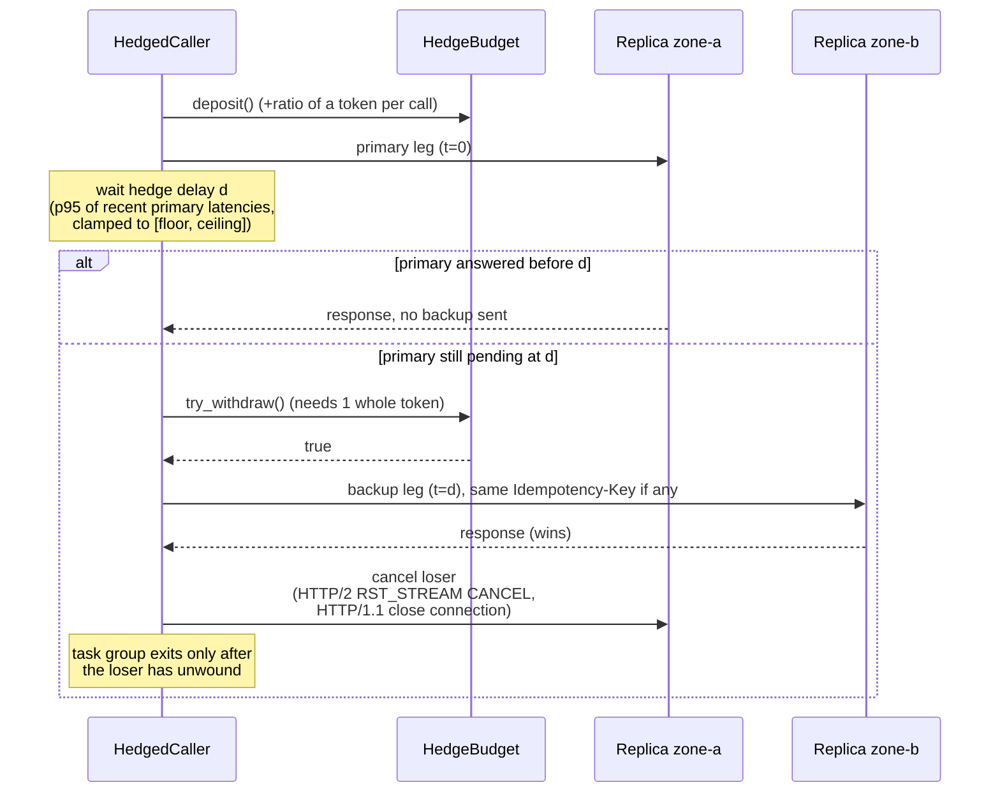

# Taming p99.9 Tail Latency with Hedged Requests and Cross-Zone Backup Calls Without Doubling Cluster Load

> [!summary] Claim
> A hedged request sends one backup copy to an independent replica only after the primary has outlived roughly its own 95th-percentile latency, so about 5% extra requests buy back most of the p99.9 tail; the backup must be capped by a token budget, limited to idempotent calls, cancelled when it loses, and sent somewhere whose slowness is uncorrelated with the primary's, or it doubles load exactly when the cluster is already slow.

Part of [Resilience Rate Limiting and Idempotency](README.md) in [API Engineering](../README.md).

## TL;DR

- Mechanism: send the primary, wait a hedge delay `d` near the primary's p95, then send one backup to another replica (ideally another zone); the first success wins and the other leg is cancelled, so latency becomes `min(X, d + Y)` while only the `P(X > d)` slow fraction pays for a second request (Dean and Barroso 2013).
- Contract rule: hedge only requests that are safe to execute twice, meaning `GET`, `HEAD`, `OPTIONS`, `TRACE`, `PUT`, `DELETE` (RFC 9110 Section 9.2.2), or a `POST` that carries an `Idempotency-Key`; gRPC applies the same rule per method through `hedgingPolicy` (gRFC A6).
- Trap: a fixed delay hedges every request when the whole backend slows down, which doubles load during the incident (lab: `extra_load=1.0` at a 3x slowdown); a token budget caps it, but a budget with no headroom over the expected hedge rate lets the tail back in (lab: p99.9 `29.5` ms at budget `0.05` versus `22.3` ms at `0.10`).
- Portability fact: the lab passes 18 of 18 tests on CPython 3.12.13, 3.13.18, 3.14.6, 3.14.10, 3.15.2, and the free-threaded 3.15.0b3; on the wire, cancelling a loser costs a whole connection on HTTP/1.1 (httpcore closes it) but only a 13-byte `RST_STREAM(CANCEL)` on HTTP/2, and httpcore 1.0.9 does not even send that frame.
- When not to use it: non-idempotent mutations without a key, backends above roughly 25-50% utilization if you hedge everything (Vulimiri et al. 2013), slowness that is correlated across replicas (same zone, hot key, shared dependency), and services whose work cannot be cancelled cheaply; there, fix the variance at its source or use load-aware replica selection.

## Mental model



The caller deposits a fraction of a token on every call and sends the primary at once.
If the primary answers within the hedge delay, nothing else happens, which is the case for about 95% of calls when the delay sits at the primary's p95.
If the primary is still pending at the delay, the caller asks the budget for one whole token; with a token it sends the backup to a replica in another zone, and without one it simply keeps waiting for the primary.
Whichever leg succeeds first wins, the other is cancelled, and the AnyIO task group does not return until the cancelled leg has finished unwinding.
The lab's ASGI test records exactly this order: `zone-a:start`, `zone-b:start`, `zone-a:cancelled`.

## How it works

### Why the tail matters more than the median: fan-out amplification

Dean and Barroso give the arithmetic that motivates the whole technique: if each server answers in 10 ms typically but has a one-second p99, a request that must collect responses from 100 such servers in parallel sees at least one slow server 63% of the time (Dean and Barroso 2013, "The Tail at Scale", CACM 56(2)).
That number is `1 - 0.99^100 = 0.634`; the same formula gives `0.181` for one slow request in 10,000 at 2,000 servers, which the paper describes as "almost one in five user requests" and plots as `0.18`.
The lab asserts both values (`test_fanout_amplification_matches_the_tail_at_scale_figures`).
The paper's Table 1 measures a real Google fan-out tree: the p99 for one random leaf is 10 ms, the p99 for 95% of all leaves to finish is 70 ms, and the p99 for all leaves to finish is 140 ms, so "waiting for the slowest 5% of the requests to complete is responsible for half of the total 99%-percentile latency".
The fan-out turns a component's p99 into the service's median, which is why the target of this note is the component p99.9 and not the mean.

### The hedged request: latency `min(X, d + Y)`, cost `P(X > d)`

The paper defines a hedged request as one where "a client first sends one request to the replica believed to be the most appropriate, but then falls back on sending a secondary request after some brief delay", and "cancels remaining outstanding requests once the first result is received".
Its recommended variant is to "defer sending a secondary request until the first request has been outstanding for more than the 95th-percentile expected latency for this class of requests", which "limits the additional load to approximately 5% while substantially shortening the latency tail".
With primary latency `X`, backup latency `Y`, and delay `d`, the call completes at `min(X, d + Y)`, and a backup is sent only when `X > d`.
If `X` and `Y` are independent, `P(T > t) = P(X > t) * P(Y > t - d)` for `t > d`, so a straggler probability `p` becomes roughly `p^2` for the hedged call: this squaring is the entire benefit, and it disappears the moment `X` and `Y` share a cause.
The paper states that limit explicitly: the techniques are "effective only when the phenomena that causes variability does not tend to simultaneously affect multiple request replicas".
The headline measurement is a BigTable benchmark reading 1,000 keys spread over 100 servers, where a hedge after 10 ms cut the p99.9 for retrieving all 1,000 values "from 1,800ms to 74ms while sending just 2% more requests".
The paper also suggests tagging hedges as lower priority than primaries to cut their overhead further.

The hedge delay trades latency for load.
In the lab's model (a 4 ms floor plus an exponential with a 2 ms mean, and a 200 ms stall on 2% of legs), hedging at 8 ms (about p85, since `P(X > 8 ms) = 0.98 * e^-2 + 0.02 = 0.153`) costs 15.2% extra requests, at 11 ms (about p95) 4.9%, and at 15 ms (about p97) 2.4%, while p99.9 moves from 19.2 to 22.3 to 26.3 ms (Numbers and limits).
The knee is around the point where the delay clears the body of the distribution: below it, extra load grows fast for little tail gain.

### Tied requests and cross-server cancellation

The hedge's "window of vulnerability" is that both replicas may execute the same request.
Tied requests close it: the client enqueues the request on two servers, each tagged with the identity of the other, and "when a request begins execution, it sends a cancellation message to its counterpart", which aborts or deprioritizes the queued copy (Dean and Barroso 2013).
Both may still start during one network message delay, so the paper recommends a client-side delay of "two times the average network message delay (1ms or less in modern data-center networks)" before the second copy.
Google's file-system implementation, sending a tied request to another replica after 1 ms, cut a mostly idle cluster's median from 19 to 16 ms (-16%) and its p99.9 from 98 to 61 ms (-38%); with a concurrent terasort, p99.9 went from 159 to 108 ms (-32%), and the extra disk utilization was "less than 1%" (Dean and Barroso 2013, Table 2).
Tied requests need server cooperation, so they belong to a storage or RPC layer you own; client-only hedging is what an API client can do alone.
The paper's other alternative, probing queue lengths first and sending to the least-loaded server, is weaker because load changes between probe and request, service times are hard to estimate, and many clients pick the same server at once.

### When redundancy hurts: the utilization threshold

Sending every request twice is only a win below a utilization threshold.
Vulimiri et al. show that, assuming client-side replication cost is low, there is "a server-side threshold load below which replication always improves latency", conjecture that it "always lies between 25% and 50% utilization regardless of the service time distribution", and find it is 33% for exponential service times (Vulimiri et al. 2013, "Low Latency via Redundancy", arXiv 1306.3707).
The upper bound is simple: above 50% load, duplicating everything pushes total load past 100%.
Delayed hedging changes the calculation because it duplicates only the slow fraction, but the same physics applies whenever the slow fraction grows, which is the failure mode the budget exists for.

### Choosing the delay: percentile trackers and their failure modes

A fixed delay is simple and wrong under load shifts, so production implementations estimate it.
Finagle's `BackupRequestFilter` derives the delay from `maxExtraLoad`: it is the latency percentile `1.0 - maxExtraLoad`, so `maxExtraLoad = 0.01` sends backups at p99 (finagle 24.5.0 finagle-core/src/main/scala/com/twitter/finagle/client/BackupRequestFilter.scala, BackupRequestFilter.percentileFromMaxExtraLoad).
It reads the percentile from a `WindowedPercentileHistogram`, refreshes `sendBackupAfterMillis` every 3 seconds (`RefreshPercentileInterval`), clamps it to at least `minSendBackupAfterMs` (default 1 ms, so a ~0 ms percentile does not hedge instantly), and initializes it to `Int.MaxValue` so the first requests are never hedged (same file, BackupRequestFilter.refreshTimerTask, MinSendBackupAfterMs).
It records latency only for successes, per-request timeouts, and legs it interrupted as superseded, because "other failures are 'fast failures' and thus would skew `sendBackupAfter` to be lower" (same file, BackupRequestFilter.shouldRecord).
It stops hedging when the percentile reaches the histogram's `highestTrackableValue` (same file, BackupRequestFilter.apply).

Cassandra's coordinator-side equivalent is the table option `speculative_retry`, default `99PERCENTILE`, which queries an additional replica when the first is slower than that percentile; it also accepts a fixed `Yms`, and since 4.0 the hybrids `MIN(XPERCENTILE,YMS)` and `MAX(XPERCENTILE,YMS)` (cassandra 5.0.9 doc/modules/cassandra/pages/developing/cql/ddl.adoc, Speculative retry options).
Its documentation names the percentile failure mode directly: "If a single host becomes unavailable, it can force up the percentiles", so a `p99` setting stops speculating exactly when it is needed, and `MIN(99PERCENTILE,35MS)` exists to protect against "a single slow instance".
The lab's `LatencyTracker` implements both guards: no delay until `min_samples` latencies are known, and a clamp to `[floor_s, ceiling_s]` (`test_tracker_clamps_delay_like_cassandra_min_max_hybrid`).

Which latency you record matters.
The lab records only the primary leg, including a censored value when the primary is cancelled, because that sample is at least the delay and therefore keeps the tracker estimating the un-hedged distribution; it never records failures.
Recording the caller-observed latency (the winner's) instead would estimate the hedged distribution, whose percentiles are lower, which shrinks the delay and sends more hedges, a positive feedback loop.
Finagle records every leg, each timed from its own start, including the backup and the superseded loser (BackupRequestFilter.record, issueBackup).

### Capping extra load: budgets

A percentile tracker keeps extra load near `1 - percentile` only while the latency distribution is stationary.
When it shifts faster than the tracker's window, or when the delay is fixed, the fraction of slow primaries can approach 100%.
Finagle guards against that with a dedicated `RetryBudget` created with `percentCanRetry = maxExtraLoad`, `minRetriesPerSec = 0`, and the default 10-second TTL; a backup is sent only if it can withdraw from both that budget and the client's general retry budget, so "the backend will not receive more extra load than that permitted by the `Retries.Budget`, whether through retries due to failures or backup requests" (BackupRequestFilter.newRetryBudget, canIssueBackup, class scaladoc).
Setting `minRetriesPerSec` to 0 has a documented cost: at `maxExtraLoad = 0.01` a client needs at least 10 QPS before any backup is sent, because 100 requests must land in the 10-second TTL to earn one token (BackupRequestFilter.Configured scaladoc).
The general Finagle default budget is 20% plus 10 retries per second over 10 seconds (finagle 24.5.0 finagle-core/src/main/scala/com/twitter/finagle/service/RetryBudget.scala, RetryBudget.apply, DefaultTtl, DefaultMinRetriesPerSec).
gRPC's `retryThrottling` applies the same idea per server name: `token_count` starts at `maxTokens`, each failed RPC subtracts 1 (only failures with a retryable or non-fatal status code, or a pushback that says not to retry, count), each success adds `tokenRatio`, and when `token_count` is at or below `maxTokens / 2` "subsequent hedged RPCs will only be sent if `token_count` is greater than the threshold"; the first RPC is always sent (gRFC A6, Throttling Retry Attempts and Hedged RPCs).
gRPC's throttle counts failures, not slowness, so it stops hedges during an error storm but not during a pure latency storm; Finagle's per-request deposit counts load directly.

The lab's `HedgeBudget` follows the Finagle shape with integer milli-tokens: every call deposits `ratio`, every backup spends one whole token, and the stored balance is capped at `max_tokens`.
Over any 1,000 calls at `ratio = 0.05` it sends exactly 50 backups even if every primary is slow (`test_budget_caps_backups_at_ratio_even_when_every_primary_is_slow`).
The budget needs headroom above the expected hedge rate: at a p95 delay the natural rate is about 5%, and a budget of exactly `0.05` runs dry often enough that some stragglers go un-hedged, raising p99.9 from 22.3 to 29.5 ms in the lab, while `0.10` costs nothing extra in steady state and still caps a storm at 10%.
The choice of retry budget sizing belongs to [[Retry-Budgets-and-Preventing-Cascading-Retry-Amplification-Storms]]; the point here is that hedges must draw from the same pool as retries.

### gRPC, Envoy, and Polly: how real stacks configure hedging

gRPC's `hedgingPolicy` has `maxAttempts`, `hedgingDelay`, and `nonFatalStatusCodes`; the original RPC is sent at once and another every `hedgingDelay` until one succeeds, `maxAttempts` is reached, or the call deadline expires, and "gRPC call deadlines apply to the entire chain of hedged requests" (gRFC A6, Hedging Policy).
A non-fatal status triggers the next hedge immediately; any other status cancels everything; a successful response cancels all outstanding hedges; and "if all instances of a hedged RPC fail, there are no additional retry attempts".
`maxAttempts` must be greater than 1, values above 5 are treated as 5, and that client-side cap (a default that the client can change through channel arguments) exists to mitigate "security concerns related to the service config being transferred to the client via DNS" (gRFC A6, Limits on Retries and Hedges).
A method may have a `retryPolicy` or a `hedgingPolicy`, never both.
Servers can push back with the `grpc-retry-pushback-ms` metadata key: a negative or unparseable value means stop hedging; a value `n` delays the next hedge by `n` ms (gRFC A6, Pushback).
Each attempt after the first carries `grpc-previous-rpc-attempts` with the number of preceding attempts, so servers can see hedges (gRFC A6, Exposed Retry Metadata).
An RPC becomes committed once the client receives response headers or overflows its replay buffer, after which no further attempts are made (gRFC A6, Retry Internals).
The proposal header lists it as "Implemented in: Java, .NET, Node, Go except hedging, and C-Core except hedging" (gRFC A6, last updated 2024-08-23), and the sources agree: grpc-go v1.85.0 carries only a `TODO(hedging): hedging will have multiple attempts simultaneously.` in its client stream (grpc-go v1.85.0 stream.go, clientStream), and C-core v1.85.1 lists "implement hedging" as a pending item in `retry_filter.cc` and still has `TODO(roth)` notes about hedging throughout `retry_filter_legacy_call_data.cc` (grpc v1.85.1 src/core/client_channel/retry_filter.cc, retry_filter_legacy_call_data.cc).
`grpcio` 1.85.1, the Python package in the lab's lock, is built on C-core, so a Python client cannot rely on `hedgingPolicy` from the service config; hedging there means writing the race yourself, as the lab does.

Envoy's route-level `HedgePolicy` has three fields, but `initial_requests` and `additional_request_chance` are marked `[#not-implemented-hide:]`; the one that works is `hedge_on_per_try_timeout`, default `false` (envoy v1.40.2 api/envoy/config/route/v3/route_components.proto, HedgePolicy).
With it, a per-try timeout issues a retry "without resetting the original request", the first successful response wins, and an error that arrives after the per-try timeout is discarded; it needs a `RetryPolicy` that retries at least one condition and sets a retry count.
In the router, `onPerTryTimeoutCommon` calls `onSoftPerTryTimeout` instead of `resetStream()`, which still records a timeout for outlier detection and asks `retry_state_->shouldHedgeRetryPerTryTimeout`, so the hedge is subject to the cluster's retry circuit breaker (`RetryStatus::NoOverflow`); once a response is chosen, `resetOtherUpstreams` resets every other upstream request (envoy v1.40.2 source/common/router/router.cc, Filter::onPerTryTimeoutCommon, Filter::onSoftPerTryTimeout, Filter::resetOtherUpstreams).
A client can toggle it per request with the `x-envoy-hedge-on-per-try-timeout` header, which the router reads and strips (envoy v1.40.2 source/common/http/headers.h, EnvoyHedgeOnPerTryTimeout; router.cc, FilterUtility::finalHedgingParams), so an edge proxy must strip it from untrusted clients.
Envoy's hedge delay is the fixed `per_try_timeout`, so the budget must come from `max_retries` circuit breakers or a retry budget, not from an adaptive percentile.

Polly 8.9.1's hedging strategy defaults to `MaxHedgedAttempts = 1` and `Delay = 2 seconds`; `0` seconds launches every attempt at once (parallel mode) and `-1` millisecond waits for each attempt to finish before the next (fallback mode) (Polly 8.9.1 docs/strategies/hedging.md, Defaults).
Its documentation states that "the hedging waits until all additional pending actions are cancelled before returning the accepted result", so a loser that ignores its cancellation token delays the winner, which is the same semantics AnyIO task groups impose.

### Cancellation on the wire: what the loser actually costs

Cancelling the loser is what keeps hedging cheap, and the cost of cancellation depends on the HTTP version.
On HTTP/2, a client abandons a stream with `RST_STREAM`, a frame of type `0x03` with a 4-byte error code, and `CANCEL (0x08)` means "the stream is no longer needed" (RFC 9113 Section 6.4, Section 7).
The lab builds that frame with `h2 4.4.1` and asserts its 13 bytes: `00 00 04` length, `03` type, `00` flags, `00 00 00 01` stream identifier, `00 00 00 08` error code (`test_http2_loser_cancellation_is_a_13_byte_rst_stream_cancel`).
On HTTP/3, clients "SHOULD use the error code H3_REQUEST_CANCELLED" (`0x010c`) and cancel by resetting the sending part of the stream and aborting reading (RFC 9114 Section 4.1.1, Section 8.1).
HTTP/1.1 has no per-request cancel, so the only way to stop receiving a response is to close the connection.

httpx inherits these costs from httpcore, and the source shows two details that matter for hedging.
On HTTP/1.1, a cancelled request reaches `_response_closed()` under `AsyncShieldCancellation`, which returns the connection to `IDLE` only if both `h11` states are `DONE` and otherwise calls `aclose()` (httpcore 1.0.9 httpcore/_async/http11.py, AsyncHTTP11Connection.handle_async_request, AsyncHTTP11Connection._response_closed), so every cancelled loser mid-response destroys a pooled connection and the next request pays a new TCP and TLS handshake.
Finagle documents the same trade-off: `sendInterrupts` should be `false` "for protocols without a control plane, where the connection is cut on interrupts... to avoid connection churn" (BackupRequestFilter.Configured scaladoc).
On HTTP/2, httpcore's `_response_closed(stream_id)` releases the stream semaphore and deletes the stream's event queue, but sends no `RST_STREAM` (httpcore 1.0.9 httpcore/_async/http2.py, AsyncHTTP2Connection._response_closed); later frames for that stream are dropped by `_receive_events`, which only queues events whose `stream_id` is still in `self._events`, and `acknowledge_received_data` is called only from `_receive_response_body` for live streams.
So with httpx 0.28.1 over HTTP/2 the server is never told the loser is unwanted and keeps sending its response.
The dropped `DATA` also leaks connection-level flow-control window: h2 subtracts every received `DATA` frame from the connection window in `_receive_data_frame` and reopens it only through `acknowledge_received_data`, and because httpcore never resets the stream, h2 still treats it as open and does not take its `_handle_data_on_closed_stream` path that auto-acknowledges the bytes (h2 4.4.1 h2/connection.py, H2Connection._receive_data_frame, H2Connection._handle_data_on_closed_stream; h2/windows.py, WindowManager.process_bytes).
httpcore opens the connection window by `2**24` at startup (httpcore 1.0.9 httpcore/_async/http2.py, AsyncHTTP2Connection._send_connection_init), so roughly 16 MiB of abandoned response bytes stall every stream on that connection; this follows from the source and was not exercised over a socket.

The server side has a matching gap.
Uvicorn's `H11Protocol.connection_lost` sets `cycle.disconnected = True` and wakes the cycle's message event, but it does not cancel the ASGI task; the app learns about the disconnect only when it calls `receive()` and gets `{"type": "http.disconnect"}`, and any later `send()` returns silently (uvicorn 0.54.0 uvicorn/protocols/http/h11_impl.py, H11Protocol.connection_lost, RequestResponseCycle.receive, RequestResponseCycle.send).
Starlette's `StreamingResponse.__call__` runs `listen_for_disconnect` alongside the body and cancels the stream on disconnect only when the server's ASGI `spec_version` is below `2.4` (Uvicorn 0.54.0's HTTP protocols advertise `2.3`); at `2.4` or later it just streams and turns an `OSError` from `send` into `ClientDisconnect`, and an ordinary handler keeps computing either way (starlette 1.10.0 starlette/responses.py, StreamingResponse.__call__; uvicorn 0.54.0 uvicorn/protocols/http/h11_impl.py, H11Protocol.handle_events).
Hypercorn 0.18.0 and Granian 2.8.7 behave the same way at the handler level.
Hypercorn turns both a connection close and a client `RST_STREAM` (`h2.events.StreamReset`) into a `StreamClosed` event, which `HTTPStream.handle` converts into an `http.disconnect` message on the app's receive queue; its `_handle` wrapper in `asyncio/task_group.py` only awaits the app and contains no task cancellation (hypercorn 0.18.0 hypercorn/protocol/h2.py, H2Protocol._handle_events and _close_stream; hypercorn/protocol/http_stream.py, HTTPStream.handle; hypercorn/asyncio/task_group.py, _handle).
That makes Hypercorn the one server here that honours a per-stream HTTP/2 reset from a client that sends one, though still only as a message the app must read.
Granian's `GuardedReceiver` sets a `disconnect_guard` when the hyper request future is dropped before a response is ready, and `ResponseBodyStream::drop` sets it when a streaming response body is dropped; `receive()` then resolves to `http.disconnect`, and the HTTP path (`handle_request!`) spawns the app without the cancellable-task wrapper that only the WebSocket branch uses (granian v2.8.7 src/utils.rs, GuardedReceiver; src/asgi/io.rs, ResponseBodyStream, ASGIHTTPProtocol.receive; src/asgi/http.rs).
None of these three servers was exercised over a socket here; the statements are from reading their source at the pinned releases.
The loser's server-side work therefore continues to completion unless the handler watches for disconnects; the cost of a hedge is the backup's full execution plus the loser's full execution, not half of each.
In-process, `httpx.ASGITransport` awaits `self.app(scope, receive, send)` in the calling task (httpx 0.28.1 httpx/_transports/asgi.py, ASGITransport.handle_async_request), so cancelling the leg cancels the app directly, which is what the lab's ASGI test observes; a real network hop does not behave that way.

### Structured concurrency: AnyIO task groups make the race correct

The lab uses an AnyIO task group because it gives the three guarantees a hedge needs.
Cancelling `tg.cancel_scope` delivers cancellation to every started child task, and `_deliver_cancellation` reschedules itself with `call_soon` while any child is still running, so a leg that swallows one `CancelledError` is cancelled again at its next await (anyio 4.16.0 anyio/_backends/_asyncio.py, CancelScope._deliver_cancellation).
`TaskGroup.__aexit__` loops until `self._tasks` is empty, so the winner is returned only after the loser has unwound, and an outer cancellation (the caller's deadline) cancels both legs (anyio 4.16.0 anyio/_backends/_asyncio.py, TaskGroup.__aexit__).
The tests prove each: the loser is cancelled, a shielded cleanup in the loser finishes before `call` returns, and a caller deadline cancels both legs.
The price of the second guarantee is that a loser stuck in uncancellable work (a shielded scope, or a blocking call in a worker thread) holds the winner hostage; Polly documents the same behavior.
AnyIO 4.14.0 added `TaskGroup.create_task` and made `start_soon` return a `TaskHandle` (anyio 4.16.0 anyio/abc/_tasks.py, TaskGroup.start_soon), but the lab does not rely on them, so it also runs on older 4.x releases in principle (not tested).
Deeper semantics are in [[AnyIO-Structured-Concurrency-TaskGroups-CancelScopes-and-ExceptionGroups]] and [[Cancellation-Semantics-CancelledError-Swallowing-and-Shielded-Cleanup]].

### Cross-zone backups: independence costs money and RTT

The backup only helps if its latency is independent of the primary's, and the cheapest independence is a different failure domain.
A backup to another process on the same host shares its CPU, garbage collector, and NIC; one in the same zone shares the zone's network and often the same hot shard; a backup in another zone is more independent but pays the inter-zone round trip and, on AWS, data transfer "across Availability Zones in the same AWS Region is charged at $0.01/GB in each direction" (AWS EC2 On-Demand pricing, Data Transfer within the same AWS Region, as of 2026-11).
The lab models both effects: a 2 ms added round trip (an assumed model parameter, not a measured AWS number) raises the hedged p99.9 from 22.3 to 24.3 ms, while full correlation between primary and backup stragglers leaves p99.9 at 210.2 ms and still spends 4.9% extra requests.
A practical policy is to send the primary to the closest healthy replica, choose the backup from a different zone than the primary, and keep the hedge rate low enough that the transfer bill stays a rounding error: at 5% hedges, cross-zone transfer for backups is roughly 5% of the request and response bytes, billed in both directions.

### Hedging versus retries, timeouts, and deadlines

A retry reacts to a failure; a hedge reacts to slowness before any failure, which is why gRPC calls hedging "retrying the original RPC before a failure is even received" (gRFC A6, Hedging Policy).
Both must be bounded by the end-to-end deadline: the lab's call runs inside the caller's cancel scope, and gRPC applies the call deadline to the whole hedge chain.
Do not stack an independent retry loop on top of hedged legs without a shared budget, or each slow call can fan out to `2 x retries` requests; see [[Retries-Exponential-Backoff-Full-vs-Decorrelated-Jitter-and-Stamina]] and [[Timeout-Taxonomy-Connect-Read-Write-Pool-and-Deadline-Propagation]].

## Numbers and limits

| Quantity | Value | Source |
| --- | --- | --- |
| Fan-out 100, per-server p(slow) 1% | 63% of user requests slow | Dean and Barroso 2013; lab `fanout_slow_probability(0.01, 100)` = `0.634` |
| Fan-out 2,000, per-server p(slow) 0.01% | about 1 in 5 (`0.18` in the figure) | Dean and Barroso 2013; lab `0.181` |
| Google fan-out tree, p99 one leaf / 95% of leaves / all leaves | 10 ms / 70 ms / 140 ms | Dean and Barroso 2013, Table 1 |
| BigTable 1,000-key read over 100 servers, hedge after 10 ms | p99.9 1,800 ms -> 74 ms, +2% requests | Dean and Barroso 2013 |
| Hedge at the p95 expected latency | about 5% extra load | Dean and Barroso 2013 |
| Tied request after 1 ms, idle cluster | p50 19 -> 16 ms, p99.9 98 -> 61 ms | Dean and Barroso 2013, Table 2 |
| Tied request after 1 ms, with terasort | p50 24 -> 19 ms, p99.9 159 -> 108 ms, disk overhead < 1% | Dean and Barroso 2013, Table 2 |
| Utilization threshold for replicating every request | 25% to 50% (conjecture), 33% for exponential service times | Vulimiri et al. 2013 |
| gRPC `hedgingPolicy.maxAttempts` | > 1 required, values above 5 treated as 5 | gRFC A6 |
| gRPC `retryThrottling` | `maxTokens` in (0, 1000], hedges blocked at `token_count <= maxTokens / 2` | gRFC A6 |
| Finagle backup delay | percentile `1 - maxExtraLoad`, min 1 ms, refreshed every 3 s | finagle 24.5.0 BackupRequestFilter.scala |
| Finagle backup budget at `maxExtraLoad = 0.01` | no backups below about 10 QPS (10 s TTL, `minRetriesPerSec = 0`) | finagle 24.5.0 BackupRequestFilter.scala, Configured scaladoc |
| Finagle default client retry budget | 20% of requests plus 10 per second, 10 s TTL | finagle 24.5.0 RetryBudget.scala |
| Polly hedging defaults | `MaxHedgedAttempts = 1`, `Delay = 2 s` | Polly 8.9.1 docs/strategies/hedging.md |
| Cassandra `speculative_retry` default | `99PERCENTILE` | cassandra 5.0.9 ddl.adoc |
| Envoy `hedge_on_per_try_timeout` default | `false`; `initial_requests` and `additional_request_chance` not implemented | envoy v1.40.2 route_components.proto |
| HTTP/2 `RST_STREAM(CANCEL)` frame | 13 bytes (9 header + 4 error code), code `0x8` | RFC 9113 Section 6.4, Section 7; lab |
| HTTP/3 client cancel code | `H3_REQUEST_CANCELLED` = `0x010c` | RFC 9114 Section 8.1 |
| AWS inter-AZ data transfer, same Region | $0.01/GB in each direction (as of 2026-11) | AWS EC2 On-Demand pricing page |

The lab's simulation reproduces the paper's shape on a synthetic workload.
Each leg is a 4 ms floor plus an exponential with a 2 ms mean, with a 200 ms stall on 2% of legs; its nearest-rank p95 is about 11 ms, so `hedge_delay_ms=11.0` approximates a p95 hedge.
The model is open-loop: extra requests do not feed back into latency through queueing, so it shows the policy's accounting, not a saturated cluster's behavior.
The driver script below is a throwaway probe, not part of the lab; it was run once from `labs/` with `uv run --frozen python sim.py` on macOS 27.3 arm64 (Darwin 27.3.0) with CPython 3.14.6 (the workspace `.venv`):

```python
from api_labs.f16_resilience_rate_limiting_and_idempotency.hedging import simulate_hedging as sim

rows = [
    ("no hedging", dict(hedge_delay_ms=None)),
    ("hedge at 8 ms (~p85)", dict(hedge_delay_ms=8.0)),
    ("hedge at 11 ms (~p95)", dict(hedge_delay_ms=11.0)),
    ("hedge at 15 ms (~p97)", dict(hedge_delay_ms=15.0)),
    ("p95 + 2 ms cross-zone RTT", dict(hedge_delay_ms=11.0, cross_zone_rtt_ms=2.0)),
    ("p95, stragglers fully correlated", dict(hedge_delay_ms=11.0, correlation=1.0)),
    ("p95, budget 0.05", dict(hedge_delay_ms=11.0, budget_ratio=0.05)),
    ("p95, budget 0.10", dict(hedge_delay_ms=11.0, budget_ratio=0.10)),
    ("3x slowdown, fixed 11 ms", dict(hedge_delay_ms=11.0, slowdown=3.0)),
    ("3x slowdown, fixed 11 ms, budget 0.10", dict(hedge_delay_ms=11.0, slowdown=3.0, budget_ratio=0.10)),
    ("3x slowdown, adaptive 33 ms", dict(hedge_delay_ms=33.0, slowdown=3.0)),
]
for name, kw in rows:
    print(f"{name}: {sim(100_000, seed=7, **kw)}")
for name, kw in [("fan-out 100, no hedging", dict(hedge_delay_ms=None)), ("fan-out 100, hedge at 11 ms", dict(hedge_delay_ms=11.0))]:
    print(f"{name}: {sim(2_000, seed=7, fanout=100, **kw)}")
```

```text
no hedging: TailStats(p50_ms=5.4, p99_ms=205.3, p999_ms=210.6, extra_load=0.0)
hedge at 8 ms (~p85): TailStats(p50_ms=5.4, p99_ms=14.0, p999_ms=19.2, extra_load=0.152)
hedge at 11 ms (~p95): TailStats(p50_ms=5.4, p99_ms=16.5, p999_ms=22.3, extra_load=0.049)
hedge at 15 ms (~p97): TailStats(p50_ms=5.4, p99_ms=20.5, p999_ms=26.3, extra_load=0.0238)
p95 + 2 ms cross-zone RTT: TailStats(p50_ms=5.4, p99_ms=18.4, p999_ms=24.3, extra_load=0.049)
p95, stragglers fully correlated: TailStats(p50_ms=5.4, p99_ms=205.3, p999_ms=210.2, extra_load=0.049)
p95, budget 0.05: TailStats(p50_ms=5.4, p99_ms=16.6, p999_ms=29.5, extra_load=0.0473)
p95, budget 0.10: TailStats(p50_ms=5.4, p99_ms=16.5, p999_ms=22.3, extra_load=0.049)
3x slowdown, fixed 11 ms: TailStats(p50_ms=16.2, p99_ms=32.9, p999_ms=45.4, extra_load=1.0)
3x slowdown, fixed 11 ms, budget 0.10: TailStats(p50_ms=16.3, p99_ms=615.6, p999_ms=629.4, extra_load=0.1)
3x slowdown, adaptive 33 ms: TailStats(p50_ms=16.3, p99_ms=49.6, p999_ms=66.8, extra_load=0.049)
fan-out 100, no hedging: TailStats(p50_ms=206.1, p99_ms=214.9, p999_ms=220.6, extra_load=0.0)
fan-out 100, hedge at 11 ms: TailStats(p50_ms=17.3, p99_ms=206.8, p999_ms=211.6, extra_load=0.0494)
```

Read four rows closely.
The p95 hedge cuts p99.9 from 210.6 to 22.3 ms for 4.9% more requests, and the median is untouched.
Under a uniform 3x slowdown a fixed 11 ms delay hedges every request (`extra_load=1.0`), which in a real cluster would add queueing on top of the slowdown; a budget caps it at 10%, but spends its tokens on primaries that are merely slow, so the real stragglers go un-hedged and p99.9 rises to 629.4 ms; an adaptive delay that tracks the new p95 (33 ms) keeps load at 4.9% on its own and p99.9 at 66.8 ms.
Correlated stragglers get no benefit at full cost.
At fan-out 100 the hedge moves the median from 206.1 to 17.3 ms but not the p99, because the residual per-leaf straggler probability is about `0.02^2 = 0.0004`, and `1 - (1 - 0.0004)^100` is about 3.9%, which is still above 1%; deep fan-out needs a second hedge, tied requests, or partial results.

## Portability

The CPython rows other than `3.14.6` are the drafter's runs (2026-11); the independent check re-ran only the `3.14.6` workspace leg, because matrix runs are paused.

| Dimension | Behavior | Evidence |
| --- | --- | --- |
| CPython `3.12.13` (the matrix's `3.12.16` is not available to `uv` here) | 18 passed | lab, `UV_PROJECT_ENVIRONMENT=<tmp> uv run --frozen --python 3.12.13 pytest ...` |
| CPython `3.13.18` | 18 passed | lab, same command with `--python 3.13.18` |
| CPython `3.14.6` (workspace `.venv`) and `3.14.10` | 18 passed on each | lab, `uv run --frozen pytest ...` and `--python 3.14.10` |
| CPython `3.15.2` (Homebrew) | 18 passed | lab, `--python /opt/homebrew/bin/python3.15` |
| CPython `3.15.0b3` free-threaded (`Py_GIL_DISABLED=1`, GIL off at runtime; the matrix's `3.15.2t` is not available here) | 18 passed | lab, `uv run --no-project --python 3.15.0b3+freethreaded` with the pinned `anyio`, `httpx`, `httpcore`, `h2`, `hpack`, `hyperframe`, `starlette`, `pytest`, `pytest-asyncio`; the full lock does not sync because `psycopg-binary==3.3.8` has no wheel for it |
| Debian Trixie and Alpine (musl) containers | Not run | none |
| `anyio 4.16.0` | Task-group cancel is level-triggered and `__aexit__` waits for every child | lab; source read (anyio 4.16.0 anyio/_backends/_asyncio.py) |
| `httpx 0.28.1` / `httpcore 1.0.9`, HTTP/1.1 | Cancelling a leg mid-response closes the pooled connection | source read (httpcore/_async/http11.py, `_response_closed`); not exercised over a socket |
| `httpx 0.28.1` / `httpcore 1.0.9`, HTTP/2 | Cancelling a leg frees the stream locally and sends no `RST_STREAM` | source read (httpcore/_async/http2.py, `_response_closed`, `_receive_events`); not exercised over a socket |
| `httpx.ASGITransport` | Leg cancellation cancels the ASGI app in-process | lab, `test_asgi_cross_zone_hedge_cancels_the_slow_replica_handler` |
| Uvicorn 0.54.0 | Client disconnect does not cancel the handler; the app sees `http.disconnect` only via `receive()` | source read (uvicorn/protocols/http/h11_impl.py); not exercised |
| Hypercorn 0.18.0 | Connection close or client `RST_STREAM` queues `http.disconnect`; the handler task is not cancelled | source read (hypercorn/protocol/h2.py, http_stream.py, asyncio/task_group.py); not exercised |
| Granian 2.8.7 | Dropped request or response body sets a disconnect guard that makes `receive()` return `http.disconnect`; the HTTP handler is not cancelled | source read (src/utils.rs, src/asgi/io.rs, src/asgi/http.rs); not exercised |
| HTTP/1.1 | No per-request cancel frame, so abandoning a response means closing the connection | httpcore 1.0.9 http11.py `_response_closed` (source read) |
| HTTP/2 | `RST_STREAM` with `CANCEL (0x8)` | RFC 9113 Section 6.4, Section 7; lab (`h2 4.4.1` bytes) |
| HTTP/3 over QUIC | Reset the stream with `H3_REQUEST_CANCELLED (0x010c)` | RFC 9114 Section 4.1.1, Section 8.1; not run |
| gRPC hedging | Java, .NET, Node only; not Go or C-core (so not Python) | gRFC A6 header (last updated 2024-08-23); grpc-go v1.85.0 stream.go `TODO(hedging)`; grpc v1.85.1 retry_filter.cc, source read |
| Envoy v1.40.2 | Only `hedge_on_per_try_timeout` is implemented | route_components.proto, router.cc |

## Worked example

The [implementation](../labs/src/api_labs/f16_resilience_rate_limiting_and_idempotency/hedging.py) has three parts: `LatencyTracker` and `HedgeBudget` decide whether and when to hedge, `HedgedCaller` runs the race in an AnyIO task group, and `simulate_hedging` replays the same policy on seeded samples.
The [test](../labs/tests/f16_resilience_rate_limiting_and_idempotency/test_hedged_requests_and_tail_latency_taming_at_scale.py) has 18 unit tests, including an in-process ASGI test with two replicas behind `httpx.ASGITransport`.

Simplified excerpt (the `HedgedCaller` class is verbatim from `hedging.py`; imports, `LatencyTracker`, `HedgeBudget`, `may_hedge`, and the dataclasses are omitted):

```python
class HedgedCaller:
    """Send a primary leg, then at most one budgeted backup leg; the first success wins."""

    def __init__(self, tracker: LatencyTracker, budget: HedgeBudget) -> None:
        self.tracker = tracker
        self.budget = budget

    async def call[T](
        self,
        primary: Leg[T],
        backup: Leg[T],
        *,
        method: str,
        idempotency_key: str | None = None,
    ) -> HedgeOutcome[T]:
        self.budget.deposit()
        delay = self.tracker.hedge_delay()
        if delay is None or not may_hedge(method, idempotency_key=idempotency_key):
            start = anyio.current_time()
            value = await primary()
            self.tracker.record(anyio.current_time() - start)
            return HedgeOutcome(value, winner=0, legs_sent=1)
        return await self._race(primary, backup, delay)

    async def _race[T](self, primary: Leg[T], backup: Leg[T], delay: float) -> HedgeOutcome[T]:
        race: _Race[T] = _Race(finished=anyio.Event())

        async def run(index: int, leg: Leg[T]) -> None:
            start = anyio.current_time()
            try:
                value = await leg()
            except anyio.get_cancelled_exc_class():
                if index == 0:  # censored sample: the primary took at least this long
                    self.tracker.record(anyio.current_time() - start)
                raise
            except Exception as exc:
                # Not recorded: fast failures would drag the percentile, and the delay, down.
                race.errors.append(exc)
                race.ended += 1
                if race.ended == race.sent:
                    race.finished.set()
                return
            if index == 0:
                self.tracker.record(anyio.current_time() - start)
            race.ended += 1
            if race.winner is None:
                race.winner = (index, value)
                race.finished.set()

        async with anyio.create_task_group() as tg:
            tg.start_soon(run, 0, primary)
            with anyio.move_on_after(delay):
                await race.finished.wait()
            # No await between this check and start_soon, so the primary cannot finish in between.
            if not race.finished.is_set() and self.budget.try_withdraw():
                race.sent = 2
                tg.start_soon(run, 1, backup)
            await race.finished.wait()
            tg.cancel_scope.cancel()  # the loser is cancelled; the group waits for it to unwind
        if race.winner is None:
            raise race.errors[0]
        index, value = race.winner
        return HedgeOutcome(value, winner=index, legs_sent=race.sent)
```

Three design choices are visible in it.
A failing leg does not win: if the backup fails while the primary is still running, the race waits for the primary, and only when every sent leg has failed does it raise the first failure.
A primary that fails before the delay is not hedged, because that is a retry decision and belongs to the retry policy and its budget; gRPC differs here and sends the next hedge immediately on a `nonFatalStatusCodes` status.
The budget check and `start_soon` run without an intervening `await`, so on one event loop the primary cannot complete between the decision and the send.

Simplified excerpt of the ASGI test (the replica factory is omitted; the lines shown are verbatim):

```python
    caller = make_caller()
    async with zone_a, zone_b:

        async def primary() -> httpx.Response:
            return await zone_a.get("/items/7")

        async def backup() -> httpx.Response:
            return await zone_b.get("/items/7")

        with anyio.fail_after(2):
            outcome = await caller.call(primary, backup, method="GET")
    assert outcome.value.status_code == 200
    assert outcome.value.headers["x-zone"] == "zone-b"
    assert log == [
        "zone-a:start GET /items/7",
        "zone-b:start GET /items/7",
        "zone-a:cancelled",
    ]
```

Captured run, from `labs/` on macOS 27.3 arm64 (Darwin 27.3.0) with CPython 3.14.6:

```sh
uv run --frozen pytest tests/f16_resilience_rate_limiting_and_idempotency/test_hedged_requests_and_tail_latency_taming_at_scale.py -q
```

```text
..................                                                       [100%]
18 passed in 6.63s
```

The async tests use a 10 ms hedge delay and legs that either sleep forever or answer after 50 ms, so every outcome is decided by ordering, not by a timing race: a primary that never answers always loses, and one that answers after 50 ms always arrives after the 10 ms hedge has been sent.

## Pitfalls

> [!warning] A fixed hedge delay during a global slowdown
> Trigger: the hedge delay is a constant (Envoy `per_try_timeout`, Polly `Delay`, a hard-coded 50 ms) and the backend slows down for everyone, for example after a deploy or during a dependency brownout.
> Symptom: every primary outlives the delay, so every call sends a backup and offered load doubles at the moment the cluster has the least headroom; the lab measures `extra_load=1.0` at a 3x slowdown.
> Real case: Cassandra's documentation warns of the inverse failure with percentile delays: "If a single host becomes unavailable, it can force up the percentiles", so a `p99` setting stops speculating when it is needed (cassandra 5.0.9 ddl.adoc).
> Fix: derive the delay from a windowed percentile with a floor and ceiling (`MIN(99PERCENTILE,35MS)` in Cassandra, `minSendBackupAfterMs` in Finagle) and always cap hedges with a budget shared with retries.

> [!warning] Hedge timers are a code path an attacker can reach
> Trigger: Envoy with `hedge_on_per_try_timeout` enabled, `per_try_idle_timeout` configured, and a per-try timeout (settable per request through a header) equal to or within the backoff interval of the idle timeout.
> Symptom: the proxy process crashes, taking every in-flight request with it; this is CVE-2024-23322 (GHSA-6p83-mfmh-qv38, published 2024-02-09, severity medium, denial of service), fixed in Envoy 1.29.1, 1.28.1, 1.27.3, and 1.26.7.
> Fix: patch to a fixed release, strip client-controlled hedging and timeout headers at the edge, and treat hedging as a feature whose timers and cancellation paths need the same fuzzing and rollout care as retries (GitHub Security Advisory GHSA-6p83-mfmh-qv38).

> [!warning] A budget with no headroom above the natural hedge rate
> Trigger: the budget ratio equals `1 - percentile`, for example `0.05` with a p95 delay.
> Symptom: random bunching of slow primaries drains the budget, some stragglers go un-hedged, and the p99.9 creeps back (lab: 29.5 ms at `0.05` versus 22.3 ms at `0.10`), while dashboards show hedging "working" at 4.7% extra load.
> Fix: give the budget roughly twice the expected rate, and alert on budget exhaustion (Finagle's `budget_exhausted` counter) rather than on hedge count.

> [!warning] Hedging a non-idempotent request
> Trigger: hedging is enabled at a client or proxy layer for every route, including `POST /payments`.
> Symptom: both legs execute and the user is charged twice; the loser's cancellation does not undo work the server already did, and Uvicorn does not even cancel the handler when the client disconnects.
> Fix: hedge only methods that RFC 9110 Section 9.2.2 calls idempotent, or requests carrying an `Idempotency-Key` that both legs share (see [[Idempotency-Key-Header-Specification-and-State-Machine-Draft-08]]); gRPC requires per-method opt-in, and the gRFC warns that hedging should only be enabled "for methods that are safe to execute multiple times without adverse affect".

> [!warning] Cancelling HTTP/1.1 losers churns connections
> Trigger: an `httpx` client over HTTP/1.1 hedges and cancels the loser mid-response.
> Symptom: the pool's connection count and TLS handshake CPU rise with the hedge rate, because httpcore closes any connection whose `h11` state is not `DONE` on both sides (httpcore 1.0.9 `AsyncHTTP11Connection._response_closed`).
> Fix: hedge over HTTP/2, where a stream can be abandoned without the connection, or let the loser finish in the background and discard it, which is Finagle's `sendInterrupts = false` advice "for protocols without a control plane".

> [!warning] Assuming the server stops work when the client cancels
> Trigger: a hedge loser is cancelled on the client, and the team budgets server capacity as if the loser's work stopped.
> Symptom: server CPU per useful request rises by the full hedge rate; with httpx over HTTP/2 the server is never even told, because httpcore 1.0.9 sends no `RST_STREAM` for a cancelled stream; with Uvicorn the handler runs to completion unless it polls `receive()` for `http.disconnect`.
> Fix: make expensive handlers watch for disconnects (Starlette's `StreamingResponse` does), propagate deadlines so the server abandons late work, and prefer tied requests with server-side cancellation where you own the storage layer.

> [!warning] Hedging into the same failure domain
> Trigger: the backup goes to a random replica, which is often on the same host, rack, zone, or shard as the primary.
> Symptom: the extra load is spent but the tail does not move, because the stall (a zone network event, a hot key, a shared lock) hits both legs; the lab's fully correlated case keeps p99.9 at 210.2 ms with 4.9% extra requests.
> Fix: choose the backup from a different failure domain than the primary, and measure "backups won" (Finagle's `backups_won`) to prove the hedges are buying anything.

> [!warning] Recording the winner's latency into the tracker
> Trigger: the latency histogram that sets the hedge delay is fed from the caller-observed latency after hedging.
> Symptom: the estimated percentile drops because hedged calls are faster, the delay shrinks, more calls hedge, and the loop runs until the budget stops it.
> Fix: record the primary leg's latency, including a censored value when the primary is cancelled, and never record fast failures (Finagle `shouldRecord`).

## Security and robustness

Hedging is an amplifier, and an attacker can aim it.
If a client can make its own requests slow, for example with an expensive query, a large page, or a cache-busting key, every such request crosses the hedge delay and is executed twice, which is the OWASP API4:2023 Unrestricted Resource Consumption risk, where an API is vulnerable if limits such as execution timeouts and "Number of operations to perform in a single API client request" are missing or set inappropriately.
The defenses are layered: hedge only routes whose cost is bounded and known, key the budget per tenant as well as per client so one tenant cannot spend everyone's tokens, give hedges lower priority than primaries as the paper suggests, and shed hedges first under overload (see [[Load-Shedding-Priority-Traffic-Classes-and-LIFO-Queue-Management]]).
Configuration is an attack surface too: gRPC caps `maxAttempts` at 5 on the client because the service config can arrive via DNS, and an edge Envoy must strip `x-envoy-hedge-on-per-try-timeout` from untrusted requests, since the router honors it per request.
The hedge machinery itself has had a denial-of-service bug: CVE-2024-23322 let a crafted combination of `hedge_on_per_try_timeout`, `per_try_idle_timeout`, and a per-try timeout crash Envoy (GHSA-6p83-mfmh-qv38), so keep proxies patched and expose the hedging headers to no one outside your trust boundary.
Hedges must not bypass protections: they should pass through the same circuit breaker and concurrency limiter as primaries (Envoy charges them to the retry circuit breaker), so a dependency that is shedding load is not hit by a second wave; see [[Circuit-Breakers-State-Machines-Half-Open-Probing-and-When-Not-to-Use-Them]] and [[Adaptive-Concurrency-Limits-Littles-Law-Vegas-and-Gradient2]].
Duplicated execution also duplicates side channels: logs, audit records, and rate-limit counters see two requests, so servers should be able to recognize hedges (gRPC sends `grpc-previous-rpc-attempts`; an HTTP API can reuse the `Idempotency-Key`) and count them as one for quota purposes.
Input validation edge cases specific to the lab: `LatencyTracker.record` rejects negative and `NaN` latencies (a `NaN` would make every comparison false and poison the percentile), the tracker refuses to hedge until `min_samples` are known, and `HedgeBudget` counts in integer milli-tokens so the cap is exact rather than drifting with float rounding.

## The principal's view

The decision is not whether to hedge but where the redundancy lives and who pays for it.
Client-side hedging is cheap to adopt and invisible to the server team, which is precisely its risk: it silently converts latency variance into capacity spend that the server team did not plan for.
A staff-plus engineer should make hedging a platform capability (a mesh policy, a shared client library) with three non-negotiable properties: per-method opt-in tied to idempotency, a budget shared with retries, and metrics for `backups_sent`, `backups_won`, and `budget_exhausted` per dependency.
The organizational trade-off is that the owner of the tail (the caller) and the owner of the cost (the callee) differ, so the budget must be visible to both, and capacity plans should include the hedge rate.
Hedging treats the symptom; Dean and Barroso pair it with cross-request adaptations (micro-partitions, selective replication of hot items, latency-induced probation of slow servers) that remove the causes, and a mature system needs both.
Choose something else when the variance is correlated across replicas (fix the shared cause), when the call is a mutation without idempotency (make it idempotent first, or accept the tail), when fan-out is deep enough that one hedge per leaf still leaves the p99 slow (use partial "good enough" results, tied requests, or a second hedge), or when the stack has no cheap cancellation: HTTP/1.1 without connection reuse, or a gRPC language without hedging support, where a load-aware replica choice (power of two choices) may give most of the benefit with no duplicated work.

## Interview questions

> [!question] L5: What is a hedged request, and why does hedging at the p95 cost only about 5% extra load?
>
> > [!success]- Answer
> > The client sends the request to one replica and, if no response has arrived after a delay, sends a copy to a second replica and uses whichever answers first, cancelling the other.
> > A backup is sent only when the primary outlives the delay, so the extra load is `P(X > d)`.
> > With `d` at the primary's p95, that probability is about 5% by definition (Dean and Barroso 2013).
> >
> > Follow-up: Why does the 5% figure stop being true during a backend-wide slowdown?

> [!question] L5: Which HTTP requests may a client hedge without extra machinery, and what does a `POST` need?
>
> > [!success]- Answer
> > Requests whose method is idempotent: `PUT`, `DELETE`, and the safe methods `GET`, `HEAD`, `OPTIONS`, and `TRACE` (RFC 9110 Section 9.2.2).
> > A `POST` may be hedged only if both legs carry the same `Idempotency-Key`, so the server executes it once and replays the stored response to the other.
> > Cancelling the loser does not undo work the server already started.
> >
> > Follow-up: Why is a hedged `DELETE` safe even if both legs execute?

> [!question] L5: Predict the output: in the lab, zone-a's replica never answers, zone-b answers at once, and the hedge delay is 10 ms; what does the shared log contain when `caller.call` returns?
>
> > [!success]- Answer
> > `["zone-a:start GET /items/7", "zone-b:start GET /items/7", "zone-a:cancelled"]`.
> > The primary starts first, the backup starts after the 10 ms delay, and zone-b wins.
> > `tg.cancel_scope.cancel()` cancels zone-a's leg, and because `httpx.ASGITransport` awaits the app in the calling task, the app itself sees the cancellation.
> > `call` returns only after that entry is written, because `TaskGroup.__aexit__` waits for every child.
> >
> > Follow-up: Would a real Uvicorn server behind a socket log `zone-a:cancelled`?

> [!question] L6: Why must hedges be capped by a budget even when the delay is a tracked p95, and how big should the budget be?
>
> > [!success]- Answer
> > A tracker follows the distribution only over its window, so a sudden shift (or a fixed delay) can make most primaries late and turn hedging into doubled load.
> > A budget that deposits `ratio` per call and spends a token per backup caps extra load at `ratio` regardless of latency.
> > It needs headroom over the natural rate: in the lab a `0.05` budget with a p95 delay let p99.9 rise from 22.3 to 29.5 ms, while `0.10` matched the unbudgeted tail.
> > Finagle adds that the hedge budget must also draw on the client's general retry budget.
> >
> > Follow-up: How does gRPC's `retryThrottling` differ from a per-request deposit budget?

> [!question] L6: What does cancelling a losing leg cost on HTTP/1.1, HTTP/2, and HTTP/3?
>
> > [!success]- Answer
> > HTTP/1.1 has no per-request cancel, so the client must close the connection; httpcore 1.0.9 does exactly that in `_response_closed` unless both `h11` states are `DONE`.
> > HTTP/2 can abandon one stream with a 13-byte `RST_STREAM` carrying `CANCEL (0x8)` (RFC 9113 Section 6.4, Section 7), keeping the connection.
> > HTTP/3 resets the stream with `H3_REQUEST_CANCELLED (0x010c)` (RFC 9114 Section 4.1.1).
> > Note that httpcore 1.0.9 over HTTP/2 frees the stream locally without sending `RST_STREAM`, so the server keeps working.
> >
> > Follow-up: What does Finagle's `sendInterrupts` flag trade off?

> [!question] L6: Debug this API: after enabling a 50 ms hedge on an `httpx.AsyncClient` (HTTP/1.1) calling a search service, p99.9 dropped, but the search service's TLS handshake rate tripled and its CPU rose 20%; why?
>
> > [!success]- Answer
> > Each cancelled loser was mid-response on an HTTP/1.1 connection, so httpcore closed that connection, and the next request opened a new TCP and TLS session.
> > The server also kept executing every loser to completion, because Uvicorn marks the cycle disconnected but does not cancel the handler.
> > A fixed 50 ms delay may also be below the service's p95, so the hedge rate is higher than intended.
> > Fix: move to HTTP/2 (or let losers finish and discard them), derive the delay from the p95, cap with a budget, and make the handler check for `http.disconnect`.
> >
> > Follow-up: How would you prove from metrics which of the three causes dominates?

> [!question] L6: What is a tied request, and what problem with hedging does it solve?
>
> > [!success]- Answer
> > The client enqueues the request on two servers, each tagged with the other's identity, and the first to begin execution sends a cancellation to its counterpart (Dean and Barroso 2013).
> > It removes most duplicated execution, because the queued copy is aborted before it runs.
> > Both may start during one network delay, so the paper delays the second copy by about two message delays (1 ms or less in a data center).
> > Google measured p99.9 from 98 to 61 ms with under 1% extra disk utilization.
> >
> > Follow-up: Why can an API client not implement tied requests on its own?

> [!question] L7+: Your platform team proposes enabling hedging mesh-wide at each route's p95; what would you require before approving it?
>
> > [!success]- Answer
> > Per-method opt-in tied to idempotency, because a mesh cannot know which `POST` routes are safe.
> > A budget shared with retries and visible to the callee, with `backups_sent`, `backups_won`, and `budget_exhausted` per dependency.
> > Backup selection from a different failure domain, and a check that `backups_won` is meaningfully above zero, otherwise the stalls are correlated and hedging only adds cost.
> > Capacity plans that include the hedge rate and the fact that losers usually run to completion server-side.
> > A rollout that watches utilization, since replicating work stops paying off above roughly 25-50% load (Vulimiri et al. 2013).
> >
> > Follow-up: Which services would you exclude even if they are idempotent?

> [!question] L7+: For a 100-way fan-out with a 2% per-leaf straggler rate, one p95 hedge per leaf fixed the median but not the p99; explain and propose the next step.
>
> > [!success]- Answer
> > The hedge squares the per-leaf straggler probability to about `0.0004`, and `1 - (1 - 0.0004)^100` is about 3.9%, still above 1%, so the p99 remains a straggler (lab: p99 206.8 ms).
> > Options: a second hedge per leaf, tied requests that make hedging nearly free, returning a "good enough" partial result after a deadline, or reducing the base straggler rate (micro-partitions, probation of slow servers).
> > Each has a cost: more load, server changes, result quality, or engineering work at the source.
> >
> > Follow-up: How would you decide the deadline after which partial results are acceptable?

## Related

Prerequisites: [[Bulkhead-Isolation-and-Per-Dependency-Resource-Partitioning]]

Next: [[Webhook-Sender-Architecture-Standard-Webhooks-Signatures-and-Fan-Out]]

See also: [[Retry-Budgets-and-Preventing-Cascading-Retry-Amplification-Storms]], [[Retries-Exponential-Backoff-Full-vs-Decorrelated-Jitter-and-Stamina]], [[Timeout-Taxonomy-Connect-Read-Write-Pool-and-Deadline-Propagation]], [[Idempotency-Key-Header-Specification-and-State-Machine-Draft-08]], [[Load-Shedding-Priority-Traffic-Classes-and-LIFO-Queue-Management]], [[Adaptive-Concurrency-Limits-Littles-Law-Vegas-and-Gradient2]], [[Circuit-Breakers-State-Machines-Half-Open-Probing-and-When-Not-to-Use-Them]], [[AnyIO-Structured-Concurrency-TaskGroups-CancelScopes-and-ExceptionGroups]], [[Cancellation-Semantics-CancelledError-Swallowing-and-Shielded-Cleanup]], [[HTTP-2-Binary-Framing-and-Stream-State-Machine]], [[HTTP-3-Framing-and-QPACK-Header-Compression-RFC-9114]], [[ASGI-HTTP-and-Disconnect-Event-Lifecycle]], [[gRPC-Deadlines-Timeout-Header-and-Context-Cancellation-Cascade]], [[gRPC-Interceptors-in-AsyncIO-Auth-Logging-Metrics-and-Retries]], [[Latency-Histograms-Percentiles-DDSketch-and-Why-Averaging-Percentiles-Is-Wrong]]

- Lab: `labs/tests/f16_resilience_rate_limiting_and_idempotency/test_hedged_requests_and_tail_latency_taming_at_scale.py`

## Further reading

- [Dean and Barroso, "The Tail at Scale" (CACM 56(2), 2013)](https://www.barroso.org/publications/TheTailAtScale.pdf): the origin of hedged and tied requests, the fan-out arithmetic, and the BigTable measurements.
- [Vulimiri et al., "Low Latency via Redundancy" (arXiv 1306.3707, 2013)](https://arxiv.org/pdf/1306.3707): when replicating every request helps and the 25-50% utilization threshold.
- [gRFC A6: gRPC Retry Design](https://github.com/grpc/proposal/blob/master/A6-client-retries.md): `hedgingPolicy`, `retryThrottling`, pushback, commit rules, and the five-attempt cap.
- [Finagle BackupRequestFilter at finagle-24.5.0](https://github.com/twitter/finagle/blob/finagle-24.5.0/finagle-core/src/main/scala/com/twitter/finagle/client/BackupRequestFilter.scala): a production percentile-and-budget hedging filter in 614 lines.
- [Envoy HedgePolicy at v1.40.2](https://github.com/envoyproxy/envoy/blob/v1.40.2/api/envoy/config/route/v3/route_components.proto): what a proxy implements (`hedge_on_per_try_timeout`) and what it does not.
- [Polly 8.9.1 hedging strategy](https://github.com/App-vNext/Polly/blob/8.9.1/docs/strategies/hedging.md): latency, parallel, and fallback modes, and why the winner waits for cancellation.
- [Cassandra 5.0.9 speculative retry options](https://github.com/apache/cassandra/blob/cassandra-5.0.9/doc/modules/cassandra/pages/developing/cql/ddl.adoc): percentile, fixed, and hybrid delays and the dead-host failure mode.
- [RFC 9110 Section 9.2.2](https://www.rfc-editor.org/rfc/rfc9110.html#section-9.2.2): which methods are idempotent and therefore hedgeable.
- [RFC 9113 Section 6.4 and Section 7](https://www.rfc-editor.org/rfc/rfc9113.html#section-6.4): `RST_STREAM` and the `CANCEL` error code.
- [RFC 9114 Section 4.1.1](https://www.rfc-editor.org/rfc/rfc9114.html#section-4.1.1): request cancellation and `H3_REQUEST_CANCELLED` in HTTP/3.
