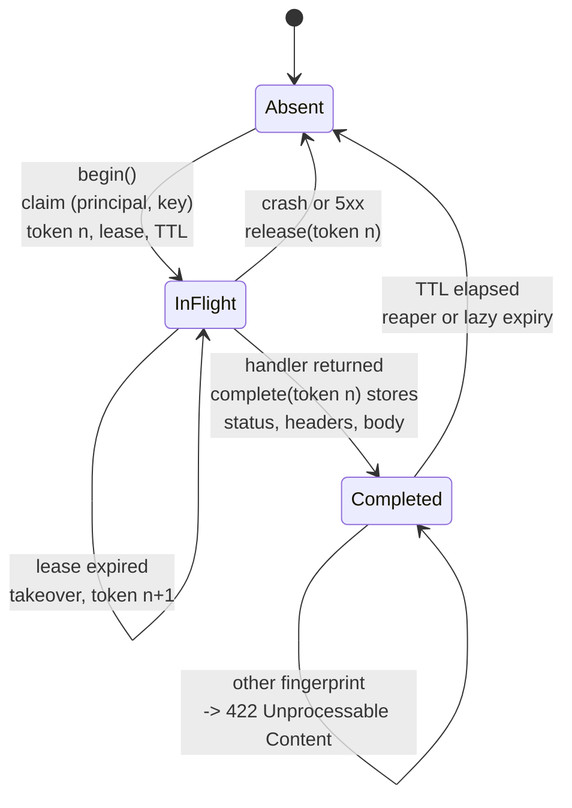

# The Idempotency-Key HTTP Header Specification (draft-ietf-httpapi-idempotency-key-header-08, October 2026) and Stripe-Grade Recovery State Machines

> [!summary] Claim
> `Idempotency-Key` turns a `POST` or `PATCH` into a retry-safe operation only when the server runs a per-key state machine (absent -> in flight -> completed, keyed by principal and key, guarded by a payload fingerprint, a lease, a fencing token, and a TTL) that answers `400`, `422`, `409`, or a byte-exact replay; draft-08 standardizes the request field and those three error codes, and leaves storage, replay fidelity, and failure recording to you.

Part of [Resilience Rate Limiting and Idempotency](README.md) in [API Engineering](../README.md).

## TL;DR

- Mechanism: the client mints one random key per logical operation and sends it on every attempt; the server atomically claims `(principal, key)`, executes once, stores the response, and replays it to every later attempt with the same fingerprint.
- Contract rule: draft-08 makes the field an RFC 9651 Item whose value MUST be a String (draft-08 Section 2.1), and says a missing key SHOULD get `400`, a reused key with a different payload SHOULD get `422`, and a retry while the original is still running SHOULD get `409` (draft-08 Section 2.7).
- The trap: the header is quoted on the wire (`Idempotency-Key: "8e03978e-..."`), so Stripe-style unquoted values are not valid Strings and a strict parser ignores the field (RFC 9651 Sections 2.2 and 4.2); and a lease that expires before a slow handler finishes lets a second worker run the side effect again.
- Portability fact: the lab middleware is pure ASGI; its 33 tests pass on CPython 3.14.6 (re-run by the fact-check) and passed in the drafter's earlier runs on 3.12.13, 3.13.18, 3.15.0b3, and 3.15.0b3 free-threaded with the GIL disabled; draft-08 was superseded by draft-09 on 2026-11-21, still an Internet-Draft, and `Idempotency-Key` is not in the IANA field registry (as of 2026-11).
- When not to use it: if the operation already maps to a single ACID transaction, or the resource can be addressed with an idempotent `PUT` to a client-chosen URI, do that instead; idempotency keys earn their cost only when a request mutates foreign state you cannot roll back.

## Mental model



Every request carrying a valid key enters `begin()`, which runs under one lock (or one unique constraint in a database) so exactly one caller can move a key from `Absent` to `InFlight`.
The claim mints a monotonically increasing fencing token, a lease deadline, and a TTL deadline.
A second attempt that arrives while the first is still `InFlight` gets `409`, unless the lease has expired, in which case it takes over with a newer token and the old owner can no longer commit.
When the handler returns a complete response, `complete()` stores status, headers, and body only if the caller still holds the current token, moving the key to `Completed`.
From `Completed`, the same fingerprint replays the stored bytes and a different fingerprint gets `422`; any state compares the fingerprint before anything else, which is why a mismatch is `422` even while the original is in flight.
A crash or a server error releases the key back to `Absent` so a retry re-executes, and the TTL eventually forgets a completed key so the same value becomes a brand-new request.

## How it works

### What draft-08 standardizes, and what it leaves open

`draft-ietf-httpapi-idempotency-key-header-08` was posted on 22 October 2026 by J. Jena, S. Dalal, and D. Tishkin, is 14 pages, expires on 25 April 2027, and is a working-group document of the IETF HTTPAPI group (draft-08 header and page footers).
Draft-09, posted on 21 November 2026 and expiring on 25 May 2027, supersedes it (datatracker metadata fetched 2026-11-21: `rev` `09`, `rfc` `null`); this note follows draft-08 and flags where draft-09 differs.
It is still a draft: the field is not in the IANA "Hypertext Transfer Protocol (HTTP) Field Name Registry" (IANA `field-names.csv` fetched 2026-11-21 has no `Idempotency-Key` row), and draft-08 Section 3.1 only requests a `permanent` registration.
Its normative content is short.
Section 2.1 says the field "is an Item Structured Header Field [RFC9651]" whose value "MUST be a String (Section 3.3.3 of [RFC9651])".
Section 2.2 says the key "MUST be unique and MUST NOT be reused with another request with a different request payload", and RECOMMENDS a UUID (RFC 9562) "or a similar random identifier".
Section 2.3 lets the resource expire keys and says it SHOULD publish the expiration policy.
Section 2.4 makes a payload fingerprint optional and lists five approaches: a checksum of the whole payload, a checksum of selected elements, field-by-field match, match on selected elements, or a request digest or signature.
Section 2.5.2 says resources "MUST publish an idempotency-related specification", and Section 2.5.1 says a client MAY send the field to signal intent but "cannot assume the server will respect this request" without a priori knowledge.
Section 2.6 distinguishes a first-time request, a retry after completion, and a concurrent request before completion.
Section 2.7 maps errors to `400`, `422`, and `409`, and shows an RFC 9457 problem-details body and a `Link: <...>; rel="describedby"` header as alternatives.
The lab sends both on every one of those errors, which covers either example in the draft.
Section 5 names two threats, injection through unvalidated keys used in cache lookups and data leaks through guessable low-entropy keys, and recommends a fixed published key format, validation before processing, and a composite lookup key that combines the client key "with other client specific attributes known only to the resource".

What the draft does not standardize is most of the engineering: the storage model, lease and lock semantics, which outcomes are recorded, how long keys live, whether replays are byte-exact, and how a client learns that a response was a replay.

### The change from draft-07 to draft-08, and the open questions

Appendix A of draft-08 lists the changes: references updated from RFC 7231, 7807, 4122, and 8941 to RFC 9110, 9457, 9562, and 9651; the unused ABNF and IMF-fixdate references removed; "Adopted the proposed text for the Retry case (#48); still open for discussion"; editorial fixes; a new author.
The #48 change is the only semantic one.
Draft-07 Section 2.6 said the resource "SHOULD respond with the result of the previously completed operation, success or an error".
Draft-08 Section 2.6 says it "SHOULD respond with a response consistent with the request being completed according to the user's intent".
The issue's author argued from RFC 9110 Section 9.2.2, which defines idempotency by "intended effect on the server" and notes that for `PUT` "the response might differ"; a second `DELETE` commonly returns `404` rather than a second `204` (ietf-wg-httpapi/idempotency issue #48).
Acconut replied that replaying the same status and headers is easier for clients, and jmileham agreed, adding that a `4xx` might be treated as not yet completed so a corrected retry can reuse the key (issue #48 comments, 2024-11-07 and 2024-11-11).
In practice, draft-08 now permits both Stripe API v1, where "Retries with the same key return the saved response, including 500 errors", and Stripe API v2, where "Stripe retries failed or partially failed work to completion when possible and returns an updated response" (Stripe API reference, "Idempotent requests", as of 2026-11).

Open issues on the working-group tracker (GitHub API `state=all`, fetched 2026-11-21) that a server still has to decide: #42 (whether `422` collides with domain validation, whether a mismatch should be `409` or OASIS's `400`, whether to block instead of returning an error, and whether in-flight should be `423 Locked`), #46 (a standard replay marker, citing Stripe's `Idempotent-Replayed: true`), #48 (the Retry wording, still open after Appendix A adopted the proposed text), #49 (TTL ranges, and whether expiry is `410 Gone` or a new request), #51 (response semantics beyond the three status codes), #35 (a response header for the retention window), #37 (resource requirements; pull request #61 relaxed the documentation MUST, and the issue is still open), and #31 (how this draft differs from OASIS Repeatable Requests).
Pull requests #60, #61, and #63 merged on 2026-11-13, after -08 was posted on 2026-10-22.
Pull request #62 was closed on 2026-10-31 with no merge; #63 replaced it.
#60 makes exact string match the default when the resource does not define uniqueness, #61 changes the documentation requirement from MUST to SHOULD, and #63 says a fingerprint mismatch is an error that does not return the original result.
Those three edits landed in the editor's copy on 2026-11-13 and were published as draft-09 on 2026-11-21: draft-09 Section 2.2 says keys are opaque and "two keys are considered the same only if their values match exactly" unless the resource defines otherwise, Section 2.4 says a mismatched fingerprint fails the request and "does not return the result of the original request", and Section 2.5.2 says resources "SHOULD document their idempotency-related behavior" (draft-09 Appendix A).

### Wire syntax: a quoted String, parsed strictly

On the wire the value is a Structured Field String, so it is quoted: `Idempotency-Key: "8e03978e-40d5-43e8-bc93-6894a57f9324"` (draft-08 Sections 2.2 and 6).
RFC 9651 Section 3.3.3 limits Strings to printable ASCII `%x20-7E`, allows only `\"` and `\\` escapes, and requires parsers to support at least 1024 characters.
Parsing runs on one combined field value: parsers MUST join every field line whose name matches case-insensitively into one comma-separated value, as RFC 9110 Section 5.2 defines that combination (RFC 9651 Section 4.2).
The lab joins with a comma and one SP, so two `Idempotency-Key` lines become `"a", "b"`, which leaves input after the Item and fails.
Section 4.2 step 1 converts that value to ASCII and fails the parse when the conversion fails, so the UTF-8 bytes of U+00E9 inside quotes never reach the String grammar.
On any failure "the entire field value MUST be ignored (i.e., treated as if the field were not present in the section)" or the message treated as malformed, and field specifications may not loosen that (RFC 9651 Section 4.2).
If parsing succeeds but the Item is not a String, RFC 9651 Section 2.2 says the field "should be ignored unless that field's definition explicitly specifies otherwise", and draft-08 does not.

This has a sharp interoperability consequence.
Stripe's own example sends `Idempotency-Key: KG5LxwFBepaKHyUD`, unquoted (Stripe API reference, "Idempotent requests", as of 2026-11).
Under RFC 9651 that value is a Token (it starts with ALPHA), so a conforming draft-08 server ignores the field and answers `400` as if it were missing; an unquoted UUID starting with a digit is worse, because the parser reads Integer `8` and fails on the leftover `e03978e-...`.
The lab enforces the strict reading and puts the reason in the `detail` member so a client author can see why.
A server that must accept existing Stripe-style clients has to decide explicitly to accept a Token or raw value as an extension, which is a local deviation from draft-08, not a reading of it.

Items may carry Parameters, and RFC 9651 Section 2.3 discourages specifications from making an unrecognized parameter an error, so `"abc";v=1` is a valid key `abc`.
A Display String (`%"..."`, RFC 9651 Section 3.3.8) is a different bare item, and draft-08 Section 2.1 requires a String, so the lab accepts the field only when it opens with DQUOTE.
The lab parser implements the RFC 9651 Section 4.2 Item algorithm with all eight bare-item types for parameter values, and the parametrized tests pin nine rejected inputs: Token, unquoted UUID, duplicate lines, unterminated String, `\n` escape, non-ASCII, uppercase parameter key, leftover input, and leading HTAB.

Header-name case is the other wire detail.
HTTP/2 and HTTP/3 require lowercase field names (RFC 9113 Section 8.2, RFC 9114 Section 4.2), but the ASGI request scope says header names "should be lowercased, but it is not required" (ASGI HTTP connection scope, `headers`).
Most stacks checked here lowercase: Uvicorn's httptools path does `name = name.lower()` (uvicorn 0.54.0 uvicorn/protocols/http/httptools_impl.py, HttpToolsProtocol.on_header), h11 lowercases in `normalize_and_validate` (h11 0.16.0 h11/_headers.py, normalize_and_validate), and httpx's in-process transport lowercases when building the scope (httpx 0.28.1 httpx/_transports/asgi.py, ASGITransport.handle_async_request).
Granian builds the scope from `http::HeaderMap` keys with `key.as_str()` (granian 2.8.9 src/asgi/utils.rs, the scope-building macro), and the `http` crate's `HeaderName` is always lower case for custom names (docs.rs `http::header::HeaderName`; the locked `http` is 1.5.0 and `hyper` is 1.12.0 in granian 2.8.9 `Cargo.lock`).
Hypercorn is the exception: its HTTP/1.1 path passes `list(request.headers)` (h11's lowercased names) by default, but with the `h11_pass_raw_headers` option, default `False`, it passes `request.headers.raw_items()`, which "preserves header casing" (hypercorn 0.18.0 src/hypercorn/protocol/h11.py, H11Protocol._create_stream, and src/hypercorn/config.py, Config.h11_pass_raw_headers; Hypercorn configuration docs).
So a conforming ASGI server can deliver `Idempotency-Key` in mixed case on HTTP/1.1, and the lab compares names case-insensitively, with a test that feeds a raw scope containing `Idempotency-Key`, because the ASGI spec does not promise lowercasing.
Source inspection only: the lab was not run under Hypercorn or Granian.
At the framework level, Starlette's `Headers.__getitem__` returns the first matching line only (starlette 1.10.0 starlette/datastructures.py, Headers.__getitem__), so `request.headers["idempotency-key"]` silently picks one of two conflicting keys where an RFC 9651 parser would reject both.

### The key: scope, entropy, and exact comparison

The lookup key is `(principal, key)`, never the client value alone.
Brandur Leach's reference schema enforces this with `CREATE UNIQUE INDEX ... ON idempotency_keys (user_id, idempotency_key)` and limits the key to `char_length(idempotency_key) <= 100` ("Implementing Stripe-like Idempotency Keys in Postgres", 2017).
Stripe API v2 scopes replays to "the same idempotency key for the same API", "the same account or sandbox", and "within 30 days" (Stripe API v2 overview, as of 2026-11).
Without the principal, two tenants that pick the same key would see each other's responses, which is exactly the draft-08 Section 5 "data leak"; the lab test `test_same_key_in_two_tenants_never_collides_or_leaks` proves the separation.

A UUIDv4 carries 122 random bits (RFC 9562 Section 5.4), and RFC 9562 Section 6.9 says implementations SHOULD use a CSPRNG; CPython's `uuid.uuid4()` is `int.from_bytes(os.urandom(16))` with the version and variant bits forced (CPython 3.14.6 Lib/uuid.py, uuid4).
The birthday bound gives a collision probability of about `n^2 / 2^123`, which is roughly `9.4e-14` for `10^12` keys in one principal's scope (computed, not measured).
Comparison is exact on the decoded String.
Never normalize case or decode the key into another representation before comparing: CVE-2026-81638 (ash_double_entry before 1.0.19) let four different spellings of one ULID decode to the same 16 bytes, and NVD lists "idempotency and deduplication keys" among the string-level checks that alternate spellings bypass.

### The fingerprint: binding the key to one request

The fingerprint is what turns "same key" into "same request".
Stripe API v1 "compares incoming parameters to those of the original request and errors if they're not the same" (Stripe API reference), AWS stores "the parameters used to make the initial request along with the client request identifier" and returns "a validation error indicating a parameter mismatch" (Amazon Builders' Library, "Making retries safe with idempotent APIs"), and Brandur's schema stores `request_method`, `request_path`, and `request_params`.
The lab fingerprint is SHA-256 over method, path, query string, and raw body, each length-prefixed with 8 bytes so that no two different tuples can concatenate to the same input:

```python
def request_fingerprint(method: str, path: str, query: bytes, body: bytes) -> str:
    """Draft-08 Section 2.4 'checksum of the entire request payload', bound to the target."""
    digest = hashlib.sha256()
    for part in (method.encode("ascii"), path.encode("utf-8"), query, body):
        digest.update(len(part).to_bytes(8, "big"))
        digest.update(part)
    return digest.hexdigest()
```

Including the path means the same key on `/v1/charges` and `/v1/refunds` is a mismatch (`422`), not a replay of a charge as a refund.
Raw bytes are strict: `{"currency": "usd", "amount": 2000}` and `{"amount": 2000, "currency": "usd"}` are different requests to the lab, and the test `test_reordered_json_is_a_mismatch_under_raw_byte_fingerprints` pins that.
Stripe-style parameter comparison is more forgiving; the cost is a canonicalization step that must itself be deterministic across releases.

### The state machine and its transitions

The lab's `IdempotencyStore.begin` is the whole decision table (excerpt, byte-identical to the lab file):

```python
    def begin(self, scope_key: tuple[str, str], fingerprint: str) -> Decision:
        now = self.clock()
        with self._lock:
            record = self._records.get(scope_key)
            if record is not None and now >= record.expires_at:
                record = None  # TTL elapsed: the key is forgotten, a reuse is a new request
            if record is not None:
                if record.fingerprint != fingerprint:
                    return Decision(Outcome.MISMATCH)
                if record.state is State.COMPLETED:
                    return Decision(Outcome.REPLAY, response=record.response)
                if now < record.lease_expires_at:
                    return Decision(Outcome.IN_PROGRESS)
                # Lease expired: the owner is presumed dead, so this request takes over.
            self._next_token += 1
            self._records[scope_key] = Record(
                fingerprint=fingerprint,
                state=State.IN_FLIGHT,
                token=self._next_token,
                lease_expires_at=now + self.lease_seconds,
                expires_at=now + self.ttl_seconds,
            )
            return Decision(Outcome.PROCEED, token=self._next_token)
```

The order of checks is a design decision.
Fingerprint first means a client that reuses a key for a different payload learns that immediately (`422`) rather than after the original finishes; Brandur's code makes the same choice, checking `key.request_params != params` before `locked_at`.
In-process, the `threading.Lock` makes the read-check-write atomic, including on the free-threaded build; in a database the arbiter is the unique index on `(principal, key)`, and Brandur's find-or-create runs inside a `SERIALIZABLE` transaction so that "if two different transactions both try to lock any one key, one of them will be aborted by Postgres", which his code maps to `409`.

### Leases, takeovers, and fencing tokens

A claim that never completes (the worker was killed) must not block the key forever, so the claim is a lease.
Brandur's `IDEMPOTENCY_KEY_LOCK_TIMEOUT = 90` seconds (rocket-rides-atomic `api.rb`) re-locks a key whose `locked_at` is older than that; the lab defaults to the same 90 seconds.
A takeover is safe only if the original owner is really dead.
If the original is merely slow (a 120-second handler against a 90-second lease), both run the side effect.
The fencing token limits the damage to the record: `complete()` and `release()` succeed only for the current token, so the stale owner cannot overwrite the newer owner's stored response, and `test_expired_lease_is_taken_over_and_stale_owner_is_fenced` proves both refusals.
The token cannot un-send an email or un-charge a card, so two further rules apply: set the lease longer than the handler's own deadline (see [[Timeout-Taxonomy-Connect-Read-Write-Pool-and-Deadline-Propagation]]), and pass a derived idempotency key to every downstream call, as Brandur does with `idempotency_key: "rocket-rides-atomic-#{key.id}"` when calling Stripe, so a second execution collapses at the dependency.

### What gets recorded, and when a retry re-executes

The middleware's own `400`, `413`, `409`, and `422` responses are never stored, because the endpoint never ran.
This matches Stripe API v1: "If incoming parameters fail validation, or the request conflicts with another request that's executing concurrently, we don't save the idempotent result because no API endpoint initiates the execution."
Handler responses below `500`, including business failures like `402` card declined, are stored and replayed; Stripe API v1 likewise says "Retrying a cached 400 response with the same key returns the same error" (Stripe "Advanced error handling").
Server errors are a policy choice.
Stripe API v1 caches `500` responses and replays them while the key is retained, and tells clients to "Treat the outcome of a request that returns 500 as indeterminate"; Stripe API v2 instead "attempts to retry any failed requests without producing side effects".
The lab default releases the key on `5xx` so the retry re-executes, and `cache_server_errors=True` reproduces Stripe API v1; both are tested.
An exception always releases, even with `cache_server_errors=True`.
That matters with Starlette, because `ServerErrorMiddleware` sends a `500` response and then re-raises ("We always continue to raise the exception", starlette 1.10.0 starlette/middleware/errors.py, ServerErrorMiddleware.__call__), so a middleware that stored whatever it saw on the wire would cache the crash.
The lab commits only after the wrapped app returns normally (excerpt, byte-identical to the lab file):

```python
        try:
            await self.app(scope, replay_receive, capture_send)
        except BaseException:
            self.store.release(scope_key, token)  # crash before commit: let a retry re-execute
            raise
        if not finished or (status >= 500 and not self.config.cache_server_errors):
            self.store.release(scope_key, token)
            return
        stored = StoredResponse(status, tuple(headers), b"".join(chunks))
        self.store.complete(scope_key, token, stored)
```

Releasing on a crash is correct only if the crash happened before any foreign side effect, or if every side effect is itself idempotent.
A handler that charged a card and then crashed has made an irreversible change, and the honest fix is recovery points and atomic phases, which [[Atomic-Idempotency-Phases-and-Failure-Recovery-Across-Network-Drops]] covers.

### Replay fidelity and the replay marker

A replay sends the stored status, every stored header, and the stored body, plus `Idempotent-Replayed: true`.
That header is Stripe's ("look for the header `Idempotent-Replayed: true`", Stripe "Advanced error handling"), and it is not in draft-08; issue #46 proposing a standard marker is open (as of 2026-11).
Byte-exact replay also replays headers that were only true at the first response, such as `Date` and any `Set-Cookie`, so decide which response headers belong in the record.
AWS takes the "semantically equivalent" view: for EC2 `RunInstances`, a late-arriving retry after the instance was terminated still gets a semantically equivalent successful response, following "the principle of least astonishment" (Amazon Builders' Library).

### The client half of the contract

The client generates the key once per logical operation, persists it before the first attempt, and sends the same key and the same parameters on every retry.
Stripe's guidance is concrete: retry "with the same idempotency key and parameters within the first 24 hours"; on `409` because the original is still executing, "wait and retry with that key and the same parameters"; and do not switch to a new key until the original outcome is reconciled, because "A new key can start a second operation" (Stripe "Advanced error handling", as of 2026-11).
Draft-08 Section 2.7 says clients "MUST correct the requests (with the exception of 409 where no correction is required) before performing a retry operation, or the resource MUST fail the request and return one of the above errors".
The same section names `401`, `403`, `500`, `502`, `503`, `504`, and `429` as statuses the client handles by the resource's own documentation, outside the three idempotency errors.
Retry pacing and budgets are the subject of [[Retries-Exponential-Backoff-Full-vs-Decorrelated-Jitter-and-Stamina]] and [[Retry-Budgets-and-Preventing-Cascading-Retry-Amplification-Storms]].

### OASIS Repeatable Requests

OASIS Repeatable Requests Version 1.0 (Committee Specification 01, 7 July 2020) is the other published specification for retrying unsafe methods, and working-group issue #31, which asks how draft-08 differs from it, is still open (as of 2026-11).
A repeatable request MUST carry both `Repeatability-Request-ID` and `Repeatability-First-Sent`.
Servers MUST accommodate the "36-character hexadecimal case-insensitive encoding of a UUID" as the identifier, and the timestamp MUST be an `IMF-fixdate` (Repeatable Requests Sections 3.1.1 and 3.1.2).
`Repeatability-First-Sent` is the retention window: a timestamp older than the earliest remembered request MUST be `412 Precondition Failed` with `Repeatability-Result: rejected`, whereas a forgotten `Idempotency-Key` in this lab is a new request.
A changed method, URI, or header other than `Date` SHOULD be `400`, and a changed body MAY be `400`; draft-08 uses `422` for a different payload (Repeatable Requests Section 5).
On a match the server MUST return `Repeatability-Result: accepted` and either the original response or, when that response was `4xx` or `5xx`, the result of re-executing (Repeatable Requests Section 5).
That last rule is the choice Stripe API v1 and v2 split, written down as allowed behavior.
The four `Repeatability-*` names are provisional in the IANA HTTP Field Name Registry (`field-names.csv` fetched 2026-11-21).
`Idempotency-Key` has no row in that file.
Issue #42 cites this specification's `400` as one alternative to draft-08's `422`.

### Lineage

The draft's acknowledgments cite PayPal's API patterns, Stripe, and Mark Nottingham's 2005 "POST Once Exactly" draft (`draft-nottingham-http-poe-00`).
POE took the opposite route: the server hands out a single-use URI, and a second `POST` to it "SHOULD respond with a 405 Method Not Allowed status code" (draft-nottingham-http-poe-00 Section 2), so the identity lives in the URI rather than in a request field.
Draft-08 Section 4 lists header-compatible implementations (Stripe, Adyen, Dwolla, Interledger, WorldPay, Yandex, http4s, Finastra, Datatrans) and Section 4.1 lists differently named equivalents (PayPal `PayPal-Request-Id`, Square's `idempotency_key` body property, Google Standard Payments `requestId`, and others).

## Numbers and limits

| Quantity | Value | Source |
|---|---|---|
| draft-08 posted, expires | 2026-10-22, 2027-04-25 | draft-08 header |
| draft-09 posted, expires | 2026-11-21, 2027-05-25 | draft-09 header; datatracker (fetched 2026-11-21) |
| Field type | RFC 9651 Item, value MUST be a String | draft-08 Section 2.1 |
| String alphabet, minimum parser support | `%x20-7E`, >= 1024 characters | RFC 9651 Section 3.3.3 |
| UUIDv4 random bits | 122 | RFC 9562 Section 5.4 |
| Collision probability, `10^12` UUIDv4 keys in one scope | about `9.4e-14` (`n^2 / 2^123`) | computed here |
| Stripe API v1 key length | up to 255 characters | Stripe API reference (as of 2026-11) |
| Stripe API v1 retention | at least 24 hours, then may be pruned | Stripe API reference (as of 2026-11) |
| Stripe API v2 replay window | 30 days, same API and account | Stripe API v2 overview (as of 2026-11) |
| Brandur reference schema key limit | `char_length(idempotency_key) <= 100` | brandur.org, 2017 |
| Brandur reference lock timeout | `IDEMPOTENCY_KEY_LOCK_TIMEOUT = 90` seconds | rocket-rides-atomic `api.rb` |
| Brandur suggested reaper threshold | about 72 hours | brandur.org, 2017 |
| OASIS window miss | `412` and `Repeatability-Result: rejected` | Repeatable Requests Section 5 (CS01, 2020-07-07) |
| Lab defaults | lease 90 s, TTL 86400 s, body cap 1048576 bytes, key `[A-Za-z0-9_-]{16,255}` | lab `idempotency_key.py` |
| Lab run | 33 passed in 0.24 s | measured 2026-11-21 by the fact-check: `uv run --frozen pytest ... -q`, CPython 3.14.6, macOS 27.3 arm64 (Darwin 27.3.0) (not a benchmark) |

The key format `[A-Za-z0-9_-]{16,255}` is this lab's published format per draft-08 Section 5, not a standard; its upper bound matches Stripe's 255.

## Portability

| Leg | Result | Evidence |
|---|---|---|
| CPython 3.14.6 (workspace `.venv`) | 33 passed in 0.24 s | fact-check run, `uv run --frozen pytest`, macOS 27.3 arm64, 2026-11-21 |
| CPython 3.12.13 | 33 passed | drafter's earlier run, `uv run --frozen --python 3.12` with plugin autoload off; not re-run by the fact-check |
| CPython 3.13.18 | 33 passed | drafter's earlier run, `uv run --frozen --python 3.13` with plugin autoload off; not re-run by the fact-check |
| CPython 3.15.0b3 | 33 passed | drafter's earlier run, `uv run --frozen --python 3.15` with `PYTEST_DISABLE_PLUGIN_AUTOLOAD=1 -p asyncio`, because the locked `hypothesis 6.170.14` plugin failed to import (`No module named 'hypothesis._native'`); not re-run by the fact-check |
| CPython 3.15.0b3 free-threaded, `-X gil=0` | 33 passed | drafter's earlier run in a separate venv with only `starlette 1.10.0`, `httpx 0.28.1`, `httpcore 1.0.9`, `anyio 4.16.0`, `pytest 9.2.0`, `pytest-asyncio 1.4.1.post1`, because the locked `psycopg-binary 3.3.8` has no 3.15t wheel; not re-run by the fact-check |
| Pinned matrix 3.12.16, 3.14.10, 3.15.2, 3.15.2t | not run | lab checks paused (2026-11-11); `uv python list` here (uv 0.11.26, 2026-11-21) finds Homebrew 3.14.10 and 3.15.2 but offers no 3.12.16 and no 3.15.2t |
| Uvicorn 0.54.0, Hypercorn 0.18.0, Granian 2.8.9 | not run; pure ASGI middleware, needs only `scope["headers"]`, `receive`, `send` | ASGI HTTP connection scope; Uvicorn and Granian deliver lowercase names, Hypercorn can deliver original case with `h11_pass_raw_headers` (source read 2026-11-21, see How it works) |
| HTTP/1.1, HTTP/2, HTTP/3 | field semantics identical; names arrive lowercase on HTTP/2 and HTTP/3 | RFC 9113 Section 8.2, RFC 9114 Section 4.2 |
| Debian and Alpine containers | not run | lab checks paused for this note (2026-11-11) |

The other CPython rows are the drafter's earlier runs of these same 33 tests.
A later revision rewrote the non-ASCII rejection case as an ASCII bytes escape, and only the workspace interpreter has run the tests since.
The in-memory store is per process: with several workers or several hosts, the store must be shared (a database row with a unique constraint, or a single-key atomic operation in a shared cache), or two workers will each claim the same key.

## Worked example

The [implementation](../labs/src/api_labs/f16_resilience_rate_limiting_and_idempotency/idempotency_key.py) has three layers: `parse_idempotency_key` (RFC 9651 Item parsing restricted to a String), `IdempotencyStore` (the state machine above), and `IdempotencyMiddleware` (pure ASGI, maps decisions to draft-08 Section 2.7 responses).
The [test](../labs/tests/f16_resilience_rate_limiting_and_idempotency/test_idempotency_key_header_specification_and_state_machine_draft_08.py) mounts a Starlette app with `POST /v1/charges`, `POST /v1/refunds`, and `GET /v1/charges` behind the middleware and drives it with `httpx.AsyncClient(transport=httpx.ASGITransport(app=..., raise_app_exceptions=False), base_url="http://test")`, an injected fake clock, and an `asyncio.Event` gate that holds the first request inside the handler.

The concurrency test is the one that proves `409` (excerpt, byte-identical to the lab test):

```python
@pytest.mark.unit
@pytest.mark.asyncio
async def test_concurrent_duplicate_gets_409_then_replay_after_completion() -> None:
    h = build(gate_open=False)
    first = asyncio.create_task(h.client.post("/v1/charges", content=BODY, headers=headers()))
    await asyncio.wait_for(h.entered.wait(), timeout=5.0)  # first request is in the handler
    assert h.store.state_of(SCOPE_KEY) is State.IN_FLIGHT
    dup = await h.client.post("/v1/charges", content=BODY, headers=headers())
    assert dup.status_code == 409
    assert dup.json()["title"] == "A request is outstanding for this Idempotency-Key"
    h.gate.set()
    assert (await first).status_code == 201
    replay = await h.client.post("/v1/charges", content=BODY, headers=headers())
    assert replay.headers["idempotent-replayed"] == "true"
    assert len(h.calls) == 1
```

What the 33 tests pin:

| Behavior | Test |
|---|---|
| 5 valid String Items parse, parameters ignored | `test_parse_accepts_sf_string_items` |
| 9 invalid inputs rejected (Token, unquoted UUID, duplicate lines, ...) | `test_parse_rejects_everything_else` |
| missing key -> `400` problem+json with `Link` `rel="describedby"` | `test_missing_key_is_400_problem_with_describedby_link` |
| unquoted key ignored -> `400` "missing" | `test_unquoted_key_is_ignored_and_treated_as_missing` |
| low-entropy key -> `400` "invalid" | `test_low_entropy_key_fails_published_format` |
| retry replays status, headers, body; handler ran once | `test_retry_replays_exact_status_headers_and_body_once_executed` |
| different body -> `422`, stored response untouched | `test_same_key_different_payload_is_422_and_does_not_execute` |
| same key, other endpoint -> `422` | `test_same_key_on_another_endpoint_is_422` |
| reordered JSON is a mismatch with raw-byte fingerprints | `test_reordered_json_is_a_mismatch_under_raw_byte_fingerprints` |
| in-flight duplicate -> `409`, then replay | `test_concurrent_duplicate_gets_409_then_replay_after_completion` |
| handler `402` recorded and replayed | `test_handler_4xx_is_recorded_and_replayed` |
| `5xx` releases, retry re-executes | `test_5xx_releases_the_key_so_a_retry_re_executes` |
| Stripe API v1 policy caches `5xx` | `test_stripe_v1_policy_caches_5xx` |
| exception releases even when `5xx` is cached | `test_crash_releases_even_when_server_errors_are_cached` |
| lease takeover at 90 s, stale token fenced | `test_expired_lease_is_taken_over_and_stale_owner_is_fenced` |
| reuse after TTL executes anew | `test_key_reuse_after_ttl_executes_a_new_request` |
| reaper drops only expired records | `test_reaper_purges_only_expired_records` |
| same key in two tenants never collides | `test_same_key_in_two_tenants_never_collides_or_leaks` |
| `GET` bypasses enforcement | `test_get_bypasses_enforcement` |
| body over 1 MiB -> `413`, no state written | `test_oversized_body_is_413_before_any_state_is_written` |
| mixed-case header name from a raw ASGI scope is found | `test_mixed_case_header_name_from_a_non_lowercasing_server_is_found` |

Captured by the fact-check on CPython 3.14.6, macOS 27.3 (Darwin 27.3.0 arm64), from `labs/`, on 2026-11-21, with `CI` unset:

```text
$ uv run --frozen pytest tests/f16_resilience_rate_limiting_and_idempotency/test_idempotency_key_header_specification_and_state_machine_draft_08.py -q
.................................                                        [100%]
33 passed in 0.24s
```

## Pitfalls

> [!warning] Unquoted keys from Stripe-style clients
> Trigger: a client copies Stripe's documented form `Idempotency-Key: KG5LxwFBepaKHyUD` into a draft-08 server.
> Symptom: every request gets `400` "missing" from a strict server, or, from a lenient one, the server accepts a value that another conforming intermediary would ignore.
> Fix: send `Idempotency-Key: "..."` (draft-08 Section 2.1); if you must accept legacy unquoted values, do it as a documented, explicit extension and say so in the `detail` member.

> [!warning] Lease shorter than the handler
> Trigger: a 90-second lease in front of a handler whose downstream call can take 120 seconds.
> Symptom: the client's retry after a timeout takes over the key at 90 seconds and runs the charge a second time; the fencing token stops the record overwrite but not the second charge.
> Fix: lease > handler deadline, enforce the deadline inside the handler, and send a derived idempotency key to every downstream mutation (Brandur's `rocket-rides-atomic-#{key.id}`).

> [!warning] Caching what the error middleware sent
> Trigger: an idempotency middleware stores whatever response it sees on the wire.
> Symptom: Starlette's `ServerErrorMiddleware` sends a `500` and then re-raises, so a transient crash is replayed for 24 hours.
> Fix: commit only after the inner app returns normally, and decide `5xx` caching as explicit policy (lab `cache_server_errors`).

> [!warning] Releasing after an irreversible side effect
> Trigger: the handler charges a card, then crashes before returning; the middleware releases the key.
> Symptom: the retry charges again, because nothing recorded that the charge happened.
> Fix: persist recovery points around every foreign mutation and resume from them; see [[Atomic-Idempotency-Phases-and-Failure-Recovery-Across-Network-Drops]].

> [!warning] Key not scoped to the principal
> Trigger: the store is keyed by the client value alone.
> Symptom: tenant B gets tenant A's replayed response, including A's resource identifiers, whenever they pick the same key; low-entropy keys make it targetable (draft-08 Section 5).
> Fix: key on `(principal, key)`, with the principal taken from authentication, never from a client-supplied field.

> [!warning] Normalizing keys before comparing
> Trigger: lowercasing, trimming, or decoding the key (UUID, ULID) into bytes and comparing those.
> Symptom: two spellings either collide (CVE-2026-81638: four spellings of one ULID decoded to the same 16 bytes and bypassed "idempotency and deduplication keys") or a client library that changes case between retries executes twice.
> Fix: compare the exact decoded String, which draft-09 Section 2.2 (from PR #60) makes the default.

> [!warning] Fingerprint drift across retries
> Trigger: the client re-serializes JSON on each attempt (key order, whitespace, float formatting), or adds a per-attempt field such as a client timestamp.
> Symptom: the retry gets `422` and the client cannot tell whether the original succeeded.
> Fix: serialize the body once and resend those bytes, or fingerprint a canonical parameter set on the server, and keep per-attempt metadata in headers outside the fingerprint.

> [!warning] Retrying with a fresh key
> Trigger: a client treats `500` or a timeout as failure and retries with a new key.
> Symptom: a second operation starts; Stripe warns that "A new key can start a second operation".
> Fix: keep the key until the outcome is reconciled; switch keys only for a deliberately new operation.

## Security and robustness

- Broken object level authorization (OWASP API1:2023): the replay path returns a stored response without running the handler's authorization, so the record must be scoped by the authenticated principal, and the principal must be checked before `begin()`.
- Unrestricted resource consumption (OWASP API4:2023): the middleware must buffer the body to fingerprint it, so cap it before buffering (the lab returns `413 Content Too Large`, RFC 9110 Section 15.5.14, and writes no state); cap key length (RFC 9651 parsers need only support 1024 characters, the lab caps at 255); and bound the store with a TTL and a reaper, because every unique key is a row.
- Injection: draft-08 Section 5 warns that unvalidated keys used in a cache lookup invite injection; validate against a published format before the key reaches any query, cache key, or log line.
- Key enumeration: low-entropy keys let an attacker guess another client's key (draft-08 Section 5); principal scoping removes the cross-tenant payoff and a CSPRNG UUIDv4 removes the guessing.
- Sensitive data in keys: Stripe says to avoid email addresses or personal identifiers as keys, because keys end up in logs and stores.
- Stored responses are data at rest: the record holds full response bodies, possibly with personal or payment data, for the TTL, so it inherits the retention and encryption rules of the resource.
- Replayed credentials: if `Set-Cookie` or other per-session headers are stored, a replay can re-issue them; strip them from the record.
- Abuse of `409`: an attacker who can send the same key as a victim (only possible without principal scoping) can hold it `InFlight` for a full lease and deny the victim's request.

## The principal's view

The architectural decision is where the idempotency boundary lives.
At the edge, as middleware like the lab, it is uniform, cheap to adopt, and blind to the handler's side effects, so it can only release or replay; it is enough for handlers whose only effects are one local transaction.
Inside the domain, as Brandur's atomic phases and recovery points, it is per-endpoint work but it can resume a half-finished operation instead of re-running it, which is what money movement needs.
Most payment-grade systems need both: the edge layer for the protocol contract (`400`, `409`, `422`, replay), and the domain layer for crash recovery.

The organizational trade-off is that draft-08 delegates nearly everything to "the resource's documentation", so the published idempotency policy is an API contract that must be versioned like one: key format, scope, TTL, which outcomes are cached, and whether replays are byte-exact or re-derived.
Changing `5xx` caching from Stripe API v1's replay to API v2's re-execution is a breaking behavior change for clients that branch on the replayed status.
Pick a status-code mapping deliberately: issue #42 argues that `422` collides with domain validation errors in many APIs, and Brandur's reference code uses `409` for parameter mismatch; following draft-08's `422` buys standard alignment at the cost of that ambiguity, mitigated by a distinct problem `type` URI.
The same issue also offers `423 Locked` for the in-flight case, and OASIS Repeatable Requests Section 5 uses `400` for a changed request, so the status you publish is a choice among those public designs.

Choose something else when it fits better.
Client-chosen resource identifiers with `PUT` give idempotency from HTTP itself (RFC 9110 Section 9.2.2) with no extra state.
A request that maps to one ACID transaction can enforce uniqueness with a unique constraint on a natural key.
For event delivery, deduplicate on an event identifier at the consumer instead, as [[Webhook-Consumer-Engineering-Signature-Verification-Replay-Windows-and-Idempotency]] describes.

## Interview questions

> [!question] L5: What does draft-08 say the server should return for a missing key, a reused key with a different payload, and a retry while the original is still running?
>
> > [!success]- Answer
> > A missing key on an operation that requires it SHOULD get `400`, a reused key with a different payload SHOULD get `422 Unprocessable Content`, and a retry before the original completes SHOULD get `409 Conflict` (draft-08 Section 2.7).
> > Each comes with an RFC 9457 problem-details body or a `Link` header with `rel="describedby"` pointing at documentation.
> > Clients must correct the request before retrying, except after `409`, where the same request can simply be retried later.
> >
> > Follow-up: Why is `409` the only one of the three where retrying unchanged is correct?

> [!question] L5: Why is `Idempotency-Key: 8e03978e-40d5-43e8-bc93-6894a57f9324` rejected by a strict draft-08 server?
>
> > [!success]- Answer
> > Draft-08 Section 2.1 makes the field an RFC 9651 Item whose value must be a String, and Strings are quoted.
> > Unquoted, the parser sees a leading digit, reads the Integer `8`, and then fails because `e03978e-...` is left over.
> > On a parse failure RFC 9651 Section 4.2 requires ignoring the whole field, so the request is treated as having no key and gets `400`.
> >
> > Follow-up: What happens to `KG5LxwFBepaKHyUD` unquoted, and why is the outcome the same?

> [!question] L5: Predict the output. Using the lab defaults and one tenant, a client sends three `POST /v1/charges` requests with the same key: body `A` (returns `201`), then body `B`, then body `A` again. What are the three status codes, and how many times does the handler run?
>
> > [!success]- Answer
> > The first request returns `201` and the handler runs once.
> > The second returns `422`, because the fingerprint differs, and the handler does not run.
> > The third returns `201` with `Idempotent-Replayed: true` and the original body, and the handler still has run once.
> > The `422` does not modify the stored record, which is what `test_same_key_different_payload_is_422_and_does_not_execute` asserts.
> >
> > Follow-up: What would the second request return if body `A` were still in flight?

> [!question] L6: What changed between draft-07 and draft-08 in the Retry case, and why does it matter for how you store results?
>
> > [!success]- Answer
> > Draft-07 said the server should return "the result of the previously completed operation, success or an error".
> > Draft-08 says it should return "a response consistent with the request being completed according to the user's intent", adopted from issue #48 and still open for discussion.
> > The new text follows RFC 9110 Section 9.2.2, where idempotency is about intended effect and the response may differ.
> > It permits both byte-exact replay (Stripe API v1, including cached `500`s) and re-execution of failed work with an updated response (Stripe API v2), so the server must document which one it does.
> >
> > Follow-up: Which of the two makes an idempotency middleware possible without domain knowledge?

> [!question] L6: Why must the store key be `(principal, key)` rather than the client key alone?
>
> > [!success]- Answer
> > Two clients can choose the same key, by accident or on purpose, and a client-key-only store would replay one tenant's response to another.
> > That is the "data leak" in draft-08 Section 5, made worse by low-entropy keys.
> > Draft-08 recommends a composite key that combines the client value with attributes known only to the resource, and Brandur's schema uses a unique index on `(user_id, idempotency_key)`.
> > The principal must come from authentication, not from a request field.
> >
> > Follow-up: What does this do to the denial-of-service risk from a squatted key?

> [!question] L6: Debug this API. After a deploy, finance sees a few duplicate charges per day. Logs show the duplicates' two executions carried the same `Idempotency-Key`, about 95 seconds apart, and neither got `409`. The lease is 90 seconds and the payment provider call has a 120-second timeout. What happened and what do you change?
>
> > [!success]- Answer
> > The first execution was still waiting on the provider when its 90-second lease expired.
> > The client's retry arrived after the lease expired, so `begin()` treated the owner as dead, took over with a new token, and ran the charge again.
> > Fencing stopped the slow owner from overwriting the stored response, but both charges went out.
> > Fix the ordering of timeouts so the lease exceeds the handler's total deadline, enforce that deadline inside the handler, and send a derived idempotency key such as `<service>-<record id>` to the provider so a second execution collapses there.
> > Consider extending the lease with heartbeats for long operations.
> >
> > Follow-up: Why does a fencing token alone not solve this?

> [!question] L6: When should an idempotency layer store a handler's response, and when should it release the key?
>
> > [!success]- Answer
> > Store any complete response the handler produced for a client-caused or business outcome, including `4xx` like `402` card declined, because re-running would produce the same answer or a worse one.
> > Never store the layer's own `400`, `409`, `413`, or `422`, because the endpoint never ran; Stripe API v1 behaves the same way.
> > For `5xx` and exceptions it is policy: Stripe API v1 caches `500`, while releasing lets a retry re-execute, which is right only if no irreversible side effect happened before the failure.
> > With Starlette, commit after the app returns normally, because `ServerErrorMiddleware` sends a `500` before re-raising.
> >
> > Follow-up: How do recovery points change this answer for a handler that has already called the payment provider?

> [!question] L7+: Your organization runs 40 services with ad-hoc idempotency. Design the platform standard.
>
> > [!success]- Answer
> > Publish one policy document as draft-08 Section 2.5.2 expects: quoted String keys, a format such as `[A-Za-z0-9_-]{16,255}`, principal scoping, a TTL, which outcomes are cached, replay fidelity, and a replay marker header.
> > Provide a shared edge library for parsing, fingerprinting, the `400`, `409`, `422` mapping, and replay, backed by a shared store with a unique constraint on `(principal, key)` and fenced leases.
> > Require services with foreign side effects to add recovery points and to propagate derived keys to dependencies, and make the lease longer than each endpoint's deadline budget.
> > Version the policy as part of the API contract, because changing `5xx` caching or the mismatch status is a breaking change.
> > Track replay rate, `409` rate, `422` rate, takeovers, and store size as SLO-adjacent metrics.
> >
> > Follow-up: Where would you put this layer in a gateway-plus-service architecture, and what breaks if the gateway replays responses that the service would have re-derived?

> [!question] L7+: When would you not use `Idempotency-Key` at all?
>
> > [!success]- Answer
> > When the client can choose the resource identifier, an idempotent `PUT` to that URI gives the same guarantee with no side table (RFC 9110 Section 9.2.2).
> > When the operation is one local ACID transaction, a unique constraint on a natural or client-supplied identifier is simpler and cannot drift from the data.
> > When the system is event-driven, consumer-side deduplication on an event ID fits better.
> > Keys earn their cost when a request mutates foreign state that cannot be rolled back and the client must learn the outcome in band.
> >
> > Follow-up: How does POST Once Exactly's single-use URI compare with a client-chosen `PUT` URI?

## Related

Prerequisites: [[Standard-RateLimit-Headers-IETF-Draft-and-429-Retry-After-Semantics]]

Next: [[Atomic-Idempotency-Phases-and-Failure-Recovery-Across-Network-Drops]]

See also: [[API-Fundamentals]], [[02-Programming-Languages/Python/Python-Backend-Interview-Prep/05-REST-API-Design]], [[Retries-Exponential-Backoff-Full-vs-Decorrelated-Jitter-and-Stamina]], [[Retry-Budgets-and-Preventing-Cascading-Retry-Amplification-Storms]], [[Timeout-Taxonomy-Connect-Read-Write-Pool-and-Deadline-Propagation]], [[Webhook-Consumer-Engineering-Signature-Verification-Replay-Windows-and-Idempotency]], [[Webhook-Sender-Architecture-Standard-Webhooks-Signatures-and-Fan-Out]], [[Structured-Field-Values-for-HTTP-RFC-9651]]

- Lab: `labs/tests/f16_resilience_rate_limiting_and_idempotency/test_idempotency_key_header_specification_and_state_machine_draft_08.py`

## Further reading

- [draft-ietf-httpapi-idempotency-key-header-08](https://www.ietf.org/archive/id/draft-ietf-httpapi-idempotency-key-header-08.txt): the specification this note follows; Sections 2.1 to 2.7 and 5 are the normative core.
- [draft-ietf-httpapi-idempotency-key-header-09](https://www.ietf.org/archive/id/draft-ietf-httpapi-idempotency-key-header-09.txt): the 2026-11-21 successor, with exact-match key uniqueness, the relaxed documentation SHOULD, and the fingerprint-mismatch rule.
- [ietf-wg-httpapi/idempotency issue #48](https://github.com/ietf-wg-httpapi/idempotency/issues/48): the discussion behind the draft-08 Retry text and the replay versus re-derive trade-off.
- [RFC 9651 Structured Field Values for HTTP](https://www.rfc-editor.org/rfc/rfc9651.html): the String type and the parse-failure rule that make unquoted keys invalid.
- [RFC 9110 HTTP Semantics](https://www.rfc-editor.org/rfc/rfc9110.html): Section 9.2.2 defines idempotent methods; Sections 15.5.10 and 15.5.21 define `409` and `422`.
- [RFC 9457 Problem Details for HTTP APIs](https://www.rfc-editor.org/rfc/rfc9457.html): the error body format draft-08 uses for `400`, `409`, and `422`.
- [RFC 9562 UUIDs](https://www.rfc-editor.org/rfc/rfc9562.html): Section 5.4 (122 random bits) and Section 6.9 (CSPRNG) for key generation.
- [Stripe, Advanced error handling](https://docs.stripe.com/error-low-level): the most detailed public description of what a production v1 idempotency layer caches and how clients should retry.
- [Stripe, API v2 overview](https://docs.stripe.com/api-v2-overview): the re-execution model with a 30-day window, contrasted with v1 replay.
- [Brandur Leach, Implementing Stripe-like Idempotency Keys in Postgres](https://brandur.org/idempotency-keys): the reference schema, lock timeout, atomic phases, and recovery points.
- [Malcolm Featonby, Making retries safe with idempotent APIs](https://aws.amazon.com/builders-library/making-retries-safe-with-idempotent-APIs/): AWS client tokens, semantic equivalence, parameter-mismatch errors, and late-arriving requests.
- [draft-nottingham-http-poe-00, POST Once Exactly](https://www.ietf.org/archive/id/draft-nottingham-http-poe-00.txt): the 2005 single-use-URI alternative that draft-08 acknowledges.
- [OASIS Repeatable Requests Version 1.0](https://docs.oasis-open.org/odata/repeatable-requests/v1.0/repeatable-requests-v1.0.html): Committee Specification 01 (7 July 2020); Sections 3 and 5 define the `Repeatability-*` headers and the `400` and `412` rules that issue #31 asks the working group to compare with `Idempotency-Key`.
