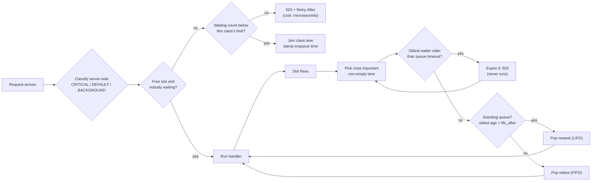

# Load Shedding Under Overload: Prioritized Admission Control (Critical vs Background Traffic), CoDel Queue Timeout, and LIFO vs FIFO Under Saturation

> [!summary] Claim
> Under sustained overload a FIFO queue serves only requests whose clients have already given up, so the server must bound queueing delay (a CoDel-style sojourn timeout), serve the freshest work first (adaptive LIFO), and shed the least important traffic class first; in this note's lab that turns a 17.1% success rate with a 4.7 s p95 into roughly 75% (the capacity ceiling) with an 84 ms p95 and 98% critical success.

Part of [Resilience Rate Limiting and Idempotency](README.md) in [API Engineering](../README.md).

## TL;DR

Mechanism: measure each request's sojourn time at dequeue, shed requests that waited longer than a short timeout once a standing queue exists (CoDel), and when the queue stands serve the newest request instead of the oldest (adaptive LIFO).
Contract rule: a shed request gets a fast, cheap `503 Service Unavailable` with `Retry-After` (RFC 9110 Section 15.6.4, Section 10.2.3), never a slow success that arrives after the client's timeout.
Trap: the mean wait of FIFO and LIFO is identical for a work-conserving server, so averages hide the change; the gain is entirely in which requests finish inside the client deadline, and LIFO's price is a fat p99 tail for the unlucky.
Portability fact: CPython `asyncio.Semaphore` and AnyIO `CapacityLimiter` wake waiters FIFO, and Uvicorn `--limit-concurrency` sheds class-blind with no `Retry-After`, so priority and LIFO must be built in the application or proxy.
When not to use it: do not shed or reorder work that cannot be retried or whose clients wait without a deadline (batch jobs, idempotent-less writes mid-flight); for those, bound concurrency and apply backpressure instead.

## Mental model



A request is classified by the server, not by a client hint, and is admitted directly only if a slot is free and nobody is already waiting, which preserves ordering.
Otherwise it may wait only while the waiting room is below its class's limit, so `BACKGROUND` traffic hits its small limit and is rejected long before `CRITICAL` traffic hits its large one.
Every time a slot frees, the scheduler looks at the most important lane, expires waiters from the old end whose sojourn exceeds the timeout (they get `503` without ever touching the handler), and then serves FIFO while the queue is short or LIFO once the oldest waiter proves a standing queue exists.
The arrows that matter are the two cheap exits: admission rejection and dequeue-time expiry both cost almost nothing, which is what keeps goodput flat when offered load keeps rising.

## How it works

### Why overload collapses a FIFO server: goodput, not throughput

Amazon's Builders' Library defines goodput as "the subset of the throughput that is handled without errors and with low enough latency" for the client to use it (AWS Builders' Library, Yanacek, "Using load shedding to avoid overload", 2019).
Past the saturation knee the queue grows at `arrival_rate - service_rate`, and with Little's law (see [[Adaptive-Concurrency-Limits-Littles-Law-Vegas-and-Gradient2]]) the waiting time grows with it.
In a FIFO queue every new arrival waits behind the whole backlog, so once the backlog exceeds `client_timeout x service_rate` every request served is one whose client has already timed out.
The server stays 100% busy and delivers 0% goodput: this is the collapse the Builders' Library describes, where "a latency increase transforms a latency problem into an availability problem", and where median latency equal to the client timeout means roughly half of requests fail.
Worse, the overload outlives its cause: after the spike ends the standing queue still holds seconds of stale work, so requests arriving at 50% load keep timing out until it drains.
The lab measures exactly this: `fifo_unbounded` succeeds for 17.5% of requests that arrive after the spike has ended, at half of capacity.

The Google SRE book makes the same point about queue sizing: "it is usually better to have small queue lengths relative to the thread pool size (e.g., 50% or less)", and its example of a queue ten times the thread count with 100 ms handling time gives "1.1 seconds to handle" a request that arrives at a full queue (Google SRE book, Chapter 22, "Addressing Cascading Failures", Ulrich).
The IETF recommendation for network queues is identical in spirit: "queue limits should not reflect the steady-state queues we want to be maintained in the network; instead, they should reflect the size of bursts" (RFC 7567 Section 2, BCP 197).

### Good queue, bad queue, and why sojourn time is the signal

CoDel's insight is that a queue has a necessary "good" part that absorbs bursts and a counterproductive "bad" part that only adds delay (RFC 8289 Section 1, Section 3).
It distinguishes them by sojourn time, defined as "the time a packet departs the buffer minus the time the packet arrived at the buffer" (RFC 8289 Section 2), and argues: "It is not the queue length that should be controlled but the amount of excess delay packets experience" (RFC 8289 Section 3.1).
For request queues this matters more than for packets: queue length is meaningless when one request costs 1 ms and the next costs 2 s, while sojourn time is measured directly in the unit the client's deadline uses.
A burst produces a queue whose minimum sojourn returns to near zero within an interval; a standing queue keeps the minimum above target for the whole interval.
That is why CoDel tracks the minimum, not the mean or the maximum: "Sojourn times must remain above the TARGET for INTERVAL amount of time in order to enter the drop state" (RFC 8289 Section 4.3).

WeChat's DAGOR reached the same signal independently: it monitors "the average waiting time of requests in the pending queue (or queuing time for short)" rather than response time or CPU, because "the queuing time is only affected by the capability of local processing of a server", whereas response time is "recursive along the service call path" and rises when a downstream is slow (Zhou et al., "Overload Control for Scaling WeChat Microservices", ACM SoCC 2018, Section 4.1).
DAGOR refreshes the signal "every second or every 2000 requests", whichever comes first, and declares overload at an average queuing time of 20 ms against a default service timeout of 500 ms (DAGOR Section 4.1).

### CoDel in packet networks (RFC 8289)

RFC 8289 is an Experimental RFC (January 2018).
`TARGET` is "the maximum acceptable persistent queue delay" and "SHOULD be set to 5 ms for normal Internet traffic" (RFC 8289 Section 4.3); the analysis puts the best value at "5-10% of the RTT, with the low end of 5% preferred" (RFC 8289 Section 4.3), consistent with the "between 5% and 10%" of the connection's RTT derived in Section 3.2.
`INTERVAL` "SHOULD have a value of 100 ms" for the terrestrial Internet and "works well across a range of RTTs from 10 ms to 1 second" (RFC 8289 Section 4.2).
CoDel drops at dequeue, from the head of the queue (RFC 8289 Section 3.3), and the dequeue routine (RFC 8289 Section 5.5) shows the shape: it dequeues, inspects the sojourn of the packet it just took, and drops that packet, which is exactly the shape a request server wants because the decision is made when a worker is free and with the true wait known.
`dodequeue` sets `first_above_time_ = now + INTERVAL` the first time sojourn exceeds `TARGET`, and returns `ok_to_drop` only if sojourn is still above target at that deadline; any sample below target, or a backlog of at most `maxpacket_` bytes (`maxpacket = 512` in the reference constants, RFC 8289 Section 5.3), resets it (RFC 8289 Section 5.6).
Once dropping, the next drop is scheduled by `control_law(t, count)`, which returns `t + INTERVAL / sqrt(count)`; the square root exists "because of the sqrt(p) dependence of TCP throughput on drop probability" (RFC 8289 Section 5.6).
On re-entering the drop state soon after leaving it, the Linux-derived pseudocode resumes the previous drop rate: `delta = count_ - lastcount_`, and if `delta > 1` and `now - drop_next_ < 16*INTERVAL` it sets `count_ = delta` instead of restarting at 1 (RFC 8289 Section 5.5).
When less than an MTU of bytes is queued, "the packet SHOULD NOT be dropped" and CoDel exits the drop state (RFC 8289 Section 4.1), so a drop does not idle the link.

### CoDel for request queues: folly's slough variant

Meta's folly ships the request-queue adaptation used by its executors and documents why it departs from the RFC (folly v2026.10.26.00 folly/executors/Codel.h, class Codel).
The header comment states the sketch: "if every request has experienced queueing delay greater than the target (5ms) during the past interval (100ms), then we shed load".
It then rejects the `sqrt` control law: "In our experience a different scheme works better for services: when overloaded slough off requests that we dequeue which have exceeded an alternate timeout (2 * target_delay)."
The implementation (folly v2026.10.26.00 folly/executors/Codel.cpp, Codel::overloaded_explicit_now) works in three steps on every dequeued request:
- When `now` passes the interval end, it starts a new interval and sets `overloaded_` to whether the minimum delay of the interval that just ended exceeded `targetDelay`.
- The first sample of each interval only resets `codelMinDelayNs_` and returns `false`; the source says "More than one request must come in during an interval before codel starts dropping requests".
- Otherwise it updates the minimum and returns `overloaded_ && delay > sloughTimeout`, where `getSloughTimeout` returns `delay * 2`.
Defaults come from gflags `codel_interval` (100 ms) and `codel_target_delay` (5 ms), `setOptions` throws `std::invalid_argument` unless `interval > targetDelay > 0`, and `getLoad` reports `min(100, 100 * minDelay / sloughTimeout)` as a load percentage (folly v2026.10.26.00 folly/executors/Codel.cpp).
The design trade-off is explicit: the RFC's gradually accelerating drops suit TCP, whose senders react to each drop by shrinking a window, while request clients do not react to a single shed request, so folly switches to a hard sojourn cap the moment a standing queue is proven.
The lab's `CoDelTimeout` is a line-by-line Python port of `overloaded_explicit_now`, including the first-sample quirk.

### Queue timeout versus client timeout

A static queue timeout equal to the client timeout fixes recovery but not latency: requests are served at the very edge of the deadline, so p50 sits near the timeout and service time pushes many over it.
In the lab, `fifo_queue_timeout` (FIFO, drop at dequeue when sojourn exceeds 1.0 s) recovers 99.7% success after the spike but has a 0.994 s median, a 1.042 s p95, and 2723 responses completed after the 1 s client deadline.
The useful queue timeout is therefore much shorter than the client timeout: folly uses 10 ms once overloaded, and Uber's Cinnamon reports that "The queue timeout is typically 33% of the normal request timeout" (Uber Engineering, "Cinnamon: Using Century Old Tech to Build a Mean Load Shedder", 2023).
The Builders' Library adds that the server should "place an upper bound on the amount of time that an incoming request sits on a queue" and "throw it out if it's too old", recording the queue time as a metric.
If clients propagate deadlines, drop at dequeue any request whose remaining budget is below the expected service time; the SRE book's rule is to check "the deadline left at each stage before attempting to perform any more work" (Google SRE book, Chapter 22), and deadline propagation itself is covered in [[Timeout-Taxonomy-Connect-Read-Write-Pool-and-Deadline-Propagation]].

### LIFO versus FIFO under saturation

For a single work-conserving, non-preemptive server whose choice of next job does not depend on job size, the order of service does not change the mean wait.
The argument is a sample-path one: the server's busy and idle periods depend only on arrival times and the sequence of service durations, so the multiset of start times is the same under FIFO and LIFO, and the sum of waits is `sum(start times) - sum(arrival times)` in both cases.
The lab proves it exactly by drawing service times in start order: at 90% load the FIFO and LIFO mean latencies agree to a relative tolerance of `1e-9`, while LIFO's p50 is lower and its p99 is more than 1.5 times FIFO's.
So LIFO does not create capacity; it redistributes delay, giving most requests almost none and a few very much.
Under overload with client timeouts that redistribution is exactly what you want, because a request that waits 50 ms or 5 s is equally useless if the deadline is 1 s, and LIFO makes the fresh majority succeed while the stale minority, already lost, absorbs all the delay.
Netflix's limiter says this in its Javadoc: "To help keep success latencies low and minimize timeouts any blocked requests are processed in last in/first out order" (Netflix concurrency-limits v0.5.4 LifoBlockingLimiter.java, class LifoBlockingLimiter); it pushes waiters with `backlog.addFirst(event)`, grants with `backlog.peekFirst()`, and defaults to a backlog of 100 waiters and a 1000 ms backlog timeout.
The Google SRE book lists the same two levers together: "Changing the queuing method from the standard first-in, first-out (FIFO) to last-in, first-out (LIFO) or using the controlled delay (CoDel) algorithm" (Google SRE book, Chapter 22).

Pure LIFO is wrong when there is no overload: it gives a fat tail for no benefit and can starve an old request indefinitely.
Adaptive LIFO serves FIFO while the queue is short and switches to LIFO only when a standing queue exists.
The switching signal must not be polluted by the switch itself: under LIFO the served requests have tiny sojourn times, so a CoDel minimum computed over served requests drops below target and would flip the queue straight back to FIFO, which then serves the stalest request in the queue.
The lab therefore switches on the age of the oldest waiter (`now - lane[0].arrival > lifo_after`), which LIFO does not lower, and separately expires waiters from the old end once they exceed the queue timeout so the LIFO queue cannot fill with dead entries.
Meta's "Fail at Scale" (Maurer, ACM Queue, October 2015) describes the production combination.
Its CoDel variant limits queue time to `M` ms when "the queue has not been empty for the last N milliseconds" and to `N` otherwise, and reports that "a value of 5 milliseconds for M and 100 ms for N tends to work well across a wide set of use cases".
Its adaptive LIFO is stated only qualitatively: "During normal operating conditions, requests are processed in FIFO order, but when a queue is starting to form, the server switches to LIFO mode", so the lab's `lifo_after` threshold is this note's choice, not Facebook's.
Its standing-queue signal, the last time the queue was empty, is one that LIFO cannot lower either, so it avoids the feedback loop described above.

### Protocol constraint on LIFO

HTTP/1.1 pipelining forbids reordering responses on one connection: a server "MUST send the corresponding responses in the same order that the requests were received" (RFC 9112 Section 9.3.2).
The Builders' Library makes the same observation: "HTTP/1.1 pipelining of requests on a given TCP connection doesn't support LIFO queues, but HTTP/2 generally does."
In practice ASGI servers process one HTTP/1.1 request per connection at a time, so LIFO across connections is unaffected; within one HTTP/2 or HTTP/3 connection, streams are independent and can complete in any order.
See [[HTTP-2-Binary-Framing-and-Stream-State-Machine]] for stream independence.

### Prioritized admission: who gets shed first

Class-blind shedding at 1.5x overload drops about one third of every class, including the login, checkout, and health-check requests that matter most.
Priority admission makes the shed order explicit, and every production system documented here uses a small ordered set of classes assigned near the edge and propagated with the request:
- Google uses four criticality values: `CRITICAL_PLUS` ("Reserved for the most critical requests"), `CRITICAL` ("The default value for requests sent from production jobs"), `SHEDDABLE_PLUS` (partial unavailability expected, "the default for batch jobs"), and `SHEDDABLE` ("frequent partial unavailability and occasional full unavailability is expected"); downstream RPCs "will use the same criticality as request A by default" (Google SRE book, Chapter 21, "Handling Overload", Forero Cuervo).
- Uber's Cinnamon uses "6 tiers, from 0 to 5, where tier 0 is the highest priority", each split into 128 user cohorts, for 768 priorities tagged at the edge and propagated down the call chain via Jaeger (Uber Engineering, 2023).
- WeChat's DAGOR assigns a business priority from an "action-priority hash table" of only "a few tens of entries", where unlisted actions get the lowest priority, plus a user priority from a hash of the user ID that rotates every hour, with 128 user-priority levels per business priority (DAGOR Section 4.2.1, Section 4.2.2, Section 4.2.3).
- Netflix's partitioned limiter sizes each partition at `max(1, ceil(totalLimit * percent))` slots and treats that size as "only a limit that it is applied if the global limit is exceeded", so a class may burst into idle capacity but, once the global limit is reached, cannot acquire beyond its own share; because sizes round up, the partition limits can sum to more than the global limit, so the share is a soft reservation, not a hard guarantee (Netflix concurrency-limits v0.5.4 AbstractPartitionedLimiter.java, AbstractPartitionedLimiter.acquire).

There are two enforcement points, and a robust design uses both:
- Admission thresholds: each class may join the queue only while total waiting is below its own limit, so `BACKGROUND` is rejected at a shallow depth while `CRITICAL` still queues; this is cheap and happens before any body is read.
- Strict-priority dequeue: when a slot frees, the most important non-empty lane is served first, so a critical request never waits behind background work already queued.
Strict priority starves lower classes by design, which is acceptable only because they are also bounded and rejected quickly; a weighted scheme is the alternative when background traffic must make guaranteed progress.

### User cohorts: shed the same users consistently

Random shedding across a call graph multiplies failures.
DAGOR's example: if service A calls an overloaded service M twice and M rejects at random half its requests, A's success rate is "50% x 50% = 25%" (DAGOR Section 3.1).
Shedding by a stable per-user cohort makes the same users fail at every hop, so the users who are admitted succeed end to end.
DAGOR rotates the user hash hourly for fairness and rejected session-based cohorts because users learned to log out and back in to get a new priority, which added load (DAGOR Section 4.2.2).
DAGOR also piggybacks the downstream's current admission level `(B, U)` on every response so the upstream can drop doomed requests before sending them (DAGOR Section 4.2.4).

### Signals that decide when to shed

- Queueing delay (CoDel, DAGOR): direct, unit-compatible with deadlines, and insensitive to slow downstreams.
- In-flight concurrency against an adaptive limit: see [[Adaptive-Concurrency-Limits-Littles-Law-Vegas-and-Gradient2]]; Cinnamon pairs a PID controller on queue inflow and outflow, which sets the fraction to reject, with an auto-tuner derived from TCP Vegas that sets the inflight limit (Uber Engineering, 2023).
- Executor load: Google smooths "executor load average" with exponential decay and rejects "as the number of active threads grows beyond the number of processors" (Google SRE book, Chapter 21).
- Client-side throttling: each client tracks `requests` and `accepts` over two minutes and rejects locally with probability `max(0, (requests - K * accepts) / (requests + 1))`, a transcription of a formula the online book renders as an image; "We generally prefer the 2x multiplier", so `K = 2` (Google SRE book, Chapter 21).
  Envoy implements the same idea as its admission control filter, with rejection probability `max(0, (rq_count - rq_success_count / sr_threshold) / (rq_count + 1)) ^ (1 / aggression)`, `sr_threshold` defaulting to 95%, `max_rejection_probability` to 80%, and a 30 s `sampling_window`; success rates are computed per worker thread, and health-check traffic is not counted (Envoy v1.40.2 api/envoy/extensions/filters/http/admission_control/v3/admission_control.proto, AdmissionControl; admission_control_filter.rst).

### The wire contract for a shed request

`503 Service Unavailable` "indicates that the server is currently unable to handle the request due to a temporary overload", and the server "MAY send a Retry-After header field" (RFC 9110 Section 15.6.4).
`Retry-After` is `HTTP-date / delay-seconds` with `delay-seconds  = 1*DIGIT` (RFC 9110 Section 10.2.3).
`429 Too Many Requests` means "the user has sent too many requests in a given amount of time", and "Responses with the 429 status code MUST NOT be stored by a cache" (RFC 6585 Section 4).
Use `503` for server overload, where the fault is capacity, and `429` for a client exceeding its quota (see [[Standard-RateLimit-Headers-IETF-Draft-and-429-Retry-After-Semantics]]); mixing them makes clients blame themselves for your outage or retry against their own exhausted quota.
A note in RFC 9110 Section 15.6.4 adds that "Some servers might simply refuse the connection" instead; a refused connection is cheaper but tells the client nothing, and clients typically treat it as a network failure and retry immediately.

### What the Python stack gives you (and does not)

Uvicorn 0.54.0 sheds by count only: when `len(self.connections) >= self.limit_concurrency or len(self.tasks) >= self.limit_concurrency` it swaps the app for `service_unavailable` (uvicorn 0.54.0 uvicorn/protocols/http/h11_impl.py, H11Protocol.handle_events), which sends `503` with `content-type`, `content-length: 19`, and `connection: close`, a body of `Service Unavailable`, and no `Retry-After` (uvicorn 0.54.0 uvicorn/protocols/http/flow_control.py, service_unavailable).
It is class-blind and has no queue at all; its socket backlog defaults to 2048 (uvicorn 0.54.0 uvicorn/config.py, Config.__init__), and Hypercorn 0.18.0 defaults to `backlog = 100` (hypercorn 0.18.0 hypercorn/config.py, Config).
The kernel accept queue in front of both is a FIFO the application cannot reorder; Linux caps it with `somaxconn`, which "Defaults to 4096. (Was 128 before linux-5.4)" (Linux v6.12 Documentation/networking/ip-sysctl.rst).
CPython 3.14.6 `asyncio.Semaphore.acquire` is explicitly FIFO ("Maintain FIFO, wait for others to start even if _value > 0.", asyncio/locks.py, Semaphore.acquire), and AnyIO 4.16.0 grants `CapacityLimiter` tokens with `self._wait_queue.popitem(last=False)`, also FIFO (anyio 4.16.0 anyio/_backends/_asyncio.py, CapacityLimiter._notify_next_waiter); see [[Async-Def-vs-Def-Endpoints-and-AnyIO-Threadpool-Limiter-Semantics]].
`asyncio.LifoQueue` (`_get` is `self._queue.pop()`) and `asyncio.PriorityQueue` (`heapq.heappush` and `heappop`) exist in CPython 3.14.6 asyncio/queues.py, but neither has a sojourn timeout or a class limit, so the lab builds its own waiting room on `collections.deque`.

## Numbers and limits

| Quantity | Value | Source |
| --- | --- | --- |
| CoDel `TARGET` | 5 ms, best at 5-10% of RTT | RFC 8289 Section 4.3, Section 3.2 |
| CoDel `INTERVAL` | 100 ms, works for 10 ms to 1 s RTTs | RFC 8289 Section 4.2 |
| CoDel drop spacing | `INTERVAL / sqrt(count)` | RFC 8289 Section 5.6 |
| CoDel rate resume window | `now - drop_next_ < 16*INTERVAL` | RFC 8289 Section 5.5 |
| folly CoDel defaults | interval 100 ms, target 5 ms, slough 2 x target = 10 ms | folly v2026.10.26.00 folly/executors/Codel.cpp |
| DAGOR overload threshold | 20 ms average queuing time vs 500 ms task timeout, refreshed every 1 s or 2000 requests | DAGOR Section 4.1 (2018) |
| DAGOR admission step | admit 5% less (`alpha`) when overloaded, 1% more (`beta`) when not | DAGOR Section 4.2.3 (2018) |
| Cinnamon queue timeout | about 33% of the request timeout | Uber Engineering (2023-11) |
| Cinnamon overhead | about 1 microsecond per request | Uber Engineering (2023-11) |
| Cinnamon priorities | 6 tiers x 128 cohorts = 768 | Uber Engineering (2023-11) |
| Netflix `LifoBlockingLimiter` defaults | backlog 100, backlog timeout 1000 ms | concurrency-limits v0.5.4 |
| Google client throttling `K` | 2 preferred; at `K = 1.1`, one backend rejection for every 10 accepted requests | Google SRE book Chapter 21 |
| Envoy admission control defaults | `sr_threshold` 95%, `max_rejection_probability` 80%, window 30 s, aggression 1.0 | Envoy v1.40.2 admission_control.proto |
| Uvicorn defaults | `limit_concurrency` none, backlog 2048 | uvicorn 0.54.0 uvicorn/config.py (as of 2026-11) |
| Linux `somaxconn` | 4096 since 5.4 (128 before) | Linux v6.12 ip-sysctl.rst |
| Lab: FIFO unbounded | 17.1% success, p95 4.715 s, 132.7 server-seconds wasted on late responses | measured, see Worked example |
| Lab: FIFO + 1 s queue timeout | 46.6% success, p95 1.042 s, 2723 late | measured |
| Lab: FIFO + CoDel | 74.5% success, p95 0.090 s, 0 late | measured |
| Lab: adaptive LIFO + CoDel | 76.3% success, p95 0.078 s, p99 0.539 s | measured |
| Lab: priority + adaptive LIFO + CoDel | critical 98.0%, background 51.8%, p95 0.084 s | measured |

The lab numbers come from one run of `report()` on CPython 3.14.6, macOS 27.3 arm64, with 8 servers, 20 ms mean exponential service (400 requests per second capacity), Poisson arrivals at 600 per second for 10 s then 200 per second for 10 s, a 50/50 critical and background mix, and a 1 s client timeout.
The success ceiling for that workload is about 75%, because capacity times duration (`10 x 400 + 10 x 200`) is three quarters of nominal offered load (`10 x 600 + 10 x 200`); adaptive LIFO's 76.3% exceeds it slightly because realized Poisson arrivals differ from the nominal rate and spike work spills into the idle recovery phase.

## Portability

| Leg | Result | Evidence |
| --- | --- | --- |
| CPython 3.12.13 | 19 passed | `uv run --frozen --python 3.12 --isolated pytest ...`, run by the drafter and not re-run in verification |
| CPython 3.13.18 | 19 passed | `uv run --frozen --python 3.13 --isolated pytest ...`, run by the drafter and not re-run in verification |
| CPython 3.14.6 (workspace) | 19 passed | `uv run --frozen pytest ...` run here |
| CPython 3.15.0b3 | not run: pytest startup fails in the pinned `hypothesis` (`ModuleNotFoundError: No module named 'hypothesis._native'`), before any test of this lab is collected | run here; the pinned matrix asks for 3.15.2, which `uv` did not provide |
| CPython 3.15t free-threaded | not run: `uv` cannot install the lock because `psycopg-binary==3.3.8` has no wheel for that platform | run here |
| Debian Trixie and Alpine musl containers | not run: lab checks paused (2026-11-11) | the code uses only `asyncio`, `collections`, `heapq`, `random`, and pure-Python ASGI, with no platform calls |
| Uvicorn 0.54.0 | class-blind `503` via `limit_concurrency`, no `Retry-After`, no queue | uvicorn/protocols/http/h11_impl.py, flow_control.py |
| Hypercorn 0.18.0 | `backlog = 100` and no request-level shedding: the package has no concurrency-limit setting and never emits `503`; HTTP/2 streams per connection are capped by `h2_max_concurrent_streams = 100` and each request's ASGI receive queue by `max_app_queue_size = 10` | hypercorn 0.18.0 hypercorn/config.py, Config; `grep` of the installed package for `503` |
| Granian 2.8.7 | `--backpressure` (default `backlog // workers`, `--backlog` default 1024, minimum 128) is a per-worker semaphore acquired before `accept()`, so it limits connections, not requests: excess connections wait in the kernel backlog, and the accept path sends no `503` | granian 2.8.7 granian/cli.py and granian/server/common.py, AbstractServer.__init__; Granian v2.8.7 src/workers.rs, acceptor_impl_loop |
| HTTP/1.1 | LIFO across connections only; pipelined responses must keep request order | RFC 9112 Section 9.3.2 |
| HTTP/2 and HTTP/3 | streams complete independently, so per-stream LIFO is allowed; cheap rejection matters because a client can open and reset streams quickly (CVE-2023-44487) | RFC 9218 Section 10, NVD CVE-2023-44487 |
| `asyncio.Semaphore` (CPython 3.14.6) | FIFO wakeup, no priority | CPython 3.14.6 asyncio/locks.py, Semaphore.acquire |
| AnyIO `CapacityLimiter` 4.16.0 | FIFO wakeup, no priority | anyio/_backends/_asyncio.py |

The middleware's correctness relies only on single-threaded event-loop semantics (`in_flight` and the lanes are mutated without locks inside one loop), which also holds on the free-threaded build as long as one shedder instance is not shared across event loops in different threads.

## Worked example

[implementation](../labs/src/api_labs/f16_resilience_rate_limiting_and_idempotency/load_shedding.py) and [test](../labs/tests/f16_resilience_rate_limiting_and_idempotency/test_load_shedding_priority_traffic_classes_and_lifo_queue_management.py).

The module has three parts: `CoDelTimeout` (the folly port), `simulate` (a deterministic discrete-event model of a c-server queue in virtual time), and `PriorityShedder` (the same rules as pure ASGI middleware with an injectable clock).
The simulator draws service durations in start order from a dedicated seeded stream, so every policy performs the same sequence of work and only ordering and shedding differ.

The CoDel controller, simplified excerpt:

```python
class CoDelTimeout:
    def __init__(self, target: float = 0.005, interval: float = 0.100, start: float = 0.0):
        if not 0.0 < target < interval:
            raise ValueError("CoDel needs 0 < target < interval")
        self.target = target
        self.interval = interval
        self.overloaded = False
        self._min_delay = 0.0
        self._interval_end = start
        self._reset_pending = True

    @property
    def slough_timeout(self) -> float:
        return 2.0 * self.target

    def should_drop(self, sojourn: float, now: float) -> bool:
        """Feed one dequeued request's sojourn time; return True to shed it."""
        if now > self._interval_end and not self._reset_pending:
            self._reset_pending = True
            self._interval_end = now + self.interval
            self.overloaded = self._min_delay > self.target
        if self._reset_pending:
            self._reset_pending = False
            self._min_delay = sojourn
            return False
        self._min_delay = min(self._min_delay, sojourn)
        return self.overloaded and sojourn > self.slough_timeout
```

The dequeue rule shared by the simulator, simplified excerpt of `_Backlog.pop`:

```python
def pop(self, now: float, expire: Callable[[Request], None]) -> Request | None:
    while True:
        lane = next((q for q in self.lanes.values() if q), None)  # most important first
        if lane is None:
            return None
        timeout = self._timeout()  # min(queue_timeout, 2 x target if CoDel overloaded)
        while lane and timeout is not None and now - lane[0].arrival > timeout:
            expire(lane.popleft())  # expire from the old end, never run
        if not lane:
            continue
        order = self.policy.order
        lifo = order == "lifo" or (
            order == "adaptive_lifo" and now - lane[0].arrival > self.policy.lifo_after
        )
        req = lane.pop() if lifo else lane.popleft()
        if self.codel is not None and self.codel.should_drop(now - req.arrival, now):
            expire(req)
            continue
        return req
```

The ASGI release path, simplified excerpt of `PriorityShedder._release`:

```python
def _release(self) -> None:
    self.in_flight -= 1
    now = self._clock()
    while self.in_flight < self._max:
        lane = next((q for q in self._lanes.values() if q), None)
        if lane is None:
            return
        while lane and now - lane[0].enqueued_at > self._queue_timeout:
            stale = lane.popleft()
            self.expired += 1
            if not stale.future.done():
                stale.future.set_result(False)  # caller answers 503 + Retry-After
        if not lane:
            continue
        lifo = now - lane[0].enqueued_at > self._lifo_after
        waiter = lane.pop() if lifo else lane.popleft()
        if waiter.future.done():
            continue
        self.in_flight += 1  # the slot is handed over, never released to a race
        waiter.future.set_result(True)
```

The slot is transferred to the chosen waiter by incrementing `in_flight` before waking it, so a newly arriving request cannot steal it, and `_acquire` hands the slot on if its task is cancelled or times out after being granted.
`_acquire` also wraps the wait in `asyncio.timeout(queue_timeout)` as a backstop: dequeue-time expiry only runs when a slot frees, so without the backstop a server whose handlers all hang would park waiters forever.

Policy comparison, captured from one run on CPython 3.14.6, macOS 27.3, arm64:

```text
$ uv run --frozen python -c "from api_labs.f16_resilience_rate_limiting_and_idempotency.load_shedding import report; print(report())"
policy                 ok%  crit%   bg%  p50_s  p95_s  p99_s  late wasted_s recov%
fifo_unbounded        17.1   17.5  16.7  2.658  4.715  5.006  6675    132.7   17.5
fifo_queue_timeout    46.6   46.4  46.8  0.994  1.042  1.074  2723     65.3   99.7
fifo_codel            74.5   74.4  74.6  0.027  0.090  0.123     0      0.0  100.0
adaptive_lifo_codel   76.3   76.1  76.4  0.017  0.078  0.539     0      0.0  100.0
priority_lifo_codel   75.2   98.0  51.8  0.022  0.084  0.254     0      0.0  100.0
```

`ok%` is the share of all offered requests answered within the 1 s client timeout, `late` counts responses completed after the client gave up, `wasted_s` is server time spent on those, and `recov%` is success for requests arriving after the spike, at 50% load.
Reading the rows: unbounded FIFO wastes 132.7 server-seconds on dead responses and stays broken in recovery; the 1 s queue timeout fixes recovery but serves at the deadline; CoDel's 10 ms slough keeps p95 at 90 ms; adaptive LIFO lowers the median further at the cost of a 539 ms p99, which is the LIFO tail; priority admission moves the same total goodput from background to critical (98.0% versus 76.1% class-blind).

Test run, captured on CPython 3.14.6, macOS 27.3, arm64:

```text
$ uv run --frozen pytest tests/f16_resilience_rate_limiting_and_idempotency/test_load_shedding_priority_traffic_classes_and_lifo_queue_management.py -q
...................                                                      [100%]
19 passed in 1.09s
```

What each test pins:
- `test_codel_tolerates_a_burst_that_drains_within_the_interval`: one short-wait sample per interval keeps CoDel out of overload, so 50 ms bursts are never shed.
- `test_codel_sheds_only_requests_older_than_twice_target_once_queue_stands`: a minimum sojourn of 8 ms for over an interval sets `overloaded`, after which 9 ms survives and 11 ms is shed.
- `test_codel_leaves_overload_after_an_interval_whose_minimum_is_below_target` and `test_codel_rejects_target_not_below_interval`.
- `test_unbounded_fifo_collapses_and_stays_collapsed_after_the_spike`, `test_queue_timeout_alone_restores_recovery_but_serves_at_the_deadline`, and `test_short_sojourn_timeout_keeps_p95_far_below_client_timeout` (three policies) pin the table rows.
- `test_priority_admission_protects_critical_and_sheds_background_first`: critical success below 80% class-blind and above 97% with priority, with zero critical admission rejections.
- `test_lifo_and_fifo_have_equal_mean_wait_but_different_tails`: equal means to `rel=1e-9`, lower LIFO p50, and LIFO p99 above 1.5 x FIFO p99.
- ASGI tests: LIFO order `/hold, /c, /b, /a` under a standing queue, FIFO order `/hold, /a, /b, /c` under a short one, a critical waiter served before older and younger background waiters, background rejected with `503` and `retry-after: 1` while critical still queues, a waiter older than the queue timeout expired without reaching the handler, a crashing handler releasing its slot, and a cancelled waiter leaving the queue.

## Pitfalls

> [!warning] Shedding that costs as much as serving
> Trigger: the rejection path parses the body, authenticates against a database, logs at `INFO`, or renders a templated error page.
> Symptom: goodput still collapses under overload because rejected requests consume the CPU the shedder was meant to protect.
> Fix: reject before reading the body, with a static response; the Builders' Library warns "it's easy to miss an accidental log statement or a socket setting" that makes dropping expensive and calls early rejection "the cheapest place to drop excess traffic"; the Google SRE book notes that "it's almost equally expensive to reject a request that requires a simple RAM lookup" as to serve it (Chapter 21).

> [!warning] A surge queue in the load balancer
> Trigger: a proxy or load balancer that queues excess requests instead of failing fast.
> Symptom: the backend's own queue timeout never sees the time spent in the proxy queue, so requests arrive already stale and the brownout persists.
> Fix: the Builders' Library recommends "a spillover configuration, which fast-fails instead of queueing excess requests" and contrasts the Classic Load Balancer surge queue with the Application Load Balancer, which rejects; stamp the arrival time at the outermost hop and propagate it.

> [!warning] Retry amplification of every shed request
> Trigger: clients retry `503` immediately and at every layer.
> Symptom: offered load rises as you shed, the Google SRE book computes traffic growing "to somewhere just below 3X" with three attempts and no budget, while capping each client's retries at "a 10% retry ratio" "reduces the growth to just 1.1x in the general case" (Chapter 21).
> Fix: send `Retry-After`, use a retry budget ([[Retry-Budgets-and-Preventing-Cascading-Retry-Amplification-Storms]]) and jittered backoff ([[Retries-Exponential-Backoff-Full-vs-Decorrelated-Jitter-and-Stamina]]), and mark shed responses so upstream services do not retry them again.

> [!warning] Health checks shed with everything else
> Trigger: liveness or readiness probes share the request queue and class with user traffic.
> Symptom: the load balancer marks the overloaded but working instance unhealthy, moves its load to the remaining instances, and turns overload into a cascading failure.
> Fix: put health checks in the highest class or bypass the shedder; the Builders' Library calls the load balancer ping "The most important request that a server will receive", and Envoy's admission control excludes health-check traffic from its measurements.

> [!warning] Shedding hides the autoscaling signal
> Trigger: shedding and CPU-based autoscaling use similar thresholds.
> Symptom: the shedder holds CPU just under the scale-out target, so capacity never grows while users get `503`.
> Fix: the Builders' Library warns about exactly this interaction, "If misconfigured, load shedding can disable reactive automatic scaling"; scale on offered load or on the shed rate, not on post-shedding utilization.

> [!warning] Dashboards that improve during an outage
> Trigger: latency percentiles computed only over successful responses.
> Symptom: the Builders' Library notes that a service "load shedding 60 percent of its traffic" can show a median latency that "might look pretty amazing".
> Fix: chart offered load, shed rate by class and reason (admission, expiry, CoDel), and client-observed success separately from server latency.

> [!warning] Pure LIFO without a queue timeout
> Trigger: switching to LIFO but never expiring old waiters.
> Symptom: the oldest requests are never served and never answered; their clients hang until their own timeout, and the queue grows to its memory bound.
> Fix: expire from the old end at the queue timeout (the lab's `_Backlog.pop` and `PriorityShedder._release`), and bound the waiting room per class.

> [!warning] Detecting the LIFO switch from served-request delay
> Trigger: using CoDel's minimum sojourn of served requests to decide when to enter and leave LIFO.
> Symptom: LIFO lowers served sojourn, CoDel declares the queue healthy, the queue flips to FIFO, serves the stalest waiter, and oscillates.
> Fix: switch on the age of the oldest waiter, which LIFO does not lower, as the lab does with `lifo_after`.

## Security and robustness

Client-declared priority is attacker-controlled input.
RFC 9218's `Priority` header carries an urgency from 0 to 7 whose default is 3 and whose lowest level 7 "is reserved for background tasks" (RFC 9218 Section 4.1), but "Expressing priority is only a suggestion" (RFC 9218 Section 10), and "Backend servers SHOULD only schedule based on client priority information where that information can be scoped to individual end clients" (RFC 9218 Section 13.2).
If the shedder trusts a header, every abusive client sets the top class; classify from the authenticated principal, the route, and server-side policy instead, and use client hints at most to lower a request's class, never to raise it.
See [[HTTP-2-Prioritization-and-Extensible-Priorities-RFC-9218]] for the header itself.

This maps onto OWASP API Security Top 10 API4:2023 Unrestricted Resource Consumption: a shedder is the last line of resource defense, so it must bound memory (a per-class waiting limit), time (the queue timeout and the event-loop backstop), and rejection cost (a static response).
Keep per-tenant fairness separate from priority: a single noisy tenant inside the `CRITICAL` class can still consume the whole class, which is the job of quotas and concurrency limits per tenant ([[Multi-Tier-Rate-Limiting-Quotas-Concurrency-Limits-and-Cost-Budgets]]) and partitions ([[Bulkhead-Isolation-and-Per-Dependency-Resource-Partitioning]]).
User cohorts must be derived from an identifier the client cannot regenerate cheaply; DAGOR's experience with session-based cohorts, where users re-logged in to escape shedding and added load, is the cautionary case (DAGOR Section 4.2.2).

HTTP/2 Rapid Reset, CVE-2023-44487, shows why cheap admission matters at the stream level: "request cancellation can reset many streams quickly, as exploited in the wild in August through October 2023" (NVD CVE-2023-44487).
A shedder that does work per stream before checking capacity, or that keeps work going after the client resets the stream, gives the attacker a multiplier.
The lab's middleware removes a cancelled waiter from its lane and returns its slot if it was granted, which is the in-process half of this defense; connection-level stream limits belong in the server ([[Uvicorn-Internals-Server-Lifecycle-Protocols-and-Flow-Control]], [[Hypercorn-Internals-HTTP-2-HTTP-3-QUIC-and-AnyIO-Trio-Workers]]).

Robustness edge cases the lab covers or names:
- A crashing handler must release its slot, or capacity leaks one slot per exception until the server sheds everything (`test_crashing_handler_releases_its_slot`).
- A client that disconnects while queued must leave the queue (`test_cancelled_waiter_leaves_the_queue`); for disconnect delivery in ASGI see [[ASGI-HTTP-and-Disconnect-Event-Lifecycle]].
- A waiter granted a slot at the same instant it is cancelled must hand the slot on, handled in `_acquire`'s exception path; see [[Cancellation-Semantics-CancelledError-Swallowing-and-Shielded-Cleanup]].
- Expiry runs only when a slot frees, so the event-loop backstop is required for the hung-server case.
- Shedding non-idempotent writes after they started is unsafe; shed only at admission or before the handler runs, and pair writes with idempotency keys ([[Idempotency-Key-Header-Specification-and-State-Machine-Draft-08]]).

## The principal's view

The architectural decision is where shedding lives and who owns the priority taxonomy, not which queue discipline a library uses.
Own the taxonomy centrally: a small fixed set of classes (Google's four, Uber's six tiers) assigned at the edge from server-side policy and propagated on every hop, because a priority each team invents locally cannot be compared across a call graph, and the DAGOR 25% example shows what random, uncoordinated shedding costs in fan-out paths.
Shed in layers, cheapest first: client-side throttling (Envoy admission control or the SRE formula) stops doomed requests before the network, the edge rejects by class, and each server enforces a sojourn timeout with local information, as the Builders' Library recommends letting the server "take on more than it can work on and drop the excess" with accurate local algorithms.
The organizational trade-off is that priority classes are a product decision dressed as an infrastructure one: someone must decide that a recommendation prefetch is `BACKGROUND` and checkout is `CRITICAL`, and that decision needs an owner, review, and a default for unlisted endpoints (DAGOR defaults unlisted actions to the lowest priority).
Test it the way it fails: the Builders' Library's rule is that a team that has not load tested "far beyond the point where it breaks" should "assume that the service will fail in the least desirable way possible", and the target result is goodput that plateaus and stays flat as offered load rises.
Choose differently when the workload is not request-response with deadlines: for batch and stream processing use backpressure and bounded queues ([[End-to-End-Backpressure-TCP-Windows-ASGI-Send-Await-and-Bounded-Queues]]) because there is no client timeout to beat; for very uneven per-request cost, shed on cost units rather than counts; and when a single Python process cannot hold the line, put admission in a proxy written for it (Envoy) and keep the in-process shedder as defense in depth.

## Interview questions

> [!question] L5: Why does a FIFO request queue produce near-zero goodput under sustained overload even though the server is 100% busy?
>
> > [!success]- Answer
> > The backlog grows at arrival rate minus service rate, so every new request waits behind it.
> > Once the backlog holds more than client timeout times service rate of work, each request reaches a worker after its client has given up.
> > The server keeps doing work, but every response is late, so throughput stays high while goodput falls to zero.
> > The overload also persists after load drops, until the stale backlog drains.
> >
> > Follow-up: How long does a 2000-request backlog take to drain at 400 per second capacity and 200 per second arrivals?

> [!question] L5: What is sojourn time and why do CoDel and DAGOR use it instead of queue length?
>
> > [!success]- Answer
> > Sojourn time is departure time from the queue minus arrival time (RFC 8289 Section 2).
> > Queue length does not map to delay when request costs vary, while sojourn is measured in the same unit as client deadlines.
> > DAGOR prefers queuing time over response time because response time also rises when a downstream is slow, which is not local overload.
> >
> > Follow-up: Why does CoDel track the minimum sojourn over an interval rather than the average?

> [!question] L5: When should an overloaded API return `503` and when `429`, and what header goes with both?
>
> > [!success]- Answer
> > `503 Service Unavailable` signals temporary server overload (RFC 9110 Section 15.6.4).
> > `429 Too Many Requests` signals that this client exceeded its rate (RFC 6585 Section 4), and it must not be cached.
> > Both may carry `Retry-After`, as seconds or an HTTP-date (RFC 9110 Section 10.2.3).
> >
> > Follow-up: What does Uvicorn's `--limit-concurrency` send, and what is missing from it?

> [!question] L6: Predict the output: a single server at 90% load serves the same arrivals and the same sequence of service durations twice, once FIFO and once LIFO, with no shedding; how do the mean latency, the median, and the p99 compare?
>
> > [!success]- Answer
> > The means are equal, because the start times form the same multiset under both orders and total wait is the sum of starts minus the sum of arrivals.
> > LIFO's median is lower, because most requests are served immediately on arrival of a free worker.
> > LIFO's p99 is much higher, because a request pushed down the stack waits until the stack empties.
> > The lab asserts all three: equal means to `rel=1e-9`, lower p50, and p99 above 1.5 times FIFO's.
> >
> > Follow-up: Which assumption breaks the equal-mean result if the scheduler picks the shortest job first?

> [!question] L6: Debug this API: after a traffic spike ends, a FastAPI service run by Uvicorn with `--limit-concurrency 200` behind a proxy keeps timing out for about ten seconds at half its capacity while `503` responses stay rare; what is happening and what do you change?
>
> > [!success]- Answer
> > The limit counts connections and tasks, so up to 200 requests are admitted and then wait FIFO inside the process (the AnyIO threadpool limiter, a database pool), while the rest wait in the socket backlog and the proxy, instead of being shed.
> > The standing queue from the spike holds seconds of stale work, so new arrivals wait behind it and time out, even though load has dropped.
> > Add dequeue-time sojourn expiry with a short timeout, stamp arrival time at the outermost hop so proxy queueing counts, and switch to LIFO while a standing queue exists.
> > Make the proxy fail fast instead of queueing, and add `Retry-After` to shed responses so clients back off.
> >
> > Follow-up: Which metric would have shown the standing queue directly?

> [!question] L6: Why does folly's CoDel drop requests older than `2 x target` once overloaded instead of following the RFC 8289 control law?
>
> > [!success]- Answer
> > The RFC's `INTERVAL / sqrt(count)` spacing exists because TCP throughput depends on the square root of drop probability, and each drop makes a sender shrink its window.
> > Request clients do not slow down when one request is shed, so gradual acceleration just prolongs the bad queue.
> > folly therefore uses CoDel only to detect a standing queue and then sloughs every dequeued request whose delay exceeds 10 ms, which its source says "empirically works better for our services than the codel approach of increasingly often dropping packets" (folly v2026.10.26.00 folly/executors/Codel.cpp, Codel::overloaded_explicit_now).
> >
> > Follow-up: What does the first-sample-of-interval rule in `overloaded_explicit_now` protect against?

> [!question] L6: What goes wrong when adaptive LIFO is switched on and off by CoDel's overloaded flag computed from served requests?
>
> > [!success]- Answer
> > LIFO serves fresh requests, so the minimum sojourn of served requests drops below target.
> > CoDel then reports no overload, the queue returns to FIFO, and the next request served is the stalest one.
> > Delay jumps, CoDel flags overload again, and the system oscillates while serving a mix of fresh and dead requests.
> > Switch on the age of the oldest waiter instead, which LIFO cannot lower, and expire old waiters separately.
> >
> > Follow-up: How would you detect this oscillation in production metrics?

> [!question] L7+: Design the priority model for a company-wide shedding platform across hundreds of services.
>
> > [!success]- Answer
> > Define a small, fixed set of classes centrally, such as Google's four criticalities or Uber's six tiers, with a documented default for unlisted endpoints.
> > Assign class at the edge from server-side policy and propagate it on every hop, so the same request has the same class everywhere.
> > Add a stable user cohort within each class so that shedding hits the same users at every hop, which avoids the multiplicative failure DAGOR describes for fan-out.
> > Expose the admission level to callers, as DAGOR piggybacks it on responses, so upstreams drop doomed calls before sending them.
> > Give product owners review authority over class assignments, and load test past the breaking point to prove goodput stays flat.
> >
> > Follow-up: How do you stop teams from labelling everything critical?

> [!question] L7+: Do you allow a partner to set their own shedding priority with the RFC 9218 `Priority` header?
>
> > [!success]- Answer
> > Not as a way to raise priority, because the header is client-controlled and RFC 9218 Section 10 says expressing priority "is only a suggestion".
> > RFC 9218 Section 13.2 says backends should schedule on client priority only where it can be scoped to individual end clients.
> > Allow it only within that partner's own quota, so their urgent requests compete with their own background work and never with other tenants'.
> >
> > Follow-up: How would you prevent a single tenant in the critical class from starving other critical tenants?

## Related

Prerequisites: [[Adaptive-Concurrency-Limits-Littles-Law-Vegas-and-Gradient2]]

Next: [[Bulkhead-Isolation-and-Per-Dependency-Resource-Partitioning]]

See also: [[Timeout-Taxonomy-Connect-Read-Write-Pool-and-Deadline-Propagation]], [[Retry-Budgets-and-Preventing-Cascading-Retry-Amplification-Storms]], [[Retries-Exponential-Backoff-Full-vs-Decorrelated-Jitter-and-Stamina]], [[Standard-RateLimit-Headers-IETF-Draft-and-429-Retry-After-Semantics]], [[Multi-Tier-Rate-Limiting-Quotas-Concurrency-Limits-and-Cost-Budgets]], [[Circuit-Breakers-State-Machines-Half-Open-Probing-and-When-Not-to-Use-Them]], [[Hedged-Requests-and-Tail-Latency-Taming-at-Scale]], [[HTTP-2-Prioritization-and-Extensible-Priorities-RFC-9218]], [[Uvicorn-Internals-Server-Lifecycle-Protocols-and-Flow-Control]], [[End-to-End-Backpressure-TCP-Windows-ASGI-Send-Await-and-Bounded-Queues]], [[Async-Def-vs-Def-Endpoints-and-AnyIO-Threadpool-Limiter-Semantics]], [[Cancellation-Semantics-CancelledError-Swallowing-and-Shielded-Cleanup]], [[ASGI-HTTP-and-Disconnect-Event-Lifecycle]]

- Lab: `labs/tests/f16_resilience_rate_limiting_and_idempotency/test_load_shedding_priority_traffic_classes_and_lifo_queue_management.py`

## Further reading

- [RFC 8289: Controlled Delay Active Queue Management](https://www.rfc-editor.org/rfc/rfc8289.html) - the CoDel estimator, target, interval, and annotated dequeue pseudocode.
- [RFC 7567: IETF Recommendations Regarding Active Queue Management (BCP 197)](https://www.rfc-editor.org/rfc/rfc7567.html) - why queues should absorb bursts, not hold standing load.
- [folly Codel.h and Codel.cpp at v2026.10.26.00](https://github.com/facebook/folly/blob/v2026.10.26.00/folly/executors/Codel.cpp) - the production request-queue adaptation with its rationale in comments.
- [Netflix concurrency-limits v0.5.4 LifoBlockingLimiter](https://github.com/Netflix/concurrency-limits/blob/v0.5.4/concurrency-limits-core/src/main/java/com/netflix/concurrency/limits/limiter/LifoBlockingLimiter.java) - a bounded LIFO backlog with a timeout, small enough to read in one sitting.
- [Google SRE book, Chapter 21: Handling Overload](https://sre.google/sre-book/handling-overload/) - criticality classes, client-side throttling, and per-customer limits.
- [Google SRE book, Chapter 22: Addressing Cascading Failures](https://sre.google/sre-book/addressing-cascading-failures/) - queue sizing, LIFO and CoDel, deadlines, and graceful degradation.
- [Amazon Builders' Library: Using load shedding to avoid overload](https://builder.aws.com/content/3Eun1EEyX6p2e3VYNyRLSJzLuMV/using-load-shedding-to-avoid-overload) - goodput, cheap rejection, queue time bounds, and testing past the break point.
- [Zhou et al., Overload Control for Scaling WeChat Microservices (SoCC 2018)](https://arxiv.org/abs/1806.04075) - DAGOR's queuing-time signal, business and user priorities, and collaborative admission.
- [Uber Engineering: Cinnamon load shedder (2023)](https://www.uber.com/blog/cinnamon-using-century-old-tech-to-build-a-mean-load-shedder/) - tiers, cohorts, PID-controlled rejection, and measured overhead.
- [Envoy admission control filter at v1.40.2](https://github.com/envoyproxy/envoy/blob/v1.40.2/api/envoy/extensions/filters/http/admission_control/v3/admission_control.proto) - the SRE client-throttling formula as a proxy filter.
- [RFC 9218: Extensible Prioritization Scheme for HTTP](https://www.rfc-editor.org/rfc/rfc9218.html) - the `Priority` header and why client priority is only a hint.
- [RFC 9110 Sections 15.6.4 and 10.2.3](https://www.rfc-editor.org/rfc/rfc9110.html) - `503` and `Retry-After` semantics.
