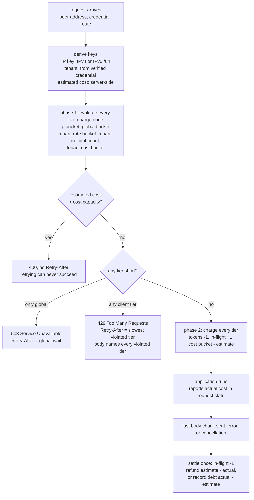

# Layered Rate Limiters in Production: Per-IP, Per-Tenant, Concurrent In-Flight Request Limiters, and Query-Cost / Compute-Unit Quotas

> [!summary] Claim
> A production API needs several limiters at once, each keyed and measured differently (per-IP request rate before authentication, a global capacity guard, per-tenant request rate, per-tenant requests in flight, and a per-tenant budget in cost units), and they only compose correctly when every tier is evaluated before any tier is charged, the in-flight permit is held until the last body byte is sent, the cost reservation is trued up against the actual cost, and the response tells the client which tier refused it, whether retrying can ever help, and how long the slowest tier needs.

Part of [Resilience Rate Limiting and Idempotency](README.md) in [API Engineering](../README.md).

## TL;DR

Mechanism: one admission critical section evaluates five tiers (IP, global, tenant rate, tenant concurrency, tenant cost) without mutating any of them, rejects if any tier is short, and only then charges all of them; an admitted request gets a lease that frees its concurrency slot and refunds or debits the difference between estimated and actual cost when its response finishes.
Contract rule: client-attributable limits answer `429 Too Many Requests` (`(RFC 6585 Section 4)`), a server-wide capacity guard answers `503 Service Unavailable` (`(RFC 9110 Section 15.6.4)`), `Retry-After` is an integer `delay-seconds` (`(RFC 9110 Section 10.2.3)`) computed from the slowest violated tier, and a request whose cost exceeds the bucket capacity gets a non-retryable `4xx` with no `Retry-After`.
Trap: charging tiers one after another leaks budget from tiers that admitted a request a later tier rejected (documented for Envoy's local rate limit descriptors and visible in slowapi 0.1.10's `Limiter.__evaluate_limits`), and releasing a concurrency permit when `call_next` returns in Starlette's `BaseHTTPMiddleware` frees it before a streaming body is sent.
Portability: the admission logic is pure Python under one `threading.Lock`, and the lab passes unchanged on CPython 3.12.13, 3.13.18, 3.14.6, 3.14.10, and 3.15.2 on macOS 27.3 arm64; the free-threaded leg could not be installed here, and HTTP version only matters for what "concurrent" means at the transport (HTTP/2 streams per connection, `(RFC 9113 Section 5.1.2)`).
When not to use it: in-process tiers are per worker process, so a fleet of N workers admits N times the configured rate unless the counters live in a shared store; for work that is inherently large (bulk exports, batch inference) move clients to an asynchronous job API with its own quota instead of tuning a request limiter (Shopify's bulk operations "don't have the max cost limits or rate limits that single queries have").

## Mental model



Keys are derived first so that the same subscriber spends one budget however it spells its address, and so that the tenant comes from a verified credential rather than a header the client controls.
Phase 1 asks every tier the same question (how long until you could admit this request) without changing any balance, which is what makes the decision atomic across tiers.
A cost estimate larger than the bucket's capacity is answered before anything else, because no amount of waiting refills a bucket past its capacity, so the right answer is a permanent client error, not a `429` the client will retry forever.
If any tier is short, the response status depends on who is at fault (only the global tier means the server is out of capacity, so `503`; any tenant or IP tier means this client is over its share, so `429`), and `Retry-After` is the maximum wait over every violated tier, not the wait of the first tier that said no.
Only when every tier admits does phase 2 charge all of them, and the lease that phase 2 returns is settled exactly once when the response has been fully sent, whether the handler succeeded, raised, or was cancelled.

## How it works

### Why one limiter is never enough

A limiter answers one question for one key in one unit, and a production API has to answer several different questions at the same time.
Stripe's 2017 post describes four limiters run in concert: a request rate limiter ("restricts each user to N requests per second"), a concurrent requests limiter ("You can only have 20 API requests in progress at the same time"), a fleet usage load shedder that reserves a fraction of capacity for critical methods, and a worker utilization load shedder that is "the final line of defense" (Stripe, Scaling your API with rate limiters, 2017-03-30).
The first two are per-user limits that protect the platform from one customer; the last two are global and protect the business from the platform's own overload.
This note covers the per-key tiers and the global capacity guard as one admission pipeline; priority-based shedding under overload is the subject of [[Load-Shedding-Priority-Traffic-Classes-and-LIFO-Queue-Management]], and the algorithms inside each bucket are in [[Rate-Limiting-Algorithms-Token-Bucket-Leaky-Bucket-and-Sliding-Window]] and [[GCRA-Generic-Cell-Rate-Algorithm-and-Atomic-Redis-Valkey-Lua-Limiters]].

The tiers differ along three axes, and confusing the axes is the root of most limiter bugs.

| Tier | Key | Unit | Protects against | Status when exceeded |
|---|---|---|---|---|
| Per-IP | peer address, IPv6 aggregated to a prefix | requests per second | unauthenticated floods, credential guessing, abuse before identity is known | `429` |
| Global | the whole service (per process or per fleet) | requests per second, or in-flight requests | total overload regardless of who causes it | `503` |
| Per-tenant rate | account or organization, never the individual key | requests per second with a burst | one customer's runaway script | `429` |
| Per-tenant concurrency | account or organization | requests in flight | slow, expensive requests piling up even at a legal rate | `429` |
| Per-tenant cost budget | account or organization | cost units (query points, seats, tokens, CPU-seconds) | cheap-looking requests that do expensive work | `429`, or a permanent `4xx` when one request exceeds capacity |
| Long-window quota | account, billing entity | requests, tokens, or money per day or month | contractual and financial overrun | contract-specific (see below) |

### Rate and concurrency are different limits, and Little's Law says why

Little's Law relates the average number of requests in the system `L`, the arrival rate `lambda`, and the average time in the system `W` as `L = lambda * W` (see [[Capacity-Planning-with-Littles-Law-and-the-Universal-Scalability-Law]]).
A tenant limited to 100 requests per second whose requests take 50 ms occupies 5 workers on average.
If a database index disappears and the same requests take 10 s, the same 100 requests per second now occupy 1,000 workers, and the rate limiter has not rejected a single one, because the rate never changed.
The concurrency tier is the limit that notices, because it counts requests whose work has started and not finished; Stripe reports that before they added it they "regularly dealt with resource contention on our most expensive endpoints caused by users making too many requests at one time" and that it is triggered "much less often (12,000 requests this month)" than the rate limiter, which "has rejected millions of requests this month alone" (Stripe, 2017).
GitHub enforces the same idea as a secondary limit: "No more than 100 concurrent requests are allowed," shared across REST and GraphQL (GitHub Docs, GraphQL rate limits, as of 2026-11).
A static per-tenant concurrency cap is a fairness tool; adjusting the global cap from measured latency is the job of [[Adaptive-Concurrency-Limits-Littles-Law-Vegas-and-Gradient2]], and isolating pools per dependency is [[Bulkhead-Isolation-and-Per-Dependency-Resource-Partitioning]].

### Per-IP tier: the only key available before authentication

Before the credential is verified the server knows only the transport peer, so the per-IP tier is the first tier that can run and the one that protects the authentication path itself (see [[Credential-Stuffing-Brute-Force-Defense-and-Account-Lockout-Traps]]).
The key has to be normalized: an IPv4-mapped IPv6 address such as `::ffff:198.51.100.7` is the same client as `198.51.100.7`, and an IPv6 subscriber is routinely delegated an entire `/64` (or more) to rotate through, so the lab's `client_key` collapses IPv6 to its `/64` network.
The key also has to be the right address: behind a proxy the peer is the proxy, and a limiter that reads `X-Forwarded-For` unconditionally hands the attacker the key; CVE-2025-59152 records exactly this for Litestar 2.17.0, whose `RateLimitMiddleware` "trusts it unconditionally and uses its value as part of the client identifier," so "each different spoofed IP creates a separate rate limit bucket" (NVD, CVE-2025-59152, fixed in 2.18.0).
Resolving the real client address from trusted hops is covered in [[Forwarded-Header-RFC-7239-and-X-Forwarded-For-Spoofing]].
Because carrier-grade NAT, corporate egress, and mobile networks put thousands of real users behind one address, the per-IP tier must be loose (an abuse ceiling, not a fairness mechanism); fairness belongs to the per-tenant tiers, which are keyed on a verified identity.

### Global tier: protecting capacity, not policing clients

The global tier has no client key; it bounds what the service as a whole accepts.
AWS API Gateway documents the layering explicitly: it "applies your throttling-related settings in the following order:" per-client or per-method throttling limits set for an API stage in a usage plan, per-method throttling limits set for an API stage, account-level throttling per Region, and AWS Regional throttling (AWS API Gateway, Throttle requests to your REST APIs), and the account-level default is "10,000 requests per second (RPS) with an additional burst capacity provided by the token bucket algorithm, using a maximum bucket capacity of 5,000 requests" (AWS API Gateway, Amazon API Gateway quotas, as of 2026-11).
Kubernetes' API server is a concurrency-based global tier: with API Priority and Fairness enabled, "the concurrency limits defined by these flags are summed and then the sum is divided up among a configurable set of priority levels," where the flags are `--max-requests-inflight` (default `400`) and `--max-mutating-requests-inflight` (default `200`) (Kubernetes docs, Flow control; kube-apiserver reference).
Stripe's fleet usage load shedder is the same shape with a priority twist: "If our reservation number is 20%, then any non-critical request over their 80% allocation would be rejected with status code 503," and the gist notes its implementation "is identical to the Concurrent Requests Limiter, except you don't use a user-specific key, you just use a global key" (Stripe gist `0-rate-limiters.md`).
Per-tenant limits are deliberately overcommitted against the global tier; Google's SRE book gives the example of a backend with 10,000 CPUs whose per-customer limits (Gmail 4,000, Calendar 4,000, Android 3,000, Google+ 2,000, everyone else 500 CPU-seconds per second) "may add up to more than the 10,000 CPUs allocated to the backend service," relying on the fact that "it's unlikely for all of their customers to hit their resource limits simultaneously" (Google SRE book, Handling Overload).
Overcommit is what makes the global tier necessary: per-tenant limits alone cannot stop the day when several tenants peak together.

### Per-tenant tiers and hierarchical keys

The tenant key must be the billing or isolation unit (organization, account, project), never the individual credential, because a tenant that can mint API keys can otherwise multiply its limit by the number of keys it creates.
Real platforms nest limits: Anthropic's API sets limits "at the organization level," lets an organization set lower limits per workspace, and states that "Organization-wide limits always apply, even if workspace limits add up to more" (Claude API docs, Rate limits, as of 2026-11).
A request therefore has to pass every level of its hierarchy (key, workspace, organization, global), and the check-all-then-commit rule below applies to the hierarchy for the same reason it applies to tiers.
Shopify keys its GraphQL Admin limit on the pair: limits "are based on the combination of the app and store," so "Calls from one app don't affect the rate limits of another app, even on the same store" (Shopify, GraphQL Admin API rate limits, as of 2026-11).
Kubernetes generalizes the tenant key into a flow: "Each request is assigned to a flow, identified by the name of the matching FlowSchema plus a flow distinguisher - which is either the requesting user, the target resource's namespace, or nothing," and uses shuffle sharding to keep "a single buggy client flooding the kube-apiserver" from starving others (Kubernetes docs, Flow control).

### Per-tenant concurrency tier: a lease, not a counter

A concurrency limit is a semaphore per key: acquire on admission, release when the work is done.
The hard part is "done," and the hard failure is a permit that is never released, because a leaked permit is invisible until the tenant has leaked all of them and every subsequent request is rejected.
Stripe's reference implementation stores one sorted-set member per in-flight request scored by its start time, admits atomically in Lua (`zcard` then `zadd` only if `count < capacity`), removes the member in `post_request_bookkeeping`, and before every check runs `zremrangebyscore(key, '-inf', @timestamp - TTL)` with `TTL = 60` to "Clear out old requests that probably got lost" (Stripe gist `2-check_concurrent_requests_limiter.rb` and `concurrent_requests_limiter.lua`).
The TTL is the crash-safety mechanism: a worker that dies holding permits leaks them for at most 60 s, and the price is that any request legitimately running longer than the TTL is silently forgotten and the tenant can exceed its cap.
In an ASGI server "done" means the last body chunk has been sent, not that the handler returned: a `StreamingResponse` produces its body after the endpoint function returns, and a pure ASGI middleware's `await self.app(scope, receive, send)` returns only after the final `http.response.body` with `more_body` false (`(starlette 1.10.0 starlette/responses.py, StreamingResponse.stream_response)`).
Starlette's `BaseHTTPMiddleware` breaks this: its `call_next` returns a `_StreamingResponse` as soon as it has received `http.response.start` (`(starlette 1.10.0 starlette/middleware/base.py, BaseHTTPMiddleware.__call__)`), so a limiter that releases after `call_next` releases while the body is still streaming; the lab proves both behaviors (see [[Why-BaseHTTPMiddleware-Hurts-Performance-Streaming-and-ContextVars]] and [[Pure-ASGI-Middleware-Onion-Architecture-and-Send-Receive-Wrapping]]).
Uvicorn has a process-wide concurrency guard of its own, `--limit-concurrency` ("Maximum number of concurrent connections or tasks to allow, before issuing HTTP 503 responses"), and its check is `len(self.connections) >= self.limit_concurrency or len(self.tasks) >= self.limit_concurrency`, after which it routes the request to `service_unavailable`, which sends `503` with `connection: close` (`(uvicorn 0.54.0 uvicorn/protocols/http/h11_impl.py, H11Protocol.handle_events)`, `(uvicorn 0.54.0 uvicorn/protocols/http/flow_control.py, service_unavailable)`).
Because `self.connections` holds every open connection, idle keep-alive connections count against that limit too, so it is a global per-process connection-and-task guard, not a per-tenant in-flight limit.

### What "concurrent" means at the transport

HTTP/2 has its own concurrency limit per connection: "A peer can limit the number of concurrently active streams using the SETTINGS_MAX_CONCURRENT_STREAMS parameter," and "Streams that are in the "open" state or in either of the "half-closed" states count toward the maximum" (`(RFC 9113 Section 5.1.2)`); the RFC recommends that the value "be no smaller than 100" (`(RFC 9113 Section 6.5.2)`).
That limit counts open streams, not server work, and CVE-2023-44487 (HTTP/2 Rapid Reset) is what happens when the two diverge: "request cancellation can reset many streams quickly," so a client keeps the stream count under the limit while the server keeps doing work for streams that no longer count (NVD, CVE-2023-44487; see [[Case-Study-HTTP-2-Rapid-Reset-DDoS-CVE-2023-44487]]).
The application-level concurrency tier must therefore count admitted work and release it when the work stops, including when a client cancels, which is why the lab releases in a `finally` that also runs on `asyncio.CancelledError`.

### Cost tier: charging for work instead of requests

A request count is a poor proxy for load, and Google's SRE book says so directly: "modeling capacity as "queries per second" or using static features of the requests that are believed to be a proxy for the resources they consume (e.g., "how many keys are the requests reading") often makes for a poor metric," and "A better solution is to measure capacity directly in available resources," with "the cost of a request" defined as "a normalized measure of how much CPU time it has consumed" (Google SRE book, Handling Overload).
Public APIs approximate CPU-time with a cost model the client can predict:
- Shopify's GraphQL Admin API charges points per field (`Scalar` and `Enum` 0, `Object` 1, `Mutation` 10, connections "Sized by `first` and `last` arguments"), refills at 100, 200, 1,000, or 2,000 points per second depending on plan, and returns `extensions.cost` with `requestedQueryCost`, `actualQueryCost`, and `throttleStatus` (`maximumAvailable`, `currentlyAvailable`, `restoreRate`) (Shopify, GraphQL Admin API rate limits, as of 2026-11).
- GitHub's GraphQL API adds up the requests needed for each connection assuming it hits its `first` or `last` limit, divides by 100, rounds, and charges at least 1 point against 5,000 points per hour for a user; it also caps a single call at 500,000 nodes (GitHub Docs, as of 2026-11).
- Kubernetes charges "seats": a LIST request occupies seats in proportion to the estimated number of objects, with `objectsPerSeat = 100.0` and a `MaximumListSeatsLimit` of 10 (100 when the `SizeBasedListCostEstimate` feature gate is enabled), and a mutating request occupies extra seats and extra time for the watch notifications it will fan out (`(kubernetes v1.34.0 staging/src/k8s.io/apiserver/pkg/util/flowcontrol/request/config.go, DefaultWorkEstimatorConfig)`; Kubernetes docs, Flow control).
- Anthropic's Messages API limits input and output tokens per minute separately from requests; "ITPM rate limits are estimated at the beginning of each request, and the estimate is adjusted during the request to reflect the actual number of input tokens used," cache reads do not count toward ITPM, and OTPM is "evaluated in real time as output tokens are produced" (Claude API docs, as of 2026-11; see [[Token-Aware-Rate-Limiting-Pre-Flight-Reservation-and-Post-Stream-Reconciliation]]).
- Envoy's global rate limit protocol carries a cost per request as `hits_addend`: "Rate limit requests can optionally specify the number of hits a request adds to the matched limit. If the value is not set in the message, a request increases the matched limit by 1" (`(envoy v1.40.2 api/envoy/service/ratelimit/v3/rls.proto, RateLimitRequest.hits_addend)`).
- In Python, `limits` 5.8.0 accepts `cost` on every strategy (`hit(self, item, *identifiers, cost=1)`, `(limits 5.8.0 limits/strategies.py, MovingWindowRateLimiter.hit)`), and slowapi 0.1.10 exposes it as the `cost` argument of its `limit` decorator, an integer or a callable of the request (`(slowapi 0.1.10 slowapi/extension.py, Limiter.limit)`).

The cost is only known after the work, but admission has to happen before it, so every serious cost tier is reserve-then-settle.
Shopify states the rule precisely: "Before execution begins, an app's bucket must have enough capacity for the requested cost of a query. When execution is complete, the bucket is refunded the difference between the requested cost and the actual cost of the query" (Shopify, as of 2026-11).
The lab implements both directions of settlement: when the actual cost is lower the difference is refunded, and when it is higher (an estimate that was wrong, or a client that lied) the difference is charged anyway, driving the bucket negative so that the tenant's next requests wait until the debt is repaid at the refill rate.
Debt is what makes a server-side estimate safe to be optimistic: an underestimate costs the tenant later, not the platform now.
A request whose estimate exceeds the bucket's capacity can never be admitted, so it must be refused as a client error before execution; Shopify enforces "A single query may not exceed a cost of 1,000 points, regardless of plan limits. This limit is enforced before a query is executed based on the query's requested cost" (Shopify, as of 2026-11), and GitHub's 500,000-node limit plays the same role.
The cost model is also an API contract: OWASP's API4:2023 scenario 2 shows a GraphQL endpoint protected by "traditional rate limiting" defeated by sending 999 `uploadPic` mutations in one batched request, which a per-request counter charges once and a per-operation cost model charges 999 times (OWASP API Security Top 10 2023, API4; see [[GraphQL-Security-Query-Depth-Complexity-Cost-Analysis-and-Batch-Limits]] and [[Unrestricted-Resource-Consumption-API4-2023-Payload-Depth-and-Limit-Guards]]).

### Long-window quotas are a different contract

A rate limit smooths traffic over seconds and recovers on its own; a quota caps consumption over a day or a billing month and recovers only at a reset time or when a human raises it.
The difference shows up in the response: Anthropic answers a reached monthly spend cap with `429` and `error.type` `rate_limit_error`, but "the response has no `retry-after` header. Retrying, including the SDK's automatic retries, fails until access resumes," and `error.details.error_code` is `enforced_spend_limit_reached` so clients can tell it from a rate limit; a spend limit the customer set themselves returns `400` with `invalid_request_error` instead (Claude API docs, as of 2026-11).
The IETF draft gives both shapes a vocabulary: a server can advertise several policies at once, for example `RateLimit-Policy: "burst";q=100;w=60,"daily";q=1000;w=86400`, the `qu` parameter names the unit (`requests`, `content-bytes`, or `concurrent-requests`), and the `quota-exceeded` problem type carries a `violated-policies` array (`(draft-ietf-httpapi-ratelimit-headers-11 Section 3)`, `(draft-ietf-httpapi-ratelimit-headers-11 Section 3.1.2)`, `(draft-ietf-httpapi-ratelimit-headers-11 Section 5.1)`).
Quotas enforced by a best-effort limiter are not a billing control; AWS says so about its own: "Usage plan throttling and quotas are not hard limits, and are applied on a best-effort basis. In some cases, clients can exceed the quotas that you set. Don't rely on usage plan quotas or throttling to control costs or block access to an API" (AWS API Gateway, Usage plans, as of 2026-11).
A quota that guards money must be enforced against a durable, strongly consistent ledger, while a rate limit can tolerate the approximation of a local or eventually consistent counter.

### Composing tiers: evaluate all, then charge all

When several limits apply to one request there are two ways to combine them.
Sequential charging (charge tier 1, then tier 2, stop at the first refusal) is what most middleware does, and it leaks: a request that tier 3 rejects has already spent tokens in tiers 1 and 2.
Envoy documents the leak in its local rate limiter: matched descriptors "will be sorted by tokens per second and try to consume tokens in order, in most cases if one of them is limited, the remaining descriptors will not consume their tokens. However, in some cases, it may not work, for example, we have two descriptors A and B, A is limited 3 requests per second, and B is limited 20 requests per 10 seconds. Obviously B is stricter than A (token per second), as a result, if we send requests above 3 in a second, the limited requests from A will also consume tokens of B" (`(envoy v1.40.2 docs/root/configuration/http/http_filters/local_rate_limit_filter.rst)`).
slowapi 0.1.10 has the same structure: `Limiter.__evaluate_limits` loops over the limits, calls `self.limiter.hit(lim.limit, *args, cost=cost)` for each, and `break`s at the first failure, so every limit before the failing one has been charged (`(slowapi 0.1.10 slowapi/extension.py, Limiter.__evaluate_limits)`); the lab reproduces it with `limits` 5.8.0 directly.
The leak matters most in exactly the case it hurts: a tenant that is being refused by its tightest tier is also draining its looser tiers and the shared global tier, so its rejected retries steal capacity from everyone else.
The lab evaluates every tier with a non-mutating `wait_for` under one lock and charges only when all of them admit; in a shared store the same rule needs every tier's keys in one atomic script (a Redis or Valkey Lua script, with Cluster hash tags so the keys share a slot) or a reserve-and-compensate protocol, which [[GCRA-Generic-Cell-Rate-Algorithm-and-Atomic-Redis-Valkey-Lua-Limiters]] develops.
Evaluating all tiers also yields a correct `Retry-After`: the client must wait for the slowest violated tier, so the lab reports `max` over all violated tiers; Envoy's local limiter, which checks one bucket at a time, sets its `Retry-After` to "the number of seconds until the next token is available in the bucket that rejected the request, clamped to at least one second" (Envoy v1.40.2 local rate limit docs), which is correct only when one bucket is short.

### Status codes and headers per tier

`429` "indicates that the user has sent too many requests in a given amount of time," "MAY include a Retry-After header," and "Responses with the 429 status code MUST NOT be stored by a cache" (`(RFC 6585 Section 4)`); the RFC deliberately does not define "how the origin server identifies the user, nor how it counts requests."
`503` "indicates that the server is currently unable to handle the request due to a temporary overload" (`(RFC 9110 Section 15.6.4)`), which is the honest answer when the global tier, not the client, is the binding constraint.
Stripe's advice is the same decision stated operationally: "you should decide if you want HTTP 429 (Too Many Requests) or HTTP 503 (Service Unavailable) and what is the most accurate depending on the situation."
`Retry-After` is `HTTP-date / delay-seconds`, and "A delay-seconds value is a non-negative decimal integer" (`(RFC 9110 Section 10.2.3)`), so a fractional wait must be rounded up, never down, or the client returns before the tier can admit it.
Platforms diverge in practice, so clients must handle more than `429`: GitHub's GraphQL API returns `200` with an error and `x-ratelimit-remaining: 0` for its primary limit and `200` or `403` for secondary limits (GitHub Docs, as of 2026-11), and Kubernetes APF answers a `Reject`-type priority level with `429` (Kubernetes docs).
The full header contract (`RateLimit`, `RateLimit-Policy`, and their interaction with `Retry-After`) is the subject of [[Standard-RateLimit-Headers-IETF-Draft-and-429-Retry-After-Semantics]].

### Failure of the limiter itself

A remote limiter is a dependency, so every tier needs a decision about what happens when its store is unreachable.
Stripe fails open: "catching exceptions at all levels so that any coding or operational errors would fail open and the API would still stay functional," and the gist's comment records "Our observed failure rate is 0.01%" for the Redis call (Stripe blog and gist, 2017).
Envoy's global filter makes the choice explicit: with `failure_mode_deny` true, an error from the rate limit service produces a `500` (Envoy v1.40.2 rate limit filter docs).
slowapi can fall back to process-local storage (`in_memory_fallback_enabled`) and log "Rate limit storage unreachable - falling back to in-memory storage" (`(slowapi 0.1.10 slowapi/extension.py, Limiter)`).
The right choice differs per tier: capacity tiers should fail open to a conservative local limit (per-process buckets sized at the fleet limit divided by the process count), while abuse tiers on authentication endpoints should keep a local limit rather than disappear, because "fail open" on a login throttle is a free guessing window.

### Concurrency safety inside one process

The lab serializes `admit` and `settle` with one `threading.Lock`, which is correct on free-threaded CPython as well as under the GIL and is held only for dictionary lookups and arithmetic; one uncontended `admit` plus `release` measured 3.2 to 3.3 us (see Numbers).
Under asyncio the lock is never held across an `await`, so it cannot deadlock the event loop, and sync endpoints running in AnyIO's threadpool can share the same limiter.

## Numbers and limits

| Quantity | Value | Source |
|---|---|---|
| Stripe concurrent limiter example | 20 requests in progress per user | Stripe blog, 2017-03-30 |
| Stripe rejections in one month | rate limiter "millions"; concurrent limiter 12,000; worker utilization shedder 100 | Stripe blog, 2017-03-30 |
| Stripe fleet reservation example | 20% reserved for critical methods; non-critical over 80% get `503` | Stripe blog, 2017-03-30 |
| Stripe gist parameters | token bucket `REPLENISH_RATE = 100`, `CAPACITY = 5 * REPLENISH_RATE`; concurrent `CAPACITY = 100`, `TTL = 60` s; shedder waits 28 s and takes 120 s to shed all, dead zone 0.7 to 0.8 utilization | Stripe gist `0-rate-limiters.md` |
| GitHub GraphQL primary limit | 5,000 points per hour per user; 10,000 per installation on Enterprise Cloud | GitHub Docs, as of 2026-11 |
| GitHub GraphQL query cost | sum of connection requests / 100, rounded, minimum 1; `first`/`last` within 1-100; at most 500,000 nodes per call | GitHub Docs, as of 2026-11 |
| GitHub secondary limits | 100 concurrent requests; 2,000 points per minute for GraphQL (900 for REST); 90 s of CPU per 60 s of real time, at most 60 s of it GraphQL; 10 s timeout | GitHub Docs, as of 2026-11 |
| Shopify GraphQL Admin restore rate | 100 (Standard), 200 (Advanced), 1,000 (Plus), 2,000 (enterprise) points per second | Shopify docs, as of 2026-11 |
| Shopify single-query ceiling | 1,000 points, checked before execution on requested cost | Shopify docs, as of 2026-11 |
| Shopify field costs | scalar 0, enum 0, object 1, mutation 10; input arrays at most 250 items | Shopify docs, as of 2026-11 |
| Kubernetes API server in-flight | `--max-requests-inflight` 400 plus `--max-mutating-requests-inflight` 200, summed under APF | kube-apiserver reference |
| Kubernetes LIST seats | 100 objects per seat; at most 10 seats (100 with `SizeBasedListCostEstimate`); mutating at most 10 seats | kubernetes v1.34.0 `config.go` |
| AWS API Gateway account throttle | 10,000 RPS with a 5,000-request bucket per Region (2,500 RPS and 1,250 burst in the Regions the page lists) | AWS docs, as of 2026-11 |
| HTTP/2 stream concurrency | recommended `SETTINGS_MAX_CONCURRENT_STREAMS` no smaller than 100 | `(RFC 9113 Section 6.5.2)` |
| Envoy circuit breaker defaults | "modest default values, e.g. 1024 connections per cluster" | Envoy v1.40.2 circuit breaking docs |
| Google SRE adaptive throttling | clients self-reject once requests reach `K * accepts`; with `K = 2` roughly half of what reaches the backend can be rejections, and `K = 1.1` means one backend rejection per 10 accepted requests | Google SRE book, Handling Overload |
| Lab `admit` plus `release`, uncontended | 3.189 to 3.294 us per pair, 5 repeats of 100,000 (re-measured 2026-11-21) | measured: `uv run --frozen python -c "<timeit.repeat of admit+release, number=100000, repeat=5>"` from `labs/`, CPython 3.14.6, Apple M3 Pro, macOS 27.3 arm64, single thread, limits set high enough that every call admits |
| Lab suite | 15 passed in 0.32 s (re-run 2026-11-21) | `uv run --frozen pytest <lab> -q -p no:cacheprovider`, CPython 3.14.6, macOS 27.3 arm64 |

## Portability

Every CPython leg ran `uv run --frozen --python <interpreter> pytest <lab> -q -p no:cacheprovider` from `labs/` with its own `UV_PROJECT_ENVIRONMENT` on 2026-11-15 (macOS 27.3 arm64), except the workspace leg, which ran the gate command `uv run --frozen pytest <lab> -q`; `<lab>` is the path on the `- Lab:` line.
The independent fact-check on 2026-11-21 re-ran only the workspace leg (lab checks paused); the other CPython legs are the drafter's 2026-11-15 runs.

| Leg | Result | Evidence |
|---|---|---|
| CPython 3.12.13 (uv-managed) | 15 passed in 0.24 s | lab run; the matrix point release 3.12.16 was not available to `uv` here, so it is not proven |
| CPython 3.13.18 (Homebrew) | 15 passed in 0.24 s | lab run |
| CPython 3.14.6 (workspace `.python-version`) | 15 passed in 0.32 s | lab run, re-run 2026-11-21 with `-p no:cacheprovider` |
| CPython 3.14.10 (Homebrew) | 15 passed in 0.24 s | lab run |
| CPython 3.15.2 (Homebrew) | 15 passed in 0.24 s | lab run |
| CPython 3.15.2t free-threaded | not run | the only free-threaded 3.15 here is `3.15.0b3+freethreaded`, and `uv run --frozen` stops because `psycopg-binary==3.3.8` has no wheel for it; the limiter takes a `threading.Lock` around every read-modify-write and does not rely on the GIL, but no free-threaded run backs that |
| `limits` 5.8.0 / slowapi 0.1.10 | sequential `hit` charges earlier limits when a later one fails | lab test with `MovingWindowRateLimiter`; `(slowapi 0.1.10 slowapi/extension.py, Limiter.__evaluate_limits)` |
| Starlette 1.10.0 `BaseHTTPMiddleware` | `call_next` returns at `http.response.start`; release after it frees the permit mid-stream | lab test |
| Starlette 1.10.0 pure ASGI | `await app(...)` returns after the last body chunk; permit held for the whole stream | lab test |
| Uvicorn 0.54.0 | `--limit-concurrency` counts open connections and tasks per process; overflow gets `503` with `connection: close` | source read; `(uvicorn 0.54.0 uvicorn/protocols/http/h11_impl.py, H11Protocol.handle_events)` and the same check in `httptools_impl.py` |
| Hypercorn 0.18.0, Granian 2.8.7 | not exercised | the middleware is server-agnostic ASGI; neither server's own concurrency settings were read for this note |
| HTTP/1.1, HTTP/2, HTTP/3 | identical admission; HTTP/2 and HTTP/3 add a per-connection stream limit below the application | lab runs in-process over `httpx.ASGITransport` only; `(RFC 9113 Section 5.1.2)` for HTTP/2 |
| Multi-process deployments | in-process tiers multiply by the worker count | by construction; a shared store is required for fleet-wide limits |

## Worked example

The [implementation](../labs/src/api_labs/f16_resilience_rate_limiting_and_idempotency/layered_limiter.py) is one module with a token bucket, a five-tier `LayeredLimiter`, a `Lease`, and a pure ASGI middleware; the [test](../labs/tests/f16_resilience_rate_limiting_and_idempotency/test_multi_tier_rate_limiting_quotas_concurrency_limits_and_cost_budgets.py) drives it with a manual clock so every assertion is deterministic.

The bucket refills continuously, refuses to mint tokens when the clock steps backwards (the same guard as `math.max(0, now-last_refreshed)` in Stripe's Lua script), and allows a negative balance so that cost debt is representable.
This block is verbatim from `layered_limiter.py`:

```python
@dataclass(slots=True)
class TokenBucket:
    """Continuous-refill token bucket; `tokens` may go negative to record cost debt."""

    capacity: float
    rate: float
    tokens: float
    updated: float

    def _refill(self, now: float) -> None:
        # A clock that steps backwards must never mint tokens or move `updated` back.
        elapsed = max(0.0, now - self.updated)
        self.tokens = min(self.capacity, self.tokens + elapsed * self.rate)
        self.updated = max(self.updated, now)

    def wait_for(self, cost: float, now: float) -> float:
        """Seconds until `cost` tokens are available; 0.0 means admissible now."""
        self._refill(now)
        if self.tokens >= cost:
            return 0.0
        return (cost - self.tokens) / self.rate

    def take(self, amount: float, now: float) -> None:
        self._refill(now)
        self.tokens -= amount

    def give(self, amount: float, now: float) -> None:
        self._refill(now)
        self.tokens = min(self.capacity, self.tokens + amount)
```

Admission is the two-phase rule: every tier reports its wait without being charged, the over-capacity cost check returns a non-retryable `400`, the status is `503` only when the global tier alone is short, and `Retry-After` is the ceiling of the largest wait.
Settlement is idempotent, frees the in-flight slot, and refunds or debits the cost difference.
This block is verbatim from `layered_limiter.py`:

```python
    def admit(
        self, client: str | None, tenant: str | None, estimated_cost: int = 1
    ) -> Lease | Rejection:
        if estimated_cost < 0:
            raise ValueError("estimated_cost must be >= 0")
        with self._lock:
            now = self.clock()
            ip_bucket = self._bucket(self._ip, client_key(client), self.ip_burst, self.ip_rate)
            global_bucket = self._global_bucket()
            # Phase 1: evaluate every tier without charging any of them.
            waits: dict[Tier, float] = {
                "ip": ip_bucket.wait_for(1, now),
                "global": global_bucket.wait_for(1, now),
            }
            rate_bucket: TokenBucket | None = None
            cost_bucket: TokenBucket | None = None
            if tenant is not None:
                plan = self.plan_for(tenant)
                if estimated_cost > plan.cost_capacity:
                    # No amount of waiting fills a bucket past its capacity: not retryable.
                    return Rejection("tenant-cost", ("tenant-cost",), 400, None)
                rate_bucket = self._bucket(self._rate, tenant, plan.burst, plan.rate)
                cost_bucket = self._bucket(self._cost, tenant, plan.cost_capacity, plan.cost_rate)
                waits["tenant-rate"] = rate_bucket.wait_for(1, now)
                if self._in_flight.get(tenant, 0) >= plan.max_in_flight:
                    waits["tenant-concurrency"] = float(self.concurrency_retry_after)
                waits["tenant-cost"] = cost_bucket.wait_for(estimated_cost, now)
            violated: tuple[Tier, ...] = tuple(t for t, wait in waits.items() if wait > 0.0)
            if violated:
                binding: Tier = max(violated, key=lambda t: waits[t])
                status = 503 if set(violated) <= SERVER_TIERS else 429
                retry_after = max(1, math.ceil(waits[binding]))
                return Rejection(binding, violated, status, retry_after)
            # Phase 2: every tier admits, so charge every tier.
            ip_bucket.take(1, now)
            global_bucket.take(1, now)
            if tenant is not None and rate_bucket is not None and cost_bucket is not None:
                rate_bucket.take(1, now)
                cost_bucket.take(estimated_cost, now)
                self._in_flight[tenant] = self._in_flight.get(tenant, 0) + 1
            return Lease(tenant, estimated_cost, self)

    def settle(self, lease: Lease, actual_cost: int | None) -> None:
        """Free the permit once and true up the cost reservation (refund or debt)."""
        if actual_cost is not None and actual_cost < 0:
            raise ValueError("actual_cost must be >= 0")
        with self._lock:
            if lease.released:
                return
            lease.released = True
            tenant = lease.tenant
            if tenant is None:
                return
            self._in_flight[tenant] -= 1
            if actual_cost is None:
                return
            bucket = self._cost[tenant]
            delta = actual_cost - lease.estimated_cost
            if delta < 0:
                bucket.give(-delta, self.clock())
            elif delta > 0:
                bucket.take(delta, self.clock())
```

The middleware holds the lease across the whole `await self.app(...)`, which in pure ASGI ends after the last body chunk, and settles in `finally` so an exception or a cancellation still frees the slot.
The application reports its actual cost through `request.state`, which Starlette backs with `scope["state"]` (`(starlette 1.10.0 starlette/requests.py, HTTPConnection.state)`); Uvicorn seeds that dict per request with `self.app_state.copy()` (`(uvicorn 0.54.0 uvicorn/protocols/http/h11_impl.py, H11Protocol.handle_events)`).
This block is verbatim from the end of `LayeredLimitMiddleware.__call__`:

```python
        if isinstance(decision, Rejection):
            headers, body = _rejection_response(decision)
            start: Message = {
                "type": "http.response.start",
                "status": decision.status,
                "headers": headers,
            }
            await send(start)
            await send({"type": "http.response.body", "body": body, "more_body": False})
            return
        # Starlette's request.state writes into this same dict, so the app can report cost.
        state: dict[str, object] = scope.setdefault("state", {})
        try:
            await self.app(scope, receive, send)
        finally:
            reported = state.get("actual_cost")
            decision.release(reported if isinstance(reported, int) else None)
```

The cost test walks the reservation through a refund and into debt with a plan of capacity 100 and refill 10 units per second.
This block is verbatim from the test module:

```python
@pytest.mark.unit
def test_cost_is_reserved_then_refunded_or_charged_as_debt() -> None:
    clock = ManualClock()
    limiter = make_limiter(clock)
    admitted(limiter.admit("198.51.100.7", "acme", estimated_cost=60)).release(actual_cost=20)
    assert limiter.tokens("tenant-cost", "acme") == 80.0
    admitted(limiter.admit("198.51.100.7", "acme", estimated_cost=50)).release(actual_cost=150)
    assert limiter.tokens("tenant-cost", "acme") == -70.0
    debt = rejected(limiter.admit("198.51.100.7", "acme", estimated_cost=1))
    assert debt.tier == "tenant-cost"
    assert debt.retry_after == 8
    clock.advance(7.2)
    admitted(limiter.admit("198.51.100.7", "acme", estimated_cost=1))
```

The arithmetic is 100 - 60 = 40, refunded by 60 - 20 = 40 to 80; then 80 - 50 = 30, debited by 150 - 50 = 100 to -70; a cost-1 request needs 71 more units at 10 per second, 7.1 s, which `Retry-After` rounds up to 8.

The streaming pair is the proof that the release point matters.
This block is verbatim from the test module:

```python
@pytest.mark.unit
@pytest.mark.asyncio
async def test_base_http_middleware_release_after_call_next_frees_permit_mid_stream() -> None:
    limiter = make_limiter(ManualClock())
    seen: list[int] = []

    async def chunks() -> AsyncIterator[bytes]:
        for part in (b"a", b"b"):
            seen.append(limiter.in_flight("acme"))
            yield part
        seen.append(limiter.in_flight("acme"))

    async def stream(request: Request) -> StreamingResponse:
        return StreamingResponse(chunks())

    async def naive(request: Request, call_next: RequestResponseEndpoint) -> Response:
        lease = admitted(limiter.admit("198.51.100.7", request.headers.get("x-tenant")))
        try:
            return await call_next(request)
        finally:
            lease.release()

    inner = Starlette(routes=[Route("/s", stream)])
    app = BaseHTTPMiddleware(inner, dispatch=naive)
    transport = httpx.ASGITransport(app=app)
    async with httpx.AsyncClient(transport=transport, base_url="http://test") as client:
        response = await client.get("/s", headers={"x-tenant": "acme"})
    assert response.content == b"ab"
    # call_next returns at `http.response.start`; the rest of the body streams unprotected.
    assert seen[-2:] == [0, 0]
```

During development, and again in a one-off probe on 2026-11-21, the first observation in that list was `1` and the next two were `0` (`[1, 0, 0]`): the generator's first step ran before `dispatch` resumed after `call_next`, so the assertion pins only the observations that do not depend on that scheduling order.
The pure ASGI counterpart, `test_middleware_holds_permit_until_last_body_chunk`, asserts `seen == [1, 1, 1]`.

The other tests prove, one mechanism each: a request rejected by the tenant tier leaves the IP bucket at its pre-request balance (`test_rejected_request_does_not_spend_earlier_tiers`); `limits` 5.8.0 charges a looser limit when a stricter one fails (`test_sequential_hits_in_limits_library_charge_earlier_limits`); `Retry-After` is 5 when the IP tier needs 1 s and the cost tier needs 5 s; the global tier alone yields `503` and global plus tenant yields `429`; a third concurrent request is refused while rate tokens remain; a double release does not free two slots; an over-capacity cost gets `400` with no `Retry-After` and charges no tier; addresses in one IPv6 `/64` share a bucket; tenants are isolated while the global tier caps their sum; a backwards clock step mints nothing; an endpoint that raises still frees its slot; and the middleware settles `request.state.actual_cost` and emits `retry-after`.

Command, run from `labs/` on CPython 3.14.6, macOS 27.3 arm64 (Apple M3 Pro):

```text
$ uv run --frozen pytest tests/f16_resilience_rate_limiting_and_idempotency/test_multi_tier_rate_limiting_quotas_concurrency_limits_and_cost_budgets.py -q -p no:cacheprovider
...............                                                          [100%]
15 passed in 0.32s
```

## Pitfalls

> [!warning] Sequential charging leaks budget from tiers that said yes
> Trigger: middleware that calls `hit` on each limit in order and stops at the first refusal, as slowapi 0.1.10's `Limiter.__evaluate_limits` does and as Envoy v1.40.2 documents for local rate limit descriptors whose per-second ordering differs from their real strictness.
> Symptom: a tenant stuck behind its tightest limit also drains its looser limits and the shared global bucket, so its rejected retries reduce capacity for everyone; the lab shows `limits` 5.8.0 leaving 8 of 10 on the loose limit after a strict refusal.
> Fix: evaluate every tier without mutating it, then charge all or none, inside one lock or one atomic Lua script; if the store cannot do that, refund earlier tiers when a later tier refuses.

> [!warning] Releasing the concurrency permit when the handler returns
> Trigger: a concurrency limiter in `BaseHTTPMiddleware` that releases after `await call_next(request)`, or any code that treats "endpoint returned" as "request done" for `StreamingResponse`, server-sent events, or file downloads.
> Symptom: the limit holds for fast JSON endpoints and silently disappears for the long streaming ones it most needed to bound; the lab observes `in_flight == 0` while chunks are still being produced.
> Fix: implement the limiter as pure ASGI and release in a `finally` around `await self.app(scope, receive, send)`, or wrap `send` and release on the final `http.response.body` with `more_body` false.

> [!warning] Permits that leak on crash, exception, or cancellation
> Trigger: acquire and release written as straight-line code, as in Stripe's illustrative `do_request` (check, do the work, then `post_request_bookkeeping`) with no `ensure`, or a worker process that dies holding permits in a shared store.
> Symptom: the tenant's in-flight count ratchets up and never comes down; eventually every request is refused with no traffic to explain it.
> Fix: release in `finally` (which also runs on `asyncio.CancelledError`), make release idempotent, and give every distributed permit a lease expiry like Stripe's `TTL = 60` sorted-set score, sized above the longest legitimate request and alarmed when it fires.

> [!warning] Counting connections or streams instead of work
> Trigger: relying on HTTP/2 `SETTINGS_MAX_CONCURRENT_STREAMS` or a connection cap as the concurrency limit.
> Symptom: CVE-2023-44487 (Rapid Reset): clients reset streams immediately, stay under the stream limit, and the server keeps doing work for cancelled requests, "as exploited in the wild in August through October 2023" (NVD).
> Fix: count admitted application work and release it when the work actually stops, and propagate client cancellation into the handler so cancelled work stops quickly; see [[Case-Study-HTTP-2-Rapid-Reset-DDoS-CVE-2023-44487]].

> [!warning] A cost larger than the bucket answered with 429
> Trigger: a cost tier that only compares the estimate with the current balance.
> Symptom: a query whose estimate exceeds the bucket capacity gets `429` with a `Retry-After`, the client waits, the bucket fills to capacity, and the query is refused again, forever; client SDKs with automatic retry spin indefinitely.
> Fix: check `estimate > capacity` first and return a non-retryable `4xx` without `Retry-After`, as Shopify does with its 1,000-point single-query ceiling enforced "before a query is executed."

> [!warning] Per-request limits bypassed by batching
> Trigger: a request counter in front of an endpoint that accepts many operations per request, such as GraphQL batches, JSON-RPC batches, or bulk REST bodies.
> Symptom: OWASP API4:2023 scenario 2: 999 `uploadPic` mutations in one request each generate thumbnails, exhausting server memory under a limiter that counted one request.
> Fix: charge cost per operation (field or operation costs, list sizes, object counts) and cap batch size, as Shopify caps input arrays at 250 items.

> [!warning] Trusting a client-supplied address or tenant
> Trigger: keying the IP tier on `X-Forwarded-For` without verifying the hop, or keying a tenant tier on a header rather than on the verified credential.
> Symptom: CVE-2025-59152: Litestar 2.17.0's `RateLimitMiddleware` used `X-Forwarded-For` unconditionally, so every spoofed value got a fresh bucket and IP limiting was "ineffective against determined attackers."
> Fix: derive the client address from trusted proxy hops only and the tenant from the authenticated principal; the lab's test middleware reads an `x-tenant` header only as a stand-in for an authentication layer.

> [!warning] A long-window quota that looks like a rate limit
> Trigger: returning a monthly or spend quota as a plain `429` with a `Retry-After`, or with no machine-readable distinction from a per-second limit.
> Symptom: clients back off for seconds and hammer the API for the rest of the month; operators cannot tell rate limiting from quota exhaustion in dashboards.
> Fix: give quota exhaustion a distinct, machine-readable reason (Anthropic's `enforced_spend_limit_reached` with no `retry-after`, or the draft's `quota-exceeded` problem type with `violated-policies`) and a `Retry-After` only when it points at the real reset.

> [!warning] Uvicorn's `--limit-concurrency` counts idle keep-alive connections
> Trigger: setting `--limit-concurrency` near the number of keep-alive connections a load balancer or client pool holds open.
> Symptom: requests get `503` with `connection: close` while few requests are actually executing, because the check is `len(self.connections) >= limit` or `len(self.tasks) >= limit` and `connections` includes idle ones.
> Fix: treat it as a per-process connection-and-task guard sized well above the pool size, and enforce per-tenant in-flight limits in the application.

> [!warning] Unbounded limiter state as a memory attack surface
> Trigger: creating a bucket per previously unseen key (per IP, per IPv6 address, per API key) with no eviction, as the lab's dictionaries do.
> Symptom: an attacker rotating through addresses in a large IPv6 allocation, or through random API keys before authentication, grows the limiter's memory without bound.
> Fix: aggregate keys (IPv6 prefixes), create tenant buckets only after authentication, and evict idle buckets once they are full (a full bucket is equivalent to an absent one), or keep state in a store with TTLs as Stripe's `setex` does.

## Security and robustness

The threat model has four attackers, and each tier answers one of them.
An anonymous flooder is bounded by the per-IP tier, and only if the address is the real peer (trusted-hop resolution, IPv6 prefix aggregation); a botnet with many addresses defeats it, which is why the per-IP tier is an abuse ceiling and never the only control.
An authenticated customer who over-consumes, by accident or intent, is bounded by the per-tenant rate, concurrency, and cost tiers, keyed on the verified tenant so that minting more credentials does not mint more capacity.
A Sybil attacker who creates many free tenants is bounded by the global tier and by low default plans for new tenants; Anthropic describes starting new organizations in an "Evaluation tier, with limits below the standard limits" as "part of how Anthropic prevents fraud and abuse" (Claude API docs, as of 2026-11).
An attacker who sends cheap-looking but expensive requests is bounded only by the cost tier, which is why OWASP API4:2023 lists the limits an API is vulnerable without: execution timeouts, maximum allocable memory, file descriptors, processes, upload size, "Number of operations to perform in a single API client request (e.g. GraphQL batching)," records per page, and "Third-party service providers' spending limit."

Defense in depth places each tier where its key first exists and where rejecting is cheapest: per-IP and global at the edge (Envoy or the gateway), per-tenant tiers after authentication, and the cost tier where the cost model is known (the GraphQL executor, the LLM gateway).
Rejection is not free; the SRE book warns that rejecting can cost nearly as much as serving for cheap requests, so that "the backend can become overloaded even though the vast majority of its CPU is spent just rejecting requests," and recommends client-side adaptive throttling for internal callers ([[Retry-Budgets-and-Preventing-Cascading-Retry-Amplification-Storms]]).
Cost estimates must be computed by the server from the parsed request, never accepted from the client; settlement with debt makes an underestimate self-correcting, and the over-capacity check makes an overestimate a clear client error.
Limit responses leak information: the draft says a server "MUST NOT convey values exposing an unwanted volume of requests" and that partition keys should not "contain sensitive information" (`(draft-ietf-httpapi-ratelimit-headers-11 Section 6)`, `(draft-ietf-httpapi-ratelimit-headers-11 Section 6.1)`), and a per-IP tier on a login endpoint should not reveal whether the account exists by limiting differently.
Every tier needs a kill switch and a shadow mode: Stripe's advice is to "Dark launch each rate limiter to watch the traffic they would block" and to keep "kill switches to disable the rate limiters should they kick in erroneously" (Stripe, 2017).

## The principal's view

The architectural decision is not which algorithm to use; it is what the unit of capacity is, where each tier's state lives, and what contract customers are given.
Choose the unit by what actually saturates: requests per second is simple and predictable for customers but, per the SRE book, a poor model of load; a published cost model (Shopify points, GitHub points, Kubernetes seats, tokens) is harder to explain but lets the platform charge fairly for heterogeneous work, and it becomes a public API surface that cannot be changed casually because client code budgets against it.
Choose the state location per tier: per-process buckets are free and partition-tolerant but multiply by the worker count and drift with autoscaling, a shared store gives fleet-exact limits at the cost of a network round trip on every request and a new failure mode, and a hybrid (local buckets refilled from a central allocation) trades exactness for both; the global capacity tier and abuse tiers usually tolerate approximation, while money-bearing quotas never do.
Decide the overcommit ratio explicitly: the sum of tenant limits over global capacity is a business bet on non-simultaneous peaks, and the global tier with priority-aware shedding is what pays out when the bet loses.
Decide the failure posture per tier before the incident: fail open with a conservative local limit for capacity tiers, keep a local limit for abuse tiers, fail closed for financial quotas.
Organizationally, limits are a product: they need documentation of every policy and unit, machine-readable responses that name the violated tier, dashboards per tier and per tenant, a path for customers to request more, and a review process for changing them, because tightening a limit is a breaking change for the customers whose traffic shape it now rejects.
Choose a different paradigm when request admission is the wrong lever: queue with fair scheduling rather than reject when latency is less important than completion (Kubernetes APF's `Queue` type with shuffle sharding), move bulk work to asynchronous jobs with their own quota (Shopify bulk operations, batch APIs), and push concurrency control to the client's programming model, as Stripe notes the concurrent limiter "asks your users to use a different programming model of "Fork off X jobs and have them process the queue" compared to "Hammer the API and back off when I get a HTTP 429"."

## Interview questions

> [!question] L5: Why does an API that already has a per-tenant requests-per-second limit also need a per-tenant concurrency limit?
>
> > [!success]- Answer
> > By Little's Law, in-flight requests equal arrival rate times latency, so a fixed admitted rate occupies more workers whenever latency rises.
> > A tenant at 100 requests per second with 50 ms requests holds 5 workers, and the same rate with 10 s requests holds 1,000, while the rate limiter rejects nothing.
> > The concurrency limit counts admitted work that has not finished, so it bounds exactly the resource that slow requests consume.
> > Stripe added one because users repeatedly caused "resource contention on our most expensive endpoints," and GitHub caps every client at 100 concurrent requests.
> >
> > Follow-up: What should `Retry-After` be when the concurrency tier refuses, given that you cannot know when an in-flight request will finish?

> [!question] L5: Which status code should each tier return, and why does the choice matter to clients?
>
> > [!success]- Answer
> > Per-IP, per-tenant rate, concurrency, and cost tiers return `429`, because the client exceeded its share (`(RFC 6585 Section 4)`).
> > The global capacity tier returns `503` when it is the only violated tier, because the server, not this client, is out of capacity (`(RFC 9110 Section 15.6.4)`).
> > A request whose cost can never fit returns a non-retryable `4xx` without `Retry-After`, and a monthly quota needs a reason code that distinguishes it from a per-second limit.
> > Clients use the code to decide whether to slow down, fail over, or stop, and retry libraries treat `429` and `503` as retryable.
> >
> > Follow-up: GitHub's GraphQL API returns `200` or `403` for its limits; what must a client library do differently?

> [!question] L6: Predict the output: with a 1 per second, burst 1 IP bucket and a cost plan of capacity 100 refilling 10 per second, a client sends `admit(ip, "acme", estimated_cost=100)`, releases it, and immediately sends `admit(ip, "acme", estimated_cost=50)`; what are `violated`, `tier`, `status`, and `retry_after`?
>
> > [!success]- Answer
> > `violated` is `("ip", "tenant-cost")` in tier order: the IP bucket is empty and needs 1 s, the cost bucket is empty and needs 50 / 10 = 5 s.
> > `tier` is `"tenant-cost"`, the binding tier with the longest wait.
> > `status` is `429`, because at least one violated tier is client-attributable.
> > `retry_after` is `5`; a limiter that reported the first failing tier would have said `1`, and the client's retry would have been refused again.
> > This is `test_retry_after_reports_the_slowest_violated_tier` in the lab.
> >
> > Follow-up: Would the answer change if the limiter charged tiers sequentially and stopped at the first refusal?

> [!question] L6: Debug this API: after moving a concurrency limiter into a `BaseHTTPMiddleware` that releases in `finally` after `await call_next(request)`, CSV export endpoints overload the database although the limiter allows 2 per tenant and JSON endpoints behave, so what is wrong?
>
> > [!success]- Answer
> > The export endpoints return `StreamingResponse`, whose body is produced after the endpoint returns.
> > Starlette 1.10.0's `call_next` returns as soon as it receives `http.response.start`, so the `finally` releases the permit while the export is still querying and streaming.
> > The limiter therefore bounds only the time to first byte, which is short, and the long tail of each export runs unbounded.
> > The fix is a pure ASGI middleware that holds the permit across `await self.app(scope, receive, send)`, which returns after the last body chunk; the lab observes `in_flight` of `0` during the stream with `BaseHTTPMiddleware` and `1` with pure ASGI.
> >
> > Follow-up: How would you also release the permit promptly when the client disconnects mid-export?

> [!question] L6: Your API keys rate limits per API key and a customer creates 50 keys to get 50 times the throughput; how do you restructure the limits?
>
> > [!success]- Answer
> > Key the per-tenant tiers on the billing or isolation unit (organization or account) derived from the verified credential, not on the credential itself.
> > Keep an optional per-key limit nested under the tenant so one leaked or runaway key cannot consume the whole tenant budget.
> > Evaluate the hierarchy (key, tenant, global) atomically, so a request refused at the tenant level does not spend the key's budget.
> > Anthropic's model is the reference: workspace limits under an organization limit, and "Organization-wide limits always apply, even if workspace limits add up to more."
> >
> > Follow-up: How do you migrate existing customers whose traffic relied on the multiplied limit without breaking them?

> [!question] L6: Design the cost tier for a GraphQL API. How is cost estimated, when is it charged, and what happens when the estimate is wrong?
>
> > [!success]- Answer
> > Estimate before execution from the parsed document: assign field costs (objects, mutations, connections sized by `first` or `last`), and multiply nested connections, as Shopify and GitHub publish.
> > Refuse any document whose estimate exceeds the bucket capacity with a non-retryable error before executing it.
> > Reserve the estimate, execute, compute the actual cost from what was resolved, and refund the difference, which is Shopify's requested versus actual cost model.
> > If the actual cost exceeds the estimate, charge the difference as debt so the tenant's next requests wait; return the cost and remaining budget in the response (`extensions.cost`) so clients can pace themselves.
> >
> > Follow-up: How do you keep the cost model from becoming a breaking change every time you optimize a resolver?

> [!question] L7+: The per-tenant limiter keeps state in one Redis primary that fails over and is unavailable for 40 s; what should each tier do, and what must the rest of the system look like for that to be safe?
>
> > [!success]- Answer
> > Capacity tiers (per-tenant rate, global) should fail open to a local per-process bucket sized at the fleet limit divided by the process count, which Stripe's "fail open" practice approximates with an alert on the failure rate.
> > Abuse tiers on authentication endpoints should fall back to local limits rather than disappear, because failing open there opens a guessing window.
> > Concurrency permits held in Redis are now unknown; when Redis returns, lease expiry (Stripe's TTL-scored sorted set) must reclaim permits whose release was lost, so the TTL must exceed the longest request.
> > Money-bearing quotas must fail closed or be enforced from a durable ledger rather than the limiter cache.
> > The rest of the system needs a global capacity guard independent of Redis (process-level concurrency limits, load shedding) so that failing open on tenant tiers cannot overload the fleet.
> >
> > Follow-up: How do you test this failure mode before the real failover, and what metrics tell you the fallback was correct?

> [!question] L7+: For a multi-tenant platform whose backend has 10,000 CPU cores, how would you choose the capacity unit, the per-tenant limits, the overcommit ratio, the enforcement points, and the organizational processes around them?
>
> > [!success]- Answer
> > Model capacity in the resource that saturates (CPU-seconds per second, as Google's SRE book recommends) and expose a customer-facing cost unit that approximates it.
> > Set per-tenant limits from negotiated usage, accept that their sum exceeds 10,000 cores because peaks rarely coincide, and size the global tier plus priority shedding for the day they do.
> > Enforce per-IP and global at the edge, per-tenant rate and concurrency after authentication, and cost where the cost model is computed, with check-all-then-commit across tiers.
> > Run every new limit in shadow mode first, publish policies and units, return machine-readable violations, and give limit changes the review process of an API change.
> >
> > Follow-up: A tenant asks for a guaranteed minimum rather than a maximum; how does that change the design?

> [!question] L7+: Why is `SETTINGS_MAX_CONCURRENT_STREAMS` not a substitute for an application-level concurrency limit, and what did CVE-2023-44487 show about where concurrency must be counted?
>
> > [!success]- Answer
> > The HTTP/2 setting limits open streams per connection (`(RFC 9113 Section 5.1.2)`), which is a transport resource, not the server's work.
> > Rapid Reset showed that a client can open and immediately reset streams, staying under the stream limit while the server keeps doing work for cancelled requests.
> > The application tier must count admitted work per tenant across connections and release it only when the work stops, and cancellation must propagate into handlers so that work actually stops.
> > Transport limits remain useful as a first bound, but the business tiers live above them.
> >
> > Follow-up: How does Uvicorn's `--limit-concurrency` differ from both of these limits?

## Related

Prerequisites: [[GCRA-Generic-Cell-Rate-Algorithm-and-Atomic-Redis-Valkey-Lua-Limiters]]

Next: [[Standard-RateLimit-Headers-IETF-Draft-and-429-Retry-After-Semantics]]

See also: [[API-Fundamentals]], [[02-Programming-Languages/Python/Python-Backend-Interview-Prep/17-Concurrency-in-Web-Services-and-Coding]], [[Rate-Limiting-Algorithms-Token-Bucket-Leaky-Bucket-and-Sliding-Window]], [[Adaptive-Concurrency-Limits-Littles-Law-Vegas-and-Gradient2]], [[Load-Shedding-Priority-Traffic-Classes-and-LIFO-Queue-Management]], [[Bulkhead-Isolation-and-Per-Dependency-Resource-Partitioning]], [[Retry-Budgets-and-Preventing-Cascading-Retry-Amplification-Storms]], [[Capacity-Planning-with-Littles-Law-and-the-Universal-Scalability-Law]], [[Credential-Stuffing-Brute-Force-Defense-and-Account-Lockout-Traps]], [[Forwarded-Header-RFC-7239-and-X-Forwarded-For-Spoofing]], [[Unrestricted-Resource-Consumption-API4-2023-Payload-Depth-and-Limit-Guards]], [[GraphQL-Security-Query-Depth-Complexity-Cost-Analysis-and-Batch-Limits]], [[Token-Aware-Rate-Limiting-Pre-Flight-Reservation-and-Post-Stream-Reconciliation]], [[External-Authorization-Ext-Authz-and-Global-Rate-Limit-Filters]], [[Why-BaseHTTPMiddleware-Hurts-Performance-Streaming-and-ContextVars]], [[Pure-ASGI-Middleware-Onion-Architecture-and-Send-Receive-Wrapping]], [[Uvicorn-Internals-Server-Lifecycle-Protocols-and-Flow-Control]], [[Case-Study-HTTP-2-Rapid-Reset-DDoS-CVE-2023-44487]], [[System-Design-Drill-Multi-Tenant-Global-Rate-Limiter-and-Quota-Gateway]]

- Lab: `labs/tests/f16_resilience_rate_limiting_and_idempotency/test_multi_tier_rate_limiting_quotas_concurrency_limits_and_cost_budgets.py`

## Further reading

- [Stripe: Scaling your API with rate limiters](https://stripe.com/blog/rate-limiters) - the canonical account of four limiters run in concert, with production rejection counts and the fail-open and dark-launch practices.
- [Stripe rate limiter gist](https://gist.github.com/ptarjan/e38f45f2dfe601419ca3af937fff574d) - the Lua token bucket, the TTL-scored sorted-set concurrency limiter, and the slow-ramping worker utilization shedder.
- [Google SRE book: Handling Overload](https://sre.google/sre-book/handling-overload/) - why requests per second is a poor capacity unit, per-customer CPU quotas with overcommit, criticality, and client-side adaptive throttling.
- [RFC 6585 Section 4](https://www.rfc-editor.org/rfc/rfc6585.html) - the definition of `429 Too Many Requests` and its caching rule.
- [RFC 9110](https://www.rfc-editor.org/rfc/rfc9110.html) - `Retry-After` (Section 10.2.3) and `503 Service Unavailable` (Section 15.6.4).
- [RFC 9113](https://www.rfc-editor.org/rfc/rfc9113.html) - HTTP/2 stream concurrency (Section 5.1.2) and `SETTINGS_MAX_CONCURRENT_STREAMS` (Section 6.5.2).
- [draft-ietf-httpapi-ratelimit-headers-11](https://www.ietf.org/archive/id/draft-ietf-httpapi-ratelimit-headers-11.txt) - multiple named policies, quota units including `concurrent-requests`, partition keys, and the `quota-exceeded` problem type.
- [Shopify: GraphQL Admin API rate limits](https://shopify.dev/docs/apps/build/apis/graphql-admin/rate-limits) - a published field cost model with requested versus actual cost and refunds.
- [GitHub: Rate limits and query limits for the GraphQL API](https://docs.github.com/en/graphql/overview/rate-limits-and-query-limits-for-the-graphql-api) - point costs, node limits, and secondary concurrency and CPU-time limits.
- [Kubernetes: API Priority and Fairness](https://kubernetes.io/docs/concepts/cluster-administration/flow-control/) - a global concurrency budget split into priority levels, seats as cost-weighted concurrency, and shuffle-sharded fair queuing.
- [Kubernetes v1.34.0 `request/config.go`](https://github.com/kubernetes/kubernetes/blob/v1.34.0/staging/src/k8s.io/apiserver/pkg/util/flowcontrol/request/config.go) - the work estimator constants behind LIST and mutating seat counts.
- [AWS API Gateway: Throttle requests to your REST APIs](https://docs.aws.amazon.com/apigateway/latest/developerguide/api-gateway-request-throttling.html) - the documented order of per-client, per-method, account, and Regional throttles.
- [Claude API: Rate limits](https://platform.claude.com/docs/en/api/rate-limits) - token-per-minute limits estimated then adjusted, cache-aware accounting, workspace limits nested in organization limits, and spend caps without `retry-after`.
- [Envoy v1.40.2 local rate limit filter](https://github.com/envoyproxy/envoy/blob/v1.40.2/docs/root/configuration/http/http_filters/local_rate_limit_filter.rst) - the documented cross-descriptor token leak and the `Retry-After` computation.
- [OWASP API4:2023 Unrestricted Resource Consumption](https://owasp.org/API-Security/editions/2023/en/0xa4-unrestricted-resource-consumption/) - the list of limits an API needs and the GraphQL batching bypass of request counting.
- [NVD CVE-2023-44487](https://nvd.nist.gov/vuln/detail/CVE-2023-44487) - HTTP/2 Rapid Reset, the case for counting work rather than streams.
- [NVD CVE-2025-59152](https://nvd.nist.gov/vuln/detail/CVE-2025-59152) - a per-IP limiter keyed on a spoofable header.
