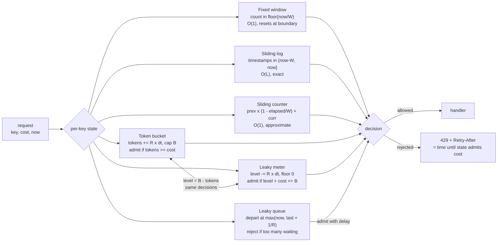

# Rate Limiting Algorithms Compared: Fixed Window Boundary Bursts, Sliding Window Log, Sliding Window Counter, Token Bucket, and Leaky Bucket

> [!summary] Claim
> Every rate limiter answers "may this request run now?" from a tiny per-key state, and the five classic algorithms differ only in what that state remembers: a fixed window forgets everything at each boundary and so admits `2 x limit` in an instant, a sliding log remembers every request and is exact at `O(limit)` memory, a sliding counter remembers two integers and is a good approximation, and the token bucket and leaky bucket meter (which are the same algorithm seen from opposite sides) remember one number and a timestamp and enforce "at most `R x t + B` in any interval `t`", which is a burst contract, not a per-window cap.

Part of [Resilience Rate Limiting and Idempotency](README.md) in [API Engineering](../README.md).

## TL;DR

- Mechanism: fixed window keeps one counter per aligned window, sliding log keeps one timestamp per admitted unit, sliding counter keeps the previous and current window counts and weights the previous by its remaining overlap, the token bucket keeps `(tokens, last)` and refills `rate x elapsed` up to `capacity`, and the leaky bucket meter keeps `(level, last)` and drains it; a leaky bucket as a queue instead delays requests so they leave exactly `1/rate` apart.
- Contract rule: a token bucket `{R, B}` admits at most `R x t + B` in any interval of length `t` (RFC 3290 Appendix A.2, RFC 2212 Policing section), so "`100` per minute" as a bucket with `capacity=100` admits up to `199` to `200` in one minute; only the sliding log enforces "at most `L` in any window of length `W`" exactly.
- The trap: the fixed window admits `200` requests in `0.2 s` for a "`100` per `60 s`" rule (the lab sends `100` at `t=59.9` and `100` at `t=60.1`), and Python's most-used limiter stack defaults to it: slowapi 0.1.10 `Limiter.__init__` falls back to the `"fixed-window"` strategy and to `memory://` storage when neither is configured.
- Portability fact: the lab is pure Python with an injected clock (28 tests passed on CPython 3.14.6, macOS 27.3 arm64; other interpreters were not run), and none of these limiters is thread-safe without a lock on any CPython build, because the GIL never made "read tokens, compare, write tokens" atomic (PEP 703, Container Thread-Safety).
- When not to use it: a per-client request-rate limiter does not protect a server from slow or expensive requests (use a concurrency limiter, [[Adaptive-Concurrency-Limits-Littles-Law-Vegas-and-Gradient2]]), from overload by many well-behaved clients (use [[Load-Shedding-Priority-Traffic-Classes-and-LIFO-Queue-Management]]), or across a fleet unless the state is shared atomically ([[GCRA-Generic-Cell-Rate-Algorithm-and-Atomic-Redis-Valkey-Lua-Limiters]]).

## Mental model



A request arrives with a key (client address, API key, tenant), a cost (usually `1`), and the current time, and the limiter reads only that key's state.
The six boxes are the six ways to compress "what has this key done recently" into that state, from a single counter that is wiped at every window boundary to a timestamp per request.
The double arrow between the token bucket and the leaky bucket meter is an identity, not an analogy: the meter's level is `capacity - tokens`, and the lab drives both with 5000 random arrivals and gets the same decision and the same `retry_after` every time.
The leaky queue is the only box that admits with a delay instead of passing a burst through; it is a shaper, the others are policers.
Every rejection can compute exactly when the same request would next fit, and that number, rounded up to whole seconds, is what `Retry-After` should carry.

## How it works

### The vocabulary the RFCs fixed in the 1990s

API rate limiting reuses traffic-policing vocabulary from IntServ and DiffServ, and the definitions there are sharper than most blog posts.
A token bucket has a rate `r` and a depth `b`; RFC 2215 Section 3.6 defines the `TOKEN_BUCKET_TSPEC` as `r` in bytes per second "from 1 byte per second to 40 terabytes per second", `b` "from 1 byte to 250 gigabytes", plus a peak rate `p`, minimum policed unit `m`, and maximum packet size `M`.
The conformance rule is in RFC 2212's Policing section: traffic "MUST obey the rule that over all time periods, the amount of data sent cannot exceed M+min[pT, rT+b-M]", which "reduces to the standard token bucket requirement" when `p` is infinite.
RFC 3290 Appendix A.2 states the same rule in its plain form: a stream conforms to `{R, B}` "if the system receives in any time interval, t, at most, an amount of data not exceeding (R * t) + B".
That inequality is the whole contract of a token bucket, and it is why a bucket is the right tool when you want to promise "a sustained rate with a bounded burst" and the wrong tool when you want to promise "never more than `L` in any `W`".

RFC 3290 Appendix A also separates the two roles that people blur under "leaky bucket".
A leaky bucket "is primarily used for shaping traffic as it leaves an interface", releasing it at a near-constant rate (RFC 3290 Appendix A.1), while a token bucket "measures the arrival rate of traffic from another device" and decides whether it "(still) conforms" (RFC 3290 Appendix A.2).
In API terms a shaper delays requests (nginx `limit_req` without `nodelay`, Go `Limiter.Wait`), and a policer admits or rejects them immediately (`429`).

RFC 3290 Section 5.1.3 then names the choice every implementation makes when a request costs more than the tokens left.
Strict conformance admits a unit of size `L` "only if there are sufficient tokens available in the bucket at the time of packet arrival for the complete packet", and is the rule in the srTCM and trTCM markers.
Loose conformance admits it "if any tokens are available", borrowing "up to L bytes" from future allocations, which lets the bucket go negative (RFC 3290 Section 5.1.3, Appendix A.3).
The lab's `TokenBucket` is strict; Guava's `SmoothRateLimiter` is loose by design, and Go's `Limiter.Reserve` also borrows from future allocations but makes the caller wait for them, as shown below.

RFC 2697 adds the multi-level form: the single-rate three-color marker meters with two buckets `C` and `E` that share one rate `CIR`, start full (`Tc(0) = CBS`, `Te(0) = EBS`), and overflow from `C` into `E`, marking a packet green if `Tc(t) - B >= 0`, else yellow if `Te(t) - B >= 0`, else red, without decrementing anything for red (RFC 2697 Section 3).
RFC 2698 is the two-rate version, with bucket `P` at `PIR` and `C` at `CIR` (RFC 2698 Section 3).
The API translation is direct: green is "serve", yellow is "serve at lower priority or count against an overage quota", red is `429`; the per-tier version of that idea is [[Multi-Tier-Rate-Limiting-Quotas-Concurrency-Limits-and-Cost-Budgets]].

### Fixed window counter

State: one integer per key per window, where the window index is `floor(now / W)`.
Admit if `count + cost <= limit`, then add `cost`; at the next index the count is zero again.
Cost: one `INCR` with an expiry in Redis or memcached, which is why it is a common default (slowapi 0.1.10 among them).

The failure is the boundary burst.
A client that sends `L` requests just before a boundary and `L` just after gets `2 x L` admitted in an arbitrarily short interval; the lab's `test_fixed_window_admits_twice_the_limit_across_the_boundary` sends `100` at `t=59.9` and `100` at `t=60.1` to a "`100` per `60 s`" limiter and asserts `200` admitted within `0.2 s`.
Figma's 2017 write-up describes the same failure with "5 requests per minute": five at `11:00:59` and five more at `11:01:00`, "we've now allowed 10 requests in less than one minute".
Cloudflare's 2017 post makes the same point: resetting the counter "at regular intervals" allows "regular traffic spikes to go through the rate limiter".

Implementations differ on where the window starts, and the lab pins one difference.
The lab's `FixedWindowCounter` aligns windows to the clock (`floor(now / W)`), so every key's window resets at the same instant, which is a thundering-herd hazard when many clients wake up on a `429` at the same boundary.
`limits` 5.8.0 does not align: `MemoryStorage.incr` sets the key's expiry to `time.time() + expiry` only when the counter equals the first increment (limits 5.8.0 limits/storage/memory.py, MemoryStorage.incr), and the Redis path does the same in Lua with `incrby` followed by `expire` when `current == amount` (limits 5.8.0 limits/resources/redis/lua_scripts/incr_expire.lua).
The window therefore starts at each key's first hit; `test_limits_5_8_0_fixed_window_starts_at_the_first_hit` hits twice at `t=50`, is rejected at `t=61`, and is admitted again at `t=110`.
That spreads resets across keys, but the `2 x L` burst still exists at `first_hit + W`.
`FixedWindowRateLimiter.hit` increments before comparing (`storage.incr(...) <= item.amount`), so rejected hits also count (limits 5.8.0 limits/strategies.py, FixedWindowRateLimiter.hit), which caps abuse inside a window but cannot extend it past the expiry.

### Sliding window log

State: one timestamp per admitted unit.
Drop timestamps `<= now - W`, admit if `len(log) + cost <= limit`, then append `cost` copies of `now`.
It is exact: no interval of length `W` ever contains more than `L` admitted units, and the lab shows `max_in_any_window(admitted, 64) == 64` for a `64` per `64 s` limit on the same arrivals where a token bucket reaches `127`.

The price is memory and work proportional to the limit.
Figma computed `500` requests per day per user for `10,000` users as `5,000,000` stored values, about `20 MB` at `4` bytes each, and rejected the design.
Cloudflare rejected it for "huge processing and memory requirements", especially for long periods "for instance 5,000 req per hour".
In Redis the usual form is a sorted set per key scored by timestamp, as in the Figma post (which credits Peter Hayes for the design); the post does not name the commands, but the natural ones are `ZREMRANGEBYSCORE`, `ZCARD`, and `ZADD`.

`limits` 5.8.0 calls this strategy `moving-window` and stores a newest-first list per key: `acquire_entry` reads the entry at index `limit - amount` and rejects if its timestamp is `>= now - expiry`, otherwise prepends `amount` entries (limits 5.8.0 limits/storage/memory.py, MemoryStorage.acquire_entry); the Redis script does the same with `LINDEX`, `LPUSH`, then `LTRIM` to indices `0` through `limit - 1` and `EXPIRE` (limits 5.8.0 limits/resources/redis/lua_scripts/acquire_moving_window.lua).
The `LTRIM` bounds memory at `limit` entries per key, which is still `O(limit)`.
Rejected requests are not logged in `limits`; Figma's design logged them, which it described as a feature: "it would just extend a ban on a malicious user".
The lab's `SlidingWindowLog` also skips rejected requests, so a client that keeps hammering is admitted again as soon as old entries age out.

### Sliding window counter

State: the previous window's count, the current window's count, and the current index.
The estimate is `previous x (1 - elapsed / W) + current`, where `elapsed` is the time since the current window started; it assumes the previous window's requests were spread evenly and counts only the fraction that still overlaps `(now - W, now]`.
Cloudflare's example is exact in the lab: `42` requests in the previous minute and `18` in the first `15 s` of this one give `42 x 0.75 + 18 = 49.5` against a limit of `50`, and `test_sliding_counter_reproduces_cloudflare_49_5_and_rejects_strictly` asserts `estimate(75.0) == 49.5`.

Its accuracy is an empirical claim, and the only primary measurement is Cloudflare's (as of 2017-06-07): over "400 million requests from 270,000 distinct sources", "0.003% of requests have been wrongly allowed or rate limited", with "an average difference of 6% between real rate and the approximate rate", three sources allowed while "less than 15% above the threshold", and no false positives.
Its worst case is not small: a client whose previous-window requests all arrived at the very end of that window is undercounted, because the formula assumes they were uniform.
For the boundary attack it holds: at `t=60.1` the previous window's `100` still weigh `100 x (1 - 0.1/60) = 99.83`, so the lab admits zero of the second hundred.

Cloudflare chose it because it needs only `GET`, `SET`, and `INCR` and "two numbers per counter", and because the leaky bucket "requires multiple distinct operations that we cannot do atomically" over the memcached protocol, where `CAS` under attack would create "a lot of CAS transactions failing".
Cloudflare also moved the counting off the request path: "the increment jobs are run asynchronously", and once a client is over the threshold every server caches the mitigation and its end time locally.
Figma's variant uses many small fixed windows instead of two: counters "1/60th the size of our rate limit's time window" summed over the hour, about `600,000` values or `2.4 MB` for the same `10,000` users, and it summed "the last hour and one minute" to err on the strict side.

Implementations disagree on rounding, and the lab proves the disagreement.
The lab admits only if `estimate + cost <= limit`.
`limits` 5.8.0 admits if `floor(weighted_count) + amount <= limit` (limits 5.8.0 limits/storage/memory.py, MemoryStorage.acquire_sliding_window_entry); the Redis script floors only the previous term, `math.floor(previous_count * previous_ttl / expiry) + current_count` (limits 5.8.0 limits/resources/redis/lua_scripts/acquire_sliding_window.lua), which is the same number because `current_count` is an integer.
`test_limits_5_8_0_sliding_counter_floors_the_estimate_and_admits_it` replays Cloudflare's numbers through `limits` with a patched clock and gets the 61st hit admitted at an estimate of `49.5`, where the lab's strict rule rejects it.
The memory backend also checks again after incrementing and calls `decr` if a concurrent hit won the race, with a source comment that near a window boundary "the counter is shifted and cannot be decremented, so less requests than expected are allowed".
The two backends also place windows differently: memory storage derives keys from `int(at / expiry)`, aligned to the epoch (limits 5.8.0 limits/storage/base.py, TimestampedSlidingWindow.sliding_window_keys), while the Redis script renames the current key to the previous one when its `PTTL` drops below `expiry`, so its windows start at each key's first hit.

### Token bucket

State: `tokens` (a float) and `last` (a timestamp).
On each request, `tokens = min(capacity, tokens + (now - last) x rate)`, `last = now`, then admit if `tokens >= cost` and subtract.
Go, Guava, nginx, and the lab compute refill lazily from elapsed time instead of running a refill timer, so state is two numbers per key regardless of rate; Envoy's configuration instead names a periodic `fill_interval`.
Stripe's 2017 post says "We use the token bucket algorithm to do rate limiting" and that "every Stripe user has a bucket, and every time they make a request we remove a token from that bucket".
AWS API Gateway documents the same model: it "throttles requests to your API using the token bucket algorithm, where a token counts for a request", a usage plan's throttling rate is "the rate, in requests per second, that tokens are added to the token bucket", and the throttling burst "is the capacity of the token bucket".
Envoy's HTTP local rate limit filter is a token bucket configured with `max_tokens`, `tokens_per_fill`, and `fill_interval`, returns `429` when it has no tokens, sets `x-envoy-ratelimited`, and keeps one bucket per Envoy process by default or one per downstream connection with `local_rate_limit_per_downstream_connection` (Envoy docs, `1.41.0-dev`, as of 2026-11).
Linux `tc-tbf` is the byte-level shaper form: "On creation, the TBF is stocked with tokens which correspond to the amount of traffic that can be burst in one go" (tc-tbf(8)).

The bucket fixes the boundary burst at the instant but not over the window.
It starts full, so the lab's `100` at `t=59.9` drain it and the `100` at `t=60.1` find `0.2 s x 100/60 = 0.33` tokens and are all rejected.
But the `R x t + B` contract allows a full burst plus a full window of refill: `test_token_bucket_admits_capacity_plus_refill_inside_one_window` configures `capacity=64`, `rate=1/s`, sends `64` at `t=0` and one per second after, and measures `127` admitted inside one half-open `64 s` window and `128` in `[0, 64]`.
If the product promise is "at most `L` per any `W`", the bucket must be configured with `capacity=L` and `rate` so low that the steady state is useless, or replaced by a sliding log.

Go's `golang.org/x/time/rate` is the clearest production source.
Its `Limiter` "implements a "token bucket" of size b, initially full and refilled at rate r tokens per second", and "The zero value is a valid Limiter, but it will reject all events" (golang.org/x/time v0.16.0 rate/rate.go, Limiter).
`advance` computes `tokens + tokensFromDuration(elapsed)` clamped to `burst`, and treats a time before `last` as zero elapsed (`if t.Before(last) { last = t }`) (golang.org/x/time v0.16.0 rate/rate.go, Limiter.advance).
`reserveN` subtracts `n` from the advanced balance, computes a wait from any deficit, grants if `n <= lim.burst && waitDuration <= maxFutureReserve`, and only on a grant stores that balance, which may be negative (golang.org/x/time v0.16.0 rate/rate.go, Limiter.reserveN).
So `Allow` is a strict policer (`AllowN` passes a maximum future reservation of zero), while `Reserve` and `Wait` turn the same bucket into a shaper that borrows from future allocations and whose negative balance is a queue of promised slots; `Reservation.Cancel` "reverses the effects of this Reservation on the rate limit as much as possible" (same file, Reservation.CancelAt).

Guava goes further and remembers the next free time instead of the last request.
Its class comment explains that an expensive `acquire(100)` on an idle 1-permit-per-second limiter is allowed "right away" and future requests are postponed "by 100 seconds", so "the RateLimiter doesn't remember the time of the _last_ request, but it remembers the (expected) time of the _next_ request" (guava v33.8.0 guava/src/com/google/common/util/concurrent/SmoothRateLimiter.java, class comment).
`resync` converts idle time into `storedPermits = min(maxPermits, storedPermits + newPermits)`, and `reserveEarliestAvailable` returns the old `nextFreeTicketMicros` and pushes it forward by the wait for the permits that stored permits do not cover (plus `storedPermitsToWaitTime`, which is `0L` for `SmoothBursty`) (same file, SmoothRateLimiter.resync, SmoothRateLimiter.reserveEarliestAvailable).
`RateLimiter.create(permitsPerSecond)` delegates to an overload that builds `new SmoothBursty(stopwatch, /* maxBurstSeconds= */ 1.0)` (guava v33.8.0 guava/src/com/google/common/util/concurrent/RateLimiter.java, RateLimiter.create), so the default stored burst is one second of rate; `SmoothWarmingUp` instead makes stored permits cost more time than fresh ones, so a cold limiter ramps up over a warmup period.
That "next free time" state is the token bucket rewritten as a theoretical arrival time, which is exactly the GCRA form covered in [[GCRA-Generic-Cell-Rate-Algorithm-and-Atomic-Redis-Valkey-Lua-Limiters]].

### Leaky bucket as a meter

State: `level` and `last`.
On each request, `level = max(0, level - (now - last) x rate)`, then admit if `level + cost <= capacity` and add `cost`.
Substitute `level = capacity - tokens` and every line becomes the token bucket's line; the lab's `test_leaky_meter_is_the_mirror_image_of_the_token_bucket` drives both with the same 5000 seeded arrivals of mixed cost and asserts identical `(allowed, retry_after)` on every one.
The name you choose is a matter of which quantity you store; the behavior, the `R x t + B` bound, and the boundary-burst immunity are the same.

nginx's `limit_req` is a meter in integer milli-requests.
The documentation says "The limitation is done using the "leaky bucket" method", the default `burst` is zero, rejected requests get `limit_req_status`, default `503`, and `nodelay` stops delaying the requests inside the burst.
The source keeps `excess` and `rate` as integers where "1 corresponds to 0.001 r/s", and parses `rate=` into `ctx->rate = rate * 1000 / scale` with `scale` `1` for `r/s` and `60` for `r/m` (nginx 1.31.8 src/http/modules/ngx_http_limit_req_module.c, ngx_http_limit_req_zone).
`ngx_http_limit_req_lookup` computes `excess = lr->excess - ctx->rate * ms / 1000 + 1000`, clamps it at zero, returns `NGX_BUSY` without touching state if `excess > limit->burst`, and otherwise stores it; a new key starts at `excess = 0` (same file, ngx_http_limit_req_lookup).
Because the stored `excess` does not count the request being served, nginx `burst=N` is a meter of capacity `N + 1`: the lab's `NginxLimitReq` transcription admits `6` simultaneous requests for `rate=1r/s burst=5` and matches `LeakyBucketMeter(rate=2, capacity=4)` for `rate=2r/s burst=3` on 5000 seeded arrivals.
Two consequences of the integer arithmetic are visible only in the source.
`1r/m` becomes `1000 / 60 = 16` milli-requests per second, so the lab's transcription admits the second request at `62.5 s`, not `60 s`, a 4% slower rate than configured.
A clock that steps back by more than `60000 ms` is treated as `ms = 1`, and a smaller step back as `ms = 0`.

### Leaky bucket as a queue

State: the scheduled departure times.
A request departs at `max(now, last_departure + 1/rate)`, and it is rejected if admitting it would leave more than `max_waiting` requests scheduled in the future.
`test_leaky_queue_spaces_departures_while_the_token_bucket_passes_the_burst` sends `7` requests at `t=0` to `rate=2, max_waiting=5`, gets delays `0.0, 0.5, 1.0, 1.5, 2.0, 2.5`, rejects the seventh with `retry_after=0.5`, and shows that a `capacity=6` token bucket would admit all six at `t=0`.
This is nginx `limit_req` without `nodelay` ("Excessive requests are delayed until their number exceeds the maximum burst size"), and nginx `delay=N` (since 1.15.7) is the hybrid: the first `N` excess requests pass undelayed and the rest are queued.
A queue protects the backend from bursts better than any policer, at the cost of holding a connection and a worker per waiting request and of adding up to `max_waiting / rate` of latency; for an API with client timeouts, that latency often turns into retries ([[Retries-Exponential-Backoff-Full-vs-Decorrelated-Jitter-and-Stamina]]).

### Computing `Retry-After` from the state

RFC 6585 Section 4 defines `429 Too Many Requests` for a user who "has sent too many requests in a given amount of time", says the response "MAY include a Retry-After header", and requires that `429` responses "MUST NOT be stored by a cache".
RFC 9110 Section 10.2.3 defines `Retry-After` as `HTTP-date / delay-seconds` with `delay-seconds = 1*DIGIT`, a non-negative integer.
Every algorithm above can compute the exact time at which the rejected request would fit if nothing else arrived:

| Algorithm | `retry_after` when rejected |
|---|---|
| Fixed window | `(index + 1) x W - now`, the end of the window |
| Sliding log | `log[k-1] + W - now`, where `k = len(log) + cost - limit` |
| Sliding counter, room in this window | `start + W x (1 - room / previous) - now`, `room = limit - current - cost` |
| Sliding counter, no room in this window | `start + W x (2 - (limit - cost) / current) - now` |
| Token bucket | `(cost - tokens) / rate` |
| Leaky meter | `(level + cost - capacity) / rate` |
| Leaky queue | first scheduled departure `- now` |
| `cost > capacity` | infinity: never; answer with a `4xx` that is not `429` |

`test_retry_after_is_the_exact_first_admission_time` checks each row: the request is rejected at `now + retry_after - 2^-10` and admitted at `now + retry_after`.
The header must round up, because `delay-seconds` is an integer and a client that retries at `floor` is rejected again; the lab's middleware sends `Retry-After: 3` for a computed `2.5 s`.
Envoy's filter does the same, using "the number of seconds until the next token is available in the bucket that rejected the request, clamped to at least one second", and is disabled by default (Envoy docs, `enable_retry_after_header`, as of 2026-11).
The header family that advertises the remaining quota in advance is [[Standard-RateLimit-Headers-IETF-Draft-and-429-Retry-After-Semantics]].

### Where the state lives

All five algorithms are read-modify-write on per-key state, so correctness depends on where that state lives.
In one asyncio process, a limiter whose `acquire` contains no `await` between the read and the write is atomic with respect to other coroutines, which is why the lab's ASGI middleware needs no lock.
Across threads it is not, on any CPython build: PEP 703 states that the GIL "does not necessarily ensure that operations are atomic or remain correct when multiple operations occur concurrently", and the free-threaded build removes the GIL entirely.
`collections.deque` appends and pops are documented as thread-safe individually, which does not make the sliding log's "evict, count, append" sequence safe.
Across processes or hosts, the state must move to a shared store with atomic scripts, and Figma's post shows the classic race: with token-bucket state in a Redis hash, "If only a single token remains and two servers' Redis operations interleave, both requests would be let through".
Per-process limiters are only an approximation of a global limit: Envoy's per-process bucket multiplies the effective limit by the number of Envoy processes unless `local_cluster_rate_limit` divides it, and then a request costs `N` tokens with `N` members, which can exceed `max_tokens` and, per the Envoy docs, is admitted once the bucket holds `max_tokens` and drives it negative.
The atomic shared-state version of the bucket is the next note, [[GCRA-Generic-Cell-Rate-Algorithm-and-Atomic-Redis-Valkey-Lua-Limiters]].

## Numbers and limits

| Quantity | Value | Source |
|---|---|---|
| Fixed window worst case | `2 x L` in an arbitrarily short interval; `200` admitted in `0.2 s` for `100` per `60 s` | lab, `test_fixed_window_admits_twice_the_limit_across_the_boundary` |
| Token bucket worst case in any interval `t` | `R x t + B` | RFC 3290 Appendix A.2; RFC 2212 Policing section |
| Token bucket "`64` per `64 s`" in one half-open window | `127` admitted (sliding log: `64`) | lab, `test_token_bucket_admits_capacity_plus_refill_inside_one_window` |
| Sliding log memory, Figma's example | `5,000,000` values, about `20 MB` (`500`/day x `10,000` users x `4` bytes) | Figma blog, 2017-04-12 |
| Minute-bucket counter memory, same example | about `600,000` values, about `2.4 MB` | Figma blog, 2017-04-12 |
| Sliding counter error | `0.003%` of `400` million requests wrong; `6%` mean rate difference; `0` false positives | Cloudflare blog, 2017-06-07 |
| Sliding counter state | two numbers per key | Cloudflare blog, 2017-06-07 |
| Token bucket and meter state | two numbers per key (`tokens` or `level`, plus `last`) | lab classes; Go v0.16.0 `Limiter` fields |
| nginx state per key | `64` bytes on 32-bit, `128` bytes on 64-bit; `1 MB` holds about `16` thousand or `8` thousand states | nginx `limit_req_zone` docs, as of 2026-11 |
| nginx rate resolution | integer milli-requests per second; `1r/m` stored as `16`, so one admission per `62.5 s` | nginx 1.31.8 source; lab, `test_nginx_one_request_per_minute_truncates_to_one_per_62_5_seconds` |
| nginx `burst=N` effective capacity | `N + 1` simultaneous requests | nginx 1.31.8 `ngx_http_limit_req_lookup`; lab |
| nginx default reject status | `503` (`limit_req_status`) | nginx docs, as of 2026-11 |
| Guava default stored burst | `1.0` second of rate (`maxBurstSeconds`) | guava v33.8.0 `RateLimiter.create` |
| Envoy `Retry-After` floor | `1` second; header off by default | Envoy docs `1.41.0-dev`, as of 2026-11 |
| RFC 2215 token bucket ranges | `r` from `1` byte/s to `40` TB/s; `b` from `1` byte to `250` GB | RFC 2215 Section 3.6 |
| RFC 3290 worked example | `1.2 Mbps` with `1500`-byte burst means `100` bursts per second, `10 ms` token interval | RFC 3290 Appendix A |
| Lab run | `28 passed in 0.32s` | `uv run --frozen pytest ... -q`, CPython 3.14.6, macOS 27.3 arm64 (`uname -r` `27.3.0`), 2026-11-21 |

## Portability

The lab ran once, on the workspace interpreter; the other legs of the matrix were not run because the user paused lab checks on 2026-11-11.

| Leg | Result | Evidence |
|---|---|---|
| CPython 3.14.6 (workspace) | 28 passed | ran here, macOS 27.3 arm64 |
| CPython 3.12.16, 3.13.18, 3.14.10, 3.15.2 | not run; no result is claimed for these legs | matrix paused by the user on 2026-11-11; for reference, the module's runtime imports are `__future__`, `json`, `math`, `collections.deque`, `dataclasses`, and `typing`, with `collections.abc` and Starlette types only under `TYPE_CHECKING` (lab source, import block) |
| CPython 3.15.2t free-threaded | not run; the classes need an external lock when shared across threads on every build | PEP 703, Container Thread-Safety |
| Clock source | the lab injects `now`; production should pass `time.monotonic()`, which "cannot go backwards" and "is not affected by system clock updates" | Python `time` docs |
| `limits` 5.8.0 | fixed window anchored at first hit, sliding counter floors the estimate, no token bucket or GCRA strategy (`STRATEGIES` has `sliding-window-counter`, `fixed-window`, `moving-window`) | lab tests; limits 5.8.0 limits/strategies.py, STRATEGIES |
| `limits` 5.8.0 clock | `time.time()` in memory storage, which "can return a lower value than a previous call if the system clock has been set back" | limits 5.8.0 limits/storage/memory.py; Python `time` docs |
| slowapi 0.1.10 | default strategy `"fixed-window"`, default storage `memory://`, `X-RateLimit-*` headers off unless `headers_enabled` | slowapi 0.1.10 slowapi/extension.py, Limiter.__init__ |
| Uvicorn, Hypercorn, Granian | the middleware is pure ASGI and keys on `scope["client"]`; behind a proxy that is the proxy's address unless a trusted proxy-headers layer rewrites it | ASGI HTTP connection scope, `client` "the remote host's IPv4 or IPv6 address" (ASGI spec, as of 2026-11); lab middleware; not run under these servers; [[Forwarded-Header-RFC-7239-and-X-Forwarded-For-Spoofing]] |
| HTTP/1.1, HTTP/2, HTTP/3 | `429` and `Retry-After` are version-independent semantics | RFC 6585 Section 4; RFC 9110 Section 10.2.3 |
| Go, Java, nginx, Envoy | Go v0.16.0 `Reserve` and `Wait` and Guava v33.8.0 borrow from future allocations (Go's balance goes negative, Guava's next free time moves ahead); Go `Allow` is strict; nginx 1.31.8 and Envoy are strict policers unless delaying or local-cluster sharing | sources cited in How it works |

## Worked example

The [implementation](../labs/src/api_labs/f16_resilience_rate_limiting_and_idempotency/rate_limiting_algorithms.py) contains all six limiters, the nginx transcription, and a pure ASGI middleware; the [test](../labs/tests/f16_resilience_rate_limiting_and_idempotency/test_rate_limiting_algorithms_token_bucket_leaky_bucket_and_sliding_window.py) has 28 cases.
Every limiter takes `now` as an argument, so a test can place a request at exactly `t=59.9`.

The token bucket, verbatim from the lab:

```python
class TokenBucket:
    """Starts full; refills ``rate`` tokens per second up to ``capacity``; strict conformance."""

    def __init__(self, rate: float, capacity: float) -> None:
        _positive("rate", rate)
        _positive("capacity", capacity)
        self.rate = rate
        self.capacity = capacity
        self._tokens = capacity
        self._last: float | None = None

    def tokens(self, now: float) -> float:
        if self._last is None:
            self._last = now
        elapsed = max(0.0, now - self._last)  # a clock step backwards mints nothing
        self._tokens = min(self.capacity, self._tokens + elapsed * self.rate)
        self._last = max(self._last, now)
        return self._tokens

    def acquire(self, now: float, cost: int = 1) -> Decision:
        _check_cost(cost)
        available = self.tokens(now)
        if cost > self.capacity:
            return Decision(False, math.inf)
        if available >= cost:
            self._tokens = available - cost
            return Decision(True)
        return Decision(False, (cost - available) / self.rate)
```

`self._last = max(self._last, now)` is the line `test_clock_step_backwards_mints_no_tokens` protects: with a naive `self._last = now`, a call at `t=5` after `t=10` would move `last` back and the next call at `t=10` would mint five tokens.

The sliding window counter's `estimate` and `acquire` methods, verbatim:

```python
    def estimate(self, now: float) -> float:
        self._roll(now)
        start = self._index * self.window
        elapsed = min(max(now - start, 0.0), self.window)
        return self._previous * (1.0 - elapsed / self.window) + self._current

    def acquire(self, now: float, cost: int = 1) -> Decision:
        _check_cost(cost)
        if cost > self.limit:
            return Decision(False, math.inf)
        if self.estimate(now) + cost <= self.limit:
            self._current += cost
            return Decision(True)
        start = self._index * self.window
        room = self.limit - self._current - cost
        if room >= 0:
            # Fits later in this window once the previous window's weight has decayed enough.
            at = start + self.window * (1.0 - room / self._previous)
        else:
            # Only fits in the next window, where today's count becomes the decaying previous one.
            fraction = max(0.0, 1.0 - (self.limit - cost) / self._current)
            at = start + self.window * (1.0 + fraction)
        return Decision(False, max(0.0, at - now))
```

The boundary tests, verbatim:

```python
BOUNDARY = [59.9] * 100 + [60.1] * 100  # the lab plan: 100 just before and 100 just after t=60


@pytest.mark.unit
def test_fixed_window_admits_twice_the_limit_across_the_boundary() -> None:
    passed = admitted(FixedWindowCounter(limit=100, window=60), BOUNDARY)
    assert len(passed) == 200
    assert max(passed) - min(passed) == pytest.approx(0.2)
```

The same `BOUNDARY` list, parametrized over the sliding log, sliding counter, token bucket, and leaky meter, admits exactly the first `100`.

Captured run, from `labs/`, CPython 3.14.6 on macOS 27.3 arm64 (`macOS-27.3-arm64-arm-64bit-Mach-O`), 2026-11-21 (the verifier's rerun; `-p no:cacheprovider` was added only to keep the workspace clean):

```text
$ uv run --frozen pytest tests/f16_resilience_rate_limiting_and_idempotency/test_rate_limiting_algorithms_token_bucket_leaky_bucket_and_sliding_window.py -q -p no:cacheprovider
............................                                             [100%]
28 passed in 0.32s
```

## Pitfalls

> [!warning] Fixed window as the default
> Trigger: a framework default such as slowapi 0.1.10, whose `Limiter.__init__` falls back to `"fixed-window"`.
> Symptom: a backend sized for `L` per window sees `2 x L` in a fraction of a second at every boundary, and clients that back off to the boundary arrive together.
> Fix: choose `moving-window` or `sliding-window-counter` explicitly, or a token bucket with a small burst; Figma documented the same `2 x` failure before moving to minute buckets (Figma blog, 2017-04-12).

> [!warning] Treating a token bucket as a per-window cap
> Trigger: product copy says "`100` requests per minute" and the limiter is a bucket with `capacity=100`, `rate=100/60`.
> Symptom: a client gets `199` or `200` in one minute and support tickets say the limit is not enforced, or a downstream with a hard per-minute quota rejects the overflow.
> Fix: state the contract as rate plus burst (`R x t + B`, RFC 3290 Appendix A.2), shrink the burst, or use a sliding log where the per-window cap is the contract (lab: `127` vs `64`).

> [!warning] Read-then-write on shared state
> Trigger: token-bucket state in Redis read with `HGET` and written with `HSET` from several app servers.
> Symptom: both of two concurrent requests take the last token; Figma: "both requests would be let through".
> Fix: one atomic server-side script per decision, as in [[GCRA-Generic-Cell-Rate-Algorithm-and-Atomic-Redis-Valkey-Lua-Limiters]], or Cloudflare's design of `INCR`-only counters with asynchronous mitigation (Cloudflare blog, 2017-06-07).

> [!warning] Shadow limits teach attackers nothing, `429` teaches them everything
> Trigger: an abuse-facing endpoint returns `429` to spammers.
> Symptom: Figma's attackers "saw the response code change from 200 to 429 and simply created new accounts".
> Fix: Figma switched to a shadow ban, returning `200` and silently not sending the invitations; keep `429` with `Retry-After` for legitimate API clients and reserve deception for abuse flows.

> [!warning] Failing closed when the limiter store is down
> Trigger: the rate limiter calls Redis on every request and raises when Redis is unavailable.
> Symptom: a cache outage becomes a full API outage.
> Fix: Stripe's rule is that if the limiter code has bugs "(or if Redis were to go down), requests wouldn't be affected", catching exceptions so errors "fail open", plus kill switches and dark launches of each new limiter (Stripe blog, 2017-03-30); slowapi exposes `swallow_errors` and `in_memory_fallback` for the same choice.

> [!warning] Wall-clock time in the limiter
> Trigger: `time.time()` as the limiter clock, as in `limits` 5.8.0 memory storage, during an NTP step or a manual clock change.
> Symptom: a backwards step freezes refills or reopens closed windows, and a forward step resets every fixed window at once.
> Fix: use `time.monotonic()` in-process and the store's own clock (for example Redis `TIME` or TTLs) when state is shared; clamp negative elapsed time to zero as the lab, Go v0.16.0 `advance`, and nginx 1.31.8 do.

> [!warning] Rounding `Retry-After` down
> Trigger: `int(retry_after)` on a computed `2.5 s`.
> Symptom: the header says `2`, the client retries at `2 s` and is rejected again, doubling the rejected traffic from well-behaved clients.
> Fix: `max(1, ceil(retry_after))`, as the lab middleware and Envoy's filter do.

> [!warning] nginx `burst` off by one and `r/m` truncation
> Trigger: `limit_req zone=one burst=5` with the expectation of "at most 5 at once", or `rate=1r/m`.
> Symptom: `6` requests pass simultaneously, and `1r/m` admits one request per `62.5 s`.
> Fix: configure `burst = desired_concurrency - 1`, and prefer `r/s` rates whose milli-request value is an integer (nginx 1.31.8 `ngx_http_limit_req_zone`, `ngx_http_limit_req_lookup`; lab).

## Security and robustness

OWASP API4:2023 Unrestricted Resource Consumption lists "Implement a limit on how often a client can interact with the API within a defined timeframe (rate limiting)" and per-operation throttles such as how often a client can "validate an OTP, or request password recovery", and its Scenario #1 is an SMS reset flow whose third-party cost ($0.05 per message) turns tens of thousands of calls into "thousands of dollars in a matter of minutes".
The algorithm choice matters per threat:
- Brute force and OTP guessing need a strict per-window cap with a long window, so a sliding log or a sliding counter keyed on the target account as well as the client; the account-lockout trade-offs are in [[Credential-Stuffing-Brute-Force-Defense-and-Account-Lockout-Traps]].
- Cost amplification (SMS, LLM tokens, exports) needs `cost > 1` per request, which every algorithm here supports, and a `cost > capacity` check that rejects outright instead of returning a `Retry-After` the client can never satisfy.
- Volumetric floods need the cheapest possible decision, which is why Cloudflare moved counting off the request path and cached mitigations, and why RFC 6585 Section 7.2 notes that answering each request with `429` "will consume resources" and that a server may "just drop connections".

The key is the attack surface.
Keying on `scope["client"]` behind a proxy limits the proxy, and keying on `X-Forwarded-For` without a trusted-proxy boundary lets an attacker pick a new key per request ([[Forwarded-Header-RFC-7239-and-X-Forwarded-For-Spoofing]]).
Keying on an API key is robust only if unauthenticated requests are limited separately, because an attacker can send unlimited distinct invalid keys.
nginx documents that "Requests with an empty key value are not accounted", so an empty key bypasses the limit by design.

State exhaustion is the second attack surface.
Per-key state is attacker-controlled cardinality: a sliding log stores up to `limit` entries per key, and nginx evicts "the least recently used state" when its zone is full and, if that fails, terminates the request with an error.
An attacker rotating IPv6 addresses can therefore evict legitimate clients' state, which resets their limits; key on prefixes (for example a `/64`) and cap the table size explicitly.

Validate configuration as input.
RFC 2215 Section 3.6 forbids negative values, negative zero, infinities, and NaNs for `r` and `b`, and the lab's constructors reject non-positive and infinite rates, limits, windows, and capacities, because `rate=0` divides by zero in `retry_after` and `capacity=inf` turns a limiter into a no-op.

## The principal's view

The decision is not "which algorithm" but "which contract", and the contract must be written down before the algorithm is picked.
"A sustained rate with a bounded burst" is a token bucket or its GCRA form, the right default for most APIs because it is two numbers per key, gives a precise `Retry-After`, and matches how AWS API Gateway, Envoy, Stripe, and Go present limits to users.
"Never more than `L` per `W`" is a sliding log, justified only for low limits on sensitive operations (logins, OTPs, money movement) where memory is small and exactness is a security property.
"About `L` per `W`, cheaply, on primitive storage" is the sliding counter, which Cloudflare measured at `0.003%` error on its traffic in 2017, and which needs no scripting.
"Protect a backend from bursts at any latency cost" is a leaky queue, appropriate at an edge proxy in front of a fragile origin and inappropriate inside an API whose clients time out.
The fixed window is acceptable for coarse daily or monthly quotas where a boundary burst is harmless and billing alignment matters.

The organizational trade-off is where the limit lives.
A limiter at the edge (nginx, Envoy, API gateway) is cheap and protects everything, but sees only connection-level keys and per-process state; a limiter in the application sees tenants, plans, and request cost, but runs after authentication and parsing have already been paid for.
Most staff-plus designs layer both, which is the subject of [[Multi-Tier-Rate-Limiting-Quotas-Concurrency-Limits-and-Cost-Budgets]], and use a concurrency limiter for expensive endpoints, which Stripe found "triggered much less often" but "totally solved" resource contention on its most expensive endpoints.

Choose something other than per-client rate limiting when the failure you fear is not one client but the aggregate.
A rate limiter assumes the server's capacity is known and fixed; when it is not, adaptive concurrency ([[Adaptive-Concurrency-Limits-Littles-Law-Vegas-and-Gradient2]]) and load shedding by priority ([[Load-Shedding-Priority-Traffic-Classes-and-LIFO-Queue-Management]]) protect the server, while rate limits protect fairness between clients.

## Interview questions

> [!question] L5: Why does a fixed window counter admit twice its limit, and what is the smallest change that fixes it?
>
> > [!success]- Answer
> > The counter resets to zero at each boundary and keeps no memory of the previous window.
> > A client can spend the full limit just before the boundary and again just after, so `2 x L` pass in an arbitrarily short time.
> > The smallest change is to keep the previous window's count and weight it by its remaining overlap, which is the sliding window counter.
> > In the lab, `100` at `t=59.9` and `100` at `t=60.1` all pass a fixed window but at `t=60.1` the sliding counter still sees `99.83` from the previous window and rejects all of the second batch.
> >
> > Follow-up: What does the sliding counter assume about the previous window, and which traffic pattern violates it?

> [!question] L5: Predict the output: a token bucket with `rate=1.0` and `capacity=64` receives `64` requests at `t=0` and then one request at each whole second from `t=1` to `t=64`; how many are admitted, and what is the most admitted inside any half-open `64`-second window?
>
> > [!success]- Answer
> > All `128` are admitted, because each later request arrives exactly when a token has refilled.
> > The window `[0, 64)` contains the `64` initial requests plus `63` refilled ones, so the maximum is `127`.
> > This is the `R x t + B` contract of RFC 3290 Appendix A.2, with `R x t = 63` plus `B = 64`.
> > A sliding log with `limit=64` on the same arrivals never exceeds `64` in any window; the lab asserts both numbers.
> >
> > Follow-up: How would you configure the bucket so that no `64`-second window can exceed `64`, and what does that do to the steady-state rate?

> [!question] L6: Show that a leaky bucket meter and a token bucket make the same decisions, and explain what "leaky bucket" means in nginx.
>
> > [!success]- Answer
> > Define `level = capacity - tokens`.
> > The bucket's refill `tokens = min(B, tokens + R x dt)` becomes `level = max(0, level - R x dt)`, and the admission test `tokens >= cost` becomes `level + cost <= B`.
> > The two are the same state machine stored in mirror image, and the lab checks identical `(allowed, retry_after)` over 5000 random arrivals.
> > nginx `limit_req` is that meter in integer milli-requests, where `burst=N` means capacity `N + 1`, and without `nodelay` it becomes a queue that delays excess requests to the configured rate.
> >
> > Follow-up: Which of nginx's modes is a policer and which is a shaper, and how does each affect client-observed latency?

> [!question] L6: Debug this API: users with "`10` requests per second" report `429` responses with `Retry-After: 0`, retry immediately, and get `429` again; the limiter is a token bucket with `rate=10` and the header is `str(int(deficit / rate))`.
>
> > [!success]- Answer
> > The deficit is at most one token, so `deficit / rate` is at most `0.1` seconds and `int()` truncates it to `0`.
> > `delay-seconds` in RFC 9110 Section 10.2.3 is an integer, so sub-second waits must round up to `1`.
> > Clients that obey `0` retry immediately and are rejected again, which doubles the rejected traffic.
> > The fix is `max(1, ceil(deficit / rate))`, which is what the lab middleware and Envoy's local rate limit filter do.
> >
> > Follow-up: For a `10` per second limit, is a one-second `Retry-After` too coarse, and what would you put in the response body or the `RateLimit` headers instead?

> [!question] L6: Why did Cloudflare choose the sliding window counter over a leaky bucket for its edge rate limiter?
>
> > [!success]- Answer
> > Its storage was memcached behind Twemproxy, which offered only `GET`, `SET`, and `INCR`, and the leaky bucket needs a multi-step read-modify-write.
> > `CAS` would make it atomic but under attack would cause many failed transactions.
> > The sliding counter needs one `INCR` to count and one `GET` to read two counters, and Cloudflare measured `0.003%` wrong decisions over `400` million requests.
> > They also moved the increments off the request path and cached mitigations locally once a client crossed the threshold.
> >
> > Follow-up: With Redis Lua available today, would you still choose the counter, and what would you lose by switching to GCRA?

> [!question] L6: `limits` 5.8.0 and the lab disagree on whether the 61st request in Cloudflare's example (estimate `49.5`, limit `50`) is admitted; who admits it and why?
>
> > [!success]- Answer
> > `limits` admits it, because it tests `floor(weighted_count) + amount > limit`, and `floor(49.5) + 1 = 50` is not greater than `50`.
> > The lab tests `estimate + cost <= limit`, and `50.5 > 50`, so it rejects.
> > The floored rule lets the estimate run up to just under `limit + 1`, a small leniency on top of the approximation's own error.
> > Neither is wrong; the choice must be documented because it changes what `Remaining` and `Retry-After` report.
> >
> > Follow-up: The `limits` memory backend increments and then decrements on a lost race; why can that decrement miss near a window boundary?

> [!question] L7+: Your company sells "`1000` requests per minute" and runs the limiter in each of `40` Envoy processes; design the limiter and the contract.
>
> > [!success]- Answer
> > Per-process buckets enforce up to `40 x 1000` per minute in aggregate, so either divide each bucket's rate by the member count (Envoy `local_cluster_rate_limit` scales each request's cost by membership) or move the decision to a shared store with an atomic script.
> > Dividing is cheap but uneven when load balancing is skewed and changes when membership changes, and Envoy's docs note the aggregate burst can be one request per member.
> > A shared GCRA in Redis or Valkey is exact but adds a network round trip per request and needs a fail-open policy.
> > The contract should be stated as a rate plus a burst, because that is what any bucket enforces, and the dashboard should report the same algorithm the limiter runs.
> >
> > Follow-up: How would you keep the limiter correct during a Redis failover without failing closed or giving every client an unlimited burst?

> [!question] L7+: When should an API shape requests with a leaky queue instead of policing them with a token bucket?
>
> > [!success]- Answer
> > Shape when the protected resource cannot absorb bursts at all and the callers can tolerate added latency, such as an edge proxy in front of a fragile origin or a batch client calling a strict third-party API.
> > Police when clients have timeouts, because a queued request that outlives its client's timeout is wasted work and often triggers a retry.
> > A queue also holds a connection and a worker per waiting request, so `max_waiting` must be small and bounded by the timeout budget divided by `1/rate`.
> > A hybrid such as nginx `delay=N` passes a small burst immediately and queues the rest.
> >
> > Follow-up: How does Go's `Limiter.Wait` behave when the context deadline is shorter than the computed delay?

> [!question] L7+: Guava's `RateLimiter` lets an `acquire(100)` on an idle 1-per-second limiter run immediately; is that a bug, and what does it imply for API rate limiting?
>
> > [!success]- Answer
> > It is deliberate loose conformance: Guava remembers the next free time, not the last request, and pushes it `100` seconds into the future so the expensive work starts now and later callers pay.
> > RFC 3290 Section 5.1.3 calls this borrowing from future allocations, and it keeps the long-run average correct.
> > For an API it means one large request can lock a tenant out for a long time, and the `Retry-After` for everyone after it is large.
> > Use strict conformance with a `cost > capacity` rejection for user-facing limits, and loose conformance for internal clients that pace themselves.
> >
> > Follow-up: How is "remember the next free time" related to GCRA's theoretical arrival time?

## Related

Prerequisites: [[Structured-Log-Redaction-and-Preventing-PII-and-Token-Leaks]]

Next: [[GCRA-Generic-Cell-Rate-Algorithm-and-Atomic-Redis-Valkey-Lua-Limiters]]

See also: [[API-Fundamentals]], [[02-Programming-Languages/Python/Python-Backend-Interview-Prep/05-REST-API-Design]], [[02-Programming-Languages/Python/Python-Backend-Interview-Prep/17-Concurrency-in-Web-Services-and-Coding]], [[Multi-Tier-Rate-Limiting-Quotas-Concurrency-Limits-and-Cost-Budgets]], [[Standard-RateLimit-Headers-IETF-Draft-and-429-Retry-After-Semantics]], [[Adaptive-Concurrency-Limits-Littles-Law-Vegas-and-Gradient2]], [[Load-Shedding-Priority-Traffic-Classes-and-LIFO-Queue-Management]], [[Retries-Exponential-Backoff-Full-vs-Decorrelated-Jitter-and-Stamina]], [[Retry-Budgets-and-Preventing-Cascading-Retry-Amplification-Storms]], [[Forwarded-Header-RFC-7239-and-X-Forwarded-For-Spoofing]], [[Credential-Stuffing-Brute-Force-Defense-and-Account-Lockout-Traps]]

- Lab: `labs/tests/f16_resilience_rate_limiting_and_idempotency/test_rate_limiting_algorithms_token_bucket_leaky_bucket_and_sliding_window.py`

## Further reading

- RFC 3290 Section 5.1.3 and Appendix A: strict vs loose token bucket conformance and the `(R * t) + B` definition, the clearest statement of what a bucket promises.
- RFC 2212, Policing section: the `M+min[pT, rT+b-M]` conformance bound with a peak rate, and policing vs reshaping.
- RFC 2215 Section 3.6: the `TOKEN_BUCKET_TSPEC` parameters, ranges, and the rule against NaN and infinite values.
- RFC 2697 Section 3 and RFC 2698 Section 3: two-bucket meters (srTCM, trTCM) that map directly to "serve, deprioritize, reject" API tiers.
- RFC 6585 Section 4 and Section 7.2: `429 Too Many Requests`, its no-cache rule, and when not to send it.
- RFC 9110 Section 10.2.3: `Retry-After` syntax, the reason it must be an integer or a date.
- nginx 1.31.8 `src/http/modules/ngx_http_limit_req_module.c`: a production leaky bucket meter in about 60 lines of integer arithmetic.
- golang.org/x/time v0.16.0 `rate/rate.go`: a token bucket with `Allow`, `Reserve`, and `Wait` that shows policing and shaping on one state.
- Guava v33.8.0 `SmoothRateLimiter.java`: the class comment is the best written explanation of stored permits and "next free time".
- Desgats, "How we built rate limiting capable of scaling to millions of domains", Cloudflare, 2017-06-07: the sliding counter and its measured error.
- Mahdi, "An alternative approach to rate limiting", Figma, 2017-04-12: the four algorithms compared on Redis with memory arithmetic, and the shadow-ban incident.
- Tarjan, "Scaling your API with rate limiters", Stripe, 2017-03-30: the four limiter types in production and fail-open operations.
- OWASP API Security Top 10 2023, API4 Unrestricted Resource Consumption: the threat model rate limits answer.
