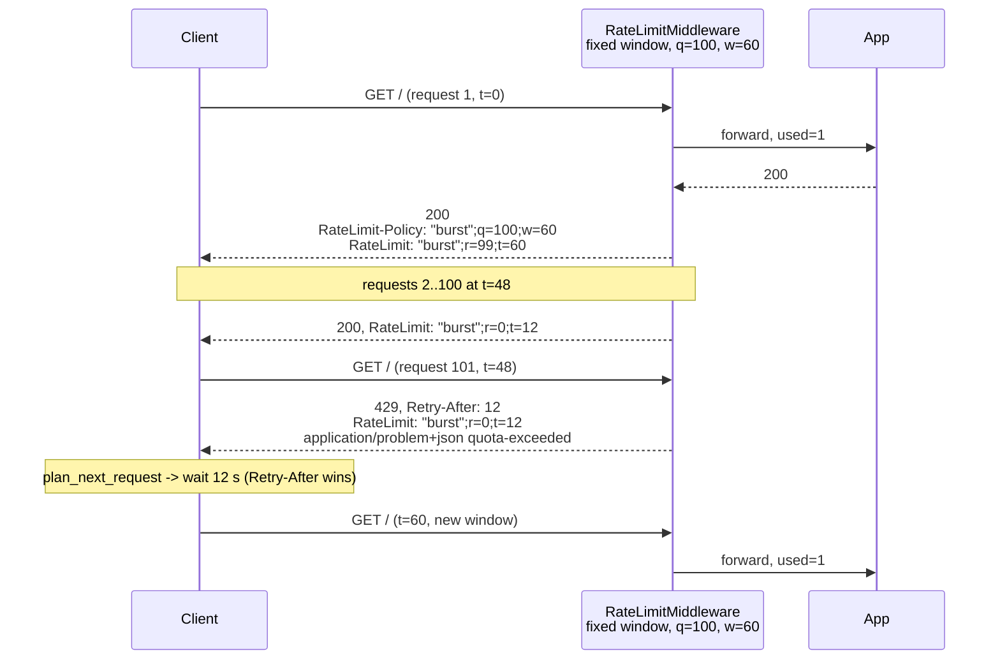

# Standardizing Rate Limit Responses: 429 Too Many Requests, Retry-After, and IETF RateLimit and RateLimit-Policy Headers (draft-ietf-httpapi-ratelimit-headers-11)

> [!summary] Claim
> `429` says "you were throttled", `Retry-After` says "do not come back before this instant", and draft-11's `RateLimit` and `RateLimit-Policy` say "here is how much you may still send and over what window" as RFC 9651 Lists, so a correct client applies `Retry-After` first, treats `RateLimit` as an unguaranteed hint that is ignored when malformed or cached, and a correct server never points `Retry-After` before the end of its own effective window.

Part of [Resilience Rate Limiting and Idempotency](README.md) in [API Engineering](../README.md).

## TL;DR

- Mechanism: `RateLimit-Policy: "burst";q=100;w=60` advertises a quota of 100 units per 60 s, and `RateLimit: "burst";r=0;t=12` says 0 units are available within the next 12 s; both are RFC 9651 Lists of String-named Items with Integer parameters (draft-11 Sections 3 and 4).
- Contract: on a response carrying both, `Retry-After` MUST take precedence (draft-11 Section 7), and the server's `Retry-After` SHOULD NOT reference a point earlier than the end of the effective window (draft-11 Section 6).
- Trap: malformed `RateLimit` MUST be ignored as a whole field (draft-11 Section 7), a bare `;q` parses as Boolean `true` which Python's `isinstance(x, int)` accepts, and Python's `int()`, `float()`, and `email.utils` all accept `Retry-After` values the ABNF forbids.
- Portability: the fields are ordinary HTTP field semantics on HTTP/1.1, HTTP/2, and HTTP/3; the lab's 65 tests pass on the workspace CPython 3.14.6 (verifier run, 2026-11-21), and the drafter's earlier 58-test version passed on 3.12.13, 3.13.18, 3.14.10, 3.15.2, and the free-threaded 3.14.6t and 3.15.0b3t; draft-11 was superseded on 2026-11-20 by draft-12, which renames `RateLimit`'s `r` and `t` to `a` and `w`, and neither field is in the IANA registry (as of 2026-11).
- When not to use it: do not advertise capacity to untrusted parties (draft-11 Section 8.2), do not count `r` as a service-level guarantee (Section 8.3), and do not send `429` at all under a volumetric attack, where dropping connections is cheaper (RFC 6585 Section 7.2).

## Mental model



The server keeps one counter per partition and policy, and decorates every response it lets through with the stable policy (`RateLimit-Policy`) and the live state (`RateLimit`).
The `200` that consumed the last unit already says `r=0;t=12`, so a well-behaved client stops before it is ever rejected; the draft explicitly allows `RateLimit` on any status (draft-11 Section 6).
The client that ignores that hint gets a `429` that repeats the same `RateLimit` and adds `Retry-After: 12`, which is exactly the end of the effective window, so the two fields never disagree.
The `429` request did not consume quota, so a client that keeps hammering does not push the window out; at `t=60` the window resets and the next request is served.

## How it works

### The status code: `429 Too Many Requests`

`429` means "the user has sent too many requests in a given amount of time" (RFC 6585 Section 4).
The response SHOULD include details explaining the condition and MAY include `Retry-After` (RFC 6585 Section 4).
RFC 6585 deliberately does not say how the server identifies the user or counts requests: per resource, per server, or across a set of servers, keyed by credentials or a cookie (RFC 6585 Section 4).
Responses with `429` MUST NOT be stored by a cache (RFC 6585 Section 4); separately, `429` is not in the heuristically cacheable set (RFC 9110 Section 15.1), so a cache would need explicit cache controls such as `max-age` or `public` to store it anyway (RFC 9111 Section 3).
Under attack, sending a `429` per request itself costs resources, so servers are not required to use it and may drop connections instead (RFC 6585 Section 7.2).

Neighbouring codes carry different contracts:

- `503 Service Unavailable` is temporary overload or scheduled maintenance, and the server MAY send `Retry-After` (RFC 9110 Section 15.6.4); draft-11 suggests `503` plus `Retry-After` for concurrency saturation (draft-11 FAQ item 6) and registers `temporary-reduced-capacity` with recommended status `503` (draft-11 Section 10.2.2).
- `413 Content Too Large`: if the condition is temporary, the server SHOULD generate `Retry-After` (RFC 9110 Section 15.5.14).
- `403 Forbidden` is used for throttling by some providers: GitHub's REST API answers both primary and secondary rate-limit violations with "a 403 or 429 response" ([GitHub REST rate limits](https://docs.github.com/en/rest/using-the-rest-api/rate-limits-for-the-rest-api?apiVersion=2022-11-28), fetched 2026-11-21), and draft-11 says its fields are not tied to `429` at all (draft-11 FAQ item 3).

### `Retry-After`: wire grammar and semantics

`Retry-After = HTTP-date / delay-seconds`, where `delay-seconds = 1*DIGIT` is a non-negative decimal integer of seconds (RFC 9110 Section 10.2.3).
With `503` it is how long the service is expected to be unavailable; with any `3xx` it is the minimum wait before following the redirect (RFC 9110 Section 10.2.3).
The ABNF has no sign, no fraction, no exponent, and no list form, so `-1`, `1.5`, `+5`, `1e3`, and `120, 60` are all invalid.
Because it is not a list-valued field, a sender MUST NOT generate two field lines for it (RFC 9110 Section 5.3), and the lab's parser treats two lines as invalid rather than picking one.

`HTTP-date` has three formats, and a recipient MUST accept all three (RFC 9110 Section 5.6.7):

```text
Sun, 06 Nov 1994 08:49:37 GMT    ; IMF-fixdate, the only one a sender may generate
Sunday, 06-Nov-94 08:49:37 GMT   ; obsolete RFC 850 format, two-digit year
Sun Nov  6 08:49:37 1994         ; ANSI C asctime(), no zone, assumed UTC
```

The rules that bite implementations (RFC 9110 Section 5.6.7):

- `HTTP-date` is case sensitive, and `GMT` is the only zone; `+0530` is not an `HTTP-date`.
- `asctime` values are assumed to be UTC even though they carry no zone.
- `time-of-day` allows `23:59:60` (leap second).
- A two-digit RFC 850 year that "appears to be more than 50 years in the future" MUST be read as the most recent past year with those digits: a rolling window, not a fixed pivot.

A `delay-seconds` value is relative to the receipt of the response, so it needs no clock agreement.
An `HTTP-date` is absolute, so its meaning depends on the client's clock; the lab computes it as `Retry-After - Date` when the response carries a single valid `Date`, which cancels client clock skew because both instants come from the server's clock.

### The draft's two fields

Both fields are response header fields whose value is an RFC 9651 List (draft-11 Sections 3 and 4).
Each member is an Item: a bare String naming a policy, followed by Parameters (RFC 9651 Section 3.1.2), which are `;key` or `;key=value` with lowercase keys.

`RateLimit-Policy` (draft-11 Section 3) is a non-empty List of Quota Policy Items whose value MUST be a String, and it SHOULD stay consistent across responses:

| Parameter | Requirement | Type and rule | Section |
| --- | --- | --- | --- |
| `q` | REQUIRED | non-negative Integer, quota in quota units | 3.1.1 |
| `qu` | OPTIONAL | String from the quota-unit registry: `requests` (default), `content-bytes`, `concurrent-requests` | 3.1.2 |
| `w` | OPTIONAL | non-negative, non-zero Integer seconds, like `delay-seconds`, no sub-second precision | 3.1.3 |
| `pk` | OPTIONAL | Byte Sequence partition key; quotas are allocated per key | 3.1.4 |

`RateLimit` (draft-11 Section 4) is a List of Service Limit Items, each identifying a policy and carrying the current state, which MAY change on every request:

| Parameter | Requirement | Type and rule | Section |
| --- | --- | --- | --- |
| `r` | REQUIRED | non-negative Integer, available quota in quota units | 4.1.1 |
| `t` | OPTIONAL | non-negative Integer seconds, the effective window | 4.1.2 |
| `pk` | OPTIONAL | Byte Sequence partition key | 4.1.3 |

Other parameters are allowed and "can be regarded as comments", and service-specific ones SHOULD carry a vendor prefix such as `acme-burst` (draft-11 Sections 3.1 and 4.1).
Neither field may appear in a trailer section (draft-11 Sections 3.1 and 4.1).
Section 4.1 says each item "identifies the quota policy" but, unlike Section 3, does not itself say the Item value MUST be a String; the lab requires a String for symmetry with `RateLimit-Policy`, which is an interpretation.

The byte layout of the seed example, member by member:

```text
RateLimit-Policy: "burst";q=100;w=60
                  ^^^^^^^ sf-string (DQUOTE, printable ASCII, only \" and \\ escapes)
                         ^^^^^^ ;key=sf-integer (at most 15 digits, RFC 9651 Section 3.3.1)
RateLimit: "burst";r=0;t=12
RateLimit: "default";r=999;pk=:dHJpYWwxMjEzMjM=:
                              ^^^^^^^^^^^^^^^^^^ sf-binary, base64 between colons -> b"trial121323"
```

`t` is the reason the draft exists in its current shape: it is `delay-seconds`-compatible because it does not rely on clock synchronization and it mitigates the thundering herd of many clients served the same timestamp (draft-11 Section 4.1.2), and the FAQ rejects Unix timestamps and sub-second precision for the same reasons (draft-11 FAQ item 5).
Contrast GitHub's `x-ratelimit-reset`, which is "in UTC epoch seconds" ([GitHub REST rate limits](https://docs.github.com/en/rest/using-the-rest-api/rate-limits-for-the-rest-api?apiVersion=2022-11-28)), and slowapi's `X-RateLimit-Reset`, an absolute fractional epoch (the lab asserts a `.` in the value and a value above `1_000_000_000`).

### Parsing: one bad member poisons the field

A parser MUST combine all field lines with the same name into one comma-separated value before parsing (RFC 9651 Section 4.2), and the draft explicitly allows a List to be split across lines (draft-11 Sections 3 and 4).
A member split across two lines, such as `"burst";q=100` then `;w=60`, combines into `"burst";q=100, ;w=60`, which fails parsing at `;`.
If any member is malformed, the whole field fails, and "Malformed RateLimit header fields MUST be ignored" (draft-11 Section 7); the lab's `test_one_bad_member_discards_the_valid_one_too` pins that `"good";r=5;t=10, "bad";r=x` yields nothing.
A duplicate parameter key overwrites the earlier value (RFC 9651 Section 4.2.3.2), so `"default";r=50;r=0` means `r=0`.
Byte Sequences need two leniencies: parsers SHOULD NOT fail on missing `=` padding or on non-zero pad bits (RFC 9651 Section 4.2.7).
The second one matters for the draft's own examples: `:cHsdsRa894==:` (Section 3.2) and `:sdfjLJUOUH==:` (Section 3.2) end in `4` and `H`, whose low 4 bits are not zero, and Python's `base64.b64decode(..., validate=True)` accepts them, decoding to `707b1db116bcf7` and `b1d7e32c950e50` (measured on CPython 3.14.6, macOS 27.3 arm64; the first is pinned by `test_draft_pk_examples_have_nonzero_pad_bits_and_still_parse`).

The type check is where Python bites: a parameter with no value is Boolean `true` (RFC 9651 Section 3.1.2), so `"burst";q` parses to `{"q": True}`, and `isinstance(True, int)` is `True` because `bool` subclasses `int`.
The lab uses `type(value) is int` (verbatim from the lab):

```python
def _non_negative_int(value: BareItem | None) -> int | None:
    # `type(...) is int`, not isinstance: a bare `;q` parses to True, and bool subclasses int.
    return value if type(value) is int and value >= 0 else None
```

```python
def parse_ratelimit(field_lines: Sequence[str]) -> tuple[ServiceLimit, ...] | None:
    """Parse every `RateLimit` line; None means absent or malformed (draft-11 Section 7)."""
    items = _items_with_string_names(field_lines)
    if items is None:
        return None
    limits: list[ServiceLimit] = []
    for item in items:
        available = _non_negative_int(item.params.get("r"))  # REQUIRED (Section 4.1.1)
        raw_window = item.params.get("t")
        window = _non_negative_int(raw_window)
        pk = item.params.get("pk")
        if available is None or (raw_window is not None and window is None):
            return None
        if pk is not None and not isinstance(pk, bytes):
            return None
        limits.append(ServiceLimit(str(item.value), available, window, pk))
    return tuple(limits)
```

The lab also rejects two members with the same policy name, because `RateLimit` references policies by name and two answers for one name are ambiguous; draft-11 is silent on this, so it is a lab choice, not a draft rule.

### Precedence and the client algorithm

Draft-11 Section 7 gives the client rules, in the order the lab applies them:

1. If a response contains both `RateLimit` and `Retry-After`, `Retry-After` MUST take precedence and the effective window MAY be ignored.
2. `RateLimit` on a response served from cache (positive `current_age`, RFC 9111 Section 4.2.3) SHOULD be ignored (draft-11 Section 7.3); the lab approximates this with `Age > 0`.
3. A client SHOULD NOT exceed the available quota within the effective window, so `r=0;t=50` means wait 50 s even on a `200` (draft-11 Appendix B.1.1 shows exactly that).
4. A positive `r` is never a guarantee (draft-11 Sections 4.1.1 and 8.3), and a client MUST NOT assume future responses carry the fields at all (Section 7).
5. A client should set thresholds and "define a consistent behavior" when values exceed them, for example when the effective window exceeds ten minutes (draft-11 Section 8.5.1); the lab gives up above `max_delay=600` instead of sleeping.

```python
def plan_next_request(
    status: int,
    headers: Sequence[tuple[str, str]],
    *,
    now: datetime,
    max_delay: float = 600.0,
    partition_key: bytes | None = None,
) -> Decision:
    """Decide what to do after a response, following draft-11 Sections 7, 7.3, and 8.5.1."""
    date_lines = _lines(headers, "date")
    date_header = parse_http_date(date_lines[0], now=now) if len(date_lines) == 1 else None
    retry_after = parse_retry_after(
        _lines(headers, "retry-after"), now=now, date_header=date_header
    )
    if retry_after is not None:  # Section 7: Retry-After MUST take precedence
        if retry_after > max_delay:
            return Decision("give-up", retry_after, "retry-after")
        return Decision("wait" if retry_after else "send", retry_after, "retry-after")
    age_lines = _lines(headers, "age")
    # ASCII digits only: str.isdigit() accepts "\u00b2", which int() then rejects.
    age = age_lines[0].strip(" \t") if len(age_lines) == 1 else ""
    from_cache = bool(age) and set(age) <= _DIGITS and age.strip("0") != ""
    limits = None if from_cache else parse_ratelimit(_lines(headers, "ratelimit"))
    for limit in limits or ():
        if partition_key is not None and limit.partition_key not in (None, partition_key):
            continue
        if limit.available == 0 and limit.effective_window is not None:
            delay = float(limit.effective_window)
            if delay > max_delay:
                return Decision("give-up", delay, "ratelimit")
            return Decision("wait", delay, "ratelimit")
    if status in (429, 503):
        return Decision("backoff", 0.0, "none")  # no usable hint: caller's jittered backoff
    return Decision("send", 0.0, "none")
```

The `backoff` branch hands control to the jittered exponential backoff in [[Retries-Exponential-Backoff-Full-vs-Decorrelated-Jitter-and-Stamina]]; this note owns only the header contract.

### Server rules

- Fields MAY be returned on any status, and the draft mandates no correlation between their values and the status (draft-11 Section 6).
- `3xx` needs care: `RateLimit: "problemPolicy";r=0;t=10` on a `301` can make a client wait 10 s before following `Location` (draft-11 Section 6).
- With both fields present, `Retry-After` SHOULD NOT reference a point earlier than the end of the effective window (draft-11 Section 6).
- A service MUST NOT convey values exposing an unwanted volume of requests and SHOULD cap the ratio between available quota and effective window (draft-11 Section 6): `RateLimit-Policy: "somepolicy";q=10000;w=1000` with `RateLimit: "somepolicy";r=10000;t=10` invites 1000 units/s against a policy average of 10 units/s (draft-11 Section 8.5).
- Servers MAY artificially lower values under attack or saturation (draft-11 Section 6), and need not send the fields on every response, for example only near exhaustion (draft-11 Section 6.2).
- Many throttled clients come back at the instant a window ends, which "is true for Retry-After too", and jitter on the effective window mitigates it (draft-11 Section 8.5).
- Whether a given request consumes quota is implementation-specific and the draft does not mandate whether non-successful responses do (draft-11 Sections 3.1.2 and 8.2), but if `401` and `403` count, a client can probe another user's traffic (draft-11 Section 8.2).

The lab's middleware makes these choices explicit (verbatim from the lab):

```python
    async def __call__(self, scope: Scope, receive: Receive, send: Send) -> None:
        if scope["type"] != "http":
            await self.app(scope, receive, send)
            return
        now = self.clock()
        key, pk = self.partition(scope)
        windows = [(p, self._window(key, p, now)) for p in self.policies]
        policy_line = ", ".join(
            QuotaPolicy(p.name, p.quota, p.window, partition_key=pk).serialize()
            for p in self.policies
        )
        violated = [(p, w) for p, w in windows if w.used >= p.quota]
        if not violated:
            for _, window in windows:
                window.used += 1

        def remaining_window(policy: PolicySpec, window: _Window) -> int:
            # ceil: flooring 0.4 s to t=0 would invite a request into a still-closed window.
            return math.ceil(window.start + policy.window - now)

        ratelimit_line = ", ".join(
            ServiceLimit(p.name, p.quota - w.used, remaining_window(p, w), pk).serialize()
            for p, w in windows
        )
        extra = [
            (b"ratelimit-policy", policy_line.encode("ascii")),
            (b"ratelimit", ratelimit_line.encode("ascii")),
        ]
        if violated:
            # Section 6: Retry-After SHOULD NOT point before the end of the effective window,
            # so a negative jitter is clamped to 0 rather than trusted.
            wait = max(remaining_window(p, w) for p, w in violated) + max(0, self.jitter())
            body = json.dumps(
                {
                    "type": QUOTA_EXCEEDED,
                    "title": "Quota Exceeded",
                    "status": 429,
                    "violated-policies": [p.name for p, _ in violated],
                },
                separators=(",", ":"),
            ).encode("ascii")
            headers = [
                (b"content-type", b"application/problem+json"),
                (b"content-length", str(len(body)).encode("ascii")),
                (b"retry-after", str(wait).encode("ascii")),
                *extra,
            ]
            await send({"type": "http.response.start", "status": 429, "headers": headers})
            await send({"type": "http.response.body", "body": body})
            return

        async def send_with_fields(message: Message) -> None:
            if message["type"] == "http.response.start":
                # Append, never replace: an upstream limit stays visible (draft-11 Section 7.2).
                message = {**message, "headers": [*message.get("headers", []), *extra]}
            await send(message)

        await self.app(scope, receive, send_with_fields)
```

Four decisions are visible in that code.
The ceiling on `t` means a window with 0.4 s left reads `t=1`, never `t=0`; `test_effective_window_rounds_up_so_it_never_reads_zero_inside_the_window` pins `t=1` at 59.2 s.
`Retry-After` is the maximum remaining window across violated policies plus the jitter clamped at 0, so it can never land before a window end even if the injected `jitter` callable returns a negative number (`test_negative_jitter_cannot_pull_retry_after_before_the_window_end`).
Rejected requests do not consume quota, so `test_rejected_requests_do_not_consume_quota_or_extend_the_window` sends 50 rejected requests and still gets `r=1;t=10` at the reset.
The middleware reports every policy, not only the one closest to exhaustion, which the draft also permits (draft-11 Appendix B.1.2 shows a server omitting the hourly policy).

### Problem types

Draft-11 Section 5 defines three RFC 9457 problem types, each with the extension member `violated-policies`, an array of policy names:

| Type URI fragment | Recommended status | Section |
| --- | --- | --- |
| `#quota-exceeded` | `429` | 5.1, 10.2.1 |
| `#temporary-reduced-capacity` | `503` | 5.2, 10.2.2 |
| `#abnormal-usage-detected` | `429` | 5.3, 10.2.3 |

The full URIs are `https://iana.org/assignments/http-problem-types#quota-exceeded` and so on, but the IANA HTTP Problem Types registry (updated 2026-06-26, 6 records, fetched 2026-11-21) does not contain them yet (as of 2026-11).
RFC 9457 requires the generator to use the same status code in the HTTP response as in `status` (RFC 9457 Section 3.1.2), and consumers MUST ignore extension members they do not recognize (RFC 9457 Section 3.2), so `violated-policies` is safe to add.
Deep treatment of problem details lives in [[Problem-Details-for-HTTP-APIs-RFC-9457]].

### Partition keys

`pk` lets one client that acts for several users or resources track several quotas (draft-11 Section 7.1 and FAQ item 4).
The server SHOULD document how `pk` is generated so clients can predict it, should avoid sensitive information in it, and SHOULD use only information present in the request (draft-11 Section 6.1).
The lab's `partition_from_api_key` uses the first 9 bytes of SHA-256 over a fixed context string and the API key: the client can compute it, and the key never appears on the wire (`test_api_keys_get_separate_partitions_and_a_predictable_non_secret_pk`).
It gives anonymous callers no `pk`, because an unsalted hash of a low-entropy identifier such as an IPv4 address is reversible by enumerating 2^32 inputs.

### Intermediaries and caches

An intermediary that is not part of the origin's infrastructure SHOULD NOT alter the fields to communicate a more permissive policy, "this includes removing the RateLimit header fields" (draft-11 Section 7.2).
It MAY make them more restrictive when it understands the quota unit and enforces a stricter policy itself (draft-11 Section 7.2).
Appending its own member is the natural way, because the client then sees both limits and must satisfy both; replacing is the bug.
Starlette's `MutableHeaders.__setitem__` replaces every existing line of that name while `MutableHeaders.append` keeps them (starlette 1.10.0 starlette/datastructures.py, MutableHeaders.__setitem__ and MutableHeaders.append); `test_starlette_setitem_removes_the_upstream_limit_append_keeps_it` pins both.
A proxy may also retransmit a request without telling the client and so consume quota (draft-11 Section 7.2), which can reveal the intermediary's existence (draft-11 Section 8.2).

### How the ecosystem handles it (pinned releases, as of 2026-11)

- slowapi 0.1.10 writes no rate-limit headers unless `headers_enabled=True` (the default is `False`); with it, it writes `X-RateLimit-Limit`, `X-RateLimit-Remaining`, `X-RateLimit-Reset`, and `Retry-After` under those default names (slowapi 0.1.10 slowapi/extension.py, Limiter.__init__ header mapping), and `Limiter._inject_headers` sets `Retry-After` on every response it decorates, including `200` (slowapi 0.1.10 slowapi/extension.py, Limiter._inject_headers); the lab observed `Retry-After` on a `200`.
- slowapi's reset is `1 + window_stats[0]`, an absolute epoch from limits (limits 5.8.0 limits/strategies.py, FixedWindowRateLimiter.get_window_stats, which returns `storage.get_expiry(...)`), serialized with `str()`, so it is fractional; its `429` body is `{"error": "Rate limit exceeded: 1 per 1 minute"}`, not problem details (slowapi 0.1.10 slowapi/extension.py, _rate_limit_exceeded_handler).
- slowapi's `_determine_retry_time` converts a parsed `HTTP-date` with `time.mktime(retry_after_date.timetuple())` (slowapi 0.1.10 slowapi/extension.py, Limiter._determine_retry_time); `mktime` interprets its argument as local time, so on a host whose zone is not UTC the result is off by the UTC offset: for `Sun, 06 Nov 1994 08:49:37 GMT` (epoch `784111777`) it returned `784129777` under `TZ=America/New_York`, 18000 s late, and `784111777` under `TZ=UTC` (one-off probe of `Limiter._determine_retry_time`, CPython 3.14.6, macOS 27.3 arm64, 2026-11-21; not pinned by a lab test because it needs a process-wide zone change).
- urllib3 2.8.0 honours `Retry-After` on `413`, `429`, and `503` (`RETRY_AFTER_STATUS_CODES`), accepts `^\s*[0-9]+\s*$` or anything `email.utils.parsedate_tz` accepts, floors past dates to 0, and clamps to `self.retry_after_max`, whose default is `DEFAULT_RETRY_AFTER_MAX = 21600` seconds (urllib3 2.8.0 urllib3/util/retry.py, Retry.parse_retry_after and Retry.DEFAULT_RETRY_AFTER_MAX); `sleep_for_retry` only sleeps `if retry_after:`, so `Retry-After: 0` falls through to the exponential backoff (urllib3 2.8.0 urllib3/util/retry.py, Retry.sleep_for_retry); a one-off probe with `time.sleep` stubbed and `backoff_factor=0.5` after two failures slept 1.0 s for `Retry-After: 0` and 3 s for `Retry-After: 3` (CPython 3.14.6, macOS 27.3 arm64, 2026-11-21).
- tenacity 9.2.1's `wait_exception` docstring shows `float(exception.response.headers.get("Retry-After", "1"))` (tenacity 9.2.1 tenacity/wait.py, wait_exception), which raises `ValueError` on an `HTTP-date` and accepts `inf` and `1e3`.
- stamina 26.1.0 lets the `on` hook return a float or `timedelta` that overrides the backoff, documented for `Retry-After` (stamina 26.1.0 stamina/_core.py, retry docstring); parsing the header stays the caller's job.
- httpx 0.28.1, starlette 1.10.0, and fastapi 0.162.0 contain no `Retry-After` handling (a case-insensitive search of their installed sources for `retry-after` and `retry_after` found none).
- litestar 2.25.0, also in the workspace lock, emits the draft-06 shape by default: `RateLimit-Policy: 10; w=60` plus `RateLimit-Limit`, `RateLimit-Remaining`, and `RateLimit-Reset` in delay seconds (litestar 2.25.0 litestar/middleware/rate_limit.py, RateLimitMiddleware.create_response_headers and RateLimitConfig); its policy member is an Integer, not a String, so a draft-11 parser such as the lab's ignores the whole field.
- None of the pinned packages emits or parses draft-11 `RateLimit` or `RateLimit-Policy` (a search of the installed sources for `ratelimit-policy` and `"ratelimit"` found only litestar's draft-06 emitter and a mypy stub mapping, 2026-11-21).

### Draft history: why old blog posts disagree

| Revision | Date | Wire shape |
| --- | --- | --- |
| -06 | 2022-12-22 | three separate fields, `RateLimit-Limit: 100`, `RateLimit-Remaining: 50`, `RateLimit-Reset: 50`, plus `RateLimit-Policy: 100;w=10` |
| -07 | 2023-06-24 | `RateLimit` is a Dictionary `limit=100, remaining=50, reset=5`; `RateLimit-Policy: 100;w=10` |
| -08 | 2024-10-07 | both fields become Lists of String-named Items, `q`/`w` and `r`/`t`, plus `qu` and `pk` |
| -10 | 2025-09-27 | `r` is "remaining quota units", `t` is "time until additional quota is made available" |
| -11 | 2026-05-23 | same bytes; `r` renamed "available quota", `t` redefined as "effective window" |
| -12 | 2026-11-20 | `RateLimit: "api";a=99;w=60`: `r` -> `a`, `t` -> `w`, new `c` (request cost); names may be Tokens or Strings, compared case-insensitively; new `RateLimit-Partition` field; sections renumbered |

The -10 to -11 change is semantic without being syntactic: -10's `t` was "the number of seconds until additional quota ... is made available" (draft-10 Section 4.1.2), while -11's `t` only bounds the time within which the client may use "no more than the available quota" and adds that it "does not imply anything about when the server will increase the available quota" (draft-11 Sections 4.1.2 and 8.4).
Both revisions already say the client MUST NOT assume its service limit is fully restored at or after `t` (draft-10 and draft-11 Section 4.1.2), so a client that refills its local bucket to `q` at `t` was never conforming; what -11 removed is the expectation that any quota returns at `t`.
The -11 to -12 change is syntactic: draft-12 Section 3.1 renames the `RateLimit` parameters to `a` and `w` and adds `c`, Section 2 allows Token policy names such as `burst;q=100;w=60` and makes identifiers case-insensitive (Section 2.1), Section 2.1 says a recipient SHOULD ignore only the malformed `RateLimit-Policy` list item rather than the whole field, and Section 4 adds `RateLimit-Partition`, which declares the dimensions a `pk` is built from.
A draft-11 parser such as the lab's rejects every draft-12 `RateLimit` member, because the REQUIRED `r` is missing, so it fails safe by ignoring the field rather than misreading it.
The datatracker lists revision 12 as an active WG Document, published 2026-11-20 and expiring 2027-05-24 (fetched 2026-11-21); this note and its lab still implement draft-11 (as of 2026-11).

### Errata-grade defects in draft-11 itself

These are worth knowing because people copy examples from drafts:

- Section 5.1's example status line is `HTTP/1.1 429 Bad Request`, and Section 5.2's is `503 Server Unavailable`; the RFC 9110 reason phrases are `Too Many Requests` (RFC 6585 Section 4) and `Service Unavailable` (RFC 9110 Section 15.6.4).
- Section 3.1.2 names the default unit `requests`, but the initial registry in Section 10.3 lists `request`.
- Appendix B.1.4's JSON body has no comma after the `"type"` member, so it is not valid JSON.
- Appendix B.3 sends `Retry-After: 20` with `RateLimit: "dynamic";r=15;t=40`, a `Retry-After` earlier than the end of the effective window, which Section 6 says SHOULD NOT happen; the example only makes sense because `r=15` is not zero.
- Draft-12 (2026-11-20) fixes the two status lines (its Sections 8.1 and 8.2 read `429 Too Many Requests` and `503 Service Unavailable`); the `request` registry entry (Section 11.3), the missing comma (Appendix A.1.4), and the `Retry-After: 20` example (Appendix A.3, now `a=15;w=40`) are unchanged.

## Numbers and limits

| Quantity | Value | Source |
| --- | --- | --- |
| Integer range for `q`, `r`, `t`, `w` | 0 to 999,999,999,999,999 (15 digits; negatives forbidden by the draft) | RFC 9651 Section 3.3.1; draft-11 Sections 3.1.1, 3.1.3, 4.1.1, 4.1.2 |
| Minimum List members a parser must support | 1024 | RFC 9651 Section 3.1 |
| Minimum parameters per Item | 256 | RFC 9651 Section 3.1.2 |
| Minimum String length (policy names) | 1024 characters | RFC 9651 Section 3.3.3 |
| Minimum Byte Sequence size (`pk`) | 16384 octets decoded | RFC 9651 Section 3.3.5 |
| `w` minimum | 1 s (non-zero), no sub-second precision | draft-11 Section 3.1.3 |
| Client threshold example | effective window above 10 minutes | draft-11 Section 8.5.1 |
| DoS example | `Retry-after: 1000000` (about 11.6 days) | draft-11 Section 8.5.1 |
| urllib3 `Retry-After` clamp | 21600 s (6 h) | urllib3 2.8.0 urllib3/util/retry.py, `DEFAULT_RETRY_AFTER_MAX`; asserted in the lab |
| Python RFC 850 year pivot | `69`-`99` -> 19xx, `00`-`68` -> 20xx | CPython 3.14.6 Lib/email/_parseaddr.py, `_parsedate_tz` |
| RFC 9110 RFC 850 year rule | rolling: more than 50 years ahead -> previous century | RFC 9110 Section 5.6.7 |
| GitHub authenticated REST quota | 5,000 requests/hour per user | GitHub docs, fetched 2026-11-21 |
| HPACK, first block (`RateLimit-Policy` + `RateLimit`) | 52 bytes | hpack 4.2.0 `Encoder`, asserted in the lab and re-measured 2026-11-21 |
| HPACK, repeated `RateLimit-Policy` | 1 byte (`0xbf`, indexed from the dynamic table) | asserted length in the lab; byte value from a one-off probe, CPython 3.14.6 |
| HPACK, `RateLimit` with a new value | 16 bytes (indexed name, new literal value) | asserted in the lab |
| Lab `delay-seconds` cap | more than 15 significant digits -> `inf`, so `give-up` | lab choice; `float(int("9" * 400))` raises `OverflowError` and `int()` refuses more than 4300 digits by default (measured, CPython 3.14.6) |
| Lab test module | 65 tests, `65 passed, 1 warning in 0.37s` | `uv run --frozen pytest ... -q -p no:cacheprovider`, CPython 3.14.6, macOS 27.3 arm64 (`uname -r` 27.3.0), 2026-11-21 |

The HPACK numbers are why draft-11 Section 6.2 mentions header compression: the stable `RateLimit-Policy` costs one byte after the first response on a connection, while `RateLimit` changes every response and is always re-sent as a literal.
The test duration is a smoke number for the suite, not a benchmark.

## Portability

| Dimension | Result | Evidence |
| --- | --- | --- |
| CPython 3.14.6 (workspace) | 65 passed, 1 `DeprecationWarning` from slowapi | verifier run, 2026-11-21, macOS 27.3 arm64; slowapi 0.1.10 calls `asyncio.iscoroutinefunction`, deprecated since 3.14 |
| CPython 3.12.13 | 58 passed (earlier 58-test version) | drafter's run, 2026-11-15, full `uv.lock` env, macOS 27.3 arm64; not re-run by the verifier (matrix runs paused) |
| CPython 3.13.18 | 58 passed (earlier 58-test version) | drafter's run, full `uv.lock` env; not re-run |
| CPython 3.14.10 | 58 passed, same warning (earlier 58-test version) | drafter's run; not re-run |
| CPython 3.15.2 | 58 passed, same warning (earlier 58-test version) | drafter's run, full `uv.lock` env; not re-run |
| CPython 3.14.6t and 3.15.0b3t free-threaded, `sys._is_gil_enabled()` is `False` | 58 passed on each (earlier 58-test version) | drafter's runs in a minimal venv with only the pinned fastapi, starlette, pydantic, pydantic-core, httpx, httpcore, h11, anyio, slowapi, limits, hpack, urllib3, pytest, pytest-asyncio; not re-run |
| CPython 3.12.16 and 3.15.2t named in the matrix | not run | `uv python list` here offers 3.12.13 and 3.15.0b3t (checked 2026-11-21) |
| `email.utils` year pivot and naive `asctime` | same code path on every version run | `test_rfc850_two_digit_year_uses_the_rolling_50_year_rule_not_pythons_fixed_pivot` and `test_email_utils_returns_naive_datetime_for_asctime_which_timestamp_reads_as_local` passed on 3.14.6 (verifier) and on the six drafter interpreters |
| slowapi 0.1.10, urllib3 2.8.0, starlette 1.10.0, hpack 4.2.0 | behaviors pinned by tests | tests named in How it works and Numbers and limits |
| Uvicorn 0.54.0, Hypercorn 0.18.0, Granian 2.8.7 over HTTP/1.1 | an ASGI app that sends `retry-after`, `ratelimit-policy`, two `ratelimit` lines, two interleaved `x-dup` lines, and `cache-control` reaches a raw socket client with all eight lines and no merging; Uvicorn and Hypercorn keep the app's exact line order, but Granian regroups lines that share a name (`ratelimit` then `ratelimit`, `x-dup` then `x-dup`), which keeps the relative order within each name and so the combined field value (RFC 9110 Section 5.3); Hypercorn sends the status line `HTTP/1.1 429 ` with an empty reason phrase, which RFC 9112 Section 4 allows | one-off probe in a temporary directory, not a lab test: each server started from the lab venv, raw `GET /` over a TCP socket, CPython 3.14.6, macOS 27.3 arm64, 2026-11-21 |
| HTTP/1.1 | repeated lines combine in order with comma SP | RFC 9110 Sections 5.2 and 5.3 |
| HTTP/2 | same field semantics, names MUST be lowercase, fields compressed with HPACK | RFC 9113 Section 8.2 |
| HTTP/3 over QUIC | same field semantics, uppercase names make the message malformed, fields compressed with QPACK | RFC 9114 Sections 4.2 and 4.2.1 |
| Debian Trixie and Alpine musl containers | not run | no container definitions in the workspace yet |

## Worked example

The [implementation](../labs/src/api_labs/f16_resilience_rate_limiting_and_idempotency/ratelimit_headers.py) has four layers: a strict RFC 9651 List parser and serializer, the `QuotaPolicy` and `ServiceLimit` profiles, `Retry-After` and `HTTP-date` parsing plus `plan_next_request`, and `RateLimitMiddleware`, a pure ASGI fixed-window limiter.
The [test](../labs/tests/f16_resilience_rate_limiting_and_idempotency/test_standard_ratelimit_headers_ietf_draft_and_429_retry_after_semantics.py) drives the middleware in-process through `httpx.ASGITransport` with a fake clock.

`Retry-After` parsing accepts only ASCII digits or one of the three `HTTP-date` formats, and measures dates against the response's `Date` (verbatim from the lab):

```python
def parse_retry_after(
    field_lines: Sequence[str], *, now: datetime, date_header: datetime | None = None
) -> float | None:
    """Seconds to wait, or None when absent or invalid (RFC 9110 Section 10.2.3).

    Retry-After is a singleton field, so two lines are invalid (RFC 9110 Section 5.3).
    An HTTP-date is measured against the response's own `Date` when present, which cancels
    client clock skew, and against the local clock otherwise.
    """
    if len(field_lines) != 1:
        return None
    value = field_lines[0].strip(" \t")
    if value and set(value) <= _DIGITS:  # delay-seconds = 1*DIGIT, ASCII digits only
        digits = value.lstrip("0") or "0"
        # Past 15 digits the wait is absurd; inf avoids float() overflow and int()'s digit limit.
        return float(int(digits)) if len(digits) <= 15 else math.inf
    when = parse_http_date(value, now=now)
    if when is None:
        return None
    return max(0.0, (when - (date_header or now)).total_seconds())
```

The seed's lab plan, end to end: 100 requests exhaust `"burst";q=100;w=60` at `t=48`, the last `200` already says `r=0;t=12`, and request 101 gets `429` with `Retry-After: 12` (verbatim from the lab):

```python
async def test_seed_plan_200_then_429_with_retry_after_and_problem_details() -> None:
    clock = FakeClock()
    app = RateLimitMiddleware(hello, policies=[PolicySpec("burst", 100, 60)], clock=clock)
    async with client(app) as c:
        first = await c.get("/")
        clock.now = 48
        for _ in range(98):
            await c.get("/")
        last_ok = await c.get("/")
        rejected = await c.get("/")
    assert first.headers["ratelimit"] == '"burst";r=99;t=60'
    assert last_ok.status_code == 200
    assert last_ok.headers["ratelimit-policy"] == '"burst";q=100;w=60'
    assert last_ok.headers["ratelimit"] == '"burst";r=0;t=12'
    assert rejected.status_code == 429
    assert rejected.headers["retry-after"] == "12"
    assert rejected.headers["ratelimit"] == '"burst";r=0;t=12'
    assert rejected.headers["content-type"] == "application/problem+json"
    assert rejected.json() == {
        "type": QUOTA_EXCEEDED,
        "title": "Quota Exceeded",
        "status": 429,
        "violated-policies": ["burst"],
    }
    assert plan_next_request(429, pairs(rejected), now=NOW) == Decision("wait", 12.0, "retry-after")
```

The rolling 50-year rule against Python's fixed pivot (verbatim from the lab):

```python
def test_rfc850_two_digit_year_uses_the_rolling_50_year_rule_not_pythons_fixed_pivot() -> None:
    raw = "Tuesday, 01-Jan-69 00:00:00 GMT"
    ours = parse_http_date(raw, now=NOW)
    assert ours is not None
    assert ours.year == 2069  # 43 years ahead of 2026, not more than 50
    assert email.utils.parsedate_to_datetime(raw).year == 1969  # POSIX pivot: 69-99 -> 19xx
    old = parse_http_date("Friday, 01-Jan-99 00:00:00 GMT", now=NOW)
    assert old is not None
    assert old.year == 1999
```

Captured output, CPython 3.14.6 on macOS 27.3 arm64, run from `labs/` on 2026-11-21 (the absolute path prefix before `.venv/` is shortened):

```text
$ uv run --frozen pytest tests/f16_resilience_rate_limiting_and_idempotency/test_standard_ratelimit_headers_ietf_draft_and_429_retry_after_semantics.py -q -p no:cacheprovider
.................................................................        [100%]
=============================== warnings summary ===============================
tests/f16_resilience_rate_limiting_and_idempotency/test_standard_ratelimit_headers_ietf_draft_and_429_retry_after_semantics.py::test_slowapi_emits_legacy_headers_and_retry_after_even_on_200
  .venv/lib/python3.14/site-packages/slowapi/extension.py:720: DeprecationWarning: 'asyncio.iscoroutinefunction' is deprecated and slated for removal in Python 3.16; use inspect.iscoroutinefunction() instead
    if asyncio.iscoroutinefunction(func):

-- Docs: https://docs.pytest.org/en/stable/how-to/capture-warnings.html
65 passed, 1 warning in 0.37s
```

## Pitfalls

> [!warning] `Retry-After` on every response
> Trigger: slowapi 0.1.10 with `headers_enabled=True`.
> Symptom: every decorated `200` carries `Retry-After` (observed in `test_slowapi_emits_legacy_headers_and_retry_after_even_on_200`), and a client that honours `Retry-After` regardless of status, as draft-11 Section 7 precedence would suggest, sleeps after successful calls.
> Fix: emit `Retry-After` only where it has defined meaning: `429` (RFC 6585 Section 4), `503` and `3xx` (RFC 9110 Section 10.2.3), and a temporary `413` (RFC 9110 Section 15.5.14); carry quota state in `RateLimit`.

> [!warning] Naive numeric parsing of `Retry-After`
> Trigger: `int(value)` or `float(value)`, as in tenacity 9.2.1's `wait_exception` docstring.
> Symptom: `int("1_000")` is 1000, `int()` of the Arabic-Indic digits U+0661 U+0662 is 12, `float("1e3")` is 1000, `float("inf")` sleeps forever, and a valid `HTTP-date` raises `ValueError`; all asserted in the lab.
> The guard people reach for is also wrong: `"\u00b2".isdigit()` (superscript two) is `True` but `int()` rejects it, and a 400-digit `delay-seconds`, which the ABNF allows, makes `float(int(value))` raise `OverflowError`; the drafter's lab crashed on both (in its `Age` check and `parse_retry_after`) until the verifier fixed them and added `test_age_that_is_not_positive_ascii_delta_seconds_does_not_mark_the_response_cached` and `test_huge_delay_seconds_is_an_absurd_wait_not_a_crash`.
> Fix: accept only `1*DIGIT` over ASCII `0-9`, or a strict `HTTP-date`, and cap the result before converting it.

> [!warning] Silent clamping instead of a decision
> Trigger: urllib3 2.8.0 clamps any `Retry-After` above 21600 s to 21600 s.
> Symptom: a misconfigured or malicious `Retry-After: 1000000` (the draft-11 Section 8.5.1 example) turns into a six-hour sleep inside a worker; the lab asserts `Retry().parse_retry_after("1000000") == 21600`.
> Fix: compare against a caller-chosen threshold and fail fast, as `plan_next_request` does with `give-up`, so the caller can surface the outage.

> [!warning] Two-digit years and naive datetimes from `email.utils`
> Trigger: parsing `HTTP-date` with `email.utils.parsedate_to_datetime`.
> Symptom: `Tuesday, 01-Jan-69 00:00:00 GMT` becomes 1969 instead of 2069, `Sun Nov  6 08:49:37 1994` becomes a naive datetime that `.timestamp()` interprets in the local zone, and `+0530` offsets are accepted although `HTTP-date` is GMT-only; all asserted in the lab on CPython 3.14.6 (verifier run) and on 3.12.13 through 3.15.2 (drafter's matrix).
> Fix: a strict three-format parser that always returns UTC, such as the lab's `parse_http_date`.

> [!warning] Trusting the client clock for `HTTP-date`
> Trigger: computing `Retry-After` dates as `date - time.time()`, as urllib3's `parse_retry_after` does.
> Symptom: a client clock one hour fast reads `Retry-After: Mon, 05 Aug 2019 09:27:05 GMT` (draft-11 Appendix B.1.4) as "already past" and retries immediately; the lab shows 0 s versus the correct 5 s.
> Fix: subtract the response's `Date`, or prefer `delay-seconds` on the server, which is the draft's own reasoning for `t` (draft-11 Section 4.1.2).

> [!warning] Treating `r` as a refill promise
> Trigger: a client written against draft-10's "time until additional quota is made available" refills its local budget to `q` when `t` elapses.
> Symptom: under draft-11, the server may return a larger `t` or smaller `r` on the next response at will (Sections 4.1.2 and 8.4), and the client overshoots into `429`s.
> Fix: re-read `RateLimit` from every response and treat it as an upper bound, never a credit.

> [!warning] Removing the upstream limit at a gateway
> Trigger: a gateway sets its own `RateLimit` with `response.headers["ratelimit"] = ...` in Starlette.
> Symptom: `MutableHeaders.__setitem__` drops the origin's line, which communicates a more permissive policy, which draft-11 Section 7.2 says SHOULD NOT happen; clients exhaust the backend's limit invisibly.
> Fix: `MutableHeaders.append`, so the client sees both members and honours the stricter one; the lab's middleware appends.

> [!warning] Synchronized return at window end
> Trigger: a daily quota that resets at 18:00:00 for everyone (the draft-11 Section 8.5 example `RateLimit: "daily";r=1;t=86400`), or an `HTTP-date` `Retry-After` shared by all clients.
> Symptom: every throttled client arrives in the same second and the first post-reset second is itself an overload; GitHub's documentation warns that continuing to send while limited "may result in the banning of your integration" ([GitHub REST rate limits](https://docs.github.com/en/rest/using-the-rest-api/rate-limits-for-the-rest-api?apiVersion=2022-11-28)).
> Fix: server-side jitter added after the window end (the lab clamps `jitter` at 0, so it only ever increases `Retry-After`), per-partition window starts instead of a global wall-clock reset, and client-side jitter from [[Retries-Exponential-Backoff-Full-vs-Decorrelated-Jitter-and-Stamina]].

> [!warning] Ratio inflation on long windows
> Trigger: advertising `r=10000;t=10` for a `q=10000;w=1000` policy (draft-11 Section 8.5).
> Symptom: a client that divides `r` by `t` sends 1000 units/s against a 10 units/s average.
> Fix: cap the advertised ratio (draft-11 Section 6) and pair long windows with a short-window policy, as the lab's two-policy test does with `burst` and `daily`.

## Security and robustness

- Threat: capacity reconnaissance.
  `RateLimit` reveals operational capacity, and draft-11 Section 8.2 says servers should not disclose capacity information usable to saturate infrastructure to untrusted parties.
  Advertise per-partition quota to authenticated clients, and show anonymous clients nothing or a deliberately lowered value (draft-11 Section 6 allows artificially lowering values).
- Threat: cross-user probing.
  If `401` and `403` responses count against a shared quota, a client can infer another user's traffic from `r` (draft-11 Section 8.2); count only authenticated requests against per-user partitions.
- Threat: partition-key disclosure and impersonation.
  A `pk` that is a raw user ID, email, or API key leaks identity; draft-11 Section 6.1 says to avoid sensitive information, and Section 8.2 warns about impersonation when `pk` identifies a client.
  The lab derives `pk` with SHA-256 over a fixed context, and omits it for anonymous callers whose identifiers are enumerable.
- Threat: client-side denial of service.
  A malicious intermediary or misconfigured server can send a huge `r` to make a client flood, or a huge `t` or `Retry-After` to stall it (draft-11 Section 8.5.1); clients bound both, and the lab's `max_delay` turns an absurd wait into an explicit `give-up`.
- Threat: throttling is advisory.
  The fields do not prevent clients from sending requests (draft-11 Section 8.1), so enforcement stays server-side; OWASP's [[Unrestricted-Resource-Consumption-API4-2023-Payload-Depth-and-Limit-Guards]] covers what to enforce, and [[OWASP-API-Security-Top-10-2023-Complete-Threat-Model]] places it in the threat model.
- Threat: cost of saying no.
  Building a JSON `429` per request is work; under a volumetric attack RFC 6585 Section 7.2 allows dropping connections, and the L4 shedding in [[Load-Shedding-Priority-Traffic-Classes-and-LIFO-Queue-Management]] is cheaper than any response.
- Robustness: header injection at serialization.
  The lab's serializer refuses Strings outside printable ASCII and Integers beyond 15 digits, so a policy name containing CR LF raises instead of reaching the wire.
- Robustness: strict parsing as a security property.
  A parser that "repairs" a split member or a negative `r` invents quota; the RFC 9651 rule of failing the whole field is the safe default, and malformed fields MUST be ignored (draft-11 Section 7).
- Robustness: privacy.
  A client that reacts to rate-limit fields is potentially re-identifiable because it reacts to information that may only be given to it (draft-11 Section 9).

## The principal's view

The decision is whether your platform's throttling contract is "whatever each gateway emits" or one documented, testable contract: `429` plus `Retry-After` for rejection, draft-11 `RateLimit` and `RateLimit-Policy` for proactive pacing, and the `quota-exceeded` problem type for the body.
Choosing the draft today buys a single client library across every service and every gateway, and lets SDKs pace proactively instead of discovering limits through errors, which is the cheapest load you will ever shed.
The cost is building on an Internet-Draft whose -10 to -11 change altered the meaning of `t` without changing a byte and whose -12 (2026-11-20) then renamed `r` and `t` to `a` and `w`, so the contract must pin a revision, version the client parser, and keep emitting the legacy `X-RateLimit-*` fields until telemetry shows no consumer reads them.
The second cost is organizational: every layer that limits (CDN, gateway, service, per-tenant quota service from [[Multi-Tier-Rate-Limiting-Quotas-Concurrency-Limits-and-Cost-Budgets]]) must append its member rather than overwrite, which is a review rule for every middleware team, not a library feature.
The third is a disclosure policy: who sees capacity numbers and partition keys is a security decision made once at the edge.
Choose differently when the limit is concurrency inside a cluster (adaptive limits in [[Adaptive-Concurrency-Limits-Littles-Law-Vegas-and-Gradient2]] react faster than any advertised window), when callers are internal services that should share a retry budget ([[Retry-Budgets-and-Preventing-Cascading-Retry-Amplification-Storms]]), when the protocol is gRPC, whose status codes and trailers carry the signal instead of HTTP response fields ([[gRPC-Status-Codes-and-Google-RPC-Status-Rich-Error-Payloads]]), or when the traffic is hostile, where no header will be honoured.

## Interview questions

> [!question] L5: When may a client send its next request after a response carrying `Retry-After: 20` and `RateLimit: "dynamic";r=15;t=40`, and why?
>
> > [!success]- Answer
> > After 20 seconds.
> > Draft-11 Section 7 says `Retry-After` MUST take precedence over `RateLimit`, and the effective window MAY be ignored.
> > After the 20 seconds, the `r=15;t=40` hint suggests pacing the rest of the window, but it is not a guarantee.
> >
> > Follow-up: Which server-side rule does this example from draft-11 Appendix B.3 appear to bend, and why is it still sensible?

> [!question] L5: Why does draft-11 express `t` as delay seconds rather than a Unix timestamp like GitHub's `x-ratelimit-reset`?
>
> > [!success]- Answer
> > Delay seconds need no clock synchronization and survive clock adjustment and skew (draft-11 Section 4.1.2 and FAQ item 5).
> > They also align with `Retry-After` and reduce thundering herds caused by many clients receiving the same timestamp.
> > The cost is that network latency shifts the client's view of the window, which the draft lets clients correct with `Date` (draft-11 Section 7).
> >
> > Follow-up: How would you correct a `delay-seconds` value for a response that sat 3 seconds in a client-side queue?

> [!question] L5: Predict the output on CPython 3.14: `email.utils.parsedate_to_datetime("Tuesday, 01-Jan-69 00:00:00 GMT").year`, and what RFC 9110 requires in 2026.
>
> > [!success]- Answer
> > Python returns 1969, because `_parsedate_tz` maps two-digit years 69 to 99 to 19xx and 00 to 68 to 20xx.
> > RFC 9110 Section 5.6.7 requires a rolling rule: only a year more than 50 years in the future moves to the previous century.
> > In 2026, 2069 is 43 years ahead, so the correct reading is 2069; the lab asserts both values.
> >
> > Follow-up: What does `parsedate_to_datetime("Sun Nov  6 08:49:37 1994").tzinfo` return, and why does that matter for `.timestamp()`?

> [!question] L6: Debug this API: after a gateway team added a Starlette middleware that sets `response.headers["ratelimit"] = '"edge";r=9;t=60'`, mobile clients hit the backend's `429` far more often although the backend's limits were unchanged; what happened?
>
> > [!success]- Answer
> > Starlette's `MutableHeaders.__setitem__` overwrites the first existing `ratelimit` line in place and deletes the rest (starlette 1.10.0 starlette/datastructures.py, MutableHeaders.__setitem__), so the backend's `"backend";r=0;t=30` member never reaches clients.
> > Clients now see a permissive limit and pace against the edge policy only, which draft-11 Section 7.2 says an intermediary SHOULD NOT cause, including by removing fields.
> > The fix is `MutableHeaders.append`, so the List carries both members and the client obeys the stricter `r=0;t=30`.
> >
> > Follow-up: When may an intermediary legitimately rewrite an upstream member rather than append its own?

> [!question] L6: Why does a Python client that receives `RateLimit: "burst";r;t=5` throttle nothing and later flood the API?
>
> > [!success]- Answer
> > In RFC 9651 a parameter with no value is Boolean `true`, so `r` parses to `True`.
> > `isinstance(True, int)` is `True` in Python, so a profile check written with `isinstance` accepts it as `r=1` and the client keeps sending.
> > The field is malformed because `r` MUST be a non-negative Integer, and malformed fields MUST be ignored (draft-11 Sections 4.1.1 and 7); check with `type(value) is int`.
> >
> > Follow-up: What should the client do next when the only rate-limit field it received is malformed?

> [!question] L6: Why do clients with fast clocks retry immediately when your API returns `429` with `Retry-After: Mon, 05 Aug 2019 09:27:05 GMT` and `Date: Mon, 05 Aug 2019 09:27:00 GMT`, and what are two fixes?
>
> > [!success]- Answer
> > They compute `Retry-After - now` with their own clock, so a clock one hour fast sees the instant as past and waits 0 seconds; urllib3's `parse_retry_after` does exactly `date - time.time()`.
> > Server fix: send `delay-seconds` (`Retry-After: 5`), which is relative to receipt and needs no clock agreement.
> > Client fix: subtract the response's own `Date`, which is on the server's clock, as the lab's `parse_retry_after(..., date_header=...)` does.
> >
> > Follow-up: RFC 9110 Section 5.6.7 says `HTTP-date` is case sensitive; which section of RFC 9111 relaxes that, and for which recipients?

> [!question] L7+: Design the rate-limit response contract and its rollout for a multi-tenant API platform whose CDN, gateway, and service tiers each enforce different quotas.
>
> > [!success]- Answer
> > One contract: `429` plus `Retry-After` in delay seconds for rejection, draft-11 `RateLimit-Policy` and `RateLimit` on every response for pacing, and an RFC 9457 `quota-exceeded` body with `violated-policies`.
> > Each tier appends its own uniquely named member and never removes another's, so clients obey the strictest; `Retry-After` is the maximum over violated windows plus jitter.
> > Partition keys are documented derivations of credentials, never raw identifiers, and anonymous callers see no capacity numbers.
> > Rollout pins draft-11 in the SDK parser, dual-emits legacy `X-RateLimit-*` until usage telemetry is flat, and gates every emitter in CI with a strict RFC 9651 parser.
> >
> > Follow-up: How do you keep the advertised `r` honest when the quota counter lives in a remote store with replication lag?

> [!question] L7+: Argue both sides of whether rejected requests should consume quota, and pick one for a public API.
>
> > [!success]- Answer
> > Draft-11 leaves it to the implementation (Sections 3.1.2 and 8.2), so it is a product decision.
> > Consuming makes hammering self-punishing but lets a buggy client extend its own lockout forever and, if `401` and `403` count, enables cross-user probing (draft-11 Section 8.2).
> > Not consuming keeps windows predictable and `Retry-After` truthful, and pushes abuse handling to a separate abnormal-usage policy (`abnormal-usage-detected`, draft-11 Section 5.3) or connection dropping (RFC 6585 Section 7.2).
> > For a public API pick not consuming, which the lab implements and pins with 50 rejected requests followed by a normal reset.
> >
> > Follow-up: How would you detect a client that ignores `Retry-After` and escalate it without punishing well-behaved tenants on the same IP?

## Related

Prerequisites: [[Multi-Tier-Rate-Limiting-Quotas-Concurrency-Limits-and-Cost-Budgets]]

Next: [[Idempotency-Key-Header-Specification-and-State-Machine-Draft-08]]

See also: [[API-Fundamentals]], [[02-Programming-Languages/Python/Python-Backend-Interview-Prep/05-REST-API-Design]], [[Rate-Limiting-Algorithms-Token-Bucket-Leaky-Bucket-and-Sliding-Window]], [[GCRA-Generic-Cell-Rate-Algorithm-and-Atomic-Redis-Valkey-Lua-Limiters]], [[Retries-Exponential-Backoff-Full-vs-Decorrelated-Jitter-and-Stamina]], [[Retry-Budgets-and-Preventing-Cascading-Retry-Amplification-Storms]], [[Load-Shedding-Priority-Traffic-Classes-and-LIFO-Queue-Management]], [[Structured-Field-Values-for-HTTP-RFC-9651]], [[Problem-Details-for-HTTP-APIs-RFC-9457]], [[HPACK-Header-Compression-and-Dynamic-Table-Security]], [[External-Authorization-Ext-Authz-and-Global-Rate-Limit-Filters]], [[Case-Study-Cascading-Retry-Storms-and-Metastable-Overload-Collapse]], [[System-Design-Drill-Multi-Tenant-Global-Rate-Limiter-and-Quota-Gateway]]

- Lab: `labs/tests/f16_resilience_rate_limiting_and_idempotency/test_standard_ratelimit_headers_ietf_draft_and_429_retry_after_semantics.py`

## Further reading

- [draft-ietf-httpapi-ratelimit-headers-11](https://www.ietf.org/archive/id/draft-ietf-httpapi-ratelimit-headers-11.txt) - the field definitions, client and server rules, problem types, and security considerations this note implements.
- [draft-ietf-httpapi-ratelimit-headers-12](https://www.ietf.org/archive/id/draft-ietf-httpapi-ratelimit-headers-12.txt) - the revision that superseded -11 on 2026-11-20, renaming `r` and `t` to `a` and `w` and adding `RateLimit-Partition`.
- [draft-ietf-httpapi-ratelimit-headers-10](https://www.ietf.org/archive/id/draft-ietf-httpapi-ratelimit-headers-10.txt) - the previous revision, needed to see how `r` and `t` were redefined in -11.
- [draft-ietf-httpapi-ratelimit-headers-07](https://www.ietf.org/archive/id/draft-ietf-httpapi-ratelimit-headers-07.txt) - the Dictionary-shaped `RateLimit` that many libraries still emit as "draft-7".
- [RFC 6585 Section 4](https://www.rfc-editor.org/rfc/rfc6585.html#section-4) - the definition of `429`, its `Retry-After` hint, and its no-store rule.
- [RFC 9110 Sections 5.6.7 and 10.2.3](https://www.rfc-editor.org/rfc/rfc9110.html#section-10.2.3) - `Retry-After` grammar and the three `HTTP-date` formats with the 50-year rule.
- [RFC 9112 Section 4](https://www.rfc-editor.org/rfc/rfc9112.html#section-4) - the `status-line` grammar whose `reason-phrase` is optional, which is why a server may send `429 ` with no text.
- [RFC 9651](https://www.rfc-editor.org/rfc/rfc9651.html) - the Structured Field parsing algorithm, type ranges, and the whole-field failure rule.
- [RFC 9457](https://www.rfc-editor.org/rfc/rfc9457.html) - problem details, the container for `quota-exceeded` and `violated-policies`.
- [RFC 9111 Section 4.2.3](https://www.rfc-editor.org/rfc/rfc9111.html#section-4.2.3) - `current_age`, which decides when cached `RateLimit` must be ignored.
- [ietf-wg-httpapi/ratelimit-headers](https://github.com/ietf-wg-httpapi/ratelimit-headers) - the working group's source and issue tracker named in the draft.
