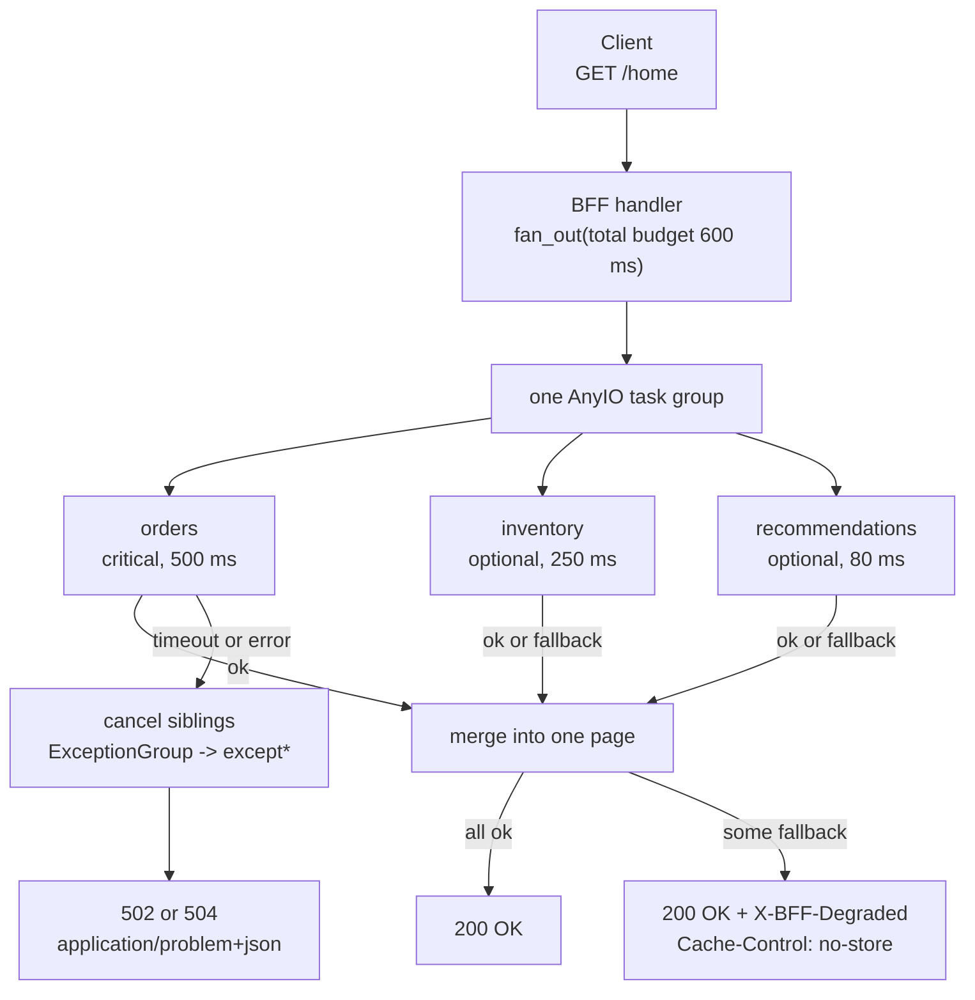

# The Backend-for-Frontend (BFF) Pattern: Parallel Fan-Out with AnyIO TaskGroups, Hedged Timeouts, and Graceful Partial Degradation

> [!summary] Claim
> A BFF turns one client request into N upstream calls, so its latency is the slowest call and its availability is the product of every dependency, unless each upstream gets an explicit contract (critical or optional, a deadline, a static fallback) and one AnyIO task group enforces it: optional failures become a `200 OK` with fallback data and a degraded marker, critical failures cancel the siblings and become a `502` or `504` problem document.

Part of [API Gateways Proxies and Edge Architecture](README.md) in [API Engineering](../README.md).

## TL;DR

- Mechanism: `fan_out` starts every upstream call as a child of one `anyio.create_task_group()`, each under its own `move_on_after(deadline)`, all under one overall budget scope, so wall time is the slowest child, not the sum.
- Contract rule: every upstream is declared `critical` (its failure fails the page with `502` or `504`) or optional (its failure or timeout becomes a deep copy of a static fallback plus a degraded marker); the `Policy` constructor rejects any other combination.
- Trap: a degraded `200 OK` is heuristically cacheable (RFC 9110 Section 15.1), so a CDN can replay the fallback long after the upstream recovered; the lab sends `Cache-Control: no-store` (RFC 9111 Section 5.2.2.5) on every degraded page.
- Portability: the lab ran once, on CPython 3.14.6 under macOS arm64, with the AnyIO asyncio backend; every other interpreter, backend, and server cell below is marked not run or cites a source.
- Do not use it when one upstream owns the whole page (a plain proxy is enough), when the calls are not read-only (do not hedge writes), or when a shared aggregation layer would serve many UIs (that is the generic aggregator Sam Newman warns against).

## Mental model



The handler opens one task group and starts the three calls at once, so the slowest permitted call, not the sum, bounds latency.
Optional children (`inventory`, `recommendations`) catch their own timeout or exception and write a fallback, so the group never sees an error from them and the siblings keep running.
A critical child (`orders`) raises `UpstreamFailure`; AnyIO cancels the siblings, waits for their cleanup, and raises one exception group that `except*` converts to `AggregationFailed`, which the handler maps to a `502` or `504` problem document.
The overall budget is an outer scope: when it expires, unfinished optional children get their fallback and an unfinished critical child fails the page with a timeout.

## How it works

### What a BFF is, and what it is not

Sam Newman describes a Backend for Frontend as one server-side backend per user experience, owned by the team that builds the UI, as used at REA and SoundCloud, with the guideline "one experience, one BFF", which he credits to Stewart Gleadow (samnewman.io/patterns/architectural/bff).
The motivation is that one general-purpose API cannot serve desktop web and mobile well, and that a UI needing several downstream calls per screen should make one call to its own aggregator instead.
Newman is explicit about the failure mode: merging BFFs back into a general-purpose aggregating edge service "has proven time and again to lead to highly bloated code" (same page).
He also notes that an aggregated page cached by a reverse proxy must expire no later than the freshest piece of content inside it.

The name collides with a different pattern.
RFC 10017 Section 6.1 ("Backend for Frontend (BFF)", published August 2026) defines a BFF as the OAuth client for a browser application: it holds access and refresh tokens in a cookie-based session and forwards requests to resource servers with the token attached.
That is token mediation, covered in [[OAuth-2-0-for-Browser-Based-Applications-BFF-and-Cookies-RFC-10017]]; this note is about response aggregation.
The two are often the same process, but they are separate concerns with separate failure modes.

This note's BFF is not an API gateway either.
The gateway's job (edge TLS, authentication offload, coarse rate limits, routing) is in [[API-Gateway-Architecture-Responsibilities-and-Anti-Patterns]]; the BFF sits behind it and owns the page's shape and its degradation policy.

### Fan-out with an AnyIO task group

`fan_out` creates one task group and calls `tg.start_soon(_run_one, ...)` per upstream (`bff_aggregation.py`, `fan_out`).
On the asyncio backend the group is `TaskGroup` in `anyio/_backends/_asyncio.py` (anyio 4.16.0, `TaskGroup.__aexit__`), and its exit path has three properties this design leans on:

1. When the body raises (`__aexit__`) or a child raises (the `task_done` callback in `TaskGroup._spawn`), it records the exception and calls `self.cancel_scope.cancel()`; a `CancelledError` is not recorded.
2. It then waits in a loop on `_on_completed_fut` until `self._tasks` is empty; if the owner is cancelled during that wait, it sets `wait_scope.shield = True` and keeps waiting, so every child's `finally` block finishes before the owner resumes.
3. If any exception was recorded it raises `BaseExceptionGroup("unhandled errors in a TaskGroup", ...)`, so the owner never sees a bare child exception, even when only one child failed (the lab's last test pins this).

AnyIO uses level cancellation inside a cancel scope: as long as a task stays inside an effectively cancelled scope, every checkpoint raises again, while bare asyncio uses edge cancellation, where a task may swallow one `CancelledError` and continue (AnyIO docs, "Differences between asyncio and AnyIO cancellation semantics").
That is why a cancelled sibling's cleanup `await` is itself cancelled unless it is shielded with `CancelScope(shield=True)`; the lab's fallback children have no cleanup awaits, so they exit at the first checkpoint.

`asyncio.gather(*aws)` with the default `return_exceptions=False` propagates the first exception to the awaiter, but "other awaitables in the aws sequence won't be cancelled and will continue to run" (Python docs, `asyncio.gather`).
In a BFF that means a failed critical call returns `502` to the client while the slow sibling keeps holding a pooled connection until its own timeout.
`asyncio.TaskGroup` (added in 3.11) cancels siblings too but differs from AnyIO in how cancellation is delivered and in its spawn API (AnyIO docs, "Differences with asyncio.TaskGroup"); the sibling note [[AnyIO-Structured-Concurrency-TaskGroups-CancelScopes-and-ExceptionGroups]] covers those differences, and this note uses AnyIO throughout.

### Deadlines: per call, and one budget for the page

Each child wraps its call in `with anyio.move_on_after(policy.deadline_s) as scope:` and reads `scope.cancelled_caught` afterwards (`anyio/_core/_tasks.py`, `move_on_after`).
`move_on_after` computes the deadline when it is called, not when the `with` block is entered (the 4.16.0 docstring says this "will be changed in v5.0"), so create it inline, as `_run_one` does, and never store the scope object for later use.
`fail_after` raises `TimeoutError` instead; `move_on_after` is right here because an optional timeout is an expected outcome, not an error.

The overall budget is a second, outer `move_on_after(total_deadline_s)` around the whole group.
Nested scopes compose by earliest effective deadline, so a child with `deadline_s=5.0` inside a `0.05` budget is cancelled at 50 ms; the lab test `test_overall_budget_caps_total_time_below_the_per_call_deadlines` pins this.
Without the outer scope, the page's worst case is the largest per-call deadline (500 ms for `orders` in the lab defaults); with it, the budget (600 ms by default) is also a hard cap for work added later, such as a new upstream with a long deadline.
When the budget expires, children that never recorded an outcome are filled in after the group exits: optional ones get their fallback with detail `budget`, critical ones become timeout failures.

The deadline must be enforced by the BFF, not delegated to the HTTP client.
`httpx.Timeout(5.0)` is the default (`httpx/_config.py`, `DEFAULT_TIMEOUT_CONFIG`, httpx 0.28.1), and its `read` timeout is applied per socket read: httpcore 1.0.9 wraps each `receive` in `anyio.fail_after(timeout)` (`httpcore/_backends/anyio.py`, `AnyIOStream.read`).
An upstream that sends one byte every four seconds never trips a 5 s read timeout, so only an outer cancel scope bounds total time.

### Classifying upstreams: critical versus optional

A page has a product-level answer to "what is the page without X".
The lab encodes it in `Policy` (`deadline_s`, `critical`, `fallback`, `hedge_after_s`), and `__post_init__` makes illegal combinations unrepresentable at construction:

| Combination | Result | Reason |
|---|---|---|
| `critical=True`, `fallback=None` | valid | failure fails the page |
| `critical=False`, `fallback={...}` | valid | failure degrades the page |
| `critical=True`, `fallback={...}` | `ValueError` | a fallback would silently override the criticality |
| `critical=False`, `fallback=None` | `ValueError` | the degraded body would have a hole |
| `deadline_s` not finite or `<= 0` | `ValueError` | `nan` and `inf` disable the timeout silently |
| `hedge_after_s` not in `(0, deadline_s)` | `ValueError` | a hedge after the deadline never fires |

The lab defaults are `orders` critical at 500 ms, `inventory` optional at 250 ms with `{"stock": "unknown"}`, and `recommendations` optional at 80 ms with an empty list.
Optional children catch `Exception`, never `BaseException`, because cancellation must propagate out of the child for sibling cancellation and deadlines to work, and `except Exception` leaves the cancellation exception to AnyIO's scopes.
By reading the code (not run as a mutation): with `except BaseException`, a budget expiry would be recorded as status `error` with detail `CancelledError` instead of `timeout` with `budget`, which `test_overall_budget_caps_total_time_below_the_per_call_deadlines` asserts; the slow call's `finally` block runs either way, so the trace assertions alone would not catch it.
The consequence of catching `Exception` is that a programming error (a `TypeError` in a mapper) also degrades silently; the child records `detail` as the exception class name for logs, and a production BFF should log it and alert on a nonzero degraded rate.

### Critical failure: fail fast, report what failed first

A critical child records its outcome and raises `UpstreamFailure`.
The group cancels every sibling, waits for their cleanup, and raises an exception group; `fan_out` handles it with `except* UpstreamFailure` and builds `AggregationFailed` from the leaves.
`return`, `break`, and `continue` are disallowed inside `except*` (PEP 654, Specification: "continue, break, and return are disallowed in except* clauses, causing a SyntaxError"), so the code assigns `failures` inside the clause and raises after it.

Fail-fast means the failure list is not a census.
Only critical failures that are already running to completion in the same event-loop iteration are collected; later ones are cancelled with their siblings.
The lab proves the collected case by releasing two critical children from one `Event` (`test_two_simultaneous_critical_failures_are_both_collected_by_except_star`), and proves the cancelled case by asserting the slow sibling's cleanup ran and the call returned in under 2 s though its deadline was 5 s.

Status mapping follows RFC 9110: `502 Bad Gateway` means the server, acting as a gateway, "received an invalid response from an inbound server" (Section 15.6.3), and `504 Gateway Timeout` means it "did not receive a timely response from an upstream server" (Section 15.6.5).
`AggregationFailed.status_code` returns `504` if any failure is a timeout, else `502`.
`503 Service Unavailable` (Section 15.6.4) describes the BFF itself being overloaded or draining and may carry `Retry-After` (Section 10.2.3); it is a load-shedding decision at the BFF, not an upstream-failure mapping (see [[Load-Shedding-Priority-Traffic-Classes-and-LIFO-Queue-Management]]).

The error body is a Problem Details document (RFC 9457 Section 3): `type` defaults to `about:blank` (Section 3.1.1), in which case `title` SHOULD be the HTTP status phrase (Section 4.2.1), served as `application/problem+json`.
`failed` is an extension member (Section 3.2) listing the BFF's own logical upstream names and statuses; clients MUST ignore extensions they do not recognize, so adding it is compatible.
It deliberately omits exception text and hostnames; the lab test asserts that an upstream exception message containing a credential and an IP never reaches the response body.
See [[Problem-Details-for-HTTP-APIs-RFC-9457]].

### Signalling and caching a degraded page

A degraded response still answers the client's request, so `200 OK` is the honest status, but the client and every cache must be able to tell it apart.
The lab adds a `_meta.degraded` list and per-upstream `{"status", "attempts"}` in the body, and a non-standard `X-BFF-Degraded` header (lab-defined, not a registered field) for log pipelines and gateways that cannot parse bodies.

`200` is "heuristically cacheable" (RFC 9110 Section 15.1, which lists 200, 203, 204, 206, 300, 301, 308, 404, 405, 410, 414, and 501), so a shared cache may keep a fallback page when explicit freshness is absent or generous.
`no-store` means a cache "MUST NOT store any part of either the immediate request or the response and MUST NOT use the response to satisfy any other request" (RFC 9111 Section 5.2.2.5); the lab sets it only on degraded pages and leaves healthy pages without a `Cache-Control` header (its test asserts both).
A middle path is a short `max-age` on degraded pages, accepting a bounded replay window; that trade-off belongs to the edge, see [[Edge-Caching-and-CDN-Shielding-for-Dynamic-and-Public-APIs]].

RFC 5861 Section 4 `stale-if-error` solves the opposite problem: a cache may serve a stale response when the origin yields "a 500, 502, 503, or 504".
A BFF that degrades to `200` never triggers it for optional failures, and a BFF that returns `502` for a critical failure lets a cache with `stale-if-error` mask the outage with the last good full page, which is often better than either.
Whether the cache is allowed to do that is a product decision encoded in `Cache-Control` on the healthy response.

### Hedged calls

A hedged request sends the same call to a second replica after a short delay and uses whichever answers first, cancelling the other (Dean and Barroso, "The Tail at Scale", CACM 2013).
The paper's guidance is to defer the second request until the first has been outstanding longer than the 95th-percentile latency for that request class, which caps extra load near 5%, and it reports a 1,000-key BigTable read across 100 servers where a hedge after 10 ms cut the 99.9th-percentile from 1,800 ms to 74 ms for 2% more requests.
The same paper says the technique works because the delay is often interference, not something inherent in the request, and that cancellation speed limits how aggressive hedging can be.

`_call_hedged` implements the minimal version with an inner task group:

1. Start attempt 0.
2. Wait up to `hedge_after_s` for attempt 0 to fail (`first_failed` event inside a `move_on_after`).
3. Start attempt 1 either when the delay elapses or immediately when attempt 0 raised.
4. The first success appends to `winner` and cancels the inner group, which cancels the other attempt.
5. If both raise, re-raise the last error, which the outer `_run_one` turns into a fallback or a critical failure.

At most two attempts run, and the per-call deadline covers the whole chain, mirroring gRPC's rule that deadlines "apply to the entire chain of hedged requests" (gRFC A6).
gRFC A6 is the reference design: `hedgingPolicy` has `maxAttempts` (greater than 1, values above 5 treated as 5), `hedgingDelay`, and `nonFatalStatusCodes`; a non-fatal error shortcuts the next hedge's delay, any other error cancels everything; and a per-server token bucket (`maxTokens` in (0, 1000], `tokenRatio`) disables hedging when failures outpace successes, with hedges sent only while `token_count` exceeds `maxTokens / 2`.
The lab omits the throttle; a production hedger without one doubles load exactly when upstreams are failing, which is the retry-storm mechanism in [[Retry-Budgets-and-Preventing-Cascading-Retry-Amplification-Storms]].

Hedging is only valid for operations safe to execute twice.
RFC 9110 Section 9.2.2 defines idempotent methods (`PUT`, `DELETE`, and safe methods) as those where repeating the request has the same intended effect; gRFC A6 states the same requirement as "safe to execute multiple times without adverse affect".
A BFF aggregating reads can hedge; a BFF that forwards a `POST` must not, and must not rely on the idempotency of a downstream that was not designed for it.
The full treatment is in [[Hedged-Requests-and-Tail-Latency-Taming-at-Scale]].

Amazon's Builders' Library names the three strategies precisely: retry (again, later), proactive retry (several in parallel, first wins, which is hedging), and fallback ("a different mechanism to achieve the same result").
The BFF uses all three at different layers, and the next subsection is about the one Amazon says it almost never uses.

### Fallbacks: what is safe to serve

Dean and Barroso note that "results from ads or spelling-correction systems are easily skipped for Web searches if they do not respond in time" ("good enough" results): optional content may be omitted.
That is the safe class: a fallback that is static, local, requires no network call, and is obviously a lower-quality version of the real thing (an empty recommendation list, `"stock": "unknown"`).
The Hystrix documentation says the same: write the fallback "without any network dependency, from an in-memory cache or by means of other static logic", and if it must call out, use another isolated command (Hystrix wiki, "How it Works", step 8).

The unsafe class is a fallback that shifts load or changes semantics.
Amazon's Builders' Library describes a retail outage that "occurred around 2001": web servers fell back to querying the supply-chain database directly when their per-host cache failed, the caches failed together, the database locked up, and in the article's words the fallback turned "a partial website outage (not being able to display shipping speeds) into a full-site outage" that also halted fulfillment centers.
Its conclusions apply here: fallbacks are hard to test, can fail themselves, and hide latent bugs that appear months later.
The Google SRE book makes the same point for degraded modes generally: "the code path you never use is the code path that (often) doesn't work", and the fix is to exercise it regularly (Chapter 22, "Addressing Cascading Failures", section "Load Shedding and Graceful Degradation").

So the lab's fallbacks are values, not calls, and every fallback is exercised by a test.
A production BFF should also exercise degradation continuously, for example by forcing a small fraction of requests to take the fallback path in a canary, so the path is never cold.

### Where the request's lifetime ends

A plain `JSONResponse` does not watch for client disconnects: `Response.__call__` sends the start and body messages and returns (starlette 1.10.0 `starlette/responses.py`, `Response.__call__`).
Uvicorn marks the cycle disconnected on `connection_lost` and wakes `receive()`, but the code path does not cancel the application task (uvicorn 0.54.0 `uvicorn/protocols/http/h11_impl.py`, `H11Protocol.connection_lost` sets `cycle.disconnected` and `message_event`; the only `cancel` call in that file is for the keep-alive timer).
Only `StreamingResponse` races `listen_for_disconnect(receive)` against streaming, and only when the ASGI `spec_version` is below 2.4 (`StreamingResponse.__call__`); Uvicorn 0.54.0's HTTP protocols advertise `spec_version` `"2.3"` (`uvicorn/protocols/http/h11_impl.py`, `H11Protocol.handle_events`), so under Uvicorn that race is active.
Hypercorn 0.18.0 behaves the same way for a plain response: on `StreamClosed` it puts `{"type": "http.disconnect"}` on the app's receive queue and does not cancel the app task (`hypercorn/protocol/http_stream.py`, `HTTPStream.handle`).
For a fan-out handler, an abandoned request therefore keeps running its upstream calls until the per-call deadlines and the overall budget end them, which is why the budget is a mandatory part of the contract and not an optimization.

### Connection-pool arithmetic

A fan-out multiplies connection demand: one client request needs up to N upstream connections at once, plus one more per hedge.
`httpx` defaults to `Limits(max_connections=100, max_keepalive_connections=20)` (`httpx/_config.py`, `DEFAULT_LIMITS`, httpx 0.28.1), so at 3 upstreams the BFF saturates a default pool at about 33 concurrent client requests, before hedging.
A saturated pool turns into pool timeouts, which look like upstream timeouts and degrade optional content for everyone.
Partition pools per upstream (see [[Bulkhead-Isolation-and-Per-Dependency-Resource-Partitioning]]) so a slow `recommendations` service cannot starve `orders`.

## Numbers and limits

| Quantity | Value | Source |
|---|---|---|
| P(page slow) with N parallel calls, each slow with probability p | `1 - (1 - p)^N`; N=3, p=1% gives 2.97%; N=5 gives 4.90%; N=10 gives 9.56% | Arithmetic from the formula in the table; the paper makes the same argument at N=100 |
| Requests slower than 1 s, 100 servers each at 1% | 63% | Dean and Barroso, CACM 2013, the fan-out example before Table 1 |
| Real Google service, p99 single leaf vs all leaves | 10 ms vs 140 ms; waiting for the slowest 5% accounts for half of the 140 ms (p99 of 95% finishing is 70 ms) | Dean and Barroso, CACM 2013, Table 1 and the paragraph after it |
| Hedge after p95 latency | extra load about 5% | Dean and Barroso, CACM 2013 |
| BigTable 1,000 keys on 100 servers, 10 ms hedge | p99.9 from 1,800 ms to 74 ms, 2% more requests | Dean and Barroso, CACM 2013 |
| gRPC hedging attempts | `maxAttempts` greater than 1; above 5 treated as 5 | gRFC A6, validation of `hedgingPolicy` |
| gRPC hedge throttle | `maxTokens` in (0, 1000]; hedges only while `token_count > maxTokens / 2`; success adds `tokenRatio` | gRFC A6, throttling section |
| httpx default timeout and pool | `Timeout(timeout=5.0)`; `Limits(max_connections=100, max_keepalive_connections=20)` | httpx 0.28.1 `httpx/_config.py` (as of 2026-11) |
| Lab defaults | `orders` 500 ms critical, `inventory` 250 ms, `recommendations` 80 ms, budget 600 ms | `bff_aggregation.py`, `DEFAULT_POLICIES` |
| Status codes | `502` Section 15.6.3, `503` Section 15.6.4, `504` Section 15.6.5 | RFC 9110 |
| Lab run | 28 passed in 0.94 s, CPython 3.14.6, macOS 27.3 (Darwin 27.3.0) arm64, `uv run --frozen pytest ... -q` | re-measured by the fact-check, 2026-11-21, one run (the draft's run took 3.46 s; wall time is not a claim of the note) |

The serial-versus-parallel difference in the lab defaults is bounded by the policies, not measured: a sequential worst case is 500 + 250 + 80 = 830 ms of deadlines against a 500 ms parallel worst case (the largest single deadline), capped at 600 ms by the budget.
No latency benchmark was run for this note.

## Portability

| Dimension | Status | Evidence |
|---|---|---|
| CPython 3.14.6 (macOS arm64) | ran: 28 passed | one pytest run, output in Worked example |
| CPython 3.12.16, 3.13.18, 3.14.10, 3.15.2, 3.15.2t free-threaded | not run | the user paused the multi-interpreter matrix on 2026-11-11; 3.13.18, 3.14.10, and 3.15.2 are installed on this machine, 3.12.16 and 3.15.2t are not (3.12.13 and 3.15.0b3t are) |
| `except*` and `asyncio.TaskGroup` | need CPython 3.11 or later | Python docs ("Added in version 3.11: asyncio.TaskGroup"); the lab declares `requires-python = ">=3.12,<3.16"` |
| AnyIO asyncio backend | exercised by the one run | pytest-asyncio strict mode in the lab |
| AnyIO Trio backend | not run: Trio is not installed in the lab workspace and every test is marked `@pytest.mark.asyncio` | the lab implementation imports only `anyio` (no `asyncio` symbol) and uses backend-neutral task group, cancel scope, and sleep calls; the AnyIO cancellation docs state that "Cancellation in AnyIO follows the model established by the Trio framework" and `pip install anyio[trio]` is the documented extra; whether the tests pass on Trio is a claim this note does not make |
| Starlette 1.10.0 plain `Response` ignores disconnect | source read | `starlette/responses.py`, `Response.__call__` |
| Uvicorn 0.54.0 does not cancel the app on disconnect | source read | `uvicorn/protocols/http/h11_impl.py`, `connection_lost` and `RequestResponseCycle.receive`; HTTP scope `spec_version` is `"2.3"` |
| Hypercorn 0.18.0 does not cancel the app on disconnect | source read | `hypercorn/protocol/http_stream.py`, `HTTPStream.handle` puts `http.disconnect` on the app queue on `StreamClosed` |
| Granian 2.8.7 does not cancel the app on disconnect | source read at tag `v2.8.7` (not run) | the ASGI HTTP path in `src/asgi/callbacks.rs` (`call_http`) creates a `SetOnce` disconnect guard and returns a `GuardedReceiver` (`src/utils.rs`) whose `Drop` sets the guard if the response was not yet delivered; `src/asgi/io.rs` (`ASGIHTTPProtocol::receive`) then resolves the pending `receive()` with `http.disconnect`; the only `spawn_cancellable` call in `src/asgi/http.rs` is on the WebSocket upgrade path, and the app task is scheduled with `call_soon` (`src/callbacks.rs`) with no task `cancel`; the compiled core is `_granian.cpython-314-darwin.so`, so this is a reading of the release source, not a run |
| HTTP/1.1, HTTP/2, HTTP/3 | status code and caching semantics are version independent; transport not exercised | RFC 9110 and RFC 9111 define the semantics; the lab uses the in-process ASGI transport only |
| Debian and Alpine containers | not run | none checked in; brief paused container legs |

## Worked example

Implementation: [implementation](../labs/src/api_labs/f17_api_gateways_proxies_and_edge_architecture/bff_aggregation.py).
Test: [test](../labs/tests/f17_api_gateways_proxies_and_edge_architecture/test_backend_for_frontend_bff_aggregation_fan_out_and_partial_degradation.py).
The upstreams are injected callables `(attempt: int) -> awaitable of dict`; a slow upstream is `anyio.sleep_forever()`, so no test depends on wall-clock sleeps for its outcome, and concurrency is proven with an `Event` rendezvous that a sequential implementation cannot pass.

Simplified excerpt (docstrings, argument validation, and the budget-expiry fill-in omitted): the per-upstream child and the fan-out.

```python
async def _run_one(name, call, policy, attempts, data, outcomes) -> None:
    value: JsonObject | None = None
    status: Status = "ok"
    detail = ""
    try:
        with anyio.move_on_after(policy.deadline_s) as scope:
            value = await _call_hedged(call, policy.hedge_after_s, attempts)
    except Exception as exc:  # optional upstreams must not cancel their siblings
        status, detail = "error", type(exc).__name__
    else:
        if scope.cancelled_caught:
            status, detail = "timeout", "deadline"
    outcome = Outcome(name, status, attempts.started, detail)
    outcomes[name] = outcome
    if status == "ok" and value is not None:
        data[name] = value
    elif policy.critical:
        raise UpstreamFailure(outcome)
    else:
        data[name] = _fallback_for(policy)  # copy.deepcopy of the policy's fallback


async def fan_out(calls, policies, *, total_deadline_s) -> Aggregate:
    ...
    try:
        with anyio.move_on_after(total_deadline_s) as budget:
            async with anyio.create_task_group() as tg:
                for name, call in calls.items():
                    tg.start_soon(
                        _run_one, name, call, policies[name], attempts[name], data, outcomes
                    )
    except* UpstreamFailure as group:  # `return` is a SyntaxError inside except*
        failures = tuple(
            sorted(
                (e.outcome for e in group.exceptions if isinstance(e, UpstreamFailure)),
                key=lambda o: o.name,
            )
        )
    ...
    if failures:
        raise AggregationFailed(failures)
    return Aggregate({n: data[n] for n in policies}, {n: outcomes[n] for n in policies})
```

Simplified excerpt: the hedger (full function, docstring omitted).

```python
async def _call_hedged(call: Call, hedge_after_s: float | None, attempts: _Attempts) -> JsonObject:
    if hedge_after_s is None:
        return await call(0)
    winner: list[JsonObject] = []
    errors: list[Exception] = []
    first_failed = anyio.Event()

    async with anyio.create_task_group() as tg:

        async def attempt(index: int) -> None:
            try:
                value = await call(index)
            except Exception as exc:
                errors.append(exc)
                first_failed.set()
                return
            if not winner:
                winner.append(value)
                tg.cancel_scope.cancel()

        tg.start_soon(attempt, 0)
        with anyio.move_on_after(hedge_after_s):
            await first_failed.wait()
        attempts.started = 2
        tg.start_soon(attempt, 1)
    if winner:
        return winner[0]
    raise errors[-1]
```

What the tests prove, by name (every test is `@pytest.mark.unit`; the mutation check was not run, see the report):

| Test | Behavior it claims |
|---|---|
| `test_fan_out_starts_every_upstream_before_any_finishes` | all three calls are in flight together |
| `test_slow_optional_upstream_returns_200_with_fallback_and_no_store` | 80 ms optional timeout gives `200`, fallback body, `X-BFF-Degraded`, `no-store`, cancelled call |
| `test_healthy_response_carries_no_degraded_marker_and_no_cache_directive` | healthy pages are unmarked and uncached-directive-free |
| `test_optional_error_degrades_without_cancelling_the_siblings` | an optional exception does not cancel `orders` |
| `test_per_call_deadline_marks_timeout_with_deadline_detail` | per-call deadline outcome |
| `test_overall_budget_caps_total_time_below_the_per_call_deadlines` | outer budget wins over 5 s per-call deadlines |
| `test_fallback_is_copied_so_mutating_one_page_cannot_corrupt_the_next` | fallbacks are deep-copied |
| `test_critical_failure_cancels_the_slow_sibling_instead_of_waiting_for_its_deadline` | fail fast and sibling cleanup |
| `test_two_simultaneous_critical_failures_are_both_collected_by_except_star` | `except*` collects both |
| `test_status_code_is_504_when_any_failure_is_a_timeout_else_502` | status mapping |
| `test_critical_error_maps_to_502_problem_details_without_leaking_exception_text` | `502`, `application/problem+json`, no leak |
| `test_critical_timeout_maps_to_504` | `504` |
| `test_outer_cancellation_cancels_every_child_before_returning` | structured cleanup under outer cancellation |
| `test_hedge_launches_second_attempt_after_delay_and_cancels_the_loser` | hedge order `a0:start, a1:start, a0:cancelled` |
| `test_hedge_is_not_launched_when_the_first_attempt_answers_in_time` | no extra load on the fast path |
| `test_hedge_launches_immediately_when_the_first_attempt_fails` | early launch, 3600 s delay not waited |
| `test_hedge_with_both_attempts_failing_degrades_to_the_fallback` | both fail gives fallback and `attempts == 2` |
| `test_policy_rejects_illegal_combinations` (9 cases) | `Policy` invariants |
| `test_fan_out_rejects_mismatched_names_and_bad_budget` | input validation |
| `test_anyio_task_group_raises_exception_group_not_the_bare_exception` | `ExceptionGroup` always wraps |

Captured output (one run, `uv run --frozen pytest tests/f17_api_gateways_proxies_and_edge_architecture/test_backend_for_frontend_bff_aggregation_fan_out_and_partial_degradation.py -q` from `labs/`; CPython 3.14.6 (main, Jun 23 2026), macOS 27.3, Darwin 27.3.0 arm64; rerun by the fact-check on 2026-11-21):

```text
............................                                             [100%]
28 passed in 0.94s
```

## Pitfalls

> [!warning] Catching `BaseException` in a child breaks cancellation
> Trigger: a child wraps its call in `except BaseException` (or a bare `except:`) to "always return a fallback".
> Symptom: sibling cancellation, deadlines, and shutdown stop working because the child swallows the cancellation and may keep running while the group waits for it.
> Fix: catch `Exception` only, as `_run_one` does, and shield cleanup `await`s with `CancelScope(shield=True)`.

> [!warning] `asyncio.gather` leaves siblings running after a failure
> Trigger: `await asyncio.gather(orders(), inventory(), recs())` with the default `return_exceptions=False`.
> Symptom: the first exception reaches the handler and the client gets an error, but the other calls "won't be cancelled and will continue to run" (Python docs), holding pooled connections and upstream capacity after the response.
> Fix: use a task group, or cancel explicitly, and give each call a deadline.

> [!warning] A degraded `200` gets cached
> Trigger: the BFF returns the fallback page with a `200` and no `Cache-Control`, behind a CDN or reverse proxy.
> Symptom: `200` is heuristically cacheable (RFC 9110 Section 15.1), so users keep seeing a page without recommendations after the upstream recovered; no alert fires because every response was `200`.
> Fix: `Cache-Control: no-store` or a short `max-age` on degraded pages, and a degraded-rate metric (see the sibling edge-caching note).

> [!warning] A fallback that calls a shared dependency
> Trigger: "if the cache is down, query the database directly" or "if recommendations is down, call the legacy recommender".
> Symptom: the fallback concentrates load on a dependency sized for the cached path; in the Amazon retail incident from around 2001 described in the Builders' Library, all caches failed together and the direct-to-database fallback locked the supply-chain database, turning a missing shipping-speed feature into a site-wide and fulfillment-wide outage.
> Fix: static fallbacks only, exercise them regularly, and convert real fallbacks to failovers that run continuously (Builders' Library recommendation).

> [!warning] Trusting the client library's read timeout
> Trigger: `httpx.Timeout(5.0)` as the only time bound.
> Symptom: the 5 s applies to each socket read (httpcore 1.0.9 wraps each `receive` in `anyio.fail_after`), so a slow-drip upstream holds the call open far beyond 5 s and the page misses its latency target.
> Fix: an outer `move_on_after` per call and a budget per page, as in the lab.

> [!warning] Hedging a non-idempotent call
> Trigger: a hedge policy applied to a call that creates or charges something.
> Symptom: two copies execute; the loser's cancellation does not undo a side effect already committed upstream.
> Fix: hedge only safe reads (RFC 9110 Section 9.2.2; gRFC A6), and put a retry throttle on every hedge policy.

> [!warning] Mutable shared fallbacks
> Trigger: returning `policy.fallback` itself in the response structure.
> Symptom: a later step that appends to the list changes the fallback for every subsequent request; the lab test appends `"poison"` to one page's fallback and asserts the next page is clean.
> Fix: deep-copy per use, as `_fallback_for` does.

> [!warning] Expecting the group to report every failure
> Trigger: asserting that `AggregationFailed.failures` lists all failing critical upstreams.
> Symptom: the first critical failure cancels the others, so the list contains only failures that completed in the same loop iteration.
> Fix: log per-upstream outcomes from `Outcome` on every path, and treat the failure list as "what stopped the page", not a health report.

## Security and robustness

Authorization is the hardest property of a BFF and the easiest to lose.
Each upstream call must carry the end user's credential or an equivalent, so the upstream's object-level checks still run; a BFF that calls `orders` with its own broad service identity and a user-supplied id turns a missing check inside the BFF into broken object level authorization.
The vault covers the control in [[Defeating-BOLA-API1-2023-Tenant-Scoped-Queries-and-PostgreSQL-RLS]] and the threat model in [[OWASP-API-Security-Top-10-2023-Complete-Threat-Model]]; the BFF-specific rule is to forward identity, never to re-derive it from request fields.

Fan-out is an amplifier.
One client request becomes N upstream requests (plus hedges), and a per-client limit at the gateway counts one.
OWASP API4:2023 "Unrestricted Resource Consumption" lists execution timeouts and "number of operations to perform in a single API client request" among the limits to enforce; the lab's total budget and its bounded attempt count (at most two per upstream) are those limits.
Rate limit at the BFF by the cost of the page (see [[Multi-Tier-Rate-Limiting-Quotas-Concurrency-Limits-and-Cost-Budgets]]), not only by request count.

OWASP API10:2023 "Unsafe Consumption of APIs" says developers tend to trust data from other APIs and lists failing to "implement timeouts for interactions with third-party services" and failing to validate data from integrated APIs as vulnerabilities.
A BFF merges many upstream payloads into one response, so it should validate each against a schema before merging, project only the fields the UI needs (which also limits broken object property level exposure), and never forward upstream error text.
The lab's problem response carries only the BFF's logical names (`orders`) and statuses, and a test proves an exception message with a credential string does not appear in the body.

Degradation has its own abuse surface.
If an attacker can make the optional upstream slow for others (a shared pool, a shared tenant), degradation is a visible, cheap denial of a feature; per-upstream pools and per-tenant limits contain it.
Never put upstream-controlled strings in `X-BFF-Degraded`; the lab joins only the BFF's static upstream names, which avoids response-splitting and log-injection through that header.

Cancellation hazards: a cancelled sibling can be cancelled mid-write to a downstream session or cache.
Keep fan-out children read-only, which is also what makes hedging legal; if a child must write, shield its commit step and make it idempotent (see [[Cancellation-Semantics-CancelledError-Swallowing-and-Shielded-Cleanup]]).

## The principal's view

The decision is not "use a BFF" but "which team owns the aggregation, and what does the page promise when a dependency is down".
Newman's ownership rule is the organizational core: the BFF is owned by the team that owns the UI, one per user experience, so the UI team can change the shape and the degradation policy without negotiating with a platform team.
The cost is duplication across BFFs (the same three calls for a wish list on two clients) and N more deployables; Newman prefers tolerating duplication or pushing the shared aggregation to a domain-modeled downstream service over a shared generic aggregator.

The criticality table is a product contract, and it determines availability arithmetic.
If a page needs `k` critical dependencies with availabilities `a_i`, its ceiling is their product (for three critical dependencies at 99.9% each, about 99.7%, by multiplication); every optional dependency removed from the critical set removes a factor.
Moving a dependency from critical to optional is therefore the cheapest availability improvement in the system, and it is a decision for the product owner, not only for the engineer, because the degraded page must still be acceptable to ship.
Review the table as part of the design review, and record in each `Policy` why a dependency is critical.

Choose a different mechanism when the shape of the problem differs.
If clients need arbitrary field selection across a graph and you can afford resolver-level cost control, a GraphQL layer with batching moves composition to the client's query (see [[The-GraphQL-N-Plus-1-Problem-and-DataLoader-Tick-Batching-Internals]]), at the price of query-cost and depth limits.
If the web client is on a fast network with few calls, Newman notes the desktop web may not need a BFF and can call services directly.
If the aggregation is identical for every client, push it into a downstream domain service.
If the work is write-heavy or multi-step, use an orchestrated workflow with sagas, not a request-scoped fan-out.

Operationally, instrument the BFF for degradation as a first-class signal: degraded rate per upstream, hedge rate (extra load), budget-expiry rate, and the age of the last time each fallback path ran.
Alert on a nonzero degraded rate sustained over minutes, because a silent `200` is exactly what hides this class of outage.
Coordinate the BFF's deadline with the gateway and mesh timeouts and retries above and below it, or the layers multiply (see [[Proxy-and-Application-Timeout-and-Retry-Interaction-Hazards]]); the BFF's total budget must be smaller than the gateway's request timeout so the BFF, not the gateway, decides what the client sees.

## Interview questions

> [!question] L5: Why does a BFF fan out with a task group instead of awaiting each upstream in turn?
>
> > [!success]- Answer
> > Awaiting in sequence makes latency the sum of the upstream latencies, and a task group makes it the maximum.
> > With the lab deadlines the sequential worst case is 500 + 250 + 80 = 830 ms against 500 ms in parallel, bounded by the 600 ms budget.
> > The group also gives structured cleanup: every child finishes or is cancelled before the handler continues.
> >
> > Follow-up: What does the page's availability look like if the three calls are sequential versus parallel?

> [!question] L5: When only the optional recommendations service times out, what does the client get and why not a `504`?
>
> > [!success]- Answer
> > A `200 OK` with the real orders data, the fallback recommendations, `_meta.degraded == ["recommendations"]`, `X-BFF-Degraded: recommendations`, and `Cache-Control: no-store`.
> > A `504` (RFC 9110 Section 15.6.5) is for a gateway that could not get a timely answer it needed to complete the request, and here the recommendations are optional by the page's contract.
> > The degraded marker lets clients and operators see the difference.
> >
> > Follow-up: What would you change if the product owner decides recommendations are required?

> [!question] L5: Predict the output of the default BFF when `orders` and `inventory` answer immediately and `recommendations` never answers.
>
> > [!success]- Answer
> > Status `200` after about 80 ms (the `recommendations` deadline; the lab test asserts the outcome, not the latency).
> > The body has `orders` and `inventory` as returned, `recommendations` equal to `{"items": [], "source": "fallback"}`, and `_meta.outcomes.recommendations` equal to `{"status": "timeout", "attempts": 1}`.
> > Headers include `X-BFF-Degraded: recommendations` and `Cache-Control: no-store`.
> > The slow call's `finally` block ran, because the child's cancel scope cancelled it.
> >
> > Follow-up: What changes in the output if the policy gives `recommendations` a hedge after 10 ms and a second attempt answers at once?

> [!question] L6: Why does `asyncio.gather(a(), b(), c())` fail the BFF's requirements, and what does a task group change?
>
> > [!success]- Answer
> > With `return_exceptions=False`, `gather` propagates the first exception, but the other awaitables "won't be cancelled and will continue to run" (Python docs), so an abandoned call keeps holding a connection.
> > With `return_exceptions=True`, errors become values and you must classify them yourself, and nothing cancels a slow sibling on a critical failure.
> > An AnyIO task group cancels siblings on the first child failure, waits for their cleanup, and raises an exception group, so the handler cannot leave work behind.
> >
> > Follow-up: Why does the group raise an `ExceptionGroup` even when exactly one child failed?

> [!question] L6: Debug this API: product pages lack recommendations for an hour after a two-minute recommendations outage, and the logs show only `200` responses; what happened and what is the fix?
>
> > [!success]- Answer
> > The BFF returned the fallback page as `200 OK` with no `Cache-Control` directive, and `200` is heuristically cacheable (RFC 9110 Section 15.1), so the CDN stored the degraded page and replayed it.
> > The fix is `Cache-Control: no-store` (RFC 9111 Section 5.2.2.5) or a short `max-age` on degraded responses, which the lab does, plus a degraded-rate metric so a silent `200` cannot hide the outage.
> > Verify with the `Age` header and the CDN's cache status on an affected response.
> >
> > Follow-up: Why is `stale-if-error` (RFC 5861 Section 4) not a substitute here?

> [!question] L6: Why have both a per-call deadline and a total budget?
>
> > [!success]- Answer
> > Per-call deadlines express each dependency's importance (80 ms for optional recommendations, 500 ms for required orders).
> > The total budget bounds the page when many calls are slow or when a new dependency is added with a long deadline; nested scopes compose by the earliest deadline, so the budget wins.
> > The budget must sit below the gateway's own request timeout, or the gateway cuts the connection before the BFF can return its degraded page.
> >
> > Follow-up: What does the BFF return when the budget expires while `orders` is still running?

> [!question] L7+: When is hedging in a BFF correct, and what must accompany it?
>
> > [!success]- Answer
> > Only for operations safe to execute twice (RFC 9110 Section 9.2.2; gRFC A6), with a delay near the upstream's p95 so extra load stays near 5% (Dean and Barroso), at most two to five attempts, a deadline that covers the whole chain, fast cancellation of the loser, and a throttle that disables hedging when failures outpace successes (gRFC A6 token bucket).
> > Without the throttle, hedging doubles load when upstreams are already failing.
> > Hedging a charge or a write is incorrect even with idempotency keys unless the upstream was designed for concurrent duplicates.
> >
> > Follow-up: How do you choose the hedge delay for an upstream whose latency distribution shifts with load?

> [!question] L7+: Design the availability story for a BFF with six upstreams, two of which are required.
>
> > [!success]- Answer
> > Classify each dependency with the product owner and record the reason in its policy; the page's availability ceiling is the product of the critical dependencies' availabilities, and each optional dependency removed from that set removes a factor.
> > Give every optional dependency a static, network-free fallback, a deadline sized by its value to the page, and a metric for degraded rate; give the page a budget below the gateway timeout.
> > Isolate connection pools per upstream, exercise fallbacks continuously so they are never cold (SRE book, Amazon Builders' Library), and alert on a sustained nonzero degraded rate.
> >
> > Follow-up: What do you do when a required dependency's own SLO is worse than the page's target?

> [!question] L7+: A teammate proposes "if recommendations times out, call the legacy recommender instead". Respond.
>
> > [!success]- Answer
> > That is a networked fallback, the class Amazon's Builders' Library says it almost never uses: it is hard to test, can fail itself, moves load onto a dependency not sized for it, and has latent bugs that appear months later; the retail outage from around 2001 is the cautionary example.
> > If the legacy recommender is genuinely a second source, make it a failover that serves a share of traffic continuously, so it is exercised and capacity-planned.
> > Otherwise keep the fallback static.
> >
> > Follow-up: How would you test that a fallback path still works six months from now?

> [!question] L7+: When would you reject a BFF and use something else?
>
> > [!success]- Answer
> > When one upstream owns the entire page (a proxy or gateway route suffices), when clients are heterogeneous and need arbitrary field selection (consider GraphQL with cost limits), when the aggregation is identical across clients (push it into a domain service), or when the flow is a multi-step write (use a workflow with compensation).
> > Also reject a shared generic aggregator serving many UIs: Newman reports it "has proven time and again" to bloat, and ownership by the UI team is the point of the pattern.
> >
> > Follow-up: How do you keep two BFFs from drifting apart without creating a shared library that couples them?

## Related

Prerequisites: [[External-Authorization-Ext-Authz-and-Global-Rate-Limit-Filters]]

Next: [[Service-Mesh-Architecture-Sidecar-vs-Ambient-Mesh-and-East-West-Policy]]

See also: [[02-Programming-Languages/Python/Python-Backend-Interview-Prep/08-Microservices-and-Messaging]], [[02-Programming-Languages/Python/Python-Backend-Interview-Prep/16-Asyncio-Deep-Dive]], [[AnyIO-Structured-Concurrency-TaskGroups-CancelScopes-and-ExceptionGroups]], [[Hedged-Requests-and-Tail-Latency-Taming-at-Scale]], [[Proxy-and-Application-Timeout-and-Retry-Interaction-Hazards]], [[API-Gateway-Architecture-Responsibilities-and-Anti-Patterns]], [[Edge-Caching-and-CDN-Shielding-for-Dynamic-and-Public-APIs]], [[Bulkhead-Isolation-and-Per-Dependency-Resource-Partitioning]], [[Timeout-Taxonomy-Connect-Read-Write-Pool-and-Deadline-Propagation]], [[Problem-Details-for-HTTP-APIs-RFC-9457]], [[OAuth-2-0-for-Browser-Based-Applications-BFF-and-Cookies-RFC-10017]]

- Lab: `labs/tests/f17_api_gateways_proxies_and_edge_architecture/test_backend_for_frontend_bff_aggregation_fan_out_and_partial_degradation.py`

## Further reading

- [RFC 9110 HTTP Semantics](https://www.rfc-editor.org/rfc/rfc9110.html): Sections 9.2.2 (idempotent methods), 15.1 (heuristically cacheable codes), 15.6.3 to 15.6.5 (`502`, `503`, `504`).
- [RFC 9111 HTTP Caching](https://www.rfc-editor.org/rfc/rfc9111.html): Section 5.2.2.5 defines `no-store`.
- [RFC 9457 Problem Details for HTTP APIs](https://www.rfc-editor.org/rfc/rfc9457.html): Sections 3, 3.2, and 4.2.1 define the error body used for `502` and `504`.
- [RFC 5861 HTTP Cache-Control Extensions for Stale Content](https://www.rfc-editor.org/rfc/rfc5861.html): Section 4 defines `stale-if-error`.
- [RFC 10017 OAuth 2.0 for Browser-Based Applications](https://www.rfc-editor.org/rfc/rfc10017.html): Section 6.1 is the other meaning of "BFF".
- [Sam Newman, Backends For Frontends](https://samnewman.io/patterns/architectural/bff/): the origin of the pattern and its ownership rule.
- [Dean and Barroso, The Tail at Scale](https://www.barroso.org/publications/TheTailAtScale.pdf): fan-out tail amplification, hedged and tied requests, good-enough results.
- [gRFC A6 Client Retries](https://raw.githubusercontent.com/grpc/proposal/master/A6-client-retries.md): the reference hedging policy and throttle.
- [Amazon Builders' Library, Avoiding fallback in distributed systems](https://aws.amazon.com/builders-library/avoiding-fallback-in-distributed-systems/): why fallbacks fail and what to do instead.
- [Google SRE book, Addressing Cascading Failures](https://sre.google/sre-book/addressing-cascading-failures/): graceful degradation and keeping degraded paths exercised.
- [Netflix Hystrix, How it Works](https://github.com/Netflix/Hystrix/wiki/How-it-Works): fallback rules and per-dependency isolation.
- [AnyIO, Creating and managing tasks](https://anyio.readthedocs.io/en/stable/tasks.html) and [Cancellation and timeouts](https://anyio.readthedocs.io/en/stable/cancellation.html): task group semantics and level cancellation.
- [Granian v2.8.7 Rust sources](https://github.com/emmett-framework/granian/tree/v2.8.7/src): `src/asgi/callbacks.rs`, `src/asgi/io.rs`, and `src/utils.rs` show how a client disconnect reaches the app as `http.disconnect` without a task cancel.
- [AnyIO, Basics](https://anyio.readthedocs.io/en/stable/basics.html): the `anyio[trio]` extra and the supported-backend statement.
- [PEP 654 Exception Groups and except*](https://peps.python.org/pep-0654/): the language feature that carries multiple child failures.
- [Python docs, asyncio Coroutines and Tasks](https://docs.python.org/3/library/asyncio-task.html): `gather` and `TaskGroup` semantics.
- [OWASP API Security Top 10 2023, API4 Unrestricted Resource Consumption](https://owasp.org/API-Security/editions/2023/en/0xa4-unrestricted-resource-consumption/) and [API10 Unsafe Consumption of APIs](https://owasp.org/API-Security/editions/2023/en/0xaa-unsafe-consumption-of-apis/): the fan-out amplification and upstream-trust threats.
