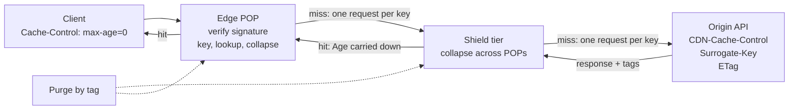

# Putting a CDN in Front of an API: Origin Shielding, Collapse-Forwarding, Signed Edge URLs, and Cache-Control: s-maxage

> [!summary] Claim
> A CDN is a shared cache with its own contract, so give it its own header (`CDN-Cache-Control` with `max-age` and the stale windows), keep `Cache-Control` for browsers, tag every response for purge, shield and collapse so the origin sees one request per key, and verify a signed URL before any cache lookup.

Part of [API Gateways Proxies and Edge Architecture](README.md) in [API Engineering](../README.md).

## TL;DR

- Mechanism: an edge POP keys the request, answers hits from memory, and on a miss sends one collapsed request upstream through a shield tier; the response is stored under RFC 9111 freshness rules and indexed by its `Surrogate-Key` tags for purge (RFC 9111 Section 4, Section 4.2.1).
- Contract rule: for a shared cache the lifetime is `s-maxage`, then `max-age`, then `Expires` (RFC 9111 Section 4.2.1), but a valid `CDN-Cache-Control` replaces `Cache-Control` entirely for the CDN, so it must repeat `max-age` (RFC 9213 Section 2.2).
- Trap: `stale-while-revalidate` written in `Cache-Control` also reaches browsers, and an uncacheable response under collapsing serializes the whole queue one origin request at a time (RFC 5861 Section 3; Fastly request collapsing guide, as of 2026-11).
- Portability: the semantics are RFC-level, but tags, purge limits, stale caps, shield placement, `Vary` handling, and `CDN-Cache-Control` support differ per vendor (Cloudflare reads it; nginx 1.31.9 and Varnish 8.0.0 core do not); the lab ran on CPython 3.14.6 only (macOS 27.3 arm64), the other matrix legs were not run.
- When not to use: per-user or write-heavy responses, low-reuse traffic, or an origin that cannot emit correct `Vary`, `Set-Cookie`, and tag headers; there the CDN adds a hop and a leak risk without a hit ratio.

## Mental model



A client request lands on the nearest edge POP, which checks the signature first, then computes a cache key and looks it up.
A hit returns at once with an `Age` and a `Cache-Status` member; a miss joins or starts one in-flight fetch for that key and goes to the shield, a second cache that every POP shares, so all POPs together cause at most one origin request per key.
The origin answers with a `CDN-Cache-Control` for the CDN tiers, a `Cache-Control` for the browser, an `ETag` for revalidation, and a `Surrogate-Key` list the tiers index and strip before the client sees it.
The dotted purge arrows show that invalidation is a separate control plane that must reach every tier, upper tier first.

## How it works

### Where the CDN sits and what it must preserve

A CDN edge, a regional cache, and an origin shield are all shared caches in the sense of RFC 9111 Section 1 and apply the same storage and reuse rules to a response that a browser (a private cache) would apply differently.
Three differences matter for an API: `private` forbids storing in a shared cache (RFC 9111 Section 5.2.2.7); a request with `Authorization` may only be answered from a stored response whose headers opt in with `must-revalidate`, `public`, or `s-maxage` (RFC 9111 Section 3.5); and `s-maxage` is read only by shared caches (RFC 9111 Section 5.2.2.10).
The deployments named in this note use the hierarchy differently.
CloudFront has edge locations, regional edge caches, and an optional Origin Shield that is itself one of the regional caches (CloudFront Origin Shield guide, as of 2026-11).
Cloudflare divides its data centers into lower tiers and upper tiers and lets only the upper tier contact the origin when Tiered Cache is on (Cloudflare Tiered Cache, last updated 2026-11-03).
Fastly funnels all POPs through one designated shield POP per origin (Fastly shielding guide).
Varnish and nginx are the open-source equivalents you run yourself, and the lab models one such tier as `EdgeCache` (see Worked example).

### Freshness for a shared cache: `s-maxage` and the rest

RFC 9111 Section 4.2.1 gives the order for a shared cache: `s-maxage`, else `max-age`, else `Expires` minus `Date`, else a heuristic.
`Expires` is ignored once `max-age` or, for a shared cache, `s-maxage` is present (RFC 9111 Section 5.3).
Caches "are encouraged to consider responses that have invalid freshness information (e.g., a max-age directive with non-integer content) to be stale" (RFC 9111 Section 4.2.1), which is why the lab turns `max-age=abc` into `ttl=0` rather than into no caching or a guessed lifetime.
`s-maxage` also carries the semantics of `proxy-revalidate` for a shared cache: once stale the cache must not reuse the response until the origin has validated it (RFC 9111 Section 5.2.2.10), and a cache must not generate a stale response if "an applicable s-maxage or proxy-revalidate response directive" prohibits it (RFC 9111 Section 4.2.4).
Read literally, that conflicts with `stale-while-revalidate`, which is defined to let a cache serve stale while it revalidates in the background (RFC 5861 Section 3).
Deployed caches disagree on this.
nginx serves stale anyway: it parses `s-maxage=` first, then `max-age=`, and afterwards parses `stale-while-revalidate=` and `stale-if-error=` from the same header, setting both its `updating_sec` and `error_sec` from the former (nginx release-1.31.9 `src/http/ngx_http_upstream.c`, `ngx_http_upstream_process_cache_control`).
Varnish does too: it takes `s-maxage`, else `max-age`, as the TTL and then initializes grace from `stale-while-revalidate` (Varnish varnish-8.0.0 `bin/varnishd/cache/cache_rfc2616.c`, `RFC2616_Ttl`).
Cloudflare follows the RFC literally: its docs say "`s-maxage` disables `stale-while-revalidate`" and that `stale-if-error` is ignored under "an applicable s-maxage or proxy-revalidate cache-response-directive" (Cloudflare Origin Cache Control, last updated 2026-06-30).
CloudFront documents `max-age=3600, stale-while-revalidate=600` serving stale for ten minutes, but every stale-directive example in its Expiration guide uses `max-age` and none uses `s-maxage`, and the guide, the origin request and response behavior page, and the managed cache policies page never say what happens when both appear in one header (as of 2026-11).
The documentation is silent there, so treat that combination on CloudFront as undefined and test it on the distribution rather than relying on either the nginx or the Cloudflare behavior.
So the portable rule is to put the stale windows in a field that has no `proxy-revalidate` coupling, which is the `CDN-Cache-Control` field below, on a CDN that reads it.
Not every cache does: nginx 1.31.9 parses only `X-Accel-Expires`, `Expires`, and `Cache-Control` for freshness, Varnish 8.0.0 core reads only `Cache-Control` and `Expires` in `RFC2616_Ttl`, and the CloudFront Expiration guide does not mention `CDN-Cache-Control` (as of 2026-11); behind those, set the CDN lifetime with `s-maxage` (accepting the stale coupling) or in the cache's own configuration.

The same nginx function shows what a real implementation does with the other directives.
It marks a response uncacheable when the header contains `no-cache`, `no-store`, or `private`, and treats a zero lifetime as uncacheable; it matches by substring search, so it does not tokenize the header the way the lab's `parse_directives` does.
nginx also never stores a response with `Set-Cookie` and honors `X-Accel-Expires` over `Cache-Control` unless `proxy_ignore_headers` is set (nginx `ngx_http_proxy_module` documentation, `proxy_cache_valid`).

### Targeted cache control: `CDN-Cache-Control`, `Surrogate-Control`, and the Age penalty

RFC 9213 defines a family of "targeted fields" that have the semantics of `Cache-Control` but a name that scopes them to one class of cache, and defines `CDN-Cache-Control` as the CDN member and registers it with IANA (RFC 9213 Section 3, Section 4).
Three rules decide the behavior.
First, a targeted field is a Structured Fields Dictionary, so an empty value or a parse error means the field is ignored and the cache falls back to `Cache-Control` (RFC 9213 Section 2.1).
`max-age=abc` is not a parse error in that grammar (`abc` is a Token), but implementations "SHOULD NOT consume values that violate these inferred constraints" (RFC 9213 Section 2.1); the lab ignores such a field as a whole, and the lab's `parse_directives` is a `Cache-Control` splitter, not a Structured Fields parser, which the same section warns "can introduce interoperability issues".
Second, a cache keeps an ordered target list and must select the first field with a valid, non-empty value, and it then must ignore `Cache-Control` and `Expires` in that response (RFC 9213 Section 2.2).
Third, targeted fields not on a cache's list "MUST NOT change that cache's behavior and MUST be passed through" (RFC 9213 Section 2.2), and CDN caches typically forward `CDN-Cache-Control` so a downstream CDN can use it (RFC 9213 Section 3).
The consequence the lab pins is that `Cache-Control: s-maxage=60` plus `CDN-Cache-Control: stale-while-revalidate=300` leaves the CDN with a valid, non-empty targeted field that has no explicit freshness, and the CDN never looks at the `s-maxage`; the test `test_cdn_cache_control_replaces_cache_control_entirely` asserts it.
The lab then does not store the response because it applies no heuristic freshness (RFC 9111 Section 4.2.2); a real CDN may instead apply a heuristic or its configured default TTL, so the symptom is a lifetime you did not choose, of which "never cached" is one case.

RFC 9213 Section 3.1 gives the canonical split: `Cache-Control: max-age=60, s-maxage=120` with `CDN-Cache-Control: max-age=600` makes a CDN cache for 600 seconds, other shared caches for 120, and the rest for 60; and `Cache-Control: no-store` with `CDN-Cache-Control: max-age=600` lets only CDN caches store.

Vendors add their own members at the front of the target list.
Cloudflare evaluates `Cloudflare-CDN-Cache-Control` before `CDN-Cache-Control` and never forwards the first; when either is present, `Cache-Control` is proxied as is and does not affect Cloudflare's decision, and a Cache Response Rule using `set_cache_control` outranks all of them (Cloudflare CDN-Cache-Control, last updated 2026-04-16).
Its worked example gives `Cache-Control: max-age=14400, s-maxage=84000`, `Cloudflare-CDN-Cache-Control: max-age=24400`, `CDN-Cache-Control: max-age=18000`, with Cloudflare's own edge using 24400 seconds (same page).
The same page says an Edge Cache TTL cache rule overrides both targeted fields, and that when `Surrogate-Control` is present Cloudflare ignores `Cache-Control` "even if the Surrogate-Control header does not contain directives".
Fastly reads `Surrogate-Control`, which overrides `Cache-Control` when both are present and is removed by Fastly's cache, and it does not support `s-maxage` inside `Surrogate-Control` (Fastly stale content guide).
The W3C Edge Architecture note from 2001 is the ancestor of `Surrogate-Control` and `Surrogate-Capabilities` (W3C Edge Architecture Specification, Section 2.1 and Section 2.2).
The lab's default target list is `("Surrogate-Control", "CDN-Cache-Control")`, most specific first.

RFC 9213 Section 2.3 names the side effect of giving the CDN a longer lifetime than everyone else.
With `Age: 1800`, `Cache-Control: max-age=600`, and `CDN-Cache-Control: max-age=3600`, the CDN thinks the object is fresh for another half hour while every downstream cache sees it as already stale.
The RFC lists the mitigations deployments use: remove `Age`, set `Date` to the current time, or set `Expires` to now plus `max-age`.
The recommended header set for a public, purgeable API resource avoids the problem by giving browsers a zero lifetime and letting them revalidate at the edge:

```http
Cache-Control: max-age=0
CDN-Cache-Control: max-age=60, stale-while-revalidate=300, stale-if-error=3600
ETag: "v7"
Surrogate-Key: product-42 catalog
```

(simplified excerpt of the lab origin's defaults, `Origin.__init__` and `Origin.product` in the implementation, with `{pid}` filled in)

The seed's plan, `s-maxage=60, stale-while-revalidate=300, max-age=0` in one `Cache-Control`, does not make "browsers always revalidate": RFC 5861 defines the stale window for any cache, and a browser cache that implements it will serve the object stale for up to 300 seconds even though its `max-age` is 0.
Fastly states the general form: the stale directives "apply to all caching HTTP clients, not just CDNs", and `Surrogate-Control` exists to scope them to the CDN (Fastly stale content guide).
MDN's browser-compat-data records `stale-while-revalidate` support from Chrome 75, Firefox 68, and Safari 14, with Edge mirroring Chrome, and has no entry for `stale-if-error` (browser-compat-data v8.1.10 `http/headers/Cache-Control.json`, as of 2026-11).
The lab's `browser_freshness` models a browser that implements it and the test `test_swr_inside_cache_control_reaches_browsers_but_inside_cdn_field_does_not` shows the difference.

### The cache key

A cache may reuse a stored response only if the target URI and method match and the request fields nominated by the stored response's `Vary` match (RFC 9111 Section 4, Section 4.1; RFC 9110 Section 12.5.5).
`Vary: *` never matches (RFC 9111 Section 4.1).
A real CDN lets you narrow the key (drop tracking parameters, sort the query, ignore a signature) or widen it (add a header, a cookie, or a device class); CloudFront collapses and caches only on requests that "share a cache key" and lists headers, cookies, and query strings as the configurable inputs (CloudFront custom-origin behavior guide).
The lab's key is `GET <path>?<sorted query minus ignored parameters>`, plus a single stored `Vary` variant per key (RFC 9111 Section 4.1 allows a cache to store more than one; the lab keeps one for brevity).
Two rules decide hit ratio: every unkeyed input that changes the response is a poisoning or leak vector (see [[Web-Cache-Poisoning-and-Cache-Deception-Attacks]]), and every keyed input that does not change the response fragments the cache, which is exactly what a per-request signature does.
`Authorization` is not part of the key, so an authenticated response is shared across users unless `Vary: Authorization` or `private` says otherwise; the lab proves both behaviors.
`Vary` only helps on a CDN that honors it: Cloudflare "does not consider vary values in caching decisions" by default, except `vary: accept-encoding`, the Cache Rules Vary setting, and Vary for images (Cloudflare Origin Cache Control, last updated 2026-06-30), so there `private` or a keyed credential is the only safe choice.

### Collapse-forwarding

RFC 9111 Section 4 says a cache can "collapse requests", combining multiple incoming requests into one forward request on a miss, and warns that if the cache cannot use the returned response for some of the collapsed requests it must forward them, "potentially introducing additional latency".
RFC 9211 gives the observable: a `collapsed` parameter on the `Cache-Status` list member, meaningful only with `fwd` (RFC 9211 Section 2.6).
The implementations differ in how they wait:

| Implementation | Mechanism | Documented knobs and limits (as of 2026-11) |
|---|---|---|
| CloudFront | pauses additional requests with the same cache key until the first response arrives; the first is logged `Miss` and the collapsed requests `Hit` in `x-edge-result-type` | to turn it off per object: minimum TTL 0 plus `private`, `no-store`, `no-cache`, `max-age=0`, or `s-maxage=0` from the origin; `CachingDisabled` disables caching and collapsing (CloudFront custom-origin behavior guide) |
| Fastly | a "waiting list" per object; leader and followers | `req.hash_ignore_busy` disables collapsing and also disables SWR and SIE for that request; `hit-for-pass` and `pass` skip it; a hit-for-pass object is created only when the response is cacheable and VCL returns `pass`, and lives 2 minutes by default, the response TTL clamped to 2 minutes to 1 hour (Fastly request collapsing guide) |
| nginx | `proxy_cache_lock on` lets one request populate a new cache element, the others wait | default off; `proxy_cache_lock_timeout` 5s, after which the request goes upstream but its response is not cached; `proxy_cache_lock_age` 5s, after which one more request may be passed (nginx `ngx_http_proxy_module` documentation) |
| Varnish | automatic request coalescing on a waiting list | with grace, a stale object is served instead of waiting (Varnish grace documentation) |

The hard part is the uncacheable response.
If the leader's response cannot satisfy the followers, each must go upstream, and if they re-queue behind the next leader the origin sees them one after another instead of in parallel.
Fastly's guide describes this exactly: the response serves only the first request, "the next request in the queue will be sent to origin and the remaining requests will form a new queue, resulting in the requests being sent consecutively, not concurrently", and "in some cases this can create extreme response times of several minutes" (Fastly request collapsing guide).
The remedy is a marker that remembers "this key is uncacheable": Fastly's `hit-for-pass` releases the queued requests to run concurrently, and requests that meet an existing marker are not collapsed; the lab's default `hit_for_pass_ttl=120.0` mirrors Fastly's 2 minute default.
Varnish's builtin VCL treats a negative TTL as the historical signal for "do not cache" (Varnish built-in VCL documentation).

The lab implements the queue as a map from key to a future and a loop:

```python
# simplified excerpt of EdgeCache._fill (collapse-forwarding with a hit-for-pass check)
while True:
    if not self._collapse or self._hfp.get(key, 0.0) > self._clock():
        return await self._fetch(key, up, stale, has_auth), collapsed
    flight = self._flights.get(key)
    if flight is None:
        flight = self._flights[key] = asyncio.get_running_loop().create_future()
        result = Fetched(502, [], b"", upstream_status="error")
        try:
            result = await self._fetch(key, up, stale, has_auth)
        finally:
            del self._flights[key]      # forget before waking followers
            flight.set_result(result)
        return result, collapsed
    result = await asyncio.shield(flight)
    if result.entry is not None and result.entry.vary_matches(req_headers) and not has_auth:
        return result, True             # usable: this follower is "collapsed"
    # unusable for this request: loop and queue behind the next leader
```

A follower can use the result only if the leader stored an entry, the follower's own `Vary` request fields match it, and the follower is not an authenticated request that the entry does not permit.
`asyncio.shield` stops a cancelled follower from cancelling the shared future.
Two more failure modes are inherent.
A leader that is slow or times out makes every follower slow or fail with it, so the leader's upstream timeout bounds the whole queue (see [[Proxy-and-Application-Timeout-and-Retry-Interaction-Hazards]]).
A leader that carries a `Set-Cookie` must never hand its response to followers; the lab refuses to store such a response, marks the key hit-for-pass, and the test `test_hit_for_pass_releases_the_queue_to_run_concurrently` asserts five distinct sessions and five distinct `Set-Cookie` values.
Collapsing is also not the application-level singleflight of [[Cache-Stampede-Singleflight-Coalescing-and-Probabilistic-Early-Expiration]], which sits in your code behind the CDN; the CDN collapses per POP (or per shield), so the two compose.

### Shielding and tiering

Without a shield, P POPs each fetch each key once, so the origin sees up to P times K requests for K keys.
With one shield, the POPs fetch from the shield, and the shield collapses and caches, so the origin sees up to K.
The lab asserts the concrete case for 4 POPs and 3 keys: 12 origin requests without a shield and 3 with one (`test_shield_turns_pops_times_keys_origin_requests_into_keys`).
The stated vendor benefits are the same: CloudFront says "all requests from all of the CloudFront caching layers to your origin go through Origin Shield", which can "retrieve each object with a single origin request"; Cloudflare says only the upper tier asks the origin and that Tiered Cache concentrates connections from a few data centers; Fastly adds that POPs keep open connections to each other so a miss can be faster through the shield (guides cited above).
The costs are also vendor-stated:

- CloudFront says Origin Shield "may not be a good fit" for dynamic content proxied to the origin, content with low cacheability, or infrequently requested content; it is billed; it is not used for gRPC requests; and requests made in the same Region as the origin bypass it (CloudFront Origin Shield guide).
- Fastly runs the edge code twice when a request goes edge then shield, so request changes meant for the origin belong at the shield-to-origin step and response changes for the client at the client-facing POP; the VCL variables `req.backend.is_origin` and `fastly.ff.visits_this_service` tell them apart (Fastly shielding guide).
- Fastly records an edge miss that hits at the shield as both a miss and a hit, and an origin fetch as two misses, so the reported hit ratio looks lower than the offload (same guide).
- Cloudflare's Smart Tiered Cache picks one upper tier per origin by measured latency, and changing origin IPs or DNS can move the upper tier and raise the miss rate while it refills; behind anycast it needs a cloud region hint; Generic Global Tiered Cache hashes the cache key to select an upper tier from a regional pool, so a pool change can reassign keys (Cloudflare Tiered Cache).

Between tiers, three header rules must hold, and the lab encodes them.
`Age` must be carried: the downstream tier computes its age from the upstream `Age` plus the response delay (RFC 9111 Section 4.2.3: `corrected_age_value = age_value + response_delay`), otherwise each tier restarts the clock and an object can live for up to the sum of the tier lifetimes.
The test `test_age_from_the_shield_stops_the_edge_from_doubling_the_ttl` shows a 61 second old object still served as version 1 when the edge ignores `Age` and refreshed to version 2 when it honors it.
Tag and edge-control headers (`Surrogate-Key`, `Surrogate-Control`) must survive between tiers so the edge can index them, and must be stripped at the client-facing edge; Fastly documents the strip for `Surrogate-Key` ("unless `Fastly-Debug` is included in the request") and Cloudflare for `Cache-Tag`.
And `Cache-Status` members must be appended in order: the first member is the cache closest to the origin and the last is closest to the client (RFC 9211 Section 2).
The lab asserts `shield; fwd=uri-miss; stored, edge-0; fwd=uri-miss; stored`.

### Stale controls at the edge

`stale-while-revalidate=N` lets a cache serve the response for N seconds after it becomes stale while it revalidates, ideally without blocking (RFC 5861 Section 3).
`stale-if-error=N` lets it serve stale for N seconds past staleness when an error (500, 502, 503, or 504) occurs (RFC 5861 Section 4).
RFC 5861 notes that SWR only fires if a request arrives inside the window, so sparse traffic falls out of it and blocks (RFC 5861 Section 3.1).
Vendors cap and scope it: CloudFront serves stale for the lesser of the directive and the distribution's maximum TTL (CloudFront Expiration guide); Fastly's `hash_ignore_busy` turns both off; nginx needs `proxy_cache_use_stale updating` or the header form and `proxy_cache_background_update on` (default off) to refresh in the background (nginx documentation).
Background revalidation is itself collapsed in the lab (`_refreshing` set), and sends `If-None-Match`; a `304` freshens the stored response without a body (RFC 9111 Section 4.3.4), which the test `test_swr_revalidation_that_returns_304_extends_freshness_without_a_body` checks.
The lab simplifies one rule: it treats any status of 500 or above as an error for SIE, where RFC 5861 lists 500, 502, 503, and 504.
Vendors split the same way: CloudFront serves stale when the origin "is unreachable or returns an error code that is between 500 and 600" (CloudFront Expiration guide), while Cloudflare triggers on 500, 502, 503, and 504 and says "there is currently no way to customize which status codes trigger stale-if-error" (Cloudflare Origin Cache Control).
The staleness budget a client can see is the sum `ttl + swr` for SWR, and up to `ttl + sie` during an outage, so the header values are a consistency SLO, not a tuning knob (see [[Stale-While-Revalidate-and-Stale-If-Error-RFC-5861]]).

### Purge and invalidation

RFC 9111 Section 4.4 requires a cache to invalidate the target URI on a non-error response to an unsafe method and allows it for `Location` and `Content-Location` of the same origin, but this "does not guarantee that all appropriate responses are invalidated globally"; only the caches the request travels through are affected.
That is why a CDN needs an explicit purge API, and why tags exist: one write touches many URLs.
`Surrogate-Key` (Fastly) and `Cache-Tag` (Cloudflare) are response headers that attach tags; the CDN indexes them, and a purge by tag evicts every object carrying it.
The documented limits differ and fail silently:

- Fastly: keys are case-sensitive, separated by spaces, at most 1 KB each, and the header at most 16 KB; if a limit is hit "the token currently being parsed and all tokens following it" are ignored (Fastly surrogate key guide).
- Cloudflare: comma-separated, case-insensitive, whitespace and repeated commas are normalized, the header at most 16 KB after the field name (about 1,000 unique tags), and a tag in a purge API call at most 1,024 characters (Cloudflare purge by cache-tags, last updated 2026-08-21).
- CloudFront: tag invalidation is opt-in through a distribution `CacheTagConfig` that names the origin's tag header; tags are comma-separated, case-insensitive, ASCII 33 to 126, at most 256 characters each, and at most 50 per cached object, with the extra tags "not stored and cannot be used for invalidation"; a `CreateInvalidation` item starting with `#` purges a tag, takes no `*` wildcard, and invalidates every cached variant (CloudFront "Invalidating content by cache tags" and "What you need to know when invalidating tags", as of 2026-11).
  The invalidation guide also recommends file versioning over invalidation for frequent updates because a versioned name also defeats browser and corporate proxy caches (CloudFront invalidation guide).

A soft purge marks an object stale instead of removing it: the next request gets the stale object while the new one is fetched, and stale objects may also be served if the origin is down; a hard purge makes it unusable and forces a refetch; soft purge exists only for URL and surrogate key purges, and purge-all is a hard purge (Fastly purging guide).
Fastly limits URL and surrogate key purges to an average of 100,000 per hour per customer, each key counting once however many objects it tags (same guide, as of 2026-11).
Vendors call tag purges instant (Cloudflare says "instantly bulk purge"); I did not measure propagation, and an invalidation is only as consistent as its slowest tier.
The order across tiers matters because a refill pulls from the next tier up: purge the shield first, then the edges.
If an edge is purged while the shield still holds the old object, the edge's next miss refills from the shield and re-stores the stale copy for another full TTL.
The test `test_purging_the_shield_first_prevents_edges_from_refilling_stale_copies` runs both orders with a request injected between the first and the remaining tiers and asserts version 2 for upstream-first and version 1 for edge-first.
See [[Cache-Invalidation-Upon-Unsafe-Methods-and-Purge-Patterns]] for the invalidation rules this builds on.

### Signed edge URLs

A signed URL carries its own authorization: a policy (an expiry, optionally a start time, a path pattern, a client IP) and a signature over it, verified by the edge with a key the origin never sends.
CloudFront signs a canned policy (expiry only, one file) or a custom policy (wildcards in `Resource`, optional start time, optional IP range, base64 policy in the URL); trusted key groups hold the public keys; RSA 2048 and ECDSA 256 signatures are supported, with `Hash-Algorithm=SHA1` or `SHA256`; and your own query parameters cannot be named `Expires`, `Signature`, `Key-Pair-Id`, or `Hash-Algorithm` with a canned policy, or `Policy`, `Signature`, `Key-Pair-Id`, or `Hash-Algorithm` with a custom policy (CloudFront signed URL guides).
Cloudflare's WAF validates an HMAC token with `is_timed_hmac_valid_v0()`, on Pro, Business, and Enterprise plans, over the path and an issue timestamp (Cloudflare token authentication, last updated 2026-05-05).
Details that decide behavior:

- Query strings must be signed: CloudFront returns `403` if a query string is added after signing, and the lab's canonical string includes the sorted non-signature query pairs so an appended parameter breaks the signature.
- Expiry is checked at request time: a download that has started completes, but a restarted connection or any later `Range` request after expiry fails (CloudFront signed URL guide).
- `OPTIONS` requests do not require a signature on CloudFront, so CORS preflights work, which means an origin must not return protected content to `OPTIONS` (same guide).

The ordering is the security property.
The edge must verify before the cache lookup, otherwise a cached object answers requests with an expired, missing, or forged signature, which turns the cache into an authorization bypass.
The edge must also exclude the signature parameters from the cache key, otherwise every issued URL is a distinct key and the hit ratio collapses to zero for signed content, and it must strip them before going upstream so the origin cannot depend on them.
The lab's `SignedUrlVerifier.check` binds `GET`, the path, the canonical query, and `exp`, selects the key by `kid` for rotation, compares with `hmac.compare_digest`, and rejects duplicated signature parameters:

```python
# simplified excerpt of SignedUrlVerifier.check
counts = Counter(k for k, _ in pairs if k in SIGNATURE_PARAMS)
if frozenset(counts) != SIGNATURE_PARAMS:
    return "missing"
if any(n > 1 for n in counts.values()):
    return "duplicate-parameter"  # parameter pollution: refuse the ambiguity
params = dict(pairs)
exp = delta_seconds(params["exp"])
key = self._keys.get(params["kid"])
if exp is None:
    return "malformed"
if key is None:
    return "unknown-kid"
want = hmac.new(key, self._canonical(path, pairs, exp), hashlib.sha256).hexdigest()
if not hmac.compare_digest(want.encode(), params["sig"].encode()):
    return "bad-signature"
return "expired" if self._clock() >= exp else None
```

A valid signature authorizes access to a URL, not an identity: anyone holding the URL until it expires gets the same cached bytes.
Use short lifetimes for private content and bind an IP only where a custom policy supports it and IPv6 is not needed: CloudFront accepts only IPv4 CIDR in `IpAddress` and says not to enable IPv6 on a distribution that uses it (CloudFront custom policy guide).

### Authenticated and personalized responses

A shared cache must not reuse a response to a request with `Authorization` unless the response opts in with `must-revalidate`, `public`, or `s-maxage` (RFC 9111 Section 3.5).
`s-maxage` is therefore an explicit statement that the response is safe to share across users, and putting it on a per-user body leaks that body to the next caller; the test `test_s_maxage_on_a_personalized_response_leaks_it_to_the_next_user` reproduces it and `test_vary_authorization_keeps_users_apart_even_with_s_maxage` shows `Vary: Authorization` as the correction on a cache that honors `Vary`, which Cloudflare does not by default (see The cache key).
Prefer `private` for per-user responses and keep them out of the CDN path; see [[Caching-Authenticated-and-Multi-Tenant-API-Responses]].

### Observability

`Cache-Status` is a Structured Fields list with `hit`, `fwd` (reasons `uri-miss`, `vary-miss`, `stale`, `bypass`, `method`, `request`, `partial`, `miss`), `fwd-status`, `ttl`, `stored`, `collapsed`, and `key` (RFC 9211 Sections 2.1 to 2.7).
A stale response that is served without going forward can be reported as a hit (RFC 9211 Section 2.1), which is how the lab labels SWR responses (`edge-0; hit; ttl=-1`, a negative `ttl` marking staleness per Section 2.4).
`hit` and `fwd` are exclusive (RFC 9211 Section 2.1), and an SIE response did go forward, so the lab labels it `edge-0; fwd=stale; fwd-status=503`.
CloudFront logs Origin Shield hits as `OriginShieldHit` in `x-edge-detailed-result-type`, but a request routed from an edge location to the regional edge cache that is acting as Origin Shield is logged as a `Hit`, not an `OriginShieldHit`; seeing either needs standard or real-time logs (CloudFront Origin Shield guide); see [[Cache-Status-Header-for-Observability-RFC-9211]].

## Numbers and limits

| Quantity | Value | Source or measurement |
|---|---|---|
| Shared-cache lifetime order | `s-maxage`, then `max-age`, then `Expires`, then heuristic | RFC 9111 Section 4.2.1 |
| SIE error statuses | 500, 502, 503, 504 | RFC 5861 Section 4 |
| `Age` rule | `corrected_age_value = age_value + response_delay` | RFC 9111 Section 4.2.3 |
| Fastly `Surrogate-Key` limits | token 1 KB, header 16 KB, rest ignored after a limit | Fastly surrogate key guide, as of 2026-11 |
| Cloudflare `Cache-Tag` limits | header 16 KB (about 1,000 tags), 1,024 chars per tag in a purge call | Cloudflare purge by cache-tags, updated 2026-08-21 |
| CloudFront cache tag limits | 256 characters per tag, 50 tags per cached object, extras not stored | CloudFront cache tag invalidation guide, as of 2026-11 |
| Fastly purge rate | average 100,000 URL and surrogate-key purges per hour per customer | Fastly purging guide, as of 2026-11 |
| Fastly hit-for-pass lifetime | 2 minutes by default; response TTL clamped to 2 minutes to 1 hour | Fastly request collapsing guide, as of 2026-11 |
| Browser `stale-while-revalidate` support | Chrome 75, Firefox 68, Safari 14, Edge mirrors Chrome | browser-compat-data v8.1.10, as of 2026-11 |
| Fastly stampede example | 50 requests per second at 500 ms fetch gives 25 concurrent origin requests | Fastly request collapsing guide (the vendor's worked arithmetic) |
| nginx lock defaults | `proxy_cache_lock` off, `proxy_cache_lock_timeout` 5s, `proxy_cache_lock_age` 5s | nginx documentation, as of 2026-11 |
| nginx background update | `proxy_cache_background_update` off, since 1.11.10 | nginx documentation, as of 2026-11 |
| CloudFront `max-age` range | 0 seconds to 100 years; default TTL 24 hours without a cache policy | CloudFront Expiration guide, as of 2026-11 |
| CloudFront stale cap | lesser of the SWR or SIE value and the maximum TTL | CloudFront Expiration guide |
| CloudFront signed URL keys | RSA 2048 and ECDSA 256 | CloudFront signed URL guide |
| Origin requests, 4 POPs x 3 keys | 12 without a shield, 3 with one | lab: `test_shield_turns_pops_times_keys_origin_requests_into_keys`, passing under `uv run --frozen pytest` from `labs/`, CPython 3.14.6, macOS 27.3 arm64 (Darwin 27.3.0), rerun 2026-11-21 |
| Origin requests, 20 concurrent misses | 1 with collapsing, 20 without; 19 followers report `collapsed` | lab: `test_collapse_forwarding_sends_one_origin_request_for_many_misses` |
| Serialized uncacheable queue, 5 clients | 1 in flight at a time without hit-for-pass; 4 released together with it | lab: the two `uncacheable` and `hit_for_pass` tests |
| Origin requests for 3 signed URLs of one object | 1 with signature excluded from the key, 3 with it included | lab: `test_signature_is_verified_before_the_cache_lookup_and_excluded_from_the_key` and `test_keying_the_cache_on_the_signature_collapses_the_hit_ratio` |

The lab numbers are counts asserted by passing tests on a fake clock with a gated in-process origin, not latency measurements; all four lab rows come from the same run on the same machine and interpreter, and no latency or throughput was measured.

## Portability

| Dimension | Status | Evidence |
|---|---|---|
| CPython 3.14.6 on macOS 27.3 arm64 (Darwin 27.3.0) | all 39 tests pass | ran: `uv run --frozen pytest ...` from `labs/`, 2026-11-21 |
| CPython 3.12, 3.13, 3.15, 3.15t | not run | lab matrix checks were paused by instruction on 2026-11-11 |
| Debian Trixie and Alpine musl containers | not run | same instruction; the lab is pure Python with no native code of its own |
| Uvicorn, Hypercorn, Granian | not run | the lab is in-process ASGI via `httpx.ASGITransport` and opens no sockets (httpx 0.28.1 `httpx/_transports/asgi.py`, `ASGITransport`) |
| HTTP/1.1, HTTP/2, HTTP/3 | semantics identical; not exercised | RFC 9111 defines caching on HTTP semantics (RFC 9110), not on a wire version; Origin Shield is bypassed for gRPC requests (CloudFront Origin Shield guide) |
| `s-maxage` honored | CloudFront yes; nginx yes; Cloudflare yes; Varnish yes; Fastly inside `Surrogate-Control` no | CloudFront Expiration guide; nginx 1.31.9 `ngx_http_upstream_process_cache_control`; Cloudflare Origin Cache Control; Varnish 8.0.0 `RFC2616_Ttl`; Fastly stale content guide |
| SWR and SIE honored | CloudFront yes (capped by maximum TTL); Fastly yes; nginx yes, even beside `s-maxage`; Varnish SWR seeds `grace` and `stale-if-error` is not parsed in `cache_rfc2616.c`; Cloudflare yes, but not beside `s-maxage` | the same pages and sources; Varnish also has `keep` (Varnish grace documentation) |
| `CDN-Cache-Control` read | Cloudflare yes; nginx 1.31.9 no; Varnish 8.0.0 core no; CloudFront not documented | Cloudflare CDN-Cache-Control; nginx and Varnish sources above (no such header handled); CloudFront Expiration guide |
| `Vary` honored | nginx yes (`Vary: *` not cached, since 1.7.7); Cloudflare not by default | nginx `proxy_cache_valid` documentation; Cloudflare Origin Cache Control |
| Tag purge header | Fastly `Surrogate-Key`; Cloudflare `Cache-Tag`; CloudFront has tag invalidation | vendor pages; there is no standard tag header |
| Library versions | starlette 1.10.0, httpx 0.28.1 | `labs/pyproject.toml`; `starlette/responses.py` `Response.init_headers` and `Response.__call__` read in the installed release |

The installed interpreter is 3.14.6, not the 3.14.10 named in the matrix, so even the 3.14 cell is the nearest available patch release.

## Worked example

The implementation is [implementation](../labs/src/api_labs/f17_api_gateways_proxies_and_edge_architecture/edge_cache.py) and the test is [test](../labs/tests/f17_api_gateways_proxies_and_edge_architecture/test_edge_caching_and_cdn_shielding_for_dynamic_and_public_apis.py).
`EdgeCache` is an ASGI app whose upstream is an `httpx.AsyncClient`, so tiers stack by passing one tier's app to the next tier's client.
`build_topology` wires `origin <- shield <- edge-0..edge-N` and every test runs on a fake clock with an `Origin` that can gate, count, and fail requests; nothing opens a socket.

```python
# simplified excerpt of EdgeCache.handle: the order of the checks is the design
denial = self._verifier.check(path, pairs) if self._verifier is not None else None
if denial is not None and self._verify_first:
    return self._plain(403, f"{self.name}: {denial}")      # 1. signature before the cache
...
entry = self._store.get(key)                               # 2. key excludes signature params
if entry is not None and not entry.vary_matches(req.headers):
    entry, reason = None, "vary-miss"                      # 3. Vary variant must match
if entry is not None and has_auth and not entry.policy.auth_ok:
    return await self._pass_through(req, path, pairs)      # 4. Authorization needs an opt-in
state = entry.stale_for(self._clock())                     # 5. fresh, SWR window, or fall through
...
result, collapsed = await self._fill(key, up, entry, has_auth, req.headers)  # 6. collapse
```

The header policy is a small pure function so the precedence is testable alone:

```python
# simplified excerpt of select_policy
lowered = {k.lower(): v for k, v in headers.items()}
for name in targets:                       # ("Surrogate-Control", "CDN-Cache-Control")
    raw = lowered.get(name.lower())
    if raw is None or not raw.strip():
        continue
    policy = _policy_from(parse_directives(raw), name, targeted=True)
    if policy is not None:                 # None means an invalid value: ignore this field
        return policy                      # first valid field wins, Cache-Control is ignored
raw_cc = lowered.get("cache-control")
...
```

Captured run, from `labs/` on macOS 27.3 arm64 (Darwin 27.3.0) with CPython 3.14.6, rerun by the fact-checker on 2026-11-21 after the lab fixes:

```text
$ uv run --frozen pytest tests/f17_api_gateways_proxies_and_edge_architecture/test_edge_caching_and_cdn_shielding_for_dynamic_and_public_apis.py -q
.......................................                                  [100%]
39 passed in 0.31s
```

The `predict-the-output` question below uses output captured from the module:

```text
>>> select_policy({"Cache-Control": "max-age=0, s-maxage=60, stale-while-revalidate=300"})
Policy(storable=True, ttl=60, swr=300, sie=0, source='Cache-Control', auth_ok=True)
>>> browser_freshness("max-age=0, s-maxage=60, stale-while-revalidate=300")
BrowserView(fresh_for=0, stale_window=300)
>>> select_policy({"Cache-Control": "max-age=0, s-maxage=60", "CDN-Cache-Control": "stale-while-revalidate=300"})
Policy(storable=False, ttl=0, swr=0, sie=0, source='CDN-Cache-Control', auth_ok=False)
```

What the lab does not model: heuristic freshness (RFC 9111 Section 4.2.2), `Range` and partial responses, multiple stored `Vary` variants, `Warning`, negative caching of `404`, request-side `Cache-Control` (the edge ignores it, as CloudFront documents for viewer `Cache-Control` and `Pragma` in its Expiration guide), and any real propagation delay for purges.
The lab's `select_policy` also does not apply the `s-maxage` implies `proxy-revalidate` rule, so it models the nginx and Varnish reading, not Cloudflare's.
Mutation checks (break a mechanism, confirm the named test fails) were not run because lab checks were paused on 2026-11-11; each test is written against one mechanism, and that a test fails without it has not been demonstrated by execution.

## Pitfalls

> [!warning] Stale directives written into `Cache-Control` leak to browsers
> Trigger: `Cache-Control: max-age=0, s-maxage=60, stale-while-revalidate=300` meant to let only the CDN serve stale.
> Symptom: browsers that implement RFC 5861 serve a 5 minute old API response with no request, and "browsers always revalidate" is false; on Cloudflare the CDN itself serves no stale at all, because `s-maxage` disables `stale-while-revalidate` there.
> Fix: put the stale windows in `CDN-Cache-Control` or `Surrogate-Control` on a CDN that reads that field, and keep `Cache-Control: max-age=0` (or `no-cache`) for browsers.
> Sources: RFC 5861 Section 3; RFC 9111 Section 5.2.2.10; Fastly stale content guide; Cloudflare Origin Cache Control; lab test `test_swr_inside_cache_control_reaches_browsers_but_inside_cdn_field_does_not`.

> [!warning] A targeted field without `max-age` silences `s-maxage`
> Trigger: adding `CDN-Cache-Control: stale-while-revalidate=300` to a response that already had `Cache-Control: s-maxage=60`.
> Symptom: the CDN stops caching the route (or falls back to a heuristic or default TTL you never chose), so origin traffic rises after a "harmless" header addition.
> Fix: repeat `max-age` in the targeted field; verify with `Cache-Status` (a `fwd` member such as `fwd=uri-miss` on every request).
> Sources: RFC 9213 Section 2.2; lab test `test_cdn_cache_control_replaces_cache_control_entirely`.

> [!warning] Collapsing serializes uncacheable responses
> Trigger: a hot URL whose response is `private`, carries `Set-Cookie`, or is otherwise uncacheable, behind a cache that collapses misses.
> Symptom: requests reach the origin one after another instead of together, and tail latency grows with the queue length; Fastly describes response times "of several minutes".
> Fix: make the route skip the cache (`pass`), or mark responses so a hit-for-pass object is created; never rely on a slow origin to drain a queue.
> Sources: Fastly request collapsing guide; CloudFront custom-origin guide; lab tests `test_uncacheable_response_serializes_collapsed_requests_without_hit_for_pass` and `test_hit_for_pass_releases_the_queue_to_run_concurrently`.

> [!warning] `s-maxage` or `public` on a personalized or poisoned response
> Trigger: `s-maxage` on a response that varies by user, or a framework that can be coerced into emitting a cacheable header for a route that should not be cached.
> Symptom: user B receives user A's body; or a CDN caches an uncacheable page.
> Fix: `private` for per-user data, `Vary: Authorization` if it must pass through a CDN that honors `Vary` (Cloudflare does not by default), and patch frameworks that emit cache headers from request input.
> Incident: CVE-2024-46982 (GHSA-gp8f-8m3g-qvj9), Next.js 13.5.1 up to but excluding 13.5.7 and 14.0.0 up to but excluding 14.2.10, pages router, could be coerced into caching a route that should not be cached and sending `Cache-Control: s-maxage=1, stale-while-revalidate`, "which some upstream CDNs may cache as well"; fixed in 13.5.7 and 14.2.10, no workaround offered (GitHub advisory, published 2024-09-17).
> Sources: RFC 9111 Section 3.5; lab test `test_s_maxage_on_a_personalized_response_leaks_it_to_the_next_user`.

> [!warning] Purging the edge before the shield re-caches the stale object
> Trigger: a purge script that iterates POPs first and the shield last, or a single-tier purge in a shielded setup.
> Symptom: the object is purged everywhere yet an edge serves the old version for another full TTL, because it refilled from the not yet purged shield.
> Fix: purge upper tiers first; if the vendor purges all tiers for you, still treat a purge as eventually consistent.
> Sources: RFC 9111 Section 4.4 (invalidation reaches only the caches it travels through); lab test `test_purging_the_shield_first_prevents_edges_from_refilling_stale_copies`.

> [!warning] Signature in the cache key, or verification after the lookup
> Trigger: leaving `sig` and `exp` in the key, or checking them only on a miss.
> Symptom: either the hit ratio on signed content is near zero (one entry per issued URL) or an expired, tampered, or unsigned URL is served from cache.
> Fix: verify first, strip signature parameters from the key and from the upstream request.
> Sources: CloudFront signed URL guide; lab tests `test_keying_the_cache_on_the_signature_collapses_the_hit_ratio` and `test_checking_the_signature_after_the_cache_lookup_leaks_cached_objects`.

> [!warning] Ignoring `Age` between tiers doubles the TTL
> Trigger: a downstream tier restarting its clock when it copies an object from a shield.
> Symptom: objects live up to the sum of the tier lifetimes, and a purge-free update takes up to twice the `max-age` to appear.
> Fix: compute `current_age` from the received `Age` (RFC 9111 Section 4.2.3); when the CDN lifetime exceeds the browser's, strip `Age` or rewrite `Date` for the client (RFC 9213 Section 2.3).
> Sources: lab test `test_age_from_the_shield_stops_the_edge_from_doubling_the_ttl`.

> [!warning] Tags silently dropped by a size limit
> Trigger: a `Surrogate-Key` list longer than the vendor limit, or a single token over 1 KB.
> Symptom: the purge by tag succeeds with a count that omits objects, and some stay stale.
> Fix: cap tag count per response in the origin, alarm on header length, and reconcile purge counts against expectations.
> Sources: Fastly surrogate key guide; Cloudflare purge by cache-tags; lab test `test_surrogate_key_parser_drops_the_oversize_token_and_everything_after_it`.

> [!warning] Shield on uncacheable or rarely hit traffic
> Trigger: enabling Origin Shield or tiered caching for dynamic, low-cacheability routes.
> Symptom: extra latency and cost on every request with no origin offload.
> Fix: scope the shield to cacheable behaviors; CloudFront's own guide calls dynamic content proxied to the origin and low-cacheability content a poor fit.
> Sources: CloudFront Origin Shield guide; Fastly shielding guide (the extra hop and the double miss accounting).

## Security and robustness

- Threat model: the CDN is an authorization-relevant component; it stores bytes and replays them to anyone who matches the key, so anything not in the key (cookies, `Authorization`, an unkeyed header) is a confidentiality boundary.
  See [[Web-Cache-Poisoning-and-Cache-Deception-Attacks]] for unkeyed-input poisoning and path-confusion deception.
  OWASP files missing cache directives under API8:2023 Security Misconfiguration, whose checklist includes "Security or cache control directives are not sent to clients" (OWASP API Security Top 10 2023, API8).
- Verify before lookup: signature, expiry, and key id are checked on every request, including cache hits, and an expired URL returns `403` even when the object is fresh in cache (lab test).
- Constant-time compare: use `hmac.compare_digest` on equal-encoded values, reject duplicate signature parameters, reject non-digit `exp`, and select keys by `kid` so rotation is overlap, not a flag day.
- Bind what you mean to authorize: the lab signs method, path, and the sorted query; CloudFront rejects an appended query string; a policy with a wildcard `Resource` authorizes every URL that matches it.
- `OPTIONS` is exempt from signature checks on CloudFront, so an origin that answers `OPTIONS` with data defeats the signature (CloudFront signed URL guide).
- Origin lock-down (engineering guidance, not a cited claim): accept traffic only from the CDN through mTLS, an origin allowlist, or a secret header, otherwise attackers bypass the edge's signature check and its WAF by calling the origin directly.
- Purge is a privileged operation: a leaked purge token lets an attacker evict the cache and send full load to the origin; scope tokens per service and rate-limit purge-all.
- Tag hygiene: `Surrogate-Key` and `Cache-Tag` reveal internal structure, so strip them at the client-facing edge as Fastly and Cloudflare document; `Cache-Status` can expose topology, so decide whether to emit it publicly (RFC 9211 Section 2 leaves the decision to the cache and points to its Section 6 on security).
- Robustness: bound the queue (nginx's `proxy_cache_lock_timeout`), cap the leader's upstream timeout, never cache `5xx` for longer than the error TTL, and give every route a documented answer to "what happens when the origin is down" (SIE window or a clean error).
- Parameter and header normalization differences between CDN, gateway, and server cause key disagreements and smuggling; see [[HTTP-Desync-and-Header-Normalization-Across-Multi-Tier-Proxies]].

## The principal's view

- The decision: put a CDN in front of an API when the response is shared across callers and reused many times within its staleness budget; keep per-user, write-after-read, and low-reuse traffic out of it.
- The contract the organization owns: every cacheable route declares a staleness budget (`max-age` plus `stale-while-revalidate` for the CDN, near zero for browsers), an invalidation story (tags at write time, never URL lists), and an owner who pages when the hit ratio falls.
- Make the origin the single source of cache policy: it emits `CDN-Cache-Control`, `Cache-Control`, `ETag`, and tags, and CDN configuration only clamps (minimum and maximum TTL); policy split across a dashboard and code is how nobody can explain a stale page.
- Abstract tags behind one emitter: Fastly, Cloudflare, and CloudFront each have their own tag header and limits, so a multi-CDN or migration plan needs a small adapter, and a tag budget (count and length per response) enforced in tests.
- Shield deliberately: it trades an extra hop on a miss and a fee for origin protection and connection reuse; enable it where origin capacity or egress cost dominates, and put it near the origin.
- Expect the metrics to mislead: Fastly counts a shield hit as an edge miss plus a shield hit, so judge success by origin requests per client request, not by the per-tier ratio.
- Trade-off to name: instant purge is a consistency tool you pay for in coupling to a vendor API and a rate limit; versioned URLs for immutable content remove the need, and the CloudFront guide recommends them for frequently updated files.
- Choose a different mechanism when: the data is per user (application cache with explicit keys, see [[Caching-Authenticated-and-Multi-Tenant-API-Responses]]), the goal is retry and routing policy rather than offload (see [[API-Gateway-Architecture-Responsibilities-and-Anti-Patterns]]), or the goal is spreading load across replicas inside a region (see [[Load-Balancing-Algorithms-Round-Robin-Least-Request-P2C-and-Consistent-Hashing]]).
- Roll out safely: dark-launch a CDN change with mirrored traffic (see [[Shadow-Traffic-Dark-Launches-and-Request-Mirroring-at-the-Gateway]]) and in cells (see [[Zero-Downtime-Blue-Green-Canary-and-Cell-Based-API-Deployments]]).

## Interview questions

> [!question] L5: What does `Cache-Control: max-age=0, s-maxage=60` mean to a browser and to a CDN?
>
> > [!success]- Answer
> > A browser is a private cache and ignores `s-maxage`, so it treats the response as stale immediately and revalidates.
> > A shared cache uses `s-maxage` before `max-age`, so the CDN holds it for 60 seconds (RFC 9111 Section 4.2.1, Section 5.2.2.10).
> > `s-maxage` also means a shared cache must not reuse the response once stale until the origin validates it, and it permits reuse for requests with `Authorization`.
> >
> > Follow-up: Which directive adds the second behavior, and what does it imply for a personalized response?

> [!question] L5: Why does the CDN need `Vary` and what happens if the origin forgets it for `Accept-Language`?
>
> > [!success]- Answer
> > A shared cache keys on the URI and the request fields named in `Vary` (RFC 9111 Section 4.1).
> > Without `Vary: Accept-Language`, the first language fetched is replayed to everyone.
> > With `Vary`, a different value is a `vary-miss` and the lab keeps one variant per key, replacing it.
> > Check the CDN first: Cloudflare ignores `Vary` by default except `Accept-Encoding` and opt-in settings, so there the fix is a cache-key rule, not the header alone.
> >
> > Follow-up: How does a large number of `Vary` values hurt hit ratio, and what normalization would you add?

> [!question] L6: Predict the output of `select_policy` and `browser_freshness` for `Cache-Control: max-age=0, s-maxage=60, stale-while-revalidate=300`.
>
> > [!success]- Answer
> > `select_policy` returns `Policy(storable=True, ttl=60, swr=300, sie=0, source='Cache-Control', auth_ok=True)`.
> > `browser_freshness` returns `BrowserView(fresh_for=0, stale_window=300)`.
> > Both outputs were captured from the lab module; the browser can serve stale for 300 seconds, which the author intended only for the CDN.
> > `swr=300` is the nginx and Varnish reading; a cache that applies the `proxy-revalidate` semantics of `s-maxage` (RFC 9111 Section 5.2.2.10), such as Cloudflare, would serve no stale at the CDN.
> > Adding `CDN-Cache-Control: stale-while-revalidate=300` to `Cache-Control: max-age=0, s-maxage=60` gives `Policy(storable=False, ttl=0, ... source='CDN-Cache-Control')` because the targeted field replaces `Cache-Control` (RFC 9213 Section 2.2).
> >
> > Follow-up: Write the header set that gives a 60 second CDN lifetime, a 300 second CDN stale window, and a browser that always revalidates.

> [!question] L6: Debug this API: after adding `CDN-Cache-Control: stale-while-revalidate=300` to improve latency, origin requests tripled.
>
> > [!success]- Answer
> > The response already had `Cache-Control: s-maxage=60`.
> > The new field is valid and non-empty, so the CDN selects it and must ignore `Cache-Control` for that response (RFC 9213 Section 2.2).
> > It has no `max-age`, so there is no explicit freshness; a CDN without a heuristic or default TTL does not store, as in the lab, and every request is a miss (`Cache-Status: ...; fwd=uri-miss`).
> > The fix is `CDN-Cache-Control: max-age=60, stale-while-revalidate=300`; the lab test `test_cdn_cache_control_replaces_cache_control_entirely` asserts the broken form.
> >
> > Follow-up: How would you catch this in CI before it ships?

> [!question] L6: 200 clients request a hot key at the same instant it expires; what does a collapsing CDN send to the origin and what does it send if the response is `private`?
>
> > [!success]- Answer
> > With a cacheable response one request goes upstream and the other 199 wait and are served the same response (RFC 9111 Section 4).
> > With an uncacheable response the response cannot serve the waiters; without a marker they re-queue and reach the origin one at a time, which Fastly warns can reach minutes.
> > With a hit-for-pass marker the waiters are released together and later requests skip collapsing.
> > The lab asserts 1 in flight at a time without the marker and 4 of 5 released together with it.
> >
> > Follow-up: What bounds the wait for the followers in nginx?

> [!question] L6: Why must a signed URL be verified before the cache lookup, and why must the signature be excluded from the cache key?
>
> > [!success]- Answer
> > If the lookup came first, a fresh cached object would answer an expired, forged, or missing signature, so the cache would bypass authorization.
> > If the signature were part of the key, every issued URL would be a unique key and a popular object would be fetched from the origin once per URL.
> > The lab shows three signed URLs for one object causing 1 origin request when excluded and 3 when included, and an expired URL returning `403` over a fresh cached object.
> >
> > Follow-up: What else must you strip before sending the request upstream, and why?

> [!question] L7+: Design the invalidation path for a catalog API behind a CDN with an origin shield, 40 POPs, and a write path that changes 10,000 products per hour.
>
> > [!success]- Answer
> > Tag each response with stable entity and collection keys (`product-42`, `catalog`) and purge by tag from the write path, not by URL.
> > Purge the shield first, then the edges, and treat the result as eventually consistent; an edge purged first refills from the old shield copy (lab test).
> > Budget purge rate: Fastly averages 100,000 URL or key purges per hour per customer, each key counting once, so tag by entity rather than by every collection a product appears in.
> > Use soft purge or `stale-while-revalidate` for pages where a few seconds of staleness is cheaper than a refill stampede.
> > Keep tags under the header limits (Fastly 16 KB, Cloudflare 16 KB and about 1,000 tags, CloudFront 50 tags of at most 256 characters per object) and alarm on truncation, because oversize or excess tags are dropped silently.
> >
> > Follow-up: What would make you stop purging and use versioned URLs instead?

> [!question] L7+: A security review asks whether `s-maxage=60` on `GET /v1/orders` (authenticated, per user) is acceptable.
>
> > [!success]- Answer
> > No unless the cache key varies by the credential.
> > `s-maxage` explicitly allows a shared cache to reuse a response to a request with `Authorization` (RFC 9111 Section 3.5, Section 5.2.2.10), and `Authorization` is not in the default cache key, so the next caller can receive the previous caller's orders.
> > The lab reproduces it: Bob receives Alice's body; with `Vary: Authorization` he receives his own with a `vary-miss`, but only on a cache that honors `Vary`, which Cloudflare does not by default.
> > Use `Cache-Control: private` and keep the route out of the CDN, or cache a per-user object in an application cache with an explicit tenant and user key.
> >
> > Follow-up: What would you test to prove that no per-user route can be cached by mistake after a framework upgrade (see CVE-2024-46982)?

> [!question] L7+: When is an origin shield the wrong decision?
>
> > [!success]- Answer
> > When traffic is dynamic and uncacheable, rarely requested, or mostly served from the POP, because a shield adds a hop on every miss, a fee, and double cache accounting without offloading the origin (CloudFront Origin Shield guide; Fastly shielding guide).
> > It also does nothing for requests in the origin's own Region on CloudFront, and it is bypassed for gRPC there.
> > It is the right choice when many POPs fetch the same cacheable objects, the origin is capacity or egress limited, or you run multiple CDNs.
> >
> > Follow-up: How do you place the shield, and what breaks when the origin's DNS changes under Cloudflare's Smart Tiered Cache?

## Related

Prerequisites: [[HTTP-Desync-and-Header-Normalization-Across-Multi-Tier-Proxies]]

Next: [[Shadow-Traffic-Dark-Launches-and-Request-Mirroring-at-the-Gateway]]

See also: [[REST-APIs]]

Also see: [[HTTP-Caching-Architecture-Private-Shared-and-Gateway-Caches]], [[Cache-Control-Directives-and-Freshness-Lifetime-Calculation]], [[Stale-While-Revalidate-and-Stale-If-Error-RFC-5861]], [[Cache-Stampede-Singleflight-Coalescing-and-Probabilistic-Early-Expiration]], [[Cache-Invalidation-Upon-Unsafe-Methods-and-Purge-Patterns]], [[Cache-Status-Header-for-Observability-RFC-9211]], [[Vary-Header-Mechanics-and-Cache-Hit-Collapse]], [[Conditional-GET-Revalidation-and-304-Not-Modified]], [[Caching-Authenticated-and-Multi-Tenant-API-Responses]], [[Web-Cache-Poisoning-and-Cache-Deception-Attacks]], [[API-Gateway-Architecture-Responsibilities-and-Anti-Patterns]], [[Proxy-and-Application-Timeout-and-Retry-Interaction-Hazards]], [[Load-Balancing-Algorithms-Round-Robin-Least-Request-P2C-and-Consistent-Hashing]], [[Zero-Downtime-Blue-Green-Canary-and-Cell-Based-API-Deployments]]

- Lab: `labs/tests/f17_api_gateways_proxies_and_edge_architecture/test_edge_caching_and_cdn_shielding_for_dynamic_and_public_apis.py`

## Further reading

- RFC 9111 HTTP Caching: Section 3.5, 4, 4.1, 4.2.1, 4.2.3, 4.2.4, 4.3.4, 4.4, 5.2.2.10; the contract every shared cache implements.
- RFC 9213 Targeted HTTP Cache Control: Section 2.1 to 2.3 and 3; the standard way to give a CDN its own policy and the source of the Age penalty discussion.
- RFC 5861 HTTP Cache-Control Extensions for Stale Content: Section 3 and 4; defines `stale-while-revalidate` and `stale-if-error`.
- RFC 9211 The Cache-Status HTTP Response Header Field: Section 2.1 to 2.7; standard names for hit, forward reason, and `collapsed`.
- RFC 9110 HTTP Semantics: Section 12.5.5 `Vary` and Section 7.6.1 `Connection`; the key and hop-by-hop rules.
- W3C Edge Architecture Specification (Note): `Surrogate-Control` and `Surrogate-Capabilities`, the ancestor of vendor edge-control headers.
- Fastly guides on request collapsing, shielding, stale content, purging, and surrogate keys; the most detailed public description of the collapse queue, hit-for-pass, and double execution.
- Amazon CloudFront Developer Guide on Origin Shield, request collapsing, expiration with `s-maxage` and stale directives, signed URLs, and invalidation.
- Cloudflare docs on Tiered Cache, CDN-Cache-Control, purge by cache-tags, and token authentication.
- nginx `ngx_http_proxy_module` documentation and `src/http/ngx_http_upstream.c` at release-1.31.9 (`ngx_http_upstream_process_cache_control`); the open-source reference for how `s-maxage` and the stale directives are parsed.
- Varnish users guide, "Grace mode and keep", and `bin/varnishd/cache/cache_rfc2616.c` at varnish-8.0.0 (`RFC2616_Ttl`); the coalescing and stale-serving model in Varnish and how it maps `s-maxage` and `stale-while-revalidate`.
- GitHub advisory GHSA-gp8f-8m3g-qvj9 (CVE-2024-46982); a primary record of an `s-maxage=1, stale-while-revalidate` header being cached upstream.
