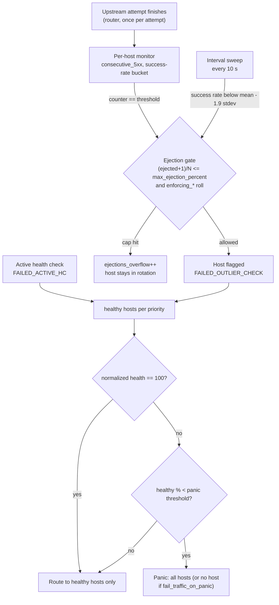

# Outlier Detection and Panic Thresholds in Envoy: Ejecting Failing Pods on Consecutive 5xx While Preventing Cascading Fleet Blackouts

> [!summary] Claim
> Envoy's outlier detection removes individual hosts that return consecutive errors, but only up to `max_ejection_percent` of the cluster, and the panic threshold is the second, independent brake: when the healthy share of a priority level drops below `healthy_panic_threshold` (default 50%), Envoy stops trusting health state and spreads load over every host, so a fleet-wide health signal failure degrades the service instead of blacking it out.

Part of [API Gateways Proxies and Edge Architecture](README.md) in [API Engineering](../README.md).

## TL;DR

- Mechanism: the router filter reports every upstream attempt to a per-host monitor; `consecutive_5xx` (default 5) or a periodic success-rate sweep (every `interval`, default 10 s) marks the host `FAILED_OUTLIER_CHECK`, and the load balancer skips it for `base_ejection_time` (30 s) times the number of recent ejections, capped by `max_ejection_time` (300 s).
- Contract rule: an ejection happens only if `(ejected + 1) / total_hosts <= max_ejection_percent` (default 10%) and only with probability `enforcing_*` percent; `enforcing_consecutive_gateway_failure` defaults to 0, so gateway-failure ejection is detected but never enforced until you raise it.
- Trap: the panic threshold compares the raw healthy percentage (no 1.4x overprovisioning) to `healthy_panic_threshold`, counts active-health-check failures and outlier ejections together, and routes to unhealthy hosts on purpose; setting it to 0 puts the whole load on the survivors (2.5x each in the lab) and answers `503 no healthy upstream` once none remain, and `fail_traffic_on_panic` answers `503 no healthy upstream` to every request that lands on a level in panic.
- Portability: the behavior is the Envoy router and load balancer, identical for HTTP/1.1, HTTP/2, and HTTP/3 upstreams because it keys on the response status or `grpc-status`; this note read Envoy v1.40.2 (as of 2026-11) and the lab model is pure stdlib Python verified here on CPython 3.14.6 only.
- When not to use: do not rely on outlier detection for clusters of fewer than 10 hosts at the default cap (it ejects nothing), for services whose errors are not 5xx, or as a substitute for overload control, retry budgets, and circuit breaking.

## Mental model



Every finished upstream attempt feeds a per-host monitor that lives with the `Host` object, so counters are shared by all worker threads.
Crossing a threshold does not eject directly: the decision is posted to the main thread, which applies the `max_ejection_percent` gate and the `enforcing_*` percentage before it sets the health flag.
Active health checking sets a second flag, `FAILED_ACTIVE_HC`, and both flags remove a host from the healthy set.
The load balancer then converts healthy counts into a per-priority health score and traffic split, and only when the combined score is below 100 does it check whether any level fell under the panic threshold; a level in panic ignores the flags and uses every host.

## How it works

### Where results come from

Outlier detection needs filters to report outcomes; the HTTP router, TCP proxy, Redis proxy, and Thrift proxy do (Envoy docs, outlier.rst, "Outlier detection").
The router calls the host's `outlierDetector().putResult(...)` from `Filter::onUpstreamHeaders` for every upstream response, and from `Filter::updateOutlierDetection` for local failures (envoy v1.40.2 source/common/router/router.cc, `Filter::onUpstreamHeaders`, `Filter::updateOutlierDetection`).
Because this runs once per upstream request, a retried request reports every attempt, and a hedged request that hits a per-try timeout records a `LocalOriginTimeout` immediately and sets `outlierDetectionTimeoutRecorded` so the global timeout does not count it twice (router.cc, `Filter::onSoftPerTryTimeout`).
Retries therefore make a failing host reach the consecutive threshold faster than the client-visible error rate suggests; see [[Proxy-and-Application-Timeout-and-Retry-Interaction-Hazards]].

Error classification (router.cc, `Filter::onUpstreamHeaders`):

- A status `>= 500` is reported as `ExtOriginRequestFailed` with the status code; anything else is `ExtOriginRequestSuccess`.
  The monitor then counts only `500` to `599` as 5xx (`Http::CodeUtility::is5xx` is `code >= 500 && code < 600` in envoy v1.40.2 source/common/http/codes.h).
- For gRPC requests, when a `grpc-status` header is present in the response headers it is mapped to an HTTP status with `Grpc::Utility::grpcToHttpStatus` and that is what outlier detection sees.
  The source comment states this "does not handle the case when an error grpc-status is sent as a trailer", so a gRPC server that fails in trailers is invisible to outlier detection.
- For non-gRPC requests only (the matcher runs in the `else` branch of the `grpc_request_` check), if the cluster configures `HttpProtocolOptions.outlier_detection` (error mapping), a response that matches is reported as 500 when its status was below 500, and a response that does not match is reported as 200, which means a real `503` that fails to match the matcher counts as a success (Envoy docs, outlier.rst, "Error Mapping"; router.cc).
- A response carrying `x-envoy-degraded` is reported as `ExtOriginRequestDegraded` only if it is not a 5xx; "ejection has priority over degradation" is a comment in the source.
- When the pool hands over a connection, `LocalOriginConnectSuccess` is reported (upstream_request.cc, `UpstreamRequest::onPoolReady`); in the default non-split mode `resultToHttpCode` returns no code for it, so a successful connect does not reset the consecutive counter.

In the default mode, `split_external_local_origin_errors: false`, locally originated errors are folded into HTTP codes: `LocalOriginTimeout` becomes `504`, `LocalOriginConnectFailed` becomes `503`, and `ExtOriginRequestFailed` without a code becomes `500` (outlier_detection_impl.cc, `DetectorHostMonitorImpl::resultToHttpCode`); that mapping applies only when no code is passed, and the router's timeout paths pass `timeout_response_code_` explicitly (router.cc, `onSoftPerTryTimeout` and the global timeout handler).
In split mode, locally originated failures use their own counter, `consecutive_local_origin_failure`, and `consecutive_5xx` sees only what the upstream server said (outlier.rst, "Consecutive Local Origin Failure").

### Consecutive 5xx and consecutive gateway failure

`DetectorHostMonitorImpl::putHttpResponseCode` increments two atomic counters (outlier_detection_impl.cc, `putHttpResponseCode`; outlier_detection_impl.h, `consecutive_5xx_`, `consecutive_gateway_failure_`).
For a 5xx, a gateway error (`502`, `503`, `504`; `isGatewayError` is `code >= 502 && code < 505` in codes.h) increments the gateway counter and any other 5xx resets it; the 5xx counter always increments.
For anything below 500, both counters reset to zero.
The trigger is an equality test, `++consecutive_5xx_ == threshold`, evaluated on the worker thread that handled the response, so exactly one worker crosses the line.
After the main thread handles the event it resets the counter, so a host that keeps failing after an ejection starts counting from zero again.
If the host is already ejected when the event runs (`FAILED_OUTLIER_CHECK` set), the handler returns without resetting, and because the test is `==` the counter walks past the threshold and cannot fire again until a success or an uneject resets it (`onConsecutiveErrorWorker`, `unejectHost`).

Defaults (Envoy v1.40.2 outlier_detection_impl.h `DEFAULT_*` constants and outlier_detection.proto): `consecutive_5xx` 5, `consecutive_gateway_failure` 5, `enforcing_consecutive_5xx` 100, `enforcing_consecutive_gateway_failure` 0.
A value of 0 for `consecutive_5xx` or `consecutive_gateway_failure` disables that detector (proto comments).
The asymmetry in the enforcing defaults is a real trap: setting only `consecutive_gateway_failure: 3` produces `ejections_detected_consecutive_gateway_failure` increments and no gateway-failure ejections (the `consecutive_5xx` detector still ejects at its own threshold of 5).

### The ejection gate and the cap

`DetectorImpl::ejectHost` runs on the main thread (outlier_detection_impl.cc, `ejectHost`):

```text
max_ejection_percent = min(100, runtime or config, default 10)
ejected_percent = 100.0 * (ejections_active + 1) / host_monitors_.size()
should_eject = ejected_percent <= max_ejection_percent
if always_eject_one_host: should_eject = ejections_active == 0 or should_eject
if not should_eject: ejections_overflow++ ; return
```

`host_monitors_.size()` counts every host in the cluster across all priorities, and a source comment says the cap "is not currently checked per-priority level, so it is possible for outlier detection to eject all hosts at any given priority level".
With 10 hosts and the default 10%, the first ejection passes (10% <= 10%) and the second fails (20% > 10%); with 5 hosts the first ejection already computes 20% and fails, so a default-configured cluster of fewer than 10 hosts never ejects anything unless `always_eject_one_host` is set.
If the gate passes, `enforceEjection` rolls the `enforcing_*` percentage (`featureEnabled` against the runtime key or config); a failed roll leaves the host in rotation and still counts as detected.
Only then is the host flagged: `healthFlagSet(FAILED_OUTLIER_CHECK)`, `num_ejections_++`, the ejection timestamp and jitter are stored, and the backoff multiplier is incremented.

### Ejection duration, backoff, and un-ejection

The ejection lasts `min(base_ejection_time * backoff, max_ejection_time) + jitter` where `backoff` is the per-host multiplier (`eject_time_backoff_`, starts at 0 and is incremented at ejection time, so the first ejection uses 1).
The multiplier only increments while `backoff * base < max + base`, which caps it at `max / base + 1` (11 for the defaults: at 10, `10 * 30 < 300 + 30` still increments; at 11, `330 < 330` does not).
`max_ejection_time` defaults to the larger of 300 s and `base_ejection_time`, and construction fails if it is smaller than the base (`DetectorImpl::create`, `DetectorConfig`).
`max_ejection_time_jitter` (default 0) adds a random `[0, jitter]` per ejection so a fleet of proxies that ejected the same host does not all reconnect on the same tick.

Un-ejection is evaluated only inside the interval timer (`onIntervalTimer`, `checkHostForUneject`), so the real duration is quantized up to the next tick: a host ejected 3 s after a tick with `base_ejection_time` 30 s and `interval` 10 s is checked at 7, 17, 27, and 37 s after ejection and returns at 37 s (derived from the code, not measured).
On un-ejection all three consecutive counters reset, "to avoid re-ejection on very few new errors" (comment in `unejectHost`).
Each tick also decrements the backoff of every non-ejected host whose last un-ejection was at least one `interval` ago, so the multiplier drops by one per clean interval; the docs say a host that stays healthy takes about `max_ejection_time / base_ejection_time * interval` to bring its ejection time back down to `base_ejection_time`, which is 100 s for the defaults (outlier.rst, "Ejection algorithm"; the 100 s is that formula evaluated, not a number the docs state).
A flapping host that fails again before its multiplier decays is ejected for 2x, 3x, and so on of the base time.

### Success-rate and failure-percentage ejection

Success-rate detection runs only in the interval sweep (`processSuccessRateEjections`).
Each host keeps two buckets (`SuccessRateAccumulator`) so the sweep reads the finished window while new results go to the other one.
A host participates if it is not already ejected and its volume in the window is at least `success_rate_request_volume` (default 100).
Detection runs only if at least `success_rate_minimum_hosts` (default 5) hosts qualify.
The threshold is `mean - (success_rate_stdev_factor / 1000) * stdev`, with the population standard deviation and a default factor of 1900 (1.9); the source comment's example `{50, 100, 100, 100, 100}` gives mean 90, stdev 20, and threshold 52 (`successRateEjectionThreshold`).
A host strictly below the threshold goes through the same `ejectHost` gate.
A sweep ejecting several hosts evaluates the cap sequentially, so with a cap that allows only one, which of two equally bad hosts is ejected depends on the iteration order of `host_monitors_`, an `absl::node_hash_map` (outlier_detection_impl.h).

Failure-percentage detection compares each host's failure rate with a flat `failure_percentage_threshold` (default 85) instead of the cluster mean, requires `failure_percentage_minimum_hosts` (5) and `failure_percentage_request_volume` (50), and its `enforcing_failure_percentage` defaults to 0, so it is off until enabled (proto and `DEFAULT_*` constants).
The lab does not model failure-percentage detection.

### Interaction with active health checking

If a cluster has an active health checker and `successful_active_health_check_uneject_host` is true (default), a passing check un-ejects a host when `FAILED_ACTIVE_HC` is clear and `FAILED_OUTLIER_CHECK` is set (`DetectorImpl::initialize`, the `addHostCheckCompleteCb` lambda).
The docs warn that if the health check does not exercise the data path, a host that answers `/healthz` but fails real requests is un-ejected prematurely, and to set the flag to false in that case (outlier.rst).
The router also honors `x-envoy-immediate-health-check-fail` on an upstream response: Envoy immediately marks the host as failed for active health checking and excludes it from load balancing, but only if the cluster has active health checking configured (health_checking.rst, "Active health checking fast failure"; router.cc, `onUpstreamHeaders`).
For the complementary design of the probe endpoints, see [[Health-Check-Engineering-Liveness-Readiness-Startup-and-Cascading-Restarts]].

### From health flags to traffic: priority load

`recalculatePerPriorityState` computes, per priority level, `health = min(100, overprovisioning_factor * healthy / total)` with the factor stored as the integer 140 (priority.rst: "defaults to 1.4"; envoy v1.40.2 source/common/upstream/upstream_impl.h, `kDefaultOverProvisioningFactor = 140`; load_balancer_impl.cc, `recalculatePerPriorityState`).
The normalized total availability is `min(sum(health) + sum(degraded), 100)` (`calculateNormalizedTotalAvailability`).
Load is then handed out in order: `load[i] = min(remaining, health[i] * 100 / normalized)`, and integer-division remainder goes to the first available priority (`distributeLoad`).
A request picks its priority with `hash % 100 + 1` against the cumulative load (`choosePriority`).
With one priority and 28 of 100 hosts down, `140 * 72 / 100 = 100` so the level is fully healthy; at 29 down it is 99, and normalized availability falls below 100 for the first time.

### The panic decision

`recalculatePerPriorityPanic` (load_balancer_impl.cc) does this:

```text
panic_threshold = min(100, runtime "upstream.healthy_panic_threshold" or cluster config, default 50)
if panic_threshold == 0 and normalized_total_availability == 0: load[P0] = 100; return   # no panic, nothing to route to
for each priority i:
    panic[i] = false if normalized_total_availability == 100
               else isHostSetInPanic(i)
if all panic[i]: recalculateLoadInTotalPanic()
```

`isHostSetInPanic` computes `healthy_percent = 100.0 * healthy / host_count` (plus degraded) and panics when `healthy_percent + degraded_percent < threshold`; there is no overprovisioning factor here, so the two numbers in the same cluster use different scales (`LoadBalancerBase::isHostSetInPanic`).
The configured percent is truncated to the nearest 1% (cluster.proto comment on `healthy_panic_threshold`), and the runtime key `upstream.healthy_panic_threshold` takes precedence over the field (`RuntimePanicThreshold` in load_balancer_impl.cc).
The comparison is strict: with 10 hosts and the default threshold, 5 healthy hosts are not in panic and 4 are.

When every priority is in panic, load is split by host count rather than health: for P0 with 2 hosts and P1 with 8, the split is 20/80, with the remainder going to the first non-empty level (`recalculateLoadInTotalPanic`).
When only some levels are in panic, the normal health-based split still applies, and the panicking level sends to all of its hosts for the share it receives.

In `hostSourceToUse`, a level in panic increments `lb_healthy_panic` per request and then returns no host if `fail_traffic_on_panic` is set (cluster.proto `ZoneAwareLbConfig.fail_traffic_on_panic`) or the source type `AllHosts` otherwise (`ZoneAwareLoadBalancerBase::hostSourceToUse`).
`AllHosts` includes ejected and actively-failed hosts, so panic overrides outlier detection by design.
Zone-aware routing has its own panic check on the local cluster, counted by `lb_local_cluster_not_ok` (stats doc and the same function); that and locality weighting are out of scope here and belong with [[Load-Balancing-Algorithms-Round-Robin-Least-Request-P2C-and-Consistent-Hashing]].

The documented examples work out as follows (panic_threshold.rst, priority.rst; the lab test names are in the Worked example):

| P0 healthy | P1 healthy | Load P0 / P1 | Panic P0 / P1 | Why |
| --- | --- | --- | --- | --- |
| 25% | 100% | 35 / 65 | no / no | normalized health is 100, panic is never evaluated |
| 25% | 25% | 50 / 50 | yes / yes | normalized health is 70 and both are below 50%, total panic splits by host count |
| 5% | 65% | 8 / 92 (source arithmetic) | yes / no | normalized health 98, only P0 is below 50% |

The last row differs from the docs table, which shows 7 / 93: with integer math `140 * 5 / 100 = 7`, `140 * 65 / 100 = 91`, normalized 98, loads 7 and 92, and the leftover 1 goes to the first available priority, which gives 8 / 92 (confirmed by reading `distributeLoad` and the remainder rule in `recalculatePerPriorityState`, whose own comment notes the first priority "receiving 2% additional load due to rounding"; the lab test `test_mixed_panic_applies_per_priority_with_source_rounding` reproduces 8 / 92; not run against a live proxy, so the docs table is best read as rounded).

## Numbers and limits

| Quantity | Value | Source |
| --- | --- | --- |
| `consecutive_5xx` | 5 | Envoy v1.40.2 outlier_detection.proto (as of 2026-11) |
| `consecutive_gateway_failure` / enforcing | 5 / 0 | outlier_detection.proto, `DEFAULT_ENFORCING_CONSECUTIVE_GATEWAY_FAILURE` |
| `enforcing_consecutive_5xx` | 100 | `DEFAULT_ENFORCING_CONSECUTIVE_5XX` |
| `interval` | 10 s | outlier_detection.proto |
| `base_ejection_time` | 30 s | outlier_detection.proto |
| `max_ejection_time` | max(300 s, `base_ejection_time`) | outlier_detection.proto, `DetectorConfig` |
| `max_ejection_time_jitter` | 0 s | outlier_detection.proto |
| `max_ejection_percent` | 10 | outlier_detection.proto |
| Success rate: min hosts / volume / stdev factor | 5 / 100 / 1900 | outlier_detection.proto |
| Failure percentage: threshold / min hosts / volume / enforcing | 85 / 5 / 50 / 0 | outlier_detection.proto |
| `healthy_panic_threshold` | 50% (0 disables, truncated to 1%) | cluster.proto, panic_threshold.rst |
| Overprovisioning factor | 1.4 (integer 140) | priority.rst |
| Cluster with 10 hosts, default cap | 1 host can be ejected | `ejectHost` arithmetic, lab test |
| Cluster with 5 hosts, default cap | 0 hosts can be ejected | `ejectHost` arithmetic, lab test |
| 10 hosts, 6 failed active HC, default panic, 1000 requests | 100 per host, 400 succeed, `lb_healthy_panic` 1000 | lab, CPython 3.14.6, macOS 27.3 arm64 |
| Same, `panic_threshold` 0 | 250 per survivor (2.5x the 100 each had under panic), 0 failures | lab, same machine |
| Same, `fail_traffic_on_panic` | 1000 requests answered `no healthy upstream` | lab, same machine |
| Lab suite | 33 tests, 1.59 s | `uv run --frozen pytest`, CPython 3.14.6, macOS 27.3 arm64 (rerun 2026-11-21; wall time varies run to run) |

Counters worth alerting on, all from the cluster stats doc: `outlier_detection.ejections_active` (gauge), `ejections_overflow`, `ejections_detected_*` against `ejections_enforced_*`, `membership_healthy` (counts both health checking and outlier detection), and `lb_healthy_panic`.

## Portability

| Axis | Cell | Evidence |
| --- | --- | --- |
| CPython 3.14.6 (lab model) | 33 tests pass | ran here, `uv run --frozen pytest`, macOS 27.3 arm64 |
| CPython 3.12.16, 3.13.18, 3.15.2, 3.15.2t | not run | lab checks were paused by the user's instruction of 2026-11-11; the model uses only the standard library, which proves nothing |
| Libraries (pydantic, Starlette, Uvicorn, Hypercorn, Granian) | not used | the lab has no ASGI surface |
| Envoy v1.40.2 | behavior described here | source and docs read at that tag; latest release per the GitHub API on 2026-11-21 |
| Older Envoy | fields absent before these releases | first `.0` tag whose outlier_detection.proto has the field: `max_ejection_time` v1.17.0, `max_ejection_time_jitter` v1.22.0, `successful_active_health_check_uneject_host` v1.28.0, `always_eject_one_host` v1.31.0, `detect_degraded_hosts` v1.38.0 (proto read at every tag v1.15.0 to v1.40.0); behavior of older code paths was not read |
| HTTP/1.1, HTTP/2, HTTP/3 upstreams | same outlier logic | `onUpstreamHeaders` takes a status code and a header map, not a protocol; not run against real upstreams |
| gRPC | status taken from `grpc-status` in headers only | router.cc comment, outlier.rst |
| TCP proxy | `consecutive_5xx` is mapped to connection failures | outlier.rst note |
| Istio `DestinationRule.outlierDetection` | `minHealthPercent` (default 0%) becomes Envoy `healthy_panic_threshold`, so Istio turns Envoy panic off unless you set it; `enforcing_success_rate` is forced to 0; each configured consecutive detector gets enforcing 100; `maxEjectionPercent` is passed only when > 0 (Envoy default 10% otherwise) | istio.io reference; Istio 1.32.0 pilot/pkg/networking/core/cluster_traffic_policy.go, `applyOutlierDetection` (as of 2026-11) |

## Worked example

The model in [implementation](../labs/src/api_labs/f17_api_gateways_proxies_and_edge_architecture/envoy_outlier_detection.py) mirrors the Envoy v1.40.2 functions named above with explicit time and injected randomness.
It omits degraded hosts, host weights, locality routing, failure-percentage detection, and the worker-to-main-thread post (ejection runs inline), so it demonstrates the arithmetic and the interaction, not Envoy's concurrency.
The test is [test](../labs/tests/f17_api_gateways_proxies_and_edge_architecture/test_envoy_outlier_detection_passive_health_checking_and_panic_thresholds.py).

Simplified excerpt, the ejection gate and the duration rule:

```python
def _eject(self, host: Host, kind: EjectionKind, now_ms: int) -> None:
    cap = min(100, self.config.max_ejection_percent)
    ejected_percent = 100.0 * (self.ejections_active + 1) / len(self.hosts)
    should_eject = ejected_percent <= cap
    if self.config.always_eject_one_host:
        should_eject = self.ejections_active == 0 or should_eject
    if not should_eject:
        self.stats.ejections_overflow += 1
        return
    if not self._enforced(kind):
        return
    self.stats.enforced[kind] += 1
    host.failed_outlier = True
    host.num_ejections += 1
    host.last_ejection_ms = now_ms
    host.jitter_ms = self._jitter(self.config.max_ejection_time_jitter_ms)
    base = self.config.base_ejection_time_ms
    if host.eject_backoff * base < self.config.effective_max_ejection_time_ms + base:
        host.eject_backoff += 1
```

Simplified excerpt, the panic decision:

```python
def _below_panic_threshold(healthy: int, count: int, threshold: int) -> bool:
    return 100 * healthy < threshold * count if count else threshold > 0

# inside compute_priority_state, after the health-based load split:
panic = [
    normalized != 100 and _below_panic_threshold(healthy[i], counts[i], threshold)
    for i in range(len(priorities))
]
if panic and all(panic):
    total_hosts = sum(counts)
    load = [100 * count // total_hosts for count in counts]
```

The scenario the lab was written for: 10 endpoints, 6 failing active health checks, 1000 requests, three configurations (script run once from outside the lab directory; output captured on CPython 3.14.6, macOS 27.3 arm64):

```text
panic_threshold=50 state: (True,) survivor_each: {'h6': 100, 'h7': 100, 'h8': 100, 'h9': 100} ok: 400 panic_counter: 1000 no_upstream: 0
panic_threshold=0 state: (False,) survivor_each: {'h6': 250, 'h7': 250, 'h8': 250, 'h9': 250} ok: 1000 panic_counter: 0 no_upstream: 0
fail_traffic_on_panic state: (True,) survivor_each: {'h6': 0, 'h7': 0, 'h8': 0, 'h9': 0} ok: 0 panic_counter: 1000 no_upstream: 1000
```

Reading it: with the default threshold the four healthy hosts keep their normal 100 requests each, and the other 600 requests go to hosts that fail, so 40% succeed.
With the threshold disabled every request succeeds in this model, but each survivor carries 250 requests, 2.5x its prior share; the model has no capacity limit, so whether that is a win depends on whether the survivors can absorb 2.5x.
The panic trade is chosen for the case where "unhealthy" is a monitoring artifact or an overload cascade, not a true loss of 60% of capacity.

Pytest, run from `labs/` with `uv run --frozen pytest tests/f17_api_gateways_proxies_and_edge_architecture/test_envoy_outlier_detection_passive_health_checking_and_panic_thresholds.py -q`, CPython 3.14.6 on macOS 27.3 arm64:

```text
.................................                                        [100%]
33 passed in 1.59s
```

Notable tests: `test_sixty_percent_unhealthy_fails_open_to_all_hosts`, `test_disabling_panic_concentrates_all_traffic_on_the_survivors`, `test_default_outlier_cap_cannot_push_the_cluster_into_panic`, `test_uncapped_outlier_ejection_triggers_panic_instead_of_a_blackout`, `test_default_cap_ejects_nothing_in_a_cluster_of_fewer_than_ten_hosts`, and `test_gateway_failure_is_detected_but_not_enforced_by_default`.
Mutation checks were not run, by instruction; the tests are written to fail on a changed boundary (for example the 5 versus 4 healthy boundary) but that was not demonstrated.

## Pitfalls

> [!warning] Gateway-failure ejection that never ejects
> Trigger: `consecutive_gateway_failure` is set and `enforcing_consecutive_gateway_failure` is left unset.
> Symptom: `ejections_detected_consecutive_gateway_failure` grows, `ejections_enforced_consecutive_gateway_failure` stays 0, and bad hosts keep serving.
> Fix: set the enforcing percent explicitly; its default is 0 while `enforcing_consecutive_5xx` defaults to 100 (outlier_detection.proto, `DEFAULT_*` constants).

> [!warning] The default cap makes small clusters unejectable
> Trigger: the default `max_ejection_percent` of 10 on a cluster of fewer than 10 hosts.
> Symptom: `ejections_overflow` increments, `ejections_active` stays 0, and a host returning 5xx on every request stays in rotation.
> Fix: raise the cap deliberately (for example 50) or set `always_eject_one_host`, and decide the panic threshold in the same change.

> [!warning] Raising the cap to 100 hands the blackout decision to the panic threshold
> Trigger: `max_ejection_percent: 100` with a shared dependency failure (a bad config push, an expired credential) that makes every host return 5xx.
> Symptom: all hosts are ejected, healthy share is 0%, the cluster goes into total panic and sends to every host, so the service still answers (with errors) and `lb_healthy_panic` climbs; with `healthy_panic_threshold: 0` it returns `503 no healthy upstream` instead.
> Fix: choose the cap and the panic threshold together, keep panic on unless failures are all-or-nothing, and alert on `lb_healthy_panic > 0` (lab: `test_uncapped_outlier_ejection_triggers_panic_instead_of_a_blackout`).

> [!warning] Panic sends traffic to hosts you just ejected
> Trigger: healthy share below the threshold, for any reason including a failing active health check endpoint.
> Symptom: the ejected pod still receives its share of requests, and success-rate dashboards show a step to roughly the healthy fraction (40% in the lab).
> Fix: treat panic as a page, not a steady state; use `fail_traffic_on_panic` only for services that fail all-or-nothing, as the Envoy docs describe.

> [!warning] Retries and hedging multiply error counts
> Trigger: a route with `retry_on` or hedging in front of a host that fails.
> Symptom: the host hits the consecutive threshold after fewer client requests, and per-try timeouts count as local-origin failures even when the hedged attempt later succeeds.
> Fix: budget retries (see [[Retry-Budgets-and-Preventing-Cascading-Retry-Amplification-Storms]]) and set `consecutive_5xx` with the retry fan-out in mind (router.cc, `onSoftPerTryTimeout`).

> [!warning] An error mapper that reclassifies real 5xx as success
> Trigger: configuring `HttpProtocolOptions.outlier_detection` with a matcher that matches only some failures.
> Symptom: a 503 that does not match is reported as 200 and resets the consecutive counters, so a failing host is never ejected (router.cc, `onUpstreamHeaders`: no match reports 200).
> Fix: write the matcher as the full definition of failure, including every 5xx you care about.

> [!warning] gRPC failures in trailers are invisible
> Trigger: a gRPC server returns `200` with `grpc-status` set only in trailers.
> Symptom: the host never accumulates consecutive errors; the source comment says error `grpc-status` in trailers is not handled.
> Fix: have servers send trailers-only responses for early failures, which put `grpc-status` in the headers, and verify with `ejections_detected_*` in a test cluster.

> [!warning] One filter chain ejects for all
> Trigger: a cluster shared by several routes or listeners, where one route sends a poison request that makes the backend return 500.
> Symptom: the host is ejected for every consumer of the cluster; the docs state a cluster may be shared and that ejection by one filter chain affects the others.
> Fix: split clusters by blast radius when routes have different failure semantics.

> [!warning] Graceful WebSocket closes count as gateway failures
> Trigger: `consecutive_gateway_failure: 1` with `enforcing_consecutive_gateway_failure: 100` on a cluster that carries WebSocket upgrades.
> Symptom: in upstream issue 24690 (opened 2022-12-27, still open when read on 2026-11-21) a single clean `echo foo | websocat` session was enough to eject the endpoint; the maintainer who traced it reported that the client's close frame is answered by a server TCP FIN, which Envoy treats as a local-origin remote close, maps to `503`, and feeds to the detector as a gateway error.
> Fix: do not set the gateway threshold to 1 on clusters with long-lived upgraded connections; a maintainer's suggested workaround in that thread was a higher consecutive count, and `ejections_detected_consecutive_gateway_failure` on a test cluster shows whether clean closes are being counted (envoyproxy/envoy issue 24690).

> [!warning] Requests keep reaching ejected hosts during a correlated failure
> Trigger: every host of priority 0 fails at once while priority 1 stays healthy.
> Symptom: upstream issue 28304 (Envoy 1.26.1, closed as stale) reported 26 failed requests on the first ejected host but 3102 and 3069 on the other two, with requests still routed to ejected hosts for about a second; a responder suggested panic mode or un-ejection as the cause, and the reporter said `healthy_panic_threshold: 0` gave the same result, so the cause was never established in the thread.
> Fix: treat this as an observed report, not a documented mechanism; in a failure drill, watch `lb_healthy_panic`, `ejections_active`, and per-host request counts together, and test your priority and cap settings with the lab model before relying on a clean shift (envoyproxy/envoy issue 28304).

## Security and robustness

- Threat model: an unauthenticated client who can trigger a 5xx on a specific route (a malformed payload that crashes a handler) can eject backends, each ejection costing 30 s times the multiplier; this is an availability attack built from the feature (reasoning from the mechanism, not a published CVE).
  The caps bound the damage: `max_ejection_percent`, then panic, which restores service at the cost of reaching bad hosts.
  Map this to OWASP API4:2023 Unrestricted Resource Consumption and API8:2023 Security Misconfiguration.
- Client errors do not count: `4xx` resets the counters, so floods of invalid requests do not eject hosts; keep server-side validation failures as 4xx, not 5xx.
- Misconfiguration surface: `enforcing_*` of 0 silently disables ejection, `healthy_panic_threshold` of 0 removes the safety net, and the runtime key `upstream.healthy_panic_threshold` overrides the config, so an operations runtime layer can undo a reviewed config.
  Treat runtime overrides of `outlier_detection.*` and `upstream.healthy_panic_threshold` as production changes with review.
- Observability for forensics: enable the ejection event log (`ClusterManager.OutlierDetection.event_log_path` in bootstrap.proto; `EventLoggerImpl::logEject` writes each `OutlierDetectionEvent` as one JSON line) so an investigation can see which host was ejected, by which detector, and whether it was enforced.
- Defense in depth: combine outlier detection with active health checks that exercise the data path, circuit breakers ([[Circuit-Breakers-State-Machines-Half-Open-Probing-and-When-Not-to-Use-Them]]), load shedding at the backend, and retry budgets; none of them replaces the others.
- The `successful_active_health_check_uneject_host` default (true) lets a shallow probe cancel a correct ejection; this is a robustness hole when probes are not representative.

## The principal's view

The decision is where fleet-level protection lives and who owns it.
Outlier detection is a local, per-proxy, statistical judgement about hosts; the panic threshold is a fleet-level guard against that judgement being wrong; they must be configured as one policy per cluster class, owned by the platform team, with service teams owning only the definition of "error" (the error mapper and the status codes their services return).

Recommended defaults: keep panic at 50 (or the default) for stateless, horizontally scaled services, because wrongly dropping traffic is a bigger risk than sending some to bad hosts; for clusters under 10 hosts either raise `max_ejection_percent` or use `always_eject_one_host`, and accept that a cap of 50% means panic is reachable.
Use `fail_traffic_on_panic` only for services that fail all-or-nothing, where fast failure protects an upstream that is already struggling, as the Envoy docs describe; the cost is that no request can succeed while in panic.
Use `healthy_panic_threshold: 0` only if you accept that survivors carry the whole load, which is justified when capacity headroom is large and the health signal is trustworthy.

The organizational trade-off is autonomy versus blast radius: per-service tuning produces mismatched caps and panic settings that are only discovered in incidents, while a platform default is conservative and slow to adapt.
When to choose differently: if the failure signal is latency rather than errors, outlier detection by status codes will not help and adaptive concurrency or hedging is the better tool ([[Adaptive-Concurrency-Limits-Littles-Law-Vegas-and-Gradient2]], [[Hedged-Requests-and-Tail-Latency-Taming-at-Scale]]); if you run a sidecar or ambient mesh, the same Envoy knobs are reached through the mesh API ([[Service-Mesh-Architecture-Sidecar-vs-Ambient-Mesh-and-East-West-Policy]]), and the mesh may change the defaults: Istio 1.32.0 writes `minHealthPercent` (default 0) into `healthy_panic_threshold`, so an Istio `outlierDetection` block disables panic unless you set it (`applyOutlierDetection`); and where a deploy causes the errors, the rollout strategy is the control ([[Zero-Downtime-Blue-Green-Canary-and-Cell-Based-API-Deployments]]).

## Interview questions

> [!question] L5: What does Envoy's outlier detection do when a host returns five 500 responses in a row, and what stops it from ejecting the whole cluster?
>
> > [!success]- Answer
> > The per-host monitor reaches `consecutive_5xx` (default 5) and the main thread decides whether to eject.
> > The gate allows an ejection only if `(ejected + 1) / total_hosts <= max_ejection_percent` (default 10%), and then a roll against `enforcing_consecutive_5xx` (default 100).
> > An ejected host is skipped by the load balancer for `base_ejection_time` times the number of recent ejections, up to `max_ejection_time`.
> > If the cap is hit, `ejections_overflow` increments and the host stays in rotation.
> >
> > Follow-up: How many hosts can the default config eject in a cluster of 5, and why?

> [!question] L5: Which responses count toward the consecutive-error counter, and what resets it?
>
> > [!success]- Answer
> > Any status from `500` to `599` increments `consecutive_5xx`; `502`, `503`, and `504` also increment the gateway counter, and other 5xx values reset the gateway counter.
> > Any status below 500, including every 4xx, resets both counters.
> > Locally originated failures (timeouts as `504`, connect failures as `503`) count the same way in the default non-split mode.
> >
> > Follow-up: What changes when `split_external_local_origin_errors` is true?

> [!question] L6: Explain when Envoy evaluates the panic threshold, what it compares, and what it does in panic.
>
> > [!success]- Answer
> > It is evaluated per priority level only when normalized total availability is below 100, where each level's health is `min(100, 1.4 * healthy_percent)`.
> > A level is in panic when its raw healthy percentage (healthy plus degraded, no 1.4 factor) is below `healthy_panic_threshold`, default 50%.
> > In panic the balancer picks from all hosts of that level regardless of health, or from none if `fail_traffic_on_panic` is set.
> > If every level is in panic, load is split by host count instead of health.
> >
> > Follow-up: With one priority and 10 hosts, how many must be healthy for the cluster not to panic at the default?

> [!question] L6: Predict the output of `route_requests(PriorityLoadBalancer([hosts]), 1000)` for ten hosts with six marked `failed_active_hc`, then again with `panic_threshold=0`.
>
> > [!success]- Answer
> > Default: healthy share is 40%, below 50%, so the level is in panic and round-robins over all ten hosts; each gets 100, 400 requests land on healthy hosts, and `lb_healthy_panic` is 1000.
> > With `panic_threshold=0`: only the four survivors are used, each gets 250, no request is lost, and `lb_healthy_panic` is 0.
> > The lab prints exactly these tallies on CPython 3.14.6.
> >
> > Follow-up: Which setting would you pick if the survivors can only handle 1.5x their usual load, and why?

> [!question] L6: Debug this API: a cluster sets `consecutive_gateway_failure: 3` and `max_ejection_percent: 50`, a host returns `503` on every request and is never ejected, and `ejections_detected_consecutive_gateway_failure` rises while `ejections_enforced_consecutive_gateway_failure` stays 0, so what is wrong?
>
> > [!success]- Answer
> > `enforcing_consecutive_gateway_failure` defaults to 0, so the detector fires but never ejects.
> > `consecutive_5xx` (default 5, enforcing 100) should still eject after five consecutive 5xx, unless it was set to 0 elsewhere or the cap blocked it.
> > Fix by setting `enforcing_consecutive_gateway_failure: 100`, then confirm `ejections_enforced_*` moves.
> >
> > Follow-up: If `ejections_overflow` were increasing instead, what would you check?

> [!question] L6: Why does a retried request make outlier detection more aggressive, and how do you account for it?
>
> > [!success]- Answer
> > The router reports each upstream attempt, so a request retried three times against failing hosts adds three errors to the per-host counters.
> > Hedged requests that exceed the per-try timeout also record a local-origin timeout even if a later attempt succeeds.
> > Size `consecutive_5xx` and the retry budget together, and prefer retrying on a different host so one bad host does not collect all attempts.
> >
> > Follow-up: What happens to the counter if the retry succeeds on the same host?

> [!question] L7+: Design the Envoy failure policy and alerts for a 30-pod payments API whose pods all fail together when a downstream credential expires.
>
> > [!success]- Answer
> > Keep outlier detection on with `consecutive_5xx` around 5 and a `max_ejection_percent` of about 30, so a few bad pods are removed but a fleet-wide fault cannot remove everything.
> > Leave `healthy_panic_threshold` at 50 so a systemic failure fails open rather than blacking out, and decide explicitly whether `fail_traffic_on_panic` suits a service whose failures are all-or-nothing (payments often are, which argues for failing fast to protect the dependency).
> > Use an active health check that exercises the credential path so `successful_active_health_check_uneject_host` does not un-eject on a shallow probe.
> > Alert on `lb_healthy_panic > 0`, `ejections_overflow > 0`, and `ejections_active` as a share of `membership_total`.
> >
> > Follow-up: How would you test the policy before a real incident?

> [!question] L7+: Why can the panic threshold and `max_ejection_percent` be at odds, and how do you pick them together?
>
> > [!success]- Answer
> > The cap limits how many hosts outlier detection removes; the panic threshold limits how few healthy hosts the balancer tolerates before it ignores health.
> > With a 10% cap, outlier detection alone cannot push a cluster below the 50% threshold; a 60% cap can, and then panic sends traffic back to ejected hosts, undoing the ejections.
> > Pick a cap below `100 - panic_threshold` if you want ejections to stay meaningful, and treat any panic event as a signal that health data cannot be trusted.
> > Active health checks are not capped, so they can still trigger panic on their own.
> >
> > Follow-up: What does the source comment on per-priority ejection tell you about multi-priority clusters?

> [!question] L7+: Why does outlier detection never eject a gRPC pod that returns application errors in trailers after `200` headers, and what would you do?
>
> > [!success]- Answer
> > The router maps `grpc-status` to an HTTP status only when it appears in the response headers, and the source states the trailer case is not handled, so the attempt is reported as a success.
> > Make servers return trailers-only responses for failures that happen before any message is sent, add a cluster-level error mapper if the failure can be expressed from headers, or fall back on active health checks or a success-rate view of the service's own metrics.
> > Verify the behavior in a test cluster because the trailer limitation is a source comment, not a guarantee across versions.
> >
> > Follow-up: What are the limits of an error mapper that only sees headers?

## Related

Prerequisites: [[Envoy-Proxy-Internals-Listeners-Filter-Chains-HCM-and-Clusters]]

Next: [[External-Authorization-Ext-Authz-and-Global-Rate-Limit-Filters]]

See also: [[Load-Balancing-Algorithms-Round-Robin-Least-Request-P2C-and-Consistent-Hashing]], [[Proxy-and-Application-Timeout-and-Retry-Interaction-Hazards]], [[Circuit-Breakers-State-Machines-Half-Open-Probing-and-When-Not-to-Use-Them]], [[Health-Check-Engineering-Liveness-Readiness-Startup-and-Cascading-Restarts]], [[Retry-Budgets-and-Preventing-Cascading-Retry-Amplification-Storms]], [[Case-Study-Cascading-Retry-Storms-and-Metastable-Overload-Collapse]], [[Service-Mesh-Architecture-Sidecar-vs-Ambient-Mesh-and-East-West-Policy]], [[Zero-Downtime-Blue-Green-Canary-and-Cell-Based-API-Deployments]], [[L4-vs-L7-Load-Balancing-for-HTTP-1-1-HTTP-2-and-gRPC]]

- Lab: `labs/tests/f17_api_gateways_proxies_and_edge_architecture/test_envoy_outlier_detection_passive_health_checking_and_panic_thresholds.py`

## Further reading

- [Envoy outlier detection overview](https://www.envoyproxy.io/docs/envoy/latest/intro/arch_overview/upstream/outlier): the ejection algorithm, detection types, error mapping, and the active health check interplay.
- [Envoy panic threshold](https://www.envoyproxy.io/docs/envoy/latest/intro/arch_overview/upstream/load_balancing/panic_threshold): the normative description and worked tables for panic with priorities.
- [Envoy priority levels](https://www.envoyproxy.io/docs/envoy/latest/intro/arch_overview/upstream/load_balancing/priority): the health score, overprovisioning, and normalized total health formulas.
- [Envoy active health checking](https://www.envoyproxy.io/docs/envoy/latest/intro/arch_overview/upstream/health_checking): how active checks and `x-envoy-immediate-health-check-fail` combine with outlier detection.
- [outlier_detection.proto at v1.40.2](https://github.com/envoyproxy/envoy/blob/v1.40.2/api/envoy/config/cluster/v3/outlier_detection.proto): every field, its default, and the exact wording on enforcing percentages and caps.
- [outlier_detection_impl.cc at v1.40.2](https://github.com/envoyproxy/envoy/blob/v1.40.2/source/common/upstream/outlier_detection_impl.cc): the counters, the ejection gate, backoff, and success-rate math.
- [load_balancer_impl.cc at v1.40.2](https://github.com/envoyproxy/envoy/blob/v1.40.2/source/extensions/load_balancing_policies/common/load_balancer_impl.cc): `recalculatePerPriorityState`, `recalculatePerPriorityPanic`, `isHostSetInPanic`, and `hostSourceToUse`.
- [router.cc at v1.40.2](https://github.com/envoyproxy/envoy/blob/v1.40.2/source/common/router/router.cc): how upstream results, `grpc-status`, error mapping, and timeouts are reported to the detector.
- [Envoy issue 24690](https://github.com/envoyproxy/envoy/issues/24690): a reported case of graceful WebSocket closes ejecting hosts under `consecutive_gateway_failure: 1`.
- [Envoy issue 28304](https://github.com/envoyproxy/envoy/issues/28304): a reported case of traffic reaching ejected hosts during a correlated priority-0 failure, with the cause unresolved.
- [Istio DestinationRule reference](https://istio.io/latest/docs/reference/config/networking/destination-rule/): how a mesh API exposes outlier detection and its `minHealthPercent` knob.
