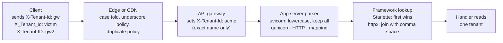

# Header Normalization Differences Across CDN, API Gateway, and ASGI Server: Underscores, Duplicate Headers, and Case Folding

> [!summary] Claim
> Every tier between the client and your handler applies its own rules to header name spelling, to repeated field lines, and to case, so the same bytes can mean three different things at three hops; a trusted header such as `X-Tenant-Id` is only trustworthy if every tier maps its spelling to the same single value or refuses the ambiguous ones at the edge.

Part of [API Gateways Proxies and Edge Architecture](README.md) in [API Engineering](../README.md).

## TL;DR

- Mechanism: `field-name = token` and `_` is a legal `tchar` (RFC 9110 Section 5.6.2), so `X_Tenant_Id` and `X-Tenant-Id` are two different, valid fields in HTTP, yet CGI-style mappers turn both into `HTTP_X_TENANT_ID` (RFC 3875 Section 4.1.18, RFC 9110 Section 17.10).
- Contract rule: a tier that sets or strips an identity header must handle every spelling that any downstream tier can fold onto it, or drop those spellings (underscores, duplicates, `Connection`-listed names) before the header is trusted.
- Trap: the gateway overwrites `X-Tenant-Id` correctly, passes the underscore twin untouched, and a WSGI or `$http_*` consumer merges them into `victim,acme` (the Django `CVE-2015-0219` shape).
- Portability: Starlette keeps the two spellings apart and returns the first duplicate from `request.headers`; Gunicorn 26.2.0 drops underscore names by default, nginx drops them by default, Envoy allows them by default (as of 2026-11).
- When not to use this note: it is about field names and repeated field lines; message framing (`Content-Length` and `Transfer-Encoding` disagreement) is [[HTTP-Request-Smuggling-CL-TE-and-Desync-Mechanics]].

## Mental model



The client sends one logical identity claim in three spellings.
Each box reduces the list of field lines to something smaller: the edge may drop or reject underscore names, the gateway rewrites the one exact name it knows, the app server lowercases names (ASGI) or folds `-` to `_` and joins duplicates (CGI and WSGI), and the framework picks the first line or a joined string.
The attack works when a later box folds two spellings the earlier boxes treated as different, or when two boxes pick different winners among duplicates.
Defense is to make the reduction identical everywhere, or to remove the ambiguity at the first tier that sees the bytes.

## How it works

### What the specification says

Field names are case-insensitive tokens (RFC 9110 Section 5.1), and a `token` is one or more `tchar`, a set that includes `-`, `.` and `_` (RFC 9110 Section 5.6.2).
HTTP/1.1 field lines are `field-name ":" OWS field-value OWS`, and no whitespace is allowed between the name and the colon: a server MUST answer `400` (RFC 9112 Section 5 and Section 5.1).
HTTP/2 requires lowercase names; a field name MUST NOT contain `0x41-0x5a` and a request that does is malformed (RFC 9113 Section 8.2.1).
So case folding is a wire rule in HTTP/2 and a comparison rule in HTTP/1.1.

Repeated field lines are defined as a list: when a name repeats, the combined field value is the line values concatenated in order, separated by a comma (RFC 9110 Section 5.2).
A recipient MAY combine them into one line, separated by a comma and optional whitespace ("For consistency, use comma SP"), and a proxy MUST NOT change the order (RFC 9110 Section 5.3).
A sender MUST NOT generate repeated lines for a field whose definition is not a list.
Section 5.3 also says a server must not act on a request until it has the whole header section, because later lines can carry "deliberately misleading duplicate header fields".
`Set-Cookie` is the documented exception that cannot be combined (RFC 9110 Section 5.3).

For the underscore, the specification is explicit about the hazard.
RFC 9110 Section 17.10 describes the CGI mapping (prepend `HTTP_`, change every hyphen to underscore), gives `Content_Length` becoming `HTTP_CONTENT_LENGTH` as a confusion example, and warns that a naive interface mapping `Transfer_Encoding` to the same variable as `Transfer-Encoding` creates a request smuggling vulnerability.
It advises implementations to "make the mapping unambiguous and complete" and lists blocking the request, removing the field, or passing it under a different prefix as options.
RFC 9110 Section 16.3.2.1 tells new field names to stay with alphanumerics, `-` and `.`, because the underscore "can be problematic when passed through non-HTTP gateway interfaces".
The original mapping is RFC 3875 Section 4.1.18: upper-case the name, replace every `-` with `_`, prepend `HTTP_`, and if several fields share a name the server MUST rewrite them "as a single value having the same semantics".

Intermediaries have one more normalization duty.
Every `connection-option` named in `Connection` is a hop-by-hop field that the intermediary MUST remove before forwarding, and then it removes `Connection` itself or replaces it with its own options (RFC 9110 Section 7.6.1).
A proxy MUST otherwise forward unrecognized fields (RFC 9110 Section 5.1).
HTTP/2 has no `Connection` field and a sender MUST NOT generate connection-specific fields (RFC 9113 Section 8.2.2).
`Cookie` is not a comma list, yet HTTP/2 lets a sender split it into several field lines for compression; after decompression they MUST be joined with `"; "` before reaching a non-HTTP/2 context or a generic server application (RFC 9113 Section 8.2.3).

### The edge: nginx and Envoy

nginx treats an underscore as an invalid character in a header name unless told otherwise.
`underscores_in_headers` defaults to `off`, and with it off, request header fields whose names contain underscores "are marked as invalid and become subject to" `ignore_invalid_headers`, which defaults to `on` and ignores them (nginx core module documentation, as of 2026-11).
In the source, `ngx_http_parse_header_line` takes an `allow_underscores` argument; on an underscore it either hashes the character or sets `r->invalid_header = 1` (nginx master `src/http/ngx_http_parse.c`, `ngx_http_parse_header_line`, with `NGINX_VERSION "1.31.10"` in `src/core/nginx.h` when fetched on 2026-11-21).
The caller in `src/http/ngx_http_request.c` passes `cscf->underscores_in_headers` and skips the line with the log message `client sent invalid header line` when `r->invalid_header && cscf->ignore_invalid_headers` (`ngx_http_process_request_headers`).

Even with underscores allowed, nginx's variable lookup conflates the spellings.
The embedded variable `$http_name` is "the field name converted to lower case with dashes replaced by underscores", and `ngx_http_variable_unknown_header` in `src/http/ngx_http_variables.c` compares each received name after lowercasing it and mapping `-` to `_`, collects every match, and joins the values with `", "`.
So with `underscores_in_headers on`, `$http_x_tenant_id` is `a, b` for `X-Tenant-Id: a` plus `X_Tenant_Id: b`.
That is a built-in version of the CGI collision, and the lab models it in `nginx_http_variable`.

Envoy exposes the choice as configuration.
`HttpProtocolOptions.headers_with_underscores_action` takes `ALLOW` (the default), `REJECT_REQUEST` (HTTP/1 gets `400`, HTTP/2 gets a stream reset, counted in `httpN.requests_rejected_with_underscores_in_headers`), or `DROP_HEADER` (dropped before the filter chain runs, so filters never see it, counted in `httpN.dropped_headers_with_underscores`).
The documentation states the reason: it is "a security measure due to systems that treat '_' and '-' as interchangeable", it affects only client request headers, and it has no effect on headers added by Envoy filters (Envoy API reference, `config/core/v3/protocol.proto`, as of 2026-11).
Envoy's own default is permissive, so a fleet that relies on the nginx default and then moves to Envoy silently loosens this control unless the action is set.
Listener and HCM mechanics are in [[Envoy-Proxy-Internals-Listeners-Filter-Chains-HCM-and-Clusters]].

Managed load balancers expose a different knob.
An AWS Application Load Balancer has `routing.http.desync_mitigation_mode` with values `monitor`, `defensive` (the default) and `strictest`, classifying requests as compliant, acceptable, ambiguous or severe, and blocking different classes per mode (AWS ELB documentation, as of 2026-11).
The page names the open-source `http_desync_guardian` library as the analyzer; its classification reasons mark a request `Ambiguous` (`SuspiciousHeader`) when a header "can be normalized to `Transfer-Encoding` or `Content-Length`", with `Transfer_Encoding: chunked` as an example, and list no reason for any other underscore name (aws/http-desync-guardian `docs/README.md`, as of 2026-11).
So the ALB control catches the RFC 9110 Section 17.10 smuggling twin but not an identity twin such as `X_Tenant_Id`, and its `defensive` default still "routes the requests but closes the client and target connections" for `Ambiguous` (AWS ELB documentation, as of 2026-11).
CDN request-header normalization is vendor-specific, and the vendor pages say little about it.
The Amazon CloudFront page on request and response behavior lists what it does to named request headers: it replaces `Connection` with `Connection: Keep-Alive`, removes `TE`, `Trailer` and (outside WebSocket) `Upgrade`, forwards `Content-Length` and `Transfer-Encoding`, sets `Host` to the origin's domain name, removes `Cookie` unless cookie forwarding is configured, and adds an `X-Forwarded-For` header with the viewer address when the viewer sent none (AWS CloudFront Developer Guide, request and response behavior for custom origins, as of 2026-11).
So a client-chosen `Connection` option list does not reach a CloudFront origin as sent, while `X-Tenant-Id` and `X_Tenant_Id` are not on its list of altered headers.
The CloudFront, Cloudflare (`fundamentals/reference/http-headers`) and Fastly (`reference/http/http-headers`) pages fetched on 2026-11-21 contain no statement about underscore names or duplicate request lines, so this note makes no claim about those policies for any CDN; treat each vendor's behavior there as something to measure with the three-spelling contract test below.
CDN caching behavior is [[Edge-Caching-and-CDN-Shielding-for-Dynamic-and-Public-APIs]].

### The application server: from bytes to ASGI scope

ASGI's `scope["headers"]` is an iterable of `[name, value]` byte-string pairs; the order of header values must be preserved but "order of header names is not important", duplicates "are possible and must be preserved in the message as received", and "header names should be lowercased, but it is not required; servers should preserve header case on a best-effort basis" (ASGI HTTP specification, as of 2026-11).
Pseudo headers must be removed and `:authority` is added at the start as `host` or replaces an existing `host`.
The spec does not require lowercase, which matters because Starlette's lookup does (see below).

Uvicorn 0.54.0 lowercases on both HTTP/1.1 parsers.
The h11 path builds `self.headers = [(key.lower(), value) for key, value in event.headers]` (uvicorn 0.54.0 `uvicorn/protocols/http/h11_impl.py`, `H11Protocol.handle_events`).
The httptools path does `name = name.lower()` in the parser callback (uvicorn 0.54.0 `uvicorn/protocols/http/httptools_impl.py`, `HttpToolsProtocol.on_header`).
Neither touches underscores or merges duplicates.
The underlying h11 0.16.0 treats an underscore as a normal token character (`field_name = token` in `h11/_abnf.py`) and its `normalize_and_validate` in `h11/_headers.py` lowercases the name and applies framing rules to the exact names `content-length` and `transfer-encoding`, so `Content_Length: 5` carries no body and `Transfer_Encoding` is inert for framing (lab test `test_h11_treats_underscore_framing_names_as_plain_headers_but_real_ones_as_framing`).
h11 also rejects `X-A : b` with `RemoteProtocolError`, as RFC 9112 Section 5.1 requires, and replaces an obsolete line fold with a space, one of the two options in RFC 9112 Section 5.2.

Hypercorn 0.18.0 feeds ASGI from h11 `list(request.headers)` (lowercase) unless the setting `h11_pass_raw_headers` is true, in which case it passes `request.headers.raw_items()`, the original case (hypercorn 0.18.0 `hypercorn/protocol/h11.py`, the branch before `Request(...)`; `hypercorn/config.py` default `h11_pass_raw_headers = False`).
Its HTTP/2 path strips pseudo headers and puts `:authority` into `host` (`hypercorn/utils.py`, `filter_pseudo_headers`).
Granian 2.8.7 builds the scope by iterating the request's `HeaderMap` (`key.as_str().as_bytes()`) and inserts `host` from the URI authority at the front if absent (granian v2.8.7 `src/asgi/utils.rs`, the `build_scope_common` macro; hyper is pinned `=1.12` in its `Cargo.toml`, and its `Cargo.lock` resolves hyper 1.12.0 and http 1.5.0).
The names are lowercase because http 1.5.0 `HeaderName::as_str` "will always be lower case" and custom names "are lower cased upon conversion"; `HeaderMap` iteration yields a key "once per associated value", but its order across keys is documented as "arbitrary" (docs.rs http 1.5.0, `HeaderName` and `HeaderMap`).
That still satisfies ASGI, where only the order of values matters, but it means a Granian scope need not list lines in wire order the way Uvicorn's does.

For HTTP/2 the h2 library 4.4.1 does the cookie join and the case check.
`validate_headers` raises `ProtocolError("Received uppercase header name ...")` for an uppercase name (h2 4.4.1 `h2/utilities.py`, `validate_headers`), and `_combine_cookie_fields` joins every `cookie` field with `b"; "` and yields it last (h2 4.4.1 `h2/utilities.py`, `_combine_cookie_fields`), exactly the RFC 9113 Section 8.2.3 rule.
The lab confirms both against a real h2 client and server state machine.
Underscore names and the order of duplicates pass through h2 unchanged.

### The WSGI server: Gunicorn's environ

WSGI has no header list.
Gunicorn builds `environ['HTTP_' + hdr_name.replace('-', '_')]`, and when the key already exists it joins `"%s,%s"` with no space (gunicorn 26.2.0 `gunicorn/http/wsgi.py`, `create`).
Its parser upper-cases the name after a token check, with a comment that `b"\xDF".decode("latin-1").upper().encode("ascii") == b"SS"` (gunicorn 26.2.0 `gunicorn/http/message.py`, `Message.parse_headers`).
Because the mapping is lossy, Gunicorn 22.0.0 added `header_map` (gunicorn 26.2.0 `gunicorn/config.py`, `HeaderMap`, `default = "drop"`): `drop` silently discards names containing `_`, `refuse` returns an error, `dangerous` restores the colliding mapping.
The implementation is `HeaderPolicy._apply_header_policy` in `gunicorn/http/message.py`: if `"_" in name`, a name in `forwarder_headers` passes, `dangerous` passes, `drop` returns `None`, anything else raises `InvalidHeaderName`.
The same method rejects a repeated `HOST` or `CONTENT-TYPE` through `RFC9110_5_3_SINGLETON_FIELDS` with `InvalidHeader`.
`Message.parse_headers` rejects a space before the colon (the token check fails) unless the deprecated `strip_header_spaces` is set, and rejects obsolete folding with `ObsoleteFolding` unless `permit_obsolete_folding` is set.
Compare h11, which folds an obs-fold into a space: the two servers disagree about the same request on that axis.

### The framework: Starlette, httpx, FastAPI

Starlette `Headers` is an immutable, case-insensitive multidict over `list[tuple[bytes, bytes]]` (starlette 1.10.0 `starlette/datastructures.py`, `Headers`).
`__getitem__` lowercases the requested key and returns the first stored value whose key bytes equal it, so `get` and `[]` return the first duplicate.
`getlist` returns every match in order.
`Request.headers` is `Headers(scope=self.scope)` (starlette 1.10.0 `starlette/requests.py`, `Request.headers`).
The comparison is on stored bytes, so a raw list that is not already lowercase does not match: `Headers(raw=[(b"X-Tenant-Id", b"a")]).get("x-tenant-id")` is `None`, while the `headers=` mapping constructor lowercases keys itself.
That is safe on Uvicorn and Granian-style servers and unsafe on Hypercorn with `h11_pass_raw_headers = True`.
Because `Headers` subclasses `Mapping[str, str]`, `dict(headers)` calls `keys()` and then `__getitem__` for each key, so it returns the first value; `dict(headers.items())` assigns in order, so the last duplicate wins.
`len(headers)` counts field lines, not distinct names.
`Request.cookies` uses `headers.getlist("cookie")` and merges every line (starlette 1.10.0 `starlette/requests.py`, `Request.cookies`).

httpx 0.28.1 `Headers.__getitem__` does the RFC 9110 Section 5.2 join: all matches, `", ".join(items)` (httpx 0.28.1 `httpx/_models.py`, `Headers.__getitem__`).

FastAPI 0.162.0 resolves a header parameter by its alias.
`analyze_param` sets `alias = param_name.replace("_", "-")` when no alias is given and `convert_underscores` is true, and `Header(convert_underscores=False)` keeps the literal name (fastapi 0.162.0 `fastapi/dependencies/utils.py`, `analyze_param`; `fastapi/params.py`, `Header.__init__`).
A scalar parameter calls `values.get(alias)`, the first duplicate; a sequence-typed one calls `getlist` (`_get_multidict_value`).
So `x_tenant_id: Annotated[str | None, Header()]` reads only the hyphen spelling, and a handler that opts out with `convert_underscores=False` reads only the underscore spelling.

### The disagreement matrix

For one input, two lines `X-Tenant-Id: a` and `X-Tenant-Id: c`, the lab reads three different strings from five real or mirrored readers (lab test `test_five_stacks_read_the_same_duplicate_pair_five_ways`):

| Reader | Result | Rule |
|---|---|---|
| Starlette `Headers.get` | `a` | first match |
| httpx `Headers[...]` | `a, c` | join with comma space |
| RFC 9110 combined value | `a, c` | Section 5.2 |
| nginx `$http_x_tenant_id` (model) | `a, c` | join with comma space |
| Gunicorn `HTTP_X_TENANT_ID` | `a,c` | join with comma, no space |

An authorization check that compares the whole string to an allow-list passes on `a` and fails on `a,c`; a check that splits on commas agrees with Starlette only if it takes the first element, and reads `c` if it takes the last.

## Numbers and limits

| Item | Value | Source or measurement |
|---|---|---|
| nginx `underscores_in_headers` default | `off` | nginx core module docs (as of 2026-11) |
| nginx `ignore_invalid_headers` default | `on` | nginx core module docs (as of 2026-11) |
| nginx `max_headers` default | `1000` header lines, `400` beyond (since nginx 1.29.8) | nginx core module docs (as of 2026-11) |
| nginx `large_client_header_buffers` default | `4 8k`; one field cannot exceed one buffer | nginx core module docs (as of 2026-11) |
| Envoy `headers_with_underscores_action` default | `ALLOW` | Envoy `protocol.proto` docs (as of 2026-11) |
| Envoy `max_headers_count` default | `100` request headers; beyond, `431` on HTTP/1.x and a stream reset on HTTP/2 | Envoy `protocol.proto` docs (as of 2026-11) |
| Gunicorn `header_map` default | `drop`, added in 22.0.0 | gunicorn 26.2.0 `gunicorn/config.py`, `HeaderMap` |
| Gunicorn `limit_request_fields` default | `100`, hard cap `MAX_HEADERS = 32768` | gunicorn 26.2.0 `config.py` and `http/message.py` |
| Gunicorn `limit_request_field_size` default | `8190` | gunicorn 26.2.0 `gunicorn/config.py` |
| AWS ALB `routing.http.desync_mitigation_mode` default | `defensive` | AWS ELB docs (as of 2026-11) |
| Duplicate join separator | `", "` (RFC, httpx, nginx) versus `","` (Gunicorn) | RFC 9110 Section 5.3; sources above |
| Lab run | 22 passed in 1.79 s (re-run 2026-11-21) | `uv run --frozen pytest tests/f17_api_gateways_proxies_and_edge_architecture/test_http_desync_and_header_normalization_across_multi_tier_proxies.py -q` from `labs/`, CPython 3.14.6, macOS 27.3 arm64 (Darwin 27.3.0) |

The limits show a second disagreement: nginx tolerates 1000 header lines, Envoy 100, and Gunicorn 100 by default.
A request with 101 to 1000 lines passes nginx and is refused by Envoy or Gunicorn, so a tier that silently drops lines for any reason (underscore `DROP`, a count cap that truncates) changes what later tiers see; refusing with `400` is safer than truncating.

## Portability

| Axis | Cell | Evidence |
|---|---|---|
| CPython 3.14.6 | All 22 tests pass | Ran: command in Numbers and limits |
| CPython 3.12, 3.13, 3.15, 3.15t | Not run | The job brief paused the matrix on 2026-11-11; no claim is made |
| Uvicorn 0.54.0, h11 parser | Lowercases, keeps underscore and duplicates | Ran (`serve_once`, parser `h11`) |
| Uvicorn 0.54.0, httptools parser | Same result | Ran (`serve_once`, parser `httptools`) |
| Gunicorn 26.2.0 | `drop`, `dangerous`, `refuse` behave as shown | Ran in process |
| Hypercorn 0.18.0 | Lowercase by default; raw case under `h11_pass_raw_headers` | Source read, not run |
| Granian 2.8.7 | Lowercase names (http 1.5.0 `HeaderName`); cross-name order not guaranteed | Source and http crate docs read, not run |
| HTTP/1.1 | Underscore and duplicate behavior above | Ran against h11, uvicorn, gunicorn |
| HTTP/2 | Lowercase enforced; cookie crumbs joined with `; ` | Ran against h2 4.4.1; RFC 9113 Section 8.2.1 and 8.2.3 |
| HTTP/3 over QUIC | Not covered | Not run; no source fetched |
| Starlette 1.10.0, FastAPI 0.162.0, httpx 0.28.1 | As described | Ran and source read |
| nginx, Envoy, ALB | Documented behavior | Docs and nginx source only; nothing was run |

## Worked example

Implementation: [implementation](../labs/src/api_labs/f17_api_gateways_proxies_and_edge_architecture/header_normalization.py).
Test: [test](../labs/tests/f17_api_gateways_proxies_and_edge_architecture/test_http_desync_and_header_normalization_across_multi_tier_proxies.py).
The scenario is the one the TL;DR describes: a gateway sets `X-Tenant-Id: acme` and an attacker adds `X_Tenant_Id: victim`.

Simplified excerpt of the gateway model and the real-component helpers (omitted: the mock transport and the h2 helper):

```python
def overwrite_trusted(headers: RawHeaders, name: str, value: str) -> RawHeaders:
    want = name.lower().encode("latin-1")
    kept = [(k, v) for k, v in headers if k.lower() != want]
    kept.append((want, value.encode("latin-1")))
    return kept


def nginx_http_variable(headers: RawHeaders, variable: str) -> str | None:
    suffix = variable.removeprefix("http_").encode("ascii")
    values = [
        value.decode("latin-1")
        for name, value in headers
        if name.lower().replace(b"-", b"_") == suffix
    ]
    return ", ".join(values) if values else None


def gunicorn_environ(raw_request: bytes, header_map: HeaderMap) -> dict[str, str]:
    config = GunicornConfig()
    config.set("header_map", header_map)
    request = next(iter(RequestParser(config, io.BytesIO(raw_request), CLIENT_ADDR)))
    _, environ = wsgi.create(request, io.BytesIO(), CLIENT_ADDR, SERVER_ADDR, config)
    return {k: v for k, v in environ.items() if k.startswith("HTTP_")}
```

Two of the tests that carry the claim:

```python
@pytest.mark.unit
def test_gateway_overwrite_does_not_stop_the_underscore_twin_reaching_a_cgi_mapper() -> None:
    gateway_out = overwrite_trusted([(b"X_Tenant_Id", b"victim")], "X-Tenant-Id", "acme")
    wire = render_request(gateway_out)

    assert gunicorn_environ(wire, "dangerous")["HTTP_X_TENANT_ID"] == "victim,acme"
    assert gunicorn_environ(wire, "drop")["HTTP_X_TENANT_ID"] == "acme"
```

```python
@pytest.mark.unit
@pytest.mark.asyncio
@pytest.mark.parametrize("parser", PARSERS)
async def test_starlette_first_wins_getlist_all_and_dict_forms_disagree(
    parser: UvicornParser,
) -> None:
    result = await probe_through_uvicorn(render_request(ATTACK), parser)

    assert result["first"] == "gw"
    assert result["all"] == ["gw", "gw2"]
    assert result["underscore"] == ["victim"]
    assert result["via_dict_of_mapping"] == "gw"
    assert result["via_dict_of_items"] == "gw2"
    assert result["len"] == 5
```

Captured output, run once from `labs/` with `uv run --frozen pytest tests/f17_api_gateways_proxies_and_edge_architecture/test_http_desync_and_header_normalization_across_multi_tier_proxies.py -q`, CPython 3.14.6, macOS 27.3 arm64:

```text
......................                                                   [100%]
22 passed in 1.79s
```

What the tests establish, each as a pair that would fail if the mechanism were absent: the same wire bytes give `victim,acme` under `dangerous` and `acme` under `drop`; dropping underscores at the edge first makes even the `dangerous` mapper return `acme`; an ASGI backend keeps `acme` and the underscore value apart; and a gateway that overwrites before stripping `Connection` loses its trusted header at the next compliant hop, while one that strips first keeps it.
The `serve_once` helper drives uvicorn's real `H11Protocol` and `HttpToolsProtocol` with a mock transport, so the ASGI scope in those tests is what Uvicorn 0.54.0 produces, not a model.
The models (`nginx_http_variable`, `apply_underscore_policy`, `overwrite_trusted`, `strip_connection_listed`) mirror documented or source-read behavior and were not checked against a running nginx or Envoy.

## Pitfalls

> [!warning] The gateway sets the trusted header but ignores its underscore twin
> Trigger: an edge proxy overwrites `X-Tenant-Id` with the value derived from the token, while `underscores_in_headers on` (nginx) or the default `ALLOW` (Envoy) lets `X_Tenant_Id` through.
> Symptom: a WSGI or `$http_*` consumer sees a joined value such as `victim,acme`, or `victim` first; in Django this was `CVE-2015-0219`, where `X-Auth_User` bypassed a proxy that stripped `X-Auth-User` (NVD and the Django 2015-01-13 security release; the fix was to drop underscore headers in the dev server, and the release note says nginx and Apache 2.4+ already did so by default).
> Fix: `DROP_HEADER` or `REJECT_REQUEST` in Envoy, keep nginx at its default, keep Gunicorn `header_map = drop`, and never set `underscores_in_headers on` for convenience.

> [!warning] Reading a duplicate header with the wrong accessor
> Trigger: a client or attacker sends two `X-Tenant-Id` lines; one service uses `request.headers["x-tenant-id"]` (first), another uses `dict(request.headers.items())` (last), a third uses httpx (joined).
> Symptom: the authorization service and the data service disagree about the tenant (lab: `gw` versus `gw2` from the same Starlette `Headers`).
> Fix: for an identity header, reject any request with more than one line (`len(headers.getlist(name)) != 1` is a `400`), and have the gateway be the only writer.

> [!warning] A trusted header added before hop-by-hop processing
> Trigger: a client sends `Connection: close, X-Tenant-Id`; a gateway forwards `Connection` unmodified after setting its own `X-Tenant-Id`; the next compliant proxy removes every field named in `Connection` (RFC 9110 Section 7.6.1).
> Symptom: the backend receives no tenant header, so a missing-header default (anonymous or the default tenant) applies; the lab shows the trusted value vanishing in the one ordering and surviving in the other.
> Fix: strip `Connection` and everything it lists first, then set trusted headers, and treat an absent identity header as a rejection rather than a default.

> [!warning] Mixed-case names reaching Starlette
> Trigger: a server passes `scope["headers"]` names that are not lowercase (permitted by the ASGI text; Hypercorn with `h11_pass_raw_headers = True`).
> Symptom: `request.headers.get("x-tenant-id")` returns `None` for a header that is plainly present, so auth middleware that treats missing as anonymous silently changes behavior.
> Fix: leave `h11_pass_raw_headers` at its default `False`, or normalize in a first ASGI middleware before any lookup.

> [!warning] Two servers disagree about obsolete line folding
> Trigger: a request contains `X-A: b` followed by a continuation line ` c`, and one tier folds it while another refuses it.
> Symptom: h11 0.16.0 (so Uvicorn) delivers `x-a: b c`, and Gunicorn 26.2.0 raises `ObsoleteFolding` unless `permit_obsolete_folding` is set (lab test `test_h11_rejects_space_before_colon_and_replaces_obs_fold_with_space` covers the h11 side; the Gunicorn side is from `Message.parse_headers` source and a one-off `RequestParser` run on CPython 3.14.6, which raised `ObsoleteFolding: Obsolete line folding is unacceptable: 'X-A'` by default and yielded `('X-A', 'b c')` with `permit_obsolete_folding` set, not a lab test).
> Fix: reject obsolete folding at the edge with `400`, one of the two options in RFC 9112 Section 5.2, so no downstream tier ever sees it.

## Security and robustness

Threat model: the attacker controls every client-sent header and can send any spelling, any case, any number of repeats, and `Connection` option lists; the defender has a gateway that authenticates and writes identity headers, and origins that trust them.
This is `API2:2023 Broken Authentication` and `API1:2023 Broken Object Level Authorization` territory when an identity header decides the principal (OWASP API Security Top 10 2023), and a smuggling ingredient when the colliding name is `Transfer_Encoding` (RFC 9110 Section 17.10); see [[OWASP-API-Security-Top-10-2023-Complete-Threat-Model]].

Defense in depth, in order of how early it acts:

1. Refuse at the first tier.
   Envoy `REJECT_REQUEST` (clean `400`) is better than `DROP_HEADER` where clients are not expected to send underscores, because dropping hides the probe; nginx's default silently ignores.
   Reject repeated lines of any single-valued identity header, whitespace before the colon (RFC 9112 Section 5.1), and obs-fold (RFC 9112 Section 5.2).
2. Normalize once, at the gateway.
   Delete all client-supplied copies of every identity header under every folding the downstream tiers apply (case, `-` to `_`), then write exactly one line.
3. Use a prefix the client cannot forge.
   Move the trusted claim out of the header namespace the client can reach, for example a signed token the origin verifies (see [[API-Gateway-Architecture-Responsibilities-and-Anti-Patterns]] and [[External-Authorization-Ext-Authz-and-Global-Rate-Limit-Filters]]).
4. Make the origin strict.
   On Gunicorn keep `header_map = drop` or use `refuse`; do not enable `strip_header_spaces` or `permit_obsolete_folding`; for `X-Forwarded-*`, trust only configured proxies (`forwarded-allow-ips`, Uvicorn's `ProxyHeadersMiddleware` trusted hosts).
5. Test the chain, not a tier.
   A contract test that sends the three spellings through the real topology and asserts one effective tenant is worth more than any one tier's configuration review.

Robustness edge cases: a count or size limit that silently drops lines changes semantics (refuse instead); case-folding with a Unicode-aware `upper()` after a latin-1 decode can collapse bytes onto ASCII (the Gunicorn comment about `\xDF` becoming `SS` is the reason it matches the token pattern first); and `Headers.__len__` counts lines, so a "header count" metric double-counts duplicates.

## The principal's view

Decide that identity is not carried in a client-reachable header name at all where a signed token is available; where a header is unavoidable, decide where the single normalization point lives and make every other tier assume nothing about spelling.
The organizational trade-off is ownership: the edge team owns underscore and duplicate policy, the gateway team owns the identity write, the service teams own accessors, and a bug lives in the seam none of them owns.
The cost of the strict choice is real: `REJECT_REQUEST` breaks the legacy client that sends `X_Custom_Header`, so the migration needs a measurement phase using the Envoy counters or nginx logs before enforcing.
Choose a different mechanism when the ambiguity cannot be removed: mTLS-derived identity between tiers, or a service mesh that attests the peer ([[Service-Mesh-Architecture-Sidecar-vs-Ambient-Mesh-and-East-West-Policy]]), instead of a plain header.
Standardize on `-` and avoid `_` in your own header names (RFC 9110 Section 16.3.2.1), and never invent `X-` prefixes for new fields.
Do not spend principal-level attention on case folding between HTTP/2 hops; the protocol enforces it.

## Interview questions

> [!question] L5: Why are `X-Tenant-Id` and `X_Tenant_Id` different headers in HTTP but one variable in a WSGI app?
>
> > [!success]- Answer
> > `_` is a valid `tchar`, so both are valid distinct field names (RFC 9110 Section 5.6.2).
> > CGI maps a header to `HTTP_` plus the upper-cased name with `-` replaced by `_` (RFC 3875 Section 4.1.18), which is lossy.
> > Both spellings land on `HTTP_X_TENANT_ID`, and duplicates are joined.
> >
> > Follow-up: What does Gunicorn do about it by default?

> [!question] L5: Which `request.headers` accessor returns the first of two duplicate lines in Starlette, and which returns all?
>
> > [!success]- Answer
> > `headers["x-tenant-id"]` and `headers.get(...)` return the first.
> > `headers.getlist("x-tenant-id")` returns every line in order.
> > `dict(headers.items())` returns the last, and `dict(headers)` returns the first.
> >
> > Follow-up: What does `len(headers)` count?

> [!question] L5: What does RFC 9110 say a recipient may do with repeated field lines, and what must a proxy not do?
>
> > [!success]- Answer
> > It may combine them into one line joined with a comma and optional whitespace (Section 5.3), and the combined value is the in-order list (Section 5.2).
> > A proxy MUST NOT change the order of the line values.
> > `Set-Cookie` is the exception that cannot be combined.
> >
> > Follow-up: Which stacks in the lab join with `", "` and which with `","`?

> [!question] L6: Predict the output of this request through Uvicorn 0.54.0 into a Starlette handler.
>
> The handler returns `h.get("x-tenant-id")`, `h.getlist("x-tenant-id")`, `h.getlist("x_tenant_id")`, `dict(h.items())["x-tenant-id"]` and `len(h)`.
>
> ```text
> GET /probe HTTP/1.1
> Host: example.test
> X-Tenant-Id: gw
> X_Tenant_Id: victim
> X-Tenant-ID: gw2
> Connection: close
> ```
>
> > [!success]- Answer
> > `gw`, `["gw", "gw2"]`, `["victim"]`, `gw2`, and `5`.
> > Uvicorn lowercases the names, so the two hyphen spellings share a key and the underscore one stays separate.
> > The count includes `host` and `connection`, because `len` counts field lines.
> >
> > Follow-up: What changes for `HTTP_X_TENANT_ID` if the same bytes go to Gunicorn with `header_map = "dangerous"`?

> [!question] L6: Debug this API: a pentest shows tenant takeover on the service described below.
>
> A FastAPI service behind nginx reads `x_tenant_id: Annotated[str, Header(convert_underscores=False)]`, and the gateway overwrites `X-Tenant-Id`.
>
> > [!success]- Answer
> > With `convert_underscores=False` the parameter reads the literal `x_tenant_id` header, not the one the gateway writes.
> > A client can supply `X_Tenant_Id` itself, and nginx needed `underscores_in_headers on` for it to arrive.
> > Remove the opt-out so the parameter reads the hyphen name the gateway controls, turn underscores back off, and reject duplicates.
> >
> > Follow-up: What lab test proves the two parameter modes read different wire names?

> [!question] L6: Which hop-by-hop mechanism explains requests that reach the backend without the `X-Tenant-Id` your gateway sets?
>
> > [!success]- Answer
> > A client lists `X-Tenant-Id` in `Connection`, and a later compliant proxy removes every field named there (RFC 9110 Section 7.6.1).
> > If the gateway adds its header before the next hop processes the forwarded `Connection`, the trusted header is removed.
> > Strip `Connection` and its listed fields first, then set trusted headers, and reject a request that arrives without an identity header.
> >
> > Follow-up: Why does HTTP/2 not have this problem for `Connection`?

> [!question] L6: Compare what nginx, Envoy, and Gunicorn do with `X_Custom: 1` by default.
>
> > [!success]- Answer
> > nginx ignores it (`underscores_in_headers off`, `ignore_invalid_headers on`).
> > Envoy allows it (`headers_with_underscores_action` is `ALLOW`).
> > Gunicorn drops it from the WSGI environ (`header_map = drop`).
> > Mixed defaults mean the behavior depends on which tiers are present.
> >
> > Follow-up: How do you find clients that would break if you set Envoy to `REJECT_REQUEST`?

> [!question] L7+: Design the header-trust boundary for a gateway, a service mesh, and Python ASGI services so a tenant claim cannot be forged by any spelling.
>
> > [!success]- Answer
> > Reject underscores, duplicate identity lines, whitespace before the colon, and obs-fold at the edge.
> > Strip `Connection` and listed fields, delete every client-supplied copy of the identity header under every folding, then write one line.
> > Prefer a signed token or mTLS-derived identity for service to service calls so the claim is not a plain header.
> > Verify end to end with a contract test that sends all spellings through the real topology.
> >
> > Follow-up: Where would you put the single normalization point, and who owns it?

> [!question] L7+: Why can an HTTP/2 front end not make HTTP/1.1 header ambiguity disappear?
>
> > [!success]- Answer
> > HTTP/2 enforces lowercase names (RFC 9113 Section 8.2.1) and joins `Cookie` crumbs (Section 8.2.3), but it allows `_` in names and repeated fields.
> > When the proxy translates to HTTP/1.1 or to a WSGI environ, underscore folding and duplicate joining happen after the h2 layer.
> > The lab's h2 test shows `x_tenant_id` and repeated `x-tenant-id` arriving unchanged.
> >
> > Follow-up: What would you test to know a proxy's h2 to h1 translation is safe?

> [!question] L7+: Should you enable `strip_header_spaces` on Gunicorn so a legacy client works?
>
> > [!success]- Answer
> > No.
> > RFC 9112 Section 5.1 requires a `400` for whitespace between the name and colon because differing handling "led to security vulnerabilities".
> > Gunicorn's own setting description says it "is known to induce vulnerabilities and is not compliant with the HTTP/1.1 standard", and marks it "Deprecated; scheduled for removal in 25.0.0", although 26.2.0 still ships it (gunicorn 26.2.0 `gunicorn/config.py`, `StripHeaderSpaces`).
> > Fix the client or normalize on a proxy you control, which keeps one component responsible.
> >
> > Follow-up: What do h11 and Gunicorn each do with an obs-fold by default?

## Related

Prerequisites: [[Proxy-and-Application-Timeout-and-Retry-Interaction-Hazards]]

Next: [[Edge-Caching-and-CDN-Shielding-for-Dynamic-and-Public-APIs]]

See also: [[HTTP-Request-Smuggling-CL-TE-and-Desync-Mechanics]], [[HTTP-Message-Abstraction-RFC-9110]], [[HTTP-2-Binary-Framing-and-Stream-State-Machine]], [[WSGI-PEP-3333-vs-ASGI-3-0-Architectural-Shift]], [[ASGI-3-0-Callable-Contract-Scope-Receive-and-Send]], [[Uvicorn-Internals-Server-Lifecycle-Protocols-and-Flow-Control]], [[Starlette-Request-Internals-Stream-Consumption-and-Body-Caching]], [[Envoy-Proxy-Internals-Listeners-Filter-Chains-HCM-and-Clusters]], [[API-Gateway-Architecture-Responsibilities-and-Anti-Patterns]], [[External-Authorization-Ext-Authz-and-Global-Rate-Limit-Filters]], [[OWASP-API-Security-Top-10-2023-Complete-Threat-Model]]

- Lab: `labs/tests/f17_api_gateways_proxies_and_edge_architecture/test_http_desync_and_header_normalization_across_multi_tier_proxies.py`

## Further reading

- RFC 9110 Section 5 (fields), Section 7.6.1 (`Connection`), Section 16.3.2.1 and Section 17.10: the normative text on combining, hop-by-hop removal, and the underscore mapping hazard.
- RFC 9112 Section 5.1, Section 5.2 and Section 11.2: whitespace before the colon, obsolete line folding, and why parsing differences enable request smuggling.
- RFC 9113 Section 8.2: lowercase field names, connection-specific fields, and `Cookie` crumb joining.
- RFC 3875 Section 4.1.18: the origin of the `HTTP_` mapping that causes the collision.
- nginx `ngx_http_core_module` documentation and `src/http/ngx_http_parse.c`, `ngx_http_variables.c`: underscore handling and the `$http_*` variable lookup.
- Envoy `config/core/v3/protocol.proto`, `HttpProtocolOptions.HeadersWithUnderscoresAction`: the configurable edge policy and its counters.
- Django security release of 2015-01-13 and NVD `CVE-2015-0219`: the canonical underscore spoofing incident.
- ASGI HTTP connection scope specification: what `scope["headers"]` guarantees and does not.
- Gunicorn `header_map` documentation in `gunicorn/config.py` (26.2.0): a server-side statement of the same hazard and its remedy.
