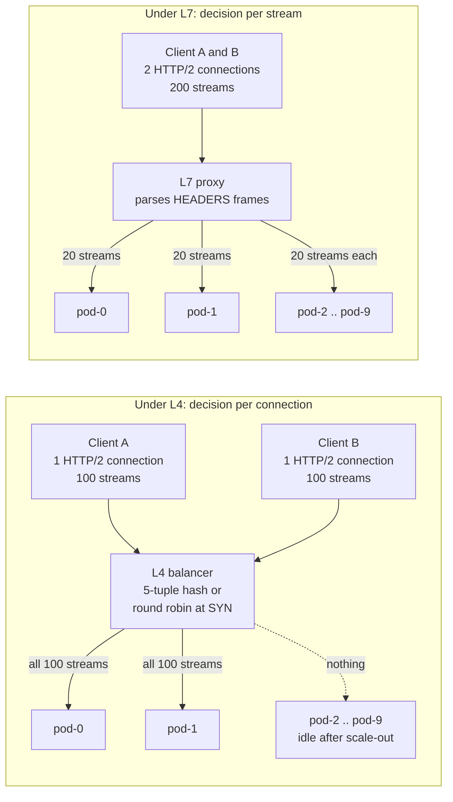

# L4 (TCP/UDP) vs L7 (Application) Load Balancing: Why Multiplexed HTTP/2 and gRPC Connections Pin Traffic to a Single Backend Under L4 Balancing

> [!summary] Claim
> A Layer 4 balancer makes one decision per connection, HTTP/2 and gRPC deliberately keep one connection open for hours and carry every request as a stream inside it, so under L4 balancing the number of balancing decisions is the number of connections, not the number of requests, and new pods added by autoscaling receive nothing until some connection is closed.

Part of [API Gateways Proxies and Edge Architecture](README.md) in [API Engineering](../README.md).

## TL;DR

- Mechanism: an L4 balancer picks a backend when the first packet of a TCP flow arrives and then forwards that flow's bytes blindly, while an L7 balancer terminates the connection, parses frames, and picks a backend per HTTP/2 stream or gRPC call (RFC 9113 Section 5.1, Section 9.1).
- Contract rule: HTTP/2 clients SHOULD open one connection per host and port and keep it, and a server that wants the client elsewhere must send `GOAWAY` and let the client reconnect, so every rebalancing action under L4 is a connection close (RFC 9113 Section 9.1, Section 6.8).
- Trap: `Deployment` scaled from 2 to 10 pods, two long-lived gRPC clients, and a ClusterIP `Service` produce two busy pods and eight idle ones with a coefficient of variation of `2.0` in the lab, and a headless `Service` does not fix it while the client keeps the default `pick_first` policy.
- Portability: HTTP/1.1 hides the problem because one connection carries one request at a time and connections churn, HTTP/3 over QUIC has the same pinning plus a 4-tuple problem when clients migrate, and the Python lab ran only on CPython 3.14.6 here (the other matrix legs were not run, per the user's 2026-11-11 pause on lab checks).
- When not to use L7: when proxy CPU, added latency, or loss of end-to-end TLS identity outweighs the skew, prefer L4 plus server-side `MAX_CONNECTION_AGE` with jitter, or client-side `round_robin`, and measure per-pod request rate before deciding.

## Mental model



The left half is the failure: each client's single TCP connection is bound to one pod at the moment it is accepted, every later `HEADERS` frame travels inside that connection, and the balancer never sees a stream boundary, so scale-out cannot move load.
The right half is the repair: the proxy ends the client connection, reads each stream, and writes it onto an upstream connection chosen per stream, so the two downstream connections fan out to ten upstream connections.
The dotted arrow is the invisible cost: the pods the autoscaler added are healthy and registered, yet carry zero requests because no new connection ever arrives.

## How it works

### What the layer names mean

"Layer 4" and "layer 7" name the unit of the balancing decision, not the speed or the vendor.
An L4 balancer decides per transport flow.
An L7 balancer decides per application message.

HAProxy's introduction draws the same line.
A packet-level balancer has a one-to-one relation between input and output packets, is usually stateless or lightly stateful, and "provides almost no content awareness".
A proxy-based balancer reassembles the input stream, so "there are two distinct connections on each side, and that there is no relation between input and output packets sizes nor counts" (HAProxy 3.2 `intro.html`, section 2 "Quick introduction to load balancing and load balancers").
RFC 9110 states the same freedom from the protocol side: later requests "might be sent through a different path of connections, often based on dynamic configuration for load balancing" (RFC 9110 Section 3.7).

There are two L4 implementations, and both decide once per connection:

- **Packet-level L4**: NAT or direct server return (DSR), where the balancer rewrites or tunnels packets and the client's TCP connection effectively terminates on the backend.
  Kubernetes `kube-proxy` in `iptables` or `nftables` mode installs rules that "select a backend Pod at random" using destination NAT when a client connects to the virtual IP, and connection tracking keeps later packets of the same flow on that pod (Kubernetes `virtual-ips` reference, "iptables proxy mode").
  The IPVS mode offers `rr` (round robin), `lc` (least connection), and source or destination hashing, all of which place new connections (same reference, "IPVS proxy mode").
  Google's Maglev hashes the 5-tuple, consults a connection tracking table so established flows stay put, and uses consistent hashing to make backend selection survive backend changes, with DSR for the return path (Maglev, NSDI 2016, Section 2 for DSR, Section 3.3 for connection tracking, Section 3.4 for consistent hashing).
- **Proxy-mode L4**: a TCP proxy that accepts the connection, opens a second TCP connection to a backend, and copies bytes.
  The gRPC load-balancing blog describes it as: "the server terminates the TCP connection and opens another connection to the backend of choice. The application data (HTTP/2 and gRPC frames) are simply copied" (grpc.io blog, "gRPC Load Balancing", section "Proxy Load Balancer options").
  Envoy's `tcp_proxy` filter is this form and exposes `max_downstream_connection_duration` (with a jitter percentage) and a default `idle_timeout` of 1 hour (Envoy `tcp_proxy.proto`, as of 2026-11).

AWS Network Load Balancer is the packet-level kind: for TCP it selects a target with a flow hash over protocol, source IP, source port, destination IP, destination port, and TCP sequence number, and "each individual TCP connection is routed to a single target for the life of the connection" (AWS NLB `introduction.html`, as of 2026-11).
For UDP the hash omits the sequence number, so a UDP flow keeps the same target for its lifetime (same page).

### Why HTTP/1.1 hid the problem

HTTP/1.1 connections are persistent by default (RFC 9112 Section 9.3), but in practice a connection carries one request and response exchange at a time, because pipelining (RFC 9112 Section 9.3.2) is rarely deployed.
Envoy's HTTP/1.1 upstream pool states that it does not pipeline, so a stuck request owns its connection (Envoy `connection_pooling`, "HTTP/1.1").
Concurrency therefore means more connections, and RFC 9112 Section 9.4 tells clients only to "limit the number of simultaneous open connections", explaining that multiple connections are used to avoid head-of-line blocking.
Connections also end: either side can send `Connection: close` (RFC 9112 Section 9.6), and servers cap requests per connection, for example nginx `keepalive_requests` with a default of 1000 since 1.19.10 (100 before) (nginx `ngx_http_core_module`, `keepalive_requests`, as of 2026-11).

The effect is that an L4 balancer sees a steady stream of new SYNs from a busy HTTP/1.1 client, each one is a fresh decision, and new pods start receiving traffic within one connection lifetime.
The Kubernetes blog post that made this widely known puts it directly: HTTP/1.1 "has several features that naturally result in cycling of TCP connections. Because of this, connection-level balancing is 'good enough'" (Kubernetes blog, "gRPC Load Balancing on Kubernetes without Tears", 2018-11-07).
The lab test `test_http11_connection_churn_partially_masks_l4_pinning` reproduces it: 50 short connections over 5 pods give exactly 10 requests per pod and a skew of `0.0`.

### What HTTP/2 changes, in the RFC text

HTTP/2 puts many independent exchanges on one connection.
Each exchange is a stream with an identifier.

- Streams opened by the client use odd identifiers, the identifier of a new stream must be higher than every stream that endpoint has opened, and identifiers cannot be reused (RFC 9113 Section 5.1.1).
  The space is 31 bits, which is 2^30 = 1,073,741,824 odd identifiers per connection direction (calculated from the 31-bit field, not measured).
- The number of streams in the `open` or `half-closed` states is bounded by `SETTINGS_MAX_CONCURRENT_STREAMS`, which is directional, and "Initially, there is no limit to this value"; the RFC recommends a value "no smaller than 100" (RFC 9113 Section 5.1.2, Section 6.5.2).
- HTTP/2 connections are persistent, and clients "SHOULD NOT open more than one HTTP/2 connection to a given host and port pair", opening extra ones only to replace connections near stream-identifier exhaustion, to refresh TLS keying material, or after errors (RFC 9113 Section 9.1).
  The same section lets a client reuse one connection for several authorities when the certificate covers them (RFC 9113 Section 9.1.1), which merges even more traffic onto it; see [[HTTP-2-Connection-Coalescing-and-421-Misdirected-Request]].
- Servers "are encouraged to maintain open connections for as long as possible" and, when closing, SHOULD first send `GOAWAY` (RFC 9113 Section 9.1).

Put the three together.
The protocol wants one connection per client per origin, it wants that connection to live as long as possible, and it gives the server only one graceful lever to end it.
An L4 balancer that decides once per connection is then, by construction, deciding once per client.
For the full frame and state machine see [[HTTP-2-Binary-Framing-and-Stream-State-Machine]].

### gRPC turns this into a default

gRPC maps one RPC to one HTTP/2 stream and uses the stream identifier as the call identifier, noting that these identifiers "are contextual to an open HTTP2 session" (gRPC `PROTOCOL-HTTP2.md`, "Stream Identification").
A gRPC channel is a pool of subchannels, and the load-balancing policy decides, per RPC, which subchannel to use (gRPC `load-balancing.md`, "Overview").
The policy default is `pick_first`: it takes the resolver's address list, connects "one at a time, in order, until it finds one that is reachable", and then sends "all RPCs sent on the channel" to that address (same document, "pick_first").
Three consequences follow in Kubernetes:

1. A ClusterIP `Service` resolves to one virtual IP, so the channel has one address and one connection, and `kube-proxy` places that connection on one pod.
2. A headless `Service` resolves to one A record per pod, but `pick_first` still connects to only the first reachable address, so each client is pinned to one pod even though the resolver returned ten.
   gRFC A62 notes that `pick_first` "is often used for L4 load balancing by randomizing the order of the addresses used by each client", which balances clients across pods but never balances one client's RPCs.
3. Only `round_robin` (or an xDS-driven policy) opens a subchannel per address and rotates RPCs across the READY ones (gRPC `load-balancing.md`, "round_robin"), and it must be selected through the service config, for example `{"loadBalancingConfig": [{"round_robin": {}}]}` (gRPC `service_config.md`, example).
   The channel argument that carries it is `grpc.service_config` (gRPC C-core `channel_arg_names.h`, `GRPC_ARG_SERVICE_CONFIG`).

The DNS resolver also rate-limits itself: `GRPC_ARG_DNS_MIN_TIME_BETWEEN_RESOLUTIONS_MS` "defaults to 30 seconds" (C-core `channel_arg_names.h`, as of 2026-11), so a client using DNS-based `round_robin` learns about new pods on that timescale at best.
Kubernetes documents why it proxies instead of relying on DNS: some applications "do DNS lookups only once and cache the results indefinitely" (Kubernetes `virtual-ips`, "Virtual IP mechanism for Services, using iptables mode").
The deeper treatment of subchannels, resolvers, and xDS is in [[gRPC-Load-Balancing-Subchannels-Pick-First-vs-Round-Robin-and-xDS]]; this note keeps only what is needed to explain the pin.

### The arithmetic of the pin

If a balancer places `C` connections uniformly at random on `N` pods, the expected number of pods with no connection is `N * (1 - 1/N)^C`.
For `N = 10` and `C = 2` that is `10 * 0.9^2 = 8.1` idle pods, and for `C = 10` it is `10 * 0.9^10 = 3.49` idle pods (calculated, not measured).
Round robin at connect time does better than random only in placing connections evenly; it cannot place requests evenly, because a connection is not a unit of load.
The lab shows both effects with a coefficient of variation (standard deviation over mean of per-pod request counts):

| Scenario in the lab | Per-pod requests | Skew (CV) |
|---|---|---|
| 2 H2 connections, L4, scale 2 to 10 pods, 100 streams each | `[100, 100, 0 x 8]` | `2.0` |
| Same traffic, L7 per-stream round robin | `[20 x 10]` | `0.0` |
| 1 client, `pick_first`, 10 resolved pods, 100 RPCs | `[100, 0 x 9]` | `3.0` |
| L4 `least_conn`, 1 busy and 1 idle connection, 1000 requests | `[1000, 0]` | `1.0` |

The last row matters for operators who reach for "least connections": it equalizes connection counts, which are equal by construction here, and says nothing about requests.

### Three ways out, and what each one does to connections

**1.
Move the decision to L7.**
The proxy terminates the client connection and chooses a backend per stream.
Envoy's HTTP/2 upstream pool multiplexes requests over one connection "up to the limits imposed by max concurrent streams and max requests per connection", opens more connections when that limit is reached, and each worker thread keeps its own pools, so an upstream host can hold one connection from every worker that has sent it traffic (Envoy `connection_pooling`, "HTTP/2" and "Number of connection pools").
The stream-level pick then uses a policy such as weighted least request, which with equal weights samples 2 hosts by default and takes the one with fewer active requests (Envoy load balancers, "Weighted least request"); the algorithms themselves are the subject of [[Load-Balancing-Algorithms-Round-Robin-Least-Request-P2C-and-Consistent-Hashing]].
Managed L7 balancers do the same for gRPC: an AWS Application Load Balancer target group with protocol version gRPC "parses gRPC requests and routes the gRPC calls to the appropriate target groups based on the package, service, and method" (AWS ALB `load-balancer-target-groups.html`, "Considerations for the gRPC protocol version", as of 2026-11).

The wire-level consequence is visible in the lab.
The client's streams `1, 3, 5, 7, 9, 11` become, at each of three upstream connections, streams `1, 3`: stream identifiers are per connection (RFC 9113 Section 5.1.1), so an L7 proxy must renumber them.
An L4 relay cannot renumber anything because it never parses a frame.

**2.
Move the decision to the client.**
The client opens a subchannel to every address and rotates RPCs, so the pin disappears without a proxy, at the price of `clients x pods` connections and a client that is trusted and kept current (grpc.io blog, "Client side LB options" and the pros and cons table).
The blog recommends L7 for cases where "RPC load varies a lot among connections" or where affinity matters, and L3/L4 when "latency is paramount" or proxy resource use matters more than features (same page, table "L3/L4 (Transport) vs L7 (Application)").

**3.
Keep L4 and recycle connections from the server.**
gRFC A9 defines `MAX_CONNECTION_IDLE`, `MAX_CONNECTION_AGE`, and `MAX_CONNECTION_AGE_GRACE` (all defaulting to infinite) and states the purpose: age-based close "can force the client to periodically reconnect to a L4 LB which allows spreading load more quickly", with a per-connection jitter of +/-10% so reconnects do not synchronize (gRFC A9, Proposal).
In C-core the channel arguments are `grpc.max_connection_age_ms` and `grpc.max_connection_age_grace_ms` (C-core `channel_arg_names.h`).
The mechanism is a two-step `GOAWAY`, and it is worth reading in the grpc-go server because it shows the race RFC 9113 describes.

When the age timer fires, `http2Server.keepalive` calls `Drain("max_age")`, and `outgoingGoAwayHandler` first writes a `GOAWAY` whose last stream identifier is `math.MaxUint32` (which `golang.org/x/net/http2` `Framer.WriteGoAway` masks to 31 bits, so `7f ff ff ff` on the wire), then a `PING` with fixed payload, then waits for the ping acknowledgement or a 5 second timer, and only then sends the real `GOAWAY` carrying the highest stream identifier the server accepted (grpc-go `internal/transport/http2_server.go`, `keepalive` and `outgoingGoAwayHandler`, master as read 2026-11-21).
The comment in the source gives the reason: during the first phase the server keeps accepting streams "since they might have originated before the GoAway reaches the client".
After the grace period elapses the connection is closed.
RFC 9113 Section 6.8 describes the race this avoids: there is "an inherent race condition between an endpoint starting new streams and the remote peer sending a GOAWAY frame", which is why the frame carries a last stream identifier.

The bytes the lab produces for the first phase, using the real `h2` 4.4.1 encoder through `WireBackend.goaway` (scratch run on CPython 3.14.6, macOS 27.3, Darwin 27.3.0 arm64, re-run by the verifier 2026-11-21):

```text
00 00 0f 07 00 00 00 00 00 7f ff ff ff 00 00 00 00 6d 61 78 5f 61 67 65
length 15 type 7 flags 0 stream 0
last_stream_id 2147483647 error 0 debug b'max_age'
```

Reading it against the `GOAWAY` frame layout (RFC 9113 Section 6.8, Figure 10): a 24-bit length of 15, type `0x07`, no flags, stream identifier 0, then a reserved bit and a 31-bit last stream identifier of `7f ff ff ff` (2^31 - 1), a 32-bit error code of `NO_ERROR`, and the 7 bytes of debug data `max_age`.
The second phase is the same frame with the last stream identifier replaced by the highest accepted stream, for example `00 00 00 01` in the lab run.

Envoy does the equivalent for HTTP/2 downstream connections.
`drain_timeout` is "the time that Envoy will wait between sending an HTTP/2 'shutdown notification' (GOAWAY frame with max stream ID) and a final GOAWAY frame", default 5000 ms, and it applies when a connection hits `idle_timeout`, `max_connection_duration`, or during server draining (Envoy HCM `http_connection_manager.proto`, `drain_timeout`, as of 2026-11).
`max_connection_duration` accepts a jitter percentage, but the field documentation says jitter is "currently only honored for downstream connections by the HTTP connection manager" (Envoy `protocol.proto`, `HttpProtocolOptions`, as of 2026-11).
`max_requests_per_connection` applies to upstream and downstream connections, and for HTTP/2 and HTTP/3 "the limit is approximate" because of concurrent stream processing (same page).
nginx closes an HTTP/2 connection after `http2_max_requests` requests (default 1000, obsolete since 1.19.7 in favor of `keepalive_requests`) "to free per-connection memory allocations" (nginx `ngx_http_v2_module`, as of 2026-11).

What the client does with `GOAWAY` is the contract that makes recycling safe.
Streams above the last stream identifier "are not or will not be processed" (RFC 9113 Section 6.8), can be retried on a new connection, and a client "MAY automatically retry them, even those with non-idempotent methods" (RFC 9113 Section 6.8, Section 8.7).
gRPC implements this as a transparent retry: when the stream ends with `REFUSED_STREAM` or the connection closes with a `GOAWAY` whose last stream identifier is lower than the stream's identifier, the client retries once immediately, and that retry does not count against `maxAttempts` or retry throttling (gRFC A6, "Transparent Retries").
The lab's `unprocessed_streams` function is this rule, and the test sends streams `1, 3, 5` and queues `7, 9`, receives a `GOAWAY` with last stream identifier 5, and asserts that exactly `[7, 9]` are retryable.

### Health, TLS, and the rest of the L4/L7 difference

- Health checks: an L4 health check proves a TCP handshake or a port; an L7 check proves a protocol exchange.
  ALB requires a custom health-check method of the form `/package.service/method` and a set of acceptable gRPC status codes for gRPC target groups (AWS ALB `load-balancer-target-groups.html`).
  Envoy closes all pooled connections to a host that becomes unavailable, "which will maximize the chance of working around a bad flow" (Envoy `connection_pooling`, "Health checking interactions").
  Passive ejection is in [[Envoy-Outlier-Detection-Passive-Health-Checking-and-Panic-Thresholds]].
- TLS: reading a stream requires decrypting it, so an L7 balancer terminates TLS and becomes a trust boundary, which HAProxy's introduction names as an expensive step that explains why high-traffic sites run many balancers.
  An L4 balancer can pass TLS through untouched.
  The ALB gRPC and HTTP/2 target group types accept only an HTTPS listener (AWS ALB `load-balancer-target-groups.html`).
- Client address: packet-level L4 can preserve the client IP; NLB exposes `preserve_client_ip.enabled` per target group (AWS NLB target groups).
  An L7 proxy sees the proxy as the peer and must forward the original address in a header, covered in [[Forwarded-Header-RFC-7239-and-X-Forwarded-For-Spoofing]].
- Idle connection state: NLB stops tracking a TCP flow after 350 seconds of idleness by default (configurable from 60 to 6000 seconds) and answers later data with a TCP RST (AWS NLB `network-load-balancers.html`, "Connection idle timeout", as of 2026-11).
  RFC 9113 Section 8.7 notes that "middleboxes (for instance, network address translators or load balancers) silently discard connection bindings" and recommends `PING` as a liveness probe; gRPC wires this to keepalive (see [[gRPC-Keepalive-Flow-Control-and-Max-Message-Size-Tuning]]).

### UDP, QUIC, and HTTP/3

For UDP the L4 decision unit is the 4-tuple flow.
QUIC breaks that assumption: a client can migrate to a new address while keeping the connection, and RFC 9000 Section 5.2.3 warns that under a balancer that routes only on addresses and ports, a change of the client's IP address or port could result in packets being forwarded to the wrong server.
It lists out-of-band forwarding by connection ID and `preferred_address` as options, and says a deployment without a solution "SHOULD indicate that migration is not supported by using the `disable_active_migration` transport parameter" (RFC 9000 Section 5.2.3).
RFC 9000 Section 5.1 allows a balancer and server to agree on a connection ID encoding; the IETF draft "QUIC-LB: Generating Routable QUIC Connection IDs" specifies one (draft-ietf-quic-load-balancers-22, an Active Internet-Draft, not an RFC, as of 2026-11).
AWS NLB already routes QUIC on a Server ID in the connection ID and falls back to the flow hash for initial packets (AWS NLB `introduction.html`).
For the migration mechanics see [[QUIC-Transport-Streams-and-Connection-Migration-RFC-9000]].

HTTP/3 multiplexes streams in one QUIC connection, so the pinning argument carries over unchanged, and Envoy's HTTP/3 pool has the same per-connection and `GOAWAY` drain behavior as its HTTP/2 pool (Envoy `connection_pooling`, "HTTP/3").
The shutdown semantics differ in one detail that breaks naive code reuse: an HTTP/3 `GOAWAY` identifier means requests "with the indicated identifier or greater are rejected", whereas in HTTP/2 the last stream identifier is the highest stream that "might have been processed" (RFC 9114 Section 5.2; RFC 9113 Section 6.8).
A retry classifier must use `>` for HTTP/2 and `>=` for HTTP/3.

## Numbers and limits

Quantities marked "lab" were produced by the code in this note on CPython 3.14.6, macOS 27.3 (Darwin 27.3.0 arm64), with the commands in the Worked example.
Everything else cites its source; "as of 2026-11" marks values that vendors can change.

| Quantity | Value | Source |
|---|---|---|
| HTTP/2 `SETTINGS_MAX_CONCURRENT_STREAMS` initial value | no limit; recommended to be no smaller than 100 | RFC 9113 Section 6.5.2 |
| `h2` 4.4.1 server advertised limit | 100 | lab: `client.remote_settings.max_concurrent_streams == 100`; (h2 4.4.1 h2/connection.py, H2Connection.__init__) |
| Envoy HTTP/2 `max_concurrent_streams` default | 1024 (HTTP/3: 100) | Envoy `protocol.proto`, as of 2026-11 |
| nginx `http2_max_concurrent_streams` default | 128 | nginx `ngx_http_v2_module`, as of 2026-11 |
| AWS ALB HTTP/2 streams per client connection (HTTP/2 protocol version target groups) | 128 | AWS ALB `load-balancer-target-groups.html`, "Considerations for the HTTP/2 protocol version", as of 2026-11 |
| Hypercorn `h2_max_concurrent_streams` default | 100 | (hypercorn 0.18.0 hypercorn/config.py, Config.h2_max_concurrent_streams), read in the pinned venv |
| Granian `HTTP2Settings.max_concurrent_streams` default | 200 | (granian 2.8.7 granian/http.py, HTTP2Settings.max_concurrent_streams), read in the pinned venv |
| Client-initiated stream identifiers per connection | 2^30 = 1,073,741,824 | RFC 9113 Section 5.1.1 (calculated) |
| gRPC server `MAX_CONNECTION_AGE`, `MAX_CONNECTION_AGE_GRACE` | infinite by default; age jitter +/-10% | gRFC A9, Proposal |
| gRPC server keepalive time and timeout | 2 hours, 20 seconds (grpc-go `keepalive.ServerParameters`) | grpc-go `keepalive/keepalive.go`, master |
| grpc-go first-to-second `GOAWAY` wait | up to 5 seconds | grpc-go `http2_server.go`, `outgoingGoAwayHandler` |
| Envoy HCM `drain_timeout` default | 5000 ms | Envoy HCM proto, as of 2026-11 |
| Envoy `tcp_proxy` `idle_timeout` default | 1 hour | Envoy `tcp_proxy.proto`, as of 2026-11 |
| gRPC DNS minimum re-resolution interval | 30 seconds | C-core `channel_arg_names.h` |
| AWS NLB TCP idle timeout default (UDP) | 350 seconds, configurable 60 to 6000 (UDP fixed at 120 seconds) | AWS NLB `network-load-balancers.html`, as of 2026-11 |
| `Service` `sessionAffinity: ClientIP` default timeout | 10800 seconds | Kubernetes `virtual-ips`, "Session affinity" |
| Idle pods, 2 connections, 10 pods, random placement | 8.1 expected | calculated: `10 * 0.9^2` |
| Idle pods, 10 connections, 10 pods, random placement | 3.49 expected | calculated: `10 * 0.9^10` |
| Lab skew, L4 pinned 2 clients on 10 pods | `2.0` | lab, test 1 |
| Lab skew, `pick_first` 1 client on 10 pods | `3.0` | lab, test 7 |
| Lab skew, L7 per-stream round robin | `0.0` | lab, test 2 |

No latency or throughput figure for an L4 or L7 balancer is given here because none was measured.
The grpc.io blog states qualitatively that L3/L4 "adds less latency compared with L7 LB, and is cheaper because it consumes fewer resources", and HAProxy's introduction says L7 processing makes it not always possible to reach line rate, especially with small packets; measure your own proxy before using either claim in a design.

## Portability

Every cell is either a lab run (stated with the interpreter) or a citation.
The user paused lab checks on 2026-11-11, so only one interpreter ran and the other matrix legs are recorded as not run.

| Dimension | Variant | Behavior for this topic | Evidence |
|---|---|---|---|
| CPython | 3.14.6 (workspace `.venv`) | 12 lab tests pass | lab run, `uv run --frozen pytest`, macOS 27.3, Darwin 27.3.0 arm64, re-run by the verifier 2026-11-21 |
| CPython | 3.12, 3.13, 3.15, 3.15t | not run | lab checks paused (user instruction, 2026-11-11); the matrix leg remains open |
| `h2` | 4.4.1 | `close_connection` accepts a second `GOAWAY` after the first (verifier scratch run) and a client rejects new streams after receiving one with `ProtocolError`; `TooManyStreamsError` at the advertised limit (lab tests) | lab, 3.14.6 only |
| HTTP/1.1 | any | one in-flight exchange per connection, connections cycle, so L4 per-connection balancing approximates per-request | RFC 9112 Section 9.3, Section 9.4; Kubernetes blog 2018 |
| HTTP/2 | any | one long-lived connection per client and origin; rebalancing only through `GOAWAY` and reconnect | RFC 9113 Section 9.1, Section 6.8 |
| HTTP/3 over QUIC | any | multiplexed like HTTP/2; `GOAWAY` boundary is inclusive of the identifier; migration changes the 4-tuple | RFC 9114 Section 5.2; RFC 9000 Section 5.2.3 |
| Envoy | docs latest (1.41.0-dev as fetched; the folder README pins 1.40.2) | per-request pick over pooled upstream connections; HTTP/2 `max_concurrent_streams` default 1024 | Envoy docs, as of 2026-11; not executed here |
| nginx | `ngx_http_grpc_module`, `ngx_http_v2_module` | `http2_max_concurrent_streams` 128; `http2_max_requests` obsolete since 1.19.7 | nginx docs, as of 2026-11; not executed here |
| HAProxy | 3.2 docs | distinguishes packet-level L4 from proxy-based L7 | HAProxy `intro.html`; not executed here |
| AWS NLB / ALB | docs as of 2026-11 | NLB: per-connection flow hash; ALB: per-call routing for gRPC target groups; 128 streams per client HTTP/2 connection for HTTP/2 target groups | AWS docs; not executed here |
| `kube-proxy` | Kubernetes docs as fetched (1.37 stated) | random backend choice at connection time for `iptables` and `nftables` | Kubernetes `virtual-ips` |
| gRPC client | C-core and grpc-go docs, master | default `pick_first` pins; `round_robin` needs service config | gRPC `load-balancing.md` |
| Origin servers | Hypercorn 0.18.0, Granian 2.8.7, Uvicorn 0.54.0 | Hypercorn and Granian speak HTTP/2 natively with the limits above; Uvicorn 0.54.0 ships an opt-in HTTP/2 path that requires `http2=True` together with `http="zttp"` and the `zttp` package, which is not in the lab lock | (uvicorn 0.54.0 uvicorn/config.py, Config.load) read in the pinned venv; `zttp` not installed, HTTP/2 path not executed |

Kernel dependence is part of portability: the Kubernetes documentation says Linux kernels before 6.1 have a conntrack bug that can close long-lived TCP connections to Service IPs with "Connection reset by peer"; `iptables` mode installs a workaround automatically, while `nftables` mode does not and needs `kube-proxy --conntrack-tcp-be-liberal` (Kubernetes `virtual-ips`, "Conntrack bug workarounds", as of 2026-11).
That matters more for HTTP/2 than HTTP/1.1 because the connections are long-lived.

## Worked example

Implementation: [implementation](../labs/src/api_labs/f17_api_gateways_proxies_and_edge_architecture/l4_vs_l7_load_balancing.py).
Test: [test](../labs/tests/f17_api_gateways_proxies_and_edge_architecture/test_l4_vs_l7_load_balancing_for_http_1_1_http_2_and_grpc.py).

The lab has two layers.
A counting model (`L4LoadBalancer`, `L7LoadBalancer`, `ClientSideLoadBalancer`, `PickFirstClient`) shows where the decision is made.
A wire model drives real `h2` connection state machines in memory: `WireBackend` is an origin, `L4WireFlow` is an opaque byte relay, and `L7WireProxy` terminates the client connection and renumbers streams onto per-backend upstream connections.
No sockets are opened.

Simplified excerpt of the L4 decision, which runs once per connection:

```python
def _select(self) -> BackendPod:
    healthy_backends = [b for b in self.backends if b.is_healthy]
    if not healthy_backends:
        raise RuntimeError("No healthy backends available for L4 connection")
    if self.policy == "least_conn":
        return min(healthy_backends, key=lambda b: b.active_connections)
    selected = healthy_backends[self._next_backend_idx % len(healthy_backends)]
    self._next_backend_idx += 1
    return selected
```

`connect` calls `_select`; `send_request` never does.
`send_request` reads `conn.backend`, so every stream on the connection lands on the same pod.

Simplified excerpt of the L7 wire proxy's per-stream decision (the real method also flushes upstream bytes and relays responses):

```python
for event in self.downstream.receive_data(up) if up else ():
    if isinstance(event, RequestReceived):
        backend = self.backends[self._next % len(self.backends)]
        self._next += 1
        conn, _ = self._upstream_for(backend)
        upstream_id = conn.get_next_available_stream_id()
        path = header_value(event.headers, ":path")
        conn.send_headers(upstream_id, request_headers(path), end_stream=True)
        self.stream_map.append((backend.pod_id, event.stream_id, upstream_id))
```

Simplified excerpt of the test that pins the L4 wire behavior (`test_l4_wire_relay_forwards_client_bytes_and_pins_all_streams_to_one_backend`; the connection-count and response assertions are omitted):

```python
pods = [WireBackend("pod-0"), WireBackend("pod-1")]
flow = L4WireFlow(pods[0])  # the L4 decision was made here, at connect time
client = new_h2(client_side=True)
stream_ids = send_requests(client, 6)
events = flow.pump(client)

assert stream_ids == [1, 3, 5, 7, 9, 11]
assert pods[0].seen == [(0, sid) for sid in stream_ids]
assert pods[1].seen == []
assert b"".join(flow.bytes_up).startswith(CLIENT_PREFACE)
```

The L7 counterpart asserts the renumbering and the fan-out: `proxy.stream_map` equals `[("pod-0", 1, 1), ("pod-1", 3, 1), ("pod-2", 5, 1), ("pod-0", 7, 3), ("pod-1", 9, 3), ("pod-2", 11, 3)]`, each pod accepted exactly one upstream connection, and the client received a response on each of its own stream identifiers.

Command and captured output (run from `labs/` by the verifier on 2026-11-21, CPython 3.14.6, pytest 9.2.0, macOS 27.3, Darwin 27.3.0 arm64; the session header lines are omitted and the long path prefix `tests/f17_api_gateways_proxies_and_edge_architecture/test_l4_vs_l7_load_balancing_for_http_1_1_http_2_and_grpc.py::` is elided from each line):

```text
$ uv run --frozen pytest tests/f17_api_gateways_proxies_and_edge_architecture/test_l4_vs_l7_load_balancing_for_http_1_1_http_2_and_grpc.py -v
collecting ... collected 12 items

...::test_l4_http2_multiplexing_pins_traffic_to_initial_backends PASSED [  8%]
...::test_l7_stream_multiplexing_distributes_requests_across_all_pods PASSED [ 16%]
...::test_http11_connection_churn_partially_masks_l4_pinning PASSED [ 25%]
...::test_l4_mitigation_max_connection_age_goaway_triggers_rebalancing PASSED [ 33%]
...::test_client_side_grpc_round_robin_avoids_l4_pinning_without_l7_proxy PASSED [ 41%]
...::test_l4_least_conn_balances_connection_counts_but_not_request_volume PASSED [ 50%]
...::test_grpc_pick_first_default_pins_every_rpc_despite_many_resolved_addresses PASSED [ 58%]
...::test_pick_first_with_per_client_address_order_balances_connections_not_requests PASSED [ 66%]
...::test_l4_wire_relay_forwards_client_bytes_and_pins_all_streams_to_one_backend PASSED [ 75%]
...::test_l7_wire_proxy_splits_one_client_connection_across_backends_and_renumbers_streams PASSED [ 83%]
...::test_goaway_last_stream_id_marks_later_streams_retryable_and_blocks_new_ones PASSED [ 91%]
...::test_max_concurrent_streams_bounds_parallelism_per_connection PASSED [100%]

============================== 12 passed in 0.20s ==============================
```

The tests were not mutation-checked (the user paused lab checks on 2026-11-11), so "each test fails if its mechanism is absent" is a design claim, not a recorded result.
The design reason for each: the L4 pin test asserts the second pod saw nothing and that exactly one connection was accepted, which an L7 implementation cannot satisfy; the L7 test asserts renumbered identifiers, which a byte relay cannot produce; the `GOAWAY` test asserts the retryable set and that new streams raise `ProtocolError`, which fail if the last stream identifier is ignored or the connection stays open.

## Pitfalls

> [!warning] Scale-out does not help
> Trigger: a gRPC service behind a ClusterIP `Service` or an L4 load balancer is scaled out to relieve one hot pod.
> Symptom: Kubernetes CPU graphs show one busy pod and idle new pods, because "only one of the pods is receiving any traffic" (Kubernetes blog, 2018-11-07).
> Fix: balance requests, not connections: an L7 proxy or mesh sidecar, client-side `round_robin` through service config, or server-side `MAX_CONNECTION_AGE` so clients reconnect.
> Check the fix with per-pod request rate, not connection count.

> [!warning] Headless Service plus the default policy is still pinned
> Trigger: switching to a headless `Service` so DNS returns every pod IP.
> Symptom: each client talks to one pod; with all clients seeing the same address order, they all pick the same first pod.
> Fix: select `round_robin` in the service config, or randomize address order per client as gRFC A62 describes and accept that this balances clients rather than requests.

> [!warning] Age-based recycling without jitter or without a grace period
> Trigger: setting `MAX_CONNECTION_AGE` identically on every server, or leaving `MAX_CONNECTION_AGE_GRACE` at infinity with long-lived streams.
> Symptom: reconnect storms at a fixed period, or "many old but active connections with few RPCs on them" (gRFC A9, Proposal for the fixed-period storm, Rationale for the old connections).
> Fix: keep the +/-10% jitter, set a finite grace period, and cap stream lifetime so a draining connection can actually end.
> Envoy offers `max_connection_duration_jitter` and `drain_timeout_jitter`, but the first is documented as honored only for downstream HTTP connection manager connections.

> [!warning] Keepalive pings stricter than the server allows
> Trigger: client keepalive pings sent more often than the server's minimum accepted interval, or sent with no active calls when the server forbids it.
> Symptom: `GOAWAY` with `ENHANCE_YOUR_CALM` and debug data `too_many_pings`, which then looks like a balancer fault because connections reset (gRPC `keepalive.md`, FAQ).
> Fix: align client and server keepalive settings; the C-core server defaults to a 5 minute minimum ping interval without data and 2 ping strikes (gRPC `keepalive.md`, "Defaults Values"), and grpc-go `EnforcementPolicy.MinTime` also defaults to 5 minutes (grpc-go `keepalive/keepalive.go`).

> [!warning] SNI-routed L4 plus HTTP/2 connection reuse sends requests to the wrong origin
> Trigger: a TLS-passthrough L4 tier that routes on SNI, with clients coalescing several hostnames on one HTTP/2 connection.
> Symptom: a request for host B arrives on a connection that the balancer bound to host A's pool; RFC 9113 Section 9.1.1 warns that a middlebox using SNI to select an origin lets clients send requests to servers that might not be the intended target.
> Fix: the origin answers `421 (Misdirected Request)`, and certificates should not be wider than the routing tier; see [[HTTP-2-Connection-Coalescing-and-421-Misdirected-Request]].

> [!warning] Idle H2 connections silently dropped by the balancer
> Trigger: an NLB with the default 350 second TCP idle timeout and a client that sends nothing for longer.
> Symptom: the next write gets a TCP RST, surfacing as `UNAVAILABLE` on a request that never reached the server (AWS NLB `network-load-balancers.html`).
> Fix: HTTP/2 `PING` keepalive below the idle timeout (RFC 9113 Section 8.7), and idle-timeout alignment across tiers as in [[Keep-Alive-Timeout-Races-Between-Reverse-Proxies-and-Origins]].

> [!warning] Long-lived connections meet kernel conntrack bugs
> Trigger: Linux kernels before 6.1 under `kube-proxy`.
> Symptom: long-lived TCP connections to Service IPs closed with "Connection reset by peer", which HTTP/2 clients surface as dropped streams (Kubernetes `virtual-ips`, "Conntrack bug workarounds").
> Fix: kernel 6.1 or later; `iptables` mode installs a workaround automatically, and `nftables` mode needs `kube-proxy --conntrack-tcp-be-liberal`.

> [!warning] Per-connection stream caps look like a balancer limit
> Trigger: a client that fans out more concurrent calls than the connection's `SETTINGS_MAX_CONCURRENT_STREAMS`, for example the ALB limit of 128 streams per client connection on HTTP/2 protocol version target groups.
> Symptom: calls queue in the client or fail with `TooManyStreamsError` style errors that vanish when pods are added.
> Fix: raise the limit where the server allows it, or let the client open additional connections; RFC 9113 Section 9.1 permits replacement connections, and each new connection is a new L4 decision.

## Security and robustness

- **Trust boundary moves with the layer.** An L7 balancer terminates TLS and sees plaintext, so it is a high-value target and must enforce what the origin used to: request size limits, header limits, authentication, and rate limits.
  An L4 balancer cannot filter on content at all; a flood of valid HTTP/2 frames passes straight to the pod.
  See [[API-Gateway-Architecture-Responsibilities-and-Anti-Patterns]] and [[External-Authorization-Ext-Authz-and-Global-Rate-Limit-Filters]].
- **HTTP/2 denial of service is per connection.** RFC 9113 Section 10.5 lists the known amplifiers: tiny `WINDOW_UPDATE` increments, `PING` and `SETTINGS` floods that each demand a response, reset floods from invalid requests, and `PRIORITY` churn, and says implementations SHOULD track and limit them.
  An L7 proxy that multiplexes many clients onto shared upstream connections concentrates this risk, so limits belong on both the downstream and upstream side.
- **OWASP API4:2023, Unrestricted Resource Consumption.** One client pinned to one pod can exhaust that pod.
  The OWASP entry lists missing limits on execution timeouts, memory, and the number of operations as causes; per-connection concurrency limits plus per-client rate limits bound a pinned client even when the balancer cannot spread it.
- **Smuggling and desync live at L7 only.** A byte-forwarding L4 tier cannot introduce a parser disagreement, while an L7 tier that downgrades HTTP/2 to HTTP/1.1 upstream can; see [[HTTP-Desync-and-Header-Normalization-Across-Multi-Tier-Proxies]] and [[HTTP-Request-Smuggling-CL-TE-and-Desync-Mechanics]].
- **Hop-by-hop state.** The `Connection` header is meaningful only for one hop, and an intermediary not acting as a tunnel "MUST implement the `Connection` header field" and exclude hop-specific fields (RFC 9110 Section 7.6.1); an L7 proxy that forwards it creates false keep-alive semantics.
  See [[Hop-by-Hop-vs-End-to-End-Headers-and-Connection-Header-Abuse]].
- **Retries multiply under recycling.** `GOAWAY` retries are safe by protocol, but a proxy retry plus a client retry plus a mesh retry can still amplify load; the budget rules are in [[Proxy-and-Application-Timeout-and-Retry-Interaction-Hazards]] and [[Retry-Budgets-and-Preventing-Cascading-Retry-Amplification-Storms]].
- **Failure of the proxy tier.** L7 adds a hop that can fail or saturate.
  Run it as a fleet with its own L4 tier in front, as HAProxy's introduction sketches (a router, then a layer of stateful packet balancers, then proxies), and drain it with the same `GOAWAY` discipline ([[Graceful-Shutdown-SIGTERM-Drain-Windows-and-Kubernetes-PreStop-Hooks]]).

## The principal's view

The decision is not "L4 or L7" but "where is the request-level decision made, and who owns it".
There are four owners: the client library, a sidecar or mesh data plane, a central L7 proxy tier, or nobody (pure L4 with connection recycling).

A default I would defend for an internal gRPC fleet: put the request-level decision in a data plane that already speaks xDS, either client-side in proxyless gRPC or in a sidecar, and keep L4 only at the internet edge where it fans connections into the L7 tier.
The reasons are concrete.
Client-side or sidecar balancing removes a hop and its latency, and sees real per-RPC outcomes for outlier ejection ([[Service-Mesh-Architecture-Sidecar-vs-Ambient-Mesh-and-East-West-Policy]]).
A central proxy tier is the right answer when clients are untrusted or numerous and heterogeneous; the grpc.io blog recommends proxy load balancing for "Many clients connecting to services behind a proxy", with L3/L4 by default and L7 (Envoy) when session stickiness is needed, so make that tier L7 only when per-request balance or affinity is the requirement.

The organizational trade-offs:

- Client-side balancing makes every client team a participant in load balancing.
  The cost is the per-language library surface and the requirement that clients be trusted and upgraded.
- A central L7 tier concentrates policy, observability, and failure.
  One misconfigured `max_concurrent_streams` or timeout there affects every service, which is why [[Envoy-Proxy-Internals-Listeners-Filter-Chains-HCM-and-Clusters]] treats the filter chain as a shared contract.
- L4 plus recycling is the cheapest to operate and the weakest guarantee: balance is statistical, convergence takes about one `MAX_CONNECTION_AGE`, and a hot client stays hot until then.
  Choose it only when a proxy hop is unaffordable and per-pod skew is tolerable.

Choose differently when the facts differ.
If a workload is HTTP/1.1 with short requests, L4 is fine and cheaper.
If requests are long-lived streams (bidirectional streaming, server push of events), no per-request balancer helps after the stream starts, and the design problem becomes placing the stream correctly at start and draining deliberately.
If requests need affinity (storage or compute locality), use L7 with a hash on a header or cookie, accepting the hot-key risk discussed in the algorithms note.
For deployments where connection recycling and rolling updates interact, read [[Zero-Downtime-Blue-Green-Canary-and-Cell-Based-API-Deployments]].

Measure before changing anything: per-pod request rate, per-pod active streams, and connection age distribution.
Connection counts per pod will look balanced under L4 and tell you nothing.

## Interview questions

> [!question] L5: Why does a gRPC client behind a Kubernetes ClusterIP `Service` send all its traffic to one pod?
>
> > [!success]- Answer
> > The ClusterIP is one virtual address, so the channel has one address and opens one HTTP/2 connection.
> > `kube-proxy` selects a pod when that connection is established, and connection tracking keeps every later packet on it.
> > gRPC sends every RPC as a stream on that one connection, so the balancer never gets a second decision.
> > RFC 9113 Section 9.1 makes this the intended behavior: one persistent connection per host and port.
> >
> > Follow-up: What changes if the client targets a headless `Service` and keeps the default policy?

> [!question] L5: Why did HTTP/1.1 services not show this problem?
>
> > [!success]- Answer
> > An HTTP/1.1 connection carries one request at a time, so concurrency requires many connections.
> > Connections also close, through `Connection: close` or per-connection request caps, so the L4 balancer sees a steady flow of new connections.
> > Each new connection is a fresh balancing decision, so connection-level balancing approximates request-level balancing.
> >
> > Follow-up: What would make an HTTP/1.1 client behave like the HTTP/2 case?

> [!question] L5: Predict the output.
> `PickFirstClient("c", pods)` is created with 10 healthy pods, then `send_rpc` is called 100 times.
> What are the per-pod request counts and the coefficient of variation?
>
> > [!success]- Answer
> > `pod-0` has 100 requests, the other nine have 0, and the coefficient of variation is `3.0`.
> > The mean is 10, the variance is `(90^2 + 9 * 10^2) / 10 = 900`, and the standard deviation is 30.
> > The lab asserts exactly this in `test_grpc_pick_first_default_pins_every_rpc_despite_many_resolved_addresses`.
> > If `pod-0` is unhealthy the same code pins to `pod-1`, and no other pod ever sees traffic.
> >
> > Follow-up: Which policy and which channel argument change the answer?

> [!question] L6: Why is "least connections" at L4 not a fix for HTTP/2 skew?
>
> > [!success]- Answer
> > Connection counts are the only signal an L4 balancer has, and under HTTP/2 they are nearly constant while request volume varies by orders of magnitude.
> > In the lab, two clients hold one connection each on two pods, so connection counts are `[1, 1]`, while one client sends 1000 requests and the other none, giving `[1000, 0]` and a skew of `1.0`.
> > It also does nothing for the connections that already exist when pods are added.
> > Only a decision that sees streams, or a close that forces a new decision, changes the outcome.
> >
> > Follow-up: What per-pod metric would have shown this in production?

> [!question] L6: Walk through a graceful `MAX_CONNECTION_AGE` close on the wire and say why there are two `GOAWAY` frames.
>
> > [!success]- Answer
> > The server sends `GOAWAY` with `NO_ERROR`, debug data `max_age`, and last stream identifier 2^31 - 1, followed by a `PING`.
> > Because the identifier is the maximum, no stream is refused yet, so streams the client started before it saw the frame are still accepted.
> > After the `PING` is acknowledged or a timer (5 seconds in grpc-go) expires, the server sends a second `GOAWAY` with the highest stream it actually accepted.
> > Streams above that identifier were never processed and the client retries them on a new connection, which is the moment an L4 balancer can pick a different pod.
> > The sources are RFC 9113 Section 6.8, gRFC A9, and grpc-go `outgoingGoAwayHandler`.
> >
> > Follow-up: What breaks if every server uses the same age with no jitter?

> [!question] L6: Debug this API.
>
> A team scales a gRPC service from 3 to 12 pods and one pod stays at 95% CPU while the others idle.
> The client is:
>
> ```python
> channel = grpc.aio.insecure_channel("dns:///orders.prod.svc.cluster.local:50051")
> ```
>
> The `Service` is headless.
> What is wrong, and what are two fixes?
>
> > [!success]- Answer
> > The channel uses the default `pick_first` policy, so it connects to the first reachable of the twelve addresses and sends every RPC there.
> > The headless `Service` returns all addresses, but nothing tells the client to use more than one.
> > Fix one is client-side: pass the service config `{"loadBalancingConfig": [{"round_robin": {}}]}` through the `grpc.service_config` channel option so the channel opens a subchannel per address.
> > Fix two is server-side: set `grpc.max_connection_age_ms` with a finite `grpc.max_connection_age_grace_ms` so clients reconnect, accepting that balance converges over one age interval.
> > A third option is an L7 proxy or sidecar that balances per stream.
> >
> > Follow-up: With `round_robin`, how quickly does the client notice newly added pods, and what bounds it?

> [!question] L7+: Design the connection and balancing strategy for a gRPC mesh of 400 clients and 60 pods, with an internet-facing edge.
>
> > [!success]- Answer
> > At the edge, use an L4 tier to spread connections across a fleet of L7 proxies, because the edge clients are untrusted and cannot run a balancing library.
> > Inside, use xDS-driven balancing in the client or sidecar so every RPC is balanced with least-request, outlier detection, and retry budgets.
> > Add `MAX_CONNECTION_AGE` with jitter and a finite grace on servers regardless, so that rolling updates and scale-out converge even if a client misconfigures its policy.
> > Size connection counts: `400 x 60 = 24,000` subchannels for full client-side mesh, so check per-pod connection memory and consider subsetting.
> > Monitor per-pod request rate and connection age percentiles, and alert on skew (coefficient of variation) instead of CPU averages.
> > State the downside: client-side balancing spreads policy ownership across every client team.
> >
> > Follow-up: When would you accept pure L4 and connection recycling instead?

> [!question] L7+: Why can an L4 balancer break QUIC, and what are the standards-based remedies?
>
> > [!success]- Answer
> > QUIC connections survive a change of client IP address or port, so a balancer that hashes the 4-tuple can send later packets to a different server (RFC 9000 Section 5.2.3).
> > Remedies are out-of-band forwarding by connection ID, a server `preferred_address`, advertising `disable_active_migration`, or encoding routing information in the connection ID, which the QUIC-LB draft specifies (an Internet-Draft, not an RFC, as of 2026-11).
> > The connection ID approach lets a stateless L4 tier keep routing correctly after migration.
> > HTTP/3 also changes the `GOAWAY` boundary: requests at or above the identifier are rejected, unlike HTTP/2 where the identifier itself might have been processed (RFC 9114 Section 5.2).
> >
> > Follow-up: What does an L4 balancer need to know to extract a server identifier from a connection ID?

> [!question] L7+: Argue for or against moving a 3 millisecond p99 internal service from L4 to an L7 proxy to fix skew.
>
> > [!success]- Answer
> > First establish the skew with per-pod request rate; if the coefficient of variation is small, nothing needs fixing.
> > An extra proxy hop adds work to the tail, and a shared proxy tier becomes a failure domain, so for a latency-bound service prefer client-side `round_robin` or a sidecar that removes the extra network hop, or L4 with jittered connection recycling.
> > If clients cannot be changed or are untrusted, accept the hop and size it, because the grpc.io guidance lists latency as the reason to choose L3/L4 and RPC load variance as the reason to choose L7.
> > Measure p99 before and after; no latency figure in this note was measured.
> >
> > Follow-up: What would you measure to tell the proxy's added latency from its queueing under load?

## Related

Prerequisites: [[Webhook-Consumer-Engineering-Signature-Verification-Replay-Windows-and-Idempotency]]

Next: [[Load-Balancing-Algorithms-Round-Robin-Least-Request-P2C-and-Consistent-Hashing]]

See also: [[gRPC-and-Protocol-Buffers]], [[02-Programming-Languages/Python/Python-Backend-Interview-Prep/08-Microservices-and-Messaging]], [[HTTP-2-Binary-Framing-and-Stream-State-Machine]], [[HTTP-2-Connection-Coalescing-and-421-Misdirected-Request]], [[HTTP-1-1-Pipelining-and-Head-of-Line-Blocking]], [[QUIC-Transport-Streams-and-Connection-Migration-RFC-9000]], [[gRPC-Load-Balancing-Subchannels-Pick-First-vs-Round-Robin-and-xDS]], [[gRPC-Keepalive-Flow-Control-and-Max-Message-Size-Tuning]], [[Keep-Alive-Timeout-Races-Between-Reverse-Proxies-and-Origins]], [[Outbound-Connection-Pools-Limits-and-DNS-TTL-Staleness]], [[Graceful-Shutdown-SIGTERM-Drain-Windows-and-Kubernetes-PreStop-Hooks]], [[Envoy-Proxy-Internals-Listeners-Filter-Chains-HCM-and-Clusters]], [[Envoy-Outlier-Detection-Passive-Health-Checking-and-Panic-Thresholds]], [[Service-Mesh-Architecture-Sidecar-vs-Ambient-Mesh-and-East-West-Policy]], [[Proxy-and-Application-Timeout-and-Retry-Interaction-Hazards]], [[Hypercorn-Internals-HTTP-2-HTTP-3-QUIC-and-AnyIO-Trio-Workers]], [[Granian-Internals-Rust-Tokio-Hyper-Engine-and-RSGI-vs-ASGI]], [[Uvicorn-Internals-Server-Lifecycle-Protocols-and-Flow-Control]]

- Lab: `labs/tests/f17_api_gateways_proxies_and_edge_architecture/test_l4_vs_l7_load_balancing_for_http_1_1_http_2_and_grpc.py`

## Further reading

- RFC 9113 (HTTP/2) Section 5.1, Section 6.8, Section 8.7, Section 9.1: stream identifiers, `GOAWAY`, retry safety, and the one-connection-per-origin rule that creates the pin.
- RFC 9112 (HTTP/1.1) Section 9.3, Section 9.4, Section 9.6: persistence, connection concurrency, and tear-down, which explain why HTTP/1.1 connections cycle.
- RFC 9000 Section 5.1 and Section 5.2.3, and RFC 9114 Section 5.2: connection ID routing, migration versus simple balancers, and HTTP/3 `GOAWAY`.
- QUIC-LB, draft-ietf-quic-load-balancers-22 (Internet-Draft): routable connection IDs for L4 balancers.
- gRFC A9 (server-side connection management), gRFC A6 (client retries, transparent retries), gRFC A62 (`pick_first`): the gRPC contract for connection recycling and retry.
- gRPC `PROTOCOL-HTTP2.md` and `load-balancing.md`: how RPCs map to streams and what `pick_first` and `round_robin` do.
- grpc-go `internal/transport/http2_server.go`: the two-phase `GOAWAY` and the age timer, as the reference implementation.
- Envoy documentation, "Connection pooling" and the HCM and protocol API references: the L7 upstream behavior and drain settings.
- Eisenbud et al., "Maglev: A Fast and Reliable Software Network Load Balancer" (NSDI 2016): how a production L4 balancer hashes, tracks connections, and survives backend change.
- HAProxy `intro.html`: the clearest vendor statement of packet-level versus proxy-based balancing.
- Kubernetes, "Virtual IPs and Service Proxies": exactly how a connection is bound to a pod.
- OWASP API Security Top 10 2023, API4: why per-connection and per-client limits matter when traffic cannot be spread.
