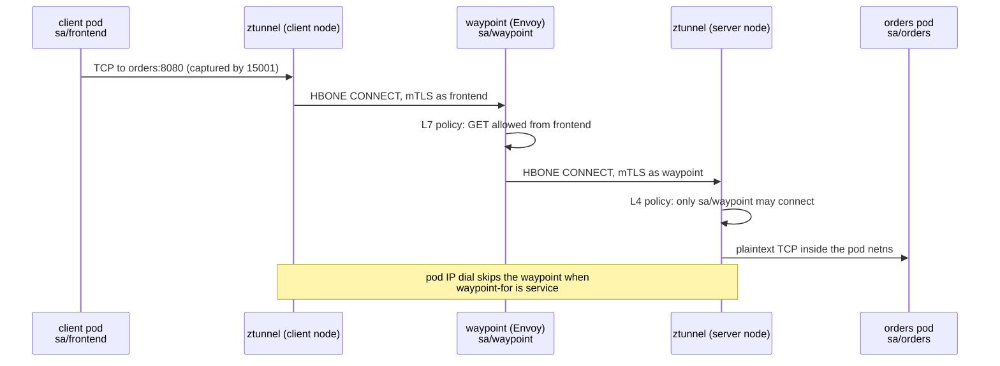

# Service Mesh Architecture for APIs: Sidecar Proxies vs Ambient L4/L7 Tunnels, Automatic mTLS Rotation, and AuthorizationPolicy

> [!summary] Claim
> A mesh moves workload identity, mutual TLS, and east-west authorization out of application code into proxies, and the design choice that matters is where the policy is enforced and with whose identity: a sidecar enforces L4 and L7 policy per pod with the client's identity, while Istio ambient mode enforces L4 policy in a per-node ztunnel and L7 policy only in an optional waypoint, which changes the identity the destination sees and silently drops L7 attributes from any policy a ztunnel receives, so a policy that is correct under one data plane can fail open or closed under the other.

Part of [API Gateways Proxies and Edge Architecture](README.md) in [API Engineering](../README.md).

## TL;DR

Mechanism: every workload gets a short-lived X.509 SVID (`spiffe://<trust-domain>/ns/<ns>/sa/<sa>`, 24 hours by default in Istio and Linkerd), a proxy terminates mTLS on its behalf, and an `AuthorizationPolicy` is evaluated at the receiving proxy as CUSTOM, then DENY, then ALLOW; ambient mode replaces the per-pod Envoy with a Rust L4 ztunnel per node that tunnels over HBONE (HTTP/2 `CONNECT` inside mTLS on port `15008`) and adds an Envoy waypoint only where L7 is needed.
Contract rule: mTLS authenticates, it does not authorize ("anyone with a valid certificate can still access a service"), so write default-deny ALLOW policies on `principals` and use positive matches on `paths` and `methods` (Istio security best practices, as of 2026-11).
Trap: a ztunnel cannot evaluate L7 attributes, so an ALLOW rule containing `methods` or `paths` is dropped and traffic is denied, while a DENY rule made only of L7 attributes is a no-op and traffic is allowed; the lab reproduces both, plus the waypoint bypass that happens when a client dials a pod IP and the waypoint only handles service traffic.
Portability: the 55-test lab passes on CPython 3.14.6 on macOS arm64 only (the version matrix was not run, per the 2026-11-11 pause on lab checks), the facts about Istio come from the 1.32.0 documentation and source tags, and HBONE carries TCP only, so UDP application traffic such as HTTP/3 is outside it.
When not to use it: a handful of services in one trust domain is cheaper to secure with mTLS at the gateway and application-level authorization, and a platform team that cannot own proxy upgrades, certificate authorities, and policy review should not adopt a mesh for compliance alone.

## Mental model



The first arrow shows the application speaking plain TCP: the pod's network namespace redirects it to port `15001` of the node ztunnel, which holds the client's certificate and opens an mTLS HTTP/2 connection as `frontend`.
The second hop terminates at the waypoint, which sees the original client identity and can therefore enforce an L7 policy such as "`GET` only from `frontend`"; it then opens a second tunnel as itself, so the destination ztunnel sees `sa/waypoint` and not `sa/frontend`, which is why the note on the destination side recommends a policy that admits only the waypoint identity.
The final arrow is local: HBONE is decapsulated inside the destination pod's own network namespace, and the application receives an ordinary TCP connection.
The note on the diagram is the bypass: if the client dials a pod IP and the waypoint only handles `service` traffic, steps two and three are skipped and the L7 policy never runs.

## How it works

### The east-west problem a mesh solves

A gateway guards the edge, and the sibling note [[API-Gateway-Architecture-Responsibilities-and-Anti-Patterns]] covers what belongs there; a mesh guards the traffic between services behind it, where the number of caller and callee pairs grows with the square of the service count and where network position is a poor identity (see [[API-Authentication-Architecture-Edge-Verification-vs-Zero-Trust-Propagation]]).
Istio states the goals as security by default, defense in depth, and a zero-trust network, delivered by a CA for key and certificate management, a configuration API that distributes authentication and authorization policy, and proxies that act as policy enforcement points (Istio docs, Security, as of 2026-11).
The proxies also give per-request metrics, retries, and timeouts, which is a hazard when several tiers retry independently; that interaction is the subject of [[Proxy-and-Application-Timeout-and-Retry-Interaction-Hazards]] and is not repeated here.
This note covers three mechanisms in order: the two data-plane architectures, the certificate lifecycle that makes identity cheap, and the policy model that turns identity into access control.

### Sidecar mode

In sidecar mode an Envoy runs in every pod, and all pod traffic is redirected through it by `iptables` rules installed by an init container or by the Istio CNI plugin.
The init container needs `NET_ADMIN` and `NET_RAW`, which the `baseline` and `restricted` Pod Security levels block, so the alternative is the CNI plugin; the user ID `1337` is reserved for the proxy, and applications must not use it (Istio docs, Application Requirements, as of 2026-11).
The ports an application must avoid include `15001` (outbound), `15006` (inbound), `15000` (admin), `15020`, `15021` (health), `15090` (telemetry), and `15008` (the HBONE tunnel port) (same page).
Certificates reach Envoy over the Envoy Secret Discovery Service: the Istio agent in the pod creates the private key and a CSR, sends the CSR to istiod with its credentials, receives the signed certificate, and hands key and certificate to Envoy through SDS (Istio docs, Security, Identity and certificate management).
SDS is what makes rotation a push and not a redeploy; without it certificates are mounted as secrets and "the proxy containers need to be re-deployed" when they expire (Envoy docs, SDS).
It also has a failure mode worth knowing: a listener whose server certificate comes from SDS is not marked active until the certificate arrives, and if the fetch fails, "the port will be open, but the connection to the port will be reset" (Envoy docs, SDS).
A second mesh-wide cost is configuration fan-out: "each proxy instance will receive configuration for all namespaces" by default, including workloads not in the mesh, so large meshes need the `Sidecar` resource's `egress.hosts`, `exportTo`, or `discoverySelectors` to bound each proxy's memory (Istio docs, Configuration Scoping).
Kubernetes now has first-class sidecar containers, implemented as init containers with `restartPolicy: Always`, stable since v1.33 and available since v1.28, which fixes start and stop ordering for a proxy and its application (Kubernetes docs, Sidecar Containers).

Two properties follow from the model.
Isolation is strong: each workload has its own key, so compromising a pod exposes the keys of that pod only; the Istio comparison table lists "Compromised application pod gives access to mesh keys: Yes" for sidecar mode, which I read as the pod's own key (Istio docs, Sidecar or ambient, as of 2026-11).
Cost scales with pod count: every pod pays proxy CPU and memory regardless of whether it needs L7, and the lifecycle of the proxy is tied to the application's, so a proxy upgrade is a pod restart.

### Ambient mode: ztunnel, HBONE, and traffic capture

Ambient mode "splits Istio's functionality into two distinct layers": a per-node ztunnel for L3 and L4 (mTLS, authentication, L4 authorization, L4 telemetry) and an optional per-namespace or per-service waypoint for L7 (Istio docs, Ambient Overview).
The ztunnel "does not terminate workload HTTP traffic or parse workload HTTP headers" and is written in Rust (same page).
It runs two Tokio runtimes: a single-threaded one for admin and xDS so that debugging cannot disturb the data plane, and a multi-threaded one for user traffic (ztunnel 1.32.0 `ARCHITECTURE.md`, Threading/Runtimes).
`ARCHITECTURE.md` still says the worker runtime "defaults to 2 threads", but the 1.32.0 code computes the default: with no `ZTUNNEL_WORKER_THREADS` and no proxy `concurrency`, it uses an explicit CPU limit if the chart sets one, and otherwise the largest of a quarter of the node's cores (rounded up), the CPU request, and `DEFAULT_WORKER_THREADS` = `2` (ztunnel 1.32.0 `src/config.rs`, `default_worker_threads`).

Capture happens inside the pod's network namespace.
The `istio-cni` node agent installs a chained CNI plugin; when a pod in an enrolled namespace starts, it enters the pod's namespace, writes redirect rules, and passes ztunnel a file descriptor for that namespace over a Unix socket, so ztunnel opens listeners on `15008`, `15006`, and `15001` inside the pod from outside it (Istio docs, Ztunnel traffic redirection).
That lets ambient work with any CNI and means the application sees no extra container.
The rules in the docs' `iptables-save` dump redirect inbound plaintext (destination port not `15008`) to `15006`, inbound HBONE (destination port `15008`) to `15008`, and all outbound TCP to `15001` (same page); the port table in ztunnel's `ARCHITECTURE.md` adds `15080` (SOCKS5), `15053` (DNS), `15021` (readiness), `15000` (admin, localhost), and `15020` (metrics).
The security argument is stated plainly in the docs: "if the ztunnel can be bypassed, authorization policies can be bypassed" (same page), and the 2026-11-06 bulletin includes a sidecar interception bypass for exactly this class of problem (see Pitfalls).

HBONE, the HTTP-Based Overlay Network Environment, "composes three open standards": HTTP/2, HTTP `CONNECT`, and mTLS (Istio docs, HBONE).
A tunnel is one HTTP/2 stream.
In HTTP/2 `CONNECT` "establishes a tunnel over a single HTTP/2 stream", the request carries only `:method` and `:authority`, and `:scheme` and `:path` "MUST be omitted" `(RFC 9113 Section 8.5)`; after a `2xx` response, DATA frames carry the TCP bytes and `END_STREAM` stands for FIN `(RFC 9113 Section 8.5)`.
The lab builds this with the pinned `h2` 4.4.1 state machines (`h2` 4.4.1 `h2/connection.py`, `H2Connection`) and shows the server side decoding exactly `[(':method', 'CONNECT'), (':authority', '10.0.1.5:8080')]`, with 18 bytes of application data arriving unchanged.
The destination ztunnel handles inbound HBONE in `build_inbound_request` and `serve_connect`: a non-`CONNECT` method returns `400`, an invalid authority or destination returns `400`, a failure to find an upstream returns `503`, a policy denial returns `401 Unauthorized` flagged `AuthorizationPolicyDenied`, and an upstream connect failure returns `503` (ztunnel 1.32.0 `src/proxy/inbound.rs`).
The lab's `serve_hbone` mirrors the first, fourth, and success cases.
Connection metadata travels in the tunnel's own request headers instead of in the application stream: `inbound.rs` imports the constants `BAGGAGE_HEADER`, `TRACEPARENT_HEADER`, and `X_FORWARDED_NETWORK_HEADER`, and the HBONE page states that the application request is proxied "without altering the underlying application traffic stream in any way".

HBONE multiplexes by identity: "each unique source and destination must get their own dedicated, secure tunnel connection, even if that underlying dedicated connection is handling multiple application-level connections" (Istio docs, HBONE).
ztunnel's pool starts a new connection when an existing one already carries `pool_max_streams_per_conn` streams, default `100` ("Go: 100, Hyper: 200, Envoy: 2147483647 (lol), Spec recommended minimum 100" in the source comment), and the check runs only when a connection is requested, not per stream, so the cap is soft (ztunnel 1.32.0 `src/config.rs`, `DEFAULT_POOL_MAX_STREAMS_PER_CONNECTION` and the `pool_max_streams_per_conn` comment).
The protocol limit it respects is `SETTINGS_MAX_CONCURRENT_STREAMS`: "initially, there is no limit", "it is recommended that this value be no smaller than 100" `(RFC 9113 Section 6.5.2)`, and exceeding the advertised limit is a stream error of type `PROTOCOL_ERROR` or `REFUSED_STREAM` `(RFC 9113 Section 5.1.2)`.
The lab shows `h2` refusing the 101st concurrent stream with `TooManyStreamsError`, raised in `send_headers` with the message "Max outbound streams is 100, 100 open" (`h2` 4.4.1 `h2/connection.py`, `H2Connection.send_headers`), and the pool opening a second connection instead.
Flow-control windows are generous: `HTTP2_STREAM_WINDOW_SIZE` defaults to 4 MiB and `HTTP2_CONNECTION_WINDOW_SIZE` to 16 MiB, against the 65,535-byte protocol default, and a source comment warns that setting the connection window equal to the stream window "can introduce deadlocks in some applications" (ztunnel 1.32.0 `src/config.rs`; RFC 9113 Sections 6.5.2 and 6.9.2 for the 65,535-byte stream and connection defaults).
Many application connections between one identity pair therefore share one TCP connection, so a single lost segment stalls every tunnel on it; that is an implication of running HTTP/2 over TCP and not a statement from the Istio docs, and the mechanics are in [[HTTP-2-Binary-Framing-and-Stream-State-Machine]] and [[HTTP-2-Flow-Control-and-Window-Update-Mechanics]].

NetworkPolicy still applies: it "is enforced on the host, outside the pod", so a policy that admits only application ports must also admit `15008` or HBONE traffic is dropped, including from sidecar workloads that receive HBONE (Istio docs, Ambient and Kubernetes NetworkPolicy).

### Waypoints: where L7 lives

A waypoint is "an optional deployment of the Envoy-based proxy" that runs outside application pods and scales independently; it is created from a Kubernetes Gateway with `gatewayClassName: istio-waypoint` and a listener on `15008` with protocol `HBONE` (Istio docs, Configure waypoint proxies).
It exclusively receives HBONE, checks that the traffic is for a service or pod that uses it, applies L7 policy (`AuthorizationPolicy`, `RequestAuthentication`, `WasmPlugin`, `Telemetry`), and for service traffic also routes and load balances (Istio docs, Ambient data plane).
In contrast to sidecars, ambient policy is enforced at the destination waypoint, and "Istio enforces that all traffic coming into the resource goes through the waypoint" (Istio docs, Configure waypoint proxies); the next paragraph shows where that sentence stops being true.

Enrollment is by label: `istio.io/use-waypoint` on a namespace, service, or pod, with the service label taking precedence over the namespace label.
The label `istio.io/waypoint-for` on the Gateway decides which destination types the waypoint accepts: `service` (the default), `workload`, `all`, or `none`; and the decision uses the original destination type, so "traffic which is addressed to a service" "is always treated by the ambient mesh as to-service" even after it resolves to a pod IP (Istio docs, Configure waypoint proxies).
`use-waypoint` records intent and does not guarantee traversal: ztunnel "routes traffic directly to the destination, rather than failing the request" when the named waypoint "does not exist or has no address" or when the traffic type does not match, for example a direct pod IP dial against a `service`-only waypoint; in either case the L7 policy "never takes effect" (same page).
The documented fix is a ztunnel-enforced policy that allows only the waypoint's identity, which is the service account named after its Gateway; it uses a `selector`, so it is enforced at L4 by ztunnel in both bypass cases.
The lab reproduces the bypass (`POST` allowed when dialing the pod IP), the fix (the same request denied at `dest-ztunnel`), and each `waypoint-for` and dial combination.
Waypoints do not impersonate the client: "once you have introduced a waypoint to the traffic path, the destination ztunnel will see traffic with the waypoint's identity, not the source identity", so an L4 policy that depends on the client identity must be attached to the waypoint (Istio docs, Use Layer 4 security policy).
Other documented behaviors: ingress gateways do not use the destination waypoint unless `istio.io/ingress-use-waypoint` is set and `ENABLE_INGRESS_WAYPOINT_ROUTING` is enabled in istiod (default `false`); a waypoint in another namespace needs `allowedRoutes` on its Gateway and the `istio.io/use-waypoint-namespace` label; and starting with Istio 1.31 an Alpha feature shifts a service between waypoints by connection, with `istio.io/use-waypoint-canary-weight` from 0 to 100 (Istio docs, Configure waypoint proxies).
`EnvoyFilter` "is not currently supported for any existing Istio version with waypoint proxies" (Istio docs, Use Layer 7 features).

Sidecars and ambient interoperate.
A sidecar uses HBONE toward an ambient destination when `ISTIO_META_ENABLE_HBONE` is true, the default under the ambient profile (Istio docs, Add workloads to the mesh), but "traffic from sidecars and gateways won't go through any waypoint proxy either" (Istio docs, Ambient data plane, as of 2026-11).
A pod labeled for both modes runs as a sidecar pod (Istio docs, Add workloads to the mesh).

### Identity and automatic mTLS rotation

Identity is a SPIFFE ID in an X.509 SVID.
The SPIFFE ID has the form `spiffe://trust-domain-name/path`; the X.509 SVID carries it "as a URI type in the Subject Alternative Name extension" `(RFC 5280 Section 4.2.1.6)`, must contain exactly one URI SAN, and validators "MUST reject the SVID" when there are more (SPIFFE X509-SVID Section 2).
A leaf must have a non-root path, `cA` false, `digitalSignature` set, and neither `keyCertSign` nor `cRLSign` (X509-SVID Sections 3.1, 4.1, 4.3, and 5.2); implementations "MUST support SPIFFE URIs up to 2048 bytes in length and SHOULD NOT generate" longer ones (SPIFFE-ID Section 2.3).
Istio uses the layout `spiffe://<trust-domain>/ns/<namespace>/sa/<service-account>`, and the authorization `principals` string drops the scheme: `cluster.local/ns/default/sa/productpage` (Istio docs, AuthorizationPolicy reference).
The handshake details are in [[Mutual-TLS-mTLS-Handshake-and-SPIFFE-Identity]] and the certificate chain rules in [[X509-Certificates-Chain-Validation-SAN-and-OCSP-Stapling]].

The verifier checks the URI SAN and not the name.
ztunnel's `IdentityVerifier` validates the chain and expiry, then requires that "SPIFFE URI SAN matches expected identities (not DNS `ServerName`)", because "Rustls doesn't natively validate URI SAN" (ztunnel 1.32.0 `src/tls/workload.rs`, `IdentityVerifier::verify_full_san` and `verify_server_cert`); inbound, it also checks the client's trust domain (`verify_trust_domain`).
The lab issues real certificates with `cryptography` 50.0.2 and shows an impostor holding `sa/reports` and the DNS name `orders.shop.svc.cluster.local` rejected as a peer for `sa/orders`.
Sidecars add "secure naming": the control plane maps identities to the service names they may run, so a client that reaches a forged server through DNS or route hijacking still rejects an identity that is not authorized for that service; for non-HTTP traffic the docs state that secure naming "doesn't protect from DNS spoofing" because Envoy routes on the destination IP (Istio docs, Security).

Issuance in sidecar mode follows the SDS flow above, with these defaults at the 1.32.0 tag:

- The agent requests `SECRET_TTL` = 24 hours, rotates when `SECRET_GRACE_PERIOD_RATIO` (`0.5`) of the lifetime remains, and jitters that ratio by up to `SECRET_GRACE_PERIOD_RATIO_JITTER` (`0.01`, "~15 minutes over 24 hours") to stagger a fleet (Istio 1.32.0 `pilot/cmd/pilot-agent/options/options.go`).
- The rotation delay is `expire - ratio * lifetime - now`, clamped at zero, with `ratio` clamped to `[0, 1]` after jitter (`security/pkg/nodeagent/cache/secretcache.go`, `rotateTime`).
- istiod's CA defaults to 24 hours for a workload certificate with a 90-day cap, and a self-signed root lives 3650 days with a 20 percent rotation grace (`security/pkg/cmd/constants.go`).

```python
def rotate_in(
    *, lifetime_s: float, age_s: float, grace_ratio: float, jitter: float, rng: random.Random
) -> float:
    offset = rng.random() * jitter * (1 if rng.randrange(2) else -1)
    ratio = min(max(grace_ratio + offset, 0.0), 1.0)
    return max(lifetime_s - ratio * lifetime_s - age_s, 0.0)
```

The block above is a simplified excerpt of the lab's `rotate_in`, which mirrors `rotateTime`.
With the ratio at `0.5` the fleet's rotation times spread over a window of at most 1,728 seconds around the half-life; in the lab, 5,000 seeded draws spanned 42,337.1 to 44,064.0 seconds, a spread of 1,726.9 seconds, and with `jitter=0` all 100 draws were exactly 43,200 seconds, which is the thundering herd the jitter exists to prevent.

Ambient changes who holds the keys.
mTLS "requires ztunnel to manage multiple distinct workload certificates, on behalf of the proxied workloads - one for each unique identity (service account) for every node-local pod", and ztunnel's own identity is never used for mTLS between workloads (Istio docs, Ambient data plane).
Asking for another workload's certificate is a form of impersonation, so the CA "must enforce that the ztunnel has permission to request that identity"; requests for identities not running on the node are rejected (same page).
istiod implements this in `CreateCertificate`: when the CSR metadata carries an impersonated identity, it requires a configured node authorizer (`CA_TRUSTED_NODE_ACCOUNTS`) and otherwise returns `Unauthenticated`; `authenticateImpersonation` then checks that the caller's service account is a trusted node account, that the requested identity parses, that the caller pod exists with a matching UID and service account, and that some pod with the requested service account runs on the caller's node (istio 1.32.0 `security/pkg/server/ca/server.go` and `node_auth.go`).
The lab's `NodeAuthorizer` reproduces four of those checks in the source's order (trusted node account, caller pod found, UID match, requested service account on the caller's node) and omits the identity-parse and caller service-account checks; it shows a ztunnel on `node-a` refused the identity of a pod that runs only on `node-b`.
The consequence is the bounded blast radius in the comparison table: a compromised application pod yields no mesh keys, while a compromised node agent yields the identities of the workloads on that node and no others (inference from the node authorizer; the table says "No" for the pod case and "each node agent has only the keys for workloads on that node").

ztunnel's refresh loop is a priority queue.
Identities carry a `Priority` of `Background`, `Warmup`, or `RealTime`: newly discovered identities are fetched at low priority, and a request that needs an identity that is not yet cached fetches it immediately (Istio docs, Ambient data plane; ztunnel 1.32.0 `src/identity/manager.rs`).
A new certificate is refreshed at `not_before + (not_after - not_before) / 2` (`src/tls/certificate.rs`, `refresh_at`), the default `SECRET_TTL` is 24 hours (`src/config.rs`, `DEFAULT_TTL`), and the lab computes the same deadline from a real certificate: issued at 2026-11-21T12:00Z with 24 hours of validity, `refresh_deadline` returns 2026-11-22T00:00Z.
When a refresh fails, ztunnel keeps serving the old certificate and retries with a per-identity exponential backoff: initial interval 500 ms, first delay 1 second, multiplier 2, randomization factor 0.2, capped at 150 seconds, reset on success, and never later than the existing certificate's expiry (`src/identity/manager.rs`, `CERT_REFRESH_FAILURE_RETRY_DELAY_MAX_INTERVAL` and the refresh loop).
The lab's `simulate_rotation` implements this loop without the jitter.

```python
def simulate_rotation(*, ttl_s, refresh_fraction, outages, horizon_s):  # simplified excerpt
    valid_until, next_t, delay = ttl_s, ttl_s * refresh_fraction, RETRY_INITIAL_S
    while next_t < horizon_s:
        t = next_t
        if t >= valid_until and gap_start is None:
            gap_start = valid_until
        if ca_up(t):
            ...                                  # record the gap, reissue, reset the backoff
            valid_until, next_t = t + ttl_s, t + ttl_s * refresh_fraction
        else:
            failed += 1
            next_t, delay = t + delay, min(delay * RETRY_MULTIPLIER, RETRY_MAX_S)
            if t < valid_until:
                next_t = min(next_t, valid_until)  # never sleep past expiry
```

Because the first attempt happens at the half-life, a CA or control-plane outage is survivable for up to half the TTL: 12 hours at 24-hour certificates.
That is an engineering consequence of the schedule above, not a documented SLO, and the lab measures it: a CA outage from 43,000 to 86,000 seconds produced 292 failed attempts, a first success at 86,055 seconds, and no gap, while an outage ending at 90,000 seconds left the identity without a valid certificate from 86,400 to 90,000 seconds, because the first success came on the first retry at or after the outage ended.
This also bounds revocation: SPIFFE notes that changing an assertion on a live system "will be protracted as all SVIDs with the old assertion must first expire" (SPIFFE-ID Section 4.1.1), so the TTL is the revocation latency unless a CRL is configured, which ztunnel 1.32.0 supports as an option in its verifier (`src/tls/workload.rs`, `crl_manager`).

Linkerd takes the same approach with a different footprint: its CA issues each proxy a certificate bound to the pod's service account that "expire[s] after 24 hours and [is] automatically rotated", but the default install's trust anchor expires after 365 days and the issuer certificate after a year, and both must be rotated manually or through cert-manager (Linkerd docs, Automatic mTLS, as of 2026-11).
The Istio self-signed root is 3650 days (`constants.go`), so the manual-rotation cliff is a Linkerd default and not a property of meshes in general.

### Policy: PeerAuthentication and AuthorizationPolicy

`PeerAuthentication` sets the mTLS requirement for inbound connections, with modes `UNSET` (inherit, otherwise `PERMISSIVE`), `DISABLE`, `PERMISSIVE` (plaintext or mTLS), and `STRICT` (mTLS with a client certificate).
The narrowest policy wins in the order workload, namespace, mesh; there may be one mesh-wide and one namespace-wide policy, newer duplicates are ignored, and among several workload policies the oldest is picked (Istio docs, Security).
`portLevelMtls` refers to the workload port and not the Service port, and requires a selector (Istio docs, PeerAuthentication reference).
In ambient mode `DISABLE` "is not supported" and such policies are ignored, because ztunnel and HBONE imply mTLS (same page, L4 policy page).
istiod lowers a workload policy with port overrides into a ztunnel DENY: `STRICT` becomes a rule with `notPrincipals: [presence]`, which matches a connection that has no peer identity, and port exemptions become extra clauses with `notDestinationPorts` (istio 1.32.0 `pilot/pkg/serviceregistry/ambient/authorization.go`, `convertPeerAuthentication`).
The lab's `lower_peer_authentication` follows that shape and tests three cases: plaintext is denied under `STRICT`; a `STRICT` port under a `PERMISSIVE` workload is still enforced, which is the case GHSA-rr2c-p22p-6r9r broke in releases 1.31.0 to 1.31.3 and 1.30.0 to 1.30.7; and a `PERMISSIVE` port under a `STRICT` workload is exempted from the deny while other ports are not.
The mesh-wide and namespace-wide `STRICT` cases use a static policy that istiod's xDS server supplies, which the lab does not model.

`AuthorizationPolicy` is evaluated in a fixed order: CUSTOM first (an extension such as external authorization may only deny), then DENY, then ALLOW, with `AUDIT` independent of the outcome (Istio docs, AuthorizationPolicy reference).
The rule is five lines: if a CUSTOM policy denies, deny; if any DENY policy matches, deny; if there is no ALLOW policy for the workload, allow; if any ALLOW policy matches, allow; otherwise deny (same page).
So the first ALLOW policy turns the workload into default-deny, `spec: {}` (an ALLOW with no rules) "allows nothing", and `rules: [{}]` allows everything.
The lab tests all three, and that DENY wins even when an ALLOW also matches.
CUSTOM delegates to an external authorizer; that protocol is in [[External-Authorization-Ext-Authz-and-Global-Rate-Limit-Filters]].

A rule has `from` (sources), `to` (operations), and `when` (conditions): list entries are ORed, the lists are ANDed, and "an empty rule is always matched" (Istio docs, AuthorizationPolicy reference).
Fields inside one `source` or `operation` are ANDed, so `principals: [a, b]` with `namespaces: [prod]` means (a or b) and `prod`.
String fields support exact, prefix (`abc*`), suffix (`*abc`), and presence (`*`, meaning non-empty); `*` is different from leaving a field unset, which matches empty values too.
The Security concepts page describes prefix and suffix the other way round (it calls `test.abc.*` a suffix match); the reference page's definition is the one the lab implements and the one the ztunnel source matches, where `Prefix` uses `starts_with` (ztunnel 1.32.0 `src/rbac.rs`, `StringMatch::matches`).
`methods` and `paths` apply to HTTP only, for gRPC the method is always `POST` and the path is `/package.service/method`, `paths` may use `{*}` and `{**}` Envoy URI templates, and `hosts` is case-insensitive (AuthorizationPolicy reference) and "meaningless on sidecar" because the server-side sidecar does not use the `Host` header when forwarding (Istio docs, Security best practices).
Scope comes from the policy's namespace (the root namespace, `istio-system` by default, applies mesh-wide) plus an optional `selector`, or in ambient from `targetRefs` that attach to a waypoint `Gateway`, a `GatewayClass` in the root namespace, a `Service` (waypoints only), or a `ServiceEntry`; at most one of `selector` and `targetRefs` may be set (AuthorizationPolicy reference).
The annotation `istio.io/dry-run: "true"` evaluates a policy without enforcing it, and ztunnel logs "dry-run" matches when `EnableWdsDryRunAuthzPol` is on (reference page; ztunnel 1.32.0 `src/state.rs`, `assert_rbac`; istio `authorization.go`).

The same policy is enforced by different engines, and that is the central operational fact.
A sidecar or waypoint enforces it as Envoy RBAC, which evaluates the connection (IPs, ports, peer certificate subject) and the HTTP headers, supports shadow mode, and reports a denial as `rbac_access_denied_matched_policy[policy_name]` in `RESPONSE_CODE_DETAILS` (Envoy docs, RBAC filter).
A ztunnel enforces only L4 attributes, in `Authorization.matches`: groups are ORed, clauses within a group are ANDed, matches within a clause are ORed, an empty match is skipped (`continue`), a clause that has matches but all of them empty is false, and a group with no clauses matches everything (ztunnel 1.32.0 `src/rbac.rs`).
Before that, istiod lowers each `AuthorizationPolicy` with `handleRule`: it keeps only ports, IPs, namespaces, service accounts, and principals, drops `hosts`, `methods`, `paths`, `requestPrincipals`, and `remoteIpBlocks`, and for an ALLOW policy discards the whole rule when any L7 attribute was found, with the comment "L7 policies never match for ALLOW" (istio 1.32.0 `authorization.go`, `handleRule`, `httpOperations`, `httpSources`).

```python
def _lower_rule(action: Action, rule: Rule) -> tuple[ZtGroup | None, set[str]]:  # simplified excerpt
    found, clauses = set(), []
    if rule.to:
        clauses.append(tuple(ZtMatch(ports=op.ports, not_ports=op.not_ports) for op in rule.to))
        ...  # found |= the L7 operation fields that were set
    if rule.from_:
        clauses.append(tuple(ZtMatch(principals=s.principals, ...) for s in rule.from_))
        ...  # found |= the L7 source fields that were set
    if action is Action.ALLOW and found:
        return None, found   # handleRule: "L7 policies never match for ALLOW"
    return tuple(clauses), found
```

The documented outcomes, which the lab reproduces row by row, are these (Istio docs, Use Layer 4 security policy; tests in the lab):

| Policy at a ztunnel | What the ztunnel evaluates | Result |
|---|---|---|
| ALLOW with an L7 attribute | the rule is dropped, no ALLOW rule can match | traffic denied |
| DENY with only L7 attributes (for example `notRequestPrincipals: ["*"]`) | every match is empty, the group never fires | traffic allowed |
| DENY with L4 and L7 attributes in one `to` entry | the L4 half is kept | everything matching the L4 half is denied, broader than intended |
| DENY with L4 in `from` and L7 in `to` | the `to` clause is all-empty, so the rule never matches | traffic allowed |

The first row is why ambient documents "if a policy with rules matching L7 attributes is targeted with a workload selector ... it will fail safe by becoming a DENY policy"; the table above is more precise than that sentence, because the last two rows fail open.
The L7 features page and the L4 policy page describe this behavior in different words, so the lab follows the source and the table.
istiod accepts these policies with an `UnsupportedValue` status message (a comment in `authorization.go` calls it "an accepted with warning condition"), so the status message is the only signal.
Its wording depends on the case: a DENY left with no enforceable rule "will have no effect", while both a mixed DENY and an ALLOW with L7 rules get "This will be more restrictive than requested" (istio 1.32.0 `authorization.go`, `httpDenyNoEffectBoilerplate`, `httpDenyMixedBoilerplate`, `httpAllowRuleBoilerplate`); the L4 policy page says that wording "applies only to DENY rules where the L4 and L7 attributes are in the same entry", which the source contradicts for ALLOW.

DENY with missing attributes is treated as a match: in the reference's example, a DENY rule with `methods: ["POST"]` and `ports: ["8080"]` applied to opaque TCP traffic means "all TCP traffic on port 8080 would be denied", and without the port match all TCP traffic would be, which is why the docs recommend scoping DENY policies to a port (AuthorizationPolicy reference).
The lab's `EnvoyEnforcer` passes `missing_matches=True` for DENY and `False` for ALLOW and tests the contrast.

Path matching happens on a normalized path.
Istio offers `NONE`, `BASE` (the default install, Envoy's `normalize_path` per RFC 3986 plus backslash to slash), `MERGE_SLASHES`, and `DECODE_AND_MERGE_SLASHES` (percent-encoded `/` and `\` are decoded first), applied in the order decode, BASE, merge, and the normalized path is both matched and forwarded (Istio docs, Security best practices).
Its worked example is a DENY on `/data/secret` and a request for `/data//secret`, which bypasses the policy while the backend, which treats `//` as `/`, serves the secret.
The lab's matrix, with each cell computed by `EnvoyEnforcer.evaluate` and the normalized forms printed by `normalize_path`:

| Request path | `NONE` | `BASE` | `MERGE_SLASHES` | `DECODE_AND_MERGE_SLASHES` |
|---|---|---|---|---|
| `/data/secret` | blocked | blocked | blocked | blocked |
| `/data//secret` | bypass | bypass | blocked | blocked |
| `/data/x/../secret` | bypass | blocked | blocked | blocked |
| `/data%2Fsecret` | bypass | bypass | bypass | blocked |
| `\data\secret` | bypass | blocked | blocked | blocked |

An ALLOW on `/public` fails closed under every mode for `/public/x`, `/Public`, `/public%2F`, and `/other`, which is why the docs prefer "ALLOW-with-positive-matching or DENY-with-negative-matching".
The lab's `normalize_path` is a simplified excerpt of the documented options and not a reimplementation of Envoy's.

### Comparison in one table

| Property | Sidecar | Ambient L4 (ztunnel) | Ambient L7 (waypoint) |
|---|---|---|---|
| Proxy placement | one Envoy per pod | one Rust ztunnel per node | Envoy Deployment per namespace or service |
| Proxies on a request | 2 sidecars | 2 ztunnels | 2 ztunnels plus 1 waypoint |
| Policy enforcement | destination sidecar, L4 and L7 | destination ztunnel, L4 only | destination waypoint, L4 and L7 |
| Identity the destination sees | the client | the client | the waypoint at the ztunnel, the client at the waypoint |
| Adding a workload | label namespace and restart pods | label namespace, no restart | `use-waypoint` label |
| Key exposure | the pod's own key | node agent holds the node's identities | the waypoint's identity |
| Upgrade unit | pod restart | node (`DaemonSet`) | Deployment, with revisions |

The rows come from the Istio docs (Sidecar or ambient; Ambient data plane; Upgrade with Helm), with the "proxies on a request" row from the Latency section of the performance page.

## Numbers and limits

| Quantity | Value | Source and date |
|---|---|---|
| Sidecar per proxy at 1000 rps, 1 KB, 2 workers | about 0.20 vCPU and 60 MB | Istio performance page, Istio 1.24 figures, as of 2026-11 |
| Waypoint per proxy, same load | about 0.25 vCPU and 60 MB | same page |
| ztunnel per node, same load | about 0.06 vCPU and 12 MB | same page |
| Latency band, sidecar | 0.63 ms to 0.88 ms | "Sidecar or ambient?" table, p90/p99, as of 2026-11 |
| Latency band, ambient L4 | 0.16 ms to 0.20 ms | same table |
| Latency band, ambient with waypoint | 0.40 ms to 0.50 ms | same table |
| Benchmark bed | bare metal, 5 M3 Large machines, Flannel CNI, mTLS on | performance page: "different hardware will give different values" |
| Workload certificate TTL | 24 hours default, 90 days maximum | istio 1.32.0 `security/pkg/cmd/constants.go` |
| Self-signed CA root TTL | 3650 days | same file |
| Sidecar agent rotation | at 0.5 of lifetime remaining, jitter 0.01 | istio 1.32.0 `pilot-agent/options/options.go` |
| ztunnel rotation | `not_before` plus half the validity | ztunnel 1.32.0 `src/tls/certificate.rs` |
| ztunnel refresh retry | 1 s first delay, factor 2, jitter 0.2, cap 150 s | ztunnel 1.32.0 `src/identity/manager.rs` |
| HBONE port | `15008` (TCP, HTTP/2 over mTLS) | Istio docs, HBONE; ztunnel `config.rs` |
| Pool streams per HBONE connection | 100, checked only on a new connection | ztunnel 1.32.0 `src/config.rs` |
| HTTP/2 windows in ztunnel | 4 MiB stream, 16 MiB connection | ztunnel 1.32.0 `src/config.rs` |
| `SETTINGS_MAX_CONCURRENT_STREAMS` guidance | initially unlimited, recommended at least 100 | RFC 9113 Section 6.5.2 |
| SPIFFE ID length | must support up to 2048 bytes, should not generate longer | SPIFFE-ID Section 2.3 |
| Sidecar mTLS floor | `TLSv1_2` minimum; six AES-GCM suites, four ECDHE and two (`AES256-GCM-SHA384`, `AES128-GCM-SHA256`) without ECDHE | Istio docs, Security, as of 2026-11 |
| Latest Istio release read | 1.32.0, published 2026-11-09; 1.29 end of life 2026-10-15 | GitHub releases; ISTIO-SECURITY-2026-007 |
| Linkerd leaf certificate TTL | 24 hours; trust anchor 365 days by default | Linkerd docs, Automatic mTLS, as of 2026-11 |
| Lab: CA outage tolerated at a 12 h refresh | 43,000 s outage (43,000 to 86,000 s), 292 failed attempts, no gap | `simulate_rotation` via `uv run --frozen python`, CPython 3.14.6, macOS 27.3 arm64 (Darwin 27.3.0), deterministic (see Worked example) |
| Lab: fleet model, 10 nodes by 30 pods, 3 waypoints | sidecar 18,000 MB across 300 proxies, ambient 300 MB across 13 | arithmetic on the documented constants, not a measurement |
| Lab: waypoints before ambient costs more memory | 298 | same model |

The footprint rows are linear scaling of figures measured at one load point, so they say what the documented per-proxy numbers imply and not what a real fleet uses.
Proxy memory "depends on the total configuration state the proxy holds" (Istio docs, Performance and Scalability), which is why sidecar scoping matters more than the headline 60 MB.
The model's break-even is the useful result: ambient saves memory only while waypoints stay far below the pod count, and a waypoint per service replica would erase the advantage.

## Portability

| Dimension | Result | Basis |
|---|---|---|
| CPython 3.14.6, macOS 27.3 arm64 (Darwin 27.3.0) | 55 tests passed, `uv run --frozen pytest ... -q`, 2.99 s wall time on the verifier's run | rerun by the verifier, 2026-11-21 |
| CPython 3.12.16, 3.13.18, 3.15.2, 3.15.2t | not run | the 2026-11-11 instruction paused the matrix; `requires-python` is `>=3.12,<3.16` and the lab uses `StrEnum`, PEP 695 generics (`def _internal[T]`), and `datetime.UTC` |
| `h2` 4.4.1, `hyperframe` 6.1.0, `cryptography` 50.0.2 | the versions the pinned lockfile installs, all used by the test | `importlib.metadata` in the lab virtualenv |
| Debian Trixie and Alpine musl containers | not run | paused with the matrix |
| Istio sidecar mode | any Kubernetes CNI; VMs supported | Istio docs, Sidecar or ambient |
| Istio ambient mode | any Kubernetes CNI; the "Sidecar or ambient" page still lists sidecar-to-waypoint interoperability, multi-cluster, multi-network, and VM support as "not yet implemented in ambient mode" and rates ambient "Stable, only single-cluster", while the ambient multicluster install page says "Ambient multi-network multicluster has reached beta status" with known limitations; VMs remain sidecar-only | Istio docs, Sidecar or ambient and Install ambient multicluster, as of 2026-11 |
| Application protocol through a mesh | HTTP/1.1, HTTP/2, gRPC, and any TCP protocol | Istio docs, Security ("supports gRPC, HTTP, HTTPS and HTTP/2 natively, as well as any plain TCP protocols") |
| HTTP/3 over QUIC (UDP) through ambient | not carried by HBONE; UDP use cases "will be investigated in the future", and every redirect rule in the documented `iptables-save` dump matches `-p tcp`, so UDP application traffic is not captured by ztunnel and gets neither mTLS nor L4 policy (an inference from the rules; DNS capture to `15053` is a separate feature) | Istio docs, HBONE and Ztunnel traffic redirection, as of 2026-11 |
| Server-first protocols | sidecar PERMISSIVE and protocol sniffing need the port declared as TCP; the comparison table lists "server-first" support as "Requires configuration" for sidecar and "Yes" for ambient | Istio docs, Application Requirements and Sidecar or ambient |
| ASGI servers (Uvicorn, Hypercorn, Granian) | not applicable to the lab, which opens no server; behind a mesh the application sees the decapsulated connection | design note, see [[API-Authentication-Architecture-Edge-Verification-vs-Zero-Trust-Propagation]] for peer identity in ASGI |

## Worked example

The implementation is [implementation](../labs/src/api_labs/f17_api_gateways_proxies_and_edge_architecture/service_mesh.py) and the test is [test](../labs/tests/f17_api_gateways_proxies_and_edge_architecture/test_service_mesh_architecture_sidecar_vs_ambient_mesh_and_east_west_policy.py).
The module models, with no network and an explicit clock: the `AuthorizationPolicy` semantics at an Envoy enforcement point (`EnvoyEnforcer`) and at a ztunnel (`lower_policy`, `zt_matches`, `evaluate_ztunnel`); `deliver`, which routes a request through the sidecar or ambient path with an optional waypoint; real X.509 SVIDs (`issue_svid`, `verify_peer`); rotation under CA outage (`simulate_rotation`, `rotate_in`); the CA's node authorization (`NodeAuthorizer`); HBONE over real `h2` state machines (`HbonePool`, `tunnel_bytes`); and the footprint arithmetic (`footprint`).

The central test is the waypoint bypass and its fix.
The block below is a simplified excerpt: the two fixtures sit at module level in the test file and the test function is verbatim.

```python
GET_ONLY = Policy(
    "get-only",
    Action.ALLOW,
    (only(principals=(FRONT.principal,), methods=("GET",)),),
    Attach.TARGET_REF,
)
ONLY_WAYPOINT = Policy("only-waypoint", Action.ALLOW, (only(principals=(WAYPOINT.principal,)),))


def test_dialing_the_pod_ip_bypasses_a_service_waypoint_until_ztunnel_requires_it() -> None:
    post = req(method="POST")
    bypass = deliver(DataPlane.AMBIENT, post, ORDERS, [GET_ONLY], dial="workload")
    assert bypass.allowed
    assert not bypass.via_waypoint
    via_service = deliver(DataPlane.AMBIENT, post, ORDERS, [GET_ONLY], dial="service")
    assert not via_service.allowed
    closed = deliver(DataPlane.AMBIENT, post, ORDERS, [GET_ONLY, ONLY_WAYPOINT], dial="workload")
    assert not closed.allowed
    assert closed.hops[-1].proxy == "dest-ztunnel"
```

It fails if the bypass is absent (the first assertion), if the waypoint stops enforcing on the service path (the third), or if the ztunnel policy stops closing the gap (the last two).
The L7 drop at ztunnel has its own test, shown verbatim.

```python
def test_allow_with_an_l7_attribute_is_dropped_so_ztunnel_denies_what_envoy_allows() -> None:
    policy = Policy(
        "get-from-frontend", Action.ALLOW, (only(principals=(FRONT.principal,), methods=("GET",)),)
    )
    lowered = lower_policy(policy)
    assert lowered is not None
    assert lowered.groups == ()
    assert lowered.unsupported == ("methods",)
    assert EnvoyEnforcer().evaluate([policy], req()).allowed
    assert not evaluate_ztunnel([policy], req()).allowed
```

The command and the captured result, run from `labs/` with CPython 3.14.6 on macOS 27.3 arm64 (Darwin 27.3.0) through `uv`:

```text
$ uv run --frozen pytest tests/f17_api_gateways_proxies_and_edge_architecture/test_service_mesh_architecture_sidecar_vs_ambient_mesh_and_east_west_policy.py -q
.......................................................                  [100%]
55 passed in 2.99s
```

A scratch script (not part of the lab) printed the values quoted in this note from the same module:

```text
A (0.0, 86055.0, 129255.0, 172455.0) 292 ()
B (0.0, 90000.0, 133200.0) 319 ((86400.0, 90000.0),)
C (0.0, 43215.0) 4 ()
D 42337.1 44064.0 1726.9
G 1 [(':method', 'CONNECT'), (':authority', '10.0.1.5:8080')] b'GET / HTTP/1.1\r\n\r\n'
H Footprint(proxies=300, memory_mb=18000.0, vcpu=60.0) Footprint(proxies=13, memory_mb=300.0, vcpu=1.35) 298
```

Line `A` is the 12-hour-tolerance case (issuance times, failed attempts, gaps), `B` the case where the outage outlasts the certificate, `C` the backoff sequence 1, 2, 4, and 8 seconds (4 failures, success at 43,215 s), `D` the jitter spread, `G` the HBONE `CONNECT` headers and the bytes that came through, and `H` the fleet model.
The scratch values were reproduced exactly by the verifier on the same machine, and `ruff format --check`, `ruff check`, `mypy` (strict), and `pyright` (strict) were run once on the module and the test and reported no issues.
Mutation testing was not run, because lab checks were paused by the 2026-11-11 instruction; the tests are written to fail on the behavior their names claim but that was not proven by mutation.

## Pitfalls

> [!warning] An L7 attribute in a policy that a ztunnel enforces
> Trigger: an `AuthorizationPolicy` with a workload `selector` that names `methods`, `paths`, `hosts`, `requestPrincipals`, or `remoteIpBlocks` on a namespace in ambient mode without a waypoint.
> Symptom: an ALLOW policy denies everything (curl exits with code 56 in the docs' example) and a DENY policy that is all L7, including the common "require a JWT" `notRequestPrincipals: ["*"]`, blocks nothing; a DENY that mixes an L4 and an L7 attribute in one entry blocks the whole L4 match.
> Fix: attach L7 policies to a waypoint with `targetRefs`, keep selector policies L4-only, and read the status message on the policy (Istio docs, Use Layer 4 security policy; istio `authorization.go`).

> [!warning] A waypoint that traffic can walk around
> Trigger: a client dials a pod IP (a headless service, a `StatefulSet` peer) while the waypoint is `waypoint-for: service`, the named waypoint does not exist, or the namespace is not enrolled.
> Symptom: L7 policy and L7 telemetry vanish for that traffic, and nothing fails.
> Fix: use `waypoint-for: all` where pod addressing exists, and add a selector ALLOW that admits only the waypoint's identity (`cluster.local/ns/<ns>/sa/<gateway-name>`) so a bypass becomes a denial (Istio docs, Configure waypoint proxies).

> [!warning] Policy bypass through request interpretation
> Trigger: a DENY on a path or method, with a backend that normalizes differently from the proxy.
> Symptom: `/data//secret` or `%2F` forms reach the backend; the Istio docs' own example is a DENY on `/data/secret`.
> Fix: choose `DECODE_AND_MERGE_SLASHES` after testing every policy, prefer ALLOW with positive paths, and write positive and negative tests for the normalization (Istio docs, Security best practices).
> Related incident: GHSA-w44g-8m76-8gc5 (ISTIO-SECURITY-2026-007, 2026-10-15, CVSS 7.4): DENY rules with `methods` were compiled to a case-sensitive `:method` matcher, so over HTTP/2 a lowercase `post` bypassed them; HTTP/1.1 was not affected because the codec rejects non-uppercase methods first; fixed in 1.31.2 and 1.30.6, with ALLOW lists of explicit methods listed as unaffected.

> [!warning] Regex metacharacters in identities
> Trigger: `serviceAccounts` or `principals` containing dots, which are legal in Kubernetes names.
> Symptom: CVE-2026-39350 (ISTIO-SECURITY-2026-003, 2026-04-20, CVSS 5.4): "an attacker could bypass an ALLOW policy or slip through a DENY policy by using a service account with a name that exploits the regex wildcard interpretation".
> Fix: upgrade to 1.29.2 or 1.28.6 or later; the lab's `principal_pattern_to_regex` shows the bug class (`billing.api` also matching `billing-api`) and models only the escape step: Istio 1.32.0 `pilot/pkg/security/authz/model/generator.go`, `serviceAccountRegex`, builds `spiffe://.+/ns/%s/(.+/|)sa/%s(/.+)?` with both values passed through `regexp.QuoteMeta`.

> [!warning] A mesh-wide STRICT that is not strict
> Trigger: ambient mode with a port-level `STRICT` `PeerAuthentication` under a `PERMISSIVE` or `DISABLE` workload mode inside a mesh-wide `STRICT` policy, on 1.31.0 to 1.31.3 or 1.30.0 to 1.30.7.
> Symptom: GHSA-rr2c-p22p-6r9r (ISTIO-SECURITY-2026-009, 2026-11-06, CVSS 8.2): an operator-precedence error let plaintext reach a port that required mTLS.
> Fix: upgrade to 1.31.4 or 1.30.8, and keep a negative test that sends plaintext to every port that must be `STRICT`.
> The same bulletin lists: a `when` condition on `request.headers[:authority]` or `request.headers[host]` matched case-sensitively (GHSA-7m6f-j3gp-2r53); `ipBlocks`, `notIpBlocks`, and `source.ip` on waypoints and on sidecars receiving HBONE matched an internal listener address, so DENY rules failed open, with `remoteIpBlocks` as the workaround (GHSA-9gqj-583v-mpqp); and a new inbound connection reusing the 4-tuple of a torn-down one could bypass the sidecar through a stale conntrack `ESTABLISHED` entry (GHSA-cxwg-46mx-q8hf, CVSS 7.4).

> [!warning] One bad header, every stream on the tunnel
> Trigger: a 55-byte `traceparent` that lacks four dash-separated fields reaches ztunnel on an inbound HBONE connection.
> Symptom: GHSA-77vw-rg85-wx5x (ISTIO-SECURITY-2026-009, CVSS 6.5): ztunnel panicked and dropped "every stream multiplexed on that inbound HBONE connection".
> Lesson: multiplexing by identity pair makes the tunnel the blast radius; keep ztunnel current and alert on its restarts.

> [!warning] The control plane is on the certificate path
> Trigger: istiod or the CA stops serving.
> Symptom: workloads keep running for up to half the certificate TTL (12 hours at defaults, from the refresh schedule) and then lose identity in sequence.
> Incident: GHSA-7p2q-4xvg-vxc6 (ISTIO-SECURITY-2026-007, CVSS 7.7): a `ServiceEntry` that claimed the address of an IP-addressed waypoint crashed istiod in a loop, so "a user allowed to create ServiceEntry resources in their own namespace could stop configuration distribution and certificate rotation for the whole mesh"; GHSA-8jw7-82jp-wr2c (ISTIO-SECURITY-2026-009) crashed istiod on an ambient `AuthorizationPolicy` with an empty `to` or `from` entry.
> Fix: restrict `ServiceEntry` and policy creation, alert on certificate age against half the TTL, and size the TTL so the outage budget exceeds your control-plane recovery objective.

> [!warning] NetworkPolicy and upgrades
> Trigger: a NetworkPolicy that admits only application ports, or an in-place ztunnel upgrade.
> Symptom: HBONE to port `15008` is dropped, and an in-place ztunnel upgrade "will briefly disrupt all ambient mesh traffic on the node", mainly long-running connections (Istio docs, Ambient and Kubernetes NetworkPolicy; Upgrade with Helm).
> Fix: admit `15008`, and cordon and drain, or use blue/green node pools, before upgrading ztunnel.

> [!warning] PERMISSIVE as a permanent state
> Trigger: leaving the default mode after migration.
> Symptom: the default accepts plaintext, so `STRICT` never took effect; in ambient, the docs note that traffic from outside the mesh has "no peer identity", which a policy requiring an identity then blocks (Istio docs, Security best practices; Ambient data plane).
> Fix: migrate through `PERMISSIVE`, then set `STRICT` per namespace and verify with telemetry before the mesh-wide switch.

> [!warning] Retry multiplication
> A mesh proxy that retries on top of a gateway and a client library multiplies load during a brownout; the sizing of that hierarchy is in [[Proxy-and-Application-Timeout-and-Retry-Interaction-Hazards]], and the passive ejection that interacts with it is in [[Envoy-Outlier-Detection-Passive-Health-Checking-and-Panic-Thresholds]].

## Security and robustness

Threat model, by attacker position:

- Network attacker between pods: mTLS with SPIFFE identity authenticates both ends and encrypts the stream; the sidecar floor is TLS 1.2 with AEAD suites, and the TLS 1.3 handshake is covered in [[TLS-1-3-Handshake-Cipher-Suites-and-ALPN-RFC-9846]].
- Compromised application pod: in sidecar mode it holds its own key and can speak as that identity; in ambient mode the pod holds no mesh key (Istio docs, Sidecar or ambient), but it can still send any request its identity may send, so L7 policy and object-level checks remain the control.
- Compromised node: the ztunnel holds only the identities of workloads scheduled to that node because the CA enforces it (`node_auth.go`), so lateral movement to other nodes' identities requires compromising those nodes or the CA; the root of trust and istiod remain the highest-value targets, and the 2026 bulletins show both have had denial-of-service defects.
- Traffic that skips the proxy: capture is a security boundary, so test it (a pod that opts out, a host-network pod, a connection that reuses a stale conntrack entry); in Linkerd, "skip ports ... bypass the proxy entirely" and non-meshed pods are outside policy, which is why Linkerd recommends HA mode so the proxy must be present when pods start (Linkerd docs, Automatic mTLS and Authorization Policy).
- Confused deputy through the waypoint: after a waypoint, the destination ztunnel sees the waypoint identity; a policy that admits the waypoint admits everything the waypoint forwards, so the waypoint's own policy must be the real gate.
- Policy author error: default-deny, positive matches, dry-run before enforcement, and a CI check that applies the lowering the data plane applies (the lab's `lower_policy` is a template).

OWASP API Security (2023) risks this layer touches:

- API2:2023 Broken Authentication: service-to-service calls without peer authentication; `STRICT` mTLS closes it.
- API5:2023 Broken Function Level Authorization: method and path policy between workloads is the east-west control for it.
- API8:2023 Security Misconfiguration: `PERMISSIVE` defaults, normalization mismatch, `DISABLE` modes, and L7 attributes at a ztunnel.
- API1:2023 Broken Object Level Authorization and API3:2023: a mesh cannot see object ownership; that stays in the application, per [[Where-Authorization-Lives-Gateway-Middleware-vs-Domain-and-Query-Layer]] and [[OWASP-API-Security-Top-10-2023-Complete-Threat-Model]].

Defense in depth: keep Kubernetes NetworkPolicy under the mesh (ambient "does not and will never bypass" it), keep user identity in a token verified in the service (see [[Service-to-Service-Identity-Client-Credentials-and-Token-Exchange-RFC-8693]]), and keep external trust-domain boundaries explicit with `trustDomains` in policies.
For peers outside the mesh, the client-certificate header route is in [[Client-Cert-Header-and-TLS-Terminating-Proxies-RFC-9440]] and forwarded-address spoofing is in [[Forwarded-Header-RFC-7239-and-X-Forwarded-For-Spoofing]].
Robustness rules: never let one wildcard `DENY` omit a port scope, never depend on `hosts` at a sidecar, set an alert on certificate age at 50 percent of TTL, and treat the waypoint and ztunnel versions as security-relevant (the bulletins in Pitfalls fixed defects in each).

## The principal's view

The decision is not "sidecar or ambient"; it is where L7 enforcement is worth its cost, who owns the proxies, and which failure you can tolerate.

- Default to ambient L4 for a new platform whose goal is mutual TLS and identity-based allow-lists, because it removes per-pod proxy cost and restarts; add a waypoint per namespace or service only where you need L7 policy, retries, or telemetry, and review any L7 policy for the L4 lowering rules above.
- Keep sidecars where each workload must carry its own identity and full L7 feature set today, where `EnvoyFilter` is needed (unsupported on waypoints), or where the documented ambient gaps apply (VMs, and multicluster beyond the beta multi-network support); sidecar is the more battle-tested mode (Istio docs, "thoroughly battle-tested").
- Choose no mesh when the service count is small, there is one trust domain, and a gateway plus in-application authorization meets the threat model; a mesh adds a CA, a control plane, a policy language, and a security-bulletin stream (12 bulletins from 2025-09 to 2026-11 in the list I read), and each has an on-call cost.
- Choose a different mesh when the operational profile matters more than the feature set: Linkerd's policy model starts at allow-all with `Server` and `AuthorizationPolicy` resources layered on, and its certificate model is the same 24-hour leaf with a manual trust-anchor lifecycle; neither is better in the abstract, and the Istio and Linkerd docs are the primary sources for the trade.

Organizational trade-offs: the platform team owns the proxies, the CA, and the upgrade train (ztunnel upgrades are per node and not per pod); application teams own the `AuthorizationPolicy` for their service, which needs a review bar because a wrong policy is an outage (ALLOW with L7 at a ztunnel) or an incident (DENY that is a no-op).
A good policy workflow is: default-deny at the namespace, ALLOW by `principals`, L7 rules attached to a waypoint, a dry-run period, and a test that sends the forbidden request along every dialing path.
Measure before adopting: the numbers in this note are Istio's documented figures at one load point, and the break-even model says the memory advantage depends on waypoint count; run the benchmark on your hardware, with your configuration scoping.

## Interview questions

> [!question] L5: What does a sidecar do that the application does not have to, and what does mTLS not give you?
>
> > [!success]- Answer
> > The sidecar terminates and originates mutual TLS with the workload's SPIFFE certificate, so traffic is encrypted and each side learns the peer's service-account identity without application code.
> > It also enforces `AuthorizationPolicy` and emits metrics.
> > mTLS authenticates; it does not authorize, so "anyone with a valid certificate can still access a service" until a policy restricts `principals`.
> > Follow-up: what does `PERMISSIVE` allow, and why is it the default?

> [!question] L5: In what order are CUSTOM, DENY, and ALLOW policies evaluated, and what happens with no ALLOW policy?
>
> > [!success]- Answer
> > CUSTOM is evaluated first and can only deny, then DENY (any match denies), then ALLOW.
> > With no ALLOW policy for the workload the request is allowed.
> > Once any ALLOW policy exists, a request must match one, so `spec: {}` denies everything and `rules: [{}]` allows everything.
> > Follow-up: how does an empty `AuthorizationPolicy` differ from one with `rules: [{}]`?

> [!question] L6: Predict the output of the policy below, selected onto `orders` in ambient mode with no waypoint: what does `GET /orders/1` from `sa/frontend` do, and why?
>
> ```yaml
> action: ALLOW
> rules:
> - from: [{source: {principals: ["cluster.local/ns/shop/sa/frontend"]}}]
>   to:   [{operation: {methods: ["GET"]}}]
> ```
>
> > [!success]- Answer
> > The connection is refused: the docs' example ends with curl exit code 56.
> > The ztunnel cannot evaluate `methods`, istiod's `handleRule` drops the whole ALLOW rule, no ALLOW policy can match, and the workload is default-deny.
> > A sidecar would allow the request.
> > The lab asserts `evaluate_ztunnel(...)` denies while `EnvoyEnforcer().evaluate(...)` allows.
> > Follow-up: how do you make it work in ambient?

> [!question] L6: Debug this API: a waypoint carries a `targetRefs` policy allowing only `GET` from `sa/frontend`, yet a scanner's `POST /orders` succeeds against the headless `orders-0` pod IP and fails against the Service name, so why, and what fixes it?
>
> > [!success]- Answer
> > The waypoint defaults to `waypoint-for: service`, and waypoint selection uses the original destination type, so a pod-IP dial is "to workload" and ztunnel sends it directly to the destination, skipping the waypoint and its L7 policy.
> > Set `waypoint-for` to `all` (or `workload`) and add a selector ALLOW that admits only the waypoint's service account, so any request that did not pass through the waypoint is denied at the destination ztunnel.
> > The lab reproduces this in `test_dialing_the_pod_ip_bypasses_a_service_waypoint_until_ztunnel_requires_it`.
> > Follow-up: what identity does the destination ztunnel see after the waypoint, and what does that do to a policy that names `sa/frontend`?

> [!question] L6: How long can a workload survive a CA outage, and how do you derive it?
>
> > [!success]- Answer
> > The first refresh runs at half the lifetime, so with 24-hour certificates the workload holds a valid certificate for about 12 hours after the first failed attempt.
> > ztunnel retries per identity with backoff 1, 2, 4, 8 seconds up to a 150-second cap and never waits past expiry; the sidecar agent rotates at a `0.5` grace ratio with jitter.
> > In the lab, an outage from 43,000 to 86,000 seconds caused 292 failed attempts and no gap, and one ending at 90,000 seconds left a gap from 86,400 to 90,000.
> > This is derived from the schedule and is not a documented SLO.
> > Follow-up: what do you alert on?

> [!question] L7: Compare enforcing the same L4 policy in a sidecar and in ambient with a waypoint, and say what changes about the identity the destination sees.
>
> > [!success]- Answer
> > With a sidecar the destination Envoy sees the client's SPIFFE identity.
> > With a waypoint the destination ztunnel sees the waypoint's identity, because the waypoint terminates the client's tunnel and opens its own.
> > A policy that must evaluate the client identity moves to the waypoint, and the ztunnel gets a policy that admits only the waypoint, so the L7 gate cannot be skipped.
> > Follow-up: what breaks if you leave the old client-identity ALLOW on the workload?

> [!question] L7: A reviewer says a shared per-node proxy must be catastrophic when its node is compromised, so what stops a node's ztunnel from minting any identity?
>
> > [!success]- Answer
> > The ztunnel authenticates to the CA as itself but asks for another workload's identity, and istiod's `CreateCertificate` allows that only through its node authorizer.
> > The authorizer requires a trusted node account, a valid identity, a matching caller pod UID and service account, and that a pod with the requested service account runs on the caller's node.
> > So a compromised ztunnel gets the identities on its own node and no others.
> > The remaining exposure is every identity on that node, which is larger than one pod's key in sidecar mode.
> > Follow-up: how does short certificate lifetime bound what an attacker holds after eviction?

> [!question] L7: Design the policy rollout for a 200-service mesh moving from `PERMISSIVE` to default-deny without an outage.
>
> > [!success]- Answer
> > Enroll workloads first with `PERMISSIVE`, then use telemetry to list actual caller and callee pairs.
> > Generate ALLOW policies by `principals` per service and apply them with `istio.io/dry-run: "true"` so ztunnel and Envoy log would-be denials.
> > Put L7 rules on a waypoint, keep selector policies L4-only, and add the waypoint-only ztunnel policy where bypass matters.
> > Turn on `STRICT` per namespace, send plaintext to every port as a negative test, and add the default-deny `allow-nothing` last.
> > Follow-up: which of these steps does the 2026-11-06 bulletin say needs a retest after an upgrade?

> [!question] L7: When would you not use a mesh?
>
> > [!success]- Answer
> > With few services, one trust domain, and a team that cannot own a CA, a control plane, proxy upgrades, and policy review, mTLS at the gateway plus in-service authorization is cheaper and has fewer failure modes.
> > A mesh also does not solve object-level authorization, which stays in the service.
> > The bulletin stream is a standing cost: 12 Istio bulletins between 2025-09 and 2026-11 in the list read for this note.
> > Follow-up: what would change your answer?

## Related

Prerequisites: [[Backend-for-Frontend-BFF-Aggregation-Fan-Out-and-Partial-Degradation]]

Next: [[Proxy-and-Application-Timeout-and-Retry-Interaction-Hazards]]

See also: [[02-Programming-Languages/Python/Python-Backend-Interview-Prep/08-Microservices-and-Messaging]]

- See also: [[API-Gateway-Architecture-Responsibilities-and-Anti-Patterns]], [[Envoy-Proxy-Internals-Listeners-Filter-Chains-HCM-and-Clusters]], [[Envoy-Outlier-Detection-Passive-Health-Checking-and-Panic-Thresholds]], [[External-Authorization-Ext-Authz-and-Global-Rate-Limit-Filters]], [[L4-vs-L7-Load-Balancing-for-HTTP-1-1-HTTP-2-and-gRPC]], [[Load-Balancing-Algorithms-Round-Robin-Least-Request-P2C-and-Consistent-Hashing]], [[Zero-Downtime-Blue-Green-Canary-and-Cell-Based-API-Deployments]]
- See also: [[Mutual-TLS-mTLS-Handshake-and-SPIFFE-Identity]], [[X509-Certificates-Chain-Validation-SAN-and-OCSP-Stapling]], [[TLS-1-3-Handshake-Cipher-Suites-and-ALPN-RFC-9846]], [[HTTP-2-Binary-Framing-and-Stream-State-Machine]], [[HTTP-2-Flow-Control-and-Window-Update-Mechanics]]
- See also: [[API-Authentication-Architecture-Edge-Verification-vs-Zero-Trust-Propagation]], [[Service-to-Service-Identity-Client-Credentials-and-Token-Exchange-RFC-8693]], [[Where-Authorization-Lives-Gateway-Middleware-vs-Domain-and-Query-Layer]], [[OWASP-API-Security-Top-10-2023-Complete-Threat-Model]]
- Lab: `labs/tests/f17_api_gateways_proxies_and_edge_architecture/test_service_mesh_architecture_sidecar_vs_ambient_mesh_and_east_west_policy.py`

## Further reading

- [Istio: Ambient data plane](https://istio.io/latest/docs/ambient/architecture/data-plane/) - the traffic paths, identity handling, and CA enforcement for ztunnel.
- [Istio: HBONE](https://istio.io/latest/docs/ambient/architecture/hbone/) - the composition of HTTP/2, `CONNECT`, and mTLS and the per-identity-pair tunnel rule.
- [Istio: Use Layer 4 security policy](https://istio.io/latest/docs/ambient/usage/l4-policy/) - the table of what a ztunnel does with L7 attributes.
- [Istio: Configure waypoint proxies](https://istio.io/latest/docs/ambient/usage/waypoint/) - `use-waypoint`, `waypoint-for`, and the require-the-waypoint policy.
- [Istio: AuthorizationPolicy reference](https://istio.io/latest/docs/reference/config/security/authorization-policy/) - evaluation order, field semantics, and DENY with missing attributes.
- [Istio: Security best practices](https://istio.io/latest/docs/ops/best-practices/security/) - default-deny, positive matching, and path normalization.
- [Istio security bulletins](https://istio.io/latest/news/security/) - the incident record cited in Pitfalls, with 2026-003, 2026-007, and 2026-009 read in full.
- [ztunnel 1.32.0 `src/rbac.rs`](https://github.com/istio/ztunnel/blob/1.32.0/src/rbac.rs) - the L4 authorization engine.
- [istio 1.32.0 `pilot/pkg/serviceregistry/ambient/authorization.go`](https://github.com/istio/istio/blob/1.32.0/pilot/pkg/serviceregistry/ambient/authorization.go) - how policies are lowered for ztunnel.
- [istio 1.32.0 `security/pkg/server/ca/node_auth.go`](https://github.com/istio/istio/blob/1.32.0/security/pkg/server/ca/node_auth.go) - node-scoped certificate issuance.
- [SPIFFE X509-SVID](https://github.com/spiffe/spiffe/blob/main/standards/X509-SVID.md) - the certificate profile that every mesh identity follows.
- [RFC 9113](https://www.rfc-editor.org/rfc/rfc9113.html) - HTTP/2, in particular Section 8.5 (`CONNECT`) and Section 5.1.2 (stream concurrency).
- [Linkerd: Automatic mTLS](https://linkerd.io/2/features/automatic-mtls/) - the contrasting certificate lifecycle and its trust-anchor operational caveat.
