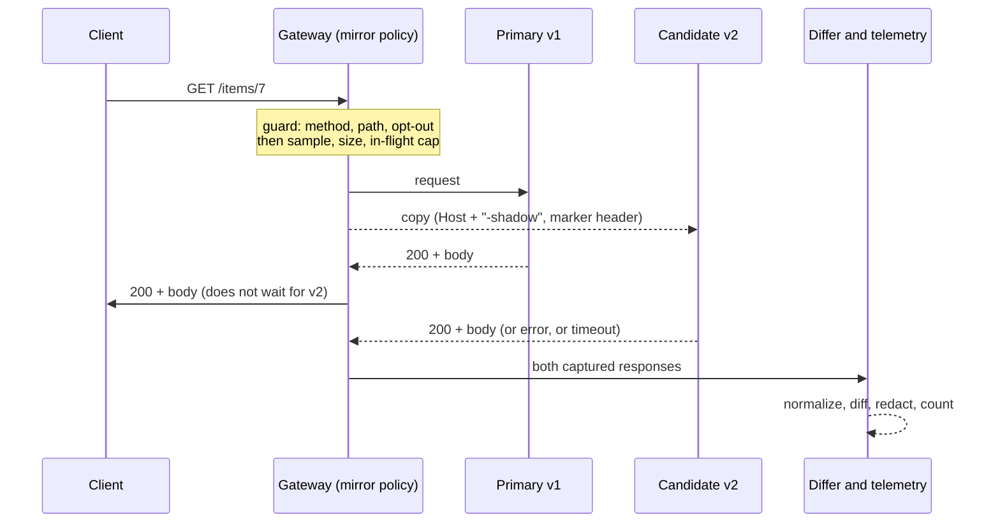

# Risk-Free API Replacements: Request Mirroring (Shadow Traffic), Fire-and-Forget Response Diffing, and Mutation Safety Guards

> [!summary] Claim
> Mirroring lets a gateway test a replacement API on real traffic without changing what any client sees, but only if the copy is detached from the primary's latency and failure, restricted to requests whose duplicate execution is harmless, and compared after normalizing the noise that two correct implementations still disagree on.

Part of [API Gateways Proxies and Edge Architecture](README.md) in [API Engineering](../README.md).

## TL;DR

- Mechanism: the proxy sends the client's request to the primary and, in the background, a copy to a candidate; the candidate's response is read only to be counted or diffed, never returned (Envoy `RequestMirrorPolicy`, nginx `mirror`, Istio `mirror`, Gateway API `RequestMirror`).
- Contract: the client's response, status, and latency must be independent of the candidate, so the copy needs its own timeout, concurrency cap, and shed-on-overload rule, and neither an unsafe method (`POST`, `PATCH`) nor a `GET` that mutates may reach a candidate that can write.
- Trap: a mirror is a duplicate request, and RFC 9110 Section 9.2.2 says flatly that "A proxy MUST NOT automatically retry non-idempotent requests" (a rule about retries, applied here by analogy); nginx's `mirror` copies whatever method it gets, so the guard is yours to build.
- Portability: the lab's 38 tests pass on CPython 3.14.6 on macOS arm64 (the other matrix legs were not run); in-process, the mirror task only runs when the event loop is free, which is a different failure mode from Envoy's per-worker async client.
- When not to use it: when the candidate cannot be isolated from production state and side effects (payments, emails, quota decrements), when responses are dominated by time or randomness you cannot normalize, or when a canary on a small tenant slice answers the question with less machinery.

## Mental model



The solid arrows are the critical path: the client gets the primary's answer the moment the primary produces it.
The dashed arrow is the copy, started by the proxy after it has admitted the request through the guard, the sampler, the body-size check, and the in-flight cap.
Whatever happens to the candidate (success, error, timeout, cancellation) ends in the differ and in counters, never on the client connection.
The differ sees a pair of captured responses, so it can only compare what both sides produced for the same request at roughly the same time; state that diverged earlier shows up as noise, not as a code regression.

## How it works

### Vocabulary: shadow, dark launch, canary

Terminology varies by organization; this note uses these meanings.
A dark launch runs new code on production inputs without exposing its output to users, whether by a feature flag that computes both paths or by a separate deployment.
Shadow traffic, or request mirroring, is the proxy-level dark launch: the candidate gets copies of requests and its responses are discarded.
A canary sends real user requests to the candidate and returns its responses, so users feel it; that is the subject of [[Zero-Downtime-Blue-Green-Canary-and-Cell-Based-API-Deployments]].
Shadowing tests behavior without user impact; a canary tests behavior under user impact with a small blast radius; they answer different questions and are usually used in sequence.

### The shared contract across gateways

Every implementation promises the same thing in different words.
Envoy: "The current implementation is 'fire and forget,' meaning Envoy will not wait for the shadow cluster to respond before returning the response from the primary cluster" (Envoy `route_components.proto` docs, `RouteAction.RequestMirrorPolicy`, as of 2026-11).
nginx: the module "implements mirroring of an original request by creating background mirror subrequests", and "Responses to mirror subrequests are ignored" (nginx `ngx_http_mirror_module` docs, introduced in 1.13.4).
Istio: mirrored traffic "is on a best effort basis where the sidecar/gateway will not wait for the mirrored cluster to respond", and the task page adds that the requests are "fire and forget", which "means that the responses are discarded" (Istio `VirtualService` reference and Mirroring task).
Gateway API: responses from the mirror backend "MUST be ignored by the Gateway" (Gateway API HTTP request mirroring guide, Extended support feature `HTTPRouteRequestMirror`), and "Mirrored requests must be sent only to a single destination endpoint within this BackendRef" (`HTTPRequestMirrorFilter.BackendRef`, `apis/v1/httproute_types.go`).
None of them promises that the copy is identical, only that it is sent; the rest of this note is about what you must add so the property holds under failure.

### Envoy: the router filter forks the request

In Envoy the fork happens inside the router filter (envoy `main`, `VERSION.txt` reads `1.41.0-dev`, fetched 2026-11-21; this is the development branch, not a release tag).
The latest release, `v1.40.2` (as of 2026-11), has the same fork, policy order, timeout, `setDiscardResponseBody(true)`, and `-shadow` rewrite in its `router.cc` and `shadow_writer_impl.cc`, but not the per-policy `stat_prefix` counters described in the next section; cluster-level mirror policies are present at `v1.37.0` and absent at `v1.36.0`.
`Filter::continueDecodeHeaders` in `source/common/router/router.cc` runs after the router has picked an upstream host for the primary request, so a request answered locally before that point (no healthy upstream, load shed) is never mirrored.
It evaluates the policies in this order:

1. Method `CONNECT` is never mirrored; the docs say shadowing "doesn't support HTTP CONNECT and upgrades".
2. Cluster-level policies replace route-level ones: `cluster_shadow_policies` if non-empty, else `route_entry_->shadowPolicies()`.
   The API docs say the same for the virtual host and route: "policies are not merged, the most specific non-empty one becomes the mirror policies" (`RouteConfiguration`, `VirtualHost`, and `RouteAction` fields `request_mirror_policies`).
3. For each policy, `FilterUtility::shouldShadow` calls `runtime.snapshot().featureEnabled(policy.runtimeKey(), policy.defaultValue(), stable_random)`, where `stable_random` is `callbacks_->streamId()`; with no `runtime_fraction`, "all requests to the target cluster will be mirrored".
4. The router copies the request headers before `UpstreamRequest::acceptHeadersFromRouter` can change them, so the shadow sees the original headers.
5. If an upstream HTTP filter answered the primary with a local reply (`saw_local_reply_`), the shadow policies are cleared.

For each surviving policy the router builds an `AsyncClient::RequestOptions` with `setTimeout(timeout_.global_timeout_)`, `setIsShadow(true)`, `setDiscardResponseBody(true)`, and a buffer limit computed like the primary's.
The shadow therefore inherits the route timeout, which is 15 s unless configured ("If not specified, the default is 15s", `RouteAction.timeout`), and its response body is thrown away while headers are kept for the 2xx check.
A header-only request goes through `ShadowWriterImpl::shadow` as one complete message.
A request with a body goes through `ShadowWriterImpl::streamingShadow`, and every later `Filter::decodeData` call copies the chunk into each open shadow stream (`Buffer::OwnedImpl copy(data); shadow_stream->sendData(copy, end_stream)`), with trailers delivered by `captureAndSendTrailers`.
Once the last byte is sent, the router removes the destructor callback, so the shadow outlives the primary stream; if the primary is destroyed earlier, `Filter::onDestroy` calls `cancel()` on the open shadow streams, counted as `rq_cancelled`.
`ShadowWriterImpl::getClusterAndPreprocessHeadersAndOptions` rewrites the host through `shadowAppendedHost`, which puts `-shadow` before any `:port` (`cluster1` becomes `cluster1-shadow`), unless `disable_shadow_host_suffix_append` or `host_rewrite_literal` is set.
It also returns early when the shadow cluster has been removed by CDS since the route was built (on `main` it counts `rq_no_cluster`; `v1.40.2` returns without a counter).
A missing `cluster_header` value also skips the shadow, in `Filter::getShadowCluster`.

### Envoy: counting what the candidate did

With `stat_prefix` set on a policy, the router emits `mirror.<stat_prefix>.` counters: `rq_sampled`, `rq_no_cluster`, `rq_started`, `rq_success`, `rq_failure`, `rq_cancelled` (Envoy router filter docs, "Mirror policies" statistics).
This whole section describes Envoy `main` (`1.41.0-dev`), which the `latest` docs on envoyproxy.io are built from; `stat_prefix` is not a field of `RequestMirrorPolicy` in `v1.40.2`, the latest release, and `ShadowRequestContext` does not exist there (as of 2026-11).
`ShadowRequestContext::recordResponse` in `shadow_writer_impl.cc` counts a response as `rq_success` only if its status is 2xx, and everything else, including a transport failure, as `rq_failure`; the destructor adds `rq_cancelled` if no outcome was recorded.
These are absolute health counters for the candidate, not a comparison with the primary: a path that returns `404` on both versions is a "failure" here.
The docs give the reconciliation: `rq_sampled - rq_no_cluster - rq_started` is the number of selected requests an upstream HTTP filter answered locally, and `rq_started - rq_success - rq_failure - rq_cancelled` is the number still in flight.
Policies sharing a `stat_prefix` share counters, "wherever they are configured" (`RequestMirrorPolicy.stat_prefix` docs).

### nginx: a background subrequest

`ngx_http_mirror_module` registers `ngx_http_mirror_handler` in `NGX_HTTP_PRECONTENT_PHASE` (`ngx_http_mirror_init`, `ngx_http_mirror_module.c`).
For each `mirror` directive on the location it calls `ngx_http_subrequest(r, &name[i], &r->args, &sr, NULL, NGX_HTTP_SUBREQUEST_BACKGROUND)`, then sets `sr->header_only = 1`, `sr->method = r->method`, and `sr->method_name = r->method_name` (`ngx_http_mirror_handler_internal`).
There is no method filter in the module: every method that reaches the location is mirrored, so a `POST` creates a mirrored `POST`.
`mirror_request_body` defaults to `on` (`ngx_http_mirror_merge_loc_conf`), and when on, the handler calls `ngx_http_read_client_request_body` first; the docs warn this disables unbuffered request-body proxying (`proxy_request_buffering off` and its `fastcgi`, `scgi`, `uwsgi` siblings) for that location.
Background subrequests skip the postponed-output list (`if (!sr->background)` in `ngx_http_subrequest`, `ngx_http_core_module.c`), so their output never blocks the main response.
They do hold a reference on the main request, though: `ngx_http_subrequest` increments `r->main->count`, and `ngx_http_finalize_connection` in `ngx_http_request.c` only reaches the keep-alive path when `r->main->count == 1`; with a larger count it calls `ngx_http_close_request` and returns.
`ngx_http_close_request` decrements the count and frees the main request only at zero, and the main request's access log entry is written in `ngx_http_free_request` (`if (!r->logged) { ngx_http_log_request(r); }`).
When a background subrequest finishes, `ngx_http_finalize_request` calls `ngx_http_finalize_connection` on it (`if (r->background)`), and that is the call that brings the count back to 1 or 0.
So the client has its response, but a slow mirror backend delays the primary request's access log line and connection reuse until the mirror subrequest ends, bounded by the mirror location's proxy timeouts.
This is read from `ngx_http_core_module.c`, `ngx_http_request.c` on nginx `master` (fetched 2026-11-21); no live nginx was run here, so treat the timing consequence as source-derived, not measured.

### Istio and Gateway API: declarative wrappers

Istio's `VirtualService` has `mirror` (single destination) and `mirrors` (a list of `HTTPMirrorPolicy`), with `mirrorPercentage` ("If this field is absent, all the traffic (100%) will be mirrored. Max value is 100") and per-policy `percentage`; the data plane is Envoy, so the `-shadow` suffix on `Host` and the "statistics will be generated for the mirrored destination" statement follow from the router behavior above.
Gateway API's `HTTPRequestMirrorFilter` has `backendRef` plus `percent` (0 to 100) or `fraction`, "Only one of Fraction or Percent may be specified. If neither field is specified, 100% of requests will be mirrored" (`httproute_types.go`).
Both are configuration surfaces; they inherit the mechanism, and its limits, from the proxy that implements them.

### The comparison layer: what a gateway does not give you

Envoy, nginx, Istio, and Gateway API only fork traffic; none compares responses.
Comparison comes from a separate system: Twitter's Diffy multicasts each request to a candidate, a primary, and a secondary instance of the known-good code, and subtracts the primary-versus-secondary disagreement (non-determinism) from the primary-versus-candidate disagreement (Diffy README; the repository is archived and the original author maintains `opendiffy/diffy`).
GitHub's Scientist does the same inside one process, running a control and a candidate block, comparing values, and publishing results; its README is blunt that "it's impossible to guarantee that it will run every time. For this reason, Scientist is only safe for wrapping methods that aren't changing data", that the blocks "run sequentially in random order", and that it "does not protect you from timeouts" (Scientist README).
The lab implements the in-process variant at the ASGI layer so the mechanism is visible: a mutation guard, a sampler, a bounded fork, a capture, a structural JSON diff with noise controls, and redacted telemetry.

### Lab: the admission order

The middleware decides in a fixed order, and the order is the design.
The guard comes before the sampler so a skipped unsafe method is counted as `method`, not as `sample`, and the cheap checks come before the body is buffered (simplified excerpt of `ShadowTraffic._skip_reason`, `shadow_traffic.py`):

```python
def _skip_reason(self, scope, headers, request_id):
    policy = self.policy
    if scope["method"] not in policy.methods:
        return Skip.METHOD
    if scope["path"].startswith(policy.deny_path_prefixes):
        return Skip.PATH
    if policy.opt_out_header in headers:
        return Skip.OPT_OUT
    if not is_sampled(request_id, policy.numerator, policy.denominator):
        return Skip.SAMPLE
    # declared content-length > policy.max_body_bytes -> Skip.BODY_TOO_LARGE
    if self._in_flight >= policy.max_in_flight:
        return Skip.OVERLOAD
    return None
```

The sampler maps a request id to a stable bucket with `int.from_bytes(sha256(id)[:8], "big") % denominator` and admits ids whose bucket is below the numerator.
Because the admitted set is `bucket < numerator`, raising the fraction from 10% to 50% only adds ids; a user who was mirrored stays mirrored, and the candidate's per-request-id history stays coherent (the test `test_sampling_is_deterministic_and_raising_the_fraction_only_adds_ids`).
Envoy derives the same kind of stable draw from the stream id passed to `featureEnabled`; sampling by a user or tenant key instead of a request id keeps a user's whole request sequence together, at the cost of a lumpier load on the candidate.

### Lab: the fork, the capture, and the timeout

An admitted request has its body buffered up to `max_body_bytes` (nginx's `mirror_request_body on` has the same cost), then replayed to both sides; if the body overruns the cap or the client disconnects while buffering, the request is skipped as `body_too_large` and the primary still receives every buffered byte followed by the rest of the stream (`_buffer_body`, `_replay`).
The primary's `send` is wrapped so each message is forwarded first and observed second, which keeps the client's bytes ahead of any bookkeeping.
The candidate runs in an `asyncio` task held in a set, because "The event loop only keeps weak references to tasks. A task that isn't referenced elsewhere may get garbage collected at any time, even before it's done" (Python `asyncio` task documentation, `create_task`).
Simplified excerpt of the fork in `ShadowTraffic.__call__`:

```python
self._in_flight += 1
self.telemetry.started += 1
task = asyncio.create_task(
    self._shadow(request_id, scope, messages, primary_done), name=f"shadow-{request_id}"
)
self._tasks.add(task)
task.add_done_callback(self._tasks.discard)
try:
    await self.app(scope, receive, capturing_send)
finally:
    if not primary_done.done():  # a cancelled shadow task cancels the future it awaits
        primary_done.set_result(primary)
```

The candidate task runs the candidate ASGI app against a copied scope with `asyncio.timeout(timeout_s)`, releases its in-flight slot as soon as the candidate stage ends, then awaits the primary's captured response and compares.
Its `receive` replays the recorded request messages and then blocks until the candidate completes its response, at which point it returns `http.disconnect`; that is a lab choice, so an app that waits for a disconnect can finish (see [[ASGI-HTTP-and-Disconnect-Event-Lifecycle]]).
Every exit is classified: `match`, `mismatch`, `not_comparable` (truncated or incomplete capture), `candidate_error`, `candidate_timeout`, `cancelled`, and `diff_error` for a bug in the differ itself, so a failing comparator never masquerades as a candidate failure.
`drain(grace_s)` waits for the tasks, then cancels and awaits the stragglers; it is the shutdown hook that keeps the task set from outliving the process's lifespan (see [[ASGI-Lifespan-Protocol-Startup-Shutdown-and-Scope-State]]).

### Lab: what the candidate sees

`build_shadow_scope` copies the scope and rewrites headers: `Host` gets the suffix (`api.example:8080` becomes `api.example-shadow:8080`; an IPv6 literal is left alone, a lab choice), headers named in `drop_headers` are removed, and a lab-defined marker header `x-shadow-request: 1` is added.
The marker is not a standard header; Envoy marks shadows only by the `Host` suffix and the `is_shadow` option on its internal client.
The middleware also strips a client-supplied marker from the primary's scope, so an outside caller cannot pose as shadow traffic.
`RefuseShadowWrites` wraps the candidate and answers `403` to any marked request whose method is not `GET`, `HEAD`, or `OPTIONS`, so a policy that opts `POST` into mirroring still cannot write through a candidate that carries this guard.

### Lab: the differ

`diff_json` walks two parsed values and reports a `Diff(path, kind, primary, candidate)` per difference, with RFC 6901 style paths (`/items/0/price`, `~1` for a literal `/` in a key).
The kinds are `changed`, `type` (so `true` versus `1` and `null` versus `0` are reported, not coerced), `missing_in_candidate`, `extra_in_candidate`, and `length`; `status`, `header`, `bytes`, and `invalid_json` come from `compare_responses`, which also compares `Content-Type` by default.
Noise is handled three ways: `ignore_paths` patterns where `*` matches exactly one path segment (so `/items/*/updated_at` does not hide `/items/0/meta/updated_at`), `float_tolerance` for numeric jitter, and `noise_paths(run_a, run_b)`, which returns the paths that differ between two runs of the same known-good version, the Diffy idea in one function.
Lists are compared by index, so a candidate that returns the same set in a different order is reported as many `changed` diffs; unordered comparison is a gap in the lab, and a real differ needs a per-path key or sort rule.

### Lab: telemetry that is safe to ship

`ShadowTelemetry` keeps counters for every request (`started`, `skipped[reason]`, `outcomes[outcome]`) and a bounded `deque` of records for non-matching outcomes only.
Each recorded difference carries the path, the kind, and an HMAC-SHA256 digest (first 12 hex characters) of each value under a per-instance random key, not the raw values.
Equal values under one key give equal digests, so an engineer can tell that the primary and candidate agree on a field across records without the log pipeline ever holding the field.
A bare unkeyed hash of a low-entropy value such as a status code or a boolean can be reversed by trying every candidate, which is why the digest is keyed.

## Numbers and limits

| Quantity | Value | Source or measurement |
| --- | --- | --- |
| Envoy shadow request timeout | The route's global timeout, `setTimeout(timeout_.global_timeout_)` | envoy `main` (1.41.0-dev) `source/common/router/router.cc`, `Filter::continueDecodeHeaders` |
| Envoy route timeout default | 15 s; `0` disables it | Envoy `RouteAction.timeout` docs (as of 2026-11) |
| Envoy shadow response body | Discarded (`setDiscardResponseBody(true)`); success means a 2xx status | `router.cc`; `shadow_writer_impl.cc`, `ShadowRequestContext::recordResponse` |
| Envoy mirror fraction default | All requests when `runtime_fraction` is unset | Envoy `RequestMirrorPolicy.runtime_fraction` docs |
| Envoy mirror counters | `rq_sampled`, `rq_no_cluster`, `rq_started`, `rq_success`, `rq_failure`, `rq_cancelled` under `mirror.<stat_prefix>.`; `main` only, not in `v1.40.2` | Envoy router filter docs (`latest` = `1.41.0-dev`); `v1.40.2` `route_components.proto` has no `stat_prefix` |
| Envoy unsupported | `CONNECT` and upgrades are never mirrored | Envoy `RequestMirrorPolicy` docs; the `router.cc` method check covers `CONNECT` only |
| nginx module introduced | 1.13.4; `mirror_request_body` default `on` | nginx `ngx_http_mirror_module` docs; `ngx_http_mirror_merge_loc_conf` |
| Istio `mirrorPercentage` | Absent means 100%; maximum 100 | Istio `VirtualService` reference |
| Gateway API mirror `percent` | 0 to 100, or `fraction`, only one of them | `httproute_types.go`, `HTTPRequestMirrorFilter` |
| Lab defaults (not recommendations) | `max_in_flight=8`, `max_body_bytes=65536`, `max_capture_bytes=1048576`, `timeout_s=2.0` | `shadow_traffic.py`, `MirrorPolicy` |
| Lab test run | 38 passed in 1.15 s (wall time varies run to run) | `uv run --frozen pytest ... -q` from `labs/`, CPython 3.14.6, macOS 27.3 arm64 (`uname -r` = `27.3.0`), re-run 2026-11-21 by the fact-checker |
| Lab starvation probe | 40 sequential requests at 1/2 sampling with the default cap of 8 and no `drain()` between them: 16 skipped as `sample`, 16 as `overload`, 8 started, 8 `match` | throwaway script, `uv run --frozen python probe.py` from `labs/`, CPython 3.14.6, same machine; reproduced byte for byte 2026-11-21, output below |
| Zero-mismatch evidence | With zero mismatches in `n` independent trials, the 95% upper bound on the mismatch rate is about `3 / n` | derivation: `(1 - p)^n = 0.05` gives `n` near `3 / p`; not measured |

The starvation probe, captured from a throwaway script (deleted) that drove `ShadowTraffic` through `httpx.ASGITransport` 40 times and then called `drain()`:

```text
Counter({<Skip.SAMPLE: 'sample'>: 16, <Skip.OVERLOAD: 'overload'>: 16}) 8 Counter({<Outcome.MATCH: 'match'>: 8}) 8
```

The fields are `telemetry.skipped`, `telemetry.started`, `telemetry.outcomes`, and the number of requests the candidate saw.
Sequential in-process calls with no real I/O never yield to the loop, so the candidate tasks queued until `drain()`, and the in-flight cap shed the 16 sampled requests that arrived after the first 8.
That is the cap working, and it is also a warning: a mirror that lives on the primary's event loop only makes progress when the primary lets it.

## Portability

| Dimension | Behavior | Evidence |
| --- | --- | --- |
| CPython `3.14.6` on macOS 27.3 arm64 | 38 passed | lab, workspace `.venv`, `uv run --frozen pytest ... -q` (the matrix's `3.14.10` was not run) |
| CPython `3.12`, `3.13`, `3.15`, `3.15t` | Not run | the brief for this note paused the multi-version matrix; the lab uses only `asyncio.timeout` (3.11+), `StrEnum`, and slotted dataclasses, which exist on 3.12, but that is a reading, not a run |
| Free-threaded CPython | Not run on `3.15.2t`; the middleware keeps state in plain attributes mutated only on one event loop thread, which is a reading of the code, not a run | none |
| `starlette 1.10.0`, `httpx 0.28.1` | The tests use `Request`, `JSONResponse`, `PlainTextResponse`, and `httpx.ASGITransport` | lab, pinned in `labs/pyproject.toml` |
| Uvicorn, Hypercorn, Granian | Not run; the middleware is pure ASGI 3 and the tests drive it in-process, so server framing is not exercised | none |
| Envoy | `RequestMirrorPolicy` per route, virtual host, or cluster; `-shadow` Host suffix; no `CONNECT` or upgrade mirroring | Envoy docs and `router.cc` on `main` (`1.41.0-dev`) and `v1.40.2`; the fork is the same in both, `stat_prefix` counters are `main` only, cluster-level policies exist from `v1.37.0` (absent at `v1.36.0`) |
| nginx | `mirror` and `mirror_request_body` since 1.13.4; mirrors every method | nginx docs and `ngx_http_mirror_module.c` (master, fetched 2026-11-21) |
| Istio | `mirror`, `mirrors`, `mirrorPercentage` on `VirtualService` | Istio reference (as of 2026-11) |
| Gateway API | `RequestMirror` filter, Extended support | Gateway API guide and `httproute_types.go` |
| HTTP/1.1, HTTP/2, HTTP/3 | The copy is a new upstream request, so the mirror hop picks its own protocol; the lab does not model it | not run; Envoy's `AsyncClient` upstream protocol selection not read |
| Debian and Alpine containers | Not run | none |

## Worked example

Implementation: [implementation](../labs/src/api_labs/f17_api_gateways_proxies_and_edge_architecture/shadow_traffic.py).
Test: [test](../labs/tests/f17_api_gateways_proxies_and_edge_architecture/test_shadow_traffic_dark_launches_and_request_mirroring_at_the_gateway.py).
The scenario: a v1 service answers `GET /items` from the client, a v2 candidate receives a mirrored copy, and the team wants to know how often v2 disagrees and to be sure that v1's clients never feel v2.

The first test pins the central claim, that the client has its answer while the candidate is still running (simplified excerpt):

```python
gate = asyncio.Event()
candidate = RecordingApp(gate=gate)           # blocks until gate.set()
mirror = ShadowTraffic(RecordingApp(), candidate)

response = await call(mirror)                 # wrapped in asyncio.timeout(5)

assert response.status_code == 200
assert response.json() == PRIMARY_JSON
await asyncio.wait_for(candidate.entered.wait(), 5)
assert mirror.telemetry.started == 1
assert not mirror.telemetry.outcomes          # candidate unfinished, client already served
gate.set()
await mirror.drain()
assert mirror.telemetry.outcomes == {Outcome.MATCH: 1}
```

If the middleware awaited the candidate before sending, `call` would block on the gate and the 5 s timeout would fail the test.
The mutation guard tests show the three layers separately (simplified excerpts):

```python
# 1. method guard: POST is not mirrored at all
assert (primary.writes, candidate.calls, candidate.writes) == (1, 0, 0)
assert mirror.telemetry.skipped == {Skip.METHOD: 1}

# 2. a GET with side effects is mirrored unless the path is denied
assert open_candidate.side_effects == 1
assert guarded_candidate.side_effects == 0

# 3. opt-in POST reaches the candidate; the candidate-side guard stops the write
assert (primary.writes, inner.calls, inner.writes) == (1, 0, 0)
assert record.diffs[0].kind is DiffKind.STATUS    # primary 201, candidate 403
```

Layer 2 is the honest one: a method allow-list cannot know that `GET /admin/purge` mutates, which is the case RFC 9110 Section 9.2.1 warns about (`page?do=delete`), so a path deny-list or a candidate that cannot reach production state has to cover it.
The differ tests pin the noise rules: `*` matches one segment, tolerance absorbs `1.0` versus `1.004`, a type change is not coerced, and two runs of the primary define a noise set that is then excluded from the candidate comparison.
The telemetry tests check that a record holds paths, kinds, and digests but never the raw `EXAMPLE-SECRET` strings, and that the record buffer is bounded while counters keep counting.

Captured run, from `labs/`, on CPython 3.14.6 (`3.14.6 (main, Jun 23 2026, 15:46:31) [Clang 22.1.3 ]`), macOS-27.3-arm64-arm-64bit-Mach-O:

```text
$ uv run --frozen pytest tests/f17_api_gateways_proxies_and_edge_architecture/test_shadow_traffic_dark_launches_and_request_mirroring_at_the_gateway.py -q
......................................                                   [100%]
38 passed in 1.15s
```

Static checks on the two lab files, run once by the fact-checker: `ruff format --check` ("2 files already formatted"), `ruff check` ("All checks passed!"), `mypy` ("Success: no issues found in 2 source files"), and `pyright` ("0 errors, 0 warnings, 0 informations").
A workspace-wide `ruff` and `mypy` run also reports problems in other notes' f10 and f12 files; none are in the f17 files.

## Pitfalls

> [!warning] A mirrored write is a duplicated write
> Trigger: a mirror configured on a location that also receives `POST`, `PUT`, `PATCH`, or `DELETE`, with a candidate that can reach a real datastore or real side-effect sinks.
> Symptom: duplicate orders, double emails or webhooks, doubled counters, rows created in the shared database by the candidate, and a candidate that "works" because it is really exercising production state.
> Fix: allow-list safe methods at the mirror (the lab's `methods`), give the candidate its own datastore and stubbed outbound sinks, and add a candidate-side refusal keyed on a marker (`RefuseShadowWrites`).
> Evidence: RFC 9110 Section 9.2.2 ("A proxy MUST NOT automatically retry non-idempotent requests"; that sentence is about retries, and I apply it to mirrors by analogy because a mirror is also a proxy-originated duplicate), and nginx's module copying `r->method` into the subrequest with no filter (`ngx_http_mirror_handler_internal`).

> [!warning] A safe method is not a harmless one
> Trigger: mirroring `GET` because it is "read-only".
> Symptom: the candidate's `GET` charges an advertiser, decrements a quota, warms or poisons a cache, sends a read receipt, or runs an action selected by a query parameter.
> Fix: deny-list known mutating paths, make the candidate's outbound clients honor the shadow marker, and exclude shadow requests from rate limits and quotas.
> Evidence: RFC 9110 Section 9.2.1 says a safe method may still have side effects the client did not request, citing log files and "a safe request initiated by selecting an advertisement on the Web will often have the side effect of charging an advertising account", and warns about `page?do=delete`; the lab test `test_a_get_with_side_effects_is_mirrored_unless_the_path_is_denied` shows the method guard letting it through.

> [!warning] The candidate holds primary resources
> Trigger: a slow or hung candidate.
> Symptom: in Envoy, a shadow stream lives up to the route timeout (15 s by default) and counts against the shadow cluster's connections; in nginx, by source reading, the main request's logging and keep-alive are deferred until the background subrequest ends; in an in-process mirror, tasks pile up and consume memory and loop time.
> Fix: give the shadow its own short timeout (the lab's `timeout_s`), cap in-flight shadows and shed instead of queueing (`max_in_flight`), and track the unfinished count (`mirror.<stat_prefix>.rq_started` minus the outcome counters in Envoy `main`; `v1.40.2` has no per-policy mirror counters).
> Evidence: `router.cc` `setTimeout(timeout_.global_timeout_)`; `ngx_http_subrequest` `r->main->count++` and `ngx_http_finalize_connection`; the lab starvation probe above.

> [!warning] The in-process mirror starves behind the primary
> Trigger: running the shadow on the primary's event loop under CPU-bound or non-yielding primary handlers.
> Symptom: the candidate tasks run late or in bursts, the in-flight cap sheds most of the sample, and results arrive after the data they compared has moved.
> Fix: for real programs mirror at the proxy (a separate process and async client), or give the shadow its own worker or process; keep the in-process form for tests and low-volume admin APIs.
> Evidence: the lab probe (16 of 40 requests shed as `overload` with the default cap of 8).

> [!warning] Divergent state looks like regression
> Trigger: mirroring reads to a candidate whose datastore does not receive the primary's writes (writes are not mirrored), or comparing two reads taken at different moments.
> Symptom: a steady mismatch rate on `GET /orders/42` right after a `POST` the candidate never saw, and diffs that change when you re-run the same request.
> Fix: feed the candidate from a replica or change stream of production state, compare only resources that are immutable over the window, learn noise with a second known-good instance, or use a copy-on-write fork of the data.
> Evidence: Scientist's README warns that blocks run in random order and "any data upon which your code depends may change before the second block is invoked"; Diffy's primary versus secondary comparison exists for non-determinism.

> [!warning] Credentials and PII leak through the copy and the diff log
> Trigger: forwarding `Authorization` and `Cookie` to a candidate owned by another team or running outside the production trust boundary, and logging raw response values on mismatch.
> Symptom: production tokens in staging logs, personal data in the mismatch store, and a candidate able to act as the user.
> Fix: forward only what the comparison needs (`drop_headers`), use a candidate trust boundary equal to production's, mint candidate-scoped tokens where the contract allows, and redact values in telemetry (the lab's keyed digests).
> Evidence: Envoy copies the request headers wholesale to the shadow and offers `request_headers_mutations` and `host_rewrite_literal` to change them (`RequestMirrorPolicy`); the lab tests `test_candidate_gets_shadow_host_marker_and_dropped_headers` and `test_mismatch_records_paths_and_kinds_but_never_raw_values`.
> See [[Structured-Log-Redaction-and-Preventing-PII-and-Token-Leaks]].

> [!warning] Policy precedence silently drops a mirror
> Trigger: adding a mirror policy on a more specific Envoy level (route over virtual host, cluster over route).
> Symptom: the broader mirror stops, because the most specific non-empty set replaces the rest and nothing is merged; counters under the old `stat_prefix` go flat (on Envoy `main`; on `v1.40.2` only the shadow cluster's own upstream stats show it).
> Fix: repeat every intended policy at the most specific level, alert on a flat `rq_sampled` (or the shadow cluster's request rate on releases without `stat_prefix`), and keep one `stat_prefix` per intent.
> Evidence: the `request_mirror_policies` field docs on `VirtualHost` and `RouteAction`, and `Filter::continueDecodeHeaders` preferring `cluster_->httpProtocolOptions().shadowPolicies()` when non-empty.

> [!warning] Shadow traffic pollutes your SLOs and your capacity plan
> Trigger: shadow requests counted in the same dashboards as real ones, and a 100% mirror sized as if free.
> Symptom: error-budget burn from candidate failures nobody can see, a candidate cluster saturated by a full copy, and load tests that are really production mirrors.
> Fix: tag and exclude shadow traffic (the `-shadow` Host suffix, the marker header), alert on the shadow's own counters, and size the candidate for the sampled fraction times peak.
> Evidence: Envoy's docs state that "All normal statistics are collected for the shadow cluster".
> See [[RED-and-USE-Metrics-and-OpenTelemetry-HTTP-Semantic-Conventions]].

> [!warning] A spoofable marker header
> Trigger: a candidate or a log pipeline that trusts `x-shadow-request` (or any marker) from the network.
> Symptom: an external client sets the marker on production requests to hide from metrics, or omits it on a request that reaches a candidate directly and writes.
> Fix: the gateway strips the marker on ingress and sets it itself (the lab does both), and the candidate's write guard sits at the candidate's own edge with network policy as the real boundary.
> Evidence: lab test `test_candidate_gets_shadow_host_marker_and_dropped_headers`.

## Security and robustness

Threat model: the candidate is code you have not trusted with production yet, and it receives production requests.
Treat it as an untrusted downstream that must not hold more authority than the primary, and assume it will eventually crash, hang, or return garbage.

- Boundary enforcement: the mirror is a proxy-originated request, so SSRF-style reasoning applies; the target is fixed configuration, never a header-derived value, with the exception of Envoy's `cluster_header` option, where the value comes from a request header and so must be set by the gateway, not the client (see [[Preventing-SSRF-API7-2023-DNS-Pinning-and-Private-CIDR-Socket-Guards]]).
- Authorization: the candidate must re-authorize with the caller's identity; a mirror that strips credentials produces `401` noise, a mirror that forwards them gives the candidate the user's authority, so choose per API and document it (see [[Where-Authorization-Lives-Gateway-Middleware-vs-Domain-and-Query-Layer]]).
- OWASP API Security 2023: API4 (unrestricted resource consumption) is the mirror's own risk, since a copy doubles upstream load and a slow candidate holds resources, hence the in-flight cap, the timeout, and the body-size cap; API10 (unsafe consumption of APIs) applies when the candidate calls third parties, where a mirrored request must not trigger real third-party calls (see [[Unrestricted-Resource-Consumption-API4-2023-Payload-Depth-and-Limit-Guards]]).
- Data minimization: log the diff path and kind, not the values; keyed digests let you correlate equality without storing data, and the record buffer is bounded so a bad candidate cannot fill memory with diffs.
- Failure isolation: every candidate error path ends in a counter (`candidate_error`, `candidate_timeout`, `cancelled`, `diff_error`) and never in the client response; a test asserts a candidate exception and a primary exception each behave as designed (`test_candidate_exception_does_not_reach_the_client`, `test_primary_exception_propagates_and_shadow_is_not_comparable`).
- Idempotent writes: mirroring a `PUT` to an isolated store is defensible because repeating it has the same intended effect (RFC 9110 Section 9.2.2); that holds only when the candidate's effects are confined, which the method alone does not prove.
- Kill switch: the mirror must be switchable to 0% without a deploy, through a runtime fraction (Envoy `runtime_fraction`) or flag (see [[Feature-Flags-Dynamic-Configuration-and-Safe-Kill-Switches-in-APIs]]).
- Overload: mirror traffic is the first thing to shed, ahead of any real request (see [[Load-Shedding-Priority-Traffic-Classes-and-LIFO-Queue-Management]]).

## The principal's view

The decision is whether shadow traffic is the right instrument for the migration at hand, and what the organization must own to use it safely.
Shadow traffic answers "does v2 behave like v1 on real inputs", which synthetic tests cannot, and it costs a duplicated read path, a candidate environment with isolated state, and a comparison pipeline that someone maintains.
It does not answer "do users like v2" or "does v2 hold at 100% load" (that is a canary and load question, see [[Zero-Downtime-Blue-Green-Canary-and-Cell-Based-API-Deployments]]), and it cannot prove a write path correct without a write-safe candidate.
The usual sequence for a replacement is: contract and unit tests, shadow reads at a small fraction with noise learning, shadow writes into an isolated store with idempotency keys if the writes matter, a canary on an internal tenant, then a ramp, with the mirror kept at a low fraction after cutover to watch for regressions.
Organizationally, assign one owner for the shadow marker contract (every service that calls out must honor it), one for the diff rules per API (normalizers are API-specific knowledge), and one for the cost of the candidate environment.
Choose a different tool when the change is a pure refactor with strong property tests (skip the mirror), when state makes comparison meaningless (use a canary with fast rollback), when the traffic is gRPC streams or upgrades the proxy cannot mirror (Envoy lists `CONNECT` and upgrades as unsupported), or when the payload is regulated and the candidate cannot sit inside the same compliance boundary.
Mirror at the gateway when many services share it and the candidate is a separate deployment; mirror in-process (Scientist style) when the comparison is between two code paths inside one service and the unit is a function.
The exit criterion is statistical and written down before the run: a noise floor measured with a second known-good instance, a per-path mismatch budget, and a sample size that justifies it (zero mismatches in 3,000 independent samples bounds the true rate near 0.1% at 95% confidence by the rule of three; it says nothing about request classes you did not see).

## Interview questions

> [!question] L5: What does "fire and forget" mean for a mirrored request, and what must stay true for the client?
>
> > [!success]- Answer
> > The proxy sends a copy of the request to the candidate, does not wait for its response before answering the client, and discards the candidate's response (Envoy `RequestMirrorPolicy`, nginx `ngx_http_mirror_module`, Istio `VirtualService`).
> > The client's status, body, and latency must be independent of the candidate: its errors, timeouts, and slowness never surface.
> > That independence is not free; it needs a separate timeout, a concurrency cap, and shedding when the candidate cannot keep up.
> >
> > Follow-up: In Envoy, which timeout does the shadow request inherit, and what is its default?

> [!question] L5: Why do mirrors usually allow only `GET`, `HEAD`, and `OPTIONS`, and why is that still not enough?
>
> > [!success]- Answer
> > A mirror duplicates the request, and duplicating a `POST` or `PATCH` can duplicate its effect, which RFC 9110 Section 9.2.2 warns about for automatic retries.
> > Safe methods are defined as not requesting a state change, but the RFC says a safe method can still have side effects the client did not request (RFC 9110 Section 9.2.1), such as charging an ad account.
> > A `GET` that mutates (`?do=delete`) or that decrements a quota passes any method allow-list, so you also need a path deny-list and a candidate that cannot reach production side effects.
> >
> > Follow-up: What is the extra layer the lab adds so an opted-in `POST` still cannot write?

> [!question] L5: What do `rq_success` and `rq_failure` in Envoy's `mirror.<stat_prefix>.` counters tell you, and what do they not?
>
> > [!success]- Answer
> > `rq_success` counts mirror requests that got a 2xx and `rq_failure` counts non-2xx or failed ones (`ShadowRequestContext::recordResponse`), so they measure the candidate's absolute health.
> > These counters exist on Envoy `main` (`1.41.0-dev`), not in `v1.40.2`, the latest release (as of 2026-11).
> > They do not compare it with the primary: a path that returns `404` on both is a "failure" here, and a `200` with a wrong body is a "success".
> > Response comparison needs a separate diffing system, as Diffy provides.
> >
> > Follow-up: How do you compute the number of mirror requests still in flight from the counters?

> [!question] L6: Predict the output: 40 sequential requests go through the lab middleware with `numerator=1`, `denominator=2`, `max_in_flight=8` (the default), no `drain()` between them, and a candidate that never blocks, so what are `skipped`, `started`, and `outcomes` after a final `drain()`?
>
> > [!success]- Answer
> > The captured run printed `Counter({<Skip.SAMPLE: 'sample'>: 16, <Skip.OVERLOAD: 'overload'>: 16}) 8 Counter({<Outcome.MATCH: 'match'>: 8}) 8`.
> > Sampling admitted 24 of the 40 ids; the first 8 started and the remaining 16 were shed as `overload` because the candidate tasks had not yet run.
> > In-process calls through `httpx.ASGITransport` contain no real I/O, so the loop never switched to the candidate tasks until `drain()`; the shed count depends on that scheduling, not on candidate speed.
> > The 16 `sample` skips are fixed by the hash of the ids `req-0` to `req-39`.
> >
> > Follow-up: What does this say about running the shadow on the primary's event loop in production?

> [!question] L6: Debug this API: a team puts `mirror /mirror;` on `location /api/ { proxy_pass http://prod; }` with `location = /mirror { internal; proxy_pass http://staging$request_uri; }` and staging soon contains duplicate customer rows, so what is wrong and how do you fix it?
>
> > [!success]- Answer
> > The nginx module has no method filter: the handler creates a background subrequest per `mirror` directive and copies the original method into it (`ngx_http_mirror_handler_internal`), so every `POST` to `/api/` is replayed against staging with its body (`mirror_request_body` defaults to `on`).
> > Fix by mirroring only a location that serves safe reads, or by refusing non-safe methods in the mirror location (for example an `if ($request_method !~ ^(GET|HEAD)$) { return 204; }` inside `location = /mirror`; `$request_method` reads the main request's method in `ngx_http_variable_request_method`, so it sees the original method inside the subrequest, but I did not run this nginx configuration here, so test it).
> > Also point staging at an isolated datastore and stubbed side-effect sinks, since a mutating `GET` would still pass.
> >
> > Follow-up: What does `mirror_request_body on` cost you, and what does `off` change for the staging side?

> [!question] L6: How do you stop `updated_at`, `request_id`, and tag-list order, on which two correct implementations of `GET /items` still differ, from flooding the mismatch log without hiding real regressions?
>
> > [!success]- Answer
> > Learn the noise instead of guessing it: run a second known-good instance, diff primary against secondary, and subtract those paths from the candidate diff, which is Diffy's design and the lab's `noise_paths`.
> > Add explicit `ignore_paths` where you know the cause, scoped to one path segment so `/items/*/updated_at` does not hide `/items/0/meta/updated_at`.
> > For order, add a per-path sort or key rule, because index-wise list comparison, which the lab uses, reports a reordering as many changes.
> > Keep a baseline of the noise rate and alert on the candidate's rate exceeding it, not on any non-zero diff.
> >
> > Follow-up: Why does the lab store keyed digests of differing values instead of the values?

> [!question] L7+: Design the program for a team that wants to shadow a payment-creating `POST /charges` before replacing the service.
>
> > [!success]- Answer
> > Do not mirror to a candidate that can reach the real processor or the real ledger; the duplicate is a real charge, and no method guard fixes that.
> > Run the candidate against an isolated store and a stubbed processor, require the shadow marker on every outbound call, and refuse real third-party calls when it is present.
> > Send each mirrored `POST` with the primary's `Idempotency-Key` plus a shadow namespace so replays are deduplicated (see [[Idempotency-Key-Header-Specification-and-State-Machine-Draft-08]]), and compare the candidate's decision (amount, currency, fee, status) against the primary's recorded outcome from the audit log, not the processor's live response.
> > Start with reads and with a replay of recorded traffic, then forward a low sampled fraction keyed by tenant, and exit on a written mismatch budget and sample size.
> >
> > Follow-up: What would make you abandon the shadow and use a canary on an internal tenant instead?

> [!question] L7+: The candidate shows a 0.4% mismatch rate on `GET /orders/{id}` that disappears when you replay the same requests an hour later, so what is the likely cause and how do you separate it from a regression?
>
> > [!success]- Answer
> > The comparison is not time-consistent: the primary and candidate read at different moments, or the candidate's data lags the primary's writes (the candidate never receives them), so the diffs are state drift, not code differences.
> > Check whether mismatches cluster on recently written resources, compare only records older than the replication lag, feed the candidate from the same change stream, and use a secondary primary instance to measure the baseline.
> > A real regression reproduces on a replay of the same recorded input against both versions at one fixed snapshot; drift does not.
> >
> > Follow-up: How many clean samples do you need to claim the rate is below 0.1% at 95% confidence, and what does that claim not cover?

> [!question] L7+: Why does the old shadow's `rq_sampled` go flat after you add a route-level mirror policy for a new candidate, and how do you prevent it?
>
> > [!success]- Answer
> > Envoy does not merge mirror policies across levels: the most specific non-empty set wins, and cluster-level policies replace route-level ones (`RouteAction.request_mirror_policies`, `VirtualHost.request_mirror_policies`, and `Filter::continueDecodeHeaders`).
> > Adding a policy at the route replaced the virtual host's set, so the old mirror stopped without an error.
> > Declare every intended policy at the level that wins, give each a `stat_prefix` (Envoy `main` only; not in `v1.40.2`), and alert when a policy's `rq_sampled` goes flat while traffic continues.
> >
> > Follow-up: Which Envoy conditions, besides policy replacement, make `rq_sampled` exceed `rq_started`?

## Related

Prerequisites: [[Edge-Caching-and-CDN-Shielding-for-Dynamic-and-Public-APIs]]

Next: [[Zero-Downtime-Blue-Green-Canary-and-Cell-Based-API-Deployments]]

See also: [[API-Gateway-Architecture-Responsibilities-and-Anti-Patterns]], [[Envoy-Proxy-Internals-Listeners-Filter-Chains-HCM-and-Clusters]], [[Proxy-and-Application-Timeout-and-Retry-Interaction-Hazards]], [[Service-Mesh-Architecture-Sidecar-vs-Ambient-Mesh-and-East-West-Policy]], [[Pure-ASGI-Middleware-Onion-Architecture-and-Send-Receive-Wrapping]], [[In-Process-Testing-of-ASGI-Apps-with-HTTPX-ASGITransport]], [[Hedged-Requests-and-Tail-Latency-Taming-at-Scale]], [[Retry-Budgets-and-Preventing-Cascading-Retry-Amplification-Storms]], [[Atomic-Idempotency-Phases-and-Failure-Recovery-Across-Network-Drops]], [[Bulkhead-Isolation-and-Per-Dependency-Resource-Partitioning]], [[Trace-Sampling-Strategies-Head-Based-vs-Tail-Based-Sampling]]

- Lab: `labs/tests/f17_api_gateways_proxies_and_edge_architecture/test_shadow_traffic_dark_launches_and_request_mirroring_at_the_gateway.py`

## Further reading

- [RFC 9110 Section 9.2.1](https://www.rfc-editor.org/rfc/rfc9110.html#section-9.2.1) and [Section 9.2.2](https://www.rfc-editor.org/rfc/rfc9110.html#section-9.2.2): the definitions of safe and idempotent methods and the rule against proxies retrying non-idempotent requests, which bound what a mirror may duplicate.
- [Envoy `RouteAction.RequestMirrorPolicy`](https://www.envoyproxy.io/docs/envoy/latest/api-v3/config/route/v3/route_components.proto): the fields, precedence rules, and the "fire and forget" statement.
- [Envoy router filter statistics](https://www.envoyproxy.io/docs/envoy/latest/configuration/http/http_filters/router_filter): the `mirror.<stat_prefix>.` counters and their reconciliation identities.
- [Envoy `router.cc`](https://github.com/envoyproxy/envoy/blob/main/source/common/router/router.cc) and [`shadow_writer_impl.cc`](https://github.com/envoyproxy/envoy/blob/main/source/common/router/shadow_writer_impl.cc): where the fork, the timeout, the host rewrite, and the success classification actually live.
- [nginx `ngx_http_mirror_module`](https://nginx.org/en/docs/http/ngx_http_mirror_module.html) and its [source](https://github.com/nginx/nginx/blob/master/src/http/modules/ngx_http_mirror_module.c): background subrequests, body buffering, and the absence of a method filter.
- [Istio Mirroring task](https://istio.io/latest/docs/tasks/traffic-management/mirroring/) and the [`VirtualService` reference](https://istio.io/latest/docs/reference/config/networking/virtual-service/): the declarative `mirror`, `mirrors`, and `mirrorPercentage`.
- [Gateway API HTTP request mirroring](https://gateway-api.sigs.k8s.io/guides/http-request-mirroring/): the portable `RequestMirror` filter and its conformance level.
- [Twitter Diffy README](https://github.com/twitter/diffy): the primary, secondary, candidate design that separates noise from regressions.
- [GitHub Scientist README](https://github.com/github/scientist): the in-process counterpart, with its own warnings about writes, timeouts, and data changing between blocks.
- [Python `asyncio` tasks](https://docs.python.org/3/library/asyncio-task.html): why a fire-and-forget task must be referenced, and the semantics of `asyncio.timeout`.
