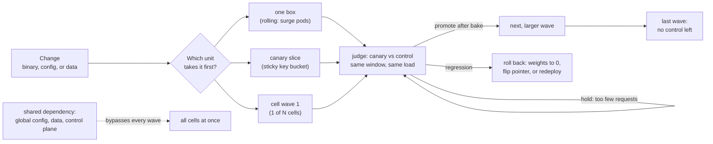

# Deployment Topologies for Critical APIs: Rolling, Blue-Green, Canary Analysis, and Cell-Based Fault Isolation (Blast Radius Containment)

> [!summary] Claim
> A deployment topology is a choice of how much traffic a change touches (its blast radius) and how fast a comparison against an untouched control can stop it: rolling replaces capacity under a surge and availability budget, blue-green swaps whole environments with one pointer flip, a canary exposes a small sticky slice and lets statistics veto the ramp, and cells bound the damage of anything that slips through to `1/N` of tenants, but only for changes that the cells do not share.

Part of [API Gateways Proxies and Edge Architecture](README.md) in [API Engineering](../README.md).

## TL;DR

- Mechanism: a rolling update moves pod counts inside two fenceposts (`maxSurge` rounds up, `maxUnavailable` rounds down), blue-green flips a router pointer between two full environments, a canary routes a sticky bucket of keys to the new version and compares it with a concurrent control, and a cell architecture hashes each tenant to one self-contained cell behind the thinnest possible router (Kubernetes v1.37.2 `ResolveFenceposts`; AWS Well-Architected cell guidance).
- Contract rule: during any rollout two versions serve the same API and the same data at once, so every change must be safe to roll forward and back, which usually means two deployments (prepare, then activate) rather than one (AWS Builders' Library, "Ensuring rollback safety during deployments").
- Trap: staged rollout only protects against what the stage exercises; on 2025-06-12 a Google Cloud binary shipped region by region without ever running its failing path, then a policy row replicated globally in seconds and crashed every region at once (Google Cloud incident report).
- Portability: weighted routing is per-request random in Envoy `weighted_clusters` unless `header_name` or `use_hash_policy` is set, `GOAWAY` has an off-by-one difference between HTTP/2 and HTTP/3, and a rolling update is only as zero-downtime as the pod's drain behavior (Envoy v1.40.2, RFC 9113 Section 6.8, RFC 9114 Section 5.2).
- When not to use it: do not build cells for a service that fits one failure domain and has no tenant-shaped partition key, do not run blue-green where the database cannot serve both versions, and do not canary a change that is a one-way door (a data migration) without an expand step first.

## Mental model



Every strategy is a ladder of exposure with a judge between rungs.
The rungs differ: pods in one fleet for a rolling update, a weighted fraction of requests for a canary, whole environments for blue-green, whole tenants for cells.
The judge needs a control that is untouched and concurrent, which is why a ramp that reaches 100% has nothing to compare against at its last rung and why an ordinary before/after comparison is weak (Google SRE Workbook, "Canarying Releases").
The dotted edge is the lesson of the 2025 outages: a change delivered through a path that all rungs share, such as globally replicated data, skips the ladder entirely.

## How it works

### What actually breaks: binary, configuration, and data

Google's SRE Workbook states that "a majority of incidents are triggered by binary or configuration pushes" (Google SRE Workbook, "Canarying Releases", section "Balancing Release Velocity and Reliability").
Amazon's pipelines therefore deploy configuration and feature flags through their own pipeline with the same safety steps as code, including automatic rollback (AWS Builders' Library, "Automating safe, hands-off deployments", section "Pipeline sources").
The unit of risk is exposure times detection time: with a canary of 5% of traffic serving 20% errors, the fleet sees 1% errors, and "impact on the budget is directly proportional to the amount of traffic exposed to defects" (SRE Workbook, "Minimizing Risk to SLOs and the Error Budget").
That model assumes uniform load and a 100% failure rate in the worst case; the workbook says so and recommends the simplest model that meets the need.

### Rolling update: two fenceposts and an ordering rule

A Deployment with `strategy.type: RollingUpdate` scales the new ReplicaSet up and the old one down within two bounds (Kubernetes Deployment documentation, "Rolling Update Deployment").
`maxUnavailable` is an absolute number or a percentage of desired pods "calculated from percentage by rounding down"; `maxSurge` is calculated "by rounding up"; neither may be 0 when the other is 0; both default to 25% (same section).
The controller resolves them in `ResolveFenceposts` (kubernetes v1.37.2 pkg/controller/deployment/util/deployment_util.go, ResolveFenceposts).
If both resolve to zero, because rounding down turned a small percentage into 0, the function sets `unavailable` to 1 "on the theory that surge might not work due to quota" (same function).
`ResolveFenceposts` itself does not clamp; the caller `MaxUnavailable` caps the result at `replicas` (kubernetes v1.37.2 pkg/controller/deployment/util/deployment_util.go, MaxUnavailable), and the lab's `resolve_fenceposts` folds both steps into one function.
Percentages are scaled with `math.Ceil` or `math.Floor` of `value * total / 100` (kubernetes v1.37.2 staging/src/k8s.io/apimachinery/pkg/util/intstr/intstr.go, GetScaledValueFromIntOrPercent).

The sync loop has a fixed order: scale the new ReplicaSet up if it can, and only if it did not, scale the old ones down (kubernetes v1.37.2 pkg/controller/deployment/rolling.go, rolloutRolling).
Scale-up is capped by `desired + maxSurge` total pods and by `desired` for the new set (kubernetes v1.37.2 pkg/controller/deployment/util/deployment_util.go, NewRSNewReplicas).
Scale-down needs `allPods - minAvailable - newUnavailable > 0` and then removes `availablePods - minAvailable` pods (kubernetes v1.37.2 pkg/controller/deployment/rolling.go, reconcileOldReplicaSets and scaleDownOldReplicaSetsForRollingUpdate).
The `newUnavailable` term is the safety valve: pods of the new version that are not yet available block further old-pod removal, so a crash-looping release stalls instead of eating capacity.
The source comment works the example of 10 replicas, `maxSurge` 3, `maxUnavailable` 2: 13 pods, `minAvailable` 8, and 5 unavailable new pods mean the old set cannot shrink further (reconcileOldReplicaSets, comment).
The lab reproduces that state exactly: `(old, new, available) = (8, 5, 8)`.

Availability is not readiness.
A pod counts as available only after `.spec.minReadySeconds` (default 0) of ready time without a container crash, and `.spec.progressDeadlineSeconds` (default 600) only sets a status condition, `Progressing=False` with reason `ProgressDeadlineExceeded`; "Kubernetes takes no action on a stalled Deployment other than to report a status condition" and higher-level orchestrators can act on it, for example by rolling back (Kubernetes Deployment documentation, "Progress Deadline Seconds" and "Failed Deployment").
Terminating pods are not counted as available, so during a rollout the real pod count can exceed `replicas + maxSurge` until `terminationGracePeriodSeconds` expires (same page, "Rolling Update Deployment" note).
The `Recreate` strategy is the zero-surge limit with downtime: old pods are terminated before any new pod exists (same page, "Recreate Deployment").

A rolling update is not a traffic-control mechanism.
The new version receives traffic in proportion to its ready pod count, you cannot hold at 5% without 20 pods, and there is no judge.
Argo Rollouts' canary without a traffic router has the same limit: it "makes a best effort attempt" and picks the whole replica number with the smallest delta, so 41% of 10 replicas is 4 canary pods (Argo Rollouts documentation, "Canary Deployment Strategy").
Amazon's rolling step replaces at most 33% of a fleet per batch, keeps at least 66% of capacity healthy, and some teams use as little as 5% per batch with 33% batches for fast rollback (AWS Builders' Library, "Automating safe, hands-off deployments", section "One-box and rolling deployments").

The whole fleet is mixed-version during a rolling update.
That window is the real risk: version N+1 may write data N cannot read, or send a heartbeat N misinterprets.
The lab counts it: a default 10-replica rollout has 3 mixed-version syncs out of 6.

### Version skew: two-phase deployment and expand/contract

The most common reason a deployment cannot be rolled back is a protocol change (AWS Builders' Library, "Ensuring rollback safety during deployments", section "Problems with protocol changes").
Amazon's example: a version that starts compressing data on write cannot be rolled back, because the old version does not know to decompress.
A heartbeat period changed from 5 seconds to 10 looks like a one-line change but makes old servers close connections from new ones (same section).
The cure is a two-phase deployment: Prepare (V2 reads both formats, still writes the old one), verify every server has it, then Activate (V3 writes the new format); each phase is individually reversible, but "we can't roll back both changes" (same article, "Two-phase deployment technique" and "Precautions").
The precondition is verifying that all servers completed phase one, not a `minimumHealthyHosts` threshold.
For schemas the same idea is Parallel Change, also called expand and contract: expand the interface to support old and new, migrate callers, then contract (Martin Fowler, "Parallel Change").
Fowler's blue-green note applies it to databases: separate schema changes from application upgrades, first apply a refactoring that supports both versions and check it, deploy the application, and remove the old support after the upgrade "has bedded down" (Martin Fowler, "Blue Green Deployment").

### Blue-green: one pointer, two environments, and the cost of both

Blue-green runs two production environments "as identical as possible"; one is live, the final test happens in the other, and then "you switch the router so that all incoming requests go to the green environment" (Martin Fowler, "Blue Green Deployment").
Rollback is a second flip; the cost is capacity for two environments, and the open problem is state: "missed transactions while the green environment was live" (same page).
Fowler's mitigations are feeding transactions to both environments or running read-only for a while before cut-over.
Argo Rollouts shows the same cost in canary clothes: with traffic routing the stable ReplicaSet stays at 100% so abort is immediate, which means "double the number of replica pods", and `dynamicStableScale` trades that for slower aborts (Argo Rollouts documentation, "Dynamic Stable Scale").

The flip is atomic at the router, not at the connection.
A new request goes to green; a request in flight on blue finishes there; a long-lived connection stays on blue until something closes it.
The lab's `BlueGreenRouter` makes this concrete: after `cut_over()`, an L4-pinned connection still reaches blue while a per-request (L7) decision reaches green, and blue is "drained" only when its in-flight count is zero.
See [[L4-vs-L7-Load-Balancing-for-HTTP-1-1-HTTP-2-and-gRPC]] for why multiplexed connections pin.

Draining a connection is a protocol act, not a timeout:

- HTTP/1.1: send `Connection: close`; a server that sends the `close` option "MUST NOT process any further requests received on that connection", and closing should be staged (half-close, then read until the peer closes) to avoid a TCP reset erasing the last response (RFC 9112 Section 9.6).
- HTTP/2: send `GOAWAY` with a last-stream-id; streams above it "are not or will not be processed" and can be retried on a new connection, while streams at or below it might have been processed and are only retryable if idempotent (RFC 9113 Section 6.8).
- The graceful form is two frames: a server SHOULD first send `GOAWAY` with last stream id `2^31-1` and `NO_ERROR`, and MAY, after at least one round-trip time, send a second with the real last id; endpoints "MUST NOT increase" the id across frames (RFC 9113 Section 6.8).
- HTTP/3 has the same two-step shutdown, but the identifier is the first rejected stream, not the last accepted one: "requests or pushes with the indicated identifier or greater are rejected", and a larger id than before is `H3_ID_ERROR` (RFC 9114 Section 5.2).
- Envoy's `drain_timeout` is the wait between the HTTP/2 shutdown-notification `GOAWAY` (max stream ID) and the final one, default 5000 ms, with `drain_timeout_jitter` to avoid a thundering herd of reconnects (Envoy v1.40.2 http_connection_manager.proto, drain_timeout and drain_timeout_jitter).

The lab's `retryable_streams(opened, last_stream_id)` implements the HTTP/2 reading (strictly greater is retryable); an HTTP/3 reading would use `>=`.
Retrying after a lost connection is only automatic for idempotent methods (RFC 9110 Section 9.2.2), so a drain that drops a `POST` mid-flight is a customer-visible error unless `GOAWAY` told the client the stream was unprocessed.
When a Service has no ready endpoints, Gateway API implementations SHOULD return `503` for that backend (Gateway API v1.6.3 httproute_types.go, HTTPRouteRule.BackendRefs), and `503` with `Retry-After` is the standard signal for a temporary condition (RFC 9110 Section 15.6.4).

A flip also exposes cold state.
The idle environment has empty caches, unwarmed connection pools, and unfilled autoscaler history, so the first minute after a flip is a load test of the cold fleet.
This note gives no typical warm-up magnitude, because it depends on cache sizes, pool settings, and autoscaler policy; measure it per service before relying on an instant flip.

### Canary: a sticky slice, a concurrent control, and a judge

Google defines canarying as "a partial and time-limited deployment of a change in a service and its evaluation", with the part receiving the change being the canary and the rest the control (SRE Workbook, "Canarying Releases", "What Is Canarying?").
Martin Fowler's note adds that canary release is an application of Parallel Change where the migrate phase lasts until all users are routed to the new version, and that A/B testing should not be conflated with it, because A/B tests "can take days" to reach significance while a canary should finish in "minutes or hours" (Martin Fowler, "Canary Release").

**Splitting traffic.**
Three mechanisms differ in granularity:

- Replica ratio: the share of traffic is the share of pods, so granularity is `1/replicas` (Argo Rollouts documentation).
- Weighted routing in the data plane: Gateway API's `weight` is `weight / (sum of all weights in this BackendRefs list)`, "not a percentage", range 0 to 1,000,000, default 1, and 0 means no traffic (Gateway API v1.6.3 shared_types.go, BackendRef.Weight); `backendRefs` is limited to 16 entries (httproute_types.go, HTTPRouteRule.BackendRefs).
- Envoy `weighted_clusters`: the router "selects an upstream cluster based on the weights"; `runtime_key_prefix` lets runtime override the per-cluster weights; `total_weight` is deprecated and "the client will use the sum of all cluster weights" (Envoy v1.40.2 route_components.proto, WeightedCluster).

Per-request random selection means one user sees both versions in one session.
Envoy offers two ways to make the choice consistent: `header_name` reads a random value from a request header "to ensure consistent cluster picking across multiple proxy levels", and `use_hash_policy: true` derives it from the route's hash policies (same message).
Without either, a client retried across proxy tiers can see the canary on one tier and the stable version on the next.
The lab's `in_canary(key, salt, basis_points)` is the sticky variant: `bucket = SHA-256(salt, key) mod 10000`, and a key is in the canary while its bucket is below the weight, so a ramp from 1% to 5% to 25% only adds keys and nobody flips back.
Use a fresh salt per release so the same users are not always the canary; the lab asserts that two salts share fewer than a quarter of a 5% slice, where independent draws would share about 5% of it (measured: 44 of 968 keys, 4.5%).

**Weights in a controller loop.**
Flagger's analysis runs on an interval, raises the canary weight by `stepWeight` up to `maxWeight`, and counts failed checks against `threshold`; when failed checks reach the threshold it routes all traffic to primary and scales the canary to zero (Flagger documentation, "Canary Release" stages).
It halts advancement while success rate is under the threshold or P99 duration is over it, supports non-linear `stepWeights` such as 1, 2, 10, 80, and offers `skipAnalysis: true` for emergencies (same page).
Its progress deadline "defaults to ten minutes" (Flagger documentation, "How it works", "Canary target").
For session affinity it uses header or cookie matches in A/B mode instead of weights (same page, "A/B Testing").
Argo Rollouts expresses the same as `setWeight` and `pause` steps, where a `pause` with no duration waits until `promote` (Argo Rollouts documentation).

**Choosing and judging metrics.**
The workbook's guidance is specific:

- Start from SLIs: failed requests and latency, because "their degradation most closely maps to an actual problem that impacts users"; CPU is a poor canary metric because it is noisy and gets the canary process ignored.
- Exclude 4xx from canary evaluation and cover missing resources with black-box probes, because users create 404s.
- Compare canary with control in the same window; before/after evaluation is a "canary deployment in time-space" and time is "one of the biggest sources of change", for example business day against weekend.
- Use a gradual canary: the first small stage uses the clearest metrics (crashes, failures), later stages add subtler ones.
- Run one canary at a time, because overlapping canaries contaminate each other.
- Keep absolute SLO checks as well, because canary and control can degrade together when they share a backend, a cache, or a client (the first response can change the second request).
- Pick the canary size and duration for the traffic: "terminating a canary deployment after receiving just a handful of queries doesn't provide a useful signal".

(All from SRE Workbook, "Canarying Releases", sections "Choosing a Canary Population and Duration", "Selecting and Evaluating Metrics", and "Dependencies and Isolation".)

**The statistics of a small sample.**
Absence of failures is weak evidence at small `n`.
If the true failure rate were `p`, the chance of zero failures in `n` requests is `(1-p)^n`, so the largest rate still compatible with zero failures at confidence `c` is `1 - (1-c)^(1/n)`, which is about `3/n` at 95% (the "rule of three"; the formula here is exact and the lab computes it).
Inverting it: seeing at least one failure with 95% probability needs `ceil(ln(0.05) / ln(1-p))` requests, which is 299 for `p = 1%`, 2995 for `p = 0.1%`, and 29956 for `p = 0.01%` (lab, measured).
So a 5% canary on a service doing 100 requests per second sees 5 canary requests per second and needs about 10 minutes to have 3000, and a regression that fails 0.1% of requests cannot be excluded in a 1-minute bake.
For comparing rates the lab uses a one-sided Fisher exact test: with canary failures `a` of `n1`, control `b` of `n2`, it computes `P(X >= a)` for the hypergeometric `X`, which conditions on the observed totals and so stays valid when the canary is tiny.
It adds two guards that a bare p-value lacks: a minimum request count per side (default 300, rounded up from the 299-request 1% detection size above, a lab policy), and a minimum absolute excess (default 0.1 percentage points), because with a million requests a 0.02-point difference is "significant" and operationally irrelevant.
In the lab, 1200 failures of 1,000,000 against 1000 of 1,000,000 has `p < 0.01` yet is promoted by the effect-size guard, and rolled back once the guard is set to 0.

Netflix's Kayenta judge, used by Spinnaker, takes a different statistical route for continuous metrics: a Mann-Whitney U test (Wilcoxon rank-sum) with a Hodges-Lehmann estimate, default confidence 0.95 and `tolerance = 0.25`, adding tiny Gaussian noise when both samples are a single repeated value (Kayenta kayenta-judge/src/main/scala/com/netflix/kayenta/judge/classifiers/metric/MannWhitneyClassifier.scala, MannWhitneyClassifier; master fetched 2026-11-21 is byte-identical to commit `9cfc5dd`, 2020-07-10, the last commit touching the file).
It also has explicit `Nodata` handling and critical-metric rules, the same "hold on too little data" idea.
Mann-Whitney is nonparametric and suits latency distributions; Fisher suits error counts.

**Ramp design.**
A ramp that reaches 100% has no control at its last step (the lab's `judge` holds because the control has 0 requests), so the last judged step is the largest canary, for example 50%, and "promote" means expand to everyone and watch SLOs.
The lab's `run_canary` shows the gradual-exposure value: a release with a 10% failure rate against a 0.1% control is rolled back at step 1 (1% of traffic), and a regression that only appears at 25% (a load-dependent bug) is caught at step 3 and never reaches 50%.
The SRE Workbook adds that performance defects "typically manifest only under heavy load", so an off-peak canary can pass what peak would fail.

### Waves and bake time

Amazon's production pipelines combine all of the above: "one-box" first, then waves of increasing size, then one AZ or cell at a time inside a Region.
The first goal is "to prevent negative impact to multiple Regions at the same time and to multiple Availability Zones in the same Region" (AWS Builders' Library, "Automating safe, hands-off deployments", "Production deployments").
The one-box stage serves "at most ten percent of overall requests for the Region or Availability Zone", and rolls back automatically on box-scoped metrics, because a 10% slice may not move the service-wide alarm.
Bake time is the pipeline continuing to watch for slow-burning impact after a deployment completes: "at least one hour after each one-box stage, at least 12 hours after the first regional wave, and at least two to four hours after each of the rest", with requirements such as "wait for at least 100 requests to the Create API", so the new code is exercised; the default pipeline reaches all Regions in "four or five business days" (same article, "Bake time").
Deployment blockers hold a rollout while an alarm is active and outside business hours, because on-call response is slower at night, on holidays, and at weekends (same article, "Alarm and time window blockers").
Those numbers are Amazon's typical defaults (as of the 2020-06-18 article), not requirements; the transferable parts are a minimum-data-points bake, longer bake early, and one control plane for code, config, and flags.

### Cells: bounding what the judge missed

A cell-based architecture runs multiple isolated instances of a workload; each cell "is independent, does not share state with other cells, and handles a subset of the overall workload requests" (AWS Well-Architected, "What is a cell-based architecture?").
The workload is partitioned by a partition key aligned with the grain of the service, such as customer ID or resource ID, and a cell router presents a single endpoint (same page).
With 10 cells and 100 requests, one failing cell leaves 90% unaffected (same page).
The guidance lists three components: the cell router ("the thinnest possible layer"), the cells, and a control plane that provisions, de-provisions, and migrates tenants (same page).

**Routing.**
The router is shared, so it cannot be cellular itself; AWS recommends "combining cryptographic hash functions and modular arithmetic to map partition keys to cells", no business logic, horizontal scalability, and continuing to serve other cells when one is unreachable (AWS Well-Architected, "Cell routing").
The lab's `CellRouterApp` is that router in about 20 lines: it reads `x-tenant-id`, computes `SHA-256 mod N`, and answers `503` with `Retry-After: 30` only for tenants in a dead cell.
Plain `hash mod N` has a cost the whitepaper handles in the control plane: changing `N` remaps almost everything.
The lab measures it: going from 8 to 9 cells moves 89.3% of 9000 tenants with `mod`, but 11.3% with rendezvous (highest-random-weight) hashing, and every moved tenant lands on the new cell.
In production keep an explicit mapping table (partition key to cell) so migrations are deliberate, as the whitepaper's router designs do ("the cell router has the mapping state of each partition key").

**Sizing and placement.**
Three forces pick a cell size: big enough for the largest tenant, small enough to test at full scale and stay under account limits, and big enough for economies of scale; smaller cells reduce impact (10 cells at 10% each, 100 at 1%) and scaling-cliff risk but multiply operational work (AWS Well-Architected, "Cell sizing").
Placement is a control-plane job that needs per-cell capacity, utilization, and quotas, and must migrate tenants when one starts to dominate a cell (AWS Well-Architected, "Cell placement").
That is the load-bearing caveat of the seed's claim: hash placement gives `1/N` of tenants in expectation, not "at most `1/N`".
The lab's 1000 tenants over 10 cells put 104 in the poison tenant's cell, 10.4%; a hard bound needs capacity-aware placement.

**Poison pills.**
The lab models a poison request as one that crashes every worker it reaches, with a client that retries across its whole worker set:

- Shared pool: the poison tenant's set is every worker, so every tenant loses everything.
- Cells: only tenants whose set is inside the poison tenant's cell lose everything, and nobody is partially degraded because cells share nothing.
- Shuffle sharding: each tenant gets `k` workers out of `W`; any other tenant overlaps the poison set in at most `k-1` workers, so it keeps at least one; only tenants with the identical set go down.

AWS's numbers for shuffle sharding: 8 workers with 2-worker shards give `C(8,2) = 28` shards and "just 1/28th" impact (7 times better than 4 plain shards); Route 53 used 2048 virtual name servers with 4 per domain, "730 billion possible shuffle shards" (AWS Builders' Library, "Workload isolation using shuffle-sharding").
The lab reproduces both: `comb(8,2) = 28`, `comb(2048,4) = 730,862,190,080`; with 2800 tenants and the poison tenant's pair dead, 106 tenants (3.8%, expected 1/28 = 3.6%) lose both workers, 1186 (42.4%) lose one, and 1508 are unaffected.
The trade-off: shuffle sharding degrades many tenants a little (42% here) to take few down, and it needs clients that retry onto another worker; cells take a fixed fraction down completely but are easier to reason about, test, and migrate.
In the same run with 4 cells over 8 workers, 683 of 2800 tenants (24.4%) fail.

**Deploying to cells.**
Cell-based architecture gives the deployment pipeline its natural wave boundary: "deploying one or more cells at a time, and when identifying any sign of failure, you can rollback" (AWS Well-Architected, "Cell deployment").
It also multiplies deployment targets from one to "tens, hundreds or even thousands", so an automated pipeline is a prerequisite (same page).
The lab's `staged_apply(cells, waves, apply, healthy)` applies a change wave by wave and halts after the first wave with an unhealthy cell; with waves of 1, 3, and 12 over 16 cells, a defect that shows in `cell-0` touches 1 cell, and one that first shows in `cell-2` touches 4, which is why the first wave is 1.

**Where cells do not help.**
Cells isolate failures that stay inside a cell.
They do not isolate the router, the control plane, or anything replicated across cells.
Two 2025 incidents are the shape to remember.
The Google Cloud outage of 2025-06-12 began with a Service Control feature added on 2025-05-29; "this code change and binary release went through our region by region rollout, but the code path that failed was never exercised during this rollout due to needing a policy change that would trigger the code", and it had no feature flag and no error handling (Google Cloud incident report, "What happened?").
On 2025-06-12 at about 10:45 PDT a policy row with blank fields was inserted and "replicated globally within seconds", crashing binaries in every region; the red button was ready at about 25 minutes and complete at about 40, and the herd effect of restarts took up to about 2 hours 40 minutes to clear in `us-central1` (same report; the incident ran 10:51 to 18:18 PDT).
The remediation list includes enforcing feature-flag protection, disabled by default, for critical binaries, and propagating globally replicated data "incrementally with sufficient time to validate and detect issues" (same report, "What's our approach moving forward?").
The Cloudflare outage of 2025-11-18 had the same shape: a database permissions change made a ClickHouse query emit duplicate feature rows, the Bot Management feature file doubled in size, exceeded a limit of 200 features (normal use was about 60), and the unhandled error crashed proxy modules; the file was regenerated every five minutes and "rapidly propagated across the network", and the gradual database rollout caused the system to flap between good and bad files until all nodes produced the bad one (Cloudflare, "Cloudflare outage on November 18, 2025").
In both, a staged code or database rollout existed, and the data path that mattered was not staged.
The lab's `crashed_cells_after_bad_data_push(16, (1, 3, 12), data_waves=None)` returns 16 and the same push staged by cell returns 1; the latent bug is deployed everywhere because the canary judged "healthy" on a path it never ran.

### Rollback versus roll forward

Rollback is only a mechanism if the old version can read what the new version wrote (above), and it must be faster than diagnosis: Amazon's pipelines roll back automatically on the aggregate high-severity alarm, "often" already in progress when on-call is paged (AWS Builders' Library, "Metrics monitoring and auto-rollback").
Flag-based kill switches decouple a feature from a binary, and Google lists feature flags and experiment frameworks as a way to separate feature launches from binary releases (SRE Workbook, "Separating Components That Change at Different Rates"); see [[Feature-Flags-Dynamic-Configuration-and-Safe-Kill-Switches-in-APIs]].
Cloudflare's remediation list includes "enabling more global kill switches for features" (Cloudflare post-incident list).
A kill switch is itself a change in a global path, so it needs the same staged discipline.

## Numbers and limits

| Quantity | Value | Source |
| --- | --- | --- |
| Kubernetes default `maxSurge` and `maxUnavailable` | 25% each; surge rounds up, unavailable rounds down | Kubernetes Deployment documentation; v1.37.2 `ResolveFenceposts` |
| `progressDeadlineSeconds` and `minReadySeconds` defaults | 600 and 0 | Kubernetes Deployment documentation |
| Default pod termination grace | 30 s; `preStop` over-run gets a one-off 2 s extension | Kubernetes Pod termination documentation |
| 10 replicas at 25% | `maxSurge` 3, `maxUnavailable` 2; 13 pods max, 8 available min | lab test `test_rollout_of_ten_stays_inside_both_fenceposts` |
| Stalled rollout (new pods never ready), 10 replicas, 3 and 2 | settles at 8 old, 5 new, 8 available | lab test `test_crash_looping_version_stalls_with_minimum_capacity_intact` |
| Envoy HTTP/2 drain wait | 5000 ms default `drain_timeout`; optional `drain_timeout_jitter` | Envoy v1.40.2 http_connection_manager.proto |
| `GOAWAY` first-frame last stream id | `2^31-1` (HTTP/2); `2^62-4` for servers (HTTP/3) | RFC 9113 Section 6.8; RFC 9114 Section 5.2 |
| Gateway API weight | `weight / sum`, 0 to 1,000,000, default 1; 16 `backendRefs` | Gateway API v1.6.3 |
| One-box share, rolling batch, bake times | at most 10%; at most 33% per batch; 1 h, 12 h, 2 to 4 h | AWS Builders' Library, "Automating safe, hands-off deployments" (2020-06-18) |
| Typical global rollout duration | four or five business days | same article |
| Kayenta defaults | confidence 0.95, tolerance 0.25 | Kayenta `MannWhitneyClassifier.scala` at commit `9cfc5dd` (2020-07-10; identical to master on 2026-11-21) |
| Requests to see a failure at 95%: `p` = 1%, 0.1%, 0.01% | 299, 2995, 29956 | lab `requests_to_see_one_failure`, measured |
| Zero failures in 3000 requests: 95% upper bound | 0.000998 (rule of three says 0.001) | lab `zero_failure_upper_bound`, measured |
| Fisher p, 30/300 canary vs 3/3000 control | 6.2e-29 | lab probe, measured |
| Sticky 5% bucket over 20000 keys | 968 keys (expected 1000) | lab probe, measured |
| Blast radius, poison tenant, 1000 tenants, 10 cells | 104 tenants (10.4%) | lab test `test_poison_pill_in_cells_affects_exactly_the_poison_tenants_cell` |
| Blast radius, 2800 tenants, 8 workers: shared, 4 cells, shuffle 2 of 8 | 2800, 683, 106 fully down; shuffle also degrades 1186 | lab probe, measured |
| Shuffle shards: `C(8,2)`, `C(2048,4)` | 28; 730,862,190,080 | lab test `test_shuffle_shard_counts_match_the_aws_figures`; AWS Builders' Library |
| Tenants remapped when cells go 8 to 9, 9000 tenants | 89.3% with `mod`; 11.3% with rendezvous | lab probe, measured |
| Staged vs global bad data push, 16 cells | 1 vs 16 cells crashed | lab test `test_globally_replicated_data_defeats_cell_by_cell_code_rollout` |

The "measured" rows come from a probe script that calls the lab functions (`uv run --frozen python ../tmp_probe/probe.py` from `labs/`) and from the lab tests, re-run by the independent fact-check on 2026-11-21 on an Apple M3 Pro, macOS 27.3 (arm64, Darwin 27.3.0), CPython 3.14.6; every value matched the draft.
They are deterministic SHA-256 placements and closed-form arithmetic, so they do not vary by run, and the probe script was removed after the run.
The incident timings (about 25, 40, and 160 minutes) are the report's own and are not measured here.

## Portability

| Dimension | Behavior | Evidence |
| --- | --- | --- |
| CPython 3.14.6 | 46 lab tests pass | lab, `uv run --frozen pytest`, macOS 27.3 arm64 |
| CPython 3.12.16, 3.13.18, 3.15.2, 3.15.2t | not run: lab checks were paused by the user's instruction of 2026-11-11, so no matrix leg beyond the workspace interpreter was executed | not run; the module uses only the standard library and Starlette types, and no claim here depends on another version |
| Library pins used | starlette 1.10.0 supplies `Scope`, `Receive`, `Send` aliases; httpx 0.28.1 `ASGITransport` drives the router in-process | starlette 1.10.0 starlette/types.py; httpx 0.28.1 httpx/_transports/asgi.py, ASGITransport.handle_async_request |
| Uvicorn, Hypercorn, Granian | not exercised: the lab router is a bare ASGI callable and no server is started | not run |
| HTTP/1.1 drain | `Connection: close`, staged close | RFC 9112 Section 9.6 |
| HTTP/2 drain | `GOAWAY`, last stream id inclusive of possibly processed streams, two-frame graceful form | RFC 9113 Section 6.8; lab `test_goaway_marks_only_streams_above_last_stream_id_as_retryable` |
| HTTP/3 drain | `GOAWAY` carries the first rejected id, so `>=` is unprocessed; larger id than before is `H3_ID_ERROR` | RFC 9114 Section 5.2 |
| Envoy v1.40.2 | `weighted_clusters` random per request unless `header_name` or `use_hash_policy`; `total_weight` deprecated | Envoy v1.40.2 route_components.proto, WeightedCluster |
| Kubernetes v1.37.2 | fencepost rounding and reconcile order as described | v1.37.2 deployment_util.go and rolling.go |
| Gateway API v1.6.3 | weights are ratios; 503 SHOULD for a backend with no ready endpoints | v1.6.3 shared_types.go and httproute_types.go |
| Kayenta (commit `9cfc5dd`) | Mann-Whitney U, confidence 0.95, tolerance 0.25; pinned by commit, not a tag | Kayenta `MannWhitneyClassifier.scala`, identical to master on 2026-11-21 |

Behavior of controllers differs by version: for example Kubernetes' terminating-pod accounting (`DeploymentReplicaSetTerminatingReplicas`, beta since v1.35 per the documentation) changes what you see in `.status`, but not the fenceposts (Kubernetes Deployment documentation, "Terminating Pods").

## Worked example

The [implementation](../labs/src/api_labs/f17_api_gateways_proxies_and_edge_architecture/deployment_topologies.py) has four parts: a Kubernetes rolling-update simulator, a blue-green router with connection pinning and `GOAWAY` rules, a canary toolkit (sticky bucketing, weighted pick, exact statistics, a judge, a ramp driver), and a cell toolkit (placement, poison-pill impact, staged application, a data-push model, and an ASGI cell router).
The [test](../labs/tests/f17_api_gateways_proxies_and_edge_architecture/test_zero_downtime_blue_green_canary_and_cell_based_api_deployments.py) has 46 cases; nothing uses a clock, a socket, or randomness.
The lab models mechanisms, not a cluster: scale-down is instantaneous, so terminating pods and drain time are not modelled.

The fenceposts and the reconcile order (simplified excerpt):

```python
def resolve_fenceposts(max_surge, max_unavailable, desired):
    surge = scale_fencepost(max_surge, desired, round_up=True)
    unavailable = scale_fencepost(max_unavailable, desired, round_up=False)
    if surge == 0 and unavailable == 0:
        unavailable = 1
    return Fenceposts(surge, min(unavailable, desired))
```

```python
        if old + new < max_total:  # NewRSNewReplicas: scale up, capped at the desired size
            new += min(max_total - (old + new), desired - new)
        else:
            available = old + new_ready
            max_scaled_down = (old + new) - min_available - (new - new_ready)
            if max_scaled_down > 0 and available > min_available:
                old -= min(old, available - min_available)
```

The canary judge with its three guards (simplified excerpt):

```python
def judge(canary, control, policy=DEFAULT_POLICY):
    if canary.requests < policy.min_requests or control.requests < policy.min_requests:
        return Verdict.HOLD
    excess = canary.rate - control.rate
    p_value = fisher_exact_greater(canary.failures, canary.requests,
                                   control.failures, control.requests)
    if excess >= policy.min_excess and p_value < policy.alpha:
        return Verdict.ROLLBACK
    return Verdict.PROMOTE
```

The poison-pill model and the three layouts (simplified excerpt):

```python
def poison_pill_impact(layout, tenants, workers, poison_tenant, *, cell_count=1, k=2):
    dead = assignment(layout, poison_tenant, workers, cell_count=cell_count, k=k)
    down = degraded = 0
    for tenant in tenants:
        mine = assignment(layout, tenant, workers, cell_count=cell_count, k=k)
        if mine <= dead:
            down += 1
        elif mine & dead:
            degraded += 1
    return PoisonImpact(down, degraded, len(tenants) - down - degraded)
```

Three test excerpts, verbatim from the test file: the stall state from the Kubernetes source comment, the strict-subset property of a ramp, and the isolation property of shuffle shards.
Each is written so that it fails if its mechanism is absent, but mutation testing was not run (lab checks were paused on 2026-11-11), so that is a design intent and not a measured result.

```python
def test_crash_looping_version_stalls_with_minimum_capacity_intact() -> None:
    result = simulate_rolling_update(10, 3, 2, new_pods_become_ready=False)
    assert not result.completed
    last = result.ticks[-1]
    # The kubernetes rolling.go comment: 13 pods, minAvailable 8, 5 unavailable new pods.
    assert (last.old, last.new, last.available) == (8, 5, 8)
    assert result.min_available == 8
```

```python
def test_canary_ramp_only_adds_keys() -> None:
    keys = [f"user-{i}" for i in range(5000)]
    sets = [{k for k in keys if in_canary(k, "rel-1", bp)} for bp in (100, 500, 2500)]
    assert sets[0] < sets[1] < sets[2]  # strict subsets: nobody flips back to stable on a ramp up
```

```python
        mine = assignment(Layout.SHUFFLE, tenant, workers, k=2)
        assert len(mine) == 2
        if mine == dead:
            identical += 1
        else:
            assert len(mine & dead) <= 1  # AWS: at most one worker of another shard is affected
```

The ASGI test drives the cell router through `httpx.AsyncClient(transport=httpx.ASGITransport(app=app), base_url="http://test")`, kills cell 3 of 8, and asserts that `503` with `Retry-After: 30` appears exactly for responses whose `x-cell` is `3`, that routing is sticky, and that a missing `x-tenant-id` gets `400`.

Output captured on 2026-11-21 from `labs/` on macOS 27.3 (Apple M3 Pro, arm64) with CPython 3.14.6:

```text
$ uv run --frozen pytest tests/f17_api_gateways_proxies_and_edge_architecture/test_zero_downtime_blue_green_canary_and_cell_based_api_deployments.py -q
..............................................                           [100%]
46 passed in 0.52s
```

The earlier run of this module had 2 failures, both mistakes in the tests and not the module: a "canary better than control" case that had equal rates, and a 100% ramp step with no control; the fixes are the `better = ... 300, 3000` case and the `STEPS = (1, 5, 25, 50)` constant with its comment.

## Pitfalls

> [!warning] A staged rollout that never exercises the failing path
> Trigger: a binary ships region by region (or canary by canary), but the code path only runs when specific data arrives later.
> Symptom: every wave is healthy, then one data change crashes all of them at once; Google Cloud, 2025-06-12, Service Control crash loop in every region with the policy row replicated globally "within seconds" (Google Cloud incident report).
> Fix: flag-protect new critical paths and ship them disabled, stage data and config pushes as you stage binaries, and add synthetic traffic that exercises new paths in canaries (lab: `crashed_cells_after_bad_data_push`, 16 against 1).

> [!warning] Configuration generated and fanned out faster than it is validated
> Trigger: a machine-generated file is published to every node every few minutes, with a hard limit in the consumer.
> Symptom: Cloudflare, 2025-11-18: a doubled feature file exceeded a 200-feature limit (normal about 60), proxies failed with HTTP 5xx, and a gradually updated database made the file flip between good and bad every five minutes, which masked the cause and delayed diagnosis (Cloudflare, "Cloudflare outage on November 18, 2025").
> Fix: harden ingestion of internally generated files "in the same way we would for user-generated input" (Cloudflare's own remediation list), validate size and schema before publishing, canary the file to a slice of nodes, and keep a last-known-good rollback path.

> [!warning] Aggregate metrics hide the canary
> Trigger: a canary at 5% of traffic with 20% errors is judged on the fleet error rate.
> Symptom: the dashboard shows 1%, below most alert thresholds (SRE Workbook, "Minimizing Risk to SLOs and the Error Budget"; lab `blended_error_rate`).
> Fix: break the key SLIs down by version, compare canary with control in the same window, and add box-scoped rollback alarms (AWS: one-box stages "additionally roll back on metrics that are scoped to only the one box").

> [!warning] Before/after comparison and tiny samples
> Trigger: judge a new release against the previous hour, or promote after a handful of requests.
> Symptom: time-of-day and weekday effects swamp the signal, or a 0.1% failure rate is invisible in a 1000-request bake (needs about 2995 requests to see one failure at 95%, lab).
> Fix: concurrent control, a minimum data-point bake (AWS: "at least 100 requests to the Create API"), and a judge that holds on too little data instead of promoting.

> [!warning] Per-request random weights split one user across versions
> Trigger: Envoy `weighted_clusters` with neither `header_name` nor `use_hash_policy`, or a replica-ratio canary behind round robin.
> Symptom: one session alternates between versions, so client-visible behavior flaps and a stateful flow can hit the old code after the new code wrote state; with several proxy tiers each tier can pick differently.
> Fix: hash a stable key (user, tenant, session) to a bucket so ramps only add keys (lab `in_canary`), or set `use_hash_policy`/`header_name` in Envoy (v1.40.2 route_components.proto).

> [!warning] Rollback blocked by a one-way door
> Trigger: a release changes a wire or storage format in the same deployment that starts using it.
> Symptom: rollback leaves old servers unable to read data the new ones wrote; a heartbeat period change from 5 to 10 seconds drops connections to new servers (AWS Builders' Library, "Ensuring rollback safety during deployments").
> Fix: two-phase deploy (read both, then write new) with verification that every host finished phase one; Parallel Change for schemas.

> [!warning] Blue-green cut-over that leaves connections behind
> Trigger: an L4 balancer or a long-lived HTTP/2 connection (gRPC) across the flip.
> Symptom: the "idle" blue environment keeps getting traffic for as long as the connections live, so it cannot be scaled down or patched; and an abrupt close drops in-flight non-idempotent requests (RFC 9113 Section 6.8).
> Fix: drain with `Connection: close` or a two-step `GOAWAY`, with Envoy `drain_timeout` and jitter, and decommission only when in-flight reaches 0 (lab `BlueGreenRouter.drained`); cross-check [[Graceful-Shutdown-SIGTERM-Drain-Windows-and-Kubernetes-PreStop-Hooks]] for the pod side.

> [!warning] `hash mod N` resharding
> Trigger: adding a cell to a router that uses `hash(tenant) mod N`.
> Symptom: about `N/(N+1)` of tenants change cells (89.3% from 8 to 9 in the lab), each with a state migration or a cold cache.
> Fix: an explicit mapping table owned by a control plane, or rendezvous hashing when a stateless router is required (11.3% moved, all to the new cell).

> [!warning] Stalled rollout that nobody notices
> Trigger: new pods never become ready (bad config, quota, image pull).
> Symptom: the Deployment settles with old pods at the availability floor and sets `Progressing=False` after 600 s, but "Kubernetes takes no action" beyond reporting it, so the release hangs half-done (Kubernetes Deployment documentation).
> Fix: have the pipeline watch the `ProgressDeadlineExceeded` condition and roll back, as Flagger and Argo Rollouts do.

## Security and robustness

- Threat model: the deployment pipeline is a path to run arbitrary code in production, so its credentials, artifact signing, and approvals are part of the API's attack surface; Amazon's pipelines enforce code review on every commit and block unreviewed commits from deploying (AWS Builders' Library, "Code review").
- Partition key trust: the lab reads the tenant from `x-tenant-id` for simplicity; a real router must derive the cell from an authenticated claim, not a client header, or a caller can choose or avoid its own cell and aim a poison request at another tenant's cell.
- Canary override headers: a header that forces the canary (to test it) is an attack-surface feature; strip it at the edge for external callers and honor it only for authenticated testers.
- Inventory: OWASP API9:2023 Improper Inventory Management warns that running multiple versions "requires additional management resources" and expands the attack surface, and notes that different versions or deployments may be "connected to the same database with real data" (OWASP API Security Top 10 2023, API9); an idle blue environment, a forgotten canary, or a cell that was never decommissioned is exactly that.
- Shared data: blue and green sharing a database means a defect in green can corrupt data blue then reads, so rollback restores code but not data; this is why expand/contract comes before the flip.
- Robustness of the judge: fail closed.
  The lab `judge` holds on no data, and a controller that cannot fetch metrics should hold or roll back, not promote (Kayenta has an explicit `Nodata` classification, Kayenta `MannWhitneyClassifier.scala`).
- Blast-radius budgets: set a maximum fraction of tenants and traffic per wave, and a maximum change rate for any globally replicated store, with a human-reviewed override like Amazon's principal-engineer review for urgent changes (AWS Builders' Library, "Bake time").
- Defense in depth: flags for new paths, wave-wise deployment, box-scoped alarms, automatic rollback, thin cell router, per-cell quotas, and a global kill switch that is itself staged.
- Retry amplification during partial failure: see [[Proxy-and-Application-Timeout-and-Retry-Interaction-Hazards]]; passive ejection of failing canary hosts is in [[Envoy-Outlier-Detection-Passive-Health-Checking-and-Panic-Thresholds]].

## The principal's view

The decision is not blue-green versus canary; it is which failure domain you are willing to lose per change, and who owns the control that bounds it.
Pick the unit of exposure first.
A stateless API with a uniform traffic mix and cheap rollback needs a rolling update with a surge floor, a one-box canary, and automated rollback on box-scoped SLIs; it does not need cells.
A multi-tenant platform where one tenant's input can crash a worker, or where one cluster outage is a front-page event, needs cells (or shuffle shards) because no amount of canary statistics detects a poison pill that only one tenant sends.
A change that rewrites stored data needs expand/contract and a two-phase deploy before any topology matters, because every topology above assumes the old and new versions can coexist.
The organizational trade-off is cost and ownership: cells multiply deployment targets from one to hundreds, so they only pay when the pipeline, observability, and tenant migration tooling are automated first; and the router and control plane become the shared thing you now have to keep simple, which is why the whitepaper calls for the thinnest possible router and keeps business logic out of it.
Spend the safety budget on the shared paths first: staged data and config delivery, flag-protected new code, and a kill switch that does not itself require the thing that is broken, because the two 2025 outages show the ladder fails where it is not applied.
Choose a different tool when the problem is not a deployment: A/B experiments need statistical power and days (Fowler, "Canary Release"), mirrored traffic suits risk-free comparison before exposure ([[Shadow-Traffic-Dark-Launches-and-Request-Mirroring-at-the-Gateway]]), and a service mesh gives you the weighted routing and mTLS plumbing but not the judge ([[Service-Mesh-Architecture-Sidecar-vs-Ambient-Mesh-and-East-West-Policy]]).
In Python specifically, none of this lives in the application process; the ASGI service must implement graceful drain and readiness correctly (see [[Graceful-Shutdown-SIGTERM-Drain-Windows-and-Kubernetes-PreStop-Hooks]] and [[Health-Check-Engineering-Liveness-Readiness-Startup-and-Cascading-Restarts]]) so the topology above can do its job.

## Interview questions

> [!question] L5: In a Kubernetes rolling update of 10 replicas with the default 25% settings, how many pods can exist at once and how many must be available?
>
> > [!success]- Answer
> > `maxSurge` rounds up to 3 and `maxUnavailable` rounds down to 2 (Kubernetes Deployment documentation; v1.37.2 `ResolveFenceposts`).
> > So at most 13 pods exist and at least 8 are available.
> > The lab reproduces both extremes, 13 and 8, in a normal rollout.
> >
> > Follow-up: What happens with 3 replicas and the same percentages, and why?

> [!question] L5: Why is a canary compared with a concurrent control rather than with the previous hour?
>
> > [!success]- Answer
> > Time is one of the largest sources of change in metrics, so a before/after comparison confounds the release with time of day and weekday (SRE Workbook, "Before/After Evaluation Is Risky").
> > A concurrent control sees the same load and the same shared dependencies.
> > It still needs absolute SLO checks, because a bad canary can hurt the control through a shared backend.
> >
> > Follow-up: What is the last ramp step you can judge, and why is 100% not one?

> [!question] L6: Predict the output: `resolve_fenceposts("0%", "10%", 5)` and `resolve_fenceposts("25%", "25%", 3)`.
>
> > [!success]- Answer
> > The first returns `Fenceposts(surge=0, unavailable=1)`: `10%` of 5 is 0.5, rounded down to 0, so both are zero and the function forces `unavailable` to 1 (v1.37.2 `ResolveFenceposts`).
> > The second returns `Fenceposts(surge=1, unavailable=0)`: `ceil(0.75)` is 1 and `floor(0.75)` is 0.
> > A 3-replica default rollout therefore keeps all 3 available and creates at most 4.
> >
> > Follow-up: Why does the controller prefer a one-pod unavailability over a zero-zero deadlock?

> [!question] L6: Debug this API: after a blue-green flip, the "idle" blue fleet still serves 30% of traffic an hour later and cannot be scaled down; what is happening and what do you change?
>
> > [!success]- Answer
> > Long-lived connections, typically HTTP/2 or gRPC through an L4 balancer, were opened while blue was live and stay pinned to it, since the flip only changes new routing decisions.
> > The lab shows an L4-pinned connection reaching blue after `cut_over()` while a per-request decision reaches green.
> > Drain with a two-step `GOAWAY` (first `2^31-1`, then the real last stream id) or `Connection: close` on HTTP/1.1 (RFC 9113 Section 6.8, RFC 9112 Section 9.6).
> > Set Envoy's `drain_timeout` and jitter, use an L7 balancer for per-request routing, and scale blue down only when its in-flight count is 0.
> >
> > Follow-up: Which requests can a client safely retry after a `GOAWAY`?

> [!question] L6: Your canary at 1% sees zero errors in the first minute at 50 requests per second; can you promote?
>
> > [!success]- Answer
> > No: that is about 30 canary requests, far too few.
> > Zero failures in `n` requests only bounds the true rate at about `3/n` at 95%, so 30 requests cannot exclude a 10% failure rate, and seeing one failure at 95% needs 299 requests at 1% and 2995 at 0.1% (lab, measured).
> > Hold until you have a minimum request count, as AWS bake times require ("at least 100 requests to the Create API"), and judge against a control with an exact test.
> >
> > Follow-up: Why does the judge also need a minimum effect size?

> [!question] L6: Why is `hash(tenant) mod N` a poor long-term cell-routing function, and what are the alternatives?
>
> > [!success]- Answer
> > When `N` changes about `N/(N+1)` of tenants move: the lab measures 89.3% moved from 8 to 9 cells.
> > Rendezvous hashing moves only the tenants whose highest score is the new cell, 11.3% in the lab, all to the new cell.
> > The AWS guidance is a simple hash-based router fed by a mapping the control plane owns, so migrations are explicit and the router stays thin (AWS Well-Architected, "Cell routing" and "Cell placement").
> >
> > Follow-up: What does the control plane need to know to place a new tenant?

> [!question] L7+: Compare a shared pool, 4 cells, and 2-of-8 shuffle sharding when a poison-pill request crashes any worker that serves it.
>
> > [!success]- Answer
> > In a shared pool a retrying client walks through every worker, so all 2800 lab tenants go down.
> > With 4 cells the poison tenant takes its own cell: 683 of 2800 (24.4%) go down and none are partially degraded.
> > With 2-of-8 shuffle shards 28 distinct pairs exist; only tenants with the identical pair go down (106, 3.8%), but 1186 (42.4%) lose one worker, so clients need to retry onto the survivor (AWS Builders' Library, "Workload isolation using shuffle-sharding").
> > Choose cells for clean fault domains and simple migration, and shuffle sharding when you cannot afford fixed fractions of tenants to fail and clients can retry.
> >
> > Follow-up: What invariant does the lab assert for every tenant that does not share the poison tenant's pair?

> [!question] L7+: A regional service with regional datastores and a region-by-region rollout were both in place on 2025-06-12, yet Google Cloud had a global outage; what failed and what do you change in the design?
>
> > [!success]- Answer
> > The binary was deployed region by region, but the failing path only ran when a later policy row arrived, so every wave looked healthy and the latent crash reached every region (Google Cloud incident report).
> > The row was written to a regional datastore that replicates globally "within seconds", so the data path bypassed the staged ladder.
> > The design changes are the report's own: flag-protect critical changes and ship them disabled, propagate globally replicated data incrementally with time to detect problems, fail open where possible, and use randomized exponential backoff to avoid restart herds.
> > In the lab, a global push crashes 16 of 16 cells and the staged push crashes 1.
> >
> > Follow-up: How would you test a code path that only data can trigger, before the data exists?

> [!question] L7+: Which topology and deployment order do you use when a release changes the stored format of a field?
>
> > [!success]- Answer
> > The topology matters less than the sequence: use a two-phase deployment (Prepare: all versions read both formats; verify every host; Activate: write the new format) or expand/contract for schemas (AWS Builders' Library, "Ensuring rollback safety during deployments"; Martin Fowler, "Parallel Change").
> > Each phase can then be done with a rolling update plus a one-box canary, and each is individually reversible, though "we can't roll back both changes".
> > Blue-green only works if both environments can use the same database at each step.
> >
> > Follow-up: What do you verify between the two phases, and why is a healthy-host percentage insufficient?

## Related

Prerequisites: [[Shadow-Traffic-Dark-Launches-and-Request-Mirroring-at-the-Gateway]]

Next: [[RED-and-USE-Metrics-and-OpenTelemetry-HTTP-Semantic-Conventions]]

See also: [[API-Gateway-Architecture-Responsibilities-and-Anti-Patterns]], [[Edge-Caching-and-CDN-Shielding-for-Dynamic-and-Public-APIs]], [[Envoy-Outlier-Detection-Passive-Health-Checking-and-Panic-Thresholds]], [[Envoy-Proxy-Internals-Listeners-Filter-Chains-HCM-and-Clusters]], [[L4-vs-L7-Load-Balancing-for-HTTP-1-1-HTTP-2-and-gRPC]], [[Load-Balancing-Algorithms-Round-Robin-Least-Request-P2C-and-Consistent-Hashing]], [[Proxy-and-Application-Timeout-and-Retry-Interaction-Hazards]], [[Service-Mesh-Architecture-Sidecar-vs-Ambient-Mesh-and-East-West-Policy]], [[Graceful-Shutdown-SIGTERM-Drain-Windows-and-Kubernetes-PreStop-Hooks]], [[Feature-Flags-Dynamic-Configuration-and-Safe-Kill-Switches-in-APIs]], [[SLIs-SLOs-Error-Budgets-and-Multi-Window-Burn-Rate-Alerting]], [[Health-Check-Engineering-Liveness-Readiness-Startup-and-Cascading-Restarts]], [[Bulkhead-Isolation-and-Per-Dependency-Resource-Partitioning]], [[Retry-Budgets-and-Preventing-Cascading-Retry-Amplification-Storms]]

- Lab: `labs/tests/f17_api_gateways_proxies_and_edge_architecture/test_zero_downtime_blue_green_canary_and_cell_based_api_deployments.py`

## Further reading

- [Google SRE Workbook, Chapter 16: Canarying Releases](https://sre.google/workbook/canarying-releases/) - canary versus control, metric selection, before/after risk, and the error-budget model.
- [AWS Builders' Library: Automating safe, hands-off deployments](https://aws.amazon.com/builders-library/automating-safe-hands-off-deployments/) - one-box, waves, bake time, and automatic rollback.
- [AWS Builders' Library: Ensuring rollback safety during deployments](https://aws.amazon.com/builders-library/ensuring-rollback-safety-during-deployments/) - protocol changes and the two-phase deployment technique.
- [AWS Builders' Library: Workload isolation using shuffle-sharding](https://aws.amazon.com/builders-library/workload-isolation-using-shuffle-sharding/) - the combinatorics of shuffle shards and Route 53's numbers.
- [AWS Well-Architected: Reducing the Scope of Impact with Cell-Based Architecture](https://docs.aws.amazon.com/wellarchitected/latest/reducing-scope-of-impact-with-cell-based-architecture/reducing-scope-of-impact-with-cell-based-architecture.html) - cell, router, control plane, sizing, placement, and deployment.
- [Google Cloud incident report, 2025-06-12](https://status.cloud.google.com/incidents/ow5i3PPK96RduMcb1SsW) - a latent crash plus globally replicated data defeats a regional rollout.
- [Cloudflare: outage on November 18, 2025](https://blog.cloudflare.com/18-november-2025-outage/) - a generated configuration file propagated to every node.
- [Kubernetes: Deployments](https://kubernetes.io/docs/concepts/workloads/controllers/deployment/) - rolling update fenceposts, `minReadySeconds`, and `progressDeadlineSeconds`.
- [RFC 9113: HTTP/2, Section 6.8](https://www.rfc-editor.org/rfc/rfc9113.html) - the `GOAWAY` last-stream-id rules and the two-frame graceful shutdown.
- [RFC 9114: HTTP/3, Section 5.2](https://www.rfc-editor.org/rfc/rfc9114.html) - the HTTP/3 shutdown with the first-rejected identifier.
- [RFC 9112: HTTP/1.1, Section 9.6](https://www.rfc-editor.org/rfc/rfc9112.html) - `Connection: close` and staged TCP close.
- [Martin Fowler: Parallel Change](https://martinfowler.com/bliki/ParallelChange.html) - expand, migrate, contract.
- [Envoy v1.40.2 route components](https://raw.githubusercontent.com/envoyproxy/envoy/v1.40.2/api/envoy/config/route/v3/route_components.proto) - `WeightedCluster` selection and consistent picking options.
- [Gateway API HTTPRoute types](https://raw.githubusercontent.com/kubernetes-sigs/gateway-api/v1.6.3/apis/v1/httproute_types.go) - `backendRefs` and weight semantics.
