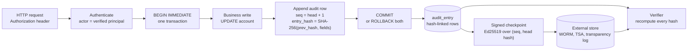

# Immutable Audit Trails for Financial and Healthcare APIs: Actor/Subject/Resource/Diff Schema and Cryptographic SHA-256 Hash Chaining

> [!summary] Claim
> An audit trail is evidence, so it must be written in the same transaction as the change it describes, name an authenticated actor, and commit each row to the previous one with a length-framed SHA-256 chain; but a chain alone only proves internal consistency, and it is tamper-evident against someone who can rewrite the database only when its head is also signed and stored somewhere that person cannot reach.

Part of [Observability Profiling and Operations](README.md) in [API Engineering](../README.md).

## TL;DR

- Mechanism: each row stores `prev_hash` and `entry_hash = SHA-256(domain || frame(chain_id, seq, prev_hash, ts, canonical_header, diff_commit))`, so editing, deleting, or reordering a row breaks the chain at a known `seq`.
- Contract rule: the audit row and the business write commit in one transaction, the actor comes from the authenticated principal and never from the body, and if the audit write fails the request fails closed with `503` and returns no data.
- Trap: truncating the tail, or rewriting a whole suffix with recomputed hashes, still verifies as a valid chain; only a signed checkpoint (or a keyed hash) held outside the database turns that into a detected failure.
- Portability: the hash, framing, and canonical-JSON bytes are identical on every CPython because they are defined by this note, RFC 8785, and `hashlib`; the lab ran on CPython 3.14.6 only, and the matrix legs were not run (lab checks paused 2026-11-11).
- When not to use: for high-volume telemetry (use [[Structured-Logging-with-Structlog-and-Stripe-Canonical-Log-Lines]]), for multi-party audit where auditors must not trust the logger (use a Merkle log, RFC 9162), or when WORM storage alone satisfies the regulation.

## Mental model



A request is authenticated first, so the actor is a fact established by the server rather than a claim in the body.
The business write and the audit append share one `BEGIN IMMEDIATE` transaction, which both serializes writers on the chain head and guarantees that the change and its evidence exist together or not at all.
Every appended row links to the previous row's hash, so the committed chain is a tamper-evident sequence.
Periodically the head hash is signed and exported to storage the database administrator cannot rewrite, and the verifier recomputes the chain from the rows and compares its head with that external anchor, which is what detects the attacks the chain alone cannot see.

## How it works

### Threat model: what "immutable" can and cannot mean

No application-level scheme makes data physically immutable; the achievable property is tamper evidence, which Schneier and Kelsey state as "a system to detect such manipulations after the fact" (Schneier and Kelsey 1998, USENIX Security, Introduction).
Crosby and Wallach use the same framing for an untrusted logger: "tamper-resistance for such a system might be impossible, tamper-detection should be guaranteed in a strong fashion" (Crosby and Wallach 2009, USENIX Security, Section 1).
Attackers differ in what they can do, and each mechanism defeats a specific class.

| Attacker | Capability | Defeated by | Not defeated by |
|---|---|---|---|
| A. Application bug or careless operator | Runs `UPDATE` or `DELETE` through the app or a console | Append-only grants, triggers, hash chain | Nothing needed beyond these |
| B. Database writer without keys | Edits rows, cannot compute a valid signature | Hash chain plus signed checkpoint, or keyed chain | Chain alone if the attacker recomputes hashes |
| C. Database administrator with DDL | Drops triggers, edits rows, recomputes every hash using the public algorithm | Signed checkpoint stored elsewhere | Triggers, grants, unkeyed chain, in-database verifier |
| D. Host root with the signing key | Signs a forged head | External anchoring (TSA, transparency log, second party), forward-secure keys | A single signing key on the same host |

MITRE ATT&CK technique T1070 (Indicator Removal) describes adversaries that "selectively delete or modify artifacts" such as "log entries" to "reduce indications of their presence" (MITRE ATT&CK T1070 description, version 3.0 last modified 12 May 2026, as of 2026-11; the "log entries" example sits in its second sentence group, "Artifacts such as command histories, log entries, or file metadata may be altered").
Selective edits are the case a hash chain is built for: removing or changing one row between two honest rows is visible, whereas deleting the entire log is not.

### Event schema: actor, subject, resource, action, outcome, diff

An audit event answers who did what to which object about whom, with what result and what change.
The lab fixes the fields in `AuditEvent.header()` ([implementation](../labs/src/api_labs/f18_observability_profiling_and_operations/audit_hash_chain.py)).

| Field | Meaning | Source of truth | Why it is separate |
|---|---|---|---|
| `actor.id`, `actor.kind` | The authenticated party that performed the action | Verified credential, never the request body | Forgeable input must never name the actor |
| `actor.on_behalf_of` | The party who delegated to the actor | The top-level `sub` of an RFC 8693 delegation token, whose `act.sub` names the actor | RFC 8693 Section 4.1 defines the `act` claim as the means "to express that delegation has occurred and identify the acting party" |
| `subject` | The data subject whose data was touched (patient, customer) | Owner of the resource, read from the DB inside the transaction | HIPAA accounting and GDPR access requests are queried by subject, not by actor |
| `resource.type`, `resource.id` | The object acted on | Route and path parameters after authorization | Stable identity for later reconstruction |
| `action`, `outcome` | A verb such as `account.update`, and `success`, `denied`, or `error` | The handler | Denied attempts are evidence; they are written outside the failed business transaction |
| `request_id`, `reason` | Correlation id and free-text justification (break-glass reason) | `X-Request-ID` header, caller-provided justification | Joins the audit row to traces ([[Distributed-Tracing-W3C-Trace-Context-and-Baggage-Propagation]]) |
| `diff` | What changed | Computed from before and after values inside the transaction | Kept outside the hashed header so it can be erased (see below) |

The word "subject" collides with the JWT `sub` claim; in this schema `subject` always means the data subject, and the token's `sub` becomes `actor.id`.
For an RFC 8693 delegation token the mapping shifts: the top-level `sub` is the party the token is about and the `act` claim "indicates" the "current actor" (RFC 8693 Section 4.1, Figure 5), so `act.sub` becomes `actor.id` and the top-level `sub` becomes `actor.on_behalf_of`.

The regulatory shape is concrete.
45 CFR 164.312(b) requires "hardware, software, and/or procedural mechanisms that record and examine activity in information systems that contain or use electronic protected health information", 164.312(a)(2)(i) requires "Assign a unique name and/or number for identifying and tracking user identity", and 164.308(a)(1)(ii)(D) requires "procedures to regularly review records of information system activity, such as audit logs, access reports, and security incident tracking reports" (eCFR text fetched with the 2025-01-01 version of Title 45).
45 CFR 164.528(a) gives individuals an accounting of disclosures "made by a covered entity in the six years prior to the date on which the accounting is requested", which is why the `subject` column is indexed.
For broker-dealers, 17 CFR 240.17a-4(f)(2)(i) lets an electronic recordkeeping system either keep "a complete time-stamped audit trail" that includes "All modifications to and deletions of the record or any part thereof", "The date and time of actions that create, modify, or delete the record", and "If applicable, the identity of the individual creating, modifying, or deleting the record" (paragraph (A)(1) to (A)(3)), plus under (A)(4) "Any other information needed to maintain an audit trail of the record in a way that maintains security, signatures, and data to ensure the authenticity and reliability of the record and will permit re-creation of the original record if it is modified or deleted", or preserve records "exclusively in a non-rewriteable, non-erasable format" (paragraph (B)) (eCFR text fetched with the 2026-11-01 version).
Whether a given hash-chained table satisfies a regulator is a legal determination; the lab proves the technical property only.

Reads are events.
The HIPAA audit-controls standard covers "activity", and the accounting of disclosures is built from who accessed a record, so the `GET /accounts/{id}` handler appends an `account.read` row before returning data.
A read-audit row has no diff and costs one append per read, which is the main write-amplification cost of the design.

The diff is a flat, top-level object in the lab: `{"added": {...}, "removed": {...}, "changed": {"field": [old, new]}}`, with masked fields recorded as `"[masked]"` (`field_diff`).
RFC 6902 JSON Patch is the standard alternative for nested documents: its operations are `add`, `remove`, `replace`, `move`, `copy`, and `test` (RFC 6902 Section 4), but a patch records only the new value for `replace`, so an audit diff built on it must add the old value explicitly to be reversible.

### Canonical bytes: why JSON must be canonicalized before hashing

A hash covers bytes, and `json.dumps` can emit different bytes for equal data (key order, whitespace, escaping), so a verifier in another language or version would disagree with the writer.
RFC 8785 (JCS) fixes this: no whitespace between tokens (Section 3.2.1), strings escaped minimally with lowercase `\uhhhh` for control characters (Section 3.2.2.2), numbers serialized per ECMAScript (Section 3.2.2.3), object properties sorted recursively by UTF-16 code units (Section 3.2.3), and input restricted to I-JSON, meaning no duplicate names and numbers expressible as IEEE 754 doubles (Section 3.1).

Python's `json` module does not implement JCS, and two differences matter for hashing:

- Number formatting: `json.dumps([1e21, 1e-7, 100.0])` emits `[1e+21, 1e-07, 100.0]` on CPython 3.14.6 (run here); `1e+21` matches RFC 8785 Appendix B, but JCS writes exponents unpadded (`9.999999999999997e-7` in Appendix B, `1e-27` in the Section 3.2.2 example) and integral doubles without a fraction (`9007199254740992` and `0` in Appendix B), so `1e-07` and `100.0` differ.
- Key order: `sort_keys=True` sorts by code point, JCS by UTF-16 code unit, so a supplementary-plane key such as U+1F600 (surrogates D83D DE00) sorts after U+FB33 in Python and before it in JCS; the RFC 8785 Section 3.2.3 test data demonstrates this, and the lab test `test_canonical_json_orders_keys_by_utf16_code_units_unlike_python_sort_keys` pins both orders.

The lab therefore defines a JCS profile (`canonical_json`) that sidesteps number formatting by refusing floats and integers beyond `2**53 - 1`, and sorts keys with `key.encode("utf-16-be")`, whose byte comparison equals UTF-16 code-unit comparison because the encoding is big-endian.
Money belongs in integer minor units or decimal strings in any case, since RFC 8785 itself recommends strings for "higher precision or longer integers than offered by IEEE 754 double precision" (Section 3.1).
Lone surrogates are refused because RFC 8785 Section 3.2.2.2 requires a compliant implementation to "terminate with an appropriate error".

### Hash input: framing, domain separation, chain id, genesis

The seed's formula concatenates `prev_entry_hash || timestamp || actor || action || resource_id || canonical_json_diff`.
Plain concatenation is ambiguous: `"a" || "bc"` and `"ab" || "c"` hash identically, so an attacker can shift bytes between adjacent variable-length fields without changing the digest (the lab test `test_length_framing_separates_fields_that_plain_concatenation_collides` shows the colliding pair and the framed pair that differs).
The lab prefixes every field with its length as 8 bytes big-endian (`frame`).

```text
entry_hash = SHA-256( "audit-chain/v1\x00"
                      || L("entry") || L(chain_id) || L(seq as 8 bytes, big-endian)
                      || L(prev_hash, 32 bytes) || L(ts, ASCII RFC 3339)
                      || L(canonical header JSON, UTF-8) || L(diff_commit, 32 bytes) )
L(x) = len(x) as 8-byte big-endian || x
genesis(chain_id) = SHA-256( "audit-chain/v1\x00" || L("genesis") || L(chain_id) )
diff_commit = SHA-256( salt || canonical diff JSON )       when a diff exists
            = SHA-256( "audit-chain/v1/no-diff" )           when it does not
```

- Domain separation: the `audit-chain/v1\x00` prefix means a digest computed for another purpose in the same system (a checkpoint, a content hash) can never be replayed as a chain entry; checkpoints use `audit-checkpoint/v1\x00`.
  RFC 6962 Section 2.1 applies the same idea inside a Merkle tree with `0x00` for leaves and `0x01` for interior nodes, noting "This domain separation is required to give second preimage resistance".
- Chain id and `seq` are hashed, so a row cannot be moved to another position or another chain (the test `test_chains_in_one_table_are_independent_and_a_relabelled_row_fails`).
- The genesis hash depends on the chain id, so two tenants' empty chains do not share a starting value.
- `ts` is a separate framed field rather than part of the header JSON so the verifier can check it byte for byte; it is formatted per RFC 3339 Section 5.6 as `YYYY-MM-DDTHH:MM:SS.ffffffZ` in UTC.
  RFC 3339 allows seconds up to `60` for leap seconds (Section 5.6 `time-second` grammar), which a Python `datetime` cannot represent, so the lab never emits `60`.

SHA-256 length-extension is irrelevant to an unkeyed chain, because there is no secret to protect and each hash input is fully specified; it matters only if you build a keyed chain as `SHA-256(key || data)`, which is why the keyed mode uses HMAC (`hmac.digest(key, data, "sha256")`, defined as `H(K XOR opad, H(K XOR ipad, text))` in RFC 2104 Section 2).

### Storage layout and the verifier

The `audit_entry` table has a composite primary key `(chain_id, seq)` and stores `ts`, the canonical `header` text, `diff`, `diff_salt`, `diff_commit`, `prev_hash`, and `entry_hash`.
Two denormalized index columns, `actor_id` and `subject`, exist only so the who-did-what query is an index scan.
They are not hashed on their own, so the verifier cross-checks each against the hashed header and reports `index_column_mismatch`; without this check, setting `subject = 'pat-9'` on one row would silently hide it from every query by patient.

`AuditLog.verify` walks rows in `seq` order and checks, per row, the sequence number, the link, the recomputed hash, the diff commitment, and the index columns.
Linking uses each row's stored `entry_hash`, so a single edited row produces a single mismatch rather than a cascade.

| Tampering | What the verifier reports | Needs a checkpoint |
|---|---|---|
| Edit `header` or `ts` of row k | `entry_hash_mismatch` at k only | No |
| Edit `diff` of row k | `diff_commit_mismatch` at k | No |
| Delete row k in the middle | `sequence_gap` and `link_broken` at k+1 | No |
| Swap two rows | `entry_hash_mismatch` and `link_broken` | No |
| Edit `actor_id` or `subject` column | `index_column_mismatch` at k | No |
| Null a diff with no redaction event | `unrecorded_redaction` at k | No |
| Delete the last rows | nothing; the chain is valid | Yes: `truncated` |
| Rewrite rows k..n and recompute all hashes | nothing; the chain is valid | Yes: `history_rewritten` |

The two "nothing" rows are the central limitation, and the tests `test_tail_truncation_passes_the_chain_but_not_a_signed_checkpoint` and `test_suffix_rewrite_with_recomputed_hashes_passes_the_chain_but_not_the_checkpoint` assert both halves: the chain-only verdict is `ok`, the checkpoint verdict is a named failure.

### Writing: atomicity, serialization, and gap-free sequence numbers

Three requirements decide the write path.

- Atomic with the change: if the business write commits and the audit row does not, there is an unrecorded change; if the audit row commits and the business write does not, there is a record of something that never happened.
  The lab's `AuditLog.transaction()` yields a handle whose `conn` runs business SQL and whose `append` writes the audit row, and `COMMIT` or `ROLLBACK` covers both (`test_failed_audit_write_rolls_back_the_business_update`).
- Serialized per chain: the new row needs the current head, so two writers that both read head `n` would both create `n+1`.
  In the lab the head is read after `BEGIN IMMEDIATE`, which "causes the database connection to start a new write immediately" and "might fail with SQLITE_BUSY if another write transaction is already active on another database connection" (SQLite lang_transaction, Section 2.2); the lab's `connect` sets a 5-second busy timeout so a waiting writer retries before failing, and the primary key `(chain_id, seq)` is the backstop that turns a lost race into an `IntegrityError` (re-raised by `append_in` as `AuditWriteError`) rather than a forked chain.
  A `threading.Lock` serializes threads that share one connection.
  `test_two_connections_to_one_file_serialize_through_begin_immediate` runs two connections to one file from two threads and asserts a contiguous `1..60` chain.
- Gap-free: `seq` is computed as `head + 1` inside the transaction, not taken from a sequence object, because PostgreSQL's "value obtained by nextval is not reclaimed for re-use if the calling transaction later aborts" and so "transaction aborts or database crashes can result in gaps" (PostgreSQL docs, Sequence Manipulation Functions, Section 9.18); a gap in this chain is a tamper signal, so it must never occur naturally.
  SQLite's `AUTOINCREMENT` does not have this problem within one transaction: a rolled-back insert followed by a new insert produced ids `[1, 2]` on SQLite 3.53.1 (run here), but `head + 1` keeps the design portable and per-chain.

Commit order equals chain order because the head read and the insert happen under the same write lock.
The throughput consequence is that one chain is one writer: SQLite documents that in WAL mode "there can only be one writer at a time" (SQLite wal.html), and any single-head design serializes on the head row.
The usual remedy is many chains, one per tenant or per resource shard, each with its own checkpoint; the lab keys everything by `chain_id` for this reason.
The same design on PostgreSQL needs an explicit mutual-exclusion step, because the head read is an ordinary `SELECT` that takes no lock.
Two documented choices exist (PostgreSQL 19 documentation, as of 2026-11).

- A row lock on a per-chain head row: `FOR UPDATE` "causes the rows retrieved by the SELECT statement to be locked as though for update", which "prevents them from being locked, modified or deleted by other transactions until the current transaction ends", and "Row-level locks are released at transaction end or during savepoint rollback" (PostgreSQL docs, Explicit Locking, Section 13.3.2).
  Readers of that row are not blocked: "Row-level locks do not affect data querying; they block only writers and lockers to the same row".
- A transaction-level advisory lock taken before reading the head: `pg_advisory_xact_lock(key bigint)` "Obtains an exclusive transaction-level advisory lock, waiting if necessary", and transaction-level locks are "held until the current transaction ends; there is no provision for manual release" (PostgreSQL docs, Advisory Lock Functions, Table 9.110 and its introduction).
  Unlike a session-level lock, it follows transaction semantics, so a rolled-back audit append cannot leak a held lock; the docs say a session-level lock "acquired during a transaction that is later rolled back will still be held following the rollback" (Explicit Locking, Section 13.3.5).
  Advisory locks are cooperative: "the system does not enforce their use", so every code path that appends must take the same key, and the primary key `(chain_id, seq)` remains the backstop for one that forgets.
  Mapping a `chain_id` string to a `bigint` key is a design choice; a hash collision between two chains only adds harmless extra serialization.

Two PostgreSQL behaviors change the picture compared with the lab.
First, `Serializable` "works exactly the same as Repeatable Read except that it also monitors for conditions which could make execution of a concurrent set of serializable transactions behave in a manner inconsistent with all possible serial (one at a time) executions of those transactions", and applications "must be prepared to retry transactions due to serialization failures" (PostgreSQL docs, Transaction Isolation, Section 13.2.3); an audit writer on that level needs a retry loop, whereas a lock-first design does not.
Second, in `Read Committed` (the default level) "a SELECT query (without a FOR UPDATE/SHARE clause) sees only data committed before the query began" (Transaction Isolation, Section 13.2.1), so a plain `SELECT max(seq)` can return a head that another transaction is about to supersede; taking the lock before the read, in the same transaction, is what makes `head + 1` safe.
Which of the two locks to use is a measurement question: the row lock ties the lock lifetime to a table row, while the advisory lock avoids touching a row but depends on every writer's discipline.

### Anchoring: signed checkpoints, keyed chains, and external timestamps

A checkpoint is `(chain_id, seq, entry_hash, ts)` signed with Ed25519 over a domain-separated, framed message (`checkpoint_message`).
Ed25519 is deterministic: "EdDSA signatures are deterministic. This protects against attacks arising from signing with bad randomness" (RFC 8032 Section 8.2), which also makes checkpoint tests reproducible.
The verifier needs only the public key, and a checkpoint with another key, or with any field edited, is rejected as `checkpoint_signature_invalid` (`test_checkpoint_with_wrong_key_or_edited_fields_is_rejected`).

Detection guarantees are bounded by what was anchored.
Rows with `seq` greater than the last checkpoint are unprotected (`test_rows_after_the_last_checkpoint_are_not_protected_by_it`), so the checkpoint interval is the undetected-tamper window, and the anchor must live outside the attacker's reach: object storage with retention lock, a second account, an email to compliance, a transparency log, or a timestamp authority.
RFC 3161 defines the last option: a client sends a `TimeStampReq` whose `messageImprint` is "the hash of the datum to be time-stamped" (RFC 3161 Section 2.4.1) and receives a signed token binding that hash to a time, which also answers "was this head in existence before the incident" independent of your own clock.

The alternative is a keyed chain: with `chain_key` set, every hash is an HMAC, so an attacker without the key cannot recompute a rewritten suffix (`test_keyed_chain_blocks_a_forger_without_the_key_but_not_one_who_has_it`).
The limit is symmetry: whoever can verify can forge, so the key must live in an HSM or KMS the database host cannot read, and verification must run there.
Schneier and Kelsey go further with forward security: the authentication key is hashed immediately after each entry (`A_{j+1} = hash("Increment Hash", A_j)`), the chain value is `Y_j = hash(Y_{j-1}, E_{K_j}(D_j), W_j)`, and each entry carries `Z_j = MAC_{A_j}(Y_j)`, so an attacker who captures the machine at time t "can delete a block of entries ... but he cannot create new entries, either past entries to replace them or future entries" (Schneier and Kelsey 1998, Section 3.1).
Their design starts the chain at `Y_{-1}` as a "twenty-byte block of binary zeros" (the width of SHA-1, which they used), and a footnote says "There is no security reason for this; it has to be initialized as something" (Schneier and Kelsey 1998, Section 3.1); the lab replaces that constant with a per-chain genesis hash so two chains never share a starting value.
RFC 5848 (Signed Syslog Messages, Kelsey among the authors) standardizes the same idea for syslog: signature blocks that carry hashes of previously sent messages, giving "origin authentication, message integrity, replay resistance, message sequencing, and detection of missing messages" (RFC 5848 Abstract).

AWS CloudTrail is a production reference for the anchoring architecture: it hashes each delivered log file with SHA-256, writes an hourly digest file that lists those hashes, signs the digest with a per-Region RSA key, includes "the digital signature of the previous digest file" in each digest, and stores digests in a separate folder of the bucket so access policies can differ (CloudTrail log file integrity validation, as of 2026-11).

### Merkle trees: when a chain is not enough

A hash chain proves a single entry only by replaying everything between that entry and a trusted anchor, which is O(n).
Crosby and Wallach report that "a classic hash chain might require an 800 MB trace to prove that a randomly chosen event is in a log with 80 million events" while their tree prototype "returns a 3 KB proof with the same semantics" (Crosby and Wallach 2009, Abstract).
RFC 6962 Section 2.1 defines the Merkle Tree Hash: `MTH({d(0)}) = SHA-256(0x00 || d(0))` and, for n > 1, `MTH(D[n]) = SHA-256(0x01 || MTH(D[0:k]) || MTH(D[k:n]))` with k the largest power of two smaller than n; Section 2.1.1 defines audit paths (inclusion proofs) and Section 2.1.2 consistency proofs, which "prove the append-only property of the tree"; RFC 9162 Sections 2.1.3 and 2.1.4 restate both for CT 2.0.
An inclusion proof has about `ceil(log2 n)` hashes: 27 for 80 million leaves, or 864 bytes of 32-byte hashes by arithmetic (the paper's 3 KB figure is its own measured proof, which this arithmetic does not reproduce).

Crosby and Wallach also name the attack a single signed chain does not stop: an untrusted logger "is free to have different snapshots make inconsistent claims about the past" (Section 1), which they call forking, so auditors must compare commitments through gossip or a public log (Section 2).
The lab has no Merkle tree and no gossip: choose one when external auditors, not only your own compliance team, must verify entries without trusting your database.

### Erasure and redaction without breaking the chain

Immutability collides with erasure.
GDPR Article 17(1) gives the data subject the right to obtain erasure of personal data "without undue delay" on specified grounds, and Article 17(3) states that paragraphs 1 and 2 "shall not apply to the extent that processing is necessary", with point (b) covering processing necessary "for compliance with a legal obligation" (Regulation (EU) 2016/679, Article 17; text read from the unofficial consolidated copy at gdpr-info.eu because EUR-Lex returned HTTP 202 with an empty body to automated clients, so the Official Journal wording was not re-read); which paragraph governs a given audit field is a legal question.
The design answer is to keep personal values out of the hashed bytes.
The chain hashes only `diff_commit = SHA-256(salt || diff)`; the diff and its random salt are stored beside it, and `AuditLog.redact` nulls both and appends an `audit.redact` event naming the target `seq`, the actor, and the reason.
The commitment is hiding because of the per-entry salt: without it, a low-entropy diff such as `["active", "frozen"]` could be recovered by hashing guesses (`test_diff_commitment_is_salted_so_equal_diffs_get_different_commitments`).
The chain stays valid after redaction (`test_redaction_erases_the_payload_keeps_the_chain_valid_and_is_itself_recorded`), and a diff nulled without a matching `audit.redact` event is reported as `unrecorded_redaction` (`test_silently_nulling_a_diff_without_a_redaction_event_is_detected`).
The trigger cannot tell an authorized nulling from an unauthorized one, since both are the same `UPDATE`; the in-chain event is what distinguishes them, and an attacker who forges that event must rewrite the suffix, which a checkpoint catches.
The alternative is crypto-shredding, encrypting each subject's payloads under a per-subject key and deleting the key; it fits when diffs must stay in the chain's hashed bytes, at the cost of key management, and it is not implemented in the lab.

### Enforcing append-only in the database

Layers, from weakest to strongest:

- Application discipline: the app only ever inserts.
  This is not a control.
- Database grants: the application role has `INSERT` and `SELECT` but not `UPDATE`, `DELETE`, or `TRUNCATE` on the audit table; PostgreSQL lists `TRUNCATE` as a separate privilege in the `REVOKE` synopsis (PostgreSQL docs, REVOKE), so revoking only `UPDATE` and `DELETE` leaves it open.
  The table owner is "always treated as holding all grant options" and a superuser acts "as though it were issued by the owner" (same page), so the application must connect as neither; the lab uses SQLite, which has no roles.
- Triggers: the lab's `audit_entry_no_delete` and `audit_entry_only_redact` use `RAISE(ABORT, ...)`, after which "the current query terminates" and "An error code of SQLITE_CONSTRAINT is returned to the application" (SQLite lang_createtrigger), surfaced by Python's `sqlite3` as `sqlite3.IntegrityError`.
  A trigger is a guardrail against bugs, not a security boundary: anyone who may run DDL can `DROP TRIGGER`, and the test `test_triggers_refuse_update_and_delete_but_dropping_them_is_only_caught_by_the_verifier` does exactly that and shows the verifier, not the trigger, catching the edit.
- WORM storage: object-lock or write-once media; this is the other branch of 17 CFR 240.17a-4(f)(2)(i)(B).
- External anchor: the only layer that survives a compromised database host.

### The HTTP layer

The lab's FastAPI service ([implementation](../labs/src/api_labs/f18_observability_profiling_and_operations/audit_account_api.py)) shows the contract rules as code.

- The actor comes from the dependency that authenticates the bearer token; `AccountPatch` uses `extra="forbid"`, so a body containing `actor` is a `422` and writes nothing (`test_actor_cannot_be_supplied_in_the_request_body`).
  This is the same mass-assignment class as OWASP API3:2023; see [[Defeating-BOPLA-and-Mass-Assignment-API3-2023-Strict-Input-Output-Schemas]].
- Authorization failures are audited as `outcome="denied"` in their own transaction, because the failed request has no business transaction to share.
- Audit failure is fail-closed: an `AuditWriteError` maps to `503` through an exception handler, and a read returns no data when its audit row cannot be written (`test_read_fails_closed_with_503_and_no_data_when_the_audit_write_fails`).
- Do not write the audit row in a Starlette `BackgroundTask`: `Response.__call__` sends `http.response.start` and `http.response.body` and only then `await self.background()` (starlette 1.10.0 starlette/responses.py, `Response.__call__`), so the client already has its answer, a crash loses the row, and a failure cannot change the response.
- Do not rely on access-log middleware for audit: a pure ASGI middleware sees bytes, not before and after state, and it samples or drops under load; audit rows are never sampled, unlike traces ([[Trace-Sampling-Strategies-Head-Based-vs-Tail-Based-Sampling]]).
- The synchronous `def` endpoints run in the thread pool (fastapi 0.162.0 fastapi/routing.py, `run_endpoint_function`, which awaits `run_in_threadpool` when the endpoint is not a coroutine), so the shared SQLite connection is opened with `check_same_thread=False`; the Python documentation notes that with this setting "write operations may need to be serialized" (Python sqlite3 docs, `sqlite3.connect`), which the lab's lock does.

### Operating the verifier

The verifier is only as trustworthy as its inputs.
`GET /audit/verify` in the lab runs inside the same trust domain as the database it checks, so it catches bugs and attackers of class A and B only; a real deployment runs the verifier somewhere else, against a checkpoint fetched from the external store, on a schedule, and alerts on any problem kind.
Verification is O(n) hash evaluations over all rows; an incremental verifier starts from the last verified checkpoint and checks only rows after it, which the lab does not implement.
The OWASP Logging Cheat Sheet states the same operational points: "Build in tamper detection so you know if a record has been modified or deleted" and "All access to the logs must be recorded and monitored" (OWASP Logging Cheat Sheet, Protection section, as of 2026-11), which is why `audit.query` and `audit.redact` are themselves chain entries.

## Numbers and limits

| Quantity | Value | Source |
|---|---|---|
| SHA-256 digest size | 32 bytes (`MTH` is "a single 32-byte Merkle Tree Hash" with SHA-256) | RFC 6962 Section 2.1 |
| Per-row cryptographic overhead in the lab | 112 bytes: `prev_hash` 32 + `entry_hash` 32 + `diff_commit` 32 + `diff_salt` 16 | Arithmetic from the schema in `audit_hash_chain.py` |
| Framing overhead per hashed entry | 56 bytes: seven fields times an 8-byte length | Arithmetic from `compute_entry_hash` |
| Largest integer in canonical JSON | `2**53 - 1` = 9007199254740991 (the lab profile's limit; JCS itself serializes any double) | RFC 7493 Section 2.2: a receiver need not treat an integer "outside the range [-(2**53)+1, (2**53)-1]" as exact; enforced by `MAX_SAFE_INT`; test `test_canonical_json_keeps_booleans_distinct_from_integers_and_accepts_2_pow_53_minus_1` |
| Verification cost | One SHA-256 per row plus one per diff commitment: O(n) | `AuditLog.verify` |
| Merkle inclusion proof length | `ceil(log2 n)` hashes; 27 for n = 80,000,000 | RFC 9162 Section 2.1.3; arithmetic, run with `math.ceil(math.log2(80_000_000))` on CPython 3.14.6 |
| Hash chain proof vs tree proof, 80 million events | 800 MB vs 3 KB (their prototype) | Crosby and Wallach 2009, Abstract |
| Tree-log prototype throughput | 1,750 events per second on one CPU core; 10,500 with signatures offloaded | Crosby and Wallach 2009, Abstract (their hardware, not this lab) |
| Writers per chain | 1 at a time (single head) | SQLite wal.html; design consequence |
| CloudTrail digest cadence | One digest file per hour, signed with SHA-256 with RSA | CloudTrail log file integrity validation (as of 2026-11) |
| Retention periods | 6 years for 45 CFR 164.316(b)(2)(i) documentation; 6 years or 3 years for 17 CFR 240.17a-4(a) and (b) record classes | eCFR text above; which class an audit log falls into is a legal question |
| Lab size and run | 48 tests, 48 passed in 3.23 s (wall time varies run to run) | `uv run --frozen pytest ... -q` on CPython 3.14.6, macOS 27.3 (Darwin 27.3.0) arm64, re-run 2026-11-26 by the fact-checker (command in Worked example) |

No throughput or latency figure for the lab's own appends is stated, because none was measured.

## Portability

| Dimension | Status | Evidence |
|---|---|---|
| CPython 3.14.6 (workspace interpreter; matrix names 3.14.10) | Ran, 48 passed | Pytest run in Worked example |
| CPython 3.12.16, 3.13.18, 3.15.2, 3.15.2t (free-threaded) | Not run | Lab checks were paused by instruction on 2026-11-11; the code uses only `hashlib`, `hmac`, `sqlite3`, `datetime.UTC`, and `X \| Y` isinstance, all present from 3.12 per `requires-python = ">=3.12,<3.16"` |
| Free-threaded build and `sqlite3` sharing | Not run | The lab guards all writes with `threading.Lock` and `BEGIN IMMEDIATE`; whether a shared `sqlite3.Connection` is safe under free threading was not tested here |
| `hmac.compare_digest` semantics | Cited, not used by the lab | "Return a == b ... avoiding content-based short circuiting"; uses OpenSSL `CRYPTO_memcmp()` since 3.10 (Python hmac docs); the lab compares public hashes with `!=`, which is correct because nothing secret is compared, but a keyed-tag comparison in a server should use it |
| JSON float text | Differs from RFC 8785 | `json.dumps(1e-07)` pads the exponent; the lab refuses floats instead of reformatting them |
| SQLite | 3.53.1 in the lab venv (`sqlite3.sqlite_version`, run) | `RAISE(ABORT)` and `BEGIN IMMEDIATE` behavior is from the SQLite documentation; older bundled SQLite versions were not run |
| SQLite on network filesystems | Unsupported for WAL | "WAL does not work over a network filesystem" (SQLite wal.html); the lab uses the default rollback journal and `:memory:` or a local file |
| PostgreSQL, other databases | Not run | The schema is portable SQL apart from SQLite's `BLOB` and trigger syntax; the lock mechanism differs (see How it works) |
| HTTP versions, ASGI servers | Not applicable | The service runs in-process through `httpx.ASGITransport`; the audit logic does not depend on HTTP/1.1, HTTP/2, HTTP/3, Uvicorn, Hypercorn, or Granian |
| Library versions in the run | fastapi 0.162.0, starlette 1.10.0, cryptography 50.0.2, pydantic 2.14.3 | Read from the lab venv; behavior on other point releases not run |
| Container legs (Debian, Alpine musl) | Not run | Paused by instruction |

## Worked example

The implementation is in two modules: the chain and verifier ([implementation](../labs/src/api_labs/f18_observability_profiling_and_operations/audit_hash_chain.py)) and the FastAPI account service ([implementation](../labs/src/api_labs/f18_observability_profiling_and_operations/audit_account_api.py)).
The tests are in [test](../labs/tests/f18_observability_profiling_and_operations/test_audit_logging_for_regulated_apis_tamper_evident_hash_chains_and_who_did_what.py).

Simplified excerpt of `compute_entry_hash` and the framing it relies on, from `audit_hash_chain.py` (docstrings and imports omitted):

```python
def frame(*parts: bytes) -> bytes:
    return b"".join(len(part).to_bytes(8, "big") + part for part in parts)


def _digest(data: bytes, key: bytes | None) -> bytes:
    if key is None:
        return hashlib.sha256(data).digest()
    return hmac.digest(key, data, "sha256")


def compute_entry_hash(
    *,
    chain_id: str,
    seq: int,
    prev_hash: bytes,
    ts: str,
    header: bytes,
    diff_commit: bytes,
    key: bytes | None = None,
) -> bytes:
    payload = DOMAIN + frame(
        b"entry",
        chain_id.encode("utf-8"),
        seq.to_bytes(8, "big"),
        prev_hash,
        ts.encode("ascii"),
        header,
        diff_commit,
    )
    return _digest(payload, key)
```

Simplified excerpt of the write path, which holds the lock, opens `BEGIN IMMEDIATE`, and commits or rolls back business SQL and the audit row together:

```python
@contextmanager
def transaction(self) -> Generator[AuditTransaction]:
    with self._lock:
        self._conn.execute("BEGIN IMMEDIATE")
        try:
            yield AuditTransaction(self, self._conn)
        except BaseException:
            with suppress(sqlite3.Error):
                self._conn.execute("ROLLBACK")
            raise
        try:
            self._conn.execute("COMMIT")
        except sqlite3.Error as exc:
            with suppress(sqlite3.Error):
                self._conn.execute("ROLLBACK")
            raise AuditWriteError(f"commit failed: {exc}") from exc
```

Simplified excerpt of the core of `AuditLog.verify` (diff, header, and checkpoint checks are separate helpers):

```python
for entry in rows:
    if entry.seq != expected_seq:
        problems.append(Problem(entry.seq, "sequence_gap", ...))
    expected_seq = entry.seq + 1
    if entry.prev_hash != prev_hash:
        problems.append(Problem(entry.seq, "link_broken", ...))
    recomputed = compute_entry_hash(
        chain_id=entry.chain_id, seq=entry.seq, prev_hash=entry.prev_hash,
        ts=entry.ts, header=entry.header.encode("utf-8"),
        diff_commit=entry.diff_commit, key=self._key,
    )
    if recomputed != entry.entry_hash:
        problems.append(Problem(entry.seq, "entry_hash_mismatch", ...))
    prev_hash = entry.entry_hash
```

Simplified excerpt of the suffix-rewrite attack test: the attacker uses the public algorithm to recompute rows 3 and 4, so the chain verifies and only the checkpoint objects.

```python
log, conn = make_log()
key = Ed25519PrivateKey.generate()
fill(log, 4)
anchor = log.checkpoint(key)
unlock(conn)                      # DROP TRIGGER: the attacker has DDL rights
forge_suffix(log, conn, 3, lambda h: h.replace("account.update", "account.read"))
assert log.verify().ok            # chain alone: valid
report = log.verify(checkpoint=anchor, public_key=key.public_key())
assert [(p.seq, p.kind) for p in report.problems] == [(4, "history_rewritten")]
```

Captured run (one command, from the `labs/` workspace directory; re-run once by the fact-checker on 2026-11-26):

```text
$ uv run --frozen pytest tests/f18_observability_profiling_and_operations/test_audit_logging_for_regulated_apis_tamper_evident_hash_chains_and_who_did_what.py -q -p no:cacheprovider
................................................                         [100%]
48 passed in 3.23s
```

Environment: CPython 3.14.6, macOS 27.3 (Darwin 27.3.0) arm64, SQLite 3.53.1, fastapi 0.162.0, starlette 1.10.0, cryptography 50.0.2, pytest-asyncio strict mode.
The earlier attempt ran ruff, mypy, and pyright on these files; they were not re-run for this revision because lab checks are paused (2026-11-11), so no lint or type-check result is claimed here.

## Pitfalls

> [!warning] A valid chain is not proof of an untampered log
> Trigger: deleting the newest rows, or rewriting from row k onward with recomputed hashes, using the public algorithm.
> Symptom: `verify()` returns `ok` because every remaining link is consistent, and the loss is only visible against an external anchor.
> Fix: sign `(seq, head hash)` regularly with Ed25519, store it where database administrators cannot write, and treat the checkpoint interval as your detection window; the tests assert both the false `ok` and the checkpoint failure.

> [!warning] Concatenating variable-length fields before hashing
> Trigger: hashing `prev || actor || action || resource` as raw bytes, as the seed formula reads literally.
> Symptom: two different events produce one hash (`"a" || "bc"` equals `"ab" || "c"`), so an attacker can move bytes between fields without breaking the chain.
> Fix: length-prefix every field (`frame`), include a domain-separation prefix, and bind `chain_id` and `seq`.

> [!warning] Hashing JSON that was serialized by `json.dumps` defaults
> Trigger: `hashlib.sha256(json.dumps(diff).encode())` on the writer and a different language or `sort_keys` setting on the verifier.
> Symptom: the verifier reports `entry_hash_mismatch` for every row after a library upgrade or in a Go verifier, with no tampering at all; floats are the worst case (`1e-07` from Python versus an unpadded exponent in RFC 8785 Appendix B).
> Fix: canonicalize per RFC 8785, ban floats in audited payloads, and store the exact canonical text that was hashed rather than re-serializing on verify.

> [!warning] Audit written after commit, in a background task, or best-effort
> Trigger: `db.commit()` followed by `BackgroundTasks.add_task(audit.append, ...)`, or a `try/except: log.warning` around the audit insert.
> Symptom: the response is already sent when the task runs (starlette 1.10.0 `Response.__call__` awaits the background task after the body is sent), a crash between commit and append leaves an unrecorded change, and an audit outage looks like success.
> Fix: one transaction for the change and the row, `503` when the row cannot be written, and an alert on audit write failures as a security event.

> [!warning] Denormalized index columns that the hash does not cover
> Trigger: a `subject` or `actor_id` column used for queries but absent from the verifier.
> Symptom: an edited column makes a row vanish from "who accessed patient X" reports while the chain stays valid.
> Fix: derive columns from the hashed header and cross-check them in `verify` (`index_column_mismatch`).

> [!warning] Treating triggers and grants as the control
> Trigger: relying on `RAISE(ABORT)` or revoked `UPDATE` privileges for immutability.
> Symptom: anyone with DDL rights drops the trigger, edits rows, and recomputes hashes; nothing in the database records it.
> Fix: keep triggers as bug guards, keep the verifier and checkpoint outside the database, and give the application role no DDL.

> [!warning] Logging secrets and personal data into the diff
> Trigger: copying a full before and after row, including credentials or health fields, into `diff`.
> Symptom: the audit table becomes the most sensitive table in the system and cannot be erased; CWE-117 and CWE-778 are the neighbouring weaknesses (improper output neutralization for logs, and insufficient logging).
> Fix: mask fields in `field_diff`, hash or encrypt values that must be provable, and plan redaction (salted commitment) or crypto-shredding before the first row is written.

> [!warning] Sequence gaps from rollbacks
> Trigger: taking `seq` from a sequence object, such as PostgreSQL `nextval` behind a `serial` or identity column.
> Symptom: a rolled-back transaction burns a number (PostgreSQL docs, Section 9.18: aborts "can result in gaps in the sequence of assigned values"), the verifier reports `sequence_gap`, and operators learn to ignore it.
> Fix: assign `seq = head + 1` under the chain's write lock in the same transaction.

No production postmortem is cited in this note: none of the incidents recalled while drafting could be checked against a fetched primary source, so none is stated.

## Security and robustness

- Untrusted input: `actor` never comes from the body; bodies are `extra="forbid"` so unknown fields fail with `422`.
  Any value that reaches a log line or audit field may contain newlines or markup; CWE-117 describes a product that "constructs a log message from external input, but it does not neutralize or incorrectly neutralizes special elements", and JSON-encoded canonical text avoids line injection because newlines are escaped as `\n` (the first lab test shows `x\ny` serialized with a literal backslash-n).
- Authorization of the audit surface: `GET /audit/subjects/{subject}` and `GET /audit/verify` need the `auditor` role, denials are themselves audited, and successful queries append `audit.query`; see [[Defeating-BOLA-API1-2023-Tenant-Scoped-Queries-and-PostgreSQL-RLS]] for scoping auditors to a tenant.
- Key handling: the Ed25519 signing key and any `chain_key` must be outside the database host; rotate keys by starting a new checkpoint series, not by re-signing old checkpoints.
  Use `hmac.compare_digest` when comparing secret-derived tags.
- Error leakage: the `503` body is a fixed string; the test asserts the response text contains neither the balance nor the subject.
- Availability: fail-closed audit makes the audit store a hard dependency of every regulated endpoint, so its availability bounds the API's; a `BEGIN IMMEDIATE` that cannot get the write lock raises `sqlite3.OperationalError` in the lab, which is not mapped to `503` (a known gap), and a production service needs a bounded lock timeout and the same mapping.
- Defense in depth: signed checkpoints, WORM copies, a separate verifier identity, alerting on `audit.redact`, and a periodic restore test of the audit store.
- Out of scope here: non-repudiation of the actor's own action (that needs a signature by the actor, see [[HTTP-Message-Signatures-RFC-9421-and-Content-Digests-RFC-9530]]), and confidentiality of the audit table at rest.

## The principal's view

The decision is not "hash chain or not" but what the audit log is promised to be.
Three tiers exist, and each costs more than the last.

- Evidence for your own compliance team (HIPAA 164.312(b), SOC-style reviews): transactional write, authenticated actor, append-only grants, signed checkpoints to a second account, and a scheduled out-of-band verifier.
  This is the lab's design.
- Evidence an external party must be able to check without trusting you (regulators, counterparties, customers): a Merkle log with inclusion and consistency proofs and gossiped heads (RFC 9162), or a managed service with signed digests such as CloudTrail validation.
  Expect higher build or buy cost and a stricter data model.
- Pure retention (17a-4(f)(2)(i)(B) style): WORM storage and no cryptography in the application at all; simpler, but it gives no per-row evidence of ordering or omissions.

The organizational trade-off is that audit is a product with an owner, not a library: someone owns the schema (changing a hashed field needs a `v` bump and dual verification), the retention policy, the redaction procedure with legal sign-off, and the pager for `verify` failures.
Write amplification is real: every read becomes a serialized write on a single head, so shard chains by tenant early, keep reads out of the audit chain only where the regulation permits, and measure append latency and lock wait before launch rather than after.
Choose a different tool when the volume is analytic rather than evidentiary (use canonical log lines and sampling), when the system of record already provides temporal tables with signed history, or when the regulation is satisfied by immutable object storage.

## Interview questions

> [!question] L5: Why must the audit row be written in the same transaction as the business change?
>
> > [!success]- Answer
> > If they commit separately, a crash or failure between the two leaves either an unrecorded change or a record of a change that never happened.
> > Evidence that can disagree with the data it describes is not evidence.
> > One `BEGIN IMMEDIATE` transaction makes both commit or both roll back, and it also serializes writers on the chain head.
> >
> > Follow-up: What do you return to the client when the audit insert fails, and why?

> [!question] L5: Where should the `actor` field come from in a FastAPI handler?
>
> > [!success]- Answer
> > From the authenticated principal established by a dependency, never from the request body or a client-controlled header.
> > The lab's `AccountPatch` forbids extra fields, so a body containing `actor` is a `422` and nothing is written.
> > For delegated calls, record the acting party and the delegator separately, mirroring the RFC 8693 `act` claim.
> >
> > Follow-up: How would you record a service account acting for a user?

> [!question] L5: Why index and query by `subject` as well as by `actor`?
>
> > [!success]- Answer
> > Regulations ask "who accessed this patient's or customer's data", which is a query by data subject; HIPAA's accounting of disclosures is organized this way.
> > The actor index answers a different question, what a particular employee touched during an investigation.
> > Because denormalized columns are not part of the hash, the verifier must cross-check them against the hashed header.
> >
> > Follow-up: What happens to those queries if someone edits the `subject` column of one row?

> [!question] L6: Predict the output
>
> ```python
> log, conn = make_log()
> for n in range(3):
>     log.append(event(n))
> unlock(conn)
> conn.execute("DELETE FROM audit_entry WHERE seq = 3")
> print(log.verify().ok, log.verify().head_seq)
> conn.execute("DELETE FROM audit_entry WHERE seq = 2")
> print(log.verify().ok)
> ```
>
> > [!success]- Answer
> > The first line prints `True 2`: deleting the newest row leaves a consistent chain of two rows, and a chain-only verifier has nothing to compare it against.
> > The second line prints `True` as well: only row 1 remains, which is again a consistent prefix.
> > Had row 2 been deleted while row 3 still existed, the verifier would report `sequence_gap` and `link_broken` at seq 3 and return `False`.
> > A signed checkpoint at seq 3 would turn the first deletion into `truncated`.
> >
> > Follow-up: What is the maximum amount of history an attacker can delete undetected if you checkpoint every 1,000 rows?

> [!question] L6: Debug this API: what is wrong with the audit handling below?
>
> ```python
> @app.patch("/accounts/{account_id}")
> def patch(account_id: str, body: Patch, background: BackgroundTasks, user=Depends(auth)):
>     db.execute("UPDATE account SET balance = ? WHERE id = ?", (body.balance, account_id))
>     db.commit()
>     background.add_task(audit.append, actor=body.actor, action="update", id=account_id)
>     return {"ok": True}
> ```
>
> > [!success]- Answer
> > There are four defects.
> > The actor is taken from the body, so any caller can attribute the change to someone else; use `user.id`.
> > The audit append is a background task, which Starlette runs after the response has been sent (`Response.__call__` awaits `self.background()` after `http.response.body`), so a crash loses it and a failure cannot affect the response.
> > It is a separate transaction from the `UPDATE`, so the two can diverge.
> > There is no diff, no subject, and no denied-attempt record.
> > Fix: authenticate to get the actor, run the `UPDATE` and the append in one transaction, return `503` if the append fails, and record the before and after values.
> >
> > Follow-up: Where would you put the authorization-denied record, given there is no business transaction to share?

> [!question] L6: Why does the lab hash length-prefixed fields instead of the seed's `||` concatenation?
>
> > [!success]- Answer
> > Plain concatenation is ambiguous when fields are variable length: `"a" || "bc"` and `"ab" || "c"` hash the same, so bytes can move between fields undetected.
> > A fixed-width length before each field makes the encoding injective.
> > The lab also adds a domain-separation prefix and binds `chain_id` and `seq`, so rows cannot be moved between positions or chains.
> >
> > Follow-up: Where does RFC 6962 use the same domain-separation idea?

> [!question] L7+: Your verifier passes, but a customer says a row you showed them last month is gone: what happened and what do you change?
>
> > [!success]- Answer
> > The chain can be consistent after tail deletion or a recomputed rewrite, because a hash chain proves only internal consistency.
> > Without a signed head stored outside the database there is nothing to compare against.
> > Change: sign `(seq, head hash)` on a schedule with a key the database host cannot use, export it to write-once storage or a timestamp authority (RFC 3161), run the verifier elsewhere, and publish the checkpoint interval as the detection window.
> > If the customer must verify independently, move to a Merkle log with inclusion and consistency proofs (RFC 9162).
> >
> > Follow-up: What do you do about a fork, where the logger shows two different histories to two auditors?

> [!question] L7+: How do you honor a GDPR erasure request for a field that is already in an immutable, hash-chained audit trail?
>
> > [!success]- Answer
> > Keep personal values out of the hashed bytes: hash a salted commitment to the diff and store the diff and salt beside it.
> > Erasure nulls the diff and salt, the chain stays valid, and an `audit.redact` event records who erased what and why, so a silent erasure is detectable.
> > The salt matters because low-entropy diffs can otherwise be recovered by hashing guesses.
> > Whether Article 17(3)(b), compliance with a legal obligation, applies to a given field is for counsel; the design makes either answer implementable.
> > Crypto-shredding with per-subject keys is the alternative when the encrypted payload must stay in the hashed bytes.
> >
> > Follow-up: What attack remains if the redaction event itself can be forged?

> [!question] L7+: One tenant produces 5,000 audited reads per second and the single chain is the bottleneck: how do you redesign it?
>
> > [!success]- Answer
> > A single head is a single serialized writer, so throughput is bounded by one transaction commit at a time.
> > Shard the chain by tenant or resource group, each with its own genesis, lock, and checkpoint series, and checkpoint all shards under a periodic signed manifest of shard heads.
> > Batch several events per transaction only if they belong to one request, because batching across requests couples unrelated latencies.
> > Consider whether read events need per-row chain entries or can be accumulated into a signed batch record where the regulation allows; measure lock wait first.
> > Do not drop audit under load: apply backpressure or fail closed instead.
> >
> > Follow-up: What does a cross-shard consistency guarantee cost, and who needs it?

## Related

Prerequisites: [[Client-Side-Telemetry-Network-Error-Logging-NEL-and-Edge-vs-Origin-Gap]]

Next: [[Feature-Flags-Dynamic-Configuration-and-Safe-Kill-Switches-in-APIs]]

See also: [[02-Programming-Languages/Python/Python-Backend-Interview-Prep/07-Auth-and-Security]]

See also: [[Structured-Logging-with-Structlog-and-Stripe-Canonical-Log-Lines]], [[Distributed-Tracing-W3C-Trace-Context-and-Baggage-Propagation]], [[Trace-Sampling-Strategies-Head-Based-vs-Tail-Based-Sampling]], [[Transactional-Outbox-Pattern-Solving-Dual-Writes-Between-DB-and-Events]], [[HTTP-Message-Signatures-RFC-9421-and-Content-Digests-RFC-9530]], [[Defeating-BOLA-API1-2023-Tenant-Scoped-Queries-and-PostgreSQL-RLS]], [[Defeating-BOPLA-and-Mass-Assignment-API3-2023-Strict-Input-Output-Schemas]], [[JWT-Cryptographic-Pitfalls-and-RFC-8725-Best-Current-Practices]], [[Symmetric-Crypto-and-Hashes]]

- Lab: `labs/tests/f18_observability_profiling_and_operations/test_audit_logging_for_regulated_apis_tamper_evident_hash_chains_and_who_did_what.py`

## Further reading

- RFC 8785, JSON Canonicalization Scheme: Sections 3.1 to 3.2.3 and Appendix B define the bytes a hash can be computed over.
- RFC 6962, Certificate Transparency, Section 2.1: the Merkle Tree Hash with leaf and node domain separation, audit paths, and consistency proofs.
- RFC 9162, Certificate Transparency Version 2.0, Sections 2.1.1 to 2.1.4: the current statement of the same tree and its proofs.
- RFC 3161, Time-Stamp Protocol, Section 2.4.1: how to bind a head hash to a trusted time.
- RFC 8693, OAuth 2.0 Token Exchange, Section 4.1: the `act` claim that models delegation in the actor field.
- RFC 5848, Signed Syslog Messages: a standards-track design for signed, sequenced log hashes with missing-message detection.
- RFC 8032, Section 8.2: why deterministic EdDSA signatures suit checkpoints.
- Schneier and Kelsey, "Cryptographic Support for Secure Logs on Untrusted Machines" (USENIX Security 1998), Section 3.1: the keyed hash chain with forward-secure key evolution.
- Crosby and Wallach, "Efficient Data Structures for Tamper-Evident Logging" (USENIX Security 2009): why a hash chain needs O(n) proofs and how a history tree fixes it.
- 45 CFR 164.312, 164.308(a)(1)(ii)(D), 164.316(b)(2)(i), and 164.528 (eCFR): the HIPAA text behind audit controls, review, retention, and accounting of disclosures.
- 17 CFR 240.17a-4(f)(2)(i) (eCFR): the audit-trail and non-rewriteable alternatives for electronic records.
- Regulation (EU) 2016/679, Article 17: the erasure right and its legal-obligation exception.
- AWS CloudTrail log file integrity validation: a production digest-and-signature chain.
- SQLite documentation, `lang_transaction` Section 2.2 and `lang_createtrigger`: `BEGIN IMMEDIATE` and `RAISE(ABORT)` semantics used by the lab.
- OWASP Logging Cheat Sheet, Protection section: tamper detection and access recording for logs.
