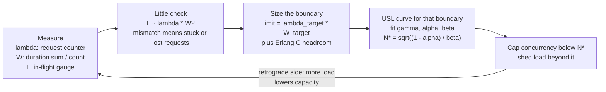

# API Capacity Planning: Little's Law (L = lambda * W), Amdahl's Law, and Gunther's Universal Scalability Law (Contention and Coherency Retrograde)

> [!summary] Claim
> Little's Law (`L = lambda * W`) is an exact bookkeeping identity that converts any two of in-flight requests, arrival rate, and time in system into the third, so it sizes every pool, limiter, and queue in an API; but it says nothing about how throughput responds to more concurrency, and that response is what the Universal Scalability Law models: Amdahl's serial fraction (`alpha`) caps the curve, and a pairwise coherency cost (`beta`) bends it downward past `N* = sqrt((1 - alpha) / beta)`, so raising a concurrency limit beyond `N*` lowers throughput.

Part of [Observability Profiling and Operations](README.md) in [API Engineering](../README.md).

## TL;DR

- Mechanism: `L = lambda * W` holds for any boundary you draw around a system, so a thread limiter, a DB pool, and a whole service each have their own `L`, `lambda`, and `W`; the USL `C(N) = N / (1 + alpha*(N-1) + beta*N*(N-1))` then says how throughput `X(N)` scales with the concurrency `N` you allow inside that boundary.
- Contract: Little's Law is exact on a finite window only if the system is empty at both ends (Little 2011, Theorem LL.1), uses means rather than percentiles, and needs `lambda` to count everything that crosses the boundary, retries included.
- Trap: sizing a pool as `lambda * W` puts it at 100 percent utilization (a 15-connection pool with `W = 100 ms` saturates at 150 requests per second), and fitting the USL only below the knee overestimates the ceiling (lab: `N* = 66.4` from `N <= 12` against a simulated peak at `N = 19`).
- Portability: the model is language-free and the lab module is stdlib-only, so its demo output was byte-identical on CPython 3.12.13, 3.13.18, 3.14.10, 3.15.2, and the free-threaded 3.15.0b3; the pytest suite ran only on 3.14.6.
- When not to use it: do not fit a USL to production data with a handful of points or to a system whose bottleneck moves with load; use asymptotic bounds and a load test that goes past the predicted knee instead.

## Mental model



The loop starts at measurement: arrivals counted at the boundary, per-request durations summed, and an in-flight gauge, which together should satisfy `L = lambda * W`; a gap means requests are stuck or the instrumentation leaks.
Given a target rate and latency, Little's Law gives the concurrency the boundary must hold, and Erlang C adds the headroom that a mean cannot.
The USL then asks whether that concurrency is on the rising side of the throughput curve; if the planned `N` exceeds `N*`, adding workers lowers capacity.
The last arrow is the dangerous one: on the retrograde side an overload reduces throughput, which grows the queue, which raises concurrency further, so the cap must sit below `N*` and excess load must be shed rather than queued.

## How it works

### Little's Law is a theorem about areas

Little's Law says the average number of items in a system, `L`, equals the average arrival rate `lambda` times the average time an item spends in the system, `W` (Little 2011, Section 1, Operations Research 59(3)).
The finite-window proof is two lines (Little 2011 Section 2.1.2, Theorem LL.1): over `[0, T]` with the system empty at both ends, let `A` be the area under the number-in-system curve `n(t)`, and `N` the number of arrivals.
Then `L = A/T`, `lambda = N/T`, and `W = A/N`, so `L = (N/T)(A/N) = lambda * W` exactly, with no probability involved.
The area `A` is used twice: once summed over time to get `L`, once summed over requests to get `W`, because a request that is in the system is also accumulating waiting time (Little 2011 Section 2.1.3).

Little 2011 Section 2.2.2 (Theorem LL.2) removes the empty-at-the-ends condition by redefining the quantities on a window: `S(T)` counts the items present at time 0 plus the arrivals, `lambda = S(T)/T`, and `W = A/S(T)` where `A` is the in-window area.
The identity is then exact for any window, but `W` is the in-window time of every item, not the full latency of items that arrived in it.
That difference is what your dashboards hit: the usual estimator takes `lambda` from arrivals in the window and `W` from the full latency of those arrivals, which is not LL.2's `W`, so the residual `L - lambda*W` is not zero unless the system is empty at the window edges (lab: `little_reading`).

What the law does not need matters as much as what it does (Little 2011 Section 2.1.4):

- It holds under nonstationary arrivals, so a traffic ramp does not break it.
- It holds for any queue discipline, so FIFO, LIFO, priority, and random order all satisfy it.
- It assumes no arrival or service-time distribution: on a sample path it is deterministic, and "holds exactly" after the fact (Section 2.1.4), so it is a measurement identity, not a forecast.
- It applies per class: with classes `k`, `L_k = lambda_k * W_k`, and `L = sum L_k` with `W = sum (lambda_k/lambda) W_k` (Section 2.2.3, corollary 3).
- It does not need a server: "there is nevertheless a waiting time" (Little 2011 Section 1), and it holds even with no service operation (Section 2.2.3, corollary 2), which is why it applies to a pool, a queue, or a semaphore.

Operational laws in the same family (Lazowska et al., Quantitative System Performance): the Utilization Law `U = X*S` (Section 3.2), which Lazowska derives as a special case of Little's Law (Section 3.3), and the Response Time Law `R = N/X - Z` for a closed system of `N` users with think time `Z` (Section 3.3).
Lazowska's worked example: 64 users, `Z = 30 s`, `X = 2` interactions per second gives `R = 2 s`; a 5 percent error in projected throughput (1.9 instead of 2) forces an 85 percent error in response time (3.7 s), which is why throughput forecasts are far more reliable than latency forecasts.

### Draw the boundary, then read the three numbers

The same identity applies at every boundary of a Python API, and each boundary has a concrete default worth knowing:

| Boundary | `L` is | Where the cap lives |
|---|---|---|
| Server connections and tasks | open connections or running ASGI tasks | Uvicorn `limit_concurrency` (default `None`); when `len(self.connections)` or `len(self.tasks)` reaches it, the request is answered by `service_unavailable` with `503` and body `Service Unavailable` (uvicorn 0.54.0 `uvicorn/protocols/http/h11_impl.py`, `handle_events`; `httptools_impl.py`, `on_headers_complete`; `flow_control.py`, `service_unavailable`) |
| Sync handler threads | threads running `def` endpoints | `anyio.to_thread.run_sync` uses a default `CapacityLimiter(40)` per event loop (anyio 4.16.0 `anyio/_backends/_asyncio.py`, `current_default_thread_limiter`); Starlette's `run_in_threadpool` calls it (starlette 1.10.0 `starlette/concurrency.py`) and FastAPI runs a non-coroutine endpoint through it (fastapi 0.162.0 `fastapi/routing.py`, `run_endpoint_function`) |
| DB connections | checked-out connections | SQLAlchemy `QueuePool` defaults `pool_size=5`, `max_overflow=10`, `timeout=30.0` (sqlalchemy 2.1.8 `sqlalchemy/pool/impl.py`, `QueuePool.__init__`); async engines default to `AsyncAdaptedQueuePool` (`sqlalchemy/engine/default.py`, `get_pool_class`) |
| HTTP/2 connection | open streams | `SETTINGS_MAX_CONCURRENT_STREAMS`: initially no limit, recommended no smaller than 100 (RFC 9113 Section 6.5.2) |

A sync endpoint may pass through the thread limiter more than once per request: `run_endpoint_function` calls the endpoint with `run_in_threadpool`, and `serialize_response` runs `field.validate` in the threadpool again when the endpoint is not a coroutine and the route has a response field (fastapi 0.162.0 `fastapi/routing.py`, lines 374 and 338).
Each pass holds a token only while a thread is executing, so the limiter's `W` is the time spent in the thread, not the request latency.

Each boundary caps throughput at `limit / W`.
Forty sync threads with `W = 50 ms` of thread time cap at `40 / 0.05 = 800` requests per second per event loop (lab: `littles_law(concurrency=40, latency=0.05)` returns `800.0`).
Fifteen pooled connections (`5 + 10`) with `W = 100 ms` of connection hold time cap at 150 requests per second per process, and a request that waits the full 30 seconds fails with the error text `QueuePool limit of size 5 overflow 10 reached, connection timed out, timeout 30.00` (sqlalchemy 2.1.8 `sqlalchemy/pool/impl.py`, `QueuePool._do_get`).
Netflix's concurrency-limits README states the same relation as `Limit = Average RPS * Average Latency` and argues for limiting concurrent requests instead of RPS because an RPS limit goes stale when the service auto-scales (Netflix concurrency-limits README, retrieved 2026-11-21); the adaptive algorithms built on it are in [[Adaptive-Concurrency-Limits-Littles-Law-Vegas-and-Gradient2]].

### Measuring L, lambda, and W without lying to yourself

OpenTelemetry defines the gauge as `http.server.active_requests`, an `UpDownCounter` in `{request}`, opt-in, with Development stability (OpenTelemetry semantic conventions `docs/http/http-metrics.md` on `main`, retrieved 2026-11-21, volatile), and the duration as `http.server.request.duration`, a Histogram in `s` with Stable stability; see [[RED-and-USE-Metrics-and-OpenTelemetry-HTTP-Semantic-Conventions]].
Three consequences follow from the proof:

1. Time-average concurrency equals the sum of request durations per unit time, because `L = A/T` where `A` is the sum of every request's time in the system.
   The `sum` of the duration histogram, differentiated over a window, is therefore an estimate of `L` without scrape-interval sampling bias.
   A gauge sampled every 15 seconds does have that bias.
2. A histogram records a request only when it finishes, so during a total stall `W` has no new observations and looks fine, while the in-flight gauge climbs.
   Compare the gauge to `lambda * W`: a gauge far above it means requests are stuck or the gauge leaks.
3. Use means, not percentiles, because `L = lambda * W` is not true for `p99`.
   See [[Latency-Histograms-Percentiles-DDSketch-and-Why-Averaging-Percentiles-Is-Wrong]] for why percentiles cannot be averaged across pods.

The lab's pure ASGI middleware, `InFlightTracker`, records `(time, +1)` on entry and `(time, -1)` in a `finally` on exit, plus a `Request(arrival, departure)` per request.
`gauge_mean` integrates the step function independently of the per-request list, so asserting that the two agree to `1e-9` tests the identity on a real Starlette app, including requests whose handler raised.

### Queueing: the hockey stick and the headroom Little's Law cannot give

Little's Law gives the mean concurrency; it does not tell you how much extra capacity absorbs variance.
For an M/M/1 queue the mean time in system is `W = S / (1 - rho)` with `rho = lambda * S`, a standard textbook result that this lab checks by simulation rather than from a primary source.
With `S = 10 ms` the simulated means over 200,000 requests are 20.03 ms at `rho = 0.5`, 50.61 ms at 0.8, 102.31 ms at 0.9, and 198.17 ms at 0.95, against theory 20, 50, 100, and 200 ms.
Latency doubles between `rho = 0.8` and `rho = 0.9` (50.61 to 102.31 ms) and doubles again by `rho = 0.95` (198.17 ms), a traffic increase of only 5.6 percent, which is why a utilization target is a latency target.

For a pool of `c` servers fed by Poisson arrivals with exponential service (M/M/c), the Erlang C formula gives the probability that an arrival must wait.
The lab computes it with the Erlang B recurrence `B_k = a*B_(k-1) / (k + a*B_(k-1))` and `C = B / (1 - (a/c)(1 - B))`, which is stable for large `c`, and checks it against the closed form `C(1, a) = a`, the direct sum formula, and a simulation (`c = 4`, `a = 3`: formula 0.5094, simulated 0.5012).
`min_servers(a, 0.05)` returns the smallest `c` whose wait probability is at most 5 percent: 10 for `a = 5`, 17 for `a = 10`, 119 for `a = 100`, and 540 for `a = 500`.
The margin over the Little mean (`a`) is 5, 7, 19, and 40 servers, which grows roughly like `sqrt(a)` (lab observation, not a cited theorem): mean concurrency `a` is the floor, and the headroom is a few multiples of its standard deviation.
These formulas assume Poisson arrivals, exponential service, an infinite queue, and no abandonment; real API traffic is burstier, so treat the result as a lower bound.

Open and closed workloads differ in what saturation looks like (see [[Load-Testing-APIs-with-Locust-and-Open-vs-Closed-Workload-Models]]).
In a closed system of `N` users the Response Time Law `R = N/X - Z` means latency rises linearly with `N` once `X` is capped, and the system throttles itself; in an open system arrivals do not slow down, so past `lambda = 1/D_max` the queue grows without bound (Lazowska Section 5.2.1).
Lazowska's asymptotic bounds for a closed system with total demand `D`, bottleneck demand `D_max`, and think time `Z` are `N / (N*D + Z) <= X(N) <= min(N / (D + Z), 1 / D_max)` (Section 5.2.2), and the two upper bounds cross at `N* = (D + Z) / D_max`; this `N*` is the saturation population, not the USL peak.
The bound's single assumption is that "the service demand of a customer at a center does not depend on how many other customers currently are in the system" (Section 5.2); the USL exists because real software breaks that assumption.

### Amdahl's Law: the contention ceiling

If a fraction `sigma` of the work is serial, speedup on `p` processors is `S_p = p / (1 + sigma*(p - 1))`, approaching `1/sigma` as `p` grows (Gunther 2008, Section 2.1, equations 1 to 3; Amdahl's 1967 paper is cited but was not fetched).
With `sigma = 0.05` the lab gives 5.93 at 8, 15.42 at 64, and 19.64 at 1024, against a ceiling of 20.
In an API the serial fraction is whatever must happen one at a time: a hot-row lock, a single-writer queue, a global cache lock, a single primary database, the GIL on a CPython build with it enabled, or one event loop thread running synchronous code (see [[Detecting-Event-Loop-Blocking-Loop-Lag-Monitors-and-Debug-Callbacks]]).
Amdahl's Law is monotone: it predicts diminishing returns, never a decline.
Gustafson's variant scales the work with `p` and recovers linear speedup (Gunther 2008 Section 2.2, equation 4); it describes batch jobs that grow with the machine, not an API whose per-request work is fixed.

### The Universal Scalability Law: contention plus coherency

Gunther's relative capacity `C(N) = X(N)/X(1)` is a rational function with `P(N) = N` and a quadratic `Q(N)` (Gunther 2008, Section 2.3, equation 5), written there with parameters `sigma` and `kappa`; this note uses `alpha` for `sigma` (contention) and `beta` for `kappa` (coherency), as the seed does:

```text
C(N) = N / (1 + alpha*(N - 1) + beta*N*(N - 1))      X(N) = gamma * C(N)
```

Here `gamma` is the throughput at `N = 1`, `alpha` in `[0, 1]` is contention (serialization or queueing), and `beta >= 0` is coherency (the cost of making state consistent between participants).
Setting `beta = 0` gives Amdahl's Law exactly (Section 2.3: "(2) is identical to (5) with kappa = 0").
Gunther's Table 1 classifies workloads: single-threaded tasks and read-only queries are case A (`alpha = beta = 0`); tasks needing locks or sequencing are case B (`alpha > 0`, `beta = 0`); SMP cache pinging and incoherent application state across cluster nodes are case C (`alpha = 0`, `beta > 0`); and tasks acting on shared-writable data, online reservation systems, and database record updates are case D, the worst case with both.

Differentiating gives a maximum at `N* = sqrt((1 - alpha) / beta)` (equation 6), with limits `N* -> 0` as `beta -> infinity`, `N* -> infinity` as `beta -> 0`, `N* -> beta^(-1/2)` as `alpha -> 0`, and `N* -> 0` as `alpha -> 1`.
Beyond `N*` throughput is retrograde: it falls even though more workers are added.
With `gamma = 1000`, `alpha = 0.03`, and `beta = 0.0004` the peak is `N* = 49.24` (best integer 49), and the lab's exact formula gives `X = 1000, 10349, 13753, 14494, 14213, 11315, 7364` at `N = 1, 16, 32, 49, 64, 128, 256`: 64 workers deliver less than 49, and 256 deliver about half the peak.

Why the quadratic term: Gunther's Section 5 argues the latency of pairwise exchange between `p` participants grows with the `p(p-1)/2` pairs, `T_p = T_1/p + kappa*(T_1/2)*(p - 1)` (equation 24), which has a unique minimum, and adding the Amdahl term (equation 26) gives the USL.
His Theorem 2 (Section 4) proves the USL equals the synchronous throughput bound of a machine-repairman queue with state-dependent service: each of `p` workers cycles through an exponential think time `Z` and a single server whose residence time is `R(p) = p*S + c*p*(p - 1)*S` (equation 20), giving `kappa = c*sigma`.
The paper itself flags a paradox (Section 3.2, Remark 1; resolved with a barrier synchronizer in Appendix B): synchronized queueing cannot persist in steady state.
Treat the derivation as justification for the functional form, not as proof that your service obeys it; the fit is a model of one measured curve.

### What N means, and fitting from measurements

`N` must be the concurrency inside the contended boundary, not the number of pods or cores in the abstract.
Two ways to get `(N, X)` pairs: a closed-loop load test with a fixed number of workers and zero think time (so `N` is controlled), or production data where Little's Law supplies `N` as the measured `L = X * W`.
The second is the author's inference, not a cited method: in production `L` is a response variable, so a regression of `X` on `L` mixes load changes with capacity changes, and you need data from both sides of the knee, which healthy production rarely visits.

The lab fits by exploiting a linearization.
`N / X = (1 + alpha*(N-1) + beta*N*(N-1)) / gamma = c0 + c1*N + c2*N^2` with `c0 = (1 - alpha)/gamma`, `c1 = (alpha - beta)/gamma`, `c2 = beta/gamma`, so ordinary least squares on a quadratic (a 3x3 normal-equation solve) recovers `gamma = 1/(c0 + c1 + c2)`, `alpha = 1 - c0*gamma`, and `beta = c2*gamma` with no iteration.
Noise-free data recovers `gamma = 1000`, `alpha = 0.03`, and `beta = 0.0004` to `1e-9` relative (test); with seeded uniform noise of plus or minus 3 percent the lab gets `gamma = 1002.72`, `alpha = 0.03112`, `beta = 0.0003755`, and `N* = 50.80` against the true 49.24.
This least-squares objective is on `N/X`, so it weights large-`N` points more heavily than a fit on `X` would; it is this lab's convenience, and this note makes no claim about how Gunther's own tools fit the model.

Real data does not need to follow the USL exactly.
The lab's `simulate_pool` runs `N` workers that each do exponential parallel work (mean 9 ms), then take one FIFO lock for `0.5 ms + 0.02 ms * (workers already waiting)`, which is the state-dependent server of Gunther's Section 3.3 and not the USL formula itself.
Simulated throughput (cycles per ms, seed 7, 20,000 cycles) rises linearly at first (0.1055 at `N = 1`, 0.8319 at 8, 1.5591 at 16), peaks at `N = 19` (1.6842), and falls to 1.0991 at 32, 0.7755 at 48, and 0.6099 at 64, which is 0.362 of the peak.
A USL fit on `N` in `{1, 2, 4, 8, 16, 24, 32, 48, 64}` returns `gamma = 0.10498`, `alpha = -0.03321`, `beta = 0.00303`, and `N* = 18.47`, within 3 percent of the simulated peak.
The negative `alpha` makes the fit unphysical (`UslFit.physical` is `False`), which is the model telling you the low-`N` region is more linear than any USL with `alpha >= 0` allows; the useful output is still `N*` and the fall-off, and a negative `alpha` is a reason to report the peak with an error bar rather than to trust the parameters.

Two ways the fit misleads, both measured in the lab:

- Data that stops below the knee: fitting `N` in `{1, 2, 4, 8, 12}` gives `alpha = 0.00032`, `beta = 0.000226`, and `N* = 66.44`, 3.5 times the simulated peak, while `N <= 24` gives `N* = 20.36`.
- A sharp saturation mistaken for retrograde: with the coherency cost set to zero the simulated throughput is `0.832, 1.587, 1.978, 2.0, 2.0, 2.0` at `N = 8, 16, 24, 32, 48, 64` (a flat ceiling at `1 / 0.5 ms`), yet a USL fit returns `beta = 0.000565` and a predicted peak at `N* = 41.9` that does not exist.

Predict, then measure past the predicted `N*`; a fitted peak that the data never reached is a hypothesis.

## Numbers and limits

Lab numbers were produced on macOS (Darwin 27.3.0, aarch64) with CPython 3.14.6 from `labs/` via `uv run --frozen python ../demo.py` (the driver listed in the worked example) and `uv run --frozen pytest ... -q --durations=3`.

| Quantity | Value | Source |
|---|---|---|
| Little's Law finite-window exactness | exact when the system is empty at `0` and `T` | Little 2011 Section 2.1.2, Theorem LL.1 |
| Residual `L - lambda*W`, full 5,000-request M/M/1 run | `0.000000` (`L = 2.1485`) | lab, `demo.py` |
| Residual, first 2 percent of the same run | `-0.003197` (`L = 1.9220`, `lambda*W = 1.9252`) | lab, `demo.py` |
| anyio default thread limiter | 40 tokens per event loop | anyio 4.16.0 `current_default_thread_limiter` (as of 2026-11) |
| SQLAlchemy `QueuePool` defaults | `pool_size=5`, `max_overflow=10`, `timeout=30.0` | sqlalchemy 2.1.8 `QueuePool.__init__` (as of 2026-11) |
| Uvicorn `limit_concurrency`, `backlog`, `timeout_keep_alive` defaults | `None`, `2048`, `5` | uvicorn 0.54.0 `uvicorn/config.py` (as of 2026-11) |
| HTTP/2 concurrent streams | no limit initially, recommended at least 100 | RFC 9113 Section 6.5.2 |
| M/M/1 mean latency, `S = 10 ms`, `rho = 0.5, 0.8, 0.9, 0.95` | 20.03, 50.61, 102.31, 198.17 ms (theory 20, 50, 100, 200) | lab, 200,000 requests, seed 3 |
| `min_servers(a, 0.05)` for `a = 5, 10, 100, 500` | 10, 17, 119, 540 | lab |
| Erlang C, `c = 4`, `a = 3` | formula 0.5094, simulated 0.5012 | lab, 100,000 requests, seed 5 |
| Amdahl, `sigma = 0.05`, `N = 8, 64, 1024` | 5.93, 15.42, 19.64 (ceiling 20) | lab |
| USL true curve, `alpha = 0.03`, `beta = 0.0004` | `N* = 49.244`, best integer 49 | lab |
| Simulated pool peak | `N = 19`, 1.6842 cycles/ms; `X(64) / X(19) = 0.362` | lab, seed 7 |
| USL fit on the simulated pool, all levels | `N* = 18.47`, `alpha = -0.03321` | lab |
| USL fit on `N <= 12` only | `N* = 66.44` | lab |
| Test suite runtime | 32 passed in 1.76 s (one run, concurrent with the demo driver) | lab, Python 3.14.6, re-measured 2026-11-21 |
| HikariCP pool-size starting formula | `connections = (core_count * 2) + effective_spindle_count`, citing the PostgreSQL project; 4 cores and one disk gives 9 | HikariCP wiki "About Pool Sizing", retrieved 2026-11-21 |
| HikariCP reported effect of shrinking a pool | response time from about 100 ms to about 2 ms, in an Oracle demonstration the wiki links but this note did not watch | HikariCP wiki, retrieved 2026-11-21 |
| `http.server.active_requests` | opt-in `UpDownCounter`, Development stability | OpenTelemetry semantic conventions `main`, retrieved 2026-11-21 |

## Portability

| Axis | Result | Evidence |
|---|---|---|
| CPython 3.14.6 (workspace `uv` interpreter) | 32 tests passed in 1.76 s | pytest run, Darwin 27.3.0 aarch64, re-run 2026-11-21 |
| CPython 3.12.13 | `demo.py` output identical to 3.14.6 except the version line | `python3.12 -I demo.py`; pytest not run |
| CPython 3.13.18 | same | `demo.py`; pytest not run |
| CPython 3.14.10 (Homebrew) | same | `demo.py`; pytest not run |
| CPython 3.15.2 | same | `demo.py`; pytest not run |
| CPython 3.15.0b3 free-threaded (`sys._is_gil_enabled()` returned `False`) | same; 3.15.2t is not installed here | `demo.py`; pytest not run |
| `uv run --python <v>` pytest legs | not run: lab checks were paused by the user's instruction of 2026-11-11 | brief |
| Containers (Debian Trixie, Alpine musl) | not run | brief |
| Uvicorn 0.54.0, `h11` and `httptools` protocols | both implement the `limit_concurrency` check | source read, `h11_impl.py` `handle_events`, `httptools_impl.py` `on_headers_complete` |
| Hypercorn 0.18.0, Granian 2.8.7 | not examined; their concurrency limits were not read | n/a |
| SQLAlchemy 2.0.57 | not read; only 2.1.8 was | n/a |
| HTTP/1.1 | one request in flight per connection, so `L` counts connections or tasks | uvicorn source above |
| HTTP/2 | `L` counts streams, bounded by `SETTINGS_MAX_CONCURRENT_STREAMS` | RFC 9113 Section 6.5.2 |
| HTTP/3 over QUIC | `L` counts request streams, bounded by the QUIC stream limit a receiver advertises (transport parameter, then `MAX_STREAMS` frames); an HTTP/3 server SHOULD permit at least 100 request streams at a time; no server implementation was run | RFC 9000 Section 4.6; RFC 9114 Section 6.1 (retrieved 2026-11-21) |

The `demo.py` runs exercise only the stdlib code paths (`random.Random`, `heapq`, arithmetic), which is why identical output across interpreters is expected; they say nothing about Starlette, httpx, or asyncio behavior, and the free-threaded run does not model threads because the simulator is single-threaded.

## Worked example

The implementation is [implementation](../labs/src/api_labs/f18_observability_profiling_and_operations/capacity_planning.py) and the test is [test](../labs/tests/f18_observability_profiling_and_operations/test_capacity_planning_with_littles_law_and_the_universal_scalability_law.py).
The module is stdlib plus Starlette types, fully typed, with no network and an explicit seed on every simulation.

Simplified excerpt, measuring L, lambda, and W from request logs and the USL fit:

```python
def little_reading(requests, start, end):
    window = end - start
    area = sum(
        max(0.0, min(r.departure, end) - max(r.arrival, start))
        for r in requests
        if r.departure > start and r.arrival < end
    )
    arrived = [r for r in requests if start <= r.arrival < end]
    return LittleReading(
        window=window,
        arrivals=len(arrived),
        mean_in_system=area / window,
        arrival_rate=len(arrived) / window,
        mean_latency=sum(r.latency for r in arrived) / len(arrived),
    )


def fit_usl(samples):
    points = [(float(n), float(x)) for n, x in samples]
    power = [sum(n**k for n, _ in points) for k in range(5)]
    moment = [sum((n / x) * n**j for n, x in points) for j in range(3)]
    normal = [list(power[i : i + 3]) for i in range(3)]
    c0, c1, c2 = _solve3(normal, moment)
    gamma = 1.0 / (c0 + c1 + c2)
    return UslFit(gamma=gamma, alpha=1.0 - c0 * gamma, beta=c2 * gamma)
```

Simplified excerpt, the in-flight middleware whose `finally` keeps the gauge honest:

```python
class InFlightTracker:
    async def __call__(self, scope, receive, send):
        if scope["type"] != "http":
            await self.app(scope, receive, send)
            return
        arrival = self.clock()
        self.events.append((arrival, 1))
        try:
            await self.app(scope, receive, send)
        finally:
            departure = self.clock()
            self.events.append((departure, -1))
            self.requests.append(Request(arrival, departure))
```

Simplified excerpt, the contended-pool simulator (a FIFO lock whose hold time grows with the number of workers already waiting):

```python
ready = [(rng.expovariate(1.0 / mean), w) for w in range(workers)]
heapq.heapify(ready)
for i in range(cycles):
    arrived, worker = heapq.heappop(ready)
    start = max(arrived, lock_free)
    waiting = sum(1 for other, _ in ready if other <= start)
    lock_free = start + model.serial_time + model.coherency_time * waiting
    heapq.heappush(ready, (lock_free + rng.expovariate(1.0 / mean), worker))
```

The test drives a Starlette app through `httpx.AsyncClient(transport=httpx.ASGITransport(app=tracker, raise_app_exceptions=False), base_url="http://test")`.
An `asyncio.Barrier(20)` in both handlers forces all 20 requests (16 `/work`, 4 `/boom` that raise `RuntimeError`) to be in flight at once, so the peak gauge is exactly 20 with no timing luck, and then asserts `gauge_mean == lambda * W` to a relative `1e-9`.

Command and captured output (macOS Darwin 27.3.0 aarch64, CPython 3.14.6, from `labs/`):

```text
$ uv run --frozen pytest tests/f18_observability_profiling_and_operations/test_capacity_planning_with_littles_law_and_the_universal_scalability_law.py -q --durations=3
................................                                         [100%]
============================= slowest 3 durations ==============================
0.48s call     tests/f18_observability_profiling_and_operations/test_capacity_planning_with_littles_law_and_the_universal_scalability_law.py::test_fitted_usl_peak_matches_the_simulated_peak
0.28s call     tests/f18_observability_profiling_and_operations/test_capacity_planning_with_littles_law_and_the_universal_scalability_law.py::test_fitting_only_below_the_knee_wildly_overestimates_the_ceiling
0.28s call     tests/f18_observability_profiling_and_operations/test_capacity_planning_with_littles_law_and_the_universal_scalability_law.py::test_mm1_simulation_matches_s_over_one_minus_rho_and_blows_up_near_saturation
32 passed in 1.76s
```

The numbers quoted in this note come from this driver, saved as `demo.py` next to `labs/` and run as `cd labs && uv run --frozen python ../demo.py`; it is not part of the lab tree:

```python
import random
import sys
sys.path.insert(0, "labs/src")
from api_labs.f18_observability_profiling_and_operations.capacity_planning import (
    PoolModel, amdahl_speedup, best_integer_concurrency, erlang_c, fit_usl, little_reading,
    littles_law, min_servers, mm1_latency, simulate_pool, simulate_queue, usl_peak, usl_throughput,
)
print("python", sys.version.split()[0])
print("thread limiter 40 tokens, W=50 ms ->", littles_law(concurrency=40, latency=0.05), "req/s")
for rho in (0.5, 0.8, 0.9, 0.95):
    run = simulate_queue(rate=rho / 0.01, mean_service=0.01, count=200_000, seed=3)
    w = sum(r.latency for r in run.requests) / len(run.requests)
    print(f"rho={rho:.2f} simulated W={w * 1000:.2f} ms  theory S/(1-rho)={mm1_latency(rho / 0.01, 0.01) * 1000:.2f} ms")
run = simulate_queue(rate=70.0, mean_service=0.01, count=5000, seed=2)
end = max(r.departure for r in run.requests)
for label, stop in (("full run", end), ("first 2 percent", end / 50)):
    rd = little_reading(run.requests, 0.0, stop)
    print(f"{label}: L={rd.mean_in_system:.4f} lambda*W={rd.arrival_rate * rd.mean_latency:.4f} residual={rd.residual:.6f}")
for load in (5.0, 10.0, 100.0, 500.0):
    c = min_servers(load, 0.05)
    print(f"a={load:g} min_servers(P(wait)<=0.05)={c} erlang_c={erlang_c(c, load):.4f}")
print("sigma=0.05 Amdahl:", {n: round(amdahl_speedup(n, 0.05), 2) for n in (8, 64, 1024)}, "ceiling 20")
pool = PoolModel(9.0, 0.5, 0.02)
levels = (1, 2, 3, 4, 6, 8, 10, 12, 14, 16, 18, 19, 20, 22, 24, 28, 32, 40, 48, 64)
xs = {n: simulate_pool(n, pool, 20_000, seed=7) for n in levels}
print("N: X(N) per ms ->", {n: round(v, 4) for n, v in xs.items()})
peak = max(xs, key=lambda n: xs[n])
print("simulated argmax N =", peak, "X =", round(xs[peak], 4), " X(64)/X(peak) =", round(xs[64] / xs[peak], 3))
fit = fit_usl([(n, xs[n]) for n in (1, 2, 4, 8, 16, 24, 32, 48, 64)])
print(f"fit all: gamma={fit.gamma:.5f} alpha={fit.alpha:.5f} beta={fit.beta:.5f} N*={fit.peak:.2f} physical={fit.physical}")
low = fit_usl([(n, xs[n]) for n in (1, 2, 4, 8, 12)])
print(f"fit N<=12: gamma={low.gamma:.5f} alpha={low.alpha:.5f} beta={low.beta:.6f} N*={low.peak:.2f}")
mid = fit_usl([(n, xs[n]) for n in (1, 2, 4, 8, 16, 24)])
print(f"fit N<=24: gamma={mid.gamma:.5f} alpha={mid.alpha:.5f} beta={mid.beta:.6f} N*={mid.peak:.2f}")
flat = PoolModel(9.0, 0.5, 0.0)
xf = {n: simulate_pool(n, flat, 20_000, seed=7) for n in (1, 8, 16, 24, 32, 48, 64)}
print("no coherency cost:", {n: round(v, 3) for n, v in xf.items()})
f = fit_usl([(n, xf[n]) for n in xf]); print(f"  spurious fit alpha={f.alpha:.5f} beta={f.beta:.6f} N*={f.peak:.1f}")
print("truth alpha=0.03 beta=0.0004 N*=", round(usl_peak(0.03, 0.0004), 3), "best int", best_integer_concurrency(0.03, 0.0004))
print("X(N) at gamma=1000:", {n: round(usl_throughput(n, 1000, 0.03, 0.0004)) for n in (1, 16, 32, 49, 64, 128, 256)})
sim = simulate_queue(rate=300.0, mean_service=0.01, count=100_000, servers=4, seed=5)
print(f"erlang_c(4, 3.0)={erlang_c(4, 3.0):.4f} simulated wait fraction={sim.wait_fraction:.4f}")
exact = fit_usl([(n, usl_throughput(n, 1000, 0.03, 0.0004)) for n in (1, 2, 4, 8, 16, 32, 64)])
print(f"noise-free fit: gamma={exact.gamma:.4f} alpha={exact.alpha:.6f} beta={exact.beta:.7f}")
rng = random.Random(1)
noisy = fit_usl([(n, usl_throughput(n, 1000, 0.03, 0.0004) * (1 + rng.uniform(-0.03, 0.03))) for n in (1, 2, 4, 8, 16, 32, 64)])
print(f"3 percent noise fit: gamma={noisy.gamma:.2f} alpha={noisy.alpha:.5f} beta={noisy.beta:.7f} N*={noisy.peak:.2f}")
```

Captured output of that driver on CPython 3.14.6:

```text
python 3.14.6
thread limiter 40 tokens, W=50 ms -> 800.0 req/s
rho=0.50 simulated W=20.03 ms  theory S/(1-rho)=20.00 ms
rho=0.80 simulated W=50.61 ms  theory S/(1-rho)=50.00 ms
rho=0.90 simulated W=102.31 ms  theory S/(1-rho)=100.00 ms
rho=0.95 simulated W=198.17 ms  theory S/(1-rho)=200.00 ms
full run: L=2.1485 lambda*W=2.1485 residual=0.000000
first 2 percent: L=1.9220 lambda*W=1.9252 residual=-0.003197
a=5 min_servers(P(wait)<=0.05)=10 erlang_c=0.0361
a=10 min_servers(P(wait)<=0.05)=17 erlang_c=0.0309
a=100 min_servers(P(wait)<=0.05)=119 erlang_c=0.0415
a=500 min_servers(P(wait)<=0.05)=540 erlang_c=0.0483
sigma=0.05 Amdahl: {8: 5.93, 64: 15.42, 1024: 19.64} ceiling 20
N: X(N) per ms -> {1: 0.1055, 2: 0.2107, 3: 0.3156, 4: 0.4202, 6: 0.6275, 8: 0.8319, 10: 1.0321, 12: 1.2247, 14: 1.4039, 16: 1.5591, 18: 1.6611, 19: 1.6842, 20: 1.6842, 22: 1.6024, 24: 1.4689, 28: 1.2466, 32: 1.0991, 40: 0.9043, 48: 0.7755, 64: 0.6099}
simulated argmax N = 19 X = 1.6842  X(64)/X(peak) = 0.362
fit all: gamma=0.10498 alpha=-0.03321 beta=0.00303 N*=18.47 physical=False
fit N<=12: gamma=0.10548 alpha=0.00032 beta=0.000226 N*=66.44
fit N<=24: gamma=0.10153 alpha=-0.03218 beta=0.002490 N*=20.36
no coherency cost: {1: 0.106, 8: 0.832, 16: 1.587, 24: 1.978, 32: 2.0, 48: 2.0, 64: 2.0}
  spurious fit alpha=0.00615 beta=0.000565 N*=41.9
truth alpha=0.03 beta=0.0004 N*= 49.244 best int 49
X(N) at gamma=1000: {1: 1000, 16: 10349, 32: 13753, 49: 14494, 64: 14213, 128: 11315, 256: 7364}
erlang_c(4, 3.0)=0.5094 simulated wait fraction=0.5012
noise-free fit: gamma=1000.0000 alpha=0.030000 beta=0.0004000
3 percent noise fit: gamma=1002.72 alpha=0.03112 beta=0.0003755 N*=50.80
```

Mutation testing of the suite (removing the `finally`, dropping the coherency term, shrinking the fit window) was not run, because the lab checks were paused on 2026-11-11; the tests were written to fail under those changes, but that is unproven here.

## Pitfalls

> [!warning] A pool sized to the Little mean has no headroom
> Trigger: `pool_size + max_overflow = 15`, `W_db = 100 ms`, and traffic reaches 150 requests per second, so `lambda * W = 15 = capacity`.
> Symptom: `rho = 1`, the waiting queue grows without bound, and requests fail after the pool timeout with `QueuePool limit of size 5 overflow 10 reached, connection timed out, timeout 30.00` (sqlalchemy 2.1.8 `QueuePool._do_get`).
> Fix: size to `min_servers(lambda * W, target_wait_probability)` and enforce a lower pool timeout than the request deadline; the lab's table shows 17 servers for a mean of 10.
> See [[Sizing-Connection-Pools-Across-Workers-Pods-and-PgBouncer-Transaction-Mode]] and [[Case-Study-Connection-Pool-Exhaustion-from-Holding-DB-Sessions-Across-Slow-Outbound-HTTP-Calls]].

> [!warning] The latency histogram cannot see a stall
> Trigger: a downstream dependency hangs, so requests are admitted but do not finish.
> Symptom: `W` from the duration histogram stays flat because observations arrive only at completion, while the in-flight gauge climbs and `L` far exceeds `lambda * W`.
> Fix: alert on the in-flight gauge and on the age of the oldest in-flight request, and compare `L` to `lambda * W` as a consistency check; see [[The-Sixty-Second-API-Incident-Triage-Playbook]].
> The lab measured a residual of -0.003197 on a window cut at 2 percent of a healthy run; a hung request makes it unbounded.

> [!warning] An in-flight gauge that is not decremented in a `finally`
> Trigger: middleware increments on entry and decrements after `await self.app(...)` without `try/finally`, so an exception or cancellation skips the decrement.
> Symptom: the gauge climbs by one per failure and never returns, so `L` is overstated and any limiter or autoscaler driven by it sheds or scales for phantom load.
> Fix: decrement in `finally`; the lab test sends four raising requests and asserts `sum(delta) == 0` and the `gauge == lambda * W` identity.

> [!warning] Averaging percentiles or using `p99` as `W`
> Trigger: computing `L = lambda * p99` or averaging per-pod `p99` values.
> Symptom: a concurrency limit several times too high or too low, because the identity holds for means only.
> Fix: use `sum / count` of the duration histogram; see [[Latency-Histograms-Percentiles-DDSketch-and-Why-Averaging-Percentiles-Is-Wrong]].

> [!warning] Fitting the USL below the knee
> Trigger: load tests that stop at the concurrency where the service still looks healthy.
> Symptom: the fit extrapolates a far-away ceiling; the lab's `N <= 12` fit predicts `N* = 66.44` while the simulated peak is at 19, and the control with no coherency cost shows a flat ceiling the fit misreads as a peak at 41.9.
> Fix: run the test at least to twice the expected `N*`, require several points past the observed maximum, and confirm that the predicted peak is observed.

> [!warning] Raising a concurrency limit to fix latency
> Trigger: queueing at a pool or thread limiter, answered by raising `pool_size` or the thread limiter from 40 to several hundred.
> Symptom: latency gets worse because the shared resource is past `N*`; the HikariCP wiki reports a pool shrink alone moving response time from about 100 ms to about 2 ms in an Oracle demonstration it links, and recommends a small pool "saturated with threads waiting for connections" (HikariCP wiki "About Pool Sizing", retrieved 2026-11-21).
> Fix: find `N*` of the contended resource (usually the database), cap concurrency there, and let the excess wait or be shed in front of it.
> The PostgreSQL project's own wiki states the same shape for its server: plotting tps against connections shows throughput climbing "until you hit saturation, and then you have a 'knee' after which performance falls off", and it lists lock contention, cache line contention, context switches, and structures that scale as `O(N^2)` or `O(N*log(N))` in `max_connections` as independent causes (PostgreSQL wiki "Number Of Database Connections", page last edited 2014-03-14, retrieved 2026-11-21).
> That is maintainer documentation, not an outage postmortem; this note cites no postmortem of a retrograde outage, and the closest in-vault case is [[Case-Study-Cascading-Retry-Storms-and-Metastable-Overload-Collapse]].

> [!warning] Counting the wrong lambda
> Trigger: `lambda` taken from successful responses, or from the edge when the boundary is the origin.
> Symptom: the identity fails because retries, health probes, and rejected requests cross the boundary but are not counted, or are counted twice.
> Fix: pick the boundary, count every arrival at it, and split by class so that `L = sum L_k` (Little 2011 Section 2.2.3 corollary 3).

## Security and robustness

- OWASP API4:2023 Unrestricted Resource Consumption names concurrent requests from one machine or cloud resources, and the resulting resource starvation and cost, as the attack (OWASP API Security Top 10 2023, API4:2023).
  Little's Law gives the attacker's lever: with a low `lambda` and a large `W` they still hold `L = lambda * W` slots, so slow clients and slow-read attacks exhaust a concurrency limit without a high request rate.
- Bound `W` and `L` independently of `lambda`: per-request deadlines cap `W`, a concurrency limit caps `L`, and a rate limit alone does not; see [[Timeout-Taxonomy-Connect-Read-Write-Pool-and-Deadline-Propagation]] and [[Multi-Tier-Rate-Limiting-Quotas-Concurrency-Limits-and-Cost-Budgets]].
- Per-tenant concurrency limits stop one tenant from consuming the shared `N` and pushing everyone toward `N*`.
- Reject early and cheaply: Uvicorn's `limit_concurrency` answers `503` with a 19-byte body and `Connection: close` before the app runs (uvicorn 0.54.0 `flow_control.py`, `service_unavailable`); a rejection that reaches the database has already spent the capacity it was meant to protect.
  Pair it with `Retry-After` and client backoff so rejected clients do not retry in lockstep (see [[Retry-Budgets-and-Preventing-Cascading-Retry-Amplification-Storms]]).
- Do not expose in-flight counts, queue depth, or the fitted `N*` on a public endpoint; they tell an attacker exactly how many connections saturate you.
- Keep metric labels on the in-flight gauge low-cardinality (`http.request.method` and `url.scheme`, the two attributes the semantic convention marks Required; `server.address` and `server.port` are Opt-In), or the gauge becomes its own resource-consumption vulnerability.
- Load tests for capacity must run against an isolated environment with an explicit ceiling; a test that finds `N*` by driving past it is a self-inflicted overload.

## The principal's view

The decision is what each boundary's concurrency cap is, who owns it, and what happens above it.
Little's Law makes the cap derivable, `limit = lambda_target * W_target` plus Erlang headroom; the USL says it must also sit below the contended resource's `N*`; and the capacity of the service is the minimum across boundaries (Lazowska's bottleneck argument, Section 5.2.1), so the plan must name which boundary binds at each traffic level.

Organizational trade-offs:

- Autoscaling on CPU hides contention: if the bottleneck is a lock or a database, adding pods adds `N` at the shared resource and can push it past `N*`, so scale on in-flight concurrency per pod and cap total concurrency at the shared resource.
- A capacity model is a hypothesis with a shelf life; refit after changes to the schema, hot paths, instance types, or dependency versions, and store `gamma`, `alpha`, `beta`, the fit range, and the date next to the dashboards.
- Plan headroom by failure domain: if losing one of `k` zones must not saturate the rest, steady-state utilization must stay below `(k-1)/k` of the bottleneck capacity (arithmetic, not a cited rule).
- Prefer shedding at the edge over queueing inside: a bounded queue converts overload into fast `503`s, an unbounded one converts it into retrograde throughput and timeouts.

When to choose differently: if `alpha` dominates, fix the serial section (shard the lock, batch writes, remove the global) rather than add capacity; if `beta` dominates, partition state so workers stop exchanging it (per-shard counters, read replicas, per-pod caches); for CPU-bound Python work, move it off the event loop (see [[Offloading-CPU-Bound-Work-ProcessPoolExecutor-vs-Free-Threaded-Python-3-15t]]) and scale processes (see [[Multi-Process-Worker-Topologies-Gunicorn-Uvicorn-Workers-vs-Kubernetes-Replicas]]).
Use this model for first-order planning and load-test design; use a load test that passes the predicted knee, and profiling (see [[Profiling-Python-API-Services-CPU-Wall-Clock-Async-Tasks-and-Memory]]), to find what actually serializes.

## Interview questions

> [!question] L5: A service handles 400 requests per second at an average of 250 ms from arrival to response: how many requests are in flight on average, and what does that imply for a thread pool?
>
> > [!success]- Answer
> > `L = lambda * W = 400 * 0.25 = 100` requests in flight on average.
> > A pool or limiter smaller than 100 saturates at `limit / W`, so a 40-token thread limiter caps this service at `40 / 0.25 = 160` requests per second.
> > Sizing exactly to 100 leaves no headroom, so add Erlang C margin for the wait-probability target.
> >
> > Follow-up: Which numbers in that calculation are means, and why does using `p99` for `W` give the wrong `L`?

> [!question] L5: What does it mean that Little's Law is exact on a finite window, and when is it only approximate in practice?
>
> > [!success]- Answer
> > If the system is empty at both ends of `[0, T]`, then `L = A/T`, `lambda = N/T`, and `W = A/N` for the same area `A`, so `L = lambda * W` holds as arithmetic (Little 2011 Theorem LL.1).
> > It is approximate on dashboards because the window usually cuts through in-flight requests, and the usual estimator takes `lambda` from arrivals and `W` from their full latency.
> > The lab's residual was 0 on a full run and -0.003197 on a window cut at 2 percent.
> >
> > Follow-up: What happens to the residual if one request hangs forever inside the window?

> [!question] L5: Predict the output: with `gamma = 1000`, `alpha = 0.03`, `beta = 0.0004`, is `usl_throughput(128, 1000, 0.03, 0.0004)` greater or less than `usl_throughput(64, ...)`, and by roughly how much?
>
> > [!success]- Answer
> > It is lower: the lab prints 11315 at `N = 128` and 14213 at `N = 64`.
> > `N* = sqrt(0.97 / 0.0004) = 49.24`, so both are past the peak, which is 14494 at `N = 49`.
> > Doubling workers from 64 to 128 costs about 20 percent of throughput.
> >
> > Follow-up: What would the same two calls return if `beta` were `0`?

> [!question] L6: Your load test shows throughput rising to 32 workers and then falling: which USL parameter explains the fall, and how would you tell it from a plain saturation plateau?
>
> > [!success]- Answer
> > The fall requires `beta > 0`, the coherency term; contention (`alpha`) alone only flattens the curve toward `1/alpha` (Gunther 2008 Section 2.3).
> > A plateau stays at its ceiling as `N` grows; retrograde throughput keeps dropping, and `N*` is `sqrt((1 - alpha) / beta)`.
> > Confirm by running `N` well past the peak: in the lab the no-coherency control stays at 2.0 cycles per ms for `N = 32, 48, 64` while the coherency model falls to 0.6099.
> >
> > Follow-up: A fit on sharp-plateau data returned `beta > 0`; what do you do before believing its `N*`?

> [!question] L6: Debug this API: a FastAPI service with `create_async_engine` defaults is healthy at 100 requests per second, but at 150 requests per second p99 jumps to 30 seconds and errors say `QueuePool limit of size 5 overflow 10 reached, connection timed out, timeout 30.00`; each request holds one connection for 100 ms: what is wrong and what do you change?
>
> > [!success]- Answer
> > The pool holds `5 + 10 = 15` connections, so its capacity is `15 / 0.1 = 150` requests per second, and `lambda * W = 15` means `rho = 1` at exactly 150 (sqlalchemy 2.1.8 `QueuePool.__init__` defaults).
> > At `rho = 1` the queue has no stable mean, and every waiter blocks up to the 30-second pool timeout, which is the p99.
> > Fix the hold time first (release the connection before slow outbound calls), then size the pool using Erlang C for the target wait probability, check the database's own `N*` with a load test, and lower the pool timeout below the request deadline so overload fails fast.
> >
> > Follow-up: Why might raising `pool_size` to 100 make the database slower instead of faster?

> [!question] L6: Why does the sum of the request-duration histogram, differentiated over time, estimate the average in-flight requests better than a scraped gauge?
>
> > [!success]- Answer
> > `L = A/T` where `A` is the total request-seconds accumulated over the window; the duration sum per second is that area per unit time for finished requests.
> > A gauge sampled every scrape interval is a point sample of `n(t)`, which aliases bursts shorter than the interval.
> > The sum has the opposite weakness: unfinished requests are missing, so during a stall use the gauge, and compare the two.
> >
> > Follow-up: How do you detect that the two disagree because of stuck requests rather than sampling noise?

> [!question] L6: A teammate says "Amdahl's Law shows we cannot scale past 20x, so adding workers never hurts." What is wrong with that?
>
> > [!success]- Answer
> > Amdahl's Law is monotone and approaches `1/sigma` (Gunther 2008 equations 2 and 3), so it is the `beta = 0` case; it cannot predict a decline.
> > Real systems with shared-writable data pay a pairwise coherency cost, and the USL's `beta` term makes throughput fall past `N* = sqrt((1 - alpha) / beta)`.
> > In the lab's simulated pool the throughput at 64 workers is 0.362 of the peak at 19.
> >
> > Follow-up: What is an API-level example of a `beta` cost that a CPU profile would not show?

> [!question] L7+: You must set a fleet-wide concurrency limit for a service that shares one Postgres primary with three other services: how do you derive it, and who owns it?
>
> > [!success]- Answer
> > Treat the primary as the contended boundary: measure its throughput against total concurrent connections (a closed-loop test with zero think time, going past the knee), fit `gamma`, `alpha`, `beta`, and find `N*`.
> > Divide a cap below `N*` among the services by traffic class and business priority, enforce each share at the application pool and at a pooler such as PgBouncer, and size each service's pool so that `lambda_s * W_s` plus headroom fits its share.
> > Ownership belongs to the platform or database team that owns the shared resource, with per-service budgets reviewed when any service's `lambda` or `W` changes.
> >
> > Follow-up: A service scales from 10 to 40 pods; what happens to the database's `N` and how do you prevent it?

> [!question] L7+: Little's Law needs only means and holds for any discipline, so why do LIFO queueing and load shedding improve user-visible latency under overload?
>
> > [!success]- Answer
> > Little's Law fixes `L = lambda * W` over the population; it does not fix how `W` is spread across requests.
> > Under overload FIFO makes every request wait behind the whole queue, so nearly all of them exceed their callers' deadlines.
> > LIFO serves recent requests first and leaves the oldest, whose callers have likely timed out, to expire, so more completed work is still useful.
> > Shedding attacks the identity directly: it lowers the admitted `lambda`, which is the only way to lower `L` when capacity is fixed.
> >
> > Follow-up: See [[Load-Shedding-Priority-Traffic-Classes-and-LIFO-Queue-Management]]: which request class would you shed first and why?

> [!question] L7+: The USL fit for your service gives a negative `alpha`; do you trust the predicted `N*`?
>
> > [!success]- Answer
> > A negative `alpha` makes the parameters unphysical (the model requires `0 <= alpha <= 1`), so do not report them as contention and coherency costs.
> > The lab's simulated pool gave `alpha = -0.03321` yet an `N*` of 18.47 within 3 percent of the simulated peak, so the peak can still be useful, but only after confirming it with measurements past the predicted knee and refitting with more points.
> > Treat it as evidence that the true curve is not USL-shaped at low `N`, and report `N*` with a range from fits over different `N` subsets (the lab's subsets gave 18.47 and 20.36 with data to 24 and beyond, but 66.44 below the knee).
> >
> > Follow-up: What additional measurement would separate a model-shape problem from measurement noise?

## Related

Prerequisites: [[Load-Testing-APIs-with-Locust-and-Open-vs-Closed-Workload-Models]]

Next: [[Profiling-Python-API-Services-CPU-Wall-Clock-Async-Tasks-and-Memory]]

See also: [[Adaptive-Concurrency-Limits-Littles-Law-Vegas-and-Gradient2]], [[Latency-Histograms-Percentiles-DDSketch-and-Why-Averaging-Percentiles-Is-Wrong]], [[RED-and-USE-Metrics-and-OpenTelemetry-HTTP-Semantic-Conventions]], [[Sizing-Connection-Pools-Across-Workers-Pods-and-PgBouncer-Transaction-Mode]], [[Connection-Pooling-Internals-QueuePool-AsyncAdaptedQueuePool-and-Pre-Ping]], [[Load-Shedding-Priority-Traffic-Classes-and-LIFO-Queue-Management]], [[Case-Study-Cascading-Retry-Storms-and-Metastable-Overload-Collapse]], [[The-Sixty-Second-API-Incident-Triage-Playbook]], [[SLIs-SLOs-Error-Budgets-and-Multi-Window-Burn-Rate-Alerting]]

- Lab: `labs/tests/f18_observability_profiling_and_operations/test_capacity_planning_with_littles_law_and_the_universal_scalability_law.py`

## Further reading

- Gunther, "A General Theory of Computational Scalability Based on Rational Functions" (arXiv 0808.1431, 2008): the USL as a rational function, Theorem 2 deriving it from a machine-repairman bound, and equation 6 for `N*`.
- Little, "Little's Law as Viewed on Its 50th Anniversary" (Operations Research 59(3), 2011): finite-window proofs of `L = lambda * W`, what it does and does not assume.
- Little, "A Proof for the Queuing Formula: L = lambda W" (Operations Research 9(3), 1961): the original proof; cited by the 2011 paper and not fetched for this note.
- Amdahl, "Validity of the Single Processor Approach to Achieving Large Scale Computing Capabilities" (AFIPS Spring Joint Computer Conference, 1967): the original serial-fraction argument; not fetched, Gunther 2008 Section 2.1 restates it.
- Lazowska, Zahorjan, Graham, and Sevcik, Quantitative System Performance, Chapter 3 (operational laws) and Chapter 5 (asymptotic and balanced bounds): free book; the utilization, Little, and response-time laws and the bottleneck bounds.
- RFC 9113, Section 6.5.2: `SETTINGS_MAX_CONCURRENT_STREAMS`, the HTTP/2 form of a concurrency limit.
- RFC 9000 Section 4.6 and RFC 9114 Section 6.1: the QUIC stream limit and the HTTP/3 recommendation of at least 100 request streams, the HTTP/3 form of a concurrency limit.
- OpenTelemetry semantic conventions, HTTP metrics: `http.server.active_requests` and `http.server.request.duration` definitions and stability.
- Netflix concurrency-limits README: `Limit = Average RPS * Average Latency` and the case for limiting concurrency instead of RPS.
- HikariCP wiki, "About Pool Sizing": maintainers' argument for small pools and the `(core_count * 2) + effective_spindle_count` starting point.
- PostgreSQL wiki, "Number Of Database Connections": the project's account of the throughput knee as connections grow and why a pool in front of the database lifts both latency and throughput.
- OWASP API Security Top 10 2023, API4:2023 Unrestricted Resource Consumption: the threat model for concurrency and rate limits.
