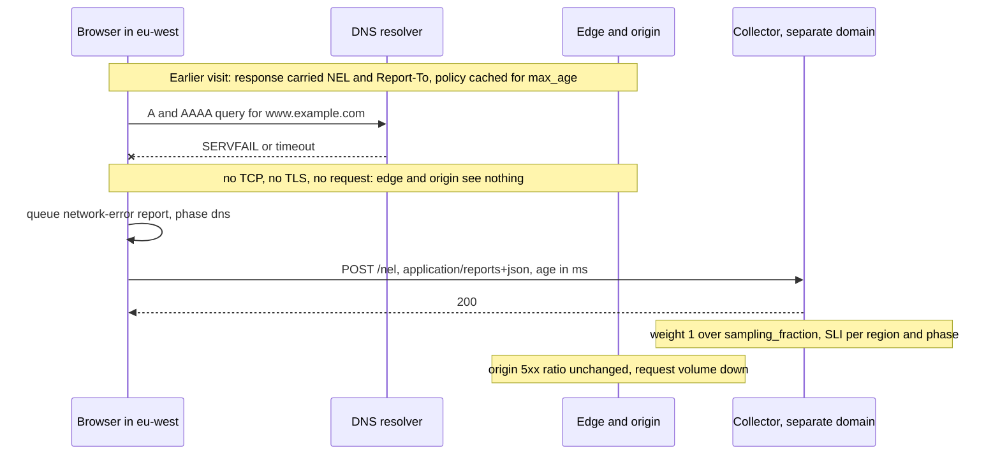

# Why Origin Metrics Miss Network and DNS Outages: Client-Side SLIs, W3C Network Error Logging (NEL), and Synthetic Canary Probes

> [!summary] Claim
> An origin's `5xx` ratio is computed only over requests that reached it, so a DNS, routing, or TLS failure between users and the edge deletes those users from both the numerator and the denominator and leaves the SLI at 100%; only a signal that originates on the client (W3C Network Error Logging reports delivered to a collector in a separate failure domain) or from outside the serving path (synthetic canaries) can see it.

Part of [Observability Profiling and Operations](README.md) in [API Engineering](../README.md).

## TL;DR

- Mechanism: a response header `NEL: {"report_to": "nel", "max_age": 2592000, "success_fraction": 0.01}` plus a `Report-To` endpoint group makes the browser cache a policy, then report its own DNS, TCP, TLS, and HTTP failures and a sampled fraction of successes to a collector (NEL Sections 4.1, 4.2, 5.4).
- Contract: the collector must live in a different failure domain from the origin, accept `POST` with `Content-Type: application/reports+json`, answer the cross-origin `OPTIONS` preflight, return `2xx` on success, and weight every report by `1 / sampling_fraction` before computing an SLI.
- Trap: absence of reports is "unknown", never "healthy", and a collector on the failing domain produces exactly zero reports from the blackholed region, which looks identical to a quiet region.
- Portability: NEL rides on the legacy `Report-To` header, not `Reporting-Endpoints` (Chrome documentation), the implementation read here is Chromium's, and this lab ran on CPython 3.14.6 only (as of 2026-11).
- When not to use it: native mobile and server-to-server clients never send NEL, so use SDK telemetry or canaries there, and do not use NEL as the only page source because it reports only from returning users whose policy is cached and whose browser supports it.

## Mental model



The arrows show who can observe what.
Everything to the right of the failed DNS query is silent, so the origin's counters report no errors and merely fewer requests.
The browser is the only party that knows a user tried and failed, and it remembers that fact in a report queue (a Reporting API cache) until it can reach a collector.
The report goes to a host that does not depend on the failing resolver path, which is the property the NEL specification's note on `report_to` asks for (NEL Section 4.1.1).
The collector converts sampled reports back into an estimated population ratio, and that ratio is the client-side SLI.

## How it works

### The arithmetic of the blind spot

Let `N` requests per minute be offered, let a fraction `f` of users sit behind a failure that prevents any request from arriving, and let `e` be the per-request `5xx` probability among requests that do arrive.
The origin sees `n = (1 - f) * N` requests and `e * n` errors, so its ratio is `e * n / n = e`, independent of `f`.
The only origin-side trace of the outage is the volume drop to `(1 - f)` of baseline, which is why the lab pairs the ratio with `volume_ratio` and why a volume alert needs a seasonal baseline to avoid paging at every night trough.
The same cancellation applies at the edge: an edge that never completed a TLS handshake logs no request line.
The SRE book states the general principle: black-box monitoring is symptom-oriented and catches active problems, while white-box monitoring inspects internals ([Monitoring Distributed Systems](https://sre.google/sre-book/monitoring-distributed-systems/), Black-Box Versus White-Box).
An origin `5xx` counter is white-box with respect to the user journey, because it can only see what reached the box.
The ratio definition belongs to [[SLIs-SLOs-Error-Budgets-and-Multi-Window-Burn-Rate-Alerting]] and the counters to [[RED-and-USE-Metrics-and-OpenTelemetry-HTTP-Semantic-Conventions]]; this note adds the vantage points that sit upstream of both.

| Failure point | Origin `5xx` ratio | Edge access log | NEL report | Canary probe |
| --- | --- | --- | --- | --- |
| Resolver or authoritative DNS unreachable | unchanged, volume drops | no line | `dns.*` from returning users | `dns` phase failure from probing regions |
| BGP or anycast blackhole to one region | unchanged | no line | `tcp.timed_out` or `tcp.address_unreachable` if the collector is reachable | `connection` phase failure from that region only |
| Expired or mismatched certificate | unchanged | no line (handshake aborted) | `tls.cert.date_invalid` or `tls.cert.name_invalid` | `connection` phase failure everywhere |
| Edge healthy, origin returns `503` | rises | `503` line | `http.error` with `status_code` 503 | `application` phase failure |
| ISP-specific fault, probes elsewhere healthy | unchanged | no line | yes, from users on that ISP | nothing, unless a probe sits inside that ISP |

### The NEL header and the policy cache

The `NEL` header value is a `json-field-value`: a JSON list written without its outer brackets, so a single object `{...}` is the common form (NEL Section 4.1).
Members are `report_to` (string, required unless removing), `max_age` (non-negative integer seconds, required), `include_subdomains` (boolean), `success_fraction` and `failure_fraction` (numbers in 0.0 to 1.0), and, in the 2025-05-05 Working Draft only, `request_headers` and `response_headers` (NEL Sections 4.1.1 to 4.1.7).
The user agent ignores a `NEL` header delivered through a `meta` element, ignores unknown members, and processes it only for a potentially trustworthy origin (NEL Sections 4.1 and 4.2).
Section 4.2 is the algorithm the lab mirrors:

1. Abort if the origin is not potentially trustworthy or there is no `NEL` header.
2. Parse with the `json-field-value` algorithm and abort on error or an empty list.
3. Take the first list element, abort if `max_age` is missing or not a number.
4. If `max_age` is 0, delete the origin's policy and stop; `report_to` is not required for this branch.
5. Abort unless `report_to` is a string and any present fraction is in range.
6. Store a policy keyed by (network partition key, origin) whose `received IP address` is the address that served the response, replacing any existing entry.

Two clauses in the 2025 draft disagree: Section 4.1 says the user agent processes "the first valid policy", while Section 4.2 takes the first element and aborts if it is invalid.
The lab follows Section 4.2, and the test `test_nel_only_the_first_list_element_is_considered` pins both halves.
Chromium sidesteps the question by parsing the whole header as one JSON object and rejecting anything else (chromium `net/network_error_logging/network_error_logging_service.cc`, `ParseHeader`, read 2026-11-21), so a header with two comma-separated objects fails entirely there.

A policy is expired when `now - creation > max_age` and stale when `now - creation > 172800` seconds, that is 48 hours (NEL Section 3.4).
Staleness does not stop reporting: Section 5.4 deletes a stale policy only after generating the current report, so a policy with a 30-day `max_age` still produces one more sampled report after hour 48 and then disappears until the next response carrying `NEL` renews it.
An unsampled request returns before the deletion step, so with a low sampling rate a stale policy can survive many requests.
The lab test `test_stale_policy_still_reports_once_then_is_deleted` pins this order.
Chromium's lookup is `clock_->Now() < it->second.expires`, which is expired at `now >= creation + max_age`, one boundary instant stricter than the draft's `>` (chromium `network_error_logging_service.cc`, `FindPolicyForReport`).
The policy cache is partitioned by the network partition key so that a policy learned while embedded under one top-level site is not used under another (NEL Sections 3.6 and 9).

Subdomain policies are narrow by design.
`include_subdomains: true` applies the parent's policy to subdomains, but Section 5.4 returns no report for a subdomain when the phase is not `dns`, so a parent policy can reveal a missing DNS record for `new.example.com` but not the behavior of a server the parent does not control (NEL Sections 5.4 and 9).
The 2026-11-02 editor's draft writes the DNS-only restriction into Section 4.1.3 itself.
The `Report-To` group must also set `include_subdomains`, or a subdomain report finds no endpoint and is never delivered (NEL Section 4.1.3 note).
Chromium refuses `include_subdomains` when the origin's registry-controlled suffix is empty, which stops a public suffix from setting a policy for everyone beneath it (chromium `DoOnHeader`; the lab approximates this with a single-label-host check because it has no public suffix list).

### Report generation: phases, types, and the downgrade

A network request has up to three phases in fixed order: `dns`, `connection` (TCP and TLS), and `application` (HTTP exchange) (NEL Sections 3.1 and 3.2).
A request is successful only if a valid HTTP response arrived and its status is not `4xx` or `5xx`, so `404` and `401` are failures for sampling purposes (NEL Section 3.1).
A request blocked for mixed content or a CORS failure, or attempted while the browser is offline, is not a network request and never produces a report (NEL Section 3.1).
Section 5.4 builds the report body:

- always: `sampling_fraction`, `elapsed_time` (milliseconds), `phase`, `type`;
- when the phase is not `dns`: `server_ip` and `protocol` (the ALPN protocol id, empty if unavailable);
- when the phase is `application`: `referrer`, `method`, `status_code`, and, in the 2025 draft, the policy-selected headers.

Successful requests report `phase: "application"` and `type: "ok"`.
Predefined types include `dns.unreachable`, `dns.name_not_resolved`, `dns.failed`, `dns.address_changed`, `tcp.timed_out`, `tcp.closed`, `tcp.reset`, `tcp.refused`, `tcp.aborted`, `tcp.address_invalid`, `tcp.address_unreachable`, `tcp.failed`, `tls.version_or_cipher_mismatch`, `tls.bad_client_auth_cert`, `tls.cert.name_invalid`, `tls.cert.date_invalid`, `tls.cert.authority_invalid`, `tls.cert.invalid`, `tls.cert.revoked`, `tls.cert.pinned_key_not_in_cert_chain`, `tls.protocol.error`, `tls.failed`, `http.error`, `http.protocol.error`, `http.response.invalid`, `http.response.redirect_loop`, `http.failed`, `abandoned`, and `unknown` (NEL Section 6).
User agents may add dot-delimited types, and Chromium does: its table adds `dns.timed_out`, `dns.protocol`, `dns.server`, `tls.unrecognized_name_alert`, `h2.ping_failed`, `h2.protocol.error`, `h3.protocol.error`, and several `http.response.invalid.*` and `http.response.headers.*` types, and it maps `ERR_ABORTED` to `abandoned` (chromium `network_error_logging_service.cc`, `kErrorTypes`).
A collector therefore must not enumerate a closed type set; the lab's `parse_reports` accepts any string `type` and validates only `phase`.

Report-to-server IP binding is the privacy rule with the largest operational effect.
Each policy remembers the IP address that delivered it; if a later request's `server_ip` differs, Section 5.4 rewrites the report to `phase: "dns"`, `type: "dns.address_changed"` and clears `status_code`, `elapsed_time`, `request_headers`, and `response_headers`, because the user agent can prove the domain owner sent the policy but not that the new server belongs to the same owner (NEL Sections 5.4, 7.5, 9).
For a round-robin or anycast origin this downgrades a large share of failure reports, so the collector sees `dns.address_changed` where an operator wanted `tcp.reset`.
Chromium also downgrades when any other address contacted during the request differs from the policy address (`other_server_ips` in `DoOnRequest`), which interacts with Happy Eyeballs: a client may try a second address 250 ms after the first (RFC 8305 Section 5), so a fault on one of two addresses can surface as `dns.address_changed` rather than a connection error.
The lab encodes the single-address rule in `generate_report`:

```python
def generate_report(
    cache: PolicyCache, outcome: RequestOutcome, *, now: float, roll: float
) -> NelReport | None:
    """NEL 5.4 with the sampling shortcut Chromium uses (a rate of 0.0 never reports)."""
    origin = Origin.parse(outcome.url)
    if not origin.trustworthy:
        return None
    policy = cache.choose(origin, now)
    if policy is None:
        return None
    http_error = 400 <= outcome.status_code < 600
    failed = outcome.error is not None or http_error
    if outcome.error is not None:
        phase: str = outcome.error.phase
        kind = outcome.error.type
    else:
        phase, kind = "application", "ok"
    if http_error:
        phase, kind = "application", "http.error"
    rate = policy.failure_fraction if failed else policy.success_fraction
    if rate <= 0.0 or (rate < 1.0 and roll >= rate):
        return None
    if phase != "dns" and policy.include_subdomains and policy.origin != origin:
        return None
    status, elapsed = outcome.status_code, outcome.elapsed_ms
    if phase != "dns" and outcome.server_ip and outcome.server_ip != policy.received_ip:
        phase, kind, status, elapsed = "dns", "dns.address_changed", 0, 0
    if policy.stale(now):
        cache.discard(policy)
    body: dict[str, object] = {
        "referrer": outcome.referrer,
        "sampling_fraction": rate,
        "server_ip": outcome.server_ip,
        "protocol": outcome.protocol,
        "method": outcome.method,
        "status_code": status,
        "elapsed_time": elapsed,
        "phase": phase,
        "type": kind,
    }
    return NelReport(
        url=_report_url(outcome.url, phase),
        user_agent=outcome.user_agent,
        body=body,
        group=policy.report_to,
        timestamp=now,
    )
```

For `dns` and `connection` phase reports the report `url` loses its path and query, and every report loses its fragment (NEL Section 5.5); the lab's `_report_url` does the same.
Chromium differs: `DoOnRequest` queues `details.uri` with no phase-dependent clearing, and `ReportingServiceImpl::QueueReport` strips only username, password, and fragment through `GURL::GetAsReferrer()` (chromium `network_error_logging_service.cc` and `reporting_service.cc`, read at `main` 2026-11-21), so Chromium `dns` and `connection` reports keep the path and query.

Sampling is where the draft and the implementation differ most sharply.
The draft draws `roll` in the closed interval 0.0 to 1.0 and drops the report when `roll > rate`, so a rate of 0.0 with `roll == 0.0` would still report; Chromium short-circuits `rate <= 0.0` to "never" and `rate >= 1.0` to "always" and otherwise drops when `RandDouble() >= rate` (`SampleAndReturnFraction`).
Chromium does not range-check the fractions on parse (a `TODO(chlily)` in `ParseHeader` says it should), whereas the draft aborts the header on an out-of-range value; the lab rejects them, and `test_nel_invalid_header_is_ignored_entirely` pins `1.5`, `-0.1`, `NaN`, and a boolean.
Defaults matter: with no `success_fraction` no success is ever reported, so a policy of `{"report_to": "nel", "max_age": 60}` can compute only a failure count, never a rate (NEL Section 4.1.4).

### Reporting API: groups, endpoints, and delivery

NEL does not deliver anything itself; it queues a `network-error` report to the endpoint group named by `report_to`, and the Reporting API machinery uploads it (NEL Section 5.5).
Two header generations exist and they are not interchangeable.

| Aspect | `Report-To` (legacy, Reporting API WD 2018-09-25) | `Reporting-Endpoints` (Reporting API WD 2025-06-11) |
| --- | --- | --- |
| Value | `json-field-value`, objects with `group`, `max_age`, `endpoints` (Section 3.1) | Structured Field Dictionary of String URLs (Section 3.2, RFC 9651 Section 3.2) |
| Scope | Origin-wide, persists for `max_age` | Per document or worker |
| Failover | `priority` and `weight` per endpoint, SRV-style | none |
| Carries NEL | yes | no: Chrome documents NEL as unsupported with the v1 header |

The current editor's drafts split further: `w3c.github.io/reporting` is document-centered and `network-reporting.html` (editor's draft 2026-09-22) moves origin-wide groups into an Origin Policy manifest member `network_reporting_endpoints`, and both say they may change at any moment.
Production NEL in 2026-11 therefore still means sending `Report-To`, as Cloudflare does for zones with NEL enabled (group `cf-nel`, `max_age` 31536000, [Cloudflare NEL overview](https://developers.cloudflare.com/network-error-logging/)).

Endpoint selection is the DNS SRV algorithm (Reporting WD 2018 Section 4.3): drop pending endpoints, keep only the lowest `priority` value, then pick by `weight` with a random number in `[0, total)`.
The lab's version:

```python
def choose_endpoint(group: EndpointGroup, now: float, rand: float) -> Endpoint | None:
    """Reporting WD 4.3: lowest priority class among non-pending endpoints, then weighted pick."""
    if group.expired(now):
        return None
    eligible = [e for e in group.endpoints if not e.pending(now)]
    if not eligible:
        return None
    best = min(e.priority for e in eligible)
    klass = [e for e in eligible if e.priority == best]
    total = sum(e.weight for e in klass)
    if total == 0:
        return klass[0]
    target = rand * total
    for endpoint in klass:
        if target < endpoint.weight:
            return endpoint
        target -= endpoint.weight
    return klass[-1]
```

Delivery (Reporting WD 2018 Sections 4.4 and 4.5) POSTs a JSON array of `{age, type, url, user_agent, body}` objects with `Content-Type: application/reports+json`; `age` is milliseconds since the report was generated, because client clocks are unreliable (Section 4.5 note and Section 11.2, Clock Skew).
`2xx` is success and removes the reports, `410 Gone` removes the endpoint but keeps the reports for other endpoints, and anything else is a failure that increments the endpoint's `failures` and sets a user-agent-chosen `retry_after`, for which the draft encourages exponential backoff with jitter (Sections 4.4 and 4.5; RFC 9110 Section 15.5.11 defines `410`).
The 2018 draft's upload request sets credentials mode `"include"` (Section 4.5); Chromium departs from that for cross-origin collectors, as below.
Chromium's numbers (chromium `net/reporting/reporting_policy.h` and `reporting_policy.cc`, read 2026-11-21):

- one delivery attempt per minute at most (`delivery_interval`);
- queue capped at 100 reports, the oldest evicted;
- report discarded after 5 attempts or 15 minutes queued (`max_report_attempts`, `max_report_age`, enforced in `reporting_garbage_collector.cc`);
- backoff initial 60 s, factor 2.0, jitter 0.1;
- reports are not persisted across restarts by default (`persist_reports_across_restarts = false`), while client configurations are (`persist_clients_across_restarts = true`);
- an endpoint group unused for 7 days is deleted (`max_group_staleness`), and at most 40 endpoints are kept per origin (`max_endpoints_per_origin`, which a `TODO(chlily)` in the header says is really per network anonymization key and origin pair), 1000 overall (`max_endpoint_count`).

The uploader adds two behaviors the specifications leave out (chromium `net/reporting/reporting_uploader.cc`, `StartUpload`, `HandlePreflightResponse`, `ResponseCodeToOutcome`).
A collector on the same origin as the reports it receives skips the preflight; any other collector first gets an `OPTIONS` request with `Origin`, `Access-Control-Request-Method: POST`, and `Access-Control-Request-Headers: content-type`, and the preflight must return `2xx` with `Access-Control-Allow-Origin` of `*` or the report origin and `Access-Control-Allow-Headers` of `*` or `content-type`, or the upload is a failure.
Cross-origin uploads carry no credentials, and a redirect to a non-cryptographic URL cancels the upload.
The lab reproduces the acceptance rule in `chromium_preflight_accepts` and gives the collector an `OPTIONS` route; the same preflight mechanics are covered in [[CORS-Protocol-Internals-Preflight-Caching-and-Origin-Reflection-Exploits]].
A loop guard exists because uploads are themselves requests: `kMaxNestedReportDepth = 1` stops a broken collector from generating NEL reports about NEL uploads without bound (`network_error_logging_service.cc`).

### From reports to a client-side SLI

The collector converts each report into an event with a region, a phase and type, a status, and a weight.
Event time is `receive_time - age`, never a client timestamp, which makes the pipeline immune to client clock skew (Reporting WD 2018 Section 4.5 note and Section 11.2).
Each report represents `1 / sampling_fraction` requests, so successes sampled at 1% count 100 each and failures sampled at 100% count 1 each; without the weights a region with 10 success and 10 failure reports looks 50% available when, at 1% success sampling, it is `1000 / 1010`, about 99.0% available.
The test `test_inverse_probability_weighting_corrects_the_success_sampling_bias` computes the same correction at a `sampling_fraction` of 0.1: 10 successes weighted 10 each against 10 failures gives `100 / 110` (about 0.909), not `0.5`.
The estimator is the ratio of two inverse-probability-weighted sums, so its variance grows when few failure reports back a large success weight; the lab guards with `min_reports` before it will flag a region.
A window with zero reports has `sli = None`, never `1.0`, because a blackhole that also strands the collector is indistinguishable from silence.

Classification is a policy decision, not a protocol fact.
The draft counts every `4xx` as a failure for sampling (NEL Section 3.1), but an availability SLI normally excludes client errors, as argued in [[SLIs-SLOs-Error-Budgets-and-Multi-Window-Burn-Rate-Alerting]], so the collector reads `status_code` and treats `http.error` below 500 as good unless a strict mode asks otherwise.
Region and ASN come from the collector's geolocation of the connecting client IP, because a NEL report body carries no client address; Cloudflare states it derives client ASN, country, and metro this way and keeps no client IP afterward ([Cloudflare NEL overview](https://developers.cloudflare.com/network-error-logging/), Privacy).
The lab stands in with an invented `x-lab-client-region` request header, which is not part of any standard.
The comparison step is the point of the whole system:

```python
def edge_origin_gap(
    *,
    origin: Mapping[str, OriginWindow],
    baseline_requests: Mapping[str, int],
    store: ReportStore,
    start: float,
    end: float,
    slo: float = 0.999,
    min_reports: int = 20,
) -> list[RegionVerdict]:
    """Flag regions where users fail while the origin's own 5xx ratio still meets the SLO."""
    verdicts: list[RegionVerdict] = []
    for region in sorted(set(origin) | set(baseline_requests)):
        window = origin.get(region, OriginWindow(0, 0))
        client = store.window(region, start, end)
        baseline = baseline_requests.get(region, 0)
        ratio = window.requests / baseline if baseline else None
        client_sli = client.sli
        origin_ok = window.sli is None or window.sli >= slo
        blind = (
            client_sli is not None
            and client.reports >= min_reports
            and client_sli < slo
            and origin_ok
        )
        verdicts.append(RegionVerdict(region, window.sli, client_sli, client.reports, ratio, blind))
    return verdicts
```

A region is a blind spot only if reports exist in volume, the weighted client SLI is below the SLO, and the origin looks healthy or has no data.
That last clause is deliberate: an origin that records nothing for a region (zero requests) is exactly the signature of a total blackhole.

### Synthetic canaries: the other vantage point

A canary probes the same user journey on a fixed schedule from chosen vantage points and records the failing phase using the NEL vocabulary, so one dashboard joins both sources.
The lab splits a probe into `dns` (20 ms), `connection` (60 ms), and `application` (30 ms) stages, stops at the first injected fault, and charges a 3000 ms timeout to any fault whose type ends in `timed_out`; those latencies are lab constants, not measurements.
The state machine needs consecutive failures to open and consecutive successes to close, because a single failed probe from one vantage point is routine noise:

```python
class CanaryRunner:
    """Consecutive-failure state machine with hysteresis on recovery."""

    def __init__(self, *, fail_threshold: int = 3, recover_threshold: int = 2) -> None:
        self.fail_threshold = fail_threshold
        self.recover_threshold = recover_threshold
        self._tracks: dict[str, _RegionTrack] = defaultdict(_RegionTrack)

    def observe(self, result: ProbeResult) -> Literal["opened", "closed"] | None:
        track = self._tracks[result.region]
        track.last = result
        if result.ok:
            track.failures = 0
            if track.state == "failing":
                track.successes += 1
                if track.successes >= self.recover_threshold:
                    track.state, track.successes = "healthy", 0
                    return "closed"
                return None
            track.state = "healthy"
            return None
        track.successes = 0
        track.failures += 1
        if track.failures >= self.fail_threshold:
            opened = track.state != "failing"
            track.state = "failing"
            return "opened" if opened else None
        if track.state != "failing":
            track.state = "suspect"
        return None

    def state(self, region: str) -> CanaryState:
        return self._tracks[region].state

    def classify(self, regions: Iterable[str]) -> str:
        """`none`, `regional:<sorted regions>`, or `global` when every region fails in one phase."""
        failing = {r: self._tracks[r] for r in regions if self._tracks[r].state == "failing"}
        every = list(regions)
        if not failing:
            return "none"
        phases = {t.last.phase for t in failing.values() if t.last is not None}
        if len(failing) == len(every) and len(phases) == 1:
            return "global"
        return "regional:" + ",".join(sorted(failing))
```

With a 60 s interval and a threshold of 3, an incident opens on the third consecutive failing round, 120 s after the first failing probe, which `detection_delay_seconds` computes and the end-to-end canary test asserts; since the fault can begin just after a probe, the worst case from onset is `threshold * interval = 180 s` by arithmetic.
`CanaryRunner.classify` reports `global` only when every vantage point fails in the same phase and `regional:<names>` otherwise, which separates "our edge is down" from "one region cannot reach us".
Canaries answer "is it down from here, right now" with a deterministic cadence and no dependence on user behavior or browser support, but their vantage points are data centers: `test_canary_vantage_points_do_not_see_an_isp_specific_fault` shows a fault limited to one residential ISP never trips a probe in `us-east` or `eu-west`.
NEL has the opposite profile: real users and real ISPs, but only returning users with a cached policy, a supporting browser, and a reachable collector.
Use both; the principal's-view section covers how to combine them.

### What the resolver does to the signal

Recursive resolvers deliberately mask short outages.
RFC 8767 lets a resolver answer from expired cache when it cannot refresh: stale answers carry a RECOMMENDED TTL of 30 seconds, the recommended client response timer is 1.8 seconds, failed refreshes are recommended no more often than every 30 seconds, and the suggested maximum stale timer is 1 to 3 days (RFC 8767 Sections 4 and 5); separately, Section 4 amends the TTL definition to recommend capping received TTLs at 604,800 seconds (7 days).
Negative answers are cached too, because negative caching stopped being optional in RFC 2308 (RFC 2308 Section 8).
The consequence for detection is asymmetric: an authoritative outage reaches users staggered over each record's TTL, so NEL reports and canary failures ramp up gradually and recovery ramps down the same way, as AWS's account of the October 2025 event shows ("customers were able to resolve the DynamoDB endpoint and establish successful connections as cached DNS records expired between 2:25 AM and 2:40 AM", [AWS post-event summary](https://aws.amazon.com/message/101925/)).
Canaries that use a long-lived local resolver cache can lag the same way, so the probe should resolve with caching disabled or with a TTL cap if it is meant to measure the authoritative path; whether a given probe agent does this is a property of the agent and is not covered by the sources read here.
Connection setup also hides single-address faults: Happy Eyeballs starts a second connection attempt after a "Connection Attempt Delay" with a recommended default of 250 milliseconds (RFC 8305 Section 5), so a blackholed address usually costs users 250 ms rather than an error, and the failed first attempt appears only as a larger `elapsed_time` on a successful request.
The `elapsed_time` field and the `success_fraction` stream are how such partial degradation shows up.

## Numbers and limits

| Quantity | Value | Source |
| --- | --- | --- |
| NEL policy `stale` threshold | 172800 s (48 hours) | NEL Section 3.4 (2025-05-05 WD and 2026-11-02 editor's draft) |
| Policy removal | `max_age` of 0 | NEL Section 4.1.2 |
| Default `success_fraction` / `failure_fraction` | 0.0 / 1.0 | NEL Section 4.2 |
| Chromium header size cap, NEL and `Report-To` | 16 KiB (`kMaxJsonSize = 16 * 1024`) | chromium `network_error_logging_service.cc`, `reporting_service.cc` |
| Chromium JSON depth cap | 4 (NEL), 5 (`Report-To`) | same files |
| Chromium NEL policies kept | 1000 (`kMaxPolicies`), stalest evicted | `network_error_logging_service.cc` |
| Chromium report queue | 100 reports, 5 attempts, 15 min, 1 min delivery interval | `reporting_policy.h`, `reporting_garbage_collector.cc` |
| Chromium endpoint limits | 40 per origin (per NAK and origin pair), 1000 total, group unused 7 days is dropped | `reporting_policy.h` |
| Chromium backoff | 60 s initial, factor 2.0, jitter 0.1 | `reporting_policy.cc` |
| Nested NEL-on-upload depth | 1 | `network_error_logging_service.cc`, `kMaxNestedReportDepth` |
| Reporting GC suggestions | about 5 attempts, about 2 days, about a week unused (non-normative) | network-reporting editor's draft Section 6.2 |
| RFC 8767 stale TTL / client timer / recheck / max stale | 30 s / 1.8 s / 30 s / 1 to 3 days | RFC 8767 Sections 4 and 5 |
| Happy Eyeballs attempt delay | 250 ms recommended | RFC 8305 Section 5 |
| Canary open delay, 60 s interval, threshold 3 | 120 s from first failing probe, 180 s worst case from onset | lab test and arithmetic |
| Lab module | 78 tests, `78 passed in 1.60s` on the verification run | `uv run --frozen pytest <module> -q` from `labs/`, CPython 3.14.6, Darwin 27.3.0 arm64 (macOS 27.3), 2026-11-21 |

The lab duration is a smoke number, not a benchmark.
Sampling-cost arithmetic (not measured): at 10,000 requests per second and `success_fraction` of 0.01 the collector ingests about 100 success reports per second before failures, and at `1.0` it would ingest 10,000 per second, which is why `success_fraction` defaults to 0.0 and is set per origin.

## Portability

| Dimension | Result | Evidence |
| --- | --- | --- |
| CPython 3.14.6 (workspace interpreter) | 78 passed | verification run, `uv run --frozen pytest ... -q`, Darwin 27.3.0 arm64, 2026-11-21 |
| CPython 3.12, 3.13, 3.15, 3.15t | not run | the user paused lab matrix checks on 2026-11-11; the module uses only the standard library plus Starlette 1.10.0 and httpx 0.28.1, but that is a prediction, not a result |
| Uvicorn, Hypercorn, Granian | not run | the collector is tested in-process with `httpx.ASGITransport`; no server was started |
| HTTP/1.1, HTTP/2, HTTP/3 | protocol-independent | the report body carries the ALPN id in `protocol` (NEL Section 5.4, example `h2`), and Chromium emits `h2.protocol.error` and `h3.protocol.error` types (`network_error_logging_service.cc`) |
| Chromium | implements NEL and `Report-To` | source read at `main` on 2026-11-21; version-pinned behavior is not claimed |
| Firefox, Safari | no `NEL` support: MDN browser-compat-data records `NEL` as Chrome 71 (Edge mirrors Chrome), Firefox `false`, Safari `false` (as of 2026-11); the Chrome documentation table also lists NEL as unsupported for the `Reporting-Endpoints` generation in every column | [MDN BCD `http/headers/NEL.json`](https://raw.githubusercontent.com/mdn/browser-compat-data/main/http/headers/NEL.json), [Chrome Reporting API guide](https://developer.chrome.com/docs/capabilities/web-apis/reporting-api) |
| NEL specification | W3C Working Draft 2025-05-05 at `/TR/`, newer Working Draft 2026-11-02 at the editor's draft URL | both fetched 2026-11-21; the newer text drops `request_headers`, `response_headers`, and the two header-extraction Sections 5.2 and 5.3, so report generation and delivery move from 5.4 and 5.5 to 5.2 and 5.3 |
| Chromium body shape | emits `referrer`, `sampling_fraction`, `server_ip`, `protocol`, `method`, `status_code`, `elapsed_time`, `phase`, `type` for every phase, no header members | `CreateReportBody` in `network_error_logging_service.cc` |

## Worked example

The [implementation](../labs/src/api_labs/f18_observability_profiling_and_operations/client_side_telemetry.py) models the browser side (`PolicyCache`, `generate_report`, `ReportingCache`), the collector (`create_collector_app`, `ReportStore`), the SLI and gap check (`edge_origin_gap`), and the canary (`SimulatedNetwork`, `CanaryRunner`).
The [test](../labs/tests/f18_observability_profiling_and_operations/test_client_side_telemetry_network_error_logging_nel_and_edge_vs_origin_gap.py) holds 78 tests, each marked `@pytest.mark.unit`; none opens a socket.
The header parser is the first piece (byte-identical to the lab file):

```python
def parse_nel_header(
    value: str, *, origin: Origin, received_ip: str, now: float
) -> NelPolicy | PolicyRemoval | None:
    """Apply NEL 4.2 to the first list element; None means the header is ignored."""
    if not origin.trustworthy:
        return None
    items = _wrap_json_list(value)
    if not items:
        return None
    item = _as_dict(items[0])
    if item is None:
        return None
    max_age = item.get("max_age")
    if not _is_int(max_age) or cast("int", max_age) < 0:
        return None
    if max_age == 0:
        return PolicyRemoval(origin)
    report_to = item.get("report_to")
    if not isinstance(report_to, str):
        return None
    fractions: dict[str, float] = {}
    for key, default in (("success_fraction", 0.0), ("failure_fraction", 1.0)):
        raw = item.get(key, default)
        if not _is_number(raw) or not 0.0 <= cast("float", raw) <= 1.0:
            return None
        fractions[key] = float(cast("float", raw))
    include = item.get("include_subdomains") is True
    if include and "." not in origin.host:
        return None  # stand-in for "an eTLD may not set include_subdomains"
    return NelPolicy(
        origin=origin,
        received_ip=received_ip,
        report_to=report_to,
        max_age=cast("int", max_age),
        include_subdomains=include,
        success_fraction=fractions["success_fraction"],
        failure_fraction=fractions["failure_fraction"],
        created=now,
    )
```

The end-to-end scenario simulates 100 returning clients in each of two regions.
`us-east` clients succeed and `eu-west` clients cannot resolve `www.example.com`.
Each client has a primed policy with `success_fraction` 0.1, so exactly 10 of 100 evenly spaced rolls sample a success.
Reports travel through a real `ReportingCache.deliver` into the Starlette collector over `httpx.ASGITransport`.
The fleet driver (byte-identical):

```python
async def run_fleet(*, collector_url: str, store: ReportStore) -> None:
    """100 returning clients per region; eu-west cannot resolve www.example.com."""
    app = create_collector_app(store, FakeClock(2000.0))
    header = '{"report_to": "nel", "max_age": 2592000, "success_fraction": 0.1}'
    report_to = (
        f'{{"group": "nel", "max_age": 2592000, "endpoints": [{{"url": "{collector_url}"}}]}}'
    )
    rolls = Rolls(100)
    async with client_for(app) as http:
        for region in ("us-east", "eu-west"):

            async def send(url: str, payload: bytes, region: str = region) -> int | None:
                if Origin.parse(url).host == "www.example.com" and region == "eu-west":
                    return None
                resp = await http.post(
                    "/nel",
                    content=payload,
                    headers={"content-type": REPORTS_CONTENT_TYPE, "x-lab-client-region": region},
                )
                return resp.status_code

            for _ in range(100):
                policies = primed(header)
                outcome = (
                    RequestOutcome("https://www.example.com/", error=DNS_FAIL)
                    if region == "eu-west"
                    else RequestOutcome("https://www.example.com/", status_code=200, server_ip=IP)
                )
                report = generate_report(policies, outcome, now=1990.0, roll=rolls.next())
                if report is None:
                    continue
                reporting = ReportingCache()
                parsed = parse_report_to(report_to, now=1990.0)
                assert parsed is not None
                reporting.apply_report_to(parsed)
                reporting.enqueue(report)
                await reporting.deliver(2000.0, send)
```

With the collector on a separate host, the origin looks perfect and NEL does not:

```python
@pytest.mark.unit
@pytest.mark.asyncio
async def test_regional_dns_blackhole_is_invisible_to_origin_but_visible_to_nel() -> None:
    store = ReportStore()
    await run_fleet(collector_url="https://reports.example.net/nel", store=store)
    verdicts = {
        v.region: v
        for v in edge_origin_gap(
            origin={"us-east": OriginWindow(100, 0), "eu-west": OriginWindow(0, 0)},
            baseline_requests={"us-east": 100, "eu-west": 100},
            store=store,
            start=0.0,
            end=3000.0,
        )
    }
    assert store.window("us-east", 0.0, 3000.0).reports == 10
    assert store.window("eu-west", 0.0, 3000.0).reports == 100
    assert verdicts["us-east"].client_sli == 1.0
    assert verdicts["us-east"].blind_spot is False
    assert verdicts["eu-west"].origin_sli is None
    assert verdicts["eu-west"].client_sli == 0.0
    assert verdicts["eu-west"].volume_ratio == 0.0
    assert verdicts["eu-west"].blind_spot is True
    assert store.failure_types("eu-west", 0.0, 3000.0) == {"dns:dns.name_not_resolved": 100}
```

With the collector on the failing host, the same outage is silent, and the gap check reports `blind_spot is False` because it has nothing to compare:

```python
@pytest.mark.unit
@pytest.mark.asyncio
async def test_collector_on_the_failing_origin_leaves_the_blackhole_unreported() -> None:
    store = ReportStore()
    await run_fleet(collector_url="https://www.example.com/nel", store=store)
    assert store.window("eu-west", 0.0, 3000.0).reports == 0
    assert store.window("us-east", 0.0, 3000.0).reports == 10
    verdict = edge_origin_gap(
        origin={"eu-west": OriginWindow(0, 0)},
        baseline_requests={"eu-west": 100},
        store=store,
        start=0.0,
        end=3000.0,
    )[0]
    assert verdict.client_sli is None
    assert verdict.blind_spot is False
```

Captured run (one execution; the tail is verbatim):

```text
$ cd labs && uv run --frozen pytest tests/f18_observability_profiling_and_operations/test_client_side_telemetry_network_error_logging_nel_and_edge_vs_origin_gap.py -q
........................................................................ [ 92%]
......                                                                   [100%]
78 passed in 1.60s
```

Environment: CPython 3.14.6, pytest 9.2.0, Starlette 1.10.0, httpx 0.28.1, Darwin 27.3.0 arm64 (macOS 27.3), verification run of 2026-11-21.
The duration is a smoke number, not a benchmark.
The scenario assertions are the proof: `us-east` has 10 reports and `client_sli == 1.0`, `eu-west` has 100 reports of `dns:dns.name_not_resolved` and `client_sli == 0.0`, the origin's `eu-west` ratio is `None` with `volume_ratio == 0.0`, and with the coupled collector `eu-west` has 0 reports.

## Pitfalls

> [!warning] The collector shares the failure domain of the thing it monitors
> Trigger: `report_to` points at an endpoint on the same registrable domain, DNS provider, CDN, or network as the origin.
> Symptom: the blackholed region produces zero reports, the regional SLI is `None`, and the dashboard shows a quiet region while users are fully down; queued reports are dropped after 15 minutes or 5 attempts.
> Fix: NEL Section 4.1.1 asks for at least one endpoint "in an alternative origin whose infrastructure is not coupled with the origin" plus multiple endpoints; in practice that means a different registrable domain, authoritative DNS provider, and network, with at least two endpoints in `priority` classes.
> The lab proves both outcomes in `test_regional_dns_blackhole_is_invisible_to_origin_but_visible_to_nel` and `test_collector_on_the_failing_origin_leaves_the_blackhole_unreported`.

> [!warning] Cross-origin collector without an `OPTIONS` handler
> Trigger: the collector route accepts only `POST`, which is the natural Starlette or FastAPI definition.
> Symptom: Chromium sends the preflight first, the framework answers `405 Method Not Allowed` (RFC 9110 Section 15.5.6; starlette 1.10.0 starlette/routing.py, Route.handle, returns `405` with an `Allow` header for any method outside `methods`), the preflight fails, and no report is ever uploaded, with nothing in the collector's logs except `OPTIONS` lines.
> Fix: answer `OPTIONS /nel` with `2xx`, `Access-Control-Allow-Origin`, and `Access-Control-Allow-Headers: content-type` (chromium `HandlePreflightResponse`); same-origin collectors skip the preflight, which hides the bug in staging.

> [!warning] Reading "no reports" as "no problem", or averaging unweighted reports
> Trigger: a dashboard plots failure report count, or the ratio of raw report counts, per region.
> Symptom: a region with 1% success sampling shows 50% availability from a 10-and-10 sample, and a region with no returning users with cached policy shows nothing at all.
> Fix: weight by `1 / sampling_fraction`, return `None` for empty windows, require a minimum report count before alerting, and pair the client SLI with canary state.

> [!warning] Counting every `4xx` as an outage
> Trigger: the collector treats `type == "http.error"` as bad because NEL Section 3.1 calls `4xx` a failure.
> Symptom: a deploy that tightens validation or a crawler that probes missing paths moves the availability SLI.
> Fix: classify by `status_code` at ingestion and keep a strict mode only for debugging.

> [!warning] Shipping NEL with `Reporting-Endpoints`
> Trigger: a team migrates CSP reporting to `Reporting-Endpoints` and removes `Report-To` to "modernize".
> Symptom: NEL silently stops, because NEL's `report_to` names a group that only `Report-To` defines and Chrome documents NEL as unsupported with the new header.
> Fix: keep `Report-To` for NEL and verify the live header set with a test that fetches the site.

> [!warning] Policy outlives its collector
> Trigger: a collector is decommissioned or its URL changes while `max_age` is 2592000 (30 days) or longer, as in the Cloudflare example's 31536000.
> Symptom: browsers keep queuing reports for a dead endpoint and burn retry budget; changing the header only reaches clients that connect again.
> Fix: return `410 Gone` from the old endpoint, which Chromium treats as "remove this endpoint" and the Reporting draft defines as such (Reporting WD 2018 Section 4.5), and use `max_age` of 0 in `NEL` and `Report-To` to withdraw policies; plan for the long tail.
> A policy and its group can also expire independently: the draft warns that if the Reporting group expires, NEL reports are not delivered even if the NEL policy has not (NEL Section 4.1.2).

> [!warning] Canary pages on one failed probe, or probes only from the origin's own network
> Trigger: alert on a single failure, or run every probe from the same cloud and region as the origin.
> Symptom: either constant false pages from transient loss, or a canary that stays green during a routing fault that only affects other networks.
> Fix: require consecutive failures with hysteresis on recovery as `CanaryRunner` does, probe from several independent networks, and treat a canary as a floor on visibility, not a proxy for every ISP.

> [!warning] Real incident shape: the service is healthy and unreachable
> Trigger: DNS or routing withdraws the path to a healthy fleet.
> Symptom: Facebook's 2021-10-04 account says its DNS servers "became unreachable even though they were still operational" after they withdrew their own BGP advertisements when they lost contact with the data centers ([Meta engineering post](https://engineering.fb.com/2021/10/05/networking-traffic/outage-details/)).
> Cloudflare's 1.1.1.1 resolver was down for 62 minutes, 21:52 to 22:54 UTC on 2025-07-14, after prefixes were withdrawn by a configuration change ([Cloudflare post-incident blog](https://blog.cloudflare.com/cloudflare-1-1-1-1-incident-on-july-14-2025/)).
> AWS reports that a latent race left an empty DNS record for the DynamoDB regional endpoint, so clients could not connect from 11:48 PM PDT on 2025-10-19, and engineers identified DNS as the source at 12:38 AM, 50 minutes in ([AWS post-event summary](https://aws.amazon.com/message/101925/)).
> Fix: none of these posts says what customers' dashboards showed, so this note does not claim NEL or canaries would have alerted sooner; it claims the structural point that those failures sit before the origin's counters.

## Security and robustness

The collector is an unauthenticated, internet-facing write endpoint by construction: Chromium sends no credentials to a cross-origin collector (`HandlePreflightResponse` in `reporting_uploader.cc`), and the request shape is public, so anyone can POST forged reports (OWASP API4:2023 Unrestricted Resource Consumption applies, [OWASP API Security Top 10](https://owasp.org/API-Security/editions/2023/en/0xa4-unrestricted-resource-consumption/)).
Treat every report as untrusted input:

- cap body size before parsing (the lab returns `413` past 64 KiB, RFC 9110 Section 15.5.14), reject other media types with `415` (RFC 9110 Section 15.5.16), and parse with a strict JSON mode, since Python's `json` accepts `NaN` and `Infinity` unless `parse_constant` rejects them;
- validate each report independently and count rejections instead of failing the batch, so one malformed entry does not discard 99 valid ones;
- bound cardinality by normalizing `type` and region before using them as metric labels;
- rate-limit per source network, and require corroboration (a canary or origin volume drop) before paging on a client-side SLI, because a forged flood of `tcp.reset` reports can fabricate an outage.

Privacy is the other half.
The NEL draft warns that a stored policy with a per-user report URI can act as a "supercookie", that reports can leak the user's network configuration, and that DNS rebinding could make browsers send an attacker reports about a server the attacker does not control, which the received-IP check and the `dns`-only subdomain rule mitigate (NEL Section 9).
User agents must clear policies when the user clears browsing data and must refuse `Set-Cookie` on report uploads (NEL Section 9).
Report URLs can carry capability tokens; the draft says developers may need to run their own collectors for that reason, and the Reporting draft notes URL stripping of credentials and fragments (NEL Section 9, Reporting WD 2018 Section 10.1).
Chromium's delivery limits mean a malicious or broken endpoint cannot cause unbounded load on the user agent: 100 queued reports, 5 attempts, exponential backoff, and `kMaxNestedReportDepth = 1`.
Design the collector so its own failure cannot hurt the product: it should be stateless behind a queue, return `2xx` quickly, and never share a database or deploy pipeline with the API, which is the same reasoning as in [[Health-Check-Engineering-Liveness-Readiness-Startup-and-Cascading-Restarts]] about not coupling probes to dependencies.
Policy rollout is a production change: ship `NEL` with `failure_fraction` only first, add `success_fraction` once the collector is sized, and keep a tested `max_age: 0` rollback through [[Feature-Flags-Dynamic-Configuration-and-Safe-Kill-Switches-in-APIs]].

## The principal's view

Make the user journey the SLO and treat the origin SLI as a diagnostic.
Define the availability SLI as "a user's attempt succeeded", then compose it from three sources with different blind spots: the origin ratio and volume (complete for requests that arrive), the canary (deterministic, regional, data-center vantage), and NEL (real users, partial coverage).
Page on the canary opening in a region or on a client-side SLI burn that clears the minimum-sample guard, and open a ticket, not a page, when the gap check says users fail while the origin is clean and no canary agrees.
The burn-rate arithmetic for those pages is in [[SLIs-SLOs-Error-Budgets-and-Multi-Window-Burn-Rate-Alerting]]; the first sixty seconds after the page are in [[The-Sixty-Second-API-Incident-Triage-Playbook]].

Decisions to take explicitly:

- Failure domain of the collector: a different registrable domain, DNS provider, and network from the product, owned by a team that is not on the same deploy train; the cost is a second service to run, and the failure mode of skipping it is a monitor that dies with the thing it monitors.
- Build or buy: a CDN that already terminates the traffic (Cloudflare documents a managed NEL pipeline) removes the collector but couples your telemetry to that vendor's reachability, so keep an independent canary regardless.
- Where NEL does not apply: mobile apps, server-to-server API clients, and browsers without support emit nothing; for those, SDK-level client telemetry and canaries are the only client-side signal, and the SLO must say which population the NEL-derived number represents.
- Spec risk: NEL is a W3C Working Draft with no Recommendation, with a Chromium-centered implementation and a documented gap between the 2025 and 2026 drafts; treat it as an opportunistic signal that can be turned off, never as the sole input to a contractual SLA.
- Privacy and legal review: IP-derived region and ASN, URL contents, and retention are a data-protection decision, so decide retention and aggregation at ingestion, not afterwards.

Choose a different mechanism when the population matters more than the protocol: a first-party RUM beacon from your own JavaScript covers cases NEL cannot (success timing, mobile web views) but cannot report a failure to load the page that carries it, which is precisely the gap NEL exists to close (NEL Section 1).
The deployment side, such as shifting traffic away from a failing region with cells and canary releases, belongs to [[Zero-Downtime-Blue-Green-Canary-and-Cell-Based-API-Deployments]] and [[Envoy-Outlier-Detection-Passive-Health-Checking-and-Panic-Thresholds]].

## Interview questions

> [!question] L5: How can a region that is fully unable to reach your API because of a DNS failure leave your dashboards showing 100% availability?
>
> > [!success]- Answer
> > The origin availability ratio is `1 - errors / requests` over requests that arrived.
> > Users who fail before TCP or TLS completes never produce a request, so they leave both the numerator and the denominator.
> > The ratio stays at the per-request error rate of the traffic that still arrives, and only request volume drops.
> > Detecting it needs a vantage point on the client side of the failure: NEL reports, a canary probe, or a volume-versus-baseline alert.
> >
> > Follow-up: What origin-side signal is still available, and what is its main weakness?

> [!question] L5: What does a `NEL` header of `{"max_age": 0}` do, and why does it not need `report_to`?
>
> > [!success]- Answer
> > It deletes the policy the browser holds for that origin (NEL Section 4.1.2).
> > The processing algorithm checks `max_age` and handles zero before it validates `report_to` (NEL Section 4.2).
> > Nothing is stored afterwards, so no reporting group is needed.
> > The lab test `test_nel_max_age_zero_removes_cached_policy_without_report_to` pins this.
> >
> > Follow-up: Which clients receive the removal, and what happens to clients that never reconnect?

> [!question] L5: Predict the output (`primed` is the test helper that stores a parsed policy for `https://www.example.com`).
> ```python
> half = primed('{"report_to": "nel", "max_age": 60, "failure_fraction": 0.5}')
> bad = RequestOutcome("https://www.example.com/", error=NetworkError("dns", "dns.name_not_resolved"))
> a = generate_report(half, bad, now=1.0, roll=0.499) is not None
> b = generate_report(half, bad, now=1.0, roll=0.5) is not None
> zero = primed('{"report_to": "nel", "max_age": 60, "failure_fraction": 0.0}')
> c = generate_report(zero, bad, now=1.0, roll=0.0) is not None
> print(a, b, c)
> ```
>
> > [!success]- Answer
> > It prints `True False False`.
> > A rate of 0.5 reports when `roll < 0.5` and drops at exactly 0.5, matching Chromium's `RandDouble() >= rate` drop rule.
> > A rate of 0.0 never reports even at `roll == 0.0`, whereas a literal reading of NEL Section 5.4 (`roll > rate` drops) would report there.
> > The test `test_sampling_boundaries_follow_chromium_not_the_literal_spec_roll` asserts exactly these three outcomes.
> >
> > Follow-up: Why does the boundary matter for an operator who sets `failure_fraction` to 0.0 to disable failure reports?

> [!question] L6: You deploy NEL with `report_to` pointing at `https://www.example.com/nel` and a regional DNS outage produces no NEL reports from that region, so what went wrong and how do you fix the design?
>
> > [!success]- Answer
> > The collector shares the failing path: browsers in that region cannot resolve the collector's host either, so reports queue and are dropped after 15 minutes or 5 attempts.
> > Zero reports from a region then looks like silence rather than an outage.
> > Move the collector to a separate registrable domain, DNS provider, and network, and list at least two endpoints with `priority` classes (NEL Section 4.1.1, Reporting WD 2018 Section 4.3).
> > Keep a canary as the independent check, since NEL cannot report its own total blindness.
> >
> > Follow-up: What would you alert on to detect that the collector itself has gone quiet?

> [!question] L6: Debug this API: a team ships this collector and sees `OPTIONS /nel` in logs but no stored reports.
> ```python
> async def ingest(request):
>     if request.headers["content-type"] != "application/json":
>         return JSONResponse({"error": "unsupported"}, status_code=415)
>     ...
> app = Starlette(routes=[Route("/nel", ingest, methods=["POST"])])
> ```
>
> > [!success]- Answer
> > There are two bugs.
> > The route has no `OPTIONS` handler, so Starlette returns `405` and Chromium's cross-origin preflight fails before any `POST` is sent.
> > Even with a preflight fixed, the browser sends `Content-Type: application/reports+json`, so an equality check against `application/json` returns `415` (and `content-type` may carry parameters, so compare the media type only).
> > The lab's collector adds an `OPTIONS` route returning `Access-Control-Allow-Origin` and `Access-Control-Allow-Headers`, and the tests `test_collector_preflight_satisfies_the_chromium_acceptance_check` and `test_collector_rejects_other_media_types_with_415` pin both.
> >
> > Follow-up: Why did staging not show the problem when the collector was same-origin?

> [!question] L6: Why must the collector weight each report by `1 / sampling_fraction`, and what should the SLI be for a region with no reports?
>
> > [!success]- Answer
> > Successes are usually sampled at a low `success_fraction` while failures are sampled at 1.0, so raw counts overrepresent failures.
> > Weighting by `1 / sampling_fraction` makes each report stand in for the requests it sampled, which turns the report mix into a population ratio.
> > With 10 failures at fraction 1.0 and 10 successes at fraction 0.1, the raw ratio is 0.5 and the weighted ratio is `100 / 110`.
> > An empty window has no information, so the SLI is `None`; reporting 1.0 would claim health exactly when a blackhole also hides the reports.
> >
> > Follow-up: What guard keeps a handful of heavily weighted successes from producing a falsely precise SLI?

> [!question] L6: What does the browser report when a request is served from an IP that differs from the one that delivered the policy?
>
> > [!success]- Answer
> > It downgrades the report to `phase: "dns"` and `type: "dns.address_changed"` and clears `status_code`, `elapsed_time`, and the header members (NEL Section 5.4).
> > The browser can verify that the domain owner delivered the policy, but not that the owner of this IP address is the same party, so it reveals only DNS-level information.
> > Chromium extends the check to any other address contacted during the request.
> > Operators with many addresses therefore see `dns.address_changed` where they expected connection or HTTP detail.
> >
> > Follow-up: How would you set up policy delivery so that most reports are not downgraded?

> [!question] L7+: Design the alerting and ownership model for client-side availability across web, mobile, and server-to-server clients.
>
> > [!success]- Answer
> > Define the product SLI by user attempt success and report which population each source covers.
> > Use the origin ratio plus volume-versus-baseline for requests that arrive, canaries for deterministic per-region detection, NEL for returning browser users, and SDK telemetry for mobile.
> > Page on a canary opening in a region (consecutive failures with hysteresis) or on a client SLI burn above a minimum sample, and ticket on the gap check when no canary agrees.
> > Put the collector in a separate failure domain with its own on-call, and write the covered population into the SLO so the number is not over-read.
> >
> > Follow-up: How would you detect that the NEL pipeline itself has silently stopped?

> [!question] L7+: What are the security and privacy risks of running a NEL collector, and what does defense in depth look like?
>
> > [!success]- Answer
> > The endpoint is write-open and unauthenticated by necessity, so reports can be forged, flooded, or crafted to inflate metric cardinality.
> > Reports reveal client network details and URLs that may contain capability tokens, and per-user report URIs can act as supercookies (NEL Section 9).
> > Defenses: size and media-type limits, strict JSON parsing, per-report validation, label normalization, per-network rate limits, corroboration before paging, minimal retention, IP-to-region reduction at ingestion, and no shared datastore with the product API.
> > The browser-side mitigations (HTTPS-only policies, received-IP binding, `dns`-only subdomain reports, cleared on browsing-data deletion, no cookies on uploads) do not protect the collector from abuse.
> >
> > Follow-up: Which of these controls would you drop first under cost pressure, and what risk does that accept?

> [!question] L7+: How do you decide to depend on NEL, given that it is a Working Draft whose 2026 editor's draft changed its shape?
>
> > [!success]- Answer
> > Treat it as an optional signal with a kill switch, not a contractual input.
> > The 2025-05-05 draft and the 2026-11-02 draft differ (the newer one removes `request_headers` and `response_headers` and renumbers sections), Chromium's behavior differs from the text at several boundaries, and MDN browser-compat-data lists no Firefox or Safari support (as of 2026-11), so the population is Chromium-based browsers only.
> > Write the collector to tolerate missing optional fields and unknown `type` values, pin behavior with tests as the lab does, and keep canaries and first-party RUM as independent signals.
> > Reassess when a vendor ships or drops support, since the draft status gives no stability guarantee.
> >
> > Follow-up: What evidence would make you remove NEL from the paging path entirely?

## Related

Prerequisites: [[SLIs-SLOs-Error-Budgets-and-Multi-Window-Burn-Rate-Alerting]]

Next: [[Audit-Logging-for-Regulated-APIs-Tamper-Evident-Hash-Chains-and-Who-Did-What]]

See also: [[RED-and-USE-Metrics-and-OpenTelemetry-HTTP-Semantic-Conventions]], [[Latency-Histograms-Percentiles-DDSketch-and-Why-Averaging-Percentiles-Is-Wrong]], [[Health-Check-Engineering-Liveness-Readiness-Startup-and-Cascading-Restarts]], [[The-Sixty-Second-API-Incident-Triage-Playbook]], [[Trace-Sampling-Strategies-Head-Based-vs-Tail-Based-Sampling]], [[Structured-Logging-with-Structlog-and-Stripe-Canonical-Log-Lines]], [[Feature-Flags-Dynamic-Configuration-and-Safe-Kill-Switches-in-APIs]], [[Outbound-Connection-Pools-Limits-and-DNS-TTL-Staleness]], [[CORS-Protocol-Internals-Preflight-Caching-and-Origin-Reflection-Exploits]], [[TLS-1-3-Handshake-Cipher-Suites-and-ALPN-RFC-9846]], [[X509-Certificates-Chain-Validation-SAN-and-OCSP-Stapling]], [[Zero-Downtime-Blue-Green-Canary-and-Cell-Based-API-Deployments]], [[Envoy-Outlier-Detection-Passive-Health-Checking-and-Panic-Thresholds]]

- Lab: `labs/tests/f18_observability_profiling_and_operations/test_client_side_telemetry_network_error_logging_nel_and_edge_vs_origin_gap.py`

## Further reading

- [W3C Network Error Logging, Working Draft](https://www.w3.org/TR/network-error-logging/): the policy header, the generation algorithm, error types, and the privacy rationale for the IP-change downgrade.
- [Network Error Logging, editor's draft](https://w3c.github.io/network-error-logging/): the 2026-11-02 text showing what changed from the 2025 draft.
- [Reporting API Working Draft, 2018-09-25](https://www.w3.org/TR/2018/WD-reporting-1-20180925/): the only fetched text defining `Report-To`, endpoint selection, delivery, and `410` handling.
- [Reporting API Working Draft, 2025-06-11](https://www.w3.org/TR/reporting-1/): the `Reporting-Endpoints` header generation that does not carry NEL.
- [Network Reporting API, editor's draft](https://w3c.github.io/reporting/network-reporting.html): the proposed origin-policy home for network endpoint groups and the non-normative garbage-collection numbers.
- [Chrome Reporting API guide](https://developer.chrome.com/docs/capabilities/web-apis/reporting-api): the vendor statement on `Report-To` versus `Reporting-Endpoints` and NEL support.
- [Chromium `network_error_logging_service.cc`](https://raw.githubusercontent.com/chromium/chromium/main/net/network_error_logging/network_error_logging_service.cc): the real parser, sampling, downgrade logic, and error-type table.
- [Chromium `reporting_uploader.cc`](https://raw.githubusercontent.com/chromium/chromium/main/net/reporting/reporting_uploader.cc): the CORS preflight rule and outcome mapping that decide whether a collector ever receives a report.
- [Chromium `reporting_policy.h`](https://raw.githubusercontent.com/chromium/chromium/main/net/reporting/reporting_policy.h): the queue, retry, and endpoint limits.
- [RFC 8767, Serving Stale Data](https://www.rfc-editor.org/rfc/rfc8767.txt): why resolvers stagger the visible start and end of a DNS outage.
- [RFC 8305, Happy Eyeballs Version 2](https://www.rfc-editor.org/rfc/rfc8305.txt): why a single dead address often costs 250 ms instead of an error.
- [Google SRE book, Monitoring Distributed Systems](https://sre.google/sre-book/monitoring-distributed-systems/): the black-box versus white-box distinction behind the vantage-point argument.
- [Meta, More details about the October 4 outage](https://engineering.fb.com/2021/10/05/networking-traffic/outage-details/), [Cloudflare, 1.1.1.1 incident on July 14, 2025](https://blog.cloudflare.com/cloudflare-1-1-1-1-incident-on-july-14-2025/), and [AWS, DynamoDB service disruption summary](https://aws.amazon.com/message/101925/): primary postmortems of failures that sit upstream of origin metrics.
