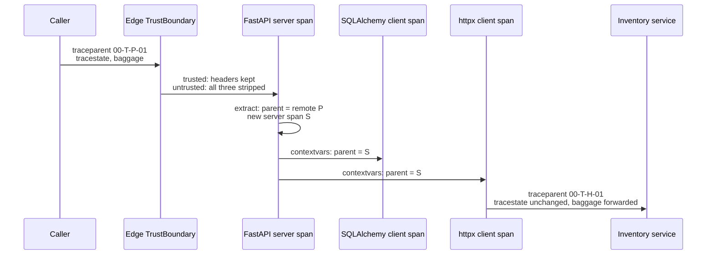

# W3C Trace Context (traceparent, tracestate) and Baggage Propagation Across FastAPI, httpx (0.28.1), and SQLAlchemy (2.1.8)

> [!summary] Claim
> A distributed trace is one `trace-id` carried in a 55-character `traceparent` header whose `parent-id` is rewritten at every hop, `tracestate` is vendor routing data that must be reordered and truncated by whole entries, and `baggage` is an unrelated, unauthenticated key-value channel that crosses every trust boundary you forget to close; the OpenTelemetry Python stack implements all three with specific, testable deviations from the W3C text.

Part of [Observability Profiling and Operations](README.md) in [API Engineering](../README.md).

## TL;DR

- Mechanism: the server span extracts `traceparent` and `tracestate` from the request, makes itself a child of the remote `parent-id`, and every outbound client span injects a fresh `parent-id` (its own span id) into the next hop; SQLAlchemy and httpx spans become children through `contextvars`, not through headers.
- Contract rule: a receiver that cannot parse `traceparent` restarts the trace and must not look at `tracestate` (W3C Trace Context Level 1 Section 3.3 and 4.3); `trace-flags` is a bit field and unknown bits are zeroed on the way out.
- Trap: `baggage` is a separate propagator that keeps flowing after a `traceparent` restart, so an edge that restarts traces but forwards `baggage` leaks and accepts attacker-controlled data across the trust boundary.
- Portability: the pure codecs and the in-process FastAPI -> async SQLAlchemy -> httpx lab pass 76 tests on CPython 3.14.6 here; `opentelemetry-instrumentation-sqlalchemy` 0.66b2 refuses SQLAlchemy 2.1.8 by its own dependency range and emits no spans unless you pass `skip_dep_check=True`.
- When not to use: do not put authorization, identity, or secrets in `baggage` or `tracestate` (both specs forbid or warn against it), and do not use parent-child propagation for fan-in messaging where span links fit better.

## Mental model



The caller sends `traceparent` carrying trace `T` and its own span id `P`; the edge either forwards the three propagation headers or deletes them, and deleting them makes the next extractor see a request with no parent, which is the spec's "restart trace" mutation.
The FastAPI server span `S` is created as a child of the remote `P` with `is_remote=True` on the parent link, and from that point everything in the same asyncio task sees `S` as the current span through a `ContextVar`.
The SQLAlchemy `SELECT` and the httpx `GET` are both direct children of `S`, siblings of each other, and only the httpx span writes a header: its own span id `H` becomes the `parent-id` the inventory service will see, while the trace id `T`, the `tracestate` list, and the `baggage` string pass through.

## How it works

### The wire format of `traceparent`

The header is exactly 55 ASCII characters for version `00`: `version` (2 hex) `-` `trace-id` (32 hex) `-` `parent-id` (16 hex) `-` `trace-flags` (2 hex); the length follows from the grammar in W3C Trace Context Level 1 Section 3.2.2 (Level 2 Section 3.2.2), and the number 55 itself appears only as the threshold in Section 3.2.4.
Byte offsets are fixed: version at 0 to 1, a dash at 2, `trace-id` at 3 to 34, a dash at 35, `parent-id` at 36 to 51, a dash at 52, and `trace-flags` at 53 to 54, which is why a parser can slice by position instead of splitting.
Hex is lowercase only; an all-zero `trace-id` or `parent-id` is invalid; version `ff` is forbidden (Level 1 Section 3.2.2.1 to 3.2.2.4).
The spec example `00-4bf92f3577b34da6a3ce929d0e0e4736-00f067aa0ba902b7-01` is the fixture used throughout the lab (Level 1 Section 3.2.3).
Header names are case-insensitive on receipt and should be sent lowercase (Level 1 Section 3.2.1); HTTP/2 and HTTP/3 make lowercase mandatory on the wire and treat an uppercase field name as malformed (RFC 9113 Section 8.2 and Section 8.1.1, RFC 9114 Section 4.2), so a dict carrier that looks up `Traceparent` is a bug waiting for a protocol upgrade.

### Versioning: how a version `00` parser reads version `01`

A parser that sees a higher version must still try the version `00` layout: shorter than 55 characters means restart; `trace-id` and `parent-id` must be hex and followed by a dash; the flags are two characters that must end the string or be followed by a dash; unknown trailing fields are neither parsed nor assumed, and the outgoing header is rebuilt as version `00` (Level 1 Section 3.2.4, "Downgrade the version" in Section 3.4).
Version `00` itself is strict: a trailing `-extra` makes it invalid, which the lab encodes as `parse_traceparent` returning `None` for `00-...-01-extra` while accepting `01-...-01-opaque-future-field`.
`opentelemetry-api` 1.45.2 agrees on all of these: its regex requires `(?:(-.*)|[ \t]*)$` after the flags, and `extract` rejects a version `00` header when the trailing group matched and rejects `ff` (opentelemetry-api 1.45.2 `opentelemetry/trace/propagation/tracecontext.py`, `TraceContextTextMapPropagator.extract`).
Two OpenTelemetry-specific behaviors the spec does not state: leading and trailing spaces or tabs around the whole value are tolerated, and a first header longer than 512 characters is dropped with a warning (same file, `_TRACEPARENT_MAXIMUM_LENGTH`).
Only the first `traceparent` field line is read (`header[0]`), which is consistent with the spec's rule that a sender must not repeat a non-list field (RFC 9110 Section 5.3).

### `trace-flags` is a bit field

Bit 0 (`0x01`) is `sampled`: the caller may have recorded the trace, and the flag may change only when `parent-id` also changes (Level 1 Section 3.2.2.5.1).
Bit 1 (`0x02`) is `random-trace-id`, added in Level 2 (Section 3.2.2.5.2): when set, at least the right-most 7 bytes of `trace-id` are uniformly random, and if the bit is set on the incoming header it must also be set on every outgoing `traceparent` that uses the same `trace-id`.
All other bits are reserved and vendors must set them to zero (Level 1 Section 3.2.2.5.2, which is Section 3.2.2.5.3 in Level 2; Level 1 Section 4.3 step 2.2 repeats the rule for higher versions).
Because it is a bit field, `09` means sampled plus reserved bit 3, not "nine"; the lab asserts `parse_traceparent("00-...-09").sampled` is true and `08` is not.
The Python SDK recomputes the flags for every new span rather than copying: the sampled bit comes from the sampler decision and the random bit from the parent's bit when a parent exists, or from `IdGenerator.is_trace_id_random()` for a root (opentelemetry-sdk 1.45.2 `opentelemetry/sdk/trace/__init__.py`, `Tracer.start_span`).
The consequence, captured in the lab, is that an inbound `ff` flag byte leaves the service as `03`, while the bare `TraceContextTextMapPropagator` (no SDK) re-injects `ff` unchanged, which violates "set unknown flags to 0" for a pass-through proxy built on it.

### `tracestate`

`tracestate` is a comma-separated list of at most 32 `key=value` members, order significant, propagated as an opaque companion to `traceparent` (Level 1 Section 3.3.1.1 to 3.3.1.4).
A key is either a simple key (`lcalpha` then up to 255 of `a-z0-9_-*/`, 256 characters at most) or a multi-tenant key `tenant-id@system-id` (tenant up to 241 characters and may start with a digit, system up to 14 and must start with a letter); a value is 1 to 256 printable ASCII characters excluding `,` and `=`, with no trailing space (Level 1 Section 3.3.1.3.1 and 3.3.1.3.2).
Duplicate keys are not allowed because an entry records the last position in the trace, so a vendor re-entering the trace overwrites its entry (Level 1 Section 3.3.1.4).
Empty and whitespace-only members are legal and ignored, because some vendors automatically inject whitespace after a comma separator, and a receiver must accept an empty `tracestate` header (Level 1 Section 3.3.1.1).
Multiple `tracestate` field lines form one list in order, by the rule for list-valued fields that Level 1 Section 3.3.1.1 takes from RFC 7230 (now RFC 9110 Section 5.3): the recipient may join them with a comma, the order of lines is significant, and a proxy must not reorder them.
A vendor mutates `tracestate` only by adding or updating its own key at the left (the left-most entry tells the next server which tracing system wrote the current `traceparent`, Level 1 Section 3.1), by deleting, or by truncating under the limits rule; unmodified members keep their relative order (Level 1 Section 3.5, Section 4.3).
When the combined value must shrink, entries longer than 128 characters go first, then entries from the right end, always whole entries, and receivers should propagate at least 512 characters (Level 1 Section 3.3.1.5; Level 2 Section 3.3.3.1 hardens this to "SHOULD NOT" for other strategies).
`TraceState.from_header` in opentelemetry-api 1.45.2 discards the entire list on any invalid member, any duplicate key, or more than 32 members, and `TraceState.update` on a full list for a new key returns the unchanged state instead of evicting the right-most member, and `add` does the same (the lab pins `add`) (opentelemetry-api 1.45.2 `opentelemetry/trace/span.py`, `TraceState.from_header`, `TraceState.update`, `TraceState.add`).
The spec says failing to parse `tracestate` must not affect `traceparent` (Level 1 Section 3.3), and the converse: a `tracestate` without a valid `traceparent` is discarded (Level 1 Section 4.2).
`TraceContextTextMapPropagator.extract` honors both, and additionally drops the `tracestate` if the combined field exceeds 8192 characters (`_TRACECONTEXT_MAXIMUM_TRACESTATE_LENGTH`) while keeping the trace.

### The processing model

Receiving a valid `traceparent`: parse the version, parse or downgrade, validate; on any failure create a new `traceparent` and delete `tracestate`; for each outgoing request the vendor must update `parent-id` and may set the sampled flag, and may add, update, or delete `tracestate` keys with modified keys moved left (Level 1 Section 4.3, Level 2 Section 4.1.2).
Receiving none: create a new `trace-id` and `parent-id`; a `tracestate` without a `traceparent` is invalid and must be discarded (Level 1 Section 4.2, Level 2 Section 4.1.1).
Allowed `traceparent` mutations are exactly four: update `parent-id`, update `sampled` (with a new `parent-id`), restart trace, and downgrade version (Level 1 Section 3.4).
If `traceparent` was not changed before forwarding, as in a pure proxy, `tracestate` must not be changed either (same section).

### Baggage

`baggage` is defined independently and works with or without tracing (W3C Baggage, Abstract).
The grammar is `list-member = key OWS "=" OWS value *( OWS ";" OWS property )` with `key` an RFC 7230 token and `value` a run of `baggage-octet`s, which exclude whitespace, `"`, `,`, `;`, and `\`; anything outside that range and the `%` itself must be percent-encoded, and invalid UTF-8 after decoding becomes U+FFFD (Baggage Section 3.3.1.2 and 3.3.1.3).
The `=` character may appear any number of times in a value and parsers must not assume it only separates key and value (Baggage Section 3.3.1.3); because a `token` key cannot contain `=`, splitting at the first one is the correct reading.
Duplicate keys are allowed on the wire and their order should be preserved when mutating; multiple `baggage` field lines are legal and combine per RFC 7230, which the spec cites and RFC 9110 Section 5.3 now replaces (Baggage Section 3.3.1.1, Section 3).
The minimum a platform must propagate is 64 list-members and 8192 bytes, limits apply to the combination of all headers, partial list-members must never be propagated, and which members to drop is unspecified (Baggage Section 3.3.2).
The grammar itself allows up to 180 members (`0*179` repetitions in Baggage Section 3.3.1), which matches OpenTelemetry's `_MAX_PAIRS = 180`.

How `opentelemetry-api` 1.45.2 implements this (`opentelemetry/baggage/propagation/__init__.py`, `W3CBaggagePropagator.extract` and `inject`):

- It reads only the first `baggage` field line (`_extract_first_element`), so the spec-legal second line is lost.
- Limits are 180 pairs, 4096 characters per pair, and 8192 bytes in total (`_MAX_PAIRS`, `_MAX_PAIR_LENGTH`, `_MAX_HEADER_LENGTH`); a longer first header is rejected whole.
- Entries containing non-ASCII characters are dropped with a warning, which is stricter than "must percent-encode".
- Decoding uses `unquote_plus` and encoding uses `quote_plus`, so `+` decodes to a space and a space encodes to `+`; the W3C text only knows `%XX`, so an upstream sender that writes a literal `+` is read back as a space.
- Property metadata after `;` is validated (`_is_valid_value` in `opentelemetry/baggage/__init__.py`) but not split off: an ad-hoc run on CPython 3.14.6 of `extract({"baggage": "a=1;prop=x,b=%E2%82%AC"})` produced `{'a': '1;prop=x', 'b': '\u20ac'}` (the euro sign, shown here as an ASCII escape), and `inject` of that context wrote `a=1%3Bprop%3Dx,b=%E2%82%AC`, re-encoding `;` as `%3B` and `=` as `%3D`, so a property is demoted to part of an opaque value after one hop.

The three propagation headers are written and read by `CompositePropagator`, which runs its members in list order and lets later ones override earlier keys on both extract and inject; the global default is `tracecontext,baggage` (opentelemetry-api 1.45.2 `opentelemetry/propagate/__init__.py`, `_load_propagators`; `opentelemetry/propagators/composite.py`).
An empty composite is a trap: `CompositePropagator([]).extract(...)` returns `None`, which the lab pins, and `OTEL_PROPAGATORS=none` selects exactly that situation.

### Where the context lives

OpenTelemetry's runtime context is a `contextvars.ContextVar` (opentelemetry-api 1.45.2 `opentelemetry/context/contextvars_context.py`, `ContextVarsRuntimeContext`).
`asyncio.create_task` and `asyncio.to_thread` copy the current context, so a child task or thread inherits the current span and baggage; `loop.run_in_executor` does not copy it, and the lab shows the baggage is empty on the executor thread.
The async SQLAlchemy driver runs the sync Core engine inside a greenlet, and the greenlet adopts the awaiting task's context at creation (`sqlalchemy 2.1.8 sqlalchemy/util/concurrency.py`, `_AsyncIoGreenlet`, which copies `gr_context` from the driver greenlet when the interpreter's greenlet exposes it), which is why events on `engine.sync_engine` see the same current span as the request handler.

### The instrumentation chain

- Server: `OpenTelemetryMiddleware` passes the ASGI scope as the carrier, and `ASGIGetter.get` reads `scope["headers"]`, lowercases names, decodes bytes, and returns a list of every matching line (opentelemetry-instrumentation-asgi 0.66b2 `opentelemetry/instrumentation/asgi/__init__.py`, `ASGIGetter.get`).
  `_start_internal_or_server_span` extracts and attaches the context only when there is no current span, and then makes the span `SERVER`; if a span is already current it becomes `INTERNAL` and nothing is extracted (opentelemetry-instrumentation 0.66b2 `opentelemetry/instrumentation/utils.py`).
  FastAPI is a thin layer on top; `FastAPIInstrumentor.instrument_app(app, exclude_spans=["send", "receive"])` removes the per-message ASGI spans, and the span name becomes the route template (`GET /orders/{order_id}`), the same low-cardinality name argued for in [[RED-and-USE-Metrics-and-OpenTelemetry-HTTP-Semantic-Conventions]].
- Client: the httpx instrumentation calls `inject(headers)` on a copy of the request's `httpx.Headers`, inside the client span, and writes the result back to the request (opentelemetry-instrumentation-httpx 0.66b2 `opentelemetry/instrumentation/httpx/__init__.py`, `_inject_propagation_headers`); `httpx.Headers.__setitem__` removes duplicate entries for the name (httpx 0.28.1 `httpx/_models.py`, `Headers.__setitem__`), so a hand-set `traceparent` or `baggage` request header is overwritten by the propagator output.
- Database: the SQLAlchemy instrumentor registers `before_cursor_execute` and pool events on the engine, starts a `CLIENT` span per statement with `trace.use_span`, and can write `traceparent` into the SQL text as a comment with `enable_commenter=True` (opentelemetry-instrumentation-sqlalchemy 0.66b2 `opentelemetry/instrumentation/sqlalchemy/engine.py`, `EngineTracer._before_cur_exec`, `_get_commenter_data`).
  Its declared range is `sqlalchemy >= 1.0.0, < 2.1.0` (same package, `package.py`, `_instruments`), so against 2.1.8 `BaseInstrumentor.instrument` logs a conflict at ERROR and returns `None` without instrumenting (opentelemetry-instrumentation 0.66b2 `opentelemetry/instrumentation/instrumentor.py`, `BaseInstrumentor.instrument`); `skip_dep_check=True` bypasses the check at your own risk.

## Numbers and limits

| Quantity | Value | Source |
| --- | --- | --- |
| `traceparent` v00 length | 55 characters (2 + 1 + 32 + 1 + 16 + 1 + 2) | Level 1 Section 3.2.2; asserted by the lab (`len(...) == 55`) |
| `trace-id` and `parent-id` | 16 bytes (32 hex) and 8 bytes (16 hex), all-zero invalid | Level 1 Section 3.2.2.3 and 3.2.2.4 |
| HTTP/1.1 header cost of `traceparent` | 13 + 55 + 2 = 70 bytes with the name, `: `, and CRLF (computed, not measured) | arithmetic on the format above |
| `tracestate` members | 32 maximum | Level 1 Section 3.3.1.1; lab cases `32-members` valid, `33-members` invalid |
| `tracestate` key | simple key 256 characters maximum; multi-tenant 241 + `@` + 14 | Level 1 Section 3.3.1.3.1; lab boundary cases for 256 and 257, 241 and 242, 14 and 15 |
| `tracestate` value | 1 to 256 printable ASCII characters, no `,` or `=` | Level 1 Section 3.3.1.3.2; lab cases for 256 and 257 |
| `tracestate` propagation floor | at least 512 characters; drop entries over 128 characters first | Level 1 Section 3.3.1.5 |
| OTel `traceparent` and `tracestate` caps | 512 characters and 8192 characters | opentelemetry-api 1.45.2 `trace/propagation/tracecontext.py`, `trace/span.py` (as of 2026-11) |
| `baggage` spec minimum | 64 list-members and 8192 bytes total | Baggage Section 3.3.2 |
| `baggage` grammar ceiling | 180 list-members (`0*179`) | Baggage Section 3.3.1 |
| OTel `baggage` caps | 180 pairs, 4096 characters per pair, 8192 bytes total | opentelemetry-api 1.45.2 `baggage/propagation/__init__.py` (as of 2026-11); lab asserts 180 |
| Lab size | 76 tests in one module, all `@pytest.mark.unit` | measured: `uv run --frozen pytest ... -q`, CPython 3.14.6, macOS 27.3 arm64 (Darwin 27.3.0); `76 passed in 2.03s` on the verifier's single run (wall time varies and is not a benchmark) |
| Spans per request in the lab | 4: 1 `SERVER`, 3 `CLIENT` (`connect`, `SELECT`, `GET`) | measured, output below |

Versions in play (as of 2026-11): Trace Context Level 1 is a W3C Recommendation dated 2021-11-23; Level 2 is the Candidate Recommendation Draft dated 2024-03-28 that was fetched for this note; Baggage is a Candidate Recommendation Snapshot dated 2024-05-30.
OpenTelemetry Python packages are `opentelemetry-api` and `opentelemetry-sdk` 1.45.2 and the contrib instrumentations 0.66b2, as pinned in `labs/pyproject.toml`.

## Portability

| Axis | Result | Evidence |
| --- | --- | --- |
| CPython 3.14 | 76 passed | ran: `uv run --frozen pytest ... -q` on CPython 3.14.6 (the matrix names 3.14.10; the local interpreter is 3.14.6), macOS 27.3 arm64, Darwin 27.3.0 |
| CPython 3.12, 3.13, 3.15, 3.15t | not run | the user paused matrix runs on 2026-11-11; nothing here is claimed for these versions |
| SQLAlchemy 2.1.8 | instrumentor refuses; app works with `skip_dep_check=True` | ran: `test_sqlalchemy_instrumentor_refuses_sqlalchemy_2_1_and_emits_no_spans` and the service tests |
| SQLAlchemy 2.0.57 | not run | declared in `labs/pyproject.toml` as the `sqlalchemy20` group; the instrumentor range `< 2.1.0` would accept it, which is a reading of `package.py`, not a run |
| Uvicorn, Hypercorn, Granian | not run | lab uses `httpx.ASGITransport`, so no server parsed a header; `ASGIGetter` lowercases names on read, so a server's name casing does not matter to extraction |
| HTTP/1.1 | multiple field lines combine in order | RFC 9110 Section 5.3; lab builds `httpx.Headers` with repeated `tracestate` |
| HTTP/2 and HTTP/3 | names must be lowercase on the wire | RFC 9113 Section 8.2, RFC 9114 Section 4.2; not exercised in the lab |
| Trace Context Level 1 versus Level 2 | Level 2 adds the `random-trace-id` flag bit and renumbers sections | text of both documents; lab covers both flags |

## Worked example

The implementation is [implementation](../labs/src/api_labs/f18_observability_profiling_and_operations/distributed_tracing_w3c_trace_context_and_baggage_propagation.py) and the test is [test](../labs/tests/f18_observability_profiling_and_operations/test_distributed_tracing_w3c_trace_context_and_baggage_propagation.py).
It has two halves: strict codecs written from the W3C text (`parse_traceparent`, `parse_tracestate`, `set_tracestate_member`, `truncate_tracestate`, `parse_baggage`, `encode_baggage`) that the tests use as an executable reference against OpenTelemetry, and `traced_service`, a hermetic FastAPI app (`GET /orders/{order_id}`) that runs an async SQLAlchemy `SELECT` on `sqlite+aiosqlite://` and an outbound httpx call through `httpx.MockTransport`.

Simplified excerpt, the version-aware `traceparent` parser (the module's `parse_traceparent`, byte-identical except that the docstring is removed):

```python
def parse_traceparent(value: str) -> Traceparent | None:
    if len(value) < TRACEPARENT_V00_LENGTH:
        return None
    version_s, trace_id, parent_id, flags_s = value[0:2], value[3:35], value[36:52], value[53:55]
    if (value[2], value[35], value[52]) != ("-", "-", "-"):
        return None
    if not all(_is_lc_hex(part) for part in (version_s, trace_id, parent_id, flags_s)):
        return None
    if version_s == "ff" or trace_id == "0" * 32 or parent_id == "0" * 16:
        return None
    if version_s == "00":
        if len(value) != TRACEPARENT_V00_LENGTH:
            return None
    elif len(value) > TRACEPARENT_V00_LENGTH and value[55] != "-":
        return None
    return Traceparent(int(version_s, 16), trace_id, parent_id, int(flags_s, 16))
```

Simplified excerpt, the trust boundary, a pure ASGI wrapper placed outside the instrumented app so that the OpenTelemetry middleware sees a request with no parent:

```python
class TrustBoundary:
    def __init__(self, app: Any, *, trusted: Callable[[_Scope], bool]) -> None:
        self.app = app
        self.trusted = trusted

    async def __call__(self, scope: _Scope, receive: _Receive, send: _Send) -> None:
        if scope["type"] == "http" and not self.trusted(scope):
            headers = [(k, v) for k, v in scope["headers"] if k.lower() not in PROPAGATION_HEADERS]
            scope = {**scope, "headers": headers}
        await self.app(scope, receive, send)
```

Simplified excerpt, the wiring inside `traced_service` (the `global_propagators` context manager installs `TraceContextTextMapPropagator` plus `W3CBaggagePropagator` and restores the previous global on exit):

```python
HTTPXClientInstrumentor.instrument_client(outbound, tracer_provider=provider)
sql = SQLAlchemyInstrumentor()
# skip_dep_check: 0.66b2 declares "sqlalchemy >= 1.0.0, < 2.1.0"
sql.instrument(engine=engine.sync_engine, tracer_provider=provider, skip_dep_check=True)
FastAPIInstrumentor.instrument_app(app, tracer_provider=provider, exclude_spans=["send", "receive"])
entry: Any = app if trusted is None else TrustBoundary(app, trusted=trusted)
client = httpx.AsyncClient(transport=httpx.ASGITransport(app=entry), base_url="http://test")
```

Captured output of the lab test module, run once by the verifier after the last edit: `cd labs && uv run --frozen pytest tests/f18_observability_profiling_and_operations/test_distributed_tracing_w3c_trace_context_and_baggage_propagation.py -q` on CPython 3.14.6, macOS 27.3 arm64 (Darwin 27.3.0):

```text
........................................................................ [ 94%]
....                                                                     [100%]
76 passed in 2.03s
```

The wall time varies between runs and is not a benchmark.
The span tree and the headers the inventory service received, from a one-off driver script (not part of the lab, same interpreter) that sends the spec example with `tracestate: rojo=00f067aa0ba902b7,congo=t61rcWkgMzE` and `baggage: tenant=acme,secret=hunter2` and allowlists only `tenant` for span attributes; span ids are random, so a rerun prints different ids with the same structure:

```text
200 {'trace_id': '4bf92f3577b34da6a3ce929d0e0e4736', 'span_id': '59eac2010c9b6177', 'stock': 7, 'baggage': {'tenant': 'acme', 'secret': 'hunter2'}}
connect            CLIENT  span=cda60b65f64469de parent=59eac2010c9b6177 remote=False flags=01 tenant=acme
SELECT             CLIENT  span=bca3f76bb9d09a1d parent=59eac2010c9b6177 remote=False flags=01 tenant=acme
GET                CLIENT  span=5b6b41976b906c69 parent=59eac2010c9b6177 remote=False flags=01 tenant=acme
GET /orders/{order_id} SERVER  span=59eac2010c9b6177 parent=00f067aa0ba902b7 remote=True flags=01 tenant=acme
traceparent: 00-4bf92f3577b34da6a3ce929d0e0e4736-5b6b41976b906c69-01
tracestate: rojo=00f067aa0ba902b7,congo=t61rcWkgMzE
baggage: tenant=acme,secret=hunter2
```

Reading the output: all four spans share trace `4bf92f35...`; the server span's parent is the remote `00f067aa0ba902b7`; the three client spans are siblings under `59eac201...`; and the downstream `parent-id` `5b6b4197...` is the span id of the httpx `GET` span, not the server span and not the caller's `00f067aa...`.
Note that `secret=hunter2` reached the downstream service even though the allowlist kept it out of every span attribute, which is exactly the split between recording baggage and forwarding it.

Flag and restart behavior from the same driver (inbound `traceparent` labels: `ff` flags, version `01` with a `-x` suffix, the string `garbage`, and `00` flags; outbound `traceparent`, `tracestate`, and `baggage`; spans recorded in parentheses):

```text
ff        (4) 00-4bf92f3577b34da6a3ce929d0e0e4736-3cc6ba3a80716780-03  tracestate kept  baggage kept
01-x      (4) 00-4bf92f3577b34da6a3ce929d0e0e4736-948cc33e0f3fb7f8-01  tracestate kept  baggage kept
garbage   (4) 00-779c1fe4f42fbb1565a084d8eaabb511-0802930ad4744b38-03  tracestate None  baggage kept
unsampled (0) 00-4bf92f3577b34da6a3ce929d0e0e4736-c6962b7d914d536d-00  tracestate kept  baggage kept
```

What the tests pin, grouped by the claim they defend:

- Codec grammar: spec examples round-trip; eleven invalid `traceparent` shapes are rejected by both the reference and OpenTelemetry; version `01` with a `-` suffix is continued; flags are masked, not compared; `format_traceparent` clears unknown bits.
- `tracestate`: 20 boundary cases (key 256 and 257, tenant 241 and 242, system 14 and 15, value 256 and 257, 32 and 33 members, duplicate keys, uppercase, `=` in value) in which the reference and `TraceState.from_header` must agree; set-member moves a key left; truncation drops entries over 128 characters first and then from the right by whole entries.
- Baggage: percent-decoding, `+` literal versus OpenTelemetry's `+` as space, the first-line-only read, 64 versus 180 members, and whole-member dropping at 8192 bytes.
- Service: one span tree; outbound `parent-id` equals the client span; `01 -> 01`, `03 -> 03`, `ff -> 03`; an unsampled parent records zero spans yet still propagates with a new `parent-id`; invalid `traceparent` restarts the trace and drops `tracestate` but not `baggage`; repeated `tracestate` lines are joined as `a=1,b=2`; two `baggage` lines lose the second; untrusted callers lose all three headers; concurrent requests do not share context; responses do not echo trace headers.

## Pitfalls

> [!warning] The edge continues attacker-supplied traces
> Trigger: a public service extracts `traceparent` from any caller and uses the default `ParentBased(ALWAYS_ON)` sampler.
> Symptom: a caller sets `-01` and a trace id of its choosing, so you record everything it sends, its ids collide with real traces, and a tracing vendor bill grows with its traffic; the spec names this attack (Level 1 Section 7.2).
> Fix: strip or restart at the boundary (the lab's `TrustBoundary` makes the next extractor see no parent, the "restart trace" mutation in Level 1 Section 3.4), and cap recording for unauthenticated callers with a sampler; see [[Trace-Sampling-Strategies-Head-Based-vs-Tail-Based-Sampling]].

> [!warning] `baggage` survives a trace restart
> Trigger: the edge restarts the trace by rejecting a malformed `traceparent`, or by design, but `baggage` is a separate propagator.
> Symptom: the lab's `test_baggage_survives_a_traceparent_restart_because_it_is_a_separate_propagator` shows `tenant=acme,secret=hunter2` leaving the service on a request whose trace was restarted; the same value reaches every third-party callee.
> Fix: strip `baggage` with `traceparent` at the boundary, allowlist keys on inbound and outbound, and never export baggage to span attributes wholesale (Baggage Section 4.1 tells owners to keep confidential data out of baggage or off trust-boundary crossings).

> [!warning] Second `baggage` field line silently dropped
> Trigger: a proxy or client splits `baggage` across two field lines, which RFC 9110 Section 5.3 and Baggage Section 3 allow.
> Symptom: the server context has only the first line (`{"a": "1"}` for `a=1` plus `b=2`), the downstream header carries `a=1` alone, and the loss is silent because no warning is logged for the second line.
> Fix: combine duplicate `baggage` lines at the first hop you control, or install a custom getter that joins them, and test with repeated header lines, not only comma lists.

> [!warning] `+` in a baggage value changes meaning
> Trigger: a sender follows the W3C text and writes a literal `+` in a value; OpenTelemetry Python decodes with `unquote_plus`.
> Symptom: `a=x+y` becomes `x y` in the Python service (lab: `test_otel_baggage_decodes_plus_as_space_and_encodes_space_as_plus`), and the Python service writes a space as `+`, which a strict W3C parser reads back as a literal `+`.
> Fix: percent-encode both `+` and space on the sender (`%2B`, `%20`), and treat the OpenTelemetry behavior as a known deviation until upstream changes it (as of 2026-11, 1.45.2).

> [!warning] SQLAlchemy 2.1 produces no database spans
> Trigger: `SQLAlchemyInstrumentor().instrument(...)` with SQLAlchemy 2.1.8 and `opentelemetry-instrumentation-sqlalchemy` 0.66b2.
> Symptom: one ERROR log line about the version range, `instrument()` returns `None`, and traces show the HTTP spans with a gap where the `SELECT` should be (lab: `test_sqlalchemy_instrumentor_refuses_sqlalchemy_2_1_and_emits_no_spans`).
> Fix: pin SQLAlchemy below 2.1 until the instrumentor widens its range, or pass `skip_dep_check=True` and cover it with a span-tree test like this note's, because the check exists to keep you from running untested combinations.

> [!warning] Context lost at `run_in_executor`
> Trigger: handler code calls `loop.run_in_executor(None, fn)` for blocking work, then uses the current span or baggage inside `fn`.
> Symptom: `fn` sees no baggage and an invalid current span, so its work appears as a separate root or is unattributed (lab: baggage empty on the executor thread, present under `create_task` and `asyncio.to_thread`).
> Fix: use `asyncio.to_thread`, or copy the context explicitly with `contextvars.copy_context().run`, and see [[Profiling-Python-API-Services-CPU-Wall-Clock-Async-Tasks-and-Memory]] for attributing that time.

> [!warning] Case-sensitive dict carriers
> Trigger: tests or custom code pass a plain `dict` carrier with `Traceparent` capitalized.
> Symptom: the default getter does an exact key lookup, so the lab's `{"Traceparent": TP}` extracts an invalid context and the trace silently restarts, even though HTTP says field names are case-insensitive (Level 1 Section 3.2.1).
> Fix: normalize names before the carrier is built, as the ASGI getter does.

> [!warning] Unknown flag bits forwarded by a pass-through
> Trigger: a proxy built on `TraceContextTextMapPropagator` alone re-injects the extracted context.
> Symptom: an inbound `ff` is emitted as `ff` (lab: `test_passthrough_propagator_forwards_unknown_flag_bits_unlike_the_spec`), while the spec says vendors must set the reserved flags to zero (Level 1 Section 3.2.2.5.2; Section 4.3 step 2.2 for higher versions); the SDK path emits `03`.
> Fix: for a proxy that edits headers, use the codec's rule (`flags & 0x03`), and remember that an unmodified header must pass through unchanged (Level 1 Section 3.4).

> [!warning] Baggage parsing is an amplification surface, and it fans out
> Trigger: a propagator parses `baggage` without a total size or entry cap, or parses every repeated `baggage` field line independently.
> Symptom: two published advisories show the shape.
> OpenTelemetry-Go 1.36.0 to 1.40.0 parsed each `baggage` field line on its own and aggregated the members, so many lines, each under the 8192-byte per-value cap, amplified CPU and allocation; the advisory's harness (80 header values, darwin/arm64, the reporter's measurement, not reproduced here) reports 10315458 bytes allocated per request against 133429 for the control, and says the bound in a default `net/http` server is its 1 MB header limit (GHSA-mh2q-q3fh-2475, CVE-2026-29181, published 2026-04-07, rated high, fixed in 1.41.0).
> The OpenTelemetry Java `W3CBaggagePropagator` in 1.61.0 and earlier enforced no total size or entry limit and walked the value character by character; the advisory adds that baggage is re-injected into every outgoing request, so the cost can reach downstream services that never saw the original request (GHSA-rcgg-9c38-7xpx, CVE-2026-45292, published 2026-05-14, rated medium, fixed in 1.62.0 with 8192 bytes and 64 entries).
> Fix: cap bytes and entries at the propagator and at the proxy, combine or reject repeated lines before extraction, and upgrade the SDK.
> Python note: neither advisory is about `opentelemetry-python`; its propagator reads only the first field line and caps it at 8192 characters (see How it works), so the multi-line amplification of the Go advisory does not apply by construction, at the price of the silent second-line drop above.
> The advisories were read at the GitHub advisory API on 2026-11-26; this note ran no exploit.

## Security and robustness

- Threat model: three attacker-controlled inputs arrive on every request (`traceparent`, `tracestate`, `baggage`); each can inflate cost (forced sampling, large headers), forge correlation (chosen trace ids), or smuggle data (baggage values copied into logs, span attributes, or downstream calls).
- Trust boundary: decide per hop whether inbound context is continued, restarted, or stripped; restart at the public edge, continue between services you operate, and strip again before calling third parties (Level 1 Section 3.4, Section 6.1, Section 7.1 to 7.2; Baggage Section 4.1 and 5.1).
- Sampler as a rate limiter: `trace-flags` is advisory ("recommendations given by the caller rather than strict rules", Level 1 Section 3.2.2.5), so apply a sampler that downsamples unauthenticated or over-quota callers, and keep the decision visible in the propagated flag.
- Header size: the specs set floors (512 characters for `tracestate`, 8192 bytes for `baggage`), and OpenTelemetry sets caps on top (512 and 8192 characters on the Trace Context side, 4096 per baggage pair); enforce your own server and proxy header limits independently, because the propagator runs after the server has already buffered the header.
The server defaults in the pinned releases are far above the propagator caps (as of 2026-11): Uvicorn 0.54.0 on its `h11` protocol passes h11 0.16.0 `DEFAULT_MAX_INCOMPLETE_EVENT_SIZE = 16 * 1024` unless `h11_max_incomplete_event_size` is set (`uvicorn/protocols/http/h11_impl.py`, `H11Protocol.__init__`); Hypercorn 0.18.0 has `h11_max_incomplete_size = 16 * 1024 * BYTES` and `h2_max_header_list_size = 2**16` (`hypercorn/config.py`, `Config`); Granian 2.8.7 has `HTTP1Settings.max_buffer_size = 8192 + 4096 * 100` and `HTTP2Settings.max_headers_size = 16 * 1024 * 1024` (`granian/http.py`).
Uvicorn's `auto` setting selects the `httptools` protocol whenever `httptools` imports, which it does in the lab (uvicorn 0.54.0 `uvicorn/protocols/http/auto.py`, `AutoHTTPProtocol`), and that path has no header size limit at all: `HttpToolsProtocol` calls `self.parser.feed_data(data)` with no size check (`uvicorn/protocols/http/httptools_impl.py`), `HIGH_WATER_LIMIT = 65536` in `uvicorn/protocols/http/flow_control.py` only pauses reading for flow control, and the llhttp 9.4.3 sources that the `httptools` v0.9.0 tag pins (submodule commit `0e81579`) define no header-size error among its `HPE_*` codes and only list `431`-style names as status constants (`include/llhttp.h`).
A request with a very large `baggage` or `traceparent` header therefore reaches the propagator on a stock Uvicorn with `httptools` installed, and only a fronting proxy limit or the OpenTelemetry caps above bound it (read from the installed sources and the tag, not exercised against a live socket; the installed `httptools` wheel is assumed to be built from that tag).
- Output encoding: percent-decoding turns `%0A` into a newline inside a baggage value (by construction of `unquote_plus`, not exercised in the lab), so any log line or span attribute fed from baggage needs escaping; [[Structured-Logging-with-Structlog-and-Stripe-Canonical-Log-Lines]] covers emitting fields as JSON values rather than interpolated text.
- Attribute allowlist: copy only named baggage keys onto spans, as `BaggageAllowlistProcessor` does, because attributes are exported to a third-party backend while the allowlist keeps the secret in the lab out of every span.
- Do not respond with trace headers: the lab asserts no `traceparent`, `tracestate`, or `baggage` in the response, in line with the spec's warning about cross-origin exposure (Level 1 Section 6.3).
- Privacy: the spec forbids personally identifiable information in `traceparent` and `tracestate` (Level 1 Section 6) and requires that a random-number generator for trace ids not rely on personally identifiable input or seed state (Level 2 Section 6.1 and 6.2; Level 1 Section 6.1 says "user-identifiable"); `baggage` has no such ban, which is why it needs the allowlist instead.
- OWASP mapping: oversized and attacker-chosen headers map to API4:2023 Unrestricted Resource Consumption, and unnecessary data forwarded to other systems to API8:2023 Security Misconfiguration (OWASP API Security Top 10 2023).
- Audit trails are a different mechanism: a `trace-id` is correlation, not evidence; see [[Audit-Logging-for-Regulated-APIs-Tamper-Evident-Hash-Chains-and-Who-Did-What]] for tamper-evident records.

## The principal's view

The decision is not "use OpenTelemetry"; it is who owns the propagation contract across teams that deploy independently.
Standardize on W3C `traceparent` and `tracestate` for trace identity and on `baggage` only for small, non-secret routing and attribution keys, publish an allowlist of baggage keys with an owner per key, and make the trust boundary a shared, tested library rather than per-service configuration.
The organizational trade-off is that a restart at the public edge breaks end-to-end traces from customer-owned clients (and browsers), which is usually the right price for abuse resistance; the cheaper alternative is to continue traces only for authenticated, known callers and restart the rest.
Baggage buys cross-service attribution (tenant, plan, experiment arm) without schema changes, but every key is a per-request byte cost on every hop (up to 8192 bytes and 180 pairs in OpenTelemetry) and a data-exposure surface across every third-party callee, so budget it like an API field.
Pin the instrumentation set as one unit: the SQLAlchemy 2.1 refusal in this lab shows instrumentation lagging a core library by a minor release, and a span-tree test in CI is what turns a silent gap into a failing build.
Choose a different mechanism when the caller is not an HTTP request: for queues and batch fan-in prefer span links over a single parent, and for authorization decisions use a signed credential, never a propagated header.
Sampling policy, not propagation, decides cost; hand that question to [[Trace-Sampling-Strategies-Head-Based-vs-Tail-Based-Sampling]] and keep this layer boring and strict.

## Interview questions

> [!question] L5: What are the four fields of `traceparent`, and which one changes at every hop?
>
> > [!success]- Answer
> > The fields are `version`, `trace-id` (32 hex), `parent-id` (16 hex), and `trace-flags` (2 hex), joined by dashes into 55 characters for version `00`.
> > The `parent-id` changes at every hop because it is the span id of the operation that makes the outbound call.
> > The `trace-id` stays constant for the whole trace.
> >
> > Follow-up: Why must a receiver treat an all-zero `parent-id` as invalid rather than as "no parent"?

> [!question] L5: Why are `tracestate` and `baggage` different headers with different jobs?
>
> > [!success]- Answer
> > `tracestate` carries vendor-specific tracing state that rides alongside `traceparent`, and is discarded if `traceparent` is invalid.
> > `baggage` carries application-defined key-value pairs, is defined independently, and keeps working when tracing is off or the trace is restarted.
> > Level 2 says `tracestate` must not be used for properties that are not defined by a tracing system and points to baggage for application-level properties.
> >
> > Follow-up: Where would you put a `tenant_id` you want on every span, and why there?

> [!question] L5: What is the first thing you check when SQLAlchemy queries are missing from traces after upgrading to SQLAlchemy 2.1?
>
> > [!success]- Answer
> > Check the logs for the instrumentor's dependency conflict message, because `opentelemetry-instrumentation-sqlalchemy` 0.66b2 declares `sqlalchemy >= 1.0.0, < 2.1.0`, logs an ERROR for 2.1.8, and returns `None` without instrumenting.
> > Either pin SQLAlchemy below 2.1 or pass `skip_dep_check=True` and add a span-tree test.
> >
> > Follow-up: Why is the dependency check worth keeping on in production rather than always skipping it?

> [!question] L6: Predict the output: what `traceparent` does the downstream service see when a service built like the lab receives `traceparent: 00-4bf92f3577b34da6a3ce929d0e0e4736-00f067aa0ba902b7-ff` and makes an outbound call?
>
> > [!success]- Answer
> > The downstream sees `00-4bf92f3577b34da6a3ce929d0e0e4736-<new 16 hex>-03`.
> > The `trace-id` is kept, the `parent-id` is the outbound client span's id, and the flags are recomputed by the SDK: the sampled bit from the sampler (a remote sampled parent under `ParentBased(ALWAYS_ON)` samples) and the random bit copied from the parent's bit 1, with unknown bits dropped.
> > The captured driver run printed `00-4bf92f3577b34da6a3ce929d0e0e4736-3cc6ba3a80716780-03` for this input.
> >
> > Follow-up: What would a proxy that only calls `TraceContextTextMapPropagator.extract` and `inject` emit for the same input, and why is that non-conformant?

> [!question] L6: Debug this API: what is wrong and how do you fix it when the edge restarts any trace whose `traceparent` is malformed, yet an audit shows an attacker-controlled `baggage` value in internal logs?
>
> > [!success]- Answer
> > The restart only replaces the trace identity; `baggage` is a separate propagator and was extracted and forwarded unchanged (the lab test for this shows the value surviving the restart).
> > Strip `baggage` at the same boundary that strips `traceparent`, allowlist keys inside the mesh, and escape baggage values wherever they reach logs since percent-decoding can introduce newlines.
> >
> > Follow-up: What would you test to prove the fix, and at which layer?

> [!question] L6: What does an OpenTelemetry Python 1.45.2 service forward, and what should it forward, when two `baggage` field lines `a=1` and `b=2` arrive?
>
> > [!success]- Answer
> > It forwards only `baggage: a=1` because the propagator reads the first field line only.
> > RFC 9110 Section 5.3 and Baggage Section 3 allow the lines to be combined in order, so a conformant implementation should treat the context as `a=1,b=2`.
> > Combine the lines at the first proxy, or install a getter that joins them.
> >
> > Follow-up: Does the same loss happen for `tracestate`, and why not?

> [!question] L7+: Design the trust-boundary policy for a platform with a public API gateway, internal services, and third-party webhooks.
>
> > [!success]- Answer
> > At the public gateway, restart `traceparent`, drop `tracestate` (Level 1 Section 3.4 says to clean it up on restart), and strip `baggage`; optionally continue the trace for authenticated first-party callers.
> > Between internal services, continue all three, enforce an allowlist of baggage keys with size caps below the spec minimum if hot paths are tight, and copy only allowlisted keys to span attributes.
> > Before third-party egress, strip `baggage` and `tracestate`, and send only a fresh `traceparent` if the partner participates.
> > Sampling for restarted traces is a head-sampler decision independent of the caller's flag, and the policy lives in a shared library with a span-tree test like this note's.
> >
> > Follow-up: What breaks for a customer who wants to correlate their trace with yours, and what is the opt-in?

> [!question] L7+: Which mutation rules did you break if a downstream vendor's backend shows broken parent links after your service started adding its own `tracestate` key?
>
> > [!success]- Answer
> > The rules are that a modified or new key goes to the left of the list, unmodified keys keep their relative order, a key appears at most once, vendors should not delete keys they did not write, and truncation removes whole entries (entries over 128 characters first, then from the right).
> > Appending on the right, duplicating your key, or deleting foreign keys breaks the position information the other vendor reads from the left-most entry.
> > If `traceparent` is forwarded unchanged, `tracestate` must not be modified at all.
> >
> > Follow-up: Which OpenTelemetry Python operation refuses instead of evicting when the list is full, and what does the caller see?

> [!question] L7+: When is propagating a parent-child relationship over HTTP headers the wrong model, and what replaces it?
>
> > [!success]- Answer
> > It is wrong for fan-in and batch work, where one consumer span has many causes, and for long-lived asynchronous workflows where a parent span would outlive its meaning.
> > Use span links to the producer contexts (the OpenTelemetry span API has `add_link`) and carry the context in the message metadata, with the same trust-boundary rules as HTTP.
> > Sampling then follows the consumer's policy, and baggage rules still apply to whatever travels with the message.
> >
> > Follow-up: What do you lose in a trace view when you switch from a parent to a link, and how do you compensate?

## Related

Prerequisites: [[RED-and-USE-Metrics-and-OpenTelemetry-HTTP-Semantic-Conventions]]

Next: [[Trace-Sampling-Strategies-Head-Based-vs-Tail-Based-Sampling]]

See also: [[02-Programming-Languages/Python/Python-Backend-Interview-Prep/08-Microservices-and-Messaging]], [[Structured-Logging-with-Structlog-and-Stripe-Canonical-Log-Lines]], [[Profiling-Python-API-Services-CPU-Wall-Clock-Async-Tasks-and-Memory]], [[Audit-Logging-for-Regulated-APIs-Tamper-Evident-Hash-Chains-and-Who-Did-What]], [[The-Sixty-Second-API-Incident-Triage-Playbook]]

- Lab: `labs/tests/f18_observability_profiling_and_operations/test_distributed_tracing_w3c_trace_context_and_baggage_propagation.py`

## Further reading

- [W3C Trace Context Level 1 (Recommendation, 2021-11-23)](https://www.w3.org/TR/trace-context/): the normative header grammar, mutation rules, and processing model this note cites by section.
- [W3C Trace Context Level 2 (Candidate Recommendation Draft, 2024-03-28)](https://www.w3.org/TR/trace-context-2/): adds the `random-trace-id` flag and tightens the `tracestate` rules.
- [W3C Baggage (Candidate Recommendation Snapshot, 2024-05-30)](https://www.w3.org/TR/baggage/): the `baggage` grammar, limits, mutation rules, and security and privacy sections.
- [RFC 9110 HTTP Semantics](https://www.rfc-editor.org/rfc/rfc9110.html): Section 5.3 on combining repeated field lines and the significance of their order.
- [RFC 9113 HTTP/2](https://www.rfc-editor.org/rfc/rfc9113.html): Section 8.2 on lowercase field names, which makes the lowercase rule for trace headers mandatory.
- [RFC 9114 HTTP/3](https://www.rfc-editor.org/rfc/rfc9114.html): Section 4.2, the same lowercase rule for HTTP/3.
- [GHSA-mh2q-q3fh-2475 (OpenTelemetry-Go multi-value baggage amplification)](https://github.com/advisories/GHSA-mh2q-q3fh-2475): the primary record of CVE-2026-29181.
- [GHSA-rcgg-9c38-7xpx (OpenTelemetry Java unbounded baggage parsing)](https://github.com/advisories/GHSA-rcgg-9c38-7xpx): the primary record of CVE-2026-45292, including the fan-out argument.
- [llhttp](https://github.com/nodejs/llhttp): the parser behind `httptools`; its header and error-code listing shows no header-size limit.
