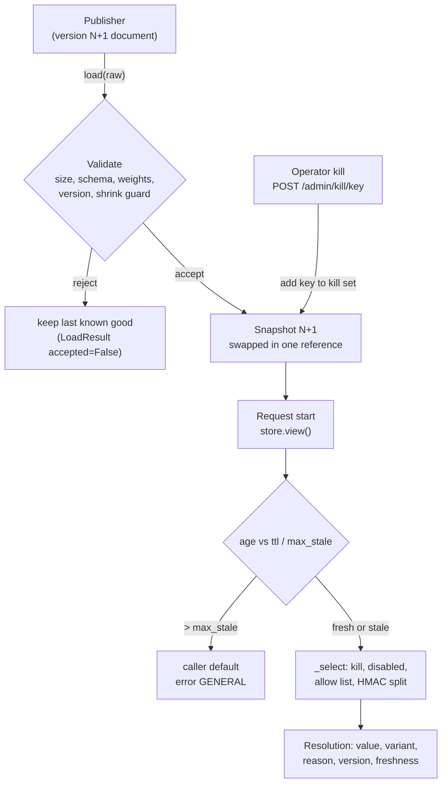

# Dynamic Runtime Configuration and Kill Switches: Safe Rollout Evaluation, Context-Consistent Bucketing, and Stale-Cache Fallback

> [!summary] Claim
> A flag evaluator is safe when it is a local, total function of one immutable snapshot (an HMAC bucket of a stable subject, a kill set that outranks every rule, and a compiled-in safe default for every failure), and when the snapshot is validated before it is published, pinned for the whole request, and served stale only inside an explicit window.

Part of [Observability Profiling and Operations](README.md) in [API Engineering](../README.md).

## TL;DR

- Mechanism: the process holds one immutable snapshot and evaluates against it with no I/O; a percentage rollout compares `HMAC-SHA256(key=flag salt, msg=subject)` reduced to 10000 buckets against cumulative basis-point weights, so the same subject gets the same variant in every process and the cohort only grows when the percentage grows (lab `bucket_of`, `View._select`).
- Contract rule: evaluation never raises and returns the caller's compiled-in default on any failure, with an error code and a reason (OpenFeature Requirements 1.4.10, 2.2.5, and the error codes in `types.md`); that default must be the safe direction, and a kill switch outranks allow lists, rollouts, and snapshot staleness.
- Trap: three things fail silently, namely a snapshot that is read twice per request (torn reads across two flags), a "stale" age measured on the wall clock or never refreshed by an unchanged poll, and config data that is trusted because we generated it (Google Cloud, 2025-06-12; Cloudflare, 2025-11-18).
- Portability: bucket values are not interchangeable between products (LaunchDarkly uses SHA-1 over `key.salt.id`, or `seed.id` when the rollout has a seed, GrowthBook uses FNV-1a with 10000 buckets, this lab uses HMAC-SHA256), so a migration reshuffles every cohort; the lab ran on CPython 3.14.6 only (as of 2026-11).
- When not to use it: do not build a vendor-grade targeting engine, a percentage rollout over a handful of huge tenants, or a runtime flag for something that is a deploy-time constant; and never use a flag as a substitute for validating the data your code reads.

## Mental model



The publisher's document is never installed directly: `load` validates it against a schema, size cap, weight sum, version order, and a shrink guard, and a rejected document leaves the previous snapshot serving.
An operator kill is a separate, tiny write that is swapped into the same state object, so it survives snapshot swaps and applies even when the snapshot is stale.
Each request takes one `View` at its start, which fixes the snapshot, the kill set, and the freshness class, and every `resolve` on that view sees the same version.
If the view is older than `max_stale_s` the evaluator stops trusting the data and returns the caller's default; otherwise it walks kill, disabled, allow list, then the HMAC split.

## How it works

### The taxonomy decides the failure policy

Fowler's toggle taxonomy has four kinds: release toggles, experiment toggles, ops toggles, and permissioning toggles (martinfowler.com, Feature Toggles).
Ops toggles are described as short-lived, with "a small number of long-lived Kill Switches" that let operators degrade non-vital functionality under load.
Each kind has a different failure policy, and the evaluator needs to know it:

- A release toggle failing should fall back to the old code path (default `off`).
- An experiment toggle needs a stable assignment, so it needs a targeting key and must not fall into an arbitrary bucket when the key is missing.
- A kill switch is read on the hottest path and must work when the control plane is down, so it is evaluated locally and delivered over the smallest possible message.
- A permissioning toggle is an authorization decision in disguise; its failure default is deny, and it belongs in the authorization layer rather than in a rollout engine.

### Evaluation is local, total, and typed

OpenFeature separates the client from the provider and requires that client methods "MUST NOT throw exceptions, or otherwise abnormally terminate" and "must always return the default value in the event of abnormal execution" (OpenFeature spec 1.4.10, as of main at commit `b489ba9`, 2026-11-15).
It also says client methods SHOULD NOT write log messages, because a missing flag in a hot path can flood the logs (OpenFeature spec 1.4.11).
The provider SHOULD set `reason` to one of `STATIC`, `DEFAULT`, `TARGETING_MATCH`, `SPLIT`, `CACHED`, `DISABLED`, `UNKNOWN`, `STALE`, `ERROR`, or another string (OpenFeature spec 2.2.5), and the error codes are `PROVIDER_NOT_READY`, `FLAG_NOT_FOUND`, `PARSE_ERROR`, `TYPE_MISMATCH`, `TARGETING_KEY_MISSING`, `INVALID_CONTEXT`, `PROVIDER_FATAL`, and `GENERAL` (OpenFeature spec types.md, Error Code).
The lab's `Resolution` carries `value`, `variant`, `reason`, `error_code`, `version`, and `freshness`, and uses the custom reason `KILL_SWITCH` that Requirement 2.2.5 allows.

The lab keeps `freshness` as its own field instead of overloading `reason` with `STALE`.
OpenFeature's `STALE` reason says only that the value is "non-authoritative or possibly out of date" (types.md, Resolution Reason); collapsing it into `reason` would hide whether the value came from a split, an allow list, or a kill.
An adapter to OpenFeature maps `freshness == "stale"` to `reason = "STALE"` at the boundary.

The default is typed.
`View.resolve` compares `type(value) is type(default)` instead of `isinstance`, because `isinstance(True, int)` is true and a boolean variant would otherwise be served to a caller that asked for an integer.
The lab test passes a `bool` variant against an `int` default and expects `TYPE_MISMATCH`.
The strictness has a cost: an `int` variant is also rejected for a `float` default.

### Bucketing: one hash, one threshold

The seed's plan is `HMAC-SHA256(flag_key, tenant_id) % 10000`; the lab implements it with two refinements.
The HMAC key is a per-flag `salt` (conventionally equal to the flag key at creation) so that a cohort can be reshuffled without renaming the flag, and only the first 8 bytes of the digest are used so the value fits an unsigned 64-bit integer in any language.

```python
def hash64(salt: str, subject: str) -> int:
    digest = hmac.digest(salt.encode(), subject.encode(), "sha256")
    return int.from_bytes(digest[:8], "big")

def bucket_of(salt: str, subject: str) -> int:
    return hash64(salt, subject) % BUCKETS      # BUCKETS = 10_000
```

This is a simplified excerpt of `feature_flags_runtime.py` with the docstrings removed.
`hmac.digest` is the one-shot form that "is equivalent to `HMAC(key, msg, digest).digest()`, but uses an optimized C or inline implementation", and the C path is used only when the digest is a string naming an OpenSSL-supported algorithm (Python 3.14 hmac documentation; added in 3.7).
HMAC-SHA-256 with a 20-byte key of `0x0b` over `"Hi There"` must begin `b0344c61d8db3853` (RFC 4231 Section 4.2, Test Case 1), and the lab asserts exactly that through `hash64`, which pins the primitive, the byte order, and the 8-byte prefix.

Why HMAC and not `sha256(salt + ":" + subject)`: the key and the message are separate inputs, so there is no delimiter to make ambiguous.
LaunchDarkly builds the hash input as the string `key.salt.id` (or `seed.id` when the rollout carries a `seed`) and takes the first 15 hex digits (60 bits) of its SHA-1, divided by `0xFFFFFFFFFFFFFFF` (launchdarkly server-sdk 9.21.0 `ldclient/impl/evaluator_common.py`, `_bucket_context`); with `.` as the separator, `("a.b", "c")` and `("a", "b.c")` hash the same input, which is harmless only because both parts are generated, not user-chosen.
That is a design observation about concatenation in general, not a reported LaunchDarkly bug.

The reduction is `% 10000`, and `2**64 % 10000 == 1616`, so the 1616 lowest buckets are each hit with probability one part in `2**64 / 10000 = 1.8447e15` higher than the rest; the relative bias is about `5.4e-16`, which is irrelevant for rollouts.
Do not read the modulo as a security property: HMAC with a known salt is a deterministic partition, not a secret, and anyone who knows the salt and a tenant id can compute the bucket.

The variants are chosen by a cumulative walk over basis-point weights that must sum to exactly 10000 (`Flag._check_references` rejects anything else):

```python
cumulative = 0
for split in flag.splits:
    cumulative += split.weight
    if bucket < cumulative:
        return split.variant, "SPLIT"
```

This is a simplified excerpt of `View._select`.
Ordering the `on` split first gives the property that matters operationally: raising `on` from 1000 to 2000 basis points only moves subjects from `off` to `on`, never the other way, because `bucket < 1000` implies `bucket < 2000`.
Putting `off` first would select a different, equally monotonic `on` cohort (the top of the bucket range), so the order of splits is part of the flag's contract and changing it reshuffles who is in.
Weight 0 splits are skipped naturally because the cumulative sum does not advance.

LaunchDarkly uses the same cumulative shape with weights out of 100000 (`wv.weight / 100000.0`) and has a documented fallback: a bucket at or above the last boundary lands in the last variation, "due to a rounding error, or due to the fact that we are scaling to 100000 rather than 99999, or the flag data could contain buckets that don't actually add up to 100000" (launchdarkly server-sdk 9.21.0 `ldclient/impl/evaluator_common.py`, `_variation_index_for_context`).
GrowthBook's `gbhash` for hash version 2 is `fnv1a32(str(fnv1a32(seed + value))) % 10000 / 10000`, and version 1 is `fnv1a32(value + seed) % 1000 / 1000` (growthbook-python v4.1.0 `growthbook/core.py`, `gbhash`); ranges are half-open, `range[0] <= n < range[1]` (`inRange`).
Its `fnv1a32` hashes UTF-8 bytes for an ASCII string but UTF-16 code units otherwise, "like the JS SDK's `charCodeAt` loop" (same file, `fnv1a32`), so a port that hashes UTF-8 everywhere diverges only on non-ASCII subjects.
Unleash documents "a normalized MurmurHash of a user's unique ID" for its rollout percentage (Unleash docs, Activation strategies, as of 2026-11); I did not read its engine source, so I state no more than that.

### Context-consistent bucketing: which subject, and where it is computed

"Context-consistent" means two things.
First, the subject is the right unit: bucketing by user splits one tenant across variants, bucketing by `tenant_id` gives every user of a tenant the same variant, which is what an API with tenant-level contracts needs.
The lab's `Flag.bucket_by` names an attribute (`tenant_id`) and falls back to the targeting key; the allow list is keyed by the same subject.
OpenFeature models this as an optional `targeting key` that "uniquely identifies the subject (end-user, or client service)" (OpenFeature spec 3.1.1), and warns that providers that need it "may behave unpredictably if a targeting key is not specified".

Second, the decision is stable across processes, services, and languages because it is a pure function of the salt and the subject.
Two pods with the same snapshot version always agree, and so do two services that share the flag document.
They disagree during a rollout of the document itself, when pod A has version N and pod B has version N+1; if a request crosses both pods and consistency matters, propagate the decision with the request (for example in a header or baggage, see [[Distributed-Tracing-W3C-Trace-Context-and-Baggage-Propagation]]) instead of re-evaluating.

OpenFeature evaluation context is merged in the order API (lowest), transaction, client, invocation, before hooks (highest), with duplicates overwritten (OpenFeature spec 3.2.3).
The lab's `Context` is one frozen object built from `X-Tenant-Id` and `X-User-Id` at the edge and passed down explicitly, which avoids a precedence puzzle at the cost of passing it.

A missing subject is the case SDKs handle differently, and the difference is a cohort bug:

- This lab returns the caller's default with `TARGETING_KEY_MISSING` for a flag that has splits, and does not need a key for a flag without splits.
- LaunchDarkly's `_bucket_context` returns `-1` when the context kind is absent (and the caller "still end[s] up returning the first bucket" with the experiment flag forced off) and `0.0` when the bucket-by value is `None`, a `bool`, or anything other than a string or integer, so a context that lacks the bucket-by attribute falls into the first variation of the rollout (launchdarkly server-sdk 9.21.0 `ldclient/impl/evaluator_common.py`, `_bucket_context`, `_bucketable_string_value`, and `_variation_index_for_context`).
  An anonymous LaunchDarkly context still has a key, because an empty key makes the context invalid ("context key must not be None or empty", same release `ldclient/context.py`, `Context.__init__`), so the first-bucket case is a missing attribute or context kind, not a missing key.
- GrowthBook skips the experiment when the hash value is empty: `if not hashValue:` logs "Skip experiment ... because user's hashAttribute value is empty" and returns the no-experiment result (growthbook-python v4.1.0 `growthbook/core.py`, around the "Get the user hash attribute and value" step).

Neither choice is wrong, but a rollout that includes anonymous traffic must say which one it gets.

### Kill switches: precedence, delivery, and the safe default

A kill switch is a flag whose only job is to force the safe variant at once.
In the lab it is a key in the state's kill set, and `_select` checks it first, before `enabled`, the allow list, and the rollout.
The kill set is swapped into the same immutable state object as the snapshot, so a reader sees a consistent pair, and a later snapshot swap does not erase it; only an explicit `revive` does.
This is deliberate: a kill that disappears when the next document is published would be undone by whoever publishes next without knowing about it.

A kill needs a definition to know what "safe" is, which is the flag's `off_variant`.
If the snapshot is empty or expired the lab returns the caller's compiled-in default, so the contract is that the default passed in code is the safe value: `False` for `payments-v2`, `"legacy"` for `checkout-flow`, `False` for `export-enabled`.
A default that is the dangerous direction turns an outage of the flag system into an outage of your API.

When the kill is a shed (the feature exists but is turned off), the response is `503 Service Unavailable`, defined for a server "currently unable to handle the request due to a temporary overload or scheduled maintenance", with an optional `Retry-After` (RFC 9110 Section 15.6.4 and Section 10.2.3).
The lab's `/export` returns `503` with `Retry-After: 60` and a JSON body naming the reason; `404` would be wrong because the resource exists.
The kill route itself returns `401` with `WWW-Authenticate: Bearer` for a missing or wrong credential, which RFC 9110 Section 15.5.2 requires a `401` to carry, and compares the credential with `hmac.compare_digest`, which the Python documentation recommends over `==` to reduce timing attacks (Python 3.14 hmac documentation).
The authentication scheme name is matched case-insensitively (RFC 9110 Section 11.1).

### Stale-cache fallback: a window, not a promise

A flag client that cannot reach its source has four honest options: serve the last data, serve the last data for a bounded time, serve compiled-in defaults, or fail the request.
The lab implements the middle two with two numbers, `ttl_s` and `max_stale_s`, on the monotonic clock (`time.monotonic` by default):

| Age since last accepted load or `touch` | `freshness` | Behavior |
|---|---|---|
| `age <= ttl_s` | `fresh` | evaluate normally |
| `ttl_s < age <= max_stale_s` | `stale` | evaluate from the snapshot, label the result `stale` |
| `age > max_stale_s` | `expired` | return the default with error code `GENERAL` |
| no snapshot ever loaded | `empty` | return the default with `PROVIDER_NOT_READY` |

This is the shape of HTTP's `stale-if-error`.
RFC 5861 Section 4 says that when an error is encountered, a stale response MAY be used "regardless of other freshness information", that its value "indicates the upper limit to staleness" beyond which the response SHOULD NOT be used, and that an error is any situation that would produce a `500`, `502`, `503`, or `504`.
Its worked example is `Cache-Control: max-age=600, stale-if-error=1200`, usable until `Age` exceeds 1800 seconds (RFC 5861 Section 4.1).
RFC 9111 Section 4.2.4 adds that a cache MUST NOT generate a stale response unless it is disconnected or doing so is explicitly permitted by the client or origin server, for example by RFC 5861 extensions or "configuration in accordance with an out-of-band contract"; the `max_stale_s` policy is that out-of-band contract.
The lab differs from RFC 5861 in one way that matters: a cache serving stale content tells downstream clients through a non-zero `Age` and a warning header (RFC 5861 Section 4), while the lab tells the caller through `Resolution.freshness`, and your code must export that value (as a metric and in the canonical log line, see [[Structured-Logging-with-Structlog-and-Stripe-Canonical-Log-Lines]]) or nobody sees that the system is running on old data.

The provider status model in OpenFeature has the same five states: `NOT_READY`, `READY`, `STALE`, `ERROR`, `FATAL`, where `STALE` means "the provider's cached state is no longer valid and may not be up-to-date with the source of truth" (OpenFeature spec 1.7.1 and types.md, Provider Status).
LaunchDarkly's Python client has the same ladder: with the data source not yet refreshed it uses cached data and logs once "using last known values from feature store" when availability is `CACHED`, and otherwise returns the default with `CLIENT_NOT_READY` unless its override layer holds the flag (launchdarkly server-sdk 9.21.0 `ldclient/client.py`, `_evaluate_internal`).

Two details decide whether the clock is trustworthy:

- The age counts from the last accepted `load` or `touch`, not from when the publisher created the document.
  A source that answers `304 Not Modified` for an unchanged version must call `touch`, otherwise an unchanged, healthy configuration goes stale after `ttl_s`.
  The lab test `test_touch_confirms_the_version_and_resets_freshness` pins this.
- The clock is monotonic.
  A wall-clock step (NTP slew or a manual change) would otherwise make a fresh snapshot look expired, or an old one look fresh.

### Delivery is a separate problem

The lab deliberately stops at `load(raw)`.
Polling with `ETag` and `If-None-Match`, a streaming connection, a sidecar relay, and a file on disk are all delivery mechanisms that end in a `load` or a `touch`.
Fowler distinguishes dynamic routing of the decision from dynamic configuration of it and recommends preferring static configuration where it suffices (martinfowler.com, Feature Toggles, headings "Dynamic routing vs dynamic configuration" and "Prefer static configuration").
For API processes the rule of thumb that follows is: the flag source's availability must never be a dependency of request handling, so liveness and readiness must not call it (see [[Health-Check-Engineering-Liveness-Readiness-Startup-and-Cascading-Restarts]]).

### Validate before you publish

The document is untrusted input even when your own system produced it.
`FlagStore.load` applies, in this order: a byte cap (`MAX_DOC_BYTES`, 1 MiB, a lab policy), strict schema validation with `extra="forbid"` through pydantic (`Document`, `Flag`, `Split`), unique keys, a version that must be greater than the current one, and a shrink guard that rejects a document with fewer than half of the current flags.
Weights must sum to 10000 and every referenced variant must exist.
A rejected document returns `LoadResult(False, reason)`, never raises, and leaves the previous snapshot serving.
The version rule means a rollback is a new, higher version with the old content, because accepting a lower version would let a delayed or replayed message silently undo a newer kill or fix.

The shrink guard exists because both big public config-propagation failures in the research below started with bad data that was syntactically valid.

## Numbers and limits

| Quantity | Value | Source |
|---|---|---|
| Bucket space in this lab | 10000 (0.01 percent per bucket) | lab `BUCKETS` |
| Modulo bias of `hash64 % 10000` | `2**64 % 10000 = 1616`, relative bias about `5.4e-16` | arithmetic, checked in a shell |
| Census of 1000 bp over 100000 tenants | 10112 selected, expected 10000, sigma 94.9 | measured, `-rA` run below (CPython 3.14.6, macOS 27.3 arm64) |
| Monotonic growth 1000 -> 2000 bp | 10053 -> 20219 selected, 0 lost | measured, same run |
| Same-percentage flags with different salts | 1044 in both of two 10175 / 10189 cohorts, independent expectation about 1000, shared salt would be about 10000 | measured, same run |
| Salt rotation at 1000 bp | 1032 of 10153 kept | measured, same run |
| `View.resolve` cost, one splits flag | 5177 ns per call over 20000 calls, one run, not profiled | measured, same run, CPython 3.14.6, macOS 27.3 arm64 (as of 2026-11) |
| Sampling noise of a percentage rollout | `sqrt(N * p * (1 - p))` subjects: 3.1 for 1 percent of 1000 tenants, 94.9 for 10 percent of 100000 | arithmetic |
| LaunchDarkly bucket resolution | weights out of 100000, 15 hex digits of SHA-1 | launchdarkly server-sdk 9.21.0 |
| GrowthBook bucket resolution | 10000 (hash version 2), 1000 (version 1) | growthbook-python v4.1.0 |
| `stale-if-error` example horizon | `max-age=600` + `stale-if-error=1200` = 1800 s | RFC 5861 Section 4.1 |
| Lab freshness policy defaults | `ttl_s=30`, `max_stale_s=3600` | lab policy, not a recommendation |
| Document limits | 1 MiB, 10000 flags | lab policy |
| Google Service Control red button | ready about 25 minutes, rollout complete within 40 minutes of the start | Google Cloud incident report, 2025-06-12 |
| Google us-central1 full recovery | up to about 2 h 40 min (restart herd, no randomized exponential backoff) | Google Cloud incident report |
| Cloudflare feature file | regenerated every 5 minutes, limit 200 features, about 60 in use | Cloudflare blog, 2025-11-18 |
| Knight Capital, 2012-08-01 | about 45 minutes, 397 million shares, $460 million loss | SEC Release 34-70694 |

The `5177 ns` figure is dominated by what I did not profile; it includes one HMAC call, a dict lookup, and dataclass construction, so treat it as an upper-bound sanity figure, not a benchmark.
The test asserts only a loose `200 us` ceiling so that it fails if network or JSON parsing creeps into the hot path.

A practical consequence of the sampling row: a percentage rollout over few, large subjects is lumpy.
At 1 percent over 1000 tenants the expected cohort is 10 tenants with a standard deviation of 3.1, and one large tenant can carry more traffic than the other nine, so for a safe canary choose the cohort explicitly with an allow list and let the percentage take over once the subject count is large.

## Portability

| Dimension | Result | Proof |
|---|---|---|
| CPython 3.14.6, macOS 27.3 arm64 | 35 passed in 7.85 s | ran here: `uv run --frozen pytest ... -q -rA` |
| CPython 3.12.16, 3.13.18, 3.14.10, 3.15.2, 3.15.2t | not run | lab checks were paused by the user on 2026-11-11, so no matrix leg was run |
| Python 3.12 floor | declared `requires-python = ">=3.12,<3.16"`; module uses `def resolve[T](...)` generics syntax, which needs 3.12 | `labs/pyproject.toml`; PEP 695 (Python-Version 3.12) |
| `hmac.digest` | added in 3.7; optimized path only for OpenSSL-supported digest names given as strings | Python 3.14 hmac documentation |
| Free-threaded build | not run; built-in `dict`, `list`, `set` use internal locks, but documentation recommends `threading.Lock` over relying on them | Python 3.14 free-threading HOWTO; lab design: readers take one attribute load, writers hold a `Lock` |
| pydantic / Starlette / httpx | 2.14.3 / 1.10.0 / 0.28.1 imported in the lab venv | `labs/.venv`, version attributes printed |
| Uvicorn, Hypercorn, Granian | not exercised; tests use `httpx.ASGITransport` in-process | no claim |
| HTTP/1.1, HTTP/2, HTTP/3 | `503`, `Retry-After`, and `401` plus `WWW-Authenticate` are defined at the semantics layer, so version-independent | RFC 9110 Sections 15.6.4, 10.2.3, 15.5.2 |
| Cross-product bucket values | not interchangeable: SHA-1 + `key.salt.id` (LaunchDarkly), FNV-1a double hash (GrowthBook), HMAC-SHA256 prefix (lab) | sources in How it works |
| Cross-language port of `bucket_of` | needs UTF-8 encoding of salt and subject and a big-endian unsigned 64-bit prefix; the lab's known-answer test includes a non-ASCII subject | `test_bucket_known_answers_are_stable_across_processes_and_runtimes` |

The bucketing code uses only `hmac` and integer arithmetic, so I expect identical results on every CPython, but the table records that as an expectation, not as a result, for every leg other than 3.14.6.

## Worked example

The implementation is [implementation](../labs/src/api_labs/f18_observability_profiling_and_operations/feature_flags_runtime.py) and the test is [test](../labs/tests/f18_observability_profiling_and_operations/test_feature_flags_dynamic_configuration_and_safe_kill_switches_in_apis.py).
The implementation is about 300 lines: `hash64` and `bucket_of`, the pydantic document models, `View` with `resolve`, `FlagStore` with `view`, `load`, `touch`, `kill`, `revive`, and a Starlette app with four routes.

Two simplified excerpts show the parts that carry the contract.
First, the pinned read path, with docstrings removed:

```python
def resolve[T](self, key: str, ctx: Context, default: T) -> Resolution[T]:
    if self.snapshot is None:
        return self._fail(default, "PROVIDER_NOT_READY")
    if self.freshness == "expired":
        return self._fail(default, "GENERAL")
    flag = self.snapshot.flags.get(key)
    if flag is None:
        return self._fail(default, "FLAG_NOT_FOUND")
    variant, reason = self._select(flag, ctx)
    if variant is None:
        return self._fail(default, "TARGETING_KEY_MISSING")
    value = flag.variants[variant]
    if type(value) is not type(default):
        return self._fail(default, "TYPE_MISMATCH")
    return Resolution(cast("T", value), variant, reason, None, self.version, self.freshness)
```

Second, the store's single-reference read and its freshness ladder:

```python
def view(self) -> View:
    state = self._state  # one attribute read: snapshot and kills cannot be torn
    if state.snapshot is None:
        return View(None, state.kills, "empty")
    age = self._clock() - state.snapshot.loaded_at
    if age <= self._policy.ttl_s:
        freshness: Freshness = "fresh"
    elif age <= self._policy.max_stale_s:
        freshness = "stale"
    else:
        freshness = "expired"
    return View(state.snapshot, state.kills, freshness)
```

Both excerpts are copied from the lab module without their docstrings, and the `resolve` excerpt also drops the inline comment on the `type(...)` line.
The checkout handlers show the torn-read bug and its fix side by side: `/checkout` takes one `view` and resolves both flags from it, and `/checkout-unpinned` calls `store.evaluate` twice, so a document swap between the calls is visible between the two reads.

Command run, from `labs/`, on CPython 3.14.6 and macOS 27.3 (Darwin 27.3.0 arm64), on 2026-11-21:

```text
uv run --frozen pytest tests/f18_observability_profiling_and_operations/test_feature_flags_dynamic_configuration_and_safe_kill_switches_in_apis.py -q -rA
```

This is an excerpt of the real output: every line shown is verbatim, and the `PASSES` banner, the per-test `Captured stdout call` headers, and the 35 `PASSED` lines of the short summary are omitted (all 35 tests passed):

```text
...................................                                      [100%]
census: 10112 of 100000 at 1000 bp, expected 10000, sigma 94.9
monotonic: 10053 -> 20219 tenants, lost 0
decorrelation: 10175 in a, 10189 in b, 1044 in both (independent: 1000)
salt rotation: kept 1032 of 10153
freshness ladder: [(0, 'fresh', True, None), (30, 'fresh', True, None), (31, 'stale', True, None), (300, 'stale', True, None), (301, 'expired', False, 'GENERAL')]
resolve: 5177 ns/call over 20000 calls (one run, indicative)
pinned: {'flow': ['legacy', 1], 'pay': [False, 1]}
unpinned: {'flow': ['legacy', 1], 'pay': [True, 2]}
shed: 503 Retry-After=60 {'error': 'disabled', 'reason': 'KILL_SWITCH'}
35 passed in 7.85s
```

The `unpinned` line is the bug in one line: the checkout flow was read from version 1 (`legacy`) and the payment flag from version 2 (`True`), a combination no operator ever published.
The `pinned` line reads both from version 1.
The remaining tests cover the known-answer buckets (including RFC 4231), the kill precedence, `touch`, the version rule, the shrink guard, the bad-document table, and the `401` on the kill route.

Mutation checks were not run (the user paused them on 2026-11-11), so the claim that each test is discriminating rests on reading the assertions, not on proof.

## Pitfalls

> [!warning] Reusing a flag name for new behavior (Knight Capital, 2012-08-01)
> Trigger: new code repurposed a flag that formerly activated discontinued "Power Peg" code, and the deployment reached only seven of eight servers (SEC Release 34-70694).
> Symptom: the eighth server ran the old code on the repurposed flag and sent millions of child orders, about 4 million executions in 154 stocks, over about 45 minutes, for a $460 million loss.
> Then the responders uninstalled the new code from the seven correctly deployed servers, which the SEC order says worsened the problem.
> Fix: give every flag one meaning for its life, delete the dead code path and the flag together, deploy the reader before the writer, and have a rehearsed kill that does not require a rollback.

> [!warning] New code path without a flag, and bad data that exercises it (Google Cloud, 2025-06-12)
> Trigger: a quota-policy feature shipped on 2025-05-29 with a "red-button" but "did not have appropriate error handling nor was it feature flag protected"; its code path ran only when a policy change with blank fields was written on 2025-06-12 and replicated globally within seconds.
> Symptom: Service Control binaries crashed on a null pointer in every region, and Google Cloud, Workspace, and Security Operations APIs returned `503`.
> The red button was ready after about 25 minutes and rolled out within 40 minutes of the start; full resolution in us-central1 took up to about 2 h 40 min because restarting tasks overloaded the Spanner table they depend on and Service Control lacked randomized exponential backoff.
> Fix: Google's own list is the checklist: gate every change to a critical binary behind a flag that is disabled by default, propagate replicated data incrementally, isolate checks so they fail open, and add randomized exponential backoff to the restart path.

> [!warning] Trusting internally generated config (Cloudflare, 2025-11-18)
> Trigger: a database permissions change made a query return duplicate rows, doubling the Bot Management "feature file", which was regenerated every five minutes and pushed to the whole network; the proxy had a limit of 200 features (about 60 in use) and its Rust code panicked on the oversized file.
> Symptom: core traffic failed from 11:20 UTC, flapped with each five-minute regeneration, and was largely restored at 14:30 after the bad file was replaced by an earlier version; everything was normal at 17:06.
> The file is a bot-management model input, not a feature-flag document, but the failure mode is identical: a propagated artifact exceeded an assumption.
> Fix: Cloudflare's stated remediation includes hardening ingestion of its own config "in the same way we would for user-generated input" and "enabling more global kill switches for features"; the lab's `load` is that ingestion gate.

> [!warning] Torn reads across two flags
> Trigger: a handler calls the flag client once per decision while a new document is published between the calls.
> Symptom: the request combines version 1 of one flag and version 2 of another, for example a new payment path on the old checkout flow, which appears only under rollout and never in tests.
> Fix: take one `View` per request and evaluate every flag from it; log the `version` in the request's canonical log line.

> [!warning] A stale clock that lies
> Trigger: freshness measured with `time.time()`, or an unchanged poll (`304`) that does not refresh it.
> Symptom: healthy configuration flips to `stale` or `expired` after `ttl_s` and the service falls back to defaults, or after an NTP step a dead source looks fresh.
> Fix: use a monotonic clock, call `touch` on every successful confirmation, and alert on `freshness != "fresh"` rather than on a failed fetch alone.

> [!warning] Correlated cohorts
> Trigger: two experiments bucket on the same hash input, for example both use the bare tenant id.
> Symptom: the same 10 percent of tenants get every experiment, so effects confound and one tenant group absorbs all the risk.
> Fix: a per-flag salt in the hash (measured here: two 10 percent flags overlapped on 1044 of about 10000 tenants, not on all of them), and a salt rotation when you must restart a cohort (1032 of 10153 retained).

> [!warning] Anonymous traffic in the first bucket
> Trigger: the subject is missing (no tenant header, anonymous request) and the SDK defaults the bucket.
> Symptom: LaunchDarkly's Python SDK returns bucket `0.0` when the bucket-by attribute is `None`, which sits in the first rollout bucket, so every caller without a tenant attribute gets the first variation; this lab instead returns the default with `TARGETING_KEY_MISSING`.
> Fix: decide and test what an anonymous subject gets, and count `TARGETING_KEY_MISSING` in metrics.

> [!warning] A boolean passed as an integer
> Trigger: `isinstance(value, int)` as the type check.
> Symptom: `True` satisfies it, so a boolean variant is served to a caller expecting a count.
> Fix: compare exact types, as `View.resolve` does, and keep flag types to a small closed set.

## Security and robustness

- Treat the flag document as untrusted input: size cap, `extra="forbid"`, referential checks, weight sum, strictly increasing version, and a shrink guard, and keep the last known good on any failure (Google and Cloudflare incidents above).
  The flag catalog also touches OWASP API8:2023 Security Misconfiguration, whose list of weaknesses includes "Unnecessary features are enabled" and missing security hardening, which is what a dead flag left on or a dangerous default amounts to (OWASP API Security Top 10 2023, API8).
- The kill route is a privileged function: authenticate it separately from user traffic and authorize by role, which is OWASP API5:2023 Broken Function Level Authorization (OWASP API Security Top 10 2023, API5).
  The lab compares a bearer credential with `hmac.compare_digest` and answers `401` with `WWW-Authenticate: Bearer`; production needs a per-operator identity, not one shared secret.
  The test credential in the lab is the obviously invalid `kill-key-EXAMPLE-NOT-A-REAL-SECRET`.
- Every kill and revive must produce an audit record with actor, key, time, and reason, see [[Audit-Logging-for-Regulated-APIs-Tamper-Evident-Hash-Chains-and-Who-Did-What]].
  The lab's route does not write one, which is a known gap.
- A kill of an unknown key is accepted and stored forever in the lab, so an authenticated caller can grow the set without bound.
  A production kill set needs a cap and a check against the flag catalog.
- Bucket assignment is not a secret and not an authorization: anyone with the salt and a subject id can compute the bucket, and a client that receives rules or the salt can enumerate cohorts.
  Evaluate on the server and send clients the result, not the rules.
- Never flag a permission: a stale snapshot, a missing key, or a kill must not widen access.
  If a flag guards a security control, its default and its expired behavior must be deny.
- Bound the blast radius of the flag path itself: evaluation does no I/O, takes no lock on read, and returns within microseconds, so an outage of the flag source cannot add latency to requests.
- Do not log every evaluation; OpenFeature says the client SHOULD NOT log (Requirement 1.4.11).
  Log changes of `version`, `freshness`, and kills, and put the version and the decisions of the request in its one canonical line.

## The principal's view

The decision is not which vendor to buy but what the failure contract is.
Before any SDK is chosen, write down for each flag class: the safe default, what happens when the source is down for 1 minute, 1 hour, and 1 day, who can kill and how fast, how a bad document is prevented from reaching all regions at once, and who deletes the flag.
Those answers belong in a short design review, because they decide the blast radius of a bad deploy more than the evaluation algorithm does.

Use a vendor or an open platform (LaunchDarkly, Unleash, GrowthBook, or a provider behind OpenFeature) when you need a UI, targeting rules, experiments, audit, and approvals; the OpenFeature client contract (never throw, default on error, typed results, provider status) is a good boundary because it keeps the evaluation call stable when the backend changes.
Write the small evaluator yourself, as this lab does, when the need is a handful of ops switches and rollouts with a hard requirement that the data path has no vendor dependency; the code is a few hundred lines, but you then own validation, delivery, and the audit trail.
The cost of the vendor route is a second control plane to secure and a cohort reshuffle on exit, because bucket functions differ.

Organizationally: ops kill switches are long-lived and few, so review them like production infrastructure; release flags are short-lived, so put an owner and an expiry date on each and delete them, because stale flags are how Knight Capital's dead path became live.
Make the kill drill part of the incident process; in the Google incident the existing red button took about 25 minutes to be ready to roll out, which is the number to beat (see [[The-Sixty-Second-API-Incident-Triage-Playbook]]).
Measure flag health with the same discipline as any dependency: evaluation latency, `freshness` ratios, error-code counts, and document version skew across pods belong on the dashboards from [[RED-and-USE-Metrics-and-OpenTelemetry-HTTP-Semantic-Conventions]] and in the SLO from [[SLIs-SLOs-Error-Budgets-and-Multi-Window-Burn-Rate-Alerting]].

Choose a different approach when the variation is not runtime: a per-environment constant, a deploy-time config file, or a separate deployment (blue-green, canary routing at the gateway) is simpler and removes a code branch; use a flag when the switch must change faster than a deploy.

## Interview questions

> [!question] L5: What does a feature-flag client return when the flag service is down, and why must it not throw?
>
> > [!success]- Answer
> > It returns the caller's compiled-in default, with a reason of `ERROR` and an error code such as `PROVIDER_NOT_READY` or `GENERAL`.
> > OpenFeature Requirement 1.4.10 says client methods must not throw or terminate abnormally and must return the default on abnormal execution.
> > A throwing evaluation call turns an outage of the flag system into an outage of every request that reads a flag.
> >
> > Follow-up: Why must the default be the safe value, and who decides what that is?

> [!question] L5: Why bucket with a hash of the subject instead of `random() < 0.1` per request?
>
> > [!success]- Answer
> > A hash is a pure function of the subject and the salt, so the same tenant gets the same variant on every request, pod, and service, and raising the percentage only adds tenants.
> > A random draw per request gives one tenant different behavior on consecutive requests and cannot be reproduced when debugging.
> >
> > Follow-up: What happens to the cohort if you change the salt, and when is that what you want?

> [!question] L5: Why does the lab compare `type(value) is type(default)` and not `isinstance`?
>
> > [!success]- Answer
> > Because `bool` is a subclass of `int`, so `isinstance(True, int)` is true and a boolean variant would be served to a caller that asked for an integer.
> > The exact-type check returns the default with `TYPE_MISMATCH` instead.
> > The cost is that an `int` variant is also rejected for a `float` default.
> >
> > Follow-up: How would you allow int-to-float widening without reopening the bool hole?

> [!question] L6: Predict the output: the tested vector says `bucket_of("payments-v2", "tenant-1") == 5122`; what does `resolve("payments-v2", Context("tenant-1"), False)` return with splits `on=5000, off=5000`, and with `on=5200, off=4800`?
>
> > [!success]- Answer
> > With `on=5000` the cumulative bound for `on` is 5000, and `5122 < 5000` is false, so the walk continues to `off` (cumulative 10000) and returns `False` with reason `SPLIT`.
> > With `on=5200`, `5122 < 5200` is true, so it returns `True` with reason `SPLIT`.
> > Running both flags through `FlagStore.evaluate` on CPython 3.14.6 (lab venv, 2026-11-21) printed `False off SPLIT` for `on=5000` and `True on SPLIT` for `on=5200`.
> >
> > Follow-up: Which direction does tenant-1 move if you reorder the splits so `off` comes first?

> [!question] L6: Debug this API: `/checkout-unpinned` returns `{"flow": ["legacy", 1], "pay": [True, 2]}` after a flag document deploy; what is wrong and how do you fix it?
>
> > [!success]- Answer
> > The handler calls `store.evaluate` twice, and each call takes a fresh `View`, so a document swap between the calls gives a torn read: the flow flag came from version 1 and the payment flag from version 2.
> > Fix it by taking `view = store.view()` once at the top and calling `view.resolve` for every flag, as `/checkout` does, which returned `{"flow": ["legacy", 1], "pay": [False, 1]}` in the same scenario.
> > Add `view.version` to the request's canonical log line so a torn read is visible in logs.
> >
> > Follow-up: A request calls a second service that re-evaluates the same flag; how do you keep the two consistent during a document rollout?

> [!question] L6: Design the stale-cache policy for a flag client: what are the states, what moves it between them, and what does it do for kill switches?
>
> > [!success]- Answer
> > Use four states by age since the last successful load or confirmation: `fresh` up to `ttl_s`, `stale` up to `max_stale_s` (serve the snapshot and label it), `expired` beyond that (return compiled-in defaults), and `empty` before the first load (`PROVIDER_NOT_READY`).
> > Measure age on a monotonic clock, move to `fresh` on any accepted load or a `304`-style `touch`, and alert on any state other than `fresh`.
> > Kills must apply in `stale`, because they are the thing you need while the source is struggling; in `expired` the default must already be the safe value.
> > This mirrors RFC 5861 `stale-if-error`, whose value is an upper limit to staleness.
> >
> > Follow-up: What breaks if you forget `touch` on an unchanged poll?

> [!question] L6: Why must a kill outrank an allow list, and why should it survive a document swap?
>
> > [!success]- Answer
> > An allow list says who gets the feature in normal operation; a kill says it must be off now for everyone, including the people the list names.
> > If the kill lived inside the document it would be overwritten by the next publish, possibly by someone who does not know about the incident.
> > In the lab the kill set is part of the same state object but separate from the snapshot, so it survives swaps until `revive`.
> >
> > Follow-up: What audit record must a kill leave, and who may revive?

> [!question] L7+: A bad flag document reached every region within seconds and took down the fleet; what controls would you require?
>
> > [!success]- Answer
> > Validate on ingestion as untrusted input (schema, size, weight sums, references), keep the last known good on rejection, require strictly increasing versions so replays cannot roll back, and add a shrink guard against blank or truncated documents.
> > Publish incrementally by region or by canary pods with automatic halt, so one bad document cannot reach everything; Google's 2025 report commits to auditing all systems that consume globally replicated data and propagating it incrementally.
> > Gate new code paths behind flags that default off, isolate checks so they fail open, and add randomized exponential backoff to restarts, as the same report says.
> > Rehearse the kill: in that incident the red button took about 25 minutes to be ready to roll out.
> >
> > Follow-up: Which of these would not have helped in the Cloudflare feature-file incident, and why?

> [!question] L7+: How do you migrate 40 services from one flag vendor to an in-house evaluator without changing who sees what?
>
> > [!success]- Answer
> > Bucket functions differ (SHA-1 of `key.salt.id` over 100000 in LaunchDarkly, a double FNV-1a over 10000 in GrowthBook, an HMAC prefix here), so a straight switch reshuffles every percentage cohort.
> > Either port the vendor's exact hash and scale and verify with known-answer vectors from the vendor's SDK on real subject ids, or freeze the current assignment by exporting it into allow lists before the cutover.
> > Run both evaluators in shadow mode, log disagreements by flag and subject, and cut over per flag when disagreement is zero.
> > Keep the OpenFeature boundary so the application call site does not change.
> >
> > Follow-up: How do you handle flags whose rules use vendor-specific attributes?

> [!question] L7+: When is a runtime flag the wrong tool for a risky change?
>
> > [!success]- Answer
> > When the change is not safely reversible by a switch (a schema migration, a data format written by the new path), because turning the flag off leaves data the old code cannot read.
> > When the flag would guard a security decision (the safe default must be deny, so it is an authorization policy, not a rollout).
> > When both branches cannot run in one process at once or the flag would multiply test states beyond what you can cover.
> > Knight Capital is the cautionary case: a flag whose meaning changed activated dead code on one unupdated server.
> >
> > Follow-up: How do you expire a release flag so it does not become a Knight Capital?

## Related

Prerequisites: [[Audit-Logging-for-Regulated-APIs-Tamper-Evident-Hash-Chains-and-Who-Did-What]]

Next: [[The-Sixty-Second-API-Incident-Triage-Playbook]]

See also: [[Health-Check-Engineering-Liveness-Readiness-Startup-and-Cascading-Restarts]], [[Structured-Logging-with-Structlog-and-Stripe-Canonical-Log-Lines]], [[Distributed-Tracing-W3C-Trace-Context-and-Baggage-Propagation]], [[SLIs-SLOs-Error-Budgets-and-Multi-Window-Burn-Rate-Alerting]], [[RED-and-USE-Metrics-and-OpenTelemetry-HTTP-Semantic-Conventions]]

- Lab: `labs/tests/f18_observability_profiling_and_operations/test_feature_flags_dynamic_configuration_and_safe_kill_switches_in_apis.py`

## Further reading

- [OpenFeature specification, flag evaluation, providers, and evaluation context](https://github.com/open-feature/spec/tree/main/specification) - the client contract this note follows: never throw, default on error, typed results, targeting key, provider status.
- [OpenFeature types.md](https://github.com/open-feature/spec/blob/main/specification/types.md) - the reason and error-code enumerations used by `Resolution`.
- [RFC 5861 Section 4](https://www.rfc-editor.org/rfc/rfc5861.html#section-4) - `stale-if-error`, the origin of the bounded-staleness rule.
- [RFC 9111 Section 4.2.4](https://www.rfc-editor.org/rfc/rfc9111.html#section-4.2.4) - when a cache may serve a stale response at all.
- [RFC 9110 Sections 10.2.3, 15.5.2, 15.6.4](https://www.rfc-editor.org/rfc/rfc9110.html) - `Retry-After`, `401` with `WWW-Authenticate`, and `503` for shedding.
- [RFC 4231 Section 4.2](https://www.rfc-editor.org/rfc/rfc4231.html#section-4.2) - the HMAC-SHA-256 test vector the lab pins.
- [Martin Fowler, Feature Toggles](https://martinfowler.com/articles/feature-toggles.html) - the four toggle categories and the argument for few long-lived kill switches.
- [Google Cloud incident report, 2025-06-12](https://status.cloud.google.com/incidents/ow5i3PPK96RduMcb1SsW) - a new code path without a flag, bad replicated data, and a 25-minute red button.
- [Cloudflare, 18 November 2025 outage](https://blog.cloudflare.com/18-november-2025-outage/) - an oversized propagated config file and the follow-up to harden ingestion and add kill switches.
- [SEC Release 34-70694, Knight Capital](https://www.sec.gov/files/litigation/admin/2013/34-70694.pdf) - the repurposed flag and the rollback that made it worse.
- [launchdarkly python-server-sdk 9.21.0, evaluator_common.py](https://github.com/launchdarkly/python-server-sdk/blob/9.21.0/ldclient/impl/evaluator_common.py) - a production bucketing and rollout implementation.
- [growthbook-python v4.1.0, core.py](https://github.com/growthbook/growthbook-python/blob/v4.1.0/growthbook/core.py) - a different hash and bucket scale for contrast.
- [OWASP API Security Top 10 2023, API5 and API8](https://api-security.owasp.org/editions/2023/en/0xa5-broken-function-level-authorization/) - the risks behind the kill route and untrusted config.
