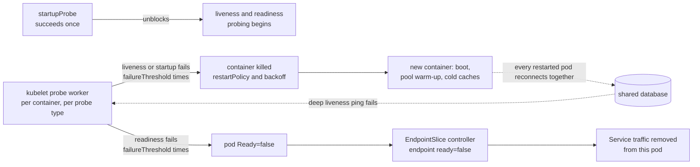

# Health Check Architecture: Liveness (/healthz) vs Readiness (/readyz) vs Startup Probes and Why Checking Downstream DBs in Liveness Causes Cascading Outages

> [!summary] Claim
> A liveness probe may only ask a question whose answer is "a restart will fix it", so it must not depend on anything the pod shares with its peers; with a database ping in `/healthz`, a dependency blip longer than `(failureThreshold - 1) * periodSeconds` restarts pods and one of at least `failureThreshold * periodSeconds` restarts every pod, and the outage then lasts the boot time, not the blip, as the lab measures (20 of 20 pods restarted and the Service had zero endpoints for 20 s after a 5 s database outage with `periodSeconds: 1`).

Part of [Observability Profiling and Operations](README.md) in [API Engineering](../README.md).

## TL;DR

Mechanism: the kubelet runs one probe worker per container per probe type, flips a result only after `failureThreshold` (or `successThreshold`) identical consecutive results, restarts the container on a liveness or startup failure, and marks the pod not Ready on a readiness failure, which makes the EndpointSlice controller set the endpoint `ready=false` `(Kubernetes v1.36.0 pkg/kubelet/prober/worker.go, worker.doProbe)` `(Kubernetes v1.36.0 staging/src/k8s.io/endpointslice/utils.go, podToEndpoint)`.
Contract rule: startup asks "has it finished booting", liveness asks "will a restart help", readiness asks "should it receive traffic right now"; only readiness may look at anything outside the process, and even then a shared dependency needs a conservative threshold because the kubelet has no fail-open.
Trap: restarting is the one remedy that cannot fix a shared dependency and always costs a cold start, so a correlated failure (every pod sees the same dead database) converts a short dependency outage into zero capacity for `boot time + reconnect time`.
Portability: the probe semantics are kubelet behavior, identical for any language and server; the Python-side facts (uvicorn binds its listener only after lifespan startup completes, and a blocked event loop fails even a database-free `/healthz`) were read in `uvicorn 0.54.0` and `starlette 1.10.0` and measured only on CPython 3.14.6.
When not to use this: a pod-local, persistent fault (own pool leaked, own disk full) is exactly where a deep check is right, and queue workers with no load balancer need a heartbeat-based liveness, not an HTTP probe.

## Mental model



The kubelet is the only actor that turns a probe result into an action.
Startup success unblocks the other two probes, a liveness or startup failure kills the container, and a readiness failure only edits the pod's `Ready` condition, which the control plane propagates to EndpointSlices and from there to kube-proxy, ingress controllers, and meshes.
The dashed arrows are the cascade this note is about: if the liveness endpoint pings a database shared by all pods, a database outage feeds the same failure into every worker at once, the restart arrow fires for the whole fleet, and the restarted pods then hit the database together while it is still recovering.
A readiness failure has the same fleet-wide shape but a cheaper remedy path, because the pod keeps running and keeps its warm caches and connections; the cost moves from "boot time" to "no endpoints".

## How it works

### Three questions, three probes

The Kubernetes concept page defines the split: startup probes "verify whether the application within a container is started" and, while one is configured, "Kubernetes does not execute liveness or readiness probes until the startup probe succeeds"; liveness probes "determine when to restart a container" and the example is a deadlock; readiness probes "determine when a container is ready to accept traffic" and "run on the container during its whole lifecycle" `(Kubernetes docs, Liveness, Readiness, and Startup Probes, "Types of probe", as of 2026-11)`.
The same page carries a caution in its liveness section: "Incorrect implementation of liveness probes can lead to cascading failures", with the listed symptoms "restarting of container under high load; failed client requests as your application became less scalable; and increased workload on remaining pods due to some failed pods".
The Google SRE book draws the same line one level up, between process health checking ("is this binary responding at all?") and service health checking ("is this binary able to respond to this class of requests right now?"), and assigns them to different consumers: process health "is relevant to the cluster scheduler, whereas service health checking is relevant to the load balancer" `(Google SRE book, Chapter 22 Addressing Cascading Failures, "Stop Health Check Failures/Deaths")`.
Liveness is the scheduler's question and readiness is the load balancer's question; a database ping belongs to the second and is almost never the first.

| Probe | Question | Failure action | Initial value in the worker | Allowed `successThreshold` |
|---|---|---|---|---|
| `startupProbe` | Has the application finished booting? | kill the container (restart policy applies) | Unknown | must be 1 |
| `livenessProbe` | Will a restart fix this? | kill the container (restart policy applies) | Success | must be 1 |
| `readinessProbe` | Should this pod receive traffic now? | pod `Ready=false`, endpoint `ready=false`, no restart | Failure | any |

The initial values and threshold rule come from `newWorker` (`w.initialValue`) in `worker.go` and the "Configuration fields" section of the concept page.
A container with no probe of a given kind is treated as Success for that kind, and for readiness specifically the result is Failure before the initial delay (concept page, "Probe results").

### The kubelet probe worker, line by line (v1.36.0)

Everything below is from `pkg/kubelet/prober/worker.go` at the `v1.36.0` tag unless noted.

- One `worker` per (pod, container, probe type), each with its own goroutine and a `time.Ticker` of `PeriodSeconds`; `run` calls `doProbe` once immediately, then once per tick `(worker.run)`.
- The probe phase is not randomized in general: `run` sleeps a random fraction of the period only `if probeTickerPeriod > time.Since(w.probeManager.start)`, that is, only in the first period after the kubelet itself started, to avoid a burst after a kubelet restart.
  Otherwise the phase of a pod's ticks is simply when its worker was created, so pods created together probe together and pods created by a staggered rollout probe at staggered phases.
  The fleet simulation below assigns phases as `pod_index % period` to model a fleet created at different times.
- `doProbe` returns early without running the handler if the pod has no status, the container is not running (after recording a Failure, see below), or `time.Since(c.State.Running.StartedAt) < InitialDelaySeconds`.
  The delay is measured from the container's start time, not from the moment a startup probe succeeded.
  The concept page says liveness and readiness delays "do not begin until the startup probe has succeeded"; the code disagrees: at `v1.36.0` the only use of `InitialDelaySeconds` in the non-test files of `pkg/kubelet/prober/` is that one comparison against `StartedAt` in `worker.doProbe`, so once a startup probe has taken longer than `initialDelaySeconds`, liveness and readiness start probing at their next tick (read from source, not observed on a cluster).
- Gating: `if c.Started != nil && *c.Started { if w.probeType == startup { return true } } else { if w.probeType != startup { return true } }`.
  Until the container's `Started` flag is true, only the startup worker probes; once it is true, the startup worker idles.
- Thresholds: the worker keeps `lastResult` and `resultRun`; an equal result increments `resultRun`, a different one resets it to 1.
  `if (result == results.Failure && w.resultRun < int(w.spec.FailureThreshold)) || (result == results.Success && w.resultRun < int(w.spec.SuccessThreshold)) { return true }` leaves the stored state unchanged, otherwise `resultsManager.Set` records it.
  So a single success between two failures resets the failure run, which is why a flapping dependency can keep a pod alive for hours at 2-of-3 failures (the lab's `test_worker_flips_only_after_a_run_of_equal_results`).
- After a liveness failure, or any startup result at threshold, `w.onHold = true` and `resultRun = 0`: the worker stops probing until `doProbe` sees a new container ID, which then re-seeds the result with `initialValue` (readiness back to Failure, liveness back to Success).
- Pod deletion: `if w.pod.ObjectMeta.DeletionTimestamp != nil && (w.probeType == liveness || w.probeType == startup)` the worker sets Success and stops probing "to ensure quiet shutdown"; the readiness worker keeps running.
- A non-running container gets a Failure recorded and, depending on `restartPolicy`, the worker either continues or exits.

`prober.probe` in `prober.go` maps probe outcomes: `probe.Success` and `probe.Warning` both return `results.Success`; `probe.Failure` and `probe.Unknown` (without an error) return `results.Failure`.
When the handler returns an error, `prober.probe` records a `ContainerUnhealthy` warning event and returns `results.Failure` together with the error, and `doProbe` then throws that result away ("Prober error, throw away the result") without counting it toward any threshold.
The concept page describes Unknown as "no action should be taken"; in the `v1.36.0` code that is true of the error path, while an Unknown returned without an error is mapped to Failure.
`runProbeWithRetries` runs the handler up to `maxProbeRetries = 3` times in total in one probe while it keeps returning an error; that covers request-construction and port-resolution errors, not HTTP failures, because `DoHTTPProbe` converts a transport error or timeout into `probe.Failure` with no error (only a failed body read returns one) `(Kubernetes v1.36.0 pkg/probe/http/http.go, DoHTTPProbe)`.

### The four probe mechanisms and what each really tests

| Mechanism | Success means | What it cannot see |
|---|---|---|
| `httpGet` | status `>= 200` and `< 400` within `timeoutSeconds` | anything the handler does not exercise; a cross-host redirect, or a same-host chain of at most 10, counts as success |
| `tcpSocket` | the kubelet connected to the pod IP and port | a blocked event loop, because the kernel can complete the handshake from the listen backlog (general TCP behavior, not measured here; `uvicorn 0.54.0` default `backlog=2048`) |
| `grpc` | `grpc.health.v1.Health/Check` returned `SERVING` for the configured `service` | non-gRPC ports; stable since Kubernetes v1.27, no named ports |
| `exec` | command exits 0 within `timeoutSeconds` | nothing extra, but it forks per probe and costs node CPU at high pod density |

`DoHTTPProbe` is precise and worth knowing in full `(Kubernetes v1.36.0 pkg/probe/http/http.go, DoHTTPProbe)`:

- The `http.Client` has `Timeout: timeout`, which bounds the whole exchange, not only the response time to first byte: Go documents that it "includes connection time, any redirects, and reading the response body" `(Go net/http client.go, Client.Timeout)`.
- Only the first 10 KiB of the body is read (`maxRespBodyLength = 10 * 1 << 10`); the docs warn that a larger body is cut off and "can cause connection reset by peer or broken pipe errors" in the application log.
- `res.StatusCode >= http.StatusOK && res.StatusCode < http.StatusBadRequest` is success, and within that range a status `>= 300` is returned as `probe.Warning`, which `prober.probe` turns into `results.Success` plus a `ProbeWarning` event.
  A `302` to a login page therefore passes a liveness or readiness probe (see Pitfalls).
- Redirects are followed only to the same hostname (`RedirectChecker`), at most 10; a redirect to another host stops at the 3xx response (`http.ErrUseLastResponse`) and is therefore a Warning, hence success.
  An eleventh same-host redirect makes `RedirectChecker` return the error "stopped after 10 redirects", `client.Do` returns that error, and `DoHTTPProbe` returns `probe.Failure`; the `v1.36.0` test `TestHTTPProbeChecker_NonLocalRedirects` expects `probe.Failure` for its "redirect loop" case `(Kubernetes v1.36.0 pkg/probe/http/http_test.go, TestHTTPProbeChecker_NonLocalRedirects)`.
  The concept page's "Redirect handling" section says instead that 11 or more redirects make the probe "successful" with a `ProbeWarning` event (as of 2026-11); the source and its test contradict the page.
- The request is a `GET` to the pod IP; the docs state the kubelet sends `User-Agent: kube-probe/<kubelet version>` and `Accept: */*` plus a `Host` header that defaults to the pod IP unless `httpHeaders` overrides it.
- HTTP/2 cleartext probing (`httpGet.protocol: HTTP2`) is alpha since Kubernetes v1.37 behind the `H2CContainerProbe` gate; the docs list no HTTP/3 option (as of 2026-11).

The gRPC protocol is a service with `Check` (unary) and `Watch` (stream); the server returns `SERVING` or `NOT_SERVING` per registered service name with the empty string as overall health, and fails the RPC with gRPC status `NOT_FOUND` for an unregistered name `(grpc doc/health-checking.md, Service Definition)`.
Kubernetes recommends encoding the probe type in the service name (`myservice-liveness`) so one port can answer the three questions differently.

### From a readiness failure to lost traffic

When a pod's `Ready` condition goes false, the EndpointSlice controller sets the endpoint's conditions through `podToEndpoint`: `serving := IsPodReady(pod)`, `terminating := pod.DeletionTimestamp != nil`, and `ready := service.Spec.PublishNotReadyAddresses || (serving && !terminating)` `(Kubernetes v1.36.0 staging/src/k8s.io/endpointslice/utils.go, podToEndpoint)`.
Consumers that honor `ready` stop routing to the pod; consumers that honor `serving` can keep draining it.
Nothing in this path re-admits traffic when every pod is unready: there is no fail-open in the kubelet or EndpointSlice controller, so a Service whose endpoints are all `ready=false` has no backends.
Colin Breck's 2018 account of the ingress side is that, with no pods behind the Service, "Kubernetes will return HTTP 404, the default backend, for all requests to the service" (the 404 is his ingress controller's behavior, not a Kubernetes guarantee).
Load balancers outside the kubelet can fail open, which is the contrast the principal's view uses: the AWS Application Load Balancer "routes requests to all those targets, regardless of their health status" when a target group has only unhealthy targets `(AWS ELB docs, Health checks for Application Load Balancer target groups)`, and Envoy's panic threshold (default 50% available hosts) makes it "disregard health status and balance either amongst all hosts or no hosts" `(Envoy docs, Panic threshold)`.

### Why a shared dependency in liveness cascades: three amplifiers

Amplifier 1, correlation.
Pods fail independently for pod-local reasons and together for shared ones, and the AWS Builders' Library states the tension directly: "trouble arises when the health check fails for a non-critical reason and when that failure is correlated across servers" `(AWS Builders' Library, Implementing health checks, "Ways to measure health")`.
Its conclusion is that automation which removes servers that could still do useful work "does more harm than good".
A database ping fails identically on every pod, so the kill condition is met on all of them within one probe period of each other.
The condition is arithmetic: with period `p` and threshold `f`, an outage of `L` whole seconds contains at least `f` probe ticks for every phase when `L >= f * p`, and for some phase when `L >= (f - 1) * p + 1`.
The lab's `restart_window(spec)` returns that pair, `(21, 30)` for the defaults (`period 10`, `failureThreshold 3`), and the simulation reproduces the whole curve (Numbers and limits).
That means the Kubernetes defaults would shrug off the seed's 5 s blip; a 5 s blip kills the fleet only with aggressive probes (the lab uses `periodSeconds: 1`), while the default probes are killed by any outage `>= 30 s`, and a database failover, a connection-pool exhaustion, or a slow-query storm can easily last that long.
Which outage lengths a real dependency produces is a property of that dependency; this note does not claim a figure for any specific database.

Amplifier 2, restart cost.
A restart is not free and not partial: the container boots, builds its pool, warms caches, and only then can pass readiness.
The lab models this with `boot_s=20` and a database that admits `db_connects_per_s=4` new connections per second (model parameters, not measurements).
A 5 s outage then costs 20 pods their 20 s boot, and the Service has no endpoints for 20 s, four times the dependency outage, and requests that never needed the database fail too.
The SRE book's cold-cache section is the general form: "If the service is not provisioned to handle requests under a cold cache, it's at greater risk of outages", and for restarts "Your actions may amplify an existing cascading failure if the outage is actually due to an issue like a cold cache" `(Google SRE book, Chapter 22, "Slow Startup and Cold Caching" and "Restart Servers")`.

Amplifier 3, feedback into the dependency.
Restarted pods reconnect at the same moment, and every restarted pod that begins probing liveness during boot can fail again.
A liveness probe with no `initialDelaySeconds` and no startup probe starts failing at the first tick (the listener is not up), so a boot longer than `failureThreshold * periodSeconds` is killed before it finishes, forever.
The lab's `test_startup_probe_lets_a_slow_boot_finish_instead_of_crash_looping` shows a 45 s boot producing at least 40 restarts across 20 pods in the window without a startup probe and none with `failureThreshold: 30, periodSeconds: 10`, the budget the docs use: "the application will have a maximum of 5 minutes (30 * 10 = 300s) to finish its startup".
Colin Breck's version is the slow drift: startup latency changes over time as load and topology change, so a fixed short initial delay becomes a boot loop later.

### The indirect path: shallow liveness that still fails because of the database

A liveness handler that never touches the database can still fail during a database incident if it shares the event loop with code that blocks.
LiteLLM's April 2026 incident report is a primary Python example: the proxy's `/health/liveliness` route "is intentionally cheap and does not touch the database", yet its Prisma reconnect path called `await self.db.disconnect()`, which "invokes a synchronous `subprocess.Popen.wait()`", freezing the asyncio loop "typically 30-120 seconds in production"; Kubernetes liveness probes timed out and the kubelet killed the pod, so "a transient DB outage that the reconnect logic was supposed to ride through" became pod restarts `(LiteLLM, Incident Report: Prisma DB Reconnect Blocks the Event Loop and Kills Liveliness, 2026-04-29)`.
Their measured table (docker pause of Postgres, reproduced locally, as reported by them): max liveness latency 10006 ms with the slow close injected before the fix versus 52.7 ms after.
Their lesson 3 is the design rule: "Health checks belong on the same event loop as the work they describe", which is both why liveness detects wedged loops and why it dies with them.
`asyncio.wait_for` could not rescue it because it "can only cancel at await points"; the lab's `test_a_blocking_call_on_the_loop_delays_even_the_cheapest_liveness_probe` shows the mechanism with a 0.2 s `time.sleep` (a lower bound on latency, not a benchmark).
Shallow is therefore necessary, not sufficient: keep dependency recovery code off the loop (see [[Detecting-Event-Loop-Blocking-Loop-Lag-Monitors-and-Debug-Callbacks]] and [[Case-Study-Blocking-Call-Inside-Async-Def-Freezing-the-Entire-Worker-Fleet]]).

### What readiness should and should not check

Readiness is the right place for dependency awareness, but the shared-versus-private distinction decides how aggressive it may be.
Colin Breck's rule is that a dependency exclusive to the container, such as a private cache or database, permits a more aggressive readiness failure, while for a shared dependency "you should be very conservative"; his worked failure is a one-second probe timeout against a dependency whose latency rises just above one second, which removes every pod and creates "a single point of failure that renders the service completely unavailable".
The AWS version is the scope-of-impact lens: a service that only sometimes calls a dependency has a "soft dependency", and "without fail-open protection, implementing a health check that tests a dependency turns that dependency into a 'hard dependency'"; one API with a broken dependency should not take the other APIs offline, and a cached read API can keep serving when its database is down `(AWS Builders' Library, "Balancing dependency health checks with the scope of impact")`.
The lab compares the three designs on the seed's scenario and adds a pod-local fault to show where a dependency check is correct:

| Fault | Right signal | Why |
|---|---|---|
| Process wedged (deadlock, blocked loop) | shallow liveness, optionally a heartbeat | a restart fixes it; the probe shares fate with the work |
| Still booting or warming | startup probe, readiness `false` until warm | not a fault; killing it is the bug |
| Draining (SIGTERM received) | readiness `false`, liveness untouched | stop new traffic, keep the process |
| This pod's own pool or credentials are broken | dependency-aware readiness (and, if it never heals, liveness) | uncorrelated, so ejecting one pod is safe |
| Shared dependency down or slow | readiness reports it (`warn`), the request path fails fast or degrades; page a human | no per-pod action can fix it; ejecting all pods only converts degradation to outage |

### The application side in Python: lifespan, the listener, and the loop

`uvicorn 0.54.0` `Server.startup` awaits `self.lifespan.startup()` first and only then calls `loop.create_server`, which is where asyncio calls `listen()` on the socket `(uvicorn 0.54.0 uvicorn/server.py, Server.startup)`; if lifespan startup fails it calls `sys.exit(STARTUP_FAILURE)` (`STARTUP_FAILURE = 3` in `uvicorn/config.py`).
With `--workers N` or `--reload`, `uvicorn.main.run` binds the socket in the parent first (`Config.bind_socket`, which binds but does not listen) and passes it to each worker, so the port starts accepting when the first worker finishes its lifespan startup, not the last `(uvicorn 0.54.0 uvicorn/main.py, run)`.
Starlette's `Router.lifespan` sends `lifespan.startup.complete` only after the `lifespan_context` has yielded, and `lifespan.startup.failed` with the traceback if it raised `(starlette 1.10.0 starlette/routing.py, Router.lifespan)`.
Consequence: warm-up done inside the lifespan context keeps the port closed, so kubelet probes get connection refused (a Failure that the startup probe's `failureThreshold * periodSeconds` budget absorbs) and an in-app `/startupz` that returns 503 while starting is unreachable; to expose a `starting` state over HTTP, run the warm-up as a background task started from the lifespan and gate `/readyz` on it, as the lab's `Phase.STARTING` models.
Either is valid; the first is simpler and makes the startup probe a connect check, the second gives a diagnosable body at the cost of a window in which the port is open but not ready (readiness is mandatory then).

On SIGTERM, `Server.handle_exit` sets `should_exit`, `Server.shutdown` closes the listening servers and sockets immediately ("Stop accepting new connections"), asks existing connections to shut down, waits `timeout_graceful_shutdown` for tasks, then runs lifespan shutdown `(uvicorn 0.54.0 uvicorn/server.py, Server.handle_exit and Server.shutdown)`.
So after SIGTERM a readiness probe sees connection refused rather than a clean 503, and the lab's `HealthState.begin_drain()` is only reachable if you flip it before the listener closes, from a `preStop` hook or a signal handler of your own.
The Kubernetes termination flow explains why that matters: the kubelet starts the `preStop` hook, then sends TERM; "at the same time" the control plane evaluates removing the pod from EndpointSlices; terminating endpoints "always have their ready status as false", with `serving` still available for drain-aware balancers `(Kubernetes docs, Pod Termination, "Pod Termination Flow")`.
There is no ordering guarantee between the kubelet stopping the server and every proxy observing the EndpointSlice change, which is the race a `preStop` sleep covers; the drain mechanics belong to [[Graceful-Shutdown-SIGTERM-Drain-Windows-and-Kubernetes-PreStop-Hooks]] and [[ASGI-Lifespan-Protocol-Startup-Shutdown-and-Scope-State]].

Two implementation details decide whether liveness stays honest under load:

- Declare probe handlers `async def`.
  FastAPI runs a plain `def` endpoint through `run_in_threadpool` `(fastapi 0.162.0 fastapi/routing.py, run_endpoint_function)`, and the default AnyIO thread limiter has 40 tokens `(anyio 4.16.0 anyio/_backends/_asyncio.py, current_default_thread_limiter, CapacityLimiter(40))`, so a `def /healthz` queues behind 40 busy blocking handlers and times out exactly when the pod is saturated, which kills a pod that is merely busy.
- Do not put host allow-listing in front of probes by accident: the kubelet sends the pod IP as `Host` unless `httpHeaders` sets one, and `TrustedHostMiddleware` answers an unlisted host with `400 Invalid host header` `(starlette 1.10.0 starlette/middleware/trustedhost.py, TrustedHostMiddleware)`, which is a probe Failure.

The probe body format is a convention, not a requirement of the kubelet, which reads only the status code.
The expired Internet-Draft `draft-inadarei-api-health-check-06` (last revision 2021-10-16) defines `application/health+json` with a mandatory `status` of `pass`, `fail`, or `warn` (aliases `ok`/`error`, `up`/`down`), requires a 2xx-3xx status for `pass` and `warn` and 4xx-5xx for `fail`, and describes `output` as raw error output for the `fail` or `warn` states that "SHOULD be omitted for "pass" state" `(draft-inadarei-api-health-check-06 Section 3.1 and Section 3.5)`; the lab uses that media type and field names, and `503 Service Unavailable` for failure, which RFC 9110 defines as "currently unable to handle the request due to a temporary overload or scheduled maintenance" with an optional `Retry-After` `(RFC 9110 Section 15.6.4, Section 10.2.3)`.

## Numbers and limits

| Quantity | Value | Source or measurement |
|---|---|---|
| Probe defaults | `periodSeconds 10`, `timeoutSeconds 1`, `successThreshold 1`, `failureThreshold 3`, `initialDelaySeconds 0` | `SetDefaults_Probe` and the concept page, Kubernetes v1.36.0 and docs (as of 2026-11); lab `test_default_probe_values_match_kubelet_defaults` |
| Probe minimums | `periodSeconds >= 1`, `timeoutSeconds >= 1`, `failureThreshold >= 1`; `successThreshold` must be 1 for liveness and startup | concept page, "Configuration fields" |
| HTTP success range | `200 <= status < 400`; 3xx returns `Warning` which is mapped to success | `DoHTTPProbe` and `prober.probe`, v1.36.0 |
| HTTP body read by the kubelet | at most 10 KiB | `maxRespBodyLength` in `http.go`; concept page caution |
| Detection latency of a failing probe | the state flips on the `failureThreshold`-th consecutive failing tick: between `(f - 1) * p` and `f * p` seconds after the fault starts, plus up to `timeoutSeconds` when the failure is a timeout | derived from `worker.doProbe`; lab `test_restart_window_formula_matches_the_simulation` |
| Outage that can restart a default-probe pod | `>= 21 s`; guaranteed for every pod `>= 30 s` | `restart_window(ProbeSpec())` returned `(21, 30)`; simulation output below |
| Startup budget | `failureThreshold * periodSeconds`, for example `30 * 10 = 300 s` | docs, "Protect slow starting containers with startup probes" |
| `terminationGracePeriodSeconds` | 30 s default; `preStop` may get a one-off 2 s extension; probe-level value stable since v1.28 and rejected for readiness probes | Pod Termination and concept pages |
| gRPC probes | stable since v1.27; TLS mode alpha since v1.37 | task page, "Define a gRPC liveness probe" |
| ALB target group health check defaults (instance and ip targets) | interval 30 s, timeout 5 s, unhealthy threshold 2, healthy threshold 5, success code 200 | AWS ELB docs, health check settings (as of 2026-11) |
| Envoy panic threshold | 50% available hosts by default | Envoy docs, Panic threshold (`latest`, 1.41.0-dev) |
| Lab: 5 s database outage, 20 pods, probes every 1 s, deep liveness | 20 restarts, 20 s with zero ready pods, 1000 failed non-database requests, 21 s to a fully ready fleet | `python -m api_labs.f18_observability_profiling_and_operations.health_probes`, CPython 3.14.6, macOS 27.3 arm64, single run |
| Lab: same outage, shallow liveness and local readiness | 0 restarts, 0 s with zero ready pods, 0 failed non-database requests, 250 failed database requests | same run |
| Lab: same outage, shallow liveness and dependency readiness | 0 restarts, 3 s with zero ready pods, 150 failed non-database requests | same run |
| Lab test run | `25 passed in 4.90s` (wall time varies run to run; the drafter saw 5.72 s and 3.66 s) | `uv run --frozen pytest <test file> -q` from `labs/`, CPython 3.14.6, macOS 27.3 arm64 (`uname -r` 27.3.0), 2026-11-21, single run by the fact-checker |

The simulation's `boot_s`, `db_connects_per_s`, request rates, and 20-pod size are model parameters chosen for the lab, so the absolute counts (1000, 250, 21 s) scale with them; the ordering of the three designs and the restart-window curve do not.

## Portability

| Behavior | Evidence | Status |
|---|---|---|
| Probe semantics (thresholds, gating, initial values, deletion handling) | `worker.go`, `prober.go`, `http.go` at Kubernetes `v1.36.0`, concept pages (as of 2026-11) | read; not run on a cluster; EKS, GKE, and AKS add no probe semantics that were checked |
| CPython 3.12.16, 3.13.18, 3.15.2, 3.15.2t | not run (lab checks paused by the user's instruction of 2026-11-11); the CPython 3.14 docs mark `asyncio.timeout` and `enum.StrEnum`, the two newest stdlib APIs the module uses, "Added in version 3.11" and `asyncio.Lock` "Changed in version 3.10: Removed the loop parameter", so every API exists on every leg of the pinned `>=3.12,<3.16` range | no runtime-behavior cell claimed for these legs; only API availability is cited |
| CPython 3.14.6 on macOS 27.3 arm64 | 25 tests passed | proven |
| `uvicorn 0.54.0` starts listening after lifespan startup (with `--workers`, after the first worker's); closes the listener first on shutdown | read `uvicorn/server.py`, `uvicorn/main.py`, `uvicorn/config.py` in the installed package | read |
| Hypercorn 0.18.0, Granian 2.8.7 | not read, not run | no cell claimed |
| Gunicorn with uvicorn workers | not read, not run | no cell claimed |
| HTTP/1.1 probes | docs: default `protocol` is HTTP1 | cited |
| HTTP/2 cleartext probes | docs: alpha since v1.37, gate `H2CContainerProbe` | cited |
| HTTP/3 probes | no `protocol` value documented | cited as absent |
| ALB and Envoy fail-open | AWS ELB docs, Envoy docs | cited |
| Debian Trixie and Alpine containers | not run | no cell claimed |

## Worked example

Implementation: [implementation](../labs/src/api_labs/f18_observability_profiling_and_operations/health_probes.py).
Test: [test](../labs/tests/f18_observability_profiling_and_operations/test_health_check_engineering_liveness_readiness_startup_and_cascading_restarts.py).

The module has two halves.
Part A is a Starlette app with the three probe endpoints, a single-flight cached dependency check, and a progress heartbeat.
Part B is a one-second-tick simulator of the kubelet worker and a fleet of pods behind a Service, so the cascade can be measured deterministically.

Simplified excerpt of the probe handlers (the full module also has the lifespan, the heartbeat, and the `warmup` hook):

```python
async def liveness(request: Request) -> Response:
    if heartbeat is not None and not heartbeat.fresh():
        return _health(503, {"status": "fail", "reason": "heartbeat-stale"})
    if deep_liveness and dependency is not None:  # the anti-pattern switch
        result = await dependency.status()
        if not result.ok:
            return _health(503, {"status": "fail", "reason": f"{result.name}-down"})
    return _health(200, {"status": "pass"})

async def ready(request: Request) -> Response:
    if state.phase is not Phase.SERVING:
        return _health(503, {"status": "fail", "reason": state.phase.value})
    if dependency is None:
        return _health(200, {"status": "pass"})
    result = await dependency.status()
    checks = {result.name: "pass" if result.ok else "fail"}
    if result.ok:
        return _health(200, {"status": "pass", "checks": checks})
    if readiness is ReadinessMode.DEPENDENCY:
        return _health(503, {"status": "fail", "checks": checks})
    return _health(200, {"status": "warn", "checks": checks})
```

Simplified excerpt of the threshold logic, mirroring `worker.doProbe`:

```python
def record(self, ok: bool) -> bool | None:
    if self._last is ok:
        self._run += 1
    else:
        self._last = ok
        self._run = 1
    needed = self.spec.success_threshold if ok else self.spec.failure_threshold
    if self._run < needed:
        return None
    self.state = ok
    return ok
```

`CachedDependencyCheck.status` reuses a result for `ttl_s` and holds an `asyncio.Lock` so that concurrent probes share one call: 50 simultaneous `/readyz` requests cost one dependency call (`test_concurrent_probes_share_one_dependency_call`), a timeout is a failure (`test_a_hung_dependency_times_out_and_counts_as_failure`), and only the exception type, never its text, leaves the process (`test_probe_body_never_leaks_dependency_error_text`).
This is the pattern the AWS article describes as "perform the dependency health check logic in a background thread and update an `isHealthy` flag", with the same warning that a dead checker means the server "does not detect a future server failure (or recovery!)"; here the check is lazy, so a stale cache cannot outlive a probe.

The central test, from the seed's plan:

```python
def test_deep_liveness_turns_a_five_second_blip_into_a_fleet_wide_restart() -> None:
    out = simulate(Scenario(liveness=LivenessKind.DEEP, db_windows=blip(5)))
    assert out.restarts == 20
    assert out.zero_endpoint_s == 20  # four times the database outage
    assert out.fail_other == 20 * 50  # requests that never needed the database failed
    assert out.recovery_s is not None
    assert out.recovery_s >= 20  # the boot time, long after the database came back
```

Command and captured output, from `labs/`, CPython 3.14.6, macOS 27.3 arm64:

```text
$ uv run --frozen pytest tests/f18_observability_profiling_and_operations/test_health_check_engineering_liveness_readiness_startup_and_cascading_restarts.py -q
.........................                                                [100%]
25 passed in 4.90s
```

The comparison table the note quotes comes from `uv run --frozen python -m api_labs.f18_observability_profiling_and_operations.health_probes`:

```text
5 s database outage at t=60 s, 20 pods, probes every 1 s (period_s=1, failureThreshold=3)
design                                       restarts 0-ready s  db fail other fail recovery s
deep liveness + local readiness                    20        20     1100       1000         21
shallow liveness + dependency readiness             0         3      250        150          0
shallow liveness + local readiness                  0         0      250          0          0

restart window for the default probe ProbeSpec(period_s=10, timeout_s=1, success_threshold=1, failure_threshold=3, initial_delay_s=0): (21, 30)
restarts of 20 pods with deep liveness, default probe (period 10, failureThreshold 3):
  outage  5 s ->  0 restarts
  outage 20 s ->  0 restarts
  outage 21 s ->  2 restarts
  outage 25 s -> 10 restarts
  outage 29 s -> 18 restarts
  outage 30 s -> 20 restarts
  outage 40 s -> 20 restarts
```

What the three rows prove, and what they do not:

- Deep liveness: the database returns at `t=65`, but the fleet restarts at `t=62`, boots for 20 s, and is fully ready 21 s after the database came back; the 1000 failed `other` requests never needed the database.
- Shallow liveness with local readiness: nothing restarts or leaves the Service, the 250 failed requests are exactly the database requests of the 5 s outage failing fast, and the recovery is immediate.
  The cost is real: database-bound traffic still fails during the outage.
  Reducing that is the job of a circuit breaker, a cache, or a degraded mode, not of a probe; see [[Circuit-Breakers-State-Machines-Half-Open-Probing-and-When-Not-to-Use-Them]] and [[Load-Shedding-Priority-Traffic-Classes-and-LIFO-Queue-Management]].
- Shallow liveness with dependency readiness: no restarts, and the outage of non-database traffic is 3 s, the time for `failureThreshold 3` at `period 1` to empty the Service; with default probes (`period 10`) it would be longer, which is Colin Breck's argument against shared dependencies in readiness.
- Unmodeled: EndpointSlice and kube-proxy propagation delay, container kill and `SIGTERM` grace time, `CrashLoopBackOff` delays, the kubelet's extra readiness probes while not Ready (concept page), and real database connection storms.
  Each would make the restart design worse, not better, so the simulation is optimistic for deep liveness.

Further tests cover the slow-but-answering database (`test_a_slow_but_answering_database_kills_pods_unless_the_probe_timeout_exceeds_it`: a 1.5 s ping with `timeoutSeconds 1` kills 20 of 20 pods while the database is still answering every query, so the only failed requests are the ones the restarts cause, and `timeoutSeconds 2` kills none), the pod-local pool fault (dependency readiness ejects exactly 2 of 20 pods, `min_ready == 18`), the same deep check being harmless for one sick pod and lethal for a correlated fault, and a wedged loop that shallow liveness correctly restarts.

## Pitfalls

> [!warning] A database ping in `/healthz`
> Trigger: the liveness endpoint runs `SELECT 1` (or calls a downstream service) so that "the app is really healthy".
> Symptom: a dependency outage longer than `(failureThreshold - 1) * periodSeconds` restarts pods, and one of at least `failureThreshold * periodSeconds` restarts every pod within one period, the Service has no endpoints for the boot time, and the restarted pods reconnect together; the Kubernetes docs name this: "Incorrect implementation of liveness probes can lead to cascading failures".
> Fix: liveness answers only "is this process able to make progress" (a constant `200`, plus a heartbeat for worker loops); move dependency state into readiness bodies and metrics.

> [!warning] Default `timeoutSeconds: 1` against a dependency with latency spikes
> Trigger: a deep readiness or liveness check whose dependency answers in milliseconds until a brief slowdown, with the one-second default.
> Symptom: a dependency that is slow but working fails every probe; in the lab a 1.5 s ping kills 20 of 20 pods while the database answers every query.
> Fix: for any probe that touches a shared dependency, set the timeout above the dependency's worst plausible latency (Colin Breck recommends a readiness timeout "longer than the maximum response time for that dependency", and no dependencies at all in liveness) and prefer a cached background check so the probe itself never waits.

> [!warning] Liveness without a startup probe or initial delay
> Trigger: a boot slower than `initialDelaySeconds + failureThreshold * periodSeconds` (for the defaults, 30 s), for example after a restart under load or after dependencies slow down.
> Symptom: the kubelet kills the container before it listens, forever (the lab restarts every pod repeatedly); Colin Breck's account is that startup latency drifts upward with load, so a delay that worked at launch fails later.
> Fix: a `startupProbe` on the same endpoint with `failureThreshold * periodSeconds` above the worst-case boot, then a tight liveness.

> [!warning] A 3xx from a health endpoint passes the probe
> Trigger: probe path behind an auth, locale, or HTTPS-redirect middleware that answers `302` or `307`.
> Symptom: `DoHTTPProbe` returns `probe.Warning` for any status `>= 300` below 400, which `prober.probe` maps to Success, so a pod that is redirecting everything to a login page stays Ready and alive; the cluster shows only `ProbeWarning` events.
> Fix: serve probe paths before any auth or redirect middleware and assert `200` exactly in a deployment test.

> [!warning] Shallow liveness that shares a blocked event loop
> Trigger: synchronous work on the asyncio loop during a dependency incident (LiteLLM's April 2026 Prisma reconnect, a synchronous driver call, a large `json.dumps`).
> Symptom: `/healthz` times out although it touches nothing, the kubelet kills the pod, and in LiteLLM's words the "transient DB outage that the reconnect logic was supposed to ride through" became pod restarts; raising the liveness timeout past the worst block was their stopgap and "not a fix".
> Fix: keep blocking recovery code off the loop (a real `await`, a thread, or a signal to a subprocess), and alert on loop lag so the stall is visible before the kubelet acts.

> [!warning] Dependency readiness on a shared dependency
> Trigger: `/readyz` fails whenever the shared database or auth service is slow.
> Symptom: all pods leave the Service together and clients see the ingress default backend instead of degraded service; Colin Breck's 2018 example is exactly a one-second probe timeout on a shared dependency.
> Fix: report the dependency in the body (`warn`), fail the individual request fast, and reserve readiness failure for pod-local resources; if the dependency must gate readiness, raise `failureThreshold` and the timeout and accept the Service-wide risk knowingly.

> [!warning] Readiness without any liveness
> Trigger: a pod that tries to load a cache once, logs the error, and keeps running, with only a readiness probe.
> Symptom: Colin Breck's example shows 3 of 5 pods stuck at `0/1 Running` with `RESTARTS 0` after more than 50 minutes, and the service can erode to zero as pods are rescheduled.
> Fix: pair readiness with a liveness probe (or exit the process on an unrecoverable startup failure and let the restart policy and backoff act), and monitor restart counts.

> [!warning] An unexplained liveness failure on a healthy component
> Trigger: an `exec` liveness probe that runs a real query against the component itself.
> Symptom: the NRE Labs outage of 2018-12-04: kubeadm's etcd static pod had a liveness `exec` probe (`etcdctl ... get foo`) with `failureThreshold: 8` and `timeoutSeconds: 15`, the pod restarted every two minutes (8 x 15 s), the author could not reproduce the failure by hand, and removed the probe to restore service; the root cause was never found in the post.
> Fix: before trusting a deep probe, log its output and latency distribution, and use a probe whose failure you can reproduce; unexplained kills are an argument for shallower probes, not longer timeouts.

> [!warning] Host header, port, and body mismatches
> Trigger: `TrustedHostMiddleware` rejecting the pod IP `Host` (`400 Invalid host header`), probing a status port that is served by a different server than the traffic port, or a probe endpoint returning more than 10 KiB.
> Symptom: probes fail or pass for reasons unrelated to the traffic path, or the application log fills with `connection reset by peer` after the kubelet truncates the read.
> Fix: probe the same listener and event loop as production traffic, set `httpHeaders` `Host` if virtual hosts matter, and keep the body tiny.

## Security and robustness

- Probe endpoints are unauthenticated by necessity, so treat their body as public: never include dependency hostnames, DSNs, exception messages, versions, or stack traces.
  OWASP API8:2023 Security Misconfiguration lists "Error messages include stack traces, or expose other sensitive information", and its example attack uses `GET /health` with a poisoned header against a logger, a reminder that health routes are scanned and logged like any other.
  The lab returns only `pass`/`fail`/`warn` and a check name, and `CachedDependencyCheck` keeps just the exception class name (`test_probe_body_never_leaks_dependency_error_text`).
  The expired health-response draft describes `output` as raw error output for `fail` and `warn`; omit it on public paths.
- Do not publish `/healthz`, `/readyz`, and `/startupz` through the public ingress; route probes node-to-pod only and deny them at the gateway.
- A deep check is a request amplifier against the dependency: every kubelet, load balancer node, and monitor that probes you multiplies into dependency calls.
  The ALB docs say each load balancer node checks each target, so the call count is `nodes x targets / interval`.
  The single-flight TTL cache bounds it to one dependency call per TTL per pod regardless of the probe fan-in (`test_concurrent_probes_share_one_dependency_call`, `test_dependency_result_is_reused_until_the_ttl_expires`).
- Probes must be cheap under overload, and health must have priority: the AWS article says it is important "to prioritize their health checks over their regular work", because a server that fails the probe during a traffic surge shrinks the fleet and starts "a downward spiral".
  Keep probe handlers `async def`, free of locks shared with request handlers, and outside request-concurrency limiters.
- Fail closed for readiness on unknown state (`STARTING`, `DRAINING` return 503) and fail open for liveness on unknown dependency state (it never asks); the asymmetry is deliberate.
- A health endpoint that reports the running software version lets a central monitor catch "zombie" servers running stale code, per the AWS article; that is a trade against the disclosure rule above and belongs on an internal-only path.
- The kubelet follows same-host redirects and treats a cross-host redirect as success, so a compromised or misconfigured middleware can make probes lie green; assert the exact status in CI.

## The principal's view

The decision is to make the probe contract a platform default instead of a per-service opinion.
The golden-path service template ships `/healthz` (constant `200`, plus an optional heartbeat), `/readyz` (warm, not draining, pod-local resources), and a startup probe sized from a measured boot time, and a manifest linter rejects a `livenessProbe` that targets the same path as a dependency-aware readiness check, a liveness probe without a startup probe when boot exceeds the liveness budget, and a `/healthz` that returns anything other than `200`.
The organizational trade-off is autonomy against blast radius: a team that wants a deep liveness check is taking a decision whose failure mode is a platform-visible outage of everything that shares its dependency, so deep checks go behind an explicit exception with an owner, in the spirit of the AWS rule that "when logic can act on a large number of servers quickly, we are extremely cautious about that logic".

Where the deep signal goes instead:

- A central, rate-limited actor, which is what Amazon does: fast load-balancer checks stay local, and "other external monitoring systems" run dependency checks and anomaly detection and "attempt to terminate instances automatically or alarm or engage an operator" with thresholding.
- A circuit breaker and fail-fast request path in the application, with the dependency state exported as a metric and an SLO alert (see [[SLIs-SLOs-Error-Budgets-and-Multi-Window-Burn-Rate-Alerting]]), so a dependency outage pages a human instead of recycling pods.
- Fail-open at the balancer where it exists: ALB's fail-open and Envoy's panic threshold are the missing half of the kubelet's contract.
  A service behind a mesh or load balancer that fails open can afford a stricter readiness check than a bare Kubernetes Service; AWS still tests partial failure, because flapping hosts never trigger the all-unhealthy threshold.

Choose differently when the shape changes.
Queue workers have no load balancer to ask them anything, so their liveness is a progress heartbeat and their dependency health gates polling rather than readiness; stateful systems (databases, caches) restart far more expensively, so Amazon's stateful teams "built cautious rate limiting and control feedback loops" that stop and call a human; gRPC services expose the same three questions through the health service name rather than three paths.
Restart counts, probe failures by type, and time-to-ready belong on a dashboard next to [[RED-and-USE-Metrics-and-OpenTelemetry-HTTP-Semantic-Conventions]], and the capacity effect of a cold fleet belongs in [[Capacity-Planning-with-Littles-Law-and-the-Universal-Scalability-Law]] and [[Load-Testing-APIs-with-Locust-and-Open-vs-Closed-Workload-Models]]: load-test a full-fleet restart, not only steady state, because the SRE book's advice is to test "how the service behaves after events such as a large restart".

## Interview questions

> [!question] L5: What is the difference between a liveness, a readiness, and a startup probe, and what does the kubelet do on each failure?
>
> > [!success]- Answer
> > Startup asks whether the application has finished booting, and while it is unsatisfied liveness and readiness are not probed.
> > Liveness asks whether a restart would help, and `failureThreshold` consecutive failures make the kubelet kill the container under its `restartPolicy`.
> > Readiness asks whether the pod should receive traffic, and failures set `Ready=false` so the EndpointSlice endpoint becomes `ready=false`, with no restart.
> > A startup failure at its threshold also kills the container.
> >
> > Follow-up: Which probe runs for the whole container lifetime, and which stops after the first success?

> [!question] L5: Why is it a mistake for `/healthz` to run `SELECT 1`?
>
> > [!success]- Answer
> > The database is shared by every pod, so its failure is correlated and every pod fails liveness within one probe period of the others.
> > Restarting cannot repair the database and costs each pod its boot time and caches.
> > The result is a fleet-wide outage that outlives the dependency incident, which the lab measures as 20 s without endpoints after a 5 s outage.
> > Liveness should check only what a restart can fix.
> >
> > Follow-up: When is a pool-exercising liveness check defensible?

> [!question] L5: Your pod takes 60 s to boot and keeps being killed with the defaults. What do you change?
>
> > [!success]- Answer
> > With `periodSeconds: 10` and `failureThreshold: 3` the liveness probe kills a container that is not answering within about 30 s of its first probe.
> > Add a `startupProbe` on the same endpoint with `failureThreshold * periodSeconds` above the worst-case boot, for example `30 * 10 = 300 s`.
> > Liveness and readiness are not probed until it succeeds, after which a tight liveness takes over.
> > Do not just raise `initialDelaySeconds`, because that also delays deadlock detection after every later restart.
> >
> > Follow-up: What does the Kubernetes source do with `initialDelaySeconds` after the startup probe succeeds?

> [!question] L6: Predict the output. Twenty pods, the default probe (`periodSeconds: 10`, `timeoutSeconds: 1`, `failureThreshold: 3`) on a liveness endpoint that pings a shared database, probe phases spread evenly over 0 to 9 s, and the database down for 25 s. How many pods restart?
>
> > [!success]- Answer
> > Ten.
> > A pod restarts only if three consecutive probe ticks fall inside the 25 s outage.
> > For a pod with phase offset `p` after the outage start, ticks land at `p`, `p+10`, `p+20`, and the third is inside the outage only if `p + 20 < 25`, that is `p <= 4`.
> > Five of the ten phases qualify, and two pods share each phase, so ten pods restart; the lab printed `outage 25 s -> 10 restarts`.
> > The guaranteed-all threshold is `failureThreshold * periodSeconds = 30 s`, and nothing restarts below `(3 - 1) * 10 + 1 = 21 s`.
> >
> > Follow-up: How does the answer change if all twenty pods were created in the same second?

> [!question] L6: Debug this API. The service is healthy in tests, but during a Postgres failover every pod restarts. What is wrong?
>
> ```python
> @app.get("/healthz")
> def healthz(db: Session = Depends(get_db)) -> dict[str, str]:
>     db.execute(text("SELECT 1"))
>     return {"status": "ok"}
> ```
>
> > [!success]- Answer
> > The liveness handler depends on the shared database, so a failover fails every pod's probe together and the kubelet restarts them all.
> > It is also a plain `def`, so FastAPI runs it with `run_in_threadpool`, whose default AnyIO limiter has 40 tokens, and it queues behind busy blocking handlers under load, which kills healthy but saturated pods.
> > Fix: an `async def /healthz` that returns a constant `200`; an `async def /readyz` that checks startup, draining, and a cached, timeout-bounded, pod-local resource check; and a circuit breaker on the request path for the database.
> >
> > Follow-up: With the fix, database-bound requests still fail during the failover; where do you handle that?

> [!question] L6: A readiness probe checks the auth service, which is shared by every pod. The auth service has a 2 s latency spike and clients get 404s from the ingress. Explain and fix.
>
> > [!success]- Answer
> > With `timeoutSeconds: 1` every pod fails readiness at about the same time, all endpoints go `ready=false`, and the ingress has no backend (Colin Breck's 2018 failure), although the auth service was only slow.
> > The kubelet has no fail-open, unlike an ALB or Envoy's panic threshold.
> > Fix: stop gating readiness on the shared service; report it as `warn` in the body and fail the individual request fast with a short deadline and `503` plus `Retry-After`.
> > If it must gate readiness, set the timeout above the dependency's worst latency and raise `failureThreshold`.
> >
> > Follow-up: Which kinds of dependency do justify failing readiness?

> [!question] L6: `/healthz` returns `302` to a login page for all unauthenticated requests. Does the probe pass, and why does that matter?
>
> > [!success]- Answer
> > Yes: `DoHTTPProbe` treats `200 <= status < 400` as success and returns `probe.Warning` for status `>= 300`, which `prober.probe` maps to `results.Success`.
> > A same-host redirect is followed up to 10 times (an eleventh is a Failure in the `v1.36.0` code), and a cross-host redirect stops at the 3xx and counts as success.
> > So a pod whose middleware redirects every request, including the real traffic, stays Ready and alive with only `ProbeWarning` events.
> > Serve probe routes before auth and redirect middleware and test for exactly `200`.
> >
> > Follow-up: What status makes the probe fail, and what does the kubelet do next?

> [!question] L7+: Design the health architecture for a fleet of 500 pods sharing one primary database and a Redis cache, where outage cost is high. What goes where?
>
> > [!success]- Answer
> > Liveness: constant `200` on the serving loop plus a heartbeat for background workers, with a timeout near the client timeout and a forgiving `failureThreshold`.
> > Startup: a probe sized from measured boot time, so liveness can stay tight.
> > Readiness: warm, not draining, and pod-local resource health from a TTL-cached single-flight check; the shared database and cache are reported as `warn`, not gates.
> > Request path: deadlines, circuit breakers, and degraded responses so a database outage produces fast `503` with `Retry-After` for the routes that need it, and normal service for the rest.
> > Deep checks and anomaly detection run in a central, rate-limited controller that pages a human before it replaces anything, following the Amazon practice.
> > Test a full-fleet restart and a dependency brownout in load tests.
> >
> > Follow-up: Where would you accept a dependency-gated readiness check, and what compensating control do you add?

> [!question] L7+: The SRE book says to treat process health and service health as different checks. Map that onto Kubernetes, a cloud load balancer, and a service mesh, and say what each can and cannot do on correlated failure.
>
> > [!success]- Answer
> > Process health maps to the kubelet liveness and startup probes, because the scheduler's action is a restart.
> > Service health maps to readiness and to the balancer or mesh health check, because their action is routing.
> > The kubelet has no fail-open, so correlated readiness failure empties the Service; an ALB routes to all targets when all are unhealthy, and Envoy's panic threshold (default 50%) ignores health below that availability, so the data-plane layer can absorb a correlated false positive that the kubelet cannot.
> > The architectural consequence is that the stricter the check, the closer to a fail-open layer it should sit, and the only check allowed to kill processes is the one that no shared dependency can fail.
> > Amazon adds that fail-open cannot be fully reasoned about for partial failures, because flapping hosts never trigger the all-unhealthy case, so it is tested, not assumed.
> >
> > Follow-up: What partial failure defeats fail-open, and how would you detect it?

> [!question] L7+: Your liveness is shallow and correct, yet pods restart during database incidents. How do you find the cause, and what is the structural fix?
>
> > [!success]- Answer
> > Suspect the shared event loop: a synchronous call in the incident path (a driver reconnect, `subprocess.wait`, a large serialization) stalls the loop so even a constant `200` misses `timeoutSeconds`.
> > Evidence: liveness latency spikes in probe-duration metrics, kubelet `Unhealthy` events reading `Liveness probe failed`, loop-lag samples, and logs that go silent between "reconnect started" and the next boot, as in LiteLLM's report.
> > Fix the code first (a real `await`, a thread, or process-level signals), then alert on loop lag; a bigger liveness timeout is a stopgap that leaves the freeze in place.
> > Structurally, keep the probe on the loop it describes, since that is what makes it detect wedged loops, and remove blocking work from that loop.
> >
> > Follow-up: Why does wrapping the blocking call in `asyncio.wait_for` not help?

## Related

Prerequisites: [[Latency-Histograms-Percentiles-DDSketch-and-Why-Averaging-Percentiles-Is-Wrong]]

Next: [[Load-Testing-APIs-with-Locust-and-Open-vs-Closed-Workload-Models]]

See also: [[02-Programming-Languages/Python/Python-Backend-Interview-Prep/04-FastAPI]], [[02-Programming-Languages/Python/Python-Backend-Interview-Prep/08-Microservices-and-Messaging]], [[Graceful-Shutdown-SIGTERM-Drain-Windows-and-Kubernetes-PreStop-Hooks]], [[ASGI-Lifespan-Protocol-Startup-Shutdown-and-Scope-State]], [[Detecting-Event-Loop-Blocking-Loop-Lag-Monitors-and-Debug-Callbacks]], [[Case-Study-Blocking-Call-Inside-Async-Def-Freezing-the-Entire-Worker-Fleet]], [[Circuit-Breakers-State-Machines-Half-Open-Probing-and-When-Not-to-Use-Them]], [[Load-Shedding-Priority-Traffic-Classes-and-LIFO-Queue-Management]], [[Retry-Budgets-and-Preventing-Cascading-Retry-Amplification-Storms]], [[Envoy-Outlier-Detection-Passive-Health-Checking-and-Panic-Thresholds]], [[Sizing-Connection-Pools-Across-Workers-Pods-and-PgBouncer-Transaction-Mode]], [[SLIs-SLOs-Error-Budgets-and-Multi-Window-Burn-Rate-Alerting]], [[RED-and-USE-Metrics-and-OpenTelemetry-HTTP-Semantic-Conventions]], [[Capacity-Planning-with-Littles-Law-and-the-Universal-Scalability-Law]], [[The-Sixty-Second-API-Incident-Triage-Playbook]], [[Feature-Flags-Dynamic-Configuration-and-Safe-Kill-Switches-in-APIs]]

- Lab: `labs/tests/f18_observability_profiling_and_operations/test_health_check_engineering_liveness_readiness_startup_and_cascading_restarts.py`

## Further reading

- [Kubernetes: Liveness, Readiness, and Startup Probes](https://kubernetes.io/docs/concepts/configuration/liveness-readiness-startup-probes/): the contract, the field semantics, the HTTP details, and the cascading-failure caution, from the maintainers.
- [Kubernetes: Configure Liveness, Readiness and Startup Probes](https://kubernetes.io/docs/tasks/configure-pod-container/configure-liveness-readiness-startup-probes/): worked manifests, the startup-probe budget, and gRPC probes.
- [Kubernetes: Pod Termination](https://kubernetes.io/docs/concepts/workloads/pods/pod-termination/): the termination flow and why terminating endpoints report `ready=false` with `serving` preserved.
- [Kubernetes v1.36.0 `pkg/kubelet/prober/worker.go`](https://raw.githubusercontent.com/kubernetes/kubernetes/v1.36.0/pkg/kubelet/prober/worker.go): the threshold, gating, hold, and deletion logic this note cites line by line.
- [Kubernetes v1.36.0 `pkg/probe/http/http.go`](https://raw.githubusercontent.com/kubernetes/kubernetes/v1.36.0/pkg/probe/http/http.go): the exact HTTP success rule, redirect handling, and body cap.
- [AWS Builders' Library: Implementing health checks](https://aws.amazon.com/builders-library/implementing-health-checks/): shallow versus deep checks, fail-open, scope of impact, and prioritizing health under load.
- [Google SRE book, Chapter 22: Addressing Cascading Failures](https://sre.google/sre-book/addressing-cascading-failures/): process versus service health, cold-cache restarts, and the warning against restarting during a cascade.
- [Colin Breck: Kubernetes Liveness and Readiness Probes: How to Avoid Shooting Yourself in the Foot](https://blog.colinbreck.com/kubernetes-liveness-and-readiness-probes-how-to-avoid-shooting-yourself-in-the-foot/): the shared-dependency readiness failure and the liveness timeout and initial delay rules.
- [Colin Breck: Kubernetes Liveness and Readiness Probes Revisited](https://blog.colinbreck.com/kubernetes-liveness-and-readiness-probes-revisited-how-to-avoid-shooting-yourself-in-the-other-foot/): why readiness without liveness leaves pods stuck, and "let it crash".
- [LiteLLM incident report: Prisma DB Reconnect Blocks the Event Loop and Kills Liveliness](https://docs.litellm.ai/blog/prisma-reconnect-blocking-incident): a primary Python postmortem where a shallow liveness probe died with a blocked loop.
- [NRE Labs outage post-mortem, 2018-12-04](https://keepingitclassless.net/2018/12/december-4-nre-labs-outage-post-mortem/): a deep `exec` liveness probe restarting a component on a fixed 2 minute cycle with an unfound cause.
- [gRPC Health Checking Protocol](https://raw.githubusercontent.com/grpc/grpc/master/doc/health-checking.md): `Check`, `Watch`, and per-service status, the basis of the Kubernetes gRPC probe.
- [RFC 9110 Section 15.6.4 and Section 10.2.3](https://www.rfc-editor.org/rfc/rfc9110.html): `503 Service Unavailable` and `Retry-After` semantics for failing probe endpoints and fail-fast request paths.
- [draft-inadarei-api-health-check-06](https://www.ietf.org/archive/id/draft-inadarei-api-health-check-06.txt): the expired draft behind `application/health+json` and the `pass`, `warn`, `fail` vocabulary.
- [Envoy: Panic threshold](https://www.envoyproxy.io/docs/envoy/latest/intro/arch_overview/upstream/load_balancing/panic_threshold) and [AWS ALB target group health checks](https://docs.aws.amazon.com/elasticloadbalancing/latest/application/target-group-health-checks.html): the fail-open behavior the kubelet lacks.
- [OWASP API8:2023 Security Misconfiguration](https://api-security.owasp.org/editions/2023/en/0xa8-security-misconfiguration/): information exposure through health and error responses.
