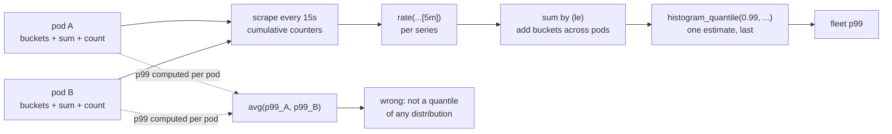

# Measuring API Latency Correctly: Prometheus Classic vs Native Histograms (prometheus-client 0.26.0) and Why Averaging p99 Across Pods Is Mathematically Invalid

> [!summary] Claim
> A percentile is a property of one whole distribution and cannot be recombined from per-pod percentiles, so a fleet p99 must be computed from mergeable distribution summaries (histogram buckets or a DDSketch) that are added first and queried last; `prometheus-client 0.26.0` can only emit classic bucket histograms, whose error is the bucket width, so the bucket layout is the accuracy contract.

Part of [Observability Profiling and Operations](README.md) in [API Engineering](../README.md).

## TL;DR

- Mechanism: record each request as one increment in a mergeable summary (classic `le` buckets, native exponential buckets, or a DDSketch), add the summaries across pods and scrapes with `sum by (le) (rate(...))`, and only then estimate the quantile with `histogram_quantile`.
- Contract rule: aggregation order is `rate`, then `sum`, then quantile; the quantile is the last operation, never an input to `avg`, `max`, `avg_over_time`, or a recording rule that is later averaged.
- Trap: averaging per-pod p99s is wrong in both directions, because it ignores how many requests each pod served and what each pod's distribution looks like below its p99; in the lab a 10% slow pod gives a traffic-weighted mean of `0.369 s` against a true fleet p99 of `1.114 s` (3.0x too low), and a 0.5% slow pod gives a plain mean of `1.198 s` against a true `0.138 s` (8.7x too high).
- Portability fact: `prometheus-client 0.26.0` `Histogram` exposes classic buckets only even when the scrape asks for `application/openmetrics-text; version=2.0.0`, because the package can parse and print a native histogram sample but nothing in it constructs one; native histograms from Python come through the OpenTelemetry exponential histogram or through the server converting classic buckets to NHCB.
- When not to use it: do not build quantiles from histograms when you need exact tail values for a few requests (use traces and logs), and do not use a `Summary` when you need a fleet-wide percentile, because a summary quantile cannot be aggregated.

## Mental model



The solid path keeps the information that a quantile throws away: how many observations fell in each value range, per pod, per scrape.
Counts are additive, so `rate` turns each cumulative counter into a per-second increase and `sum by (le)` adds pods that share a bucket boundary into one fleet-wide histogram, from which a single `histogram_quantile` interpolation yields the fleet p99.
The dotted path computes a quantile first, which collapses each pod's distribution to one number, and then tries to combine numbers that no longer carry the pod's request count or tail shape; there is no function of those numbers that recovers the fleet quantile, as the counterexample in the lab shows.

## How it works

### Why a quantile cannot be aggregated

Let pod `i` serve a fraction `w_i` of the traffic with cumulative distribution function `F_i`.
The fleet distribution is the mixture `F(x) = sum_i w_i * F_i(x)`, and the fleet q-quantile is the `x` that solves `F(x) = q`.
Pod `i` reports `p_i = F_i^-1(q)`, the inverse of its own CDF at the single point `q`.
The fleet quantile depends on the whole shape of every `F_i` (to the right and the left of `p_i`), while `p_i` carries only one point of each, so no formula in the `p_i` and `w_i` can reproduce it.
Averages work for means because expectation is linear in the mixture, `E[X] = sum_i w_i * E[X_i]`, and quantiles are not linear: the inverse of a sum of CDFs is not the sum of the inverses.
The Prometheus documentation says the same thing about summaries: "aggregating the precomputed quantiles from a summary rarely makes sense", and "averaging the quantiles yields statistically nonsensical values", with `avg(http_request_duration_seconds{quantile="0.95"}) // BAD!` as its example (Prometheus docs, "Histograms and summaries", section "Quantiles").

The lab proves non-recoverability with two fleets that have identical per-pod p99s and sizes and different fleet p99s.
`steady` is 1000 observations of `1.0`; `half_slow` is 500 of `1.0` and 500 of `100.0`; `rare_slow` is 985 of `1.0` and 15 of `100.0`.
Both slow pods have p99 `100.0`, so the pair of per-pod p99s is `(1, 100)` with sizes `(1000, 1000)` in both fleets, yet the fleet p99 is `100.0` for `steady + half_slow` and `1.0` for `steady + rare_slow` (`test_same_per_pod_p99_and_sizes_can_give_different_fleet_p99`).
Weighting does not rescue it: the weight on the slow pod that happens to reproduce the true fleet p99 is `0.41` in the lab's 10% slow-pod scenario and `0.017` in the 1% scenario, and equals neither traffic share (`test_no_fixed_weight_recovers_the_fleet_p99`; values from a bisection run on the same lab data).
The SRE book makes the adjacent point about means: a service with "an average latency of 100 ms at 1,000 requests per second" can have 1% of requests taking 5 seconds, and the way to see the tail is to collect "request counts bucketed by latencies (suitable for rendering a histogram), rather than actual latencies" (Google SRE book, "Monitoring Distributed Systems", section "Worrying About Your Tail").

What does aggregate is a distribution summary with a merge operation that is exact on the summary: add the counts of buckets that mean the same thing.
The three summaries below differ in how bucket boundaries are chosen, and therefore in what error the final interpolation can have.

### Classic histograms in prometheus-client 0.26.0

`Histogram` in `prometheus_client/metrics.py` is a set of float counters, one per upper bound, plus a sum (`prometheus-client 0.26.0 prometheus_client/metrics.py, Histogram._metric_init`).
`DEFAULT_BUCKETS` is `(.005, .01, .025, .05, .075, .1, .25, .5, .75, 1.0, 2.5, 5.0, 7.5, 10.0, INF)`, sized "to cover a typical web/rpc request from milliseconds to seconds" (`Histogram.DEFAULT_BUCKETS`).
`_prepare_buckets` raises `ValueError('Buckets not in sorted order')` for unsorted input, appends `+Inf` if absent, and requires at least two buckets, so an explicit layout is a contract fixed at construction (`Histogram._prepare_buckets`).
`observe` takes the lock-protected `_sum.inc(amount)`, then scans the upper bounds in order and increments only the first bucket with `amount <= bound` before `break`, so each observation costs two counter increments (two `MutexValue` lock acquisitions in single-process mode) and a scan that is linear in the bucket count (`Histogram.observe`, `prometheus-client 0.26.0 prometheus_client/values.py, MutexValue.inc`).
Bucket counts are stored non-cumulatively and made cumulative only at collection time, where `_child_samples` yields `_bucket{le="..."}` as a running total, then `_count` equal to the final total, then `_sum` only when the first bound is `>= 0`, then `_created` unless `PROMETHEUS_DISABLE_CREATED_SERIES` is set (`Histogram._child_samples`, `prometheus_client/metrics.py` `_get_use_created`).
The inclusive upper bound is exactly the `le` semantics PromQL expects: the lab observes `0.1` into `buckets=(0.1, 0.5)` and sees `le="0.1"` equal `1.0`.

Each label set therefore costs `len(buckets) + 2` series at scrape time: 15 `_bucket` series plus `_count` and `_sum` is 17 with the defaults, plus a `_created` series that the text exposition moves into a separate `gauge` family named `<name>_created` (`prometheus-client 0.26.0 prometheus_client/exposition.py, generate_latest`, the `om_samples` handling).
Series multiply by every label combination, which is why the route label must be a template and never a raw path (see the sibling [[RED-and-USE-Metrics-and-OpenTelemetry-HTTP-Semantic-Conventions]]).

`Summary` in the same package has only `_count` and `_sum` (and a reserved `quantile` label name): `Summary.observe` increments exactly those two, and `_child_samples` returns exactly those two plus `_created` (`prometheus-client 0.26.0 prometheus_client/metrics.py, Summary.observe, Summary._child_samples`).
The Python client therefore cannot produce the streaming quantiles that the Go client's summaries do, and the Prometheus guidance "Summaries are usually supported by all libraries, but some might only track the count and sum of observations and omit the quantile calculation" describes this case (Prometheus docs, "Histograms and summaries", section "Instrumentation library support").

The server computes the quantile with `histogram_quantile`, documented behavior for classic input (Prometheus docs, "Query functions", section `histogram_quantile()`):

- Input series carry an `le` label with the inclusive upper bound; other labels and the metric name identify which histogram a bucket belongs to.
- Within the bucket holding the target rank, the value is linearly interpolated, "assuming a uniform distribution of observations within the bucket".
- The highest bucket must be `+Inf`, and "if a quantile is located in the highest bucket, the upper bound of the second highest bucket is returned", so a slow tail beyond the last finite bound is invisible and reported as that bound.
- The lower limit of the lowest bucket is assumed to be `0` when its upper bound is positive; otherwise that upper bound is returned.
- No observations returns `NaN`; `q < 0` returns `-Inf`; `q > 1` returns `+Inf`; fewer than two buckets returns `NaN`.
- Non-monotonic cumulative counts are repaired by raising each to the previous bucket's value, with differences below one trillionth (`1e-12`) of the sum of both buckets treated as floating-point noise, and the repair is flagged by the info annotation `input to histogram_quantile needed to be fixed for monotonicity`.

The lab's `ClassicHistogram.quantile` implements those rules and reproduces the documentation's own worked numbers: for bounds `(0.1, 0.2, 0.3, 0.45)` and every observation at `0.22`, the p95 estimate is `0.295` (the documentation says 295 ms); moving every observation to `0.32` gives `0.4425` (the documentation says 443 ms), while the true value is `0.32` (`test_classic_quantile_reproduces_the_prometheus_doc_spike_example`).
The estimate is a position inside the bucket, not a measurement, so the maximum error is the bucket width, "the maximum possible error is the whole width of a bucket" (Prometheus native histogram specification, section "Interpolation within a bucket").

The query shape that follows from additivity is `histogram_quantile(0.99, sum by (le) (rate(http_request_duration_seconds_bucket[5m])))`.
`rate` goes first because it handles counter resets per series (a pod restart resets its counters to zero), and the sum of already-rated series is a valid fleet rate; summing raw counters first would turn one pod's reset into a spurious fleet-wide drop.
The documentation spells out the same rate-first ordering for averages: "first take a rate over the desired duration and then divide" the rate of the sum by the rate of the count (Prometheus docs, "Histograms and summaries", section "Count and sum of observations").
Keeping `le` in the `by` clause is mandatory for classic buckets because `histogram_quantile` needs it; dropping it, for example `sum by (route)`, merges every bucket of a route into one series and the result is meaningless or empty.

Two consequences of "the bucket layout is the accuracy" matter operationally.
First, a fraction such as "share of requests at or under 300 ms" is exact only when a bucket boundary sits at `0.3`: `sum(rate(..._bucket{le="0.3"}[5m])) / sum(rate(..._count[5m]))` returns no series at all if the boundary is missing, and an incomplete result without a warning if only some pods have it (Prometheus docs, "Histograms and summaries", section "Bucketing"; lab `ClassicHistogram.fraction_le` returns `None` for a missing bound).
Second, changing the layout (a deploy adds a bucket) makes `sum by (le)` add series that exist on only some pods.
The lab's `sum_by_le` shows the resulting corruption: an old pod with 10 observations at `0.05` and bounds `(0.1, 0.5)` plus a new pod with 1 observation and bounds `(0.1, 0.25, 0.5)` sum to `le=0.1: 11`, `le=0.25: 1`, `le=0.5: 11`, which is not monotonic (`test_sum_by_le_over_mixed_bucket_layouts_is_silently_non_monotonic`).
PromQL then raises the `0.25` count to `11` and annotates the result, and the interpolation is quietly wrong for the whole rollout window.

### Native histograms: the data model

A native histogram is one sample type that carries the count, the sum, a schema, a zero bucket, and sparse buckets, so one histogram is one time series instead of `buckets + 2` (Prometheus native histogram specification, sections "Schema", "Buckets", "Zero bucket").
Prometheus 2.40.0 was the first server with support behind `--enable-feature=native-histograms`, 3.8.0 made it stable, scraping needs `scrape_native_histograms` set, 3.9 made the feature flag a no-op, and "from v4 on" both `scrape_native_histograms` and `send_native_histograms` default to true (specification page, introduction; as of 2026-11).

The schema is an `int8`.
A standard schema `n` in `[-4, 8]` defines bucket `i` as the interval `((2**2**-n)**(i-1), (2**2**-n)**i]`, lower bound exclusive and upper bound inclusive for positive buckets, with `i` any integer (specification, section "Schema").
The growth factor from one bucket to the next is `2**(2**-n)`, so schema `n` has half the resolution of schema `n+1`, and a schema `n+1` histogram becomes schema `n` by merging neighbors: new index `ceil(i / 2)`, because bucket `i = 2j-1` and `i = 2j` both lie inside `((2**2**-n)**(j-1), (2**2**-n)**j]`.
Schema `-53` is a distinct mode, custom bucket boundaries (NHCB), used to carry classic histograms; schemas `-9..52` are reserved for future standard schemas, and a standard schema above 8 may be reduced on ingestion (specification, section "Schema").
The mapping from the instrumentation-side growth factor to a schema is in the specification table; the lab prints the same factors from the formula: schema 0 is `2`, schema 3 is `1.0905`, schema 4 is `1.0443`, schema 5 is `1.0219`, schema 8 is `1.0027`.
Instrumentation picks "a starting schema that results in a growth of the bucket width from one bucket to the next by a factor not larger than the provided value", so a requested factor of `1.1` yields schema 3 and a factor of `1.05` yields schema 4 (specification, section "Instrumentation libraries" parameter `NativeHistogramBucketFactor`, default `1.1`).

Worked index: with schema 3 the value `0.05 s` has `log2(0.05) * 8 = -34.58`, so index `ceil(-34.58) = -34`, and bucket `-34` is `(0.04819, 0.05256]`; reduced to schema 2 it lands in index `-17`, and reduced to schema `-1` in index `-2` (lab `ExponentialHistogram.index`, `bounds`, `reduced`).
Exact powers of two are handled with `math.frexp` so that `2.0` lands in the bucket whose inclusive upper bound is `2.0` rather than in the next bucket through a rounding error in `log2` (`test_native_powers_of_two_sit_on_inclusive_upper_boundaries`).

Buckets are sparse: only populated indices are listed.
Integer histograms store each bucket as a delta to the previous listed bucket (the first is absolute), with deltas that must not sum to a negative count, and spans `(offset, length)` map list positions to indices: the specification's example `-2->3, -1->5, 0->0, 1->0, 2->1, 3->0, 4->3, 5->2` becomes bucket list `[3, 2, -4, 2, -1]` with spans `[[-2, 2], [2, 1], [1, 2]]` (specification, section "Buckets", "Examples").
Observations of exactly zero, and with a positive threshold everything in `[-threshold, +threshold]`, go to a dedicated zero bucket; the default threshold offered to instrumentation is `2**-128`, and merging histograms with different thresholds takes the largest threshold, raises it further until it no longer cuts through a populated bucket, and adds every source bucket inside the new threshold to the zero bucket (specification, section "Zero bucket").
`NaN` goes into no bucket but increments the count, so the count can exceed the sum of all buckets by the number of `NaN` observations; `+Inf` and `-Inf` go to the overflow buckets (specification, section "Special cases of observed values").

Quantile estimation interpolates differently: for a standard schema it uses exponential interpolation inside a bucket, which models "the assumption that dividing a bucket into two when increasing the schema number by one ... will on average see similar populations in both new buckets"; the zero bucket and NHCBs use linear interpolation (specification, section "Interpolation within a bucket"; functions page, `histogram_quantile()`).
The engine computes a positive standard-schema bucket as `math.Exp2(logLower + (logUpper-logLower)*fraction)` with `logLower = math.Log2(lower)`, which is algebraically the lab's `lower * (upper / lower) ** fraction` and places the half-population point of a bucket at the geometric mean `sqrt(lower * upper)`; custom buckets and the zero bucket use `bucket.Lower + (bucket.Upper-bucket.Lower)*fraction` (prometheus v3.8.0 promql/quantile.go, HistogramQuantile).
The error that the estimate can have is bounded by the growth factor: at schema 3 the true value is within `9.05%` of any point in the bucket, and the lab measures `0.30%` on a log-normal (sigma 2, 20,000 observations) against `2.36%` for 15 classic buckets and `0.51%` for a DDSketch with `alpha = 0.01`.

Cost control is part of the model.
A distribution that is "manipulated from the outside" can create many buckets and "could even be used as a DoS attack vector via exhausting all the memory", so instrumentation SHOULD offer a bucket limit; the Go strategy has three parameters (`NativeHistogramMaxBucketNumber`, default `0` meaning unlimited, a typical value `160`, `NativeHistogramMinResetDuration`, and `NativeHistogramMaxZeroThreshold`), and applies remedies in order: reset the whole histogram if enough time has passed, otherwise widen the zero bucket up to its maximum, otherwise lower the schema by one repeatedly down to `-4` (specification, section "Limiting the bucket count").
The server has two matching limits, `native_histogram_bucket_limit` and `native_histogram_min_bucket_factor`: each reduces the schema until it holds, a limit that cannot be met even at `-4` fails the scrape for the bucket limit, and the factor limit succeeds at `-4` regardless (specification, section "Limiting bucket count and resolution").
The lab's `limit_buckets(160)` takes a schema 8 histogram with 3805 populated buckets (log-normal, sigma 2) to schema 2 with 89 buckets, and `limit_buckets(1)` stops at schema `-4` instead of looping.
The specification warns against requesting a tiny factor such as `1.005` together with a limit of `160`: the resolution is then reduced repeatedly after creation and after each reset, which creates churn in both the process and the TSDB, and queries that merge many histograms fall back to the lowest common resolution anyway (specification, section "Limiting the bucket count").

Exposition is the portability constraint.
At the time of the fetched documentation, native histograms required the protobuf exposition format, which limited support to "protobuf-enabled libraries, like the Java and the Go library", with "support in a text-based format ... underway as part of OpenMetrics v2" (Prometheus docs, "Histograms and summaries", section "Instrumentation library support"; as of 2026-11).
The specification lists Go, Java, and Rust as the three official instrumentation libraries with native histogram support "Currently (2026-06-15)", and Python is not among them (specification, section "Instrumentation libraries"; as of 2026-11).
`scrape_native_histograms` also changes content negotiation so that, unless `scrape_protocols` says otherwise, the protobuf format is preferred over OpenMetrics text (native histogram specification, section "Scrape configuration").

What `prometheus-client 0.26.0` actually does is narrower than its marketing suggests, and the lab pins it down.
`prometheus_client/samples.py` defines a `NativeHistogram` `NamedTuple` (count, sum, schema, zero threshold, zero count, spans, deltas, exemplars) commented "experimental and subject to change at any time", and `Sample` gains a `native_histogram` field.
`prometheus_client/openmetrics/exposition.py, generate_latest` prints a sample that has one as `{count:...,sum:...,schema:...,zero_threshold:...,zero_count:...,positive_spans:[...],positive_deltas:[...]}` (with `negative_spans:[...]` and `negative_deltas:[...]` before the positive pair when present), and skips such samples entirely when the negotiated version is below `2.0.0`.
`prometheus_client/openmetrics/parser.py` parses that text back (`_parse_nh_sample`, `_parse_nh_struct`).
`Histogram` never builds one: the only `NativeHistogram(` constructor call in the whole package is in the parser, so `Histogram.observe` increments classic buckets only.
The scrape handler `choose_encoder` accepts `application/openmetrics-text; version=2.0.0` and returns the OpenMetrics generator with that version and a `2.0.0` content type, but the body of a `Histogram` is still `_bucket{le="..."}` lines (`prometheus-client 0.26.0 prometheus_client/exposition.py, choose_encoder`).
The lab asserts exactly that: with `Accept: application/openmetrics-text; version=2.0.0` the response has the `2.0.0` content type, contains `http_request_duration_seconds_bucket{le="0.1",route="/work"} 1.0`, ends with `# EOF`, and contains no `schema:` text (`test_scrape_with_openmetrics_2_still_exposes_classic_buckets_only`).

So a Python service has three real routes to native histograms:
- Keep the classic `Histogram` and have Prometheus ingest it as an NHCB with `convert_classic_histograms_to_nhcb`; "they behave exactly like classic histograms" on the instrumentation side, "the quantile error is the same as with a corresponding classic histogram", and one series per histogram on the server (Prometheus docs, "Histograms and summaries", section "Quantiles", and native histogram specification, section "Scraping classic histograms as NHCBs").
- Record with the OpenTelemetry SDK's `ExponentialBucketHistogramAggregation`, which in `opentelemetry-sdk 1.45.2` defaults to `max_size=160` and `max_scale=20` (`opentelemetry-sdk 1.45.2 opentelemetry/sdk/metrics/_internal/aggregation.py, ExponentialBucketHistogramAggregation`), and export through OTLP, where "OTel's exponential histograms are always converted into the usual native histograms" (Prometheus docs, "Histograms and summaries", section "Ingestion via Open Telemetry").
- Move the percentile computation to a pipeline you control, with a DDSketch, below.

Mind the OTel unit trap: the same SDK's default explicit-bucket boundaries are `(0.0, 5.0, 10.0, 25.0, 50.0, 75.0, 100.0, 250.0, 500.0, 750.0, 1000.0, 2500.0, 5000.0, 7500.0, 10000.0)` (`opentelemetry-sdk 1.45.2 opentelemetry/sdk/metrics/_internal/aggregation.py, _DEFAULT_EXPLICIT_BUCKET_HISTOGRAM_AGGREGATION_BOUNDARIES`), which is tuned for milliseconds, so recording seconds into the default layout puts every request below `5.0` into one bucket.

### DDSketch: relative error by construction

DDSketch (Masson, Rim, Lee; PVLDB 12(12), 2019) fixes the value range a bucket covers by a geometric rule, so that every bucket's width is a constant fraction of its value (DDSketch paper, Section 2).
Given a target relative accuracy `alpha`, set `gamma = (1 + alpha) / (1 - alpha)`; bucket `i` counts values in `(gamma**(i-1), gamma**i]`, and a value `x > 0` goes to `i = ceil(log_gamma(x))` (Algorithm 1, `Insert`).
The reported value for bucket `i` is `2 * gamma**i / (gamma + 1)`, and Lemma 2 shows it is an alpha-accurate answer for every value in the bucket: at the bucket's lower edge the ratio `2*gamma/(gamma+1)` equals `1 + alpha`, at the upper edge `2/(gamma+1)` equals `1 - alpha`.
The guarantee is on the value, `|estimate - true| <= alpha * true`, not on the rank, which is why heavy tails do not hurt: rank-error sketches, including t-digest, "still have high relative error on heavy-tailed data sets", as the paper's related-work section argues (DDSketch paper, Section 1.2).
For `alpha = 0.01`, `gamma = 1.0202`, and the lab places `0.05 s` in key `-149`, whose bucket is `(0.04978, 0.05079]` and whose representative value is `0.05028`, an error of `0.56%`.

Merging is exact and trivial: sketches with equal `gamma` have identical bucket boundaries independent of the data, so "merging two sketches is straightforward": add counts bucket by bucket (Section 2.1).
That is the same property as a classic histogram with a shared layout, minus the need to choose the layout.
Different `gamma` values are not mergeable, and `sketches-py` enforces it: `BaseDDSketch.merge` raises `ValueError("Cannot merge two DDSketches with different parameters ...")` when `_mergeable` finds unequal gammas (`sketches-py 3.0.1 ddsketch/ddsketch.py, BaseDDSketch.merge, BaseDDSketch._mergeable`).
The lab's merge has the stronger property that `merge(sketch(A), sketch(B)).bins == sketch(A + B).bins` exactly, bucket for bucket (`test_merge_equals_observing_the_union`).

Unbounded growth is handled by collapsing: when more than `m` buckets are populated, the two lowest are merged (Algorithm 3, `DDSketch-Insert`), and the alpha guarantee then holds only for quantiles above the collapsed region.
The paper's sizing example: "for alpha = 0.01, a sketch of size 2048 can handle values from 80 microseconds to 1 year, and cover all quantiles" (Section 2.2); the lab computes `gamma**2048 = 6.2e17` for that setting, comfortably larger than the `1 year / 80 us = 3.9e11` ratio.
`sketches-py` sets `DEFAULT_REL_ACC = 0.01` and `DEFAULT_BIN_LIMIT = 2048`, but the bin limit applies only to `LogCollapsingLowestDenseDDSketch` and `LogCollapsingHighestDenseDDSketch`; the plain `DDSketch` class uses an unbounded `DenseStore` (`sketches-py 3.0.1 ddsketch/ddsketch.py, DDSketch`).
Its `KeyMapping` base computes `key = int(ceil(_log_gamma(value)) + offset)` and `value(key) = _pow_gamma(key - offset) * (2.0 / (1 + gamma))`, which `LogarithmicMapping` instantiates with exact logarithms (`sketches-py 3.0.1 ddsketch/mapping.py, KeyMapping.key, KeyMapping.value`); the sketch tracks the exact `sum`, `min`, and `max` separately, counts values at or below `min_possible` in `zero_count`, and answers `get_quantile_value(q)` with `rank = q * (count - 1)` (`sketches-py 3.0.1 ddsketch/ddsketch.py, BaseDDSketch.add, BaseDDSketch.get_quantile_value`).
Its `CollapsingLowestDenseStore` collapses over the dense key range between the lowest and highest key rather than over the count of non-empty buckets that the paper's pseudocode uses (`sketches-py 3.0.1 ddsketch/store.py, CollapsingLowestDenseStore._adjust`), so the two bound the size in slightly different units; the lab follows the paper.
The collapse trade-off is visible in the lab: a Pareto sample (shape 1.5, 20,000 values) needs 247 buckets at `alpha = 0.01`; capped at 120 buckets, the p99 error stays under `1%` (`0.66%` measured) while the p1 estimate is off by more than `5%` (`1153%` measured) because the lowest buckets were merged upward (`test_ddsketch_collapse_trades_low_quantile_accuracy_for_a_hard_size_limit`).
The `alpha = 0.001` run in the scratch measurement hit the 2048 cap on the log-normal sample, so a tight `alpha` over a wide range engages collapse on its own.

The paper's related-work section places DDSketch among rank-error sketches (GK, which is "only one-way mergeable"), t-digest (more accurate at extreme quantiles but "only one-way mergeable"), the HDR Histogram (the one earlier relative-error design, with a bounded value range and no published guarantee), and the Moments sketch (guarantees on average rank error only) (DDSketch paper, Section 1.2).
That is the engineering reason to prefer a bucketed, additive summary for fleet metrics: merge cost and correctness are trivial and independent of arrival order.

### Time windows, recording rules, and SLOs

The averaging error repeats across time: `avg_over_time(p99[1h])` of a per-minute p99 series weights a quiet minute and a busy minute equally and is not the p99 of that hour.
Compute `histogram_quantile(0.99, sum by (le) (rate(..._bucket[1h])))` directly, or store a recording rule for the summed rate of buckets (`sum by (le, route) (rate(..._bucket[5m]))`) and derive quantiles and fractions from that; do not record the quantile and then aggregate the recording.
Latency SLIs are naturally bucket fractions, "the share of requests at or under threshold T", which the fraction form above computes exactly when a boundary equals T; the multi-window burn-rate construction on top of that is in [[SLIs-SLOs-Error-Budgets-and-Multi-Window-Burn-Rate-Alerting]].
A histogram built in the process measures only what the process sees: requests that never reach the handler, queueing before accept, and load generators that stop sending when the server stalls are invisible, which the sibling notes [[Load-Testing-APIs-with-Locust-and-Open-vs-Closed-Workload-Models]] and [[Client-Side-Telemetry-Network-Error-Logging-NEL-and-Edge-vs-Origin-Gap]] cover.

## Numbers and limits

| Quantity | Value | Source or measurement |
|---|---|---|
| `Histogram.DEFAULT_BUCKETS` | 15 upper bounds from `0.005` to `10.0`, `+Inf` last | `prometheus-client 0.26.0 prometheus_client/metrics.py`; asserted in lab |
| Series per classic histogram label set | `buckets + 2`, so 17 with defaults, plus a `_created` series | `Histogram._child_samples`, `generate_latest` |
| Classic quantile error | at most the width of the bucket holding the quantile | Prometheus native histogram specification, "Interpolation within a bucket" |
| Doc spike example, all observations at 220 ms, buckets 100/200/300/450 ms | p95 estimate `295 ms`, true `220 ms` | Prometheus docs, "Histograms and summaries"; lab `0.295` |
| Same, spike moved to 320 ms | p95 estimate `443 ms`, true `320 ms` | same; lab `0.4425` |
| `histogram_quantile` monotonicity tolerance | `1e-12` of the sum of two buckets | Prometheus docs, "Query functions" |
| Native schema range | `-4..8` standard, `-53` custom, `-9..52` reserved | native histogram specification, "Schema" |
| Growth factor `2**(2**-n)` | n=0 `2`, n=3 `1.0905`, n=4 `1.0443`, n=5 `1.0219`, n=8 `1.0027` | lab formula output, 2026-11 run |
| Highest bucket index at schema 8 | `262144` (the `MaxFloat64` bucket) | native histogram specification, "Buckets" |
| Typical bucket limit | `160` | native histogram specification, "Limiting the bucket count"; `opentelemetry-sdk 1.45.2` default `max_size` |
| Zero threshold default offered to instrumentation | `2**-128` | native histogram specification, instrumentation parameters |
| Native bucket count, log-normal sigma 2, n=20,000, schema 8 | `3805` buckets; limit 160 gives schema 2, `89` buckets | lab, Python 3.14.6, macOS arm64 |
| p99 relative error on that sample, exact p99 `5.2335 s` | schema 0 `7.4%`, schema 3 `0.30%`, schema 5 `0.20%`, 15 classic buckets `2.36%` | lab scratch measurement, same machine |
| DDSketch buckets, same sample | `alpha=0.05` 149, `alpha=0.01` 654, `alpha=0.001` 2048 (cap reached) | lab scratch measurement, same machine |
| DDSketch defaults | `relative_accuracy=0.01`; `bin_limit=2048` only on the `LogCollapsing*DenseDDSketch` classes, plain `DDSketch` unbounded | `sketches-py 3.0.1 ddsketch/ddsketch.py` |
| Range of 2048 buckets at `alpha=0.01` | factor `gamma**2048 = 6.2e17`; paper: 80 microseconds to 1 year | lab arithmetic; DDSketch paper, Section 2.2 |
| Fleet p99, slow pod share 10% | true `1.114 s`, mean of p99 `1.340 s`, traffic-weighted `0.369 s`, classic merge `1.339 s`, native merge `1.116 s`, DDSketch merge `1.116 s` | `python -m ...`, below |
| Prometheus native histogram stability | first in 2.40.0, stable in 3.8.0, defaults on in v4 | native histogram specification page (as of 2026-11) |

The fleet table below is the program's own output, and the numbers in the TL;DR come from it.

## Portability

| Dimension | Claim | Evidence |
|---|---|---|
| CPython 3.14.6 on macOS (arm64, `macOS-27.3-arm64`) | the 42 lab tests pass | `uv run --frozen pytest ... -q` run for this note |
| CPython 3.12, 3.13, 3.15, 3.15t | not run for this note | the user paused lab matrix checks on 2026-11-11; the lab uses `math`, `bisect`, `statistics`, and `prometheus-client` only |
| `prometheus-client 0.26.0` interpreters | declares Python `>=3.9` with classifiers 3.9 through 3.14 and no 3.15 | `prometheus_client-0.26.0.dist-info/METADATA` read from the pinned environment |
| `Histogram` produces native histograms | no: the only `NativeHistogram(` call is in `openmetrics/parser.py` | source search of the installed `prometheus-client 0.26.0`, plus the scrape test |
| Text exposition versions | `text/plain; version=0.0.4` by default; `application/openmetrics-text` at any requested `version` `>= 1.0.0` (echoed in the content type, `1.0.0` when none is given); `text/plain; version=1.0.0` on request | `choose_encoder` source; `test_default_scrape_is_the_classic_text_format` and the OpenMetrics 2.0 scrape test |
| Multi-process mode (`PROMETHEUS_MULTIPROC_DIR`) | histogram buckets from all worker files are summed per `le` and accumulated, so a per-host aggregate is correct | `MultiProcessCollector._accumulate_metrics` source read; not run here |
| Prometheus server | native histograms stable from 3.8.0, scrape opt-in until v4 | native histogram specification page (as of 2026-11) |
| ASGI servers (Uvicorn, Hypercorn, Granian) and HTTP/1.1, HTTP/2, HTTP/3 | not exercised: the histogram math is independent of both, and the lab app is driven through `httpx.ASGITransport` | no server was started |
| `math.log` and `math.log2` at bucket edges | the lab asserts with tolerances except at exact powers of two, which use `frexp`; other platforms' libm not run | `ExponentialHistogram.index` source; only macOS run |

## Worked example

The implementation is [implementation](../labs/src/api_labs/f18_observability_profiling_and_operations/latency_histograms_percentiles_ddsketch_and_why_averaging_percentiles_is_wrong.py) and the test is [test](../labs/tests/f18_observability_profiling_and_operations/test_latency_histograms_percentiles_ddsketch_and_why_averaging_percentiles_is_wrong.py).
It has no network, no clock, and no randomness: a population is the inverse CDF of a log-normal at the midpoints `(i + 0.5) / n`, so every number below is reproducible.

The scenario is two pods: a healthy pod (median `50 ms`, sigma `0.4`) and a degraded pod (median `400 ms`, sigma `0.8`) that receives `slow_share` of 20,000 requests.
Each pod feeds a 15-bucket `ClassicHistogram`, an `ExponentialHistogram(3)`, and a `DDSketch(0.01)`, and each summary is merged across the two pods.

Simplified excerpt of the native bucket index and schema reduction:

```python
def index(self, value: float) -> int:
    frac, exp = math.frexp(value)
    if self.schema > 0:
        if frac == 0.5:
            return (exp - 1) << self.schema          # exact power of two
        return math.ceil(math.log2(value) * (1 << self.schema))
    k = exp - 1 if frac == 0.5 else exp
    return -(-k // (1 << -self.schema))              # ceil(k / 2**-schema)

def reduced(self, target: int) -> ExponentialHistogram:
    divisor = 1 << (self.schema - target)
    for i, c in self.buckets.items():
        j = -(-i // divisor)                         # ceil(i / divisor)
        out.buckets[j] = out.buckets.get(j, 0) + c
```

Simplified excerpt of the DDSketch insert, collapse, and quantile:

```python
self.gamma = (1.0 + relative_accuracy) / (1.0 - relative_accuracy)

def key(self, value: float) -> int:
    return math.ceil(math.log(value) / self._log_gamma)

def value(self, key: int) -> float:
    return 2.0 * self.gamma**key / (self.gamma + 1.0)

def _collapse(self) -> None:
    while len(self.bins) > self.max_bins:
        ordered = sorted(self.bins)
        self.bins[ordered[1]] += self.bins.pop(ordered[0])

def quantile(self, q: float) -> float:
    rank = q * (self.count - 1)
    if rank < self.zero_count:
        return 0.0
    running = float(self.zero_count)
    for k in sorted(self.bins):
        running += self.bins[k]
        if running > rank:
            return self.value(k)
    return self.value(max(self.bins))
```

Simplified excerpt of the classic quantile (the documented `histogram_quantile` rules):

```python
rank = q * self.total
b = next(i for i, c in enumerate(cum) if c >= rank and c > 0)
if b == len(self.bounds) - 1:
    return self.bounds[-2]                  # quantile in the +Inf bucket
lower = 0.0 if b == 0 else self.bounds[b - 1]
below = 0 if b == 0 else cum[b - 1]
return lower + (self.bounds[b] - lower) * ((rank - below) / self.counts[b])
```

Run from `labs/` on CPython 3.14.6, macOS 27.3 arm64 (2026-11-21), with `prometheus-client 0.26.0`:

```text
$ uv run --frozen python -m api_labs.f18_observability_profiling_and_operations.latency_histograms_percentiles_ddsketch_and_why_averaging_percentiles_is_wrong
slow_share  true  mean_p99  weighted_p99  classic  native  ddsketch   (seconds)
    0.005  0.138     1.198         0.137    0.228   0.139     0.139
    0.010  0.165     1.265         0.150    0.241   0.166     0.167
    0.050  0.783     1.331         0.247    0.794   0.785     0.779
    0.100  1.114     1.340         0.369    1.339   1.116     1.116
    0.500  2.067     1.348         1.348    2.383   2.073     2.075
```

Reading the table: `true` is the exact p99 of all 20,000 requests; `mean_p99` is the plain mean of the two pod p99s; `weighted_p99` weights them by request count; the last three columns merge the summaries and then ask for p99.
The plain mean barely moves (`1.198` to `1.348`) because each pod's own p99 is nearly fixed (about `0.13 s` for the healthy pod and `2.3` to `2.6 s` for the degraded one), so it reports about `1.2` to `1.3 s` whatever the traffic split, while the true p99 ranges from `0.138 s` to `2.067 s`.
The traffic-weighted mean is accurate only when the slow share is tiny (`0.137` against `0.138` at `0.005`) and drifts to 3.0x low at 10%, because the fleet p99 sits inside the slow pod's body, not at its p99.
The merged native histogram stays within `0.5%` of the truth and the merged DDSketch within `1%` in every row (`1.116` against `1.114` at 10%; relative errors computed from the same run).
The merged classic histogram tracks the truth only to within one bucket: `0.228` against `0.138` at 0.5% is a `65%` error that lands inside the `(0.1, 0.25]` bucket, which is the bucket-width limit working as specified.
The seed's expected "4x error when one pod receives 90% of traffic" did not reproduce with these distributions; the error depends on the distributions, between 0.32x and 8.7x here, which is the point.

Test run, same machine:

```text
$ uv run --frozen pytest tests/f18_observability_profiling_and_operations/test_latency_histograms_percentiles_ddsketch_and_why_averaging_percentiles_is_wrong.py -q
..........................................                               [100%]
42 passed in 0.33s
```

The tests that carry the claim are `test_mean_of_pod_p99_is_wrong_in_both_directions`, `test_same_per_pod_p99_and_sizes_can_give_different_fleet_p99`, `test_no_fixed_weight_recovers_the_fleet_p99`, `test_merge_equals_observing_the_union`, `test_ddsketch_relative_error_never_exceeds_alpha_on_a_heavy_tail`, `test_native_schema_reduction_equals_observing_at_the_lower_schema`, `test_native_bucket_limit_halves_resolution_until_it_fits`, and the two ASGI scrape tests.
Mutation checks, which would prove each test fails when its mechanism is removed, were not run: the user paused them on 2026-11-11, so the claim that every test is discriminating rests on reading the assertions, not on a recorded mutation run.

## Pitfalls

> [!warning] Averaging percentiles, plain or weighted
> Trigger: a dashboard or alert uses `avg(...{quantile="0.99"})`, `avg(histogram_quantile(0.99, rate(..._bucket[5m])))` computed per pod, `avg_over_time` of a p99, or a recording rule that stores a per-pod p99 and a later query averages it.
> Symptom: the fleet "p99" is `8.7x` too high when one pod in 200 is slow and `3.0x` too low when 10% of traffic is slow (lab); it can also hide a regression when two pods trade places.
> Fix: record bucket rates, sum by `le`, and compute the quantile last: `histogram_quantile(0.99, sum by (le) (rate(http_request_duration_seconds_bucket[5m])))`.
> Source: Prometheus docs, "Histograms and summaries", section "Quantiles"; the Google SRE book describes the Bigtable SLO that was driven by a mean while "the worst 5% of requests were often significantly slower than the rest" ("Monitoring Distributed Systems", section "Bigtable SRE: A Tale of Over-Alerting").

> [!warning] A bucket layout that does not contain your threshold
> Trigger: an SLO of 300 ms with buckets `0.25, 0.5`, or an SLO change after the layout shipped.
> Symptom: the quantile is interpolated across a wide bucket and can sit anywhere in it; the doc example estimates `443 ms` for a true `320 ms`, and a fraction query at `le="0.3"` returns no series at all if the bound is missing.
> Fix: put a boundary at every SLO threshold and a few around it, size buckets so the width near the threshold is small against the tolerance, or move to schema-3 native histograms or an NHCB when the threshold may change.

> [!warning] Changing bucket boundaries during a rollout
> Trigger: a deploy adds, removes, or moves a bucket while old pods still run.
> Symptom: `sum by (le)` adds series that exist on only some pods, the cumulative series is non-monotonic (the lab sums to `11, 1, 11`), and `histogram_quantile` repairs it and sets the info annotation `input to histogram_quantile needed to be fixed for monotonicity`; interpolation is silently wrong until the old pods are gone.
> Fix: treat the layout as an API, change it only with a new metric name, and watch for that annotation.

> [!warning] Assuming `prometheus-client 0.26.0` emits native histograms
> Trigger: enabling `scrape_native_histograms` on a target that uses `prometheus_client.Histogram`, or sending `Accept: application/openmetrics-text; version=2.0.0` and expecting `schema:` lines.
> Symptom: the series are still `_bucket`, `_count`, `_sum`; nothing in the Python client constructs a native histogram (lab).
> Fix: choose NHCB conversion on the server, the OpenTelemetry exponential histogram, or a different client.

> [!warning] OTel default boundaries are milliseconds
> Trigger: recording seconds with the OpenTelemetry SDK's default explicit-bucket histogram.
> Symptom: every request lands in `(0, 5]`, so every quantile is interpolated inside one bucket (`opentelemetry-sdk 1.45.2`, default bounds `0.0, 5.0, ... 10000.0`).
> Fix: pass explicit second-scale `boundaries` through a `View`, or use the exponential aggregation.

> [!warning] Quantile of lifetime counters
> Trigger: `histogram_quantile(0.99, http_request_duration_seconds_bucket)` without `rate`.
> Symptom: the "p99" moves slowly and never reflects the last five minutes, because it is computed from counters accumulated since process start.
> Fix: always wrap the buckets in `rate(...[window])`; the functions page says "Use the `rate()` function to specify the time window for the quantile calculation".

> [!warning] `NaN` poisons `_sum` and breaks `count == sum of buckets`
> Trigger: `Histogram.observe(float("nan"))` from an unguarded subtraction or a missing timestamp.
> Symptom: in `prometheus-client 0.26.0` the observation matches no bucket (`nan <= bound` is false for every bound, including `+Inf`), so `_bucket` and `_count` do not change, and `_sum` becomes `nan` permanently, which turns every average from `rate(_sum)/rate(_count)` into `NaN` (measured: after `observe(0.05)`, `observe(nan)`, `observe(inf)` the text exposition was `le="0.1"} 1.0`, `le="1.0"} 1.0`, `le="+Inf"} 2.0`, `_count 2.0`, `_sum NaN`; CPython 3.14.6, macOS 27.3 arm64, 2026-11-21).
> Fix: validate the duration (`max(end - start, 0)` as the package's own `Timer` does) before observing.

> [!warning] Label cardinality multiplies buckets
> Trigger: a `path` label with raw URLs or user IDs on a 15-bucket histogram.
> Symptom: 17 series per distinct value, then slow scrapes and a memory spike in Prometheus.
> Fix: label by route template, method, and status class; see [[RED-and-USE-Metrics-and-OpenTelemetry-HTTP-Semantic-Conventions]].
> Source: CVE-2022-21698 (NVD, published 2022-02-15): in `client_golang` before `1.11.1`, `promhttp.InstrumentHandler*` middleware with a `method` label let requests with non-standard HTTP methods create unbounded series and exhaust memory; the NVD workarounds are to drop the `method` label or sanitize the method before the middleware.

## Security and robustness

- Unbounded distinct values are an attack surface twice: a high-cardinality label lets an unauthenticated caller create series, and an unbounded native histogram lets a caller who controls observed values create buckets; the specification calls the second "a DoS attack vector via exhausting all the memory", and requires libraries to offer a bucket limit (native histogram specification, section "Limiting the bucket count").
  Derive labels from the matched route template and a closed set of statuses, never from request input.
- DDSketch is self-limiting through `max_bins`, but collapse silently degrades the low quantiles, so cap `max_bins` large enough that the quantiles you alert on stay above the collapsed range (Algorithm 3 and Section 3 of the DDSketch paper).
- Validate observed values at the call site: reject `NaN`, negative durations (a negative `_sum` is read by the server as a counter reset; the client docstring warns "Negative values are accepted but prevent current versions of Prometheus from properly detecting counter resets in the sum"), and unit mistakes.
- Keep `/metrics` off the public listener or behind network policy and authentication: route templates, status distributions, and traffic shape are reconnaissance data, and a heavy scrape is itself a cost.
- Percentiles are not a security boundary: a p99 SLO hides a 1% attack stream completely, so pair latency histograms with error and abuse signals from the [[SLIs-SLOs-Error-Budgets-and-Multi-Window-Burn-Rate-Alerting]] and [[The-Sixty-Second-API-Incident-Triage-Playbook]] notes.
- Histogram output is a processing-time side channel if exposed per user or per token; aggregate by route.

## The principal's view

The decision is to make "distribution summaries that merge" the only latency data model in the fleet and to ban stored percentiles as inputs to aggregation.
That is cheap to state and expensive to enforce, because every vendor dashboard and every well-meaning recording rule offers a "p99" series that looks aggregable.
Make the platform own three things: the default bucket layout (seconds, boundaries at the common SLO thresholds, versioned as an API), the recording rules that sum buckets and derive quantiles and threshold fractions, and a lint that rejects `avg(...{quantile=...})` and `avg(histogram_quantile(...))` in alert rules.

Choose the summary by who controls the aggregation point.
With Prometheus and Python services, classic histograms with a deliberate layout are the safe default, ingested as NHCB where the server supports it, and OpenTelemetry exponential histograms when you want real exponential resolution without choosing boundaries; the trade-off is that the Python client gives you no native path today, so the migration is a pipeline change, not a one-line flag.
Reach for DDSketch where you own both ends of the pipeline (a vendor agent, a stream processor, an offline analysis) and need a value-relative guarantee across many orders of magnitude, accepting that Prometheus cannot ingest it and that its storage is a custom bucket list rather than a TSDB-native type.
Choose a `Summary` only when no cross-instance aggregation will ever be needed, which is rare for an API with more than one replica.

The organizational trade-off is series cost against resolution: more buckets, more labels, and finer schemas cost memory and query time in every consumer, and the specification itself advises against maximum resolution with tight limits.
Budget bucket count per service the way you budget cardinality, review bucket layouts when SLOs change, and keep percentile values for display while using bucket fractions for alerting.
Change protocol or tool when you need the exact tail of individual requests (use [[Distributed-Tracing-W3C-Trace-Context-and-Baggage-Propagation]] with [[Trace-Sampling-Strategies-Head-Based-vs-Tail-Based-Sampling]] to keep the slow ones), or when the question is capacity rather than latency, where [[Capacity-Planning-with-Littles-Law-and-the-Universal-Scalability-Law]] applies.

## Interview questions

> [!question] L5: What is wrong with this replica-wide p99 dashboard, and what replaces it?
>
> The panel is `avg(http_request_duration_seconds{quantile="0.99"})` over eight replicas.
>
> > [!success]- Answer
> > A quantile is a property of one whole distribution, so the mean of eight per-replica p99s is not the p99 of any distribution.
> > It ignores how many requests each replica served and what each replica's distribution looks like below its p99.
> > The metric type is also wrong: a `Summary` quantile cannot be aggregated, so use a histogram.
> > Compute `histogram_quantile(0.99, sum by (le) (rate(http_request_duration_seconds_bucket[5m])))`, which adds bucket counts across replicas and interpolates once.
> >
> > Follow-up: what changes if the replicas have different bucket layouts?

> [!question] L5: Why does `histogram_quantile` need `rate` and why `sum by (le)`?
>
> > [!success]- Answer
> > Bucket series are cumulative counters, so a quantile from raw values describes the whole process lifetime; `rate` over a window gives the recent increase and handles resets per series.
> > `histogram_quantile` needs the `le` label to know each bucket's inclusive upper bound, so it must stay in the `by` clause when aggregating.
> > Summing the rated series across pods first makes one fleet histogram, and the quantile is the last step.
> >
> > Follow-up: what does the result look like if you write `sum by (route)` and drop `le`?

> [!question] L5: Why must you use histograms rather than summaries for a service with several replicas?
>
> > [!success]- Answer
> > A summary computes quantiles inside each process over its own sliding window, and those quantiles cannot be combined: the Prometheus documentation calls averaging them "statistically nonsensical".
> > A histogram exports counts per bucket, which add, so any quantile or window can be computed later on the server.
> > In `prometheus-client 0.26.0` a `Summary` does not even compute quantiles, it exports only `_count` and `_sum`.
> >
> > Follow-up: when is a quantile-less summary still fine?

> [!question] L6: Predict the output of this classic histogram quantile.
>
> `h = ClassicHistogram((0.1, 0.2, 0.3, 0.45))`, then 1000 observations of `0.32`, then `h.quantile(0.95)`.
>
> > [!success]- Answer
> > The result is `0.4425`.
> > All observations are in the `(0.3, 0.45]` bucket, the target rank is `950` of `1000`, the count at the lower edge is `0`, so the position is `0.95` of the way across the bucket: `0.3 + 0.15 * 0.95 = 0.4425`.
> > The true quantile is `0.32`, so the estimate is 38% too high; this reproduces the 443 ms figure in the Prometheus documentation.
> > The error is bounded by the bucket width and caused by the uniform-distribution assumption, not by the arithmetic.
> >
> > Follow-up: which bucket boundaries would make this particular estimate accurate, and why is that a bad design goal?

> [!question] L6: Debug this API: why does this alert never fire?
>
> The rule is `avg(histogram_quantile(0.99, sum by (pod, le) (rate(http_request_duration_seconds_bucket[5m])))) > 0.5`.
> During the incident one pod serves slow requests for 10% of traffic.
>
> > [!success]- Answer
> > The `by (pod, le)` computes a per-pod p99 and `avg` then averages them, which is the invalid aggregation; with one pod in ten degraded, the mean sits between a good p99 and a bad one and depends on the pod count, not on the user experience.
> > Drop `pod` from the `by` clause so buckets from all pods add before the quantile: `histogram_quantile(0.99, sum by (le) (rate(http_request_duration_seconds_bucket[5m]))) > 0.5`.
> > Then check that a bucket boundary exists at or near `0.5`, because the alert threshold is only as exact as the bucket width.
> >
> > Follow-up: how would you page on one bad pod without averaging percentiles?

> [!question] L6: Which bucket layout and query serve an SLO of 95% of requests under 300 ms?
>
> Also say what a missing `le="0.3"` bucket does.
>
> > [!success]- Answer
> > Put a boundary at `0.3` and several around it; compute `sum(rate(..._bucket{le="0.3"}[5m])) / sum(rate(..._count[5m]))`, an exact fraction rather than an interpolated quantile.
> > Without that bucket the expression returns no series at all, and if only some pods have it the result is incomplete without a warning, per the Prometheus documentation.
> > With native histograms use `histogram_fraction(0, 0.3, ...)`, which interpolates when no boundary matches.
> >
> > Follow-up: how does the layout choice change if the SLO threshold can move?

> [!question] L6: Does enabling `scrape_native_histograms` give a `prometheus-client 0.26.0` service native histograms?
>
> > [!success]- Answer
> > No.
> > `Histogram` only increments classic buckets; the package can parse and print a native histogram sample (`NativeHistogram`, OpenMetrics 2.0 text) but nothing builds one, and a scrape with `version=2.0.0` still returns `_bucket` lines.
> > Options are NHCB conversion on the server, the OpenTelemetry exponential histogram through OTLP, or another client library.
> > The lab asserts the absence of `schema:` in the scrape body.
> >
> > Follow-up: what accuracy do you keep and lose with NHCB conversion?

> [!question] L7+: Derive the relative error bound of DDSketch and explain what collapsing gives up.
>
> > [!success]- Answer
> > Take `gamma = (1 + alpha) / (1 - alpha)`; bucket `i` holds `(gamma**(i-1), gamma**i]` and the reported value is `2*gamma**i/(gamma+1)`.
> > At the lower edge the ratio of reported to true is `2*gamma/(gamma+1) = 1 + alpha`, at the upper edge `2/(gamma+1) = 1 - alpha`, so every value is within `alpha` relative error.
> > To bound memory, collapse merges the lowest buckets upward when more than `m` are populated, so the guarantee holds only for quantiles above the collapsed region; the lab shows p99 within 1% and p1 off by more than 5% (`1153%` measured) at 120 buckets.
> > The bound is on value, not rank, which is why it survives heavy tails.
> >
> > Follow-up: how large must `m` be for `alpha = 0.01` to cover 80 microseconds to a year?

> [!question] L7+: Design the fleet latency pipeline for 400 Python services on Kubernetes with Prometheus.
>
> Say where the percentile is computed and what you forbid.
>
> > [!success]- Answer
> > Services record seconds-scale classic histograms with a versioned layout containing the SLO thresholds, or OTel exponential histograms over OTLP; Prometheus ingests classic ones as NHCB where supported.
> > Recording rules sum rated buckets by route and a small label set; quantiles and threshold fractions are derived from those sums, and SLO alerts use fractions through multi-window burn rates.
> > Forbid stored percentile series as aggregation inputs, `avg` over quantiles, layout changes under an existing metric name, and raw-path labels; enforce with a rule linter and a series-count budget per service.
> > Trade-off: finer resolution and more labels cost memory and query time everywhere, so budget buckets like cardinality.
> >
> > Follow-up: how do you roll out a new bucket layout without corrupting `sum by (le)`?

> [!question] L7+: Which is right when a merged classic histogram says p99 is 228 ms and a DDSketch pipeline says 139 ms for the same traffic?
>
> > [!success]- Answer
> > Neither number is "right" without knowing the error model: the classic estimate is accurate only to the width of the bucket holding the quantile (the lab's `0.228` against a true `0.138` is a `65%` error inside the `(0.1, 0.25]` bucket), while the DDSketch is within `alpha` of the true value.
> > Decide from the data's bucket boundaries and the sketch's `alpha`, check both against an exact computation on a sampled slice, and prefer the one whose stated error is smaller than the decision threshold.
> > The practical action is to add buckets around the quantile region, or to move that service to a relative-error summary.
> >
> > Follow-up: what would you alert on so the choice does not matter?

## Related

Prerequisites: [[Structured-Logging-with-Structlog-and-Stripe-Canonical-Log-Lines]]

Next: [[Health-Check-Engineering-Liveness-Readiness-Startup-and-Cascading-Restarts]]

See also: [[RED-and-USE-Metrics-and-OpenTelemetry-HTTP-Semantic-Conventions]], [[SLIs-SLOs-Error-Budgets-and-Multi-Window-Burn-Rate-Alerting]], [[Load-Testing-APIs-with-Locust-and-Open-vs-Closed-Workload-Models]], [[Capacity-Planning-with-Littles-Law-and-the-Universal-Scalability-Law]], [[Client-Side-Telemetry-Network-Error-Logging-NEL-and-Edge-vs-Origin-Gap]], [[Distributed-Tracing-W3C-Trace-Context-and-Baggage-Propagation]], [[Trace-Sampling-Strategies-Head-Based-vs-Tail-Based-Sampling]], [[The-Sixty-Second-API-Incident-Triage-Playbook]]

- Lab: `labs/tests/f18_observability_profiling_and_operations/test_latency_histograms_percentiles_ddsketch_and_why_averaging_percentiles_is_wrong.py`

## Further reading

- [Prometheus: Histograms and summaries](https://prometheus.io/docs/practices/histograms/): the maintainers' comparison of native, classic, and summary types, including the 295 ms and 443 ms worked errors reproduced in the lab.
- [Prometheus: Native Histograms specification](https://prometheus.io/docs/specs/native_histograms/): the normative schema, bucket, zero bucket, interpolation, and bucket-limit rules.
- [Prometheus: Query functions, `histogram_quantile()`](https://prometheus.io/docs/prometheus/latest/querying/functions/): the exact special cases and the monotonicity repair.
- [DDSketch: A Fast and Fully-Mergeable Quantile Sketch with Relative-Error Guarantees (PVLDB 12(12), 2019)](https://www.vldb.org/pvldb/vol12/p2195-masson.pdf): the algorithm, Lemma 2, and the collapse construction.
- [Google SRE book: Monitoring Distributed Systems](https://sre.google/sre-book/monitoring-distributed-systems/): "Worrying About Your Tail" on why means hide the tail and bucketed counts reveal it.
- [DataDog/sketches-py v3.0.1 `ddsketch.py`](https://raw.githubusercontent.com/DataDog/sketches-py/v3.0.1/ddsketch/ddsketch.py): the reference Python implementation, defaults, and the merge compatibility check.
