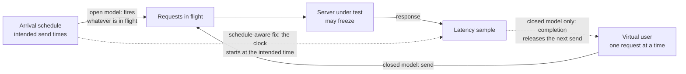

# Load Testing HTTP APIs with Locust (2.47.0): Open vs Closed Workload Models and the Coordinated Omission Problem

> [!summary] Claim
> A Locust user is a closed-loop actor that cannot send request n+1 until request n returns, so a server stall silences the generator, records one slow sample where a real arrival stream would have suffered hundreds, and reports a falsely low p99 (5 ms against 1705 ms in the lab).
> Measure latency from the intended send time or drive an open arrival schedule, and print the workload model next to every latency number.

Part of [Observability Profiling and Operations](README.md) in [API Engineering](../README.md).

## TL;DR

- Mechanism: Locust runs `N` gevent greenlets that each loop `task -> wait_time -> task` (locust 2.47.0 `locust/user/task.py`, `TaskSet.run`), so offered load is `N / (R + Z)` and falls whenever the response time `R` rises.
- Contract rule: a latency percentile is only meaningful with its workload model (`N` users with think time `Z`, or `lambda` arrivals per second) and a clock that starts at the intended send time, not when a blocked sender got around to sending.
- Trap: for identical server behavior, a 2 s freeze gives p99 = 5 ms from the closed-loop generator and 1705 ms from the open-arrival run in the lab, because the closed loop logged 1 slow sample and made 199 fewer sends than scheduled.
- Portability: the lab model is pure Python and passed 18 tests on CPython 3.14.6 here; Locust imports `gevent`, whose 26.9.0 metadata says free-threaded CPython is unsupported, and a plain `import locust` monkey-patches the whole process unless `LOCUST_SKIP_MONKEY_PATCH` is set.
- When not to use: a closed model is correct when the real population is a fixed pool (a worker fleet, a connection pool of `N`); for internet-facing tail latency, SLO verification, and overload tests use an open generator (k6 arrival-rate executors, wrk2 `-R`, or a Locust task that spawns one greenlet per arrival).

## Mental model



In an open model the arrival schedule `S` pushes requests into the system at a rate that does not depend on the server, so a stalled server accumulates a backlog and every queued request is measured.
In a closed model the only way to send is for a user `U` to be released by the completion of its previous request (the dashed edge), so a stalled server removes load from itself: the users are all parked inside the stall and the stall appears in the data once per user.
The second dashed edge is the repair used by wrk2 and HdrHistogram: keep the closed sender, but start each sample's clock at the time the schedule says the request should have gone out, so the time spent blocked behind the stall is charged to the requests that were delayed.
Everything else in this note is the detail of those arrows: how Locust implements the closed loop, what it measures, how to get the open behavior out of it, and how to prove the difference.

## How it works

### Closed, open, and partly-open systems

The vocabulary comes from Schroeder, Wierman, and Harchol-Balter, "Open Versus Closed: A Cautionary Tale" (NSDI 2006).
In a closed system there are `N` users (the multiprogramming level, MPL), each repeating "submit a job, receive the response, think for a while", so a new request is only triggered by the completion of a previous one and `N_think + N_system = N` at all times (NSDI 2006 Section 2).
In an open system jobs arrive at average rate `lambda` independent of completions; the number in the system ranges from zero to infinity, and "a request completion does not trigger a new request" (NSDI 2006 Section 2).
A partly-open system has outside arrivals like an open system, but after each response the user stays with probability `p` and sends a follow-up, so session length is geometric with mean `1/(1 - p)` (NSDI 2006 Section 2).
Real web traffic is the partly-open case: a visitor behaves like a closed user for a few requests, then leaves.

Four of the paper's eight principles drive load-test design ((i) and (ii) in NSDI 2006 Section 5.1, (vii) and (viii) in Section 6):

| Principle | Statement | Consequence for a load test |
| --- | --- | --- |
| (i) | For a given load, mean response times are significantly lower in closed systems than in open systems | A closed test of a system that really faces open arrivals is optimistic |
| (ii) | As the MPL grows, closed systems become open, but convergence is slow for practical purposes | A big enough `N` approximates an open test; see the lab sweep below for how big |
| (vii) | A partly-open system behaves like an open system when expected requests per session are small (5 or fewer as a rule of thumb) and like a closed system when they are large (10 or more) | Count requests per session in production traces before choosing a model |
| (viii) | In a partly-open system, think time has little effect on mean response time | Tuning `wait_time` does not rescue a closed model of a short-session workload |

The principles are about mean response time and scheduling.
Coordinated Omission, below, is a different defect: it is about what the measurement records even when the model is right.

The closed loop has a simple throughput identity: offered rate is `X = N / (R + Z)`, the interactive form of Little's Law (a textbook identity, not fetched here; the derivation and the capacity-planning use are in [[Capacity-Planning-with-Littles-Law-and-the-Universal-Scalability-Law]]).
It says a closed generator cannot hold a rate by itself: when `R` grows, `X` falls.
The lab asserts the consequence: one user paced at 100 requests per second against a 50 ms server delivers `1 / 0.05 = 20` requests per second (`test_closed_loop_throughput_follows_the_response_time_law`).

### Coordinated Omission: the mechanism

The wrk2 README (Gil Tene) states it directly: "Since each connection will only begin to send a request after receiving a response, high latency responses result in the load generator coordinating with the server to avoid measurement during high latency periods" (wrk2 README, section "A note about wrk2's latency measurement technique").
The k6 documentation describes the same loop: in a closed model "Slower response times means longer iterations and a lower arrival rate of new iterations", and it names the problem coordinated omission (k6 docs, "Open and closed models").

The lab fixes the numbers (`labs/src/api_labs/f18_observability_profiling_and_operations/load_testing_workload_models.py`):

- Intended load is 100 requests per second for 60 s, so 6000 scheduled sends and one every 10 ms.
- The server is a single FIFO worker with a 5 ms service time, so utilization is 50 percent.
- At t = 20 s the server freezes for 2 s.

An open generator sends 200 requests during the freeze, and all of them queue.
The first one waits 2005 ms; arrival `i` (counting from the freeze) completes at `22 + 0.005 (i + 1)` seconds and arrived at `20 + 0.01 i`, so its latency is `2.005 - 0.005 i`.
The backlog drains at 5 ms per request because the server has 5 ms of spare capacity per 10 ms interval, so latency stays above the 5 ms baseline for `i < 400`: 400 requests, 6.7 percent of the run (the test asserts exactly 400).
The 60 slowest requests are `i = 0 .. 59`, so p99 is the latency of `i = 60`: `2.005 - 0.3 = 1.705` s.

A closed generator with one `constant_pacing` user has one request in flight.
It sends one request at t = 20.00 s, gets the response at 22.005 s, and then waits `max(0, pacing - run_time) = 0`, so it resumes at once on the normal 10 ms cadence, 5 ms off the original grid.
The 200 scheduled slots inside the stall are skipped (the 5 ms offset adds one send back at the end), so the run has 5801 samples instead of 6000 and exactly one of them is slow.
Locust's percentile code returns the value of the k-th slowest sample where `k = N - int(N * 0.99) = 5801 - 5742 = 59` (locust 2.47.0 `locust/stats.py`, `calculate_response_time_percentile`), so one slow sample cannot move p99; it only shows up in the p99.99 and maximum columns, which `PERCENTILES_TO_REPORT` does include.
The failure is not that Locust hides the stall completely; it is that the stall is one sample out of 5801 while the users it would have hurt were 400 out of 6000.

### The two published corrections

Schedule-aware measurement (wrk2).
The README describes it as combining "constant throughput load generation with latency measurement that takes the intended constant throughput into account": latency runs "from the time the transmission *should* have occurred according to the constant throughput configured for the run", so a late response is charged to every request it delayed (wrk2 README).
It needs "a 'model' or 'plan' that can provide the intended start time" of each request, which is trivial for a constant rate and harder for stochastic arrivals (wrk2 README).
wrk2 also keeps an uncorrected histogram, reported with `--u_latency`, so the difference stays visible.
The lab implements it as `run_schedule_aware_closed_loop`: still one request in flight, but each sample carries its schedule slot as `intended_s`.
The sorted corrected latencies equal the open-loop latencies, element by element (`test_schedule_aware_measurement_recovers_the_open_loop_distribution`), while the same samples measured from the actual send time give p99 = 5 ms again.
The sender is behind schedule after the stall and sends back to back until it catches up, which is also how the 6000 slots all get sent.

Expected-interval fill (HdrHistogram).
`recordValueWithExpectedInterval(value, expectedInterval)` records `value`, then, while `missing = value - expectedInterval` is at least `expectedInterval`, records `missing` and subtracts another interval (HdrHistogram `AbstractHistogram.java`, `recordSingleValueWithExpectedInterval`, which `recordValueWithExpectedInterval` calls; `recordValueWithCountAndExpectedInterval` is the same loop for the counted variant used by `copyCorrectedForCoordinatedOmission`).
The Javadoc calls this an at-recording correction and says it is mutually exclusive with the post-recording `copyCorrectedForCoordinatedOmission(long)`: "only one of the two should be be used on a given data set" (HdrHistogram `AbstractHistogram.java`, `recordValueWithExpectedInterval`).
Applied to the closed-loop latencies with a 10 ms interval, the lab's `expected_interval_fill_us` adds 199 samples (1995 ms down to 15 ms) and moves p99 from 5 ms to 1405 ms (one-off driver run, reproduced by the verifier on 2026-11-21; the test asserts only the bounds), still short of the true 1705 ms.
The reason is structural: the fill assumes the suppressed requests would have seen latencies falling by one interval per request, but a server with spare capacity drains a backlog more slowly than the arrival cadence, so more than 199 requests were affected.
The test asserts the honest property: the filled p99 lies strictly between 1.0 s and the open-loop p99 (`test_expected_interval_fill_only_partly_corrects_a_stall_that_leaves_a_backlog`).
Treat the fill as a floor on the damage, valid for a constant expected interval, and prefer schedule-aware measurement when you can have it.

Raising the user count is not a correction but it changes the model, and the lab sweep shows where it converges (closed `constant_pacing` users offering 100 requests per second in total, same freeze; from a one-off driver run, with the 1, 10, 50, and 200 rows asserted in `test_closed_loop_p99_converges_to_the_open_loop_p99_only_with_enough_users`):

| Users `N` | Samples | p99 (ms) | Peak in flight |
| --- | --- | --- | --- |
| 1 | 5801 | 5.0 | 1 |
| 10 | 5810 | 5.0 | 10 |
| 50 | 5850 | 250.0 | 50 |
| 100 | 5900 | 1710.0 | 100 |
| 150 | 6000 | 1705.0 | 150 |
| 200 | 6000 | 1705.0 | 200 |
| open arrivals | 6000 | 1705.0 | 201 |

Once `N` approaches the number of requests the stall strands, the closed run reproduces the open distribution (the p99 matches from `N = 150` here and the sample count reaches 6000); the open run peaks at 201 requests in flight, which is Little's Law again (`lambda * R_worst = 100 * 2.005`).
The practical rule for a Locust run that must behave open: size `N` from the in-flight count the worst expected stall will create, not from the in-flight count of the healthy system, which is under 1 here (NSDI 2006 Principle (ii): convergence needs a large MPL).

### Locust 2.47.0: the user loop

A Locust `User` is a gevent greenlet started by `User.start` (`locust/user/users.py`, `User.start`).
`TaskSet.run` is the closed loop (locust 2.47.0 `locust/user/task.py`, `TaskSet.run`):

```python
# simplified excerpt from locust 2.47.0 locust/user/task.py, TaskSet.run
while True:
    try:
        if not self._task_queue:
            self.schedule_task(self.get_next_task())
        try:
            if self.user._state == LOCUST_STATE_STOPPING:
                raise StopUser()
            self.execute_next_task()
        except RescheduleTaskImmediately:
            pass
        except RescheduleTask:
            self.wait()
        else:
            self.wait()
```

`execute_next_task` runs the task to completion, then `wait()` sleeps for `wait_time()` on the gevent hub (`TaskSet.wait`, `TaskSet._sleep`, which calls `gevent.sleep`).
Nothing in this loop can start task `n+1` before task `n` returns; that single fact makes every Locust `User` closed.
The default `User.wait_time` is `constant(0)` (`locust/user/users.py`), so a user with no `wait_time` sends back to back, which is a saturation generator, not a rate generator.

The wait-time helpers are all functions of the user, called after each task (locust 2.47.0 `locust/user/wait_time.py`):

| Helper | What it returns | What it holds constant | Model |
| --- | --- | --- | --- |
| `between(a, b)` | uniform random in `[a, b]` | think time | closed |
| `constant(t)` | `t` | think time | closed |
| `constant_pacing(t)` | `max(0, t - run_time)` | start-to-start interval, when the task is fast enough | closed, rate-limited |
| `constant_throughput(r)` | `constant_pacing(1 / r)`; `ValueError` if `r <= 0` | starts per second per user, when the task is fast enough | closed, rate-limited |
| `poisson(rate)` | `random.expovariate(rate)`; `ValueError` if `rate <= 0` | mean of the wait only | closed |

`constant_pacing` is the helper the lab reproduces:

```python
# simplified excerpt from locust 2.47.0 locust/user/wait_time.py, constant_pacing
def wait_time_func(self: "User") -> float:
    run_time: float = perf_counter() - self._cp_last_run - self._cp_last_wait_time
    self._cp_last_wait_time = max(0, wait_time - run_time)
    self._cp_last_run = perf_counter()
    return self._cp_last_wait_time
```

When a task overruns, `run_time > wait_time`, the wait is 0, and the next call measures only the next task: the schedule is forgotten, so there is no catch-up.
The lab drives the real helper with a fake clock: with pacing 0.01 s and task durations `[0.002, 2.0, 0.002, 0.002]` the waits are `[0.008, 0.0, 0.008, 0.008]` (`test_locust_constant_pacing_never_catches_up_after_a_stall`).
The docstring says it directly: "If a task execution exceeds the specified wait_time, the wait will be 0 before starting the next task."
So `constant_throughput(r)` is a ceiling of `r` starts per second per user, not a generator of `r`; the Locust maintainer's advice on issue #2347 to use `constant_throughput` "to achieve an 'open' workload" holds only while no user is blocked, and the same comment attributes the dips to "locust by default running with a 'closed' workload" (locustio/locust issue 2347, collaborator comment of 2023-05-17).
In 2.47.0 `constant_pacing` measures with `time.perf_counter` and `constant_throughput` rejects a non-positive rate; both changes first shipped in 2.46.7 (upstream commits `23f940a1e5` and `80751d02bf`, compared against the release tags).

`poisson` deserves a separate warning from source reading (not executed in the lab): it returns an exponential wait with no run-time compensation, unlike `constant_pacing`, and `TaskSet.run` calls it after the task finishes.
Read from `TaskSet.run` and `TaskSet.wait` (locust 2.47.0 `locust/user/task.py`: `wait()` runs only after `execute_next_task` returns, then calls `gevent.sleep(self.wait_time())`) and from the `poisson` body, `lambda instance: random.expovariate(rate)` with no `run_time` term (`locust/user/wait_time.py`), the gap between task starts is `R + Exp(rate)`, with mean `R + 1/rate`, so the realized rate is `1 / (R + 1/rate)`, below `rate`, and the start process is Poisson only in the limit `R -> 0`.
The wait-time docs describe `poisson` as tasks arriving "as a Poisson process with the given average rate" (Locust docs, "Writing a locustfile", wait_time), and the docstring says "The average number of task runs per second will be `rate`" (locust 2.47.0 `locust/user/wait_time.py`, `poisson`); read both as true for the waits, not for the sends.
`poisson` is new: it first shipped in Locust 2.46.6 (upstream commit `999f7824dd`, 2026-09-13).
The lab confirms the distribution of the helper itself: over 20000 seeded draws at rate 50 the mean is within 5 percent of 0.02 s and the standard deviation within 10 percent of the mean, and `poisson(0)` raises (`test_locust_poisson_wait_is_exponential_and_validates_its_rate`).

Users stop gracefully or by kill.
`User.stop(force=False)` kills a user in the `None` or `waiting` state at once, and for a `running` user sets `LOCUST_STATE_STOPPING` so the user exits after the current task (`locust/user/users.py`, `User.stop`).
`--stop-timeout` (default `"0"`) is the number of seconds to wait for a user to finish its task (`locust/argument_parser.py`); with the default, users are killed at once, so a request still in flight at the end of a run is cut off and never reaches the `request` event: the kill raises `GreenletExit`, a `BaseException`, inside `_send_request_safe_mode`, which catches only `RequestException`, so `HttpSession.request` never builds `request_meta` (source reading of locust 2.47.0 `locust/clients.py`, `_send_request_safe_mode`, and `locust/user/users.py`, `User.stop`, whose `force` path calls `killone`; `TaskSet.run` re-raises `GreenletExit` after `on_stop`; not executed).

Load shapes change concurrency, not arrival rate.
`LoadTestShape.tick()` returns `(user_count, spawn_rate)` or `(user_count, spawn_rate, user_classes)`, or `None` to stop (locust 2.47.0 `locust/shape.py`, `LoadTestShape.tick`).
The docs say it plainly: "spawn rate/ramp up does not change peak load, it only changes how fast you get there", and "High wait times and sleeps do impact throughput, so that may make it necessary to launch even more Users" (Locust docs, "Increasing the request rate").
`LocalRunner.start` logs a warning when `spawn_rate > 100`, and `MasterRunner.start` when the per-worker rate exceeds 100 (`locust/runners.py`).

### Locust 2.47.0: what is measured and reported

`HttpSession.request` takes `time.perf_counter()` immediately before `_send_request_safe_mode` and again after it returns, so `response_time` (milliseconds) covers everything `requests` does inside the call: pool checkout, connect and TLS if the connection is new, sending, waiting, and reading the body unless `stream=True` (locust 2.47.0 `locust/clients.py`, `HttpSession.request`).
It also records `start_time = time.time()` in the request metadata, passed to the `request` event along with `request_type`, `name`, `response_time`, `response_length`, `response`, `context`, `exception`, and `url`.
No timer starts before the send, so time a user spends late, whether blocked behind a slow earlier request or starved by a saturated generator CPU, is invisible.

`HttpUser` sets no default timeout: `HttpSession.request` forwards `**kwargs`, and `requests` resolves `timeout=None` to `TimeoutSauce(connect=None, read=None)` (requests 2.34.2 `requests/adapters.py`, `HTTPAdapter.send`).
A server that accepts the connection and never answers therefore removes that user from the test indefinitely, because a live but silent peer raises no TCP error and urllib3 enables only `TCP_NODELAY`, not keepalive, by default (urllib3 2.8.0 `urllib3/connection.py`, `HTTPConnection.default_socket_options`); this is Coordinated Omission in its purest form.
`FastHttpUser` defaults are `network_timeout = 60.0`, `connection_timeout = 60.0`, `max_retries = 0`, `insecure = True`, and `concurrency = 10` (locust 2.47.0 `locust/contrib/fasthttp.py`, `FastHttpUser`).

Each sample goes through `RequestStats.log_request` and `StatsEntry.log`, which increments `num_requests` and stores the response time in a histogram keyed by `bucket_response_time` (locust 2.47.0 `locust/stats.py`):

```python
# simplified excerpt from locust 2.47.0 locust/stats.py, bucket_response_time
if response_time < 100:
    return round(response_time)
elif response_time < 1000:
    return int(round(response_time, -1))
elif response_time < 10000:
    return int(round(response_time, -2))
else:
    return int(round(response_time, -3))
```

The docstring gives the examples 147 to 150, 3432 to 3400, 58760 to 59000, and a bound of about 310 unique keys, chosen "for bandwidth in distributed mode".
The lab checks the examples and sweeps 100 ms to 99999 ms asserting relative error of at most 5 percent (`test_locust_buckets_response_times_to_two_significant_digits`); that is why the open-loop p99 of 1705 ms prints as 1700.
`calculate_response_time_percentile` walks the keys from the slowest downward, accumulating counts until `num_requests - processed_count <= int(num_requests * percent)`, and returns that key.
`median_response_time` additionally clamps the median into `[min, max]` because the histogram has two digits but min and max are exact.

`StatsEntry.get_current_response_time_percentile` is the sliding "current" figure the web UI charts: it diffs the live histogram against a cached copy from about `CURRENT_RESPONSE_TIME_PERCENTILE_WINDOW = 10` seconds ago, with a cache of the last 20 one-second snapshots (`StatsEntry._cache_response_times`).
`PERCENTILES_TO_REPORT` is `[0.50, 0.66, 0.75, 0.80, 0.90, 0.95, 0.98, 0.99, 0.999, 0.9999, 1.0]`.
The lab feeds the closed and open latency sets through the real `RequestStats` and gets 5 and 1700 as the reported p99 (`test_locust_reports_the_closed_loop_artifact_through_its_own_stats`).

In distributed mode each worker sends `stats.serialize_stats()` to the master every `WORKER_REPORT_INTERVAL = 3.0` seconds, and the master merges with `StatsEntry.extend`, which adds the bucketed `response_times` counts key by key (locust 2.47.0 `locust/runners.py`, `locust/stats.py`, `setup_distributed_stats_event_listeners`).
Merging histograms by summing counts is the correct way to combine percentiles, with resolution limited to the bucket width; averaging per-worker p99 values is not, as [[Latency-Histograms-Percentiles-DDSketch-and-Why-Averaging-Percentiles-Is-Wrong]] shows.
Each runner starts `monitor_cpu_and_memory`, which every `CPU_MONITOR_INTERVAL = 10.0` seconds compares process CPU to `CPU_WARNING_THRESHOLD = 90` and logs that high CPU "may constrain your throughput and may even give inconsistent response time measurements" (`locust/runners.py`).
The docs add that "Python cannot fully utilize more than one core per process", so one worker per core is needed, and that "Locust/gevent can run thousands or even tens of thousands of Users per process just fine, as long as their total request rate (RPS) is not too high" (Locust docs, "Distributed load generation").

### Getting an open workload out of Locust

| Approach | How | What it buys | Failure mode |
| --- | --- | --- | --- |
| Paced waits plus many users | `wait_time = constant_throughput(r)` or `poisson(r)` with `N >= lambda * R_worst` | no code changes; per-user pacing gives a rate while users are free | closed again once `N` is exhausted; verify achieved RPS equals offered RPS |
| One greenlet per arrival | a task returns at once and `gevent.spawn`s the request, with a `poisson` or `constant` wait supplying the schedule | requests are sent on schedule whatever is in flight | unbounded in-flight requests, memory and file descriptors; connection pool contention (below) |
| External open generator | k6 arrival-rate executors, wrk2 `-R` | native open model; wrk2 also corrects the clock | different tool, scripting, and reporting from Locust |
| Schedule-aware reporting | compute `intended` per request and fire the `request` event yourself with `response_time = (done - intended) * 1000` | keeps Locust's UI, CSV, and distribution | you now own the correctness of the timestamps; double counting if combined with a fill |

The per-arrival pattern needs a connection pool sized for the concurrency.
`requests` defaults to `DEFAULT_POOLSIZE = 10` and `DEFAULT_POOLBLOCK = False` (requests 2.34.2 `requests/adapters.py`), and urllib3 2.8.0 logs "Connection pool is full, discarding connection" when a returned connection does not fit (`urllib3/connectionpool.py`, `HTTPConnectionPool._put_conn`), so beyond 10 concurrent requests per `HttpUser` every extra request pays a new TCP and TLS handshake and you are measuring connection setup, not the API.
`HttpUser.pool_manager` lets users share a larger pool, and the Locust docs state that a single `FastHttpUser` session can run concurrent requests if you launch a greenlet per request (Locust docs, "Increase performance with a more efficient HTTP client").
This sketch is a simplified excerpt that the lab did not execute (no network is used by the lab); its names were checked against locust 2.47.0 source: `locust/__init__.py` exports `FastHttpUser`, `poisson`, and `task`, `FastHttpUser.concurrency` defaults to 10 and its docstring says that you must spawn your own gevent greenlets to use it, and `FastHttpSession.get` accepts `name=`:

```python
# simplified excerpt, NOT executed in the lab
import gevent
from locust import FastHttpUser, poisson, task


class OpenArrivals(FastHttpUser):
    concurrency = 500             # session pool for concurrent greenlets
    wait_time = poisson(20.0)     # per-user arrival rate; waits only, see the warning above

    @task
    def arrive(self) -> None:
        gevent.spawn(self.client.get, "/api/items", name="/api/items")  # returns at once
```

### The wire layer: where "one request at a time" comes from

HTTP/1.1 clients rarely pipeline.
RFC 9112 Section 9.3.2 allows a client to send multiple requests without waiting but requires the server to send "the corresponding responses in the same order that the requests were received", so one stalled response blocks every later response on that connection, and the RFC says a user agent SHOULD NOT pipeline after a non-idempotent method until its final response arrives.
Load generators therefore use one connection per in-flight request, which makes the connection count the concurrency cap and the closed loop's `N`.
HTTP/2 multiplexes streams on one connection, limited by `SETTINGS_MAX_CONCURRENT_STREAMS`, of which RFC 9113 says "Initially, there is no limit to this value" and recommends a value "no smaller than 100" (RFC 9113 Sections 5.1.2 and 6.5.2), so a generator could keep sending on schedule on one connection.
That matches the wrk2 README's condition for the asynchronous send-without-waiting technique, which it says "is normally only effective with non-blocking protocols or single-request-per-connection workloads"; the README, written in 2014 before HTTP/2 was published, counts "most TCP and HTTP workloads" as blocking and the technique there as "usually not a viable option" (wrk2 README).
Locust 2.47.0 does not take advantage of that: `locust/contrib/fasthttp.py` has no HTTP/2 code, `geventhttpclient` 2.6.1 defines only `HTTP_11` and `HTTP_10` in `client.py`, and a search of the `locust` and `geventhttpclient` Python sources for QUIC or HTTP/3 finds nothing (the only hit is a minified web UI asset).
A Locust result is therefore an HTTP/1.1 result with per-request connections; a production client fleet on HTTP/2 or HTTP/3 has different head-of-line and concurrency behavior (as of 2026-11).

### Designing and reading the test

1. Pick the model from traces: requests per session of 5 or fewer points to open arrivals, 10 or more to a closed pool (NSDI 2006 Principle (vii)); in between, build sessions (`classify_session_length` in the lab encodes those thresholds).
2. For an open test, set the arrival rate `lambda`, then size users or the greenlet pool for `lambda * R_worst` plus headroom, and check the generator CPU stays under the 90 percent warning line.
3. Discard the ramp with `--reset-stats`, which resets statistics "once spawning has been completed" (`locust/argument_parser.py`), and run long enough that the slowest 1 percent contains many samples; in the lab's 6000-sample run p99.9 rests on 6 requests, so a p99.9 claim needs many more samples than that after warm-up.
4. Compare offered to achieved rate (`sent_in_window` in the lab): if achieved falls below offered during an incident window, the run is closed and its tail is censored.
5. Report the model, the arrival rate or `N`, the sample count, the percentile, and whether the clock started at the intended time.
6. Feed percentiles into SLO checks through [[SLIs-SLOs-Error-Budgets-and-Multi-Window-Burn-Rate-Alerting]], and compare with server-side histograms from [[RED-and-USE-Metrics-and-OpenTelemetry-HTTP-Semantic-Conventions]] and [[Latency-Histograms-Percentiles-DDSketch-and-Why-Averaging-Percentiles-Is-Wrong]]; a load test whose p99 is far below the server's own p99 under the same window is almost always a closed-loop artifact.

## Numbers and limits

Measured numbers come from `uv run --frozen pytest tests/f18_observability_profiling_and_operations/test_load_testing_apis_with_locust_and_open_vs_closed_workload_models.py -q` on CPython 3.14.6, macOS 27.3 arm64 (Apple Silicon, `uname -r` = `27.3.0`), 2026-11-21; "one-off driver" means a throwaway script that imported the lab module, whose output was captured and whose script was deleted.
The verifier reran the test and an independent one-off driver on the same machine and interpreter on 2026-11-21 and reproduced every driver number below exactly.

| Quantity | Value | Source |
| --- | --- | --- |
| Scenario | 100 requests/s, 60 s, 5 ms FIFO service, 2 s freeze at t = 20 s | lab constants in the test |
| Closed-loop samples vs scheduled | 5801 of 6000 (199 sends omitted) | lab, asserted |
| Closed-loop p99, p99.9 | 5 ms, 5 ms | lab, asserted |
| Closed-loop maximum | 2005 ms, exactly one sample above 100 ms | lab, asserted |
| Open-loop p50, p99 | 5 ms, 1705 ms | lab, asserted |
| Requests above the 5 ms baseline, open loop | 400 (200 during the freeze, 200 draining) | lab, asserted |
| Peak in flight, closed vs open | 1 vs 201 | lab, asserted |
| Requests sent in the freeze window `[20, 22)` | 1 closed, 200 open | lab, asserted |
| Locust-reported p99 | 5 ms closed, 1700 ms open | lab through `locust.stats.RequestStats`, asserted |
| HdrHistogram fill samples added | 199; fill p99 1405 ms | lab asserted count and bounds; the 1405 value is from a one-off driver, reproduced |
| Poisson arrivals, seed 7 | 6082 arrivals, p50 6.0 ms, p99 1688.8 ms | one-off driver, reproduced, not asserted |
| Closed users for p99 to match open | 1 and 10: 5 ms; 50: 250 ms; 200: 1705 ms | lab, asserted |
| One 50 ms server, 1 paced user | 20 requests/s delivered of 100 asked | lab, asserted |
| Real Locust user, 50 ms task, wait asks 1000/s | at most `elapsed / 0.05 + 1` runs in a 0.6 s window | lab, asserted |
| Locust response-time bucket error | at most 5 percent for 100 ms to 99999 ms | lab sweep, asserted |
| Locust bucket keys | about 310 | locust 2.47.0 `bucket_response_time` docstring |
| Percentile window, cache | 10 s window, 20 snapshots | `locust/stats.py` constants |
| Worker report interval | 3.0 s | `locust/runners.py`, `WORKER_REPORT_INTERVAL` |
| CPU monitor interval, warning threshold | 10.0 s, 90 percent | `locust/runners.py` |
| Spawn rate warning | above 100 users/s (per worker when distributed) | `locust/runners.py`, `start` |
| `FastHttpUser` defaults | `concurrency` 10, `network_timeout` 60.0, `connection_timeout` 60.0, `max_retries` 0 | `locust/contrib/fasthttp.py` |
| `requests` pool defaults | 10 connections, not blocking | requests 2.34.2 `requests/adapters.py` |
| Web UI default port, master port | 8089, 5557; both bind all interfaces by default | `locust/argument_parser.py` |
| Session-length rule of thumb | 5 or fewer: open-like; 10 or more: closed-like | NSDI 2006 Principle (vii) |
| HTTP/2 stream limit | initially unlimited, recommended at least 100 | RFC 9113 Section 6.5.2 |
| Test suite | 18 passed in 1.96 s | lab, finish run 2026-11-21 (earlier runs took 6.43 s and 3.00 s; wall time varies) |

## Portability

| Dimension | Behavior | Evidence |
| --- | --- | --- |
| CPython 3.14 | 18 lab tests pass on 3.14.6 (workspace `.venv`) | lab, `uv run --frozen pytest ... -q`, macOS 27.3 arm64; the 3.14.10 interpreter was not run |
| CPython 3.12 (3.12.16 in the matrix) | not run: lab checks paused by the user's instruction of 2026-11-11 | no evidence; `locust-2.47.0` metadata lists Python 3.12 and requires `>=3.11` |
| CPython 3.13 (3.13.18) | not run, same reason | locust 2.47.0 metadata lists 3.13; gevent 26.9.0 metadata lists 3.13 |
| CPython 3.15 (3.15.2) | not run, same reason | locust 2.47.0 metadata lists 3.15; gevent 26.9.0 classifiers stop at 3.13, but gevent imported and ran on 3.14.6 here |
| CPython 3.15t (free-threaded) | not run, same reason; expect the Locust-dependent tests to be unsuitable | gevent 26.9.0 METADATA: "Free-Threading is not Supported ... using gevent in such an interpreter will cause the GIL to be enabled" |
| Pure-Python simulation | the FIFO model, the three generators, the percentile and fill functions import no Locust code | lab: `locust` is imported lazily inside four helpers and one test, so a gevent import failure fails only the tests that call them |
| Process-wide monkey patching | `import locust` calls `gevent.monkey.patch_all()` unless `LOCUST_SKIP_MONKEY_PATCH` is set; the lab sets it before importing | lab `test_plain_import_locust_patches_the_stdlib_but_the_lab_import_does_not` (subprocess, 3.14.6); locust 2.47.0 `locust/__init__.py` |
| Locust point release | behavior above is read from locust 2.47.0; `poisson` first shipped in 2.46.6, and the `constant_throughput` rate check and the `perf_counter` pacing clock in 2.46.7, so older releases lack them | installed package source; GitHub compare of commits `999f7824dd`, `80751d02bf`, `23f940a1e5` against the release tags (as of 2026-11) |
| Server implementations (Uvicorn, Hypercorn, Granian) | not applicable: the lab models the server as a FIFO queue and starts no ASGI server | lab design; no claim made |
| HTTP/1.1 | one in-flight request per connection in practice; pipelining allowed but responses ordered | RFC 9112 Section 9.3.2 |
| HTTP/2 | many streams per connection, limited by `SETTINGS_MAX_CONCURRENT_STREAMS` | RFC 9113 Sections 5.1.2 and 6.5.2 |
| HTTP/3 over QUIC | not tested by Locust 2.47.0: no QUIC or HTTP/3 code in `locust` or `geventhttpclient` Python sources | source search (as of 2026-11) |
| Debian Trixie and Alpine containers | not run: lab checks paused | no evidence |

## Worked example

The implementation is [implementation](../labs/src/api_labs/f18_observability_profiling_and_operations/load_testing_workload_models.py) and the test is [test](../labs/tests/f18_observability_profiling_and_operations/test_load_testing_apis_with_locust_and_open_vs_closed_workload_models.py).
The model is virtual time: no sleeping, no sockets, no threads, so it is deterministic.
The server is a FIFO worker whose completion function handles the freeze (simplified excerpt):

```python
# simplified excerpt: FifoServer.serve
start = max(arrival_s, self._free_at_s)
end = start + self._service_s
freeze = self._freeze
if freeze is not None:
    if freeze.start_s <= start < freeze.end_s:      # arrives or starts inside the freeze
        start = freeze.end_s
        end = start + self._service_s
    elif start < freeze.start_s < end:              # in service when the freeze begins
        end += freeze.duration_s
self._free_at_s = end
return end
```

The two generators differ in one line each (simplified excerpts):

```python
# simplified excerpt: closed loop, Locust constant_pacing semantics
done = server.serve(sent)
samples.append(Sample(intended_s=sent, sent_s=sent, done_s=done))
heapq.heappush(heap, (max(done, sent + pacing), user))      # no schedule memory

# simplified excerpt: open loop
for arrival in arrivals_s:
    samples.append(Sample(intended_s=arrival, sent_s=arrival, done_s=server.serve(arrival)))
```

The schedule-aware sender is the closed loop with `intended = slot time` and `next_send = max(done, next_slot)`.
Locust enters in two places, both through its real code and both guarded so that `import locust` does not patch the pytest process (simplified excerpt):

```python
# simplified excerpt: what Locust itself would report for a latency set
os.environ.setdefault("LOCUST_SKIP_MONKEY_PATCH", "1")
from locust.stats import RequestStats

stats = RequestStats(use_response_times_cache=False)
for seconds in latencies:
    stats.log_request("GET", "/api", seconds * 1000.0, 0)
return stats.get("/api", "GET").get_response_time_percentile(percent / 100)
```

`count_locust_task_runs` goes one step further and runs one real Locust `User` in-process on a `LocalRunner`, with a 50 ms task and `wait_time = constant_throughput(1000)`, for 0.6 s.
A sleep never returns early, so the run count is bounded above by `elapsed / 0.05 + 1`, about 13, against the 600 the wait time asked for; the test asserts the bound, that the user ran at least 3 times, and that it ran far fewer than the offered count.

Captured run (command from `labs/`, CPython 3.14.6, macOS 27.3 arm64, finish run 2026-11-21):

```text
$ uv run --frozen pytest tests/f18_observability_profiling_and_operations/test_load_testing_apis_with_locust_and_open_vs_closed_workload_models.py -q
..................                                                       [100%]
18 passed in 1.96s
```

The scenario table below is from a one-off driver script that imported the module on the same interpreter (the script was deleted after the run; the asserted subset is in the test).
Columns are samples, then p50, p99, p99.9, p99.99, and maximum in milliseconds, then the p99 as Locust reports it; the row labels and alignment were added by hand, and the numbers are the driver's printed values:

```text
closed (constant_pacing, 1 user)        5801  5.0     5.0  5.0  2005.0  2005.0  locust p99 5
schedule-aware, measured from send      6000  5.0     5.0  5.0  2005.0  2005.0  locust p99 5
schedule-aware, measured from intended  6000  5.0  1705.0  1980.0 2005.0 2005.0  locust p99 1700
open (constant 100/s)                   6000  5.0  1705.0  1980.0 2005.0 2005.0  locust p99 1700
open (Poisson 100/s, seed 7)            6082  6.0  1688.8  1957.6 2010.7 2010.7  locust p99 1700
```

The first row is the whole note: the same server, the same instant, p99 of 5 ms versus 1705 ms, differing only in whether the generator coordinates with the stall.

## Pitfalls

> [!warning] Reading a closed-loop p99 as user-facing latency
> Trigger: a Locust run with `N` users against a service that stalls (GC pause, lock convoy, failover, noisy neighbor).
> Symptom: the Locust p99 looks healthy while server histograms and real users show seconds; offered RPS dips in the stall window, as in a user report of "frequent dips in requests" that the maintainer closed as expected closed-workload behavior (locustio/locust issue 2347).
> Fix: compare offered and achieved rate per window, measure from the intended send time, or use an open generator and state the model.

> [!warning] `import locust` patches the whole process
> Trigger: importing `locust` in a test runner, a notebook, or a service that also does I/O.
> Symptom: `socket`, `time.sleep`, `threading`, and more are replaced by gevent versions for everything in the process, and the lab shows a fresh interpreter reports `is_module_patched('socket')` as `True` after `import locust` (locust 2.47.0 `locust/__init__.py`).
> Fix: set `LOCUST_SKIP_MONKEY_PATCH` before the import when you only need `locust.stats` or `locust.user.wait_time`, or run Locust only as its own process.

> [!warning] Treating `constant_throughput` as a rate generator
> Trigger: `wait_time = constant_throughput(10)` with 50 users, expecting 500 requests per second.
> Symptom: during a slowdown each user's wait drops to 0 and the achieved rate falls below the target; the Locust docs say the task runs "(at most) X times per second" (Locust docs, "Writing a locustfile").
> Fix: size `N` for the worst-case in-flight count, alert on achieved rate versus target, and put the target rate in the run report.

> [!warning] No request timeout on `HttpUser`
> Trigger: a server that accepts connections and never answers, or a half-open connection after a failover.
> Symptom: users block indefinitely inside `requests`, the user count stays at `N` while the request rate goes to zero, and no sample is recorded for the hung requests.
> Fix: pass `timeout=` on every call (or a session-wide default), count timeouts as failures, and alert when requests per second drops while users stay constant.

> [!warning] A saturated load generator
> Trigger: Locust process CPU above 90 percent (a heavy `on_start`, response parsing in the task, or too many users per process).
> Symptom: Locust logs "CPU usage above 90%" and response times include generator-side scheduling delay, which Locust's own message says may give "inconsistent response time measurements" (locust 2.47.0 `locust/runners.py`, `monitor_cpu_and_memory`).
> Fix: one worker per core (Locust docs, "Distributed load generation"), `FastHttpUser` for HTTP-heavy tests, and treat any run with the warning as invalid for tail latency.

> [!warning] Double correction and wrong fill intervals
> Trigger: applying `recordValueWithExpectedInterval` to samples already measured from the intended time, or mixing at-recording and post-recording correction.
> Symptom: inflated tail percentiles; the HdrHistogram Javadoc says the two methods "are mutually exclusive" (HdrHistogram `AbstractHistogram.java`).
> Fix: choose one correction per dataset, use the true expected interval, and keep an uncorrected histogram beside the corrected one, as wrk2 does with `--u_latency`.

> [!warning] Per-arrival greenlets on a default pool
> Trigger: spawning more than 10 concurrent requests from one `HttpUser`.
> Symptom: "Connection pool is full, discarding connection" in the logs, extra TCP and TLS handshakes, and latency that includes connection setup (requests 2.34.2 `DEFAULT_POOLSIZE = 10`; urllib3 2.8.0 `connectionpool.py`).
> Fix: share a sized `pool_manager`, or use `FastHttpUser` with a larger `concurrency` and a gevent pool.

> [!warning] Reading two-digit percentiles as precise
> Trigger: comparing p99 values that differ by a few percent across runs.
> Symptom: values like 1705 ms print as 1700 ms, and 147 ms prints as 150 ms, so differences under about 5 percent are below the histogram's resolution (lab sweep: error at most 5 percent).
> Fix: export raw samples through the `request` event or `--csv-full-history` when a regression gate needs finer resolution, and gate on ratios with a tolerance wider than the bucket error.

## Security and robustness

- Authorization first: a load test is a denial-of-service attempt unless the owner of the target and every shared dependency has agreed to it; get written approval, a window, a rate ceiling, and a kill switch (see [[Feature-Flags-Dynamic-Configuration-and-Safe-Kill-Switches-in-APIs]]).
- Bound the blast radius: use `--run-time` and a stop condition rather than a run that "defaults to run forever" (`locust/argument_parser.py`, `--run-time`), and prefer a closed model with a hard `N` when probing an unknown system, because it cannot exceed `N` in flight, whereas an open generator can bury a system that is already failing.
- OWASP API4:2023 (Unrestricted Resource Consumption) is the property under test, and an open test with no cap is also the attack: rate limits, WAF rules, and abuse detection should be exercised deliberately, with an allowlisted source, not tripped by surprise (flood protection is called out in the Locust docs, "Increasing the request rate").
- The Locust web UI binds all interfaces on port 8089 by default (`--web-host` defaults to `""`, which its help text documents as `*`, all interfaces), the master listens on `*:5557` (`--master-bind-host` defaults to `*`), and `--web-auth` now raises an error telling you to use `--web-login`; put both behind a private network or an authenticating proxy, because the UI can start a test against any `--host`.
- `FastHttpUser.insecure` defaults to `True`, meaning no TLS verification (`locust/contrib/fasthttp.py`); a test that disables verification does not test your certificate chain and can send credentials to the wrong peer, so set `insecure = False` for anything but a lab host.
- Test data hygiene: use synthetic accounts and an obviously invalid placeholder such as `sk_live_EXAMPLE-NOT-A-REAL-KEY` in locustfiles; never commit real tokens; scrub `name=` labels and URLs of identifiers before exporting CSV, because Locust's `name` grouping is the only protection against unbounded label cardinality in its own stats (see the cardinality discussion in [[RED-and-USE-Metrics-and-OpenTelemetry-HTTP-Semantic-Conventions]]).
- Do not test through a production health-check path blindly: a load test that makes readiness probes fail can trigger the restarts described in [[Health-Check-Engineering-Liveness-Readiness-Startup-and-Cascading-Restarts]], which changes the system you are measuring.
- Keep tests reproducible: seed random generators, pin the Locust version (this note is about 2.47.0), and record host, region, client machine type, and generator CPU alongside the results.

## The principal's view

The decision is not "which tool" but "which question".
There are three different questions, and each wants a different model: what is the capacity ceiling (closed, saturating, `wait_time = constant(0)` with a ramp), what is the latency at a stated arrival rate (open, schedule-aware), and does the system survive a pathological burst or stall (open, with a fault injected, and a recovery-time metric).
Locust is excellent at the first and at scripted, stateful, session-shaped behavior, because Python tasks can follow real flows with real data; it is a weaker fit for the second and third unless you add the open-arrival machinery above.
The organizational trade-off is that a closed-loop number is easy to produce and easy to misread, and the people who read it (product, finance, an SLO review) will not know which model it came from, so the platform team should publish a template run report with the model, the achieved-versus-offered rate, the sample count, and the clock origin as mandatory fields.
Gate regressions on achieved-versus-offered rate and open-model p99, not on the closed-loop p99; a closed-loop p99 can improve because the system got worse (it processed fewer requests during a stall).
Choose a different tool when the arrival process is the point: k6 arrival-rate executors for scripted open load (k6 docs, "Open and closed models"), wrk2 for a constant-rate corrected HTTP/1.1 microbenchmark, a production-traffic shadow or replay for realism, and `aiolocust` or an asyncio generator when per-user greenlet overhead dominates (`aiolocust` is an asyncio and aiohttp based tool hosted in the `locustio` GitHub organization, https://github.com/locustio/aiolocust, as of 2026-11; not evaluated here).
Whatever the tool, close the loop with production: a load test is a hypothesis about the arrival process, and the check is whether server-side histograms under real traffic match the test's percentile at the same rate.

## Interview questions

> [!question] L5: What is the difference between a closed and an open workload model, and which does a Locust user implement?
>
> > [!success]- Answer
> > In a closed model a fixed number of users each send a request, wait for the response, think, and repeat, so a new request is only triggered by a completion.
> > In an open model requests arrive at a rate that is independent of completions, so the number in the system is unbounded.
> > A Locust `User` runs `execute_next_task` and then `wait` in a loop (`TaskSet.run`), so it is closed, even with `constant_throughput` or `poisson` waits.
> >
> > Follow-up: What does `--users` control, and what does `--spawn-rate` control?

> [!question] L5: Why does a load test of a slow API produce fewer requests per second than you asked for?
>
> > [!success]- Answer
> > A closed generator's offered rate is `N / (R + Z)`, so as the response time `R` rises the rate falls.
> > `constant_throughput(r)` is a ceiling: when a task takes longer than `1/r` the wait is 0 and the user simply runs as fast as the server lets it.
> > The lab's single user paced at 100 requests per second delivers 20 per second against a 50 ms server.
> >
> > Follow-up: Which metric proves the run was closed during an incident window?

> [!question] L6: Predict the output: `locust_pacing_waits(0.01, [0.002, 2.0, 0.002, 0.002])` in the lab drives Locust's real `constant_pacing` with a fake clock.
>
> > [!success]- Answer
> > It returns `[0.008, 0.0, 0.008, 0.008]`.
> > The first wait is `0.01 - 0.002`, the second is `max(0, 0.01 - 2.0) = 0`, and the third and fourth are `0.008` again.
> > The 2 s task is not repaid: the helper has no memory of the missed schedule, which is why a stall drops sends instead of delaying them.
> >
> > Follow-up: How would you change the sender so it catches up, and what does that do to the measurement?

> [!question] L6: Explain Coordinated Omission and show with numbers why p99 is wrong in a closed run with a 2 s freeze at 100 requests per second.
>
> > [!success]- Answer
> > The generator coordinates with the server: while a response is outstanding it sends nothing, so the requests that would have arrived during the stall are never sent or measured.
> > With one in flight, the run has 5801 samples and one slow one, so p99 is the 59th slowest (5 ms); the open run has 400 slow samples and p99 of 1705 ms.
> > The two figures come from identical server behavior, and the difference is only in whether the clock starts at the intended time.
> >
> > Follow-up: Which Locust report columns do show the stall, and why is that not enough?

> [!question] L6: Debug this API test: a team runs a 60 s Locust test with 20 users and `wait_time = constant_throughput(5)`, targeting 100 requests per second.
> At t = 20 s a database failover stalls the API for 2 s.
> Locust reports a healthy p99 of a few milliseconds and no failures; the server's own histogram shows p99 of 1.8 s for the same minute, and customers complained.
> What went wrong and how do you fix the test?
>
> > [!success]- Answer
> > The test is closed: all 20 users are blocked inside the stall, so only about 20 slow samples exist, while an open stream at 100 requests per second would have sent 200 arrivals in the 2 s window and kept about 400 requests above baseline through the drain, as in the lab.
> > Locust's p99 is the k-th slowest sample with `k = N - int(N * 0.99)`, about 59 of 5800 samples, so 20 slow samples cannot move it.
> > `constant_throughput(5)` waits 0 after the overrun and never catches up, so it neither sends the missed requests nor charges their delay.
> > Fix it by measuring from the intended time (fire the `request` event with `done - intended`), or spawn per-arrival greenlets from a `poisson` wait with a sized pool, set a request `timeout`, alert on achieved versus offered rate, and compare with the server histogram.
> >
> > Follow-up: How many users are enough for the closed version to match the open one, and how do you derive it?

> [!question] L6: How does Locust compute a percentile, and what are the consequences of its bucketing?
>
> > [!success]- Answer
> > Each response time is rounded to about two significant digits and counted in a dict, and the percentile walks the keys from the slowest down until the remaining count is at most `int(N * p)`.
> > It is exact in rank but approximate in value, with at most about 5 percent error from 100 ms up, so 1705 ms reports as 1700.
> > In distributed mode the master adds the bucket counts, which merges percentiles correctly, unlike averaging per-worker p99 values.
> >
> > Follow-up: Why does the median clamp to min and max?

> [!question] L7+: Design a load test that proves an API meets a p99 of 300 ms at 2000 requests per second through a 3 s dependency stall.
>
> > [!success]- Answer
> > Use an open model at 2000 arrivals per second with Poisson arrivals, and measure from the intended time so generator lateness is charged.
> > Size the generator for `2000 * 3 = 6000` requests in flight plus headroom, with a connection pool to match, distribute across cores, and verify generator CPU under 90 percent.
> > Inject the stall with a fault tool at a known time, record achieved versus offered rate, report p99 with sample counts for pre-stall, stall, and recovery windows, and compare against the server-side histogram.
> >
> > Follow-up: What do you do if the 6000 in-flight requests exhaust file descriptors on the target?

> [!question] L7+: When is a closed-loop load test the right design, and how would you convince a skeptical reviewer?
>
> > [!success]- Answer
> > It is right when the real population is a fixed pool: a worker fleet pulling from a queue, a service behind a fixed-size client connection pool, or a short-session workload measured with 10 or more requests per session (NSDI 2006 Principle (vii)).
> > It is also the right design for finding a saturation ceiling safely, because in-flight is capped at `N`.
> > Show the production trace statistics (requests per session, pool sizes) and print the model in the report.
> >
> > Follow-up: What would you measure to detect that the production population is actually open?

> [!question] L7+: Compare schedule-aware measurement, expected-interval fill, and an open generator for correcting Coordinated Omission.
>
> > [!success]- Answer
> > Schedule-aware measurement keeps one request in flight but starts each clock at the intended slot, giving an exact distribution in the lab at constant rate; it needs a known schedule.
> > The HdrHistogram fill adds the suppressed samples assuming a ramp of one interval per request, which understates the tail when the server drains a backlog more slowly (lab p99 1405 ms against 1705 ms).
> > An open generator needs no correction but must hold unbounded in-flight requests and, on HTTP/1.1, one connection per request.
> >
> > Follow-up: Why must you not apply both the at-recording and the post-recording HdrHistogram correction?

## Related

Prerequisites: [[Health-Check-Engineering-Liveness-Readiness-Startup-and-Cascading-Restarts]]

Next: [[Capacity-Planning-with-Littles-Law-and-the-Universal-Scalability-Law]]

See also: [[Latency-Histograms-Percentiles-DDSketch-and-Why-Averaging-Percentiles-Is-Wrong]], [[SLIs-SLOs-Error-Budgets-and-Multi-Window-Burn-Rate-Alerting]], [[RED-and-USE-Metrics-and-OpenTelemetry-HTTP-Semantic-Conventions]], [[The-Sixty-Second-API-Incident-Triage-Playbook]], [[Profiling-Python-API-Services-CPU-Wall-Clock-Async-Tasks-and-Memory]], [[Feature-Flags-Dynamic-Configuration-and-Safe-Kill-Switches-in-APIs]], [[Distributed-Tracing-W3C-Trace-Context-and-Baggage-Propagation]], [[Client-Side-Telemetry-Network-Error-Logging-NEL-and-Edge-vs-Origin-Gap]]

- Lab: `labs/tests/f18_observability_profiling_and_operations/test_load_testing_apis_with_locust_and_open_vs_closed_workload_models.py`

## Further reading

- [Open Versus Closed: A Cautionary Tale (NSDI 2006)](https://www.usenix.org/legacy/event/nsdi06/tech/full_papers/schroeder/schroeder.pdf) - defines closed, open, and partly-open systems in Section 2 and the eight principles; Principle (vii) gives the session-length rule of thumb.
- [wrk2 README](https://raw.githubusercontent.com/giltene/wrk2/master/README.md) - the author's explanation of Coordinated Omission and the constant-throughput, intended-time correction, plus the `--u_latency` uncorrected histogram.
- [HdrHistogram AbstractHistogram.java](https://raw.githubusercontent.com/HdrHistogram/HdrHistogram/master/src/main/java/org/HdrHistogram/AbstractHistogram.java) - `recordValueWithExpectedInterval` and `copyCorrectedForCoordinatedOmission`, with the mutual-exclusion warning.
- [k6: Open and closed models](https://grafana.com/docs/k6/latest/using-k6/scenarios/concepts/open-vs-closed/) - a mainstream tool's statement of the same distinction and which executors are open.
- [Locust: Writing a locustfile](https://docs.locust.io/en/stable/writing-a-locustfile.html) - the `wait_time` helpers including `constant_throughput`, `constant_pacing`, and `poisson`.
- [Locust: Increasing the request rate](https://docs.locust.io/en/stable/increasing-request-rate.html) - why ramp-up does not change peak load and why waits force more users.
- [Locust: Distributed load generation](https://docs.locust.io/en/stable/running-distributed.html) - one worker per core and the per-process user guidance.
- [Locust: Increase performance with a more efficient HTTP client](https://docs.locust.io/en/stable/increase-performance.html) - `FastHttpUser` and its concurrency model.
- [locustio/locust issue 2347](https://github.com/locustio/locust/issues/2347) - the maintainer's statement that Locust runs a closed workload by default and the suggested rate-limited waits.
- [RFC 9112: HTTP/1.1](https://www.rfc-editor.org/rfc/rfc9112.txt) - Section 9.3.2 on pipelining and in-order responses.
- [RFC 9113: HTTP/2](https://www.rfc-editor.org/rfc/rfc9113.txt) - Section 5.1.2 and Section 6.5.2 on concurrent streams.
- [OWASP API4:2023 Unrestricted Resource Consumption](https://owasp.org/API-Security/editions/2023/en/0xa4-unrestricted-resource-consumption/) - the risk class a load test exercises and an uncapped open test can become.
